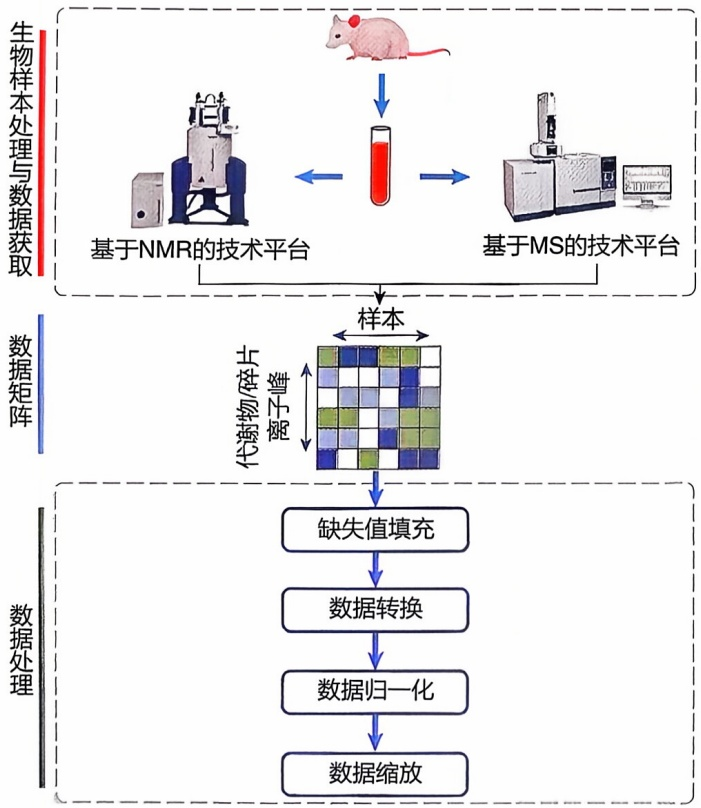
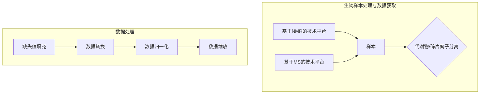
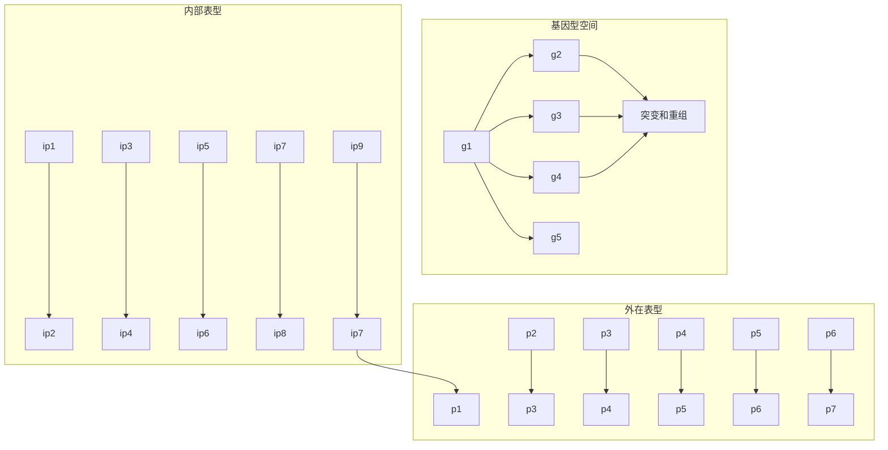

实验相关的详细信息。此外，MetaboLights 还提供了数据分析工具和资源，包括用于代谢物注释和通路分析的工具。用户可以使用这些工具对下载的数据进一步分析和解释。MetaboLights 支持数据共享和数据集发布。研究人员可以将自己的代谢组学数据上传到 MetaboLights 数据库，并选择是否将其公开共享，已经成为代谢组学数据存储和检索的重要平台。

Metabolomics Workbench 数据库是一个由美国国立卫生研究院（NIH）支持的综合性代谢组学数据库，旨在存储、共享和分析代谢组学实验数据。它收集和整理了来自各种代谢组学研究的实验数据，包括质谱和核磁共振等技术生成的代谢物谱图、代谢物注释信息、样品和实验设计等相关数据。这些数据可以通过网站进行搜索和访问。用户可以根据关键词、实验类型、物种等条件进行搜索，并查看与特定实验相关的详细信息。Metabolomics Workbench 同样支持数据共享和数据集发布。

## 9.5.2 代谢组学数据处理

随着检测技术的发展，代谢组学一次实验能够运行的样本数、检测到的代谢物数量飞速增加。代谢组学数据的复杂性也随之快速提高，有必要在后续分析之前进行完善的数据处理，以提供后续数据分析的可靠性。通常，基于 NMR 技术平台获取的原始数据通过代谢物注释（annotation）获得数据矩阵（行为样本，列为代谢物），而基于质谱技术平台获取的原始数据通过峰检测（peak detection）获取数据矩阵（行为样本，列为代谢物碎片离子峰）。针对所得数据矩阵的常用的数据处理

流程包括缺失值填充（imputation）、数据转换（transformation）、数据归一化（normalization）、数据缩放（scaling）。具体流程见图9-21。

## 9.5.2.1 缺失值填充

代谢组学实验中，部分代谢物产生的信号峰质量较差或者代谢物含量较低而无法被检测到，导致数据矩阵中出现相应的缺失值。对于缺失值，可以选择适当的填充方法，如均值替换、中值替换、最近邻替换等，以保持数据的完整性和一致性。

## 9.5.2.2 数据转换

许多统计分析假设数据的分布符合正态分布，然而实际数据矩阵中的特征分布可能并不是正态分布，而是偏态分布，需要在后续分析前使其呈现近似正态分布。此外，数据经常会受到来自各种来源的异方差噪声的影响，而分析时通常假设噪声是同方差的。对数据矩阵进行数据转换就是为了纠正异方差和偏态分布，为后续分析提供便利。常用的数据转换方法包括对数

flowchart

图9-21 代谢组学数据获取与数据处理

变换、方根变换等。

## 9.5.2.3 数据归一化

数据归一化是为了消除样本间不需要的变异（如不同的样本液体浓度等），并允许对样本进行定量比较。常见的归一化策略是为数据表中的样本计算归一化系数，然后将矩阵中的每一行（行代表样本）除以归一化系数，以消除样本间的不必要变异，如总面积归一化法（total area normalization）、概率商归一化法（probabilistic quotient normalization）等。也有部分归一化方法不需要计算归一化系数，如分位数归一化法（quantile normalization）等。

## 9.5.2.4 数据缩放

在数据矩阵中，丰度较高的代谢物表现出较高的数值，与丰度较低的代谢物相比，在样本间显示出更大的差异。后续分析中采用的部分方法（如PCA）基于方差进行分析，这可能会导致丰度较高的代谢物被认为是关键代谢物，而部分在生物学上有重要意义但丰度较低的代谢物则被忽视。因此，有必要对数据矩阵中的代谢物特征（列代表代谢物或代谢物碎片离子峰）表达值进行缩放，以平衡代谢物间的表达值差异。常用的缩放包括自动缩放（auto-scaling）、范围缩放（range scaling）等。

## 9.5.2.5 代谢组学数据处理的软件和工具

对于代谢组学数据，选择适合自己研究目的和数据类型的软件和工具进行数据处理是很重要的。常见的数据处理工具如下。

## (1) XCMS

XCMS 是一个用于代谢组学数据处理和分析的流行开源软件包。它提供了用于峰识别、对齐、配准和归一化的功能，可以处理质谱和色谱数据。

## (2) MetaboAnalyst

MetaboAnalyst 是一个集成的在线平台，用于代谢组学数据处理、统计分析和功能解释。它提供了丰富的工具和算法，包括数据处理、多变量分析、通路富集分析等。

## (3) MZmine

MZmine 是一个用于质谱数据处理和分析的开源软件。它支持从原始质谱数据中进行特征提取、峰识别和定量分析，还提供了工作流的创建和自定义功能。

## (4) MS-Dial

MS-Dial 是一个用于代谢组学数据处理和分析的开源软件工具。它专门设计用于处理液相色谱-质谱联用（LC-MS）和气相色谱-质谱联用（GC-MS）数据，旨在帮助研究人员从复杂的代谢组学数据中提取有关样品中代谢物的信息。

## (5) NOREVA

NOREVA 是一个专业用于代谢组学数据处理的工具。它支持数百种不同的代谢组学数据处理流程，并能够对这些数据处理流程的性能进行评估。

## 9.5.3 代谢组学下游分析

## 9.5.3.1 聚类分析

聚类分析常被用于对经过数据处理的代谢组数据进行数据挖掘。它可用于对一组对象进行分组，其中相似的对象比那些关系较远的对象分组得更紧密。聚类不是单一算法，而是指一组不同的算法，这些算法在确定关系的方法上存在显著差异。

代谢组学数据的聚类分析主要有两种目的，一种是对包含所有代谢物表达信息的数据矩阵进行聚类，比对实验设计中的样本组学分类与聚类结果中的样本分类，以此检查样本重复性以及实验操作的质量；另一种是对具有相近表达模式的代谢物进行聚类，以此观察代谢物丰度在各类别中的变化规律，识别关键的代谢物。目前可选的聚类方法众多，最常用的包括 $K$-means 聚类、层次聚类等方法，聚类方法的选择需要考虑数据维度、样本数、数据分布等条件，聚类结果的可视化通常采用聚类树状图和热图。

## 9.5.3.2 差异分析

通过差异分析，研究者能够快速找到不同组别中的差异代谢物，如疾病与健康状态下的关键生物标志物。通常使用t检验、ANOVA检验，识别出不同组别之间的差异代谢物，也可以结合多元统计分析的结果对关键代谢物进行识别。在差异分析中，常用的图形表示为差异柱状图、火山图、差异热图等。

## 9.5.3.3 通路分析

代谢组学的通路分析是对代谢物进行功能注释和关联分析，以揭示代谢物之间的相互关系以及其参与的生物过程和代谢通路。代谢通路是一系列相互作用的化学反应，负责维持生物体内代谢平衡和能量转化。通过通路分析，可以识别出与特定生物过程或疾病相关的代谢通路，并深入了解其调控机制。通路分析有助于深入理解代谢物在生物体内的作用和调控机制。通常基于KEGG数据库进行代谢组数据的通路分析。

部分代谢组学通路分析的方法直接借鉴基因通路分析的方法，如过表征分析（over-representation analysis, ORA）。ORA 是一种用于确定在给定数据集中是否存在显著过度表示的统计方法。通常使用一些统计检验方法（如超几何分布、Fisher 精确检验等）来计算基因集合或代谢物集合（代谢通路）中的实际数量与预期数量之间的差异，被用于确定某些基因集合或代谢物集合是否在给定的实验条件下过度表示，是否有显著差异。

## 9.5.3.4 蛋白质与代谢物关联分析

蛋白质与代谢物的关联分析可以帮助我们理解蛋白质在代谢过程中的作用和调控机制。以下是一些常见的蛋白质与代谢物关联分析的方法:

## (1) 代谢组学和蛋白质组学的整合分析

对蛋白质组和代谢组两个组学数据进行整合分析，快速筛选数据，找到共同参与某类代谢通路或者具有相同变化趋势的差异蛋白和差异代谢物，系统描述生物体内的分子调控机制，为后续实验验证与分析提供数据基础。例如，可以将代谢物与相应的酶或转运蛋白进行关联分析，以了解蛋白质在代谢途径中的功能和调节。

## (2) 蛋白质-代谢物网络分析

通过构建蛋白质与代谢物之间的相互作用网络，揭示两者之间的关联模式和蛋白质与代谢物之间的相互作用关系、调控机制和生物功能。

## （3）代谢酶和蛋白质相互作用分析

通过研究代谢酶与其他蛋白质之间的相互作用，可以了解代谢途径的调节机制。例如，可以使用蛋白质-蛋白质相互作用网络数据库和相关的实验技术，揭示代谢酶与其他蛋白质（如转录因子或底物结合蛋白）之间的相互作用关系，从而解析代谢调控的分子机制。

## 9.5.4 代谢组学应用实例

## 9.5.4.1 代谢组学在疾病诊断中的应用

代谢组学在疾病诊断中已经得到广泛研究和应用。通过分析和解读人体内代谢产物的组合和数量变化，可以揭示疾病的生物标志物、疾病机制以及个体化医学相关信息。以下是代谢组学在疾病诊断中的几个常见应用。

## （1）疾病早期筛查和诊断

代谢组学可以通过比较正常人群和患者群体之间的代谢物谱图差异，寻找特异性的代谢标志物，从而进行疾病早期筛查和诊断。例如，通过代谢物组合的分析可以帮助早期发现某些遗传代谢病、代谢综合征、癌症等多种疾病。

## (2) 疾病分类与亚型识别

代谢组学可以对不同类型或亚型的疾病进行分类和识别。通过分析代谢物组合的模式，可以将同一疾病的不同亚型进行区分，并为治疗选择提供指导。例如，针对一些特殊的难治型肿瘤亚型（如三阴性乳腺癌），研究者们也在不断地通过对大规模队列的多组学测序，揭示其内在亚型分类及对应的生物学特性。代谢组学在肿瘤分类、心血管疾病亚型的识别和糖尿病类型的确定等方面具有潜在应用价值。

## （3）疾病进展监测和预后评估

代谢组学可以通过监测代谢物组合的动态变化，帮助监测疾病的进展和治疗效果，并评估患者的预后情况。例如，代谢组学可以用于监测癌症患者的肿痛负荷，评估疾病复发和转移风险。

## （4）药物疗效评估和个体化治疗

代谢组学可以帮助评估药物在个体水平的疗效和副作用。通过分析代谢物组合的变化，可以预测个体对特定药物的反应并为个体化药物治疗提供指导。这对于优化药物治疗方案、减少药物不良反应和提高治疗效果非常重要。

## 9.5.4.2 代谢组学在药物靶标发现中的应用

发现潜在治疗靶标是针对特定疾病开发新药的首个关键环节。目前，新药临床研究的高失败率很大程度上归因于选择的靶标可药靶性不佳。因此，代谢组学在药物靶标发现方面的应用可以帮助揭示药物与生物体内代谢物之间的相互作用关系，从而鉴定潜在的药物靶标。以下是代谢组学在药物靶标发现中的几个常见应用:

## （1）靶标识别和验证

通过分析药物处理后的代谢产物组合，可以确定与药物相互作用的蛋白质靶标。这可以通过使用代谢物组合与已知药物靶标数据库进行比对来实现。一旦潜在的目标被确定，进一步的实验验证可以通过体外或体内方法进行，以确认代谢组学的预测结果。

## (2) 作用机制研究

代谢组学还可以帮助了解药物与其靶标之间的作用机制。通过分析药物的代谢产物变化及其影响的代谢途径，可以推断药物对靶标的调节方式、信号传导通路以及可能的副作用。

## （3）副作用评估

代谢组学可以帮助评估药物的副作用。通过分析药物对代谢物组合的影响，可以检测药物是否对代谢通路产生意外的影响，从而揭示潜在的副作用机制和可能的安全性问题。

## 9.5.4.3 代谢组学在肠道微生物研究中的应用

越来越多的证据表明，肠道菌群可以调节饮食，改变宿主的新陈代谢和代谢紊乱的发生。肠道菌群会产生极为多样的代谢产物，并在宿主中发挥重要的生理作用。在人类和动物模型中进行的多项研究表明，肠道菌群对各种代谢特征和功能障碍有重要贡献。在无菌小鼠中的研究表明，产生丁酸盐的细菌定殖使结肠上皮摆脱了在无菌结肠上皮中观察到的能量饥饿状态和自噬。此外，肠道乳酸菌还产生亚油酸代谢产物 KetoA，它在全身能量代谢中起着重要作用，饮食中摄取 KetoA 可以增加小鼠的能量消耗，从而保护小鼠免于饮食引起的肥胖。流行病学和实验室研究报告表明，肠道微生物群依赖的代谢产物，如短链脂肪酸（short chain fatty acid, SCFA），在能量获取中的作用与代谢综合征的发展密切相关。因此，肠道代谢产物被认为是将肠道菌群与代谢综合征联系起来的主要因素。

经过代谢组学分析，可以了解微生物参与的代谢途径、产生的代谢产物对宿主的影响，研究肠道微生物与饮食、药物与疾病的相互作用关系，指导精准医学中的个体化治疗等。

## 9.5.4.4 代谢组学在植物研究中的应用

植物的代谢组学研究是指通过对植物中代谢产物的组成和变化进行高通量分析，来揭示植物代谢途径、调控机制以及与环境互作等方面的信息，为植物科学、农业和食品工业等领域提供科学依据和技术支持。

## (1) 植物代谢途径分析

代谢组学能够有效探究植物的代谢途径及其调控机制。通过分析植物中代谢产物的组合和浓度变化，可以了解不同代谢途径的相互关系和调控网络。这有助于深入理解植物的生物合成途径、能量代谢和信号转导机制。

## (2) 逆境响应研究

代谢组学可以帮助研究植物对逆境条件的响应机制。通过比较正常生长和逆境条件下植物的代谢物组合差异，可以了解逆境对植物代谢途径的影响，并鉴定与逆境响应相关的关键代谢物。这有助于揭示植物逆境耐受机制和适应策略，为育种和遗传改良提供指导。

## （3）品质评估与优化

代谢组学可以用于评估植物的品质特性。通过分析不同植物品种或不同生长条件下的代谢物组合，可以定量和比较其中的营养成分、药用化合物和风味物质等。这有助于优化植物品种选择、种植管理和加工工艺，提高农产品的营养价值和质量特性。

## (4) 植物与环境互作研究

代谢组学可以揭示植物与环境之间的相互关系。通过分析植物代谢物的变化，可以了解植物对环境因子（如温度、湿度、光照等）的响应和适应方式。这有助于研究气候变化对植物生长和生态系统稳定性的影响。

## (5) 功能基因组学研究

代谢组学可以帮助揭示植物基因功能及其调控网络。通过整合基因组学和代谢组学数据，可以确定基因与代谢物之间的关系，进一步理解基因的功能和调控机制。这对于植物育种和基因工程具有指导意义。

## 9.6 蛋白质组学和代谢组学的总结与展望

## 9.6.1 蛋白质组学和代谢组学的最新进展及发展趋势

蛋白质组学和代谢组学作为系统生物学中两个密切相关的领域，它们共同致力于揭示生物体内复杂的分子机制。蛋白质组学提供了蛋白质表达和修饰的信息，而代谢组学揭示了蛋白质功能活动产生的代谢产物，两者相互补充，共同揭示生物体的生理和病理状态。通过对蛋白质组学和代谢组学数据的联合分析，可以更准确地识别生物标志物和药物靶点，更深入地建立生物体基因型和表型的关系，从而获得对生物系统更全面的理解。近些年来，蛋白质组学和代谢组学均取得许多令人瞩目的新进展。

随着高精度检测技术的发展，高通量蛋白质组测定的敏感度与覆盖度在持续提升。同时，质谱进一步结合高内涵成像（high content imaging）与激光显微切割技术，使得单细胞蛋白质组与空间蛋白质组的发展与应用正在成为热点。细胞是生物体生命活动的基本单元。生物体内同一组织或器官中存在着空间定位不同、种类亚型各异的多种细胞，细胞间的异质性是生物系统的普遍特征。大规模蛋白质组鉴定了成千上万个细胞的蛋白质表达，并提供了模糊单个细胞之间关键差异的平均蛋白质丰度，难以满足对细胞间差异的分析需求。此外，大规模蛋白质组无法对罕见细胞群进行研究，因为不具备检测癌症干细胞等罕见细胞的灵敏度。研究人员清醒认识到对单细胞蛋白质组测定的需求，进而推动了单细胞质谱技术的发展。单细胞质谱技术旨在通过创新样本制备方法，将多肽从单个细胞高效地输送到质谱仪器中。第一个使用液相色谱-质谱联用方法（LC-MS）成功测定单细胞质谱的方法称为SCoPE-MS，该方法通过将样品制备体积减小到低微升尺度，并采用一个包含200个细胞的载体通道，确保足够的碎片离子强度用于肽鉴定。大多数的单细胞蛋白质组研究要么集中在实验室培养提取的细胞中，要么集中在液体活检样本上。然而，由于要使用单细胞分离方法，单细胞蛋白质组学往往会丢失有价值的空间信息。为了解决这个问题，空间蛋白质组利用高精度激光捕获显微切割（LCM）技术切取感兴趣的组织区域（20～100  $\mu$ m，5～10个细胞），经过超微量样本无损提取技术提取并酶解蛋白质为肽段，进而使用高敏感质谱，分析得到蛋白质在不同空间位置的表达特征。

近年来，高分辨率质谱技术的发展极大地提高了代谢物检测的灵敏度和准确性，使得研究人员能够鉴定出更多低丰度的代谢产物。液相色谱-质谱联用（LC-MS）和气相色谱-质谱联用（GC-MS）等技术的不断优化，使得代谢物的定性和定量变得更加精确和高效。随着这些技术的进步，代谢组学研究正朝着更高通量、更广覆盖的方向发展，为揭示生物体内的代谢途径和代谢网络提供了强大的工具。此外，代谢组学领域中单细胞代谢组学和空间代谢组学技术正在快速发展并备受研究者关注。从理论上讲，单细胞研究是唯一能够描述实时生化反应的分析类型，而这些反应通常只需几秒或几分钟即可发生。不仅如此，细胞行为的不同步，使得在研究细胞周期等复杂问题时必须在单细胞的层面研究，以获得准确的代谢特征。目前来说，单细胞代谢组学的分析技术仍处于起步阶段，其灵敏度以及样本吞吐量仍然难以满足研究的需求，但其分析技术正在飞速进步，有望在未来数年间得到广泛应用。空间代谢组学同样作为代谢组学中的新兴技术被众多研究者关注。空间代谢组学可用于组织切片，能够获得接近单细胞的分辨率并且保留样本中代谢物分布的空间信息，这在检测细胞代谢状态及其异质性、在微米尺度上探测宿主-微生物代谢相互作用、揭示代谢细胞命运轨迹和创建代谢活动的空间图谱等方面都具有广阔的应用前景。然而空间代谢组学目前同样面临众多挑战，包括灵敏度不足、检测速率较慢、代谢物注释困难等。值得庆幸的是，研究者对该领域的高度关注正在推动空间代谢组学技术快速革新。

蛋白质组学和代谢组学数据的迅猛增加，相关新技术伴随着不断提高的分析难度以及人工智能的应用都推动了数据分析方法的迭代。在蛋白质组学数据解析方面，人工智能的引入显著地提升了谱图解析率，特别是在肽段的从头测序中表现尤为突出。先进的深度学习算法与超高灵敏度的质谱相结合的技术展现出巨大的潜力。一项开创性的工作流程被称为“深度视觉蛋白质组学”，结合了先进的免疫荧光成像和 LCM 技术，从而实现了在福尔马林固定和石蜡包埋（formalin-fixed and parriffin-embedded, FFPE）样本中保留空间信息的情况下，对汇总的单细胞蛋白质组进行 LC-MS 测量。尽管高通量测量空间分辨的真实单细胞蛋白质组仍然具有挑战性，但作者展示了将该技术与固有的单细胞分辨率（即显微镜检查）、先进的机器学习算法和超高灵敏度质谱结合的广阔潜力。由于代谢组学数据集庞大且其中的数据模式复杂，传统分析方法难以满足研究者的分析需求，越来越多的研究使用 AI 进行代谢组学分析。在代谢物的鉴别中，通过训练模型来预测未知代谢物的身份，AI 技术能够提高代谢物的鉴定效率。例如，基于 Transformer 框架开发的 MassGenie 工具，以计算机方式探索数百万种碎片模式，展现出从质谱数据中识别小分子前所未有的能力。在代谢组学生物标志物的识别中，基于支持向量机（SVM）和递归特征消除所构建的稳定识别算法，通过整合多重随机抽样和一致性打分，将代谢组学生物标志物识别的稳定性提高了一个数量级。在基于代谢组学的疾病预测、患者分型等任务中，机器学习、深度学习的方法同样得到广泛的应用。传统机器学习模型，如 XGBoost 和 SVM，在数据量较小时通常表现出较好的效果，而深度学习方法则在有大量训练数据时表现出优异的性能。随着算法的不断进步和完善，未来 AI 技术将在代谢组学研究中发挥更加重要的作用，为代谢生物学的研究带来革命性的变化。

## 9.6.2 蛋白质结构与功能预测的最新进展及发展趋势

当以 AlphaFold2 为代表的基于深度学习的蛋白质结构预测取得重大突破后，研究人员自然把目光转向更为挑战性的任务，即蛋白质与其他分子复合物的三维结构预测。DeepMind 团队对 AlphaFold2 进行了多项修改，包括对多序列比对构建的改进，推出了 AlphaFold-Multimer，专门用于蛋白质复合物结构预测的工具。在最新的 AlphaFold3 中，开发者对模型架构和训练过程进行了重大改进，新版本不仅能够预测单链蛋白质结构和蛋白复合物结构，还能准确预测蛋白质与 DNA、RNA 及配体等分子相互作用的复合物结构。AlphaFold3 在预测蛋白复合物结构表现出色，尤其在抗体-抗原互作界面预测比 AlphaFold-Multimer 有显著改善。

蛋白质结构预测的突破使得从结构出发预测蛋白质功能越来越可行。2023年澳大利亚的Ascher研究团队开发了LEGO-CSM方法，该方法从蛋白质序列及AlphaFold2预测的结构模型出发，运用基于结构的CSM（cutoff scanning matrix）算法同时预测蛋白质的亚细胞定位，酶分子功能（EC号）和GO条目，进而实现对蛋白质功能的综合准确的预测。蛋白质的结构实现准确预测后，大大拓宽了利用生物分子模拟研究蛋白质功能的应用场合。对尚未实验解析结构的蛋白质，可以利用AlphaFold2预测得到的结构模型，进一步采用分子动力学模拟及分子对接研究蛋白质构象动态变化以及它与其他分子相互作用的动态过程。人工智能的新技术在蛋白质功能预测中也发挥着越来越重要的作用。近年来在人工智能领域，自然语言处理（natural language processing，NLP）取得重大进展。将NLP中的语言模型概念复制到蛋白质研究中，一系列蛋白质语言模型被相继开发。具体来说，将蛋白质序列中的氨基酸看作语言模型的词，将整个蛋白质视为语言模型中的句子。首先，将这些语言模型以自监督的方式进行训练，本质上是学习预测已知序列中隐藏的氨基酸。然后，通过训练得到的蛋白质语言模型可以实现对每个残基及每个蛋白质的表征，进而用于蛋白质相关的分类任务。ProtTrans 是一个蛋白质语言模型，在包含 3930 亿个氨基酸的 UniRef 和 Big Fantastic Database 数据集上进行训练得到。ESM（evolutionary scale modeling）是由 Facebook 提出，基于 2.5 亿个蛋白质序列训练大容量的 Transformer 语言模型，并使用该语言模型学习和表征蛋白质的生物学特性。总体上，无论是 ProTrans 还是 ESM 模型都含有丰富的蛋白质语义信息，这些信息对蛋白质序列、结构、功能和进化关系进行了深入刻画。这些预训练的蛋白质语言模型在蛋白质功能预测中有着优秀的表现。

人工智能的革命性发展，也深刻影响着生物分子模拟技术的变革。以AlphaFold3为代表的蛋白质与其他分子复合物结构的预测，提供了有别于传统利用分子对接研究蛋白质与其他分子相互作用的新策略。在分子动力学模拟的多个环节，人工智能尤其是深度学习算法，都具有重要的应用前景。在分子力场方面，传统的力场参数是人工拟合形成，这是一项繁杂而艰巨的工作，而深度学习可以根据量子化学计算或实验数据自动优化力场参数，使力场拟合更准确，对于新系统，也可以通过学习快速拟合好力场参数；在模拟过程中，深度学习网络可用来加速计算分子间相互作用势能，这可以大幅减少计算量，加速模拟过程。总体来说，人工智能在分子模拟中的应用仍处于早期阶段，但其潜力是巨大的。

总之，近年来蛋白质组学和代谢组学技术的不断突破，极大地推动了其在生命科学、生物技术与医药、农业科学等领域中的应用。蛋白质结构与功能预测作为生物信息学中的基础研究方向，由于以深度学习为代表的人工智能技术的广泛应用，正焕发出勃勃生机，相关方法正在快速更新迭代且日臻完善和实用，从而加快了界定蛋白质组学和代谢组数据中所蕴含的生物学规律。从序列出发，我们可以准确预测蛋白质的三维结构及其潜在的生物学功能；利用分子动力学模拟，我们可以系统研究蛋白质的折叠过程、构象动态变化以及和其他分子相互作用的动态过程；采用先进的分子设计手段，我们可以为蛋白质功能改造以及全新蛋白质功能设计提供方案。毫无疑问，以AlphaFold为代表的蛋白质结构预测取得的巨大突破以及日新月异的蛋白质分子设计技术，很大程度上正在改变着生命科学的研究范式。

## ※ 推荐阅读

1. 陈铭. 生物信息学 [M]. 北京:科学出版社, 2022.

点评:该书第4章对传统蛋白质三级结构预测方法、二级结构预测方法及蛋白质结构比对均进行了详细介绍，有助于全面了解蛋白质结构预测的历史。

2. Frenkel D, Smit B. Understanding molecular simulation: from algorithms to applications [M]. Amsterdam: Elsevier, 2023.
点评:蛋白质分子动力学模拟作为生物分子模拟的重要组成部分，是本章学习的难点。该专著作为分子模拟的经典入门级教科书，有助于加深对分子动力学模拟的理解。
3. Jumper J, Evans R, Pritzel A, et al. Highly accurate protein structure prediction with AlphaFold [J]. Nature, 2021, 596(7873): 583-589.

点评:该文是 AlphaFold2 的算法文章，具体报道了 AlphaFold2 的算法原理、实现细节以及取得突破性的预测性能，它是人工智能在蛋白质结构预测中应用的标志性论文。

## ※ 思考与练习题

1. 简述串联质谱高通量检测蛋白质表达的原理。
2. 蛋白质组定量分析的关键步骤是什么？
3. 简述蛋白质结构预测常见的几种方法及其主要原理。
4. 基于蛋白质-蛋白质相互作用网络的蛋白质功能预测的主要原理是什么？
5. 简述代谢组学数据处理的主要流程。

## ※ 讨论题

1. 结构与功能之间的关系是结构生物学家关注的重点，有人曾形象地比喻:“没有功能的结构就像一具尸体，没有结构的功能就像是一个幽灵”，分子动力学模拟能够在结构-功能关系研究中起到什么作用？谈谈你的想法。
2. 在后 Alphafold 时代, 机器学习在蛋白质结构与功能预测中会有哪些新的应用?
3. 假设你有一个样本需要在测完代谢组学数据后，进行转录组测序，样本数量较少且非常宝贵，你该使用哪种代谢组学技术平台？请说明你的理由。

## ※ 参考文献

1. 陈正隆, 徐为人, 汤立达. 分子模拟的理论与实践 [M]. 北京: 化学工业出版社, 2007.
2. 布兰登, 图兹. 蛋白质结构导论 [M]. 王克夷, 龚祖埙, 译. 上海: 上海科学技术出版社, 2007.
3. Aebersold R, Mann M. Mass spectrometry-based proteomics [J]. Nature, 2003,

422: 198-207.

4. Li B, Tang J, Yang Q, et al. NOREVA: normalization and evaluation of MS-based metabolomics data [J]. Nucleic acids research, 2017, 45(W1): W162-W170.
5. Roy A, Yang J, Zhang Y. COFACTOR: an accurate comparative algorithm for structure-based protein function annotation [J]. Nucleic acids research, 2012, 40(W1): W471-W477.
6. Sali A, Blundell T L. Comparative protein modelling by satisfaction of spatial restraints [J]. Journal of molecular biology, 1993, 234: 779-815.
7. Sharan R, Ulitsky I, Shamir R. Network-based prediction of protein function [M]. Molecular systems biology, 2007, 3: 88.
8. Sud M, Fahy E, Cotter D, et al. Metabolomics workbench: an international repository for metabolomics data and metadata, metabolite standards, protocols, tutorials and training, and analysis tools [J]. Nucleic acids research, 2016, 44(D1): D463-D470.
9. Tyanova S, Temu T, Cox J. The MaxQuant computational platform for mass spectrometry-based shotgun proteomics [J]. Nature protocols, 2016, 11(12): 2301-2319.
10. Yeh A H, Norn C, Kipnis Y, et al. De novo design of luciferases using deep learning [J]. Nature, 2023, 614(7949): 774-780.

编者:张子丁（中国农业大学）

李婧（上海交通大学）

田卫东（复旦大学）

王明钰（山东大学）

王勇（浙江大学）

朱峰（浙江大学）

审读:宁康（华中科技大学）

## 表型组学

生命科学领域持续经历革新，不断追求对生命本质更深入、更精细的认识。前面章节的内容主要从基因组、转录组、蛋白质组和代谢组等分子水平的微观视角来揭示生命的复杂性。然而，生命现象本质上跨越多个层次、尺度和维度，迫切需要采用更全面和系统的研究方法，表型组学（phenomics）作为一门跨学科领域应运而生，将生命科学研究推向了一个新的时代。

表型组学一词由加州大学伯克利分校衰老研究中心主任史蒂文·加兰（Steven Garan）于1996年首次提出，专注于从宏观和系统角度出发，全面而精确地测量和分析生物个体和种群的物理、化学和生物性状，涵盖形态、生理、行为及环境适应性等方面。借助多种先进的测量技术和大数据分析方法，表型组学构建了一个跨尺度、多维度的表型数据框架，旨在揭示基因型与表型之间的深层联系，进而深入探索生命过程及其调控机制。

本章将系统地介绍表型组学的基础理论和研究方法。首先，概述表型组学的核心概念、研究领域及其发展历程，为读者提供一个全面的学科研究视角（10.1）。随后，探讨表型组数据的来源、特性、编码系统及标准物质（10.2）。同时，特别介绍了数据的预处理与质量控制流程，从单模态与多模态数据的角度，阐释常见的表型组学分析方法，以及一些新概念，以帮助读者掌握所需的生物信息学分析技能（10.3）。接着，详细讨论了表型组学在不同研究层面如细胞与类器官、人类和动植物的最新进展，展示其在生物医学研究、个性化医疗、生物育种等领域的应用潜力（10.4）。最后，总结表型组学的研究成就与面临的挑战，并展望未来发展方向（10.5）。

text_image

10

## 10.1 表型组学概述

## 10.1.1 表型与表型组

表型组学是一门研究生物体在不同环境条件下表现出的所有性状特征（即表型）的学科。表型组包括生物体从分子到个体的多尺度空间特征，以及从胚胎发育到出生、成长、衰老乃至死亡的全生命周期中的特征。广义的表型涵盖了除基因型以外的所有性状，包括生物体外部特征和内部属性。狭义的表型特征包括形态特征、结构、功能、行为、生理、分子组成规律等生物、物理和化学特征的集合，可以通过观察和测量获得。

表型与基因型之间存在复杂的关系，涉及遗传信息、基因互作，以及环境因素等多个层面。理解这一关系，有助于揭示生物多样性和适应性的本质。建立“基因型-表型”关系图，可以帮助深入研究这些相互作用（图10-1）。表型组学利用图像分析、生化测量、行为观察等技术手段，获取、分析和解释大规模的生物体表型数据。将这些数据与基因型和环境因素相结合，可以揭示基因与表型之间复杂的关系，为医学疾病研究、个体化医疗、农业改进和生态学研究等领域提供重要的工具和见解。

传统研究手段难以获取大量、高通量的表型数据，导致对表型组（phenome）的理解远远落后于对基因组的理解。全面把握生物体内部和外部特征需要更先进、高通量、高维度的表型分析技术和方法。重视表型组学学科的发展，推动高通量、高维度表型分析技术和方法的研发和应用，将有助于更全面地理解生物体的多样性和复杂性，为科学研究提供新的视角和深刻认识。

flowchart

图 10-1 “基因型-表型”关系图（改绘自 Chen et al., 2013）

## 10.1.2 表型组学研究领域

表型组学的研究通过大规模表型全景精密测量与数据系统解析，贯穿和破解基因-表型-环境、宏观表型-微观表型之间以及宏观表型之间的关联与调控机制，从而全面理解生物系统，最终推动疾病与健康的精准干预、牲畜精准管理和改良、农作物产量和品质提高等。表型组学研究有助于进一步揭示人类健康、生物技术、农业和生命科学其他领域的基本理论和功能基础。

表型包括微观表型和宏观表型。微观表型包括转录组、蛋白质组和代谢组，细胞免疫等特征，微生物等；宏观表型生物体整体可观察或可测量的表型特征，如影像学表征、体貌特征、疾病病症、健康生理状态、环境适应能力等。基于研究对象，表型组学可以分为人类表型组学、植物表型组学、动物表型组学、生态与环境表型组学等。基于表型数据类型，可以分为分子表型组学、细胞表型组学、图像表型组学、功能表型组学等。

## 10.1.2.1 基于研究对象分类

## (1) 人类表型组学

人类表型组学（human phenomics）是描述和分类人类个体在形态、生理、行为和疾病等方面的可观察特征的集合。它涵盖了从分子水平到整个个体的各个方面，旨在为理解人类的生理学、行为学、遗传学等提供一个全面的框架。人类表型组学研究包含以下几个关键方面:首先，运用多种先进技术对人体各类表型进行精准测量，包括基因组测序、蛋白质组分析、代谢组学、表观遗传学等。其次，旨在构建一个多维度、跨尺度、全周期的人类表型参考图谱，从系统全面的角度来描述和理解人类表型。另外，通过构建表型网络，揭示不同表型之间的关联和相互作用，进一步理解表型共性、功能关联和疾病复杂性之间的关系。

## (2) 动物表型组学

2010年，大卫·霍尔（David Houle）等将动物表型组学（animal phenomics）定义为在动物范围内获取高维表型数据的过程。后来保罗·格林伍德（Paul Greenwood）等将这个定义扩展为对高密度行为和生理输入实时获取，并与描述生产环境的数据相结合而产生指导实际生产的措施。作为一门生物学领域的新兴分支，动物表型组学旨在研究动物的表型特征，从分子、细胞、器官到整体生物体水平，揭示遗传背景和环境之间的相互作用对生物体表现的影响，它代表了对个体动物测量的性状、获取这些性状的方法以及分析数据所需算法的集合，识别准确且可重复的性状测量或表型有助于精确的牲畜管理和遗传改良。

动物表型组学的表型数据包括生长速度、体重、饮食习惯、运动行为、生殖特性、免疫反应等。通过使用分子生物学和基因组学技术，识别与特定表型相关的基因，探索遗传背后的机制。动物表型组学研究还关注环境因素对动物表型的影响，包括了解环境条件对生长、行为和生殖的影响，以及如何适应和应对不同的环境挑战。另外，通过比较不同物种或不同个体的表型，提供关于进化过程的见解，有助于理解为什么不同物种在表型上有不同的特征和适应性。

## (3) 植物表型组学

植物表型组学（plant phenomics）是一门研究植物的可观测特征和性状的学科。利用先进的高通量技术和数据分析方法，植物表型组学系统性地描述、量化和分析植物的生物学特性，包括形态、结构、生长、发育、生理、代谢、抗性等各方面的性状，理解植物如何响应环境条件、生物胁迫、遗传变异以及其他因素，以及如何提高植物的适应性、生产效率和品质。

植物表型组学的研究范围包括从单一植物个体到植物种群和生态系统的多个层次，以及从基因组到生态系统水平的多个尺度。植物表型组研究包括研究植物形态和结构特征，如植物的植株形状、叶片的大小和形状、花朵和果实的外观等；探究植物的生长和发育过程，如生长速率、生长期的长度、生长的分布在植物各部分的方式；测量影响植物生长的因素，包括光、温度和水分等；了解植物的生理过程，如光合作用、呼吸作用、水分及养分吸收和运输等。此外，研究植物对生物和非生物胁迫的反应也很重要，包括植物的抗病性、抗虫性、耐盐性、耐旱性等，有助于改进农作物品种，使其更能抵抗各种生长条件下的压力。最后，通过研究植物的遗传信息和表型数据，可以识别与特定性状相关的基因，有助于植物育种工作，使其更加精确和高效。

## （4）生态与环境表型组学

生态与环境表型组学（ecological and environmental phenomics）关注自然环境中物种表型的多样性及其生态和进化意义，探讨生物在面对环境压力时表型可塑性的表现及其适应性价值。生态与环境表型组学是一门研究生物体在其自然环境中如何表现出不同的表型特征，并探索这些表型特征如何帮助生物适应环境变化的科学。这一领域利用高通量技术，测量生物在多种环境条件下的表型，分析这些表型数据来解释生态系统中的生物多样性和生态动态。研究表型特征如何帮助生物适应其生态位，包括食物获取、捕食者避避、繁殖策略等。利用表型组数据监测环境变化的生物学效应，并预测未来环境变化对生物多样性的潜在影响。生态与环境表型组学揭示了表型在自然环境中的形成机制以及表型变异如何影响生物的生存和繁殖成功，进而对生态系统功能和稳定性产生影响。

## 10.1.2.2 基于表型数据类型分类

表型组的研究涵盖分子、细胞/组织、图像以及功能等不同类型，跨越了微观和宏观的多个层面，全面揭示了个体的发育过程、生理状态、心理特征等方面，有助于构建表型组研究的全景图和深入掌握个体的生物特性。

## (1) 分子表型组学

分子表型组学（molecular phenomics）关注生物大分子的表型特征，包括但不限于:转录组表型，即在特定条件下个体的基因表达模式，揭示生物学过程和疾病的发病机制；代谢组表型，研究关注个体内各种代谢产物的相对含量，通过分析代谢物的变化，可以了解个体的代谢活动、营养状态和代谢途径的调节；蛋白质组表型，关注个体内蛋白质的表达模式，对了解蛋白质在细胞功能、信号传导和疾病发展中的角色至关重要；宏基因组表型，研究探究微生物群落的组成和功能，特别是肠道微生物群落，对个体的健康和疾病具有深远的影响；表观遗传组表型，研究关注基因组中的表观遗传修饰，如DNA甲基化和组蛋白修饰，这些修饰可以影响基因表达和细胞功能，对疾病和环境因素的响应具有重要意义。

## (2) 细胞表型组学

细胞表型组学（cellular phenomics）通过高通量技术和系统生物学的方法，全面分析和表征细胞的表型特征和行为，包括细胞的形态、结构、功能、动态变化和响应环境刺激等。利用自动化显微镜、流式细胞仪和高内涵筛选等技术，能够在短时间内从大量细胞中获取丰富的表型数据，捕捉细胞在时间、空间和不同环境条件下的表型变化。先进的成像技术和图像分析算法可以精确测量细胞的形态、运动、增殖、凋亡和分化等特征，结合计算机视觉和机器学习技术，自动化处理和分析大规模图像数据。通过整合基因组学、转录组学、蛋白质组学和代谢组学的数据，细胞表型组学构建多层次的细胞表型网络，理解细胞功能和调控机制。该领域广泛应用于药物筛选和开发、疾病研究、基因功能研究、个性化医学和发育生物学等方面，能够通过高通量筛选快速识别潜在药物，分析病变细胞的表型变化，探索基因与细胞功能的关系，并根据患者细胞的表型特征制定个性化治疗方案。组织和器官表型组学则关注各器官和组织的形态学、组成和功能学特征。观察到组织的大小、形状、结构排列等外观信息，以及各种细胞类型、细胞外基质以及其三维空间组织关系。这些特征与组织的生理功能密切相关。研究类器官表型就通过体外模型模拟器官或组织的功能和结构，深入理解器官发育和疾病机制。

## (3) 图像表型组学

图像表型组学（image-based phenomics）主要利用高通量图像分析技术来获取和分析生物体的表型数据，这些表型一般指生物体的可观察特征或特性，包括形态、发育、行为和生理等方面。通过显微镜、磁共振成像（magnetic resonance imaging, MRI）、X射线或计算机断层扫描（computed tomography, CT）、超声波和光学成像等技术，图像表型组学捕捉生物体在不同条件下的表型变化，从而进行深入的表型分析和研究。其主要特点和优势包括:高通量数据采集，利用自动化成像设备在短时间内采集大量高分辨率图像数据；多维数据分析，捕捉时间、空间、光谱等多个维度的信息，提供全面和详细的表型数据；高精度和高分辨率，捕捉细微的表型变化；计算机视觉和机器学习，通过先进的图像处理算法和机器学习技术对海量图像数据进行分析，提取关键特征和模式；非侵入性，不破坏样本即可获取大量信息。图像表型组学广泛应用于农业（监测作物的生长、发育、健康状况及其对环境变化的响应）、医学（通过图像分析检测疾病的表型特征辅助诊断和治疗）和生态学（研究不同环境条件下生物群体的表型变化和适应机制）等领域，通过高效、精确和非侵入性的图像分析技术，能够更全面地理解生物体的复杂表型特征，为研究生物体功能提供重要数据信息。