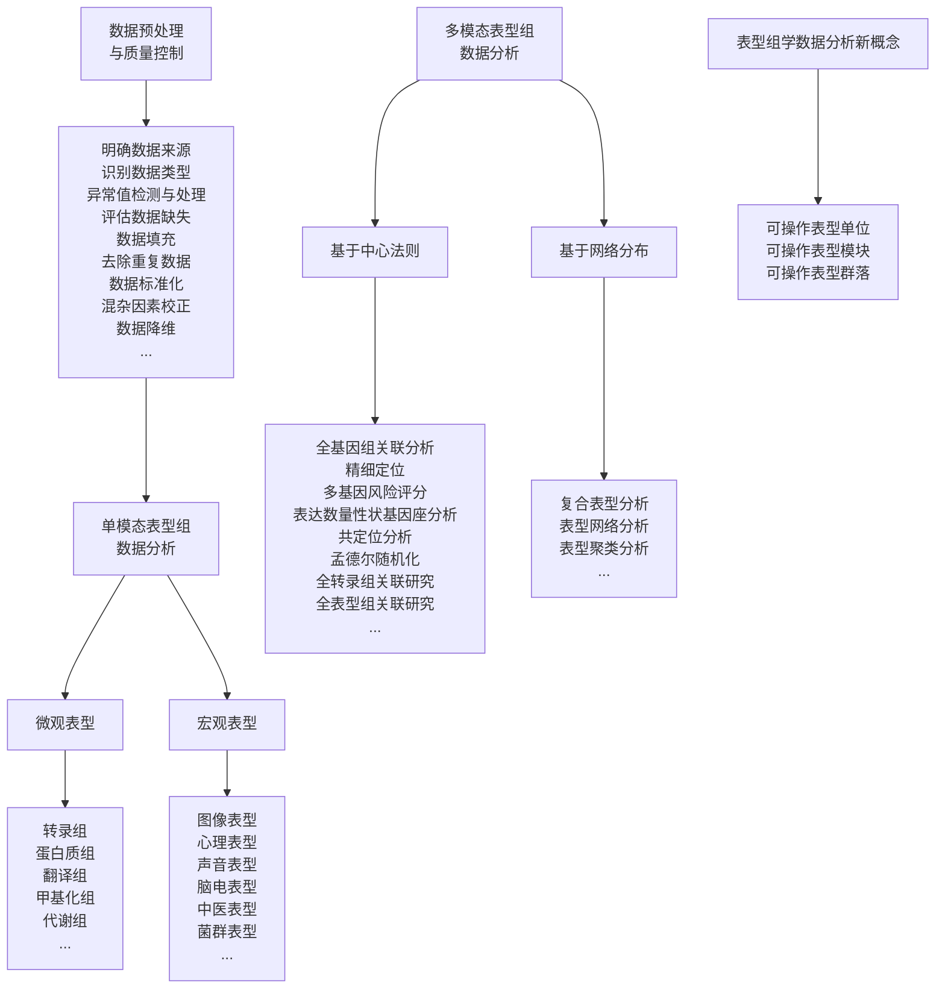

flowchart

图10-2 表型组学发展历程

## (4) 功能表型组学

功能表型组学（functional phenomics）关注个体的形态学特征、生理特征、心理和行为特征等。形态学特征包括个体面部结构和五官特征、皮肤特征、毛发特征、手足特征、牙齿形态、身体对称性特征等。生理表型涵盖生物电信号、血氧、体温、激素水平、心跳和血压等生理指标，以及代谢表型、免疫反应特征、内分泌功能、神经功能、运动功能、心血管功能、呼吸功能等复杂生理表型。心理和行为特征表型包括智力和认知能力、人格特质、情绪和情感调节、心理应激反应、心理健康和精神疾病、社交行为、冲动控制等。此外，还可以研究睡眠表型，包括睡眠时间、质量和结构，语言和语音表型，包括语言流利度、语音音质和音量等特征，以及中医表型，反映疾病外在表现和内在本质的一组特定表型的集合，如发热、恶寒、气短、心悸、舌象、脉象、体味等，为中医诊断和治疗提供综合评估和辨识。

## 10.1.3 表型组学的发展历程

表型组学的发展历史是一个承载着科学技术进步、交叉学科合作和生物学研究新范式演变的故事。从最早的表型描述到今天的高通量数据分析，表型组学已跨越了数个发展阶段（图10-2）。

## (1) 第一阶段: 早期表型的描述

表型组学的历史可以追溯到古代，当时的自然历史学家、植物学家、动物学家（如亚里士多德、普林尼大帝、希波克拉底）通过观察和记录植物、动物和微生物的外观性状，为表型描述奠定了基础。随着时间的推移，物种分类学逐渐成为早期表型描述的一个重要领域。卡尔·林奈（Carl Linnaeus）是分类学领域的重要人物，他开创了现代生物分类学，通过命名和分类物种，将表型描述系统化，并创立了生物学中使用的命名法规（拉丁学名）。这一举措标志着对生物多样性进行系统化描述的开始。自然历史学的早期探险家和科学家，如查尔斯·达尔文（Charles Darwin）、阿尔弗雷德·华莱士（Alfred Wallace）和亨利·贝茨（Henry Bates），在全球范围内进行探险和野外观察，记录了大量生物物种的表型特征，为理解生物多样性的地理分布和适应性提供了关键信息。

## (2) 第二阶段: 遗传学的兴起

19世纪末至20世纪初，遗传学开始崭露头角，为表型研究提供了新的理论基础。格雷戈尔·孟德尔（Gregor Mendel）通过豌豆的性状遗传研究，把豌豆的7个性状作为“表型”研究“遗传因子”，将遗传因子与表型之间的关系引入生物学研究，提出了遗传学的基本定律，包括隐性和显性性状、基因的分离定律等。这些定律奠定了遗传学的基础，为基因型和表型之间的关系提供了关键见解。1909年，丹麦生物学家威廉·约翰森（Wilhelm Johannsen）将孟德尔提出的遗传因子定义为“基因”，正式提出了“表型”（phenotype）这一概念。他强调，不同的基因型可能导致不同的表型，同一个表型也可能由不同的基因型所决定。

## （3）第三阶段:表型组学的崛起

20世纪中叶，分子生物学的兴起推动了基因和生物表型的深入研究。DNA的结构解析和基因的功能研究使得科学家们能够更深入地了解基因如何影响生物体的表型特征。进入20世纪90年代，基因组学的飞速发展带动了从基因到基因表达各环节的研究，伴随着新技术和新方法的涌现，形成了包括基因组学、蛋白质组学、转录组学、代谢组学等在内的多种组学研究方向。在这一背景下，表型组学应时而生。1996年，史蒂文·加兰（Steven Garan）在滑铁卢大学的一次应邀演讲上首次提出了表型组学一词，并将其运用到人类神经生物学研究领域。同期，针对植物单一或系列表型的研究开始受到广泛关注，并逐渐发展成为生物学研究中的一个重要分支。这个时期的研究重点是探究单个性状是如何受遗传与环境因素共同影响的。

## （4）第四阶段:表型组学的蓬勃发展

随着表型组学的兴起，科学家们开始意识到要全面理解生物体的特性，需要将多个学科领域的知识和技术整合起来。表型组学不仅涵盖了生物学，还包括统计学、计算生物学、生物信息学、工程学等多个领域的交叉合作，这一跨学科整合推动了表型组学的快速发展。例如，2002年，约翰·凯尔索（John Kelsoe）和亚历山大·尼库莱斯库（Alexander Niculescu）将表型组学这一概念引进精神遗传学，在精神病表型的实验研究中，将精神病按照表型进行分型，认为表型组学是基因组与表型之间的重要桥梁；2007年，美国康奈尔大学植物分子遗传育种学家苏珊·麦考奇（Susan McCouch）认为，表型组学研究应与高分辨率连锁图谱、全基因组关联分析和基因组选择模型等技术紧密结合，通过建立强大的表型分型系统，精确表征不同物种的细胞、器官和组织在不同发育阶段、不同环境中的表型差异，将表型组学研究逐渐从细胞层面上升到群体层面。

随着技术的不断进步和国际合作的深化，人类表型组学取得了快速的发展。2003年，纳尔逊·弗莱默（Nelson Freimer）和基亚拉·萨巴蒂（Chiara Sabatti）在Nature Genetics杂志上首次提出了“人类表型组计划”的概念，并倡导全球科研力量共建表型组数据库、共享数据，开发新的分析技术。2012年，美国人类遗传学年会召开主题“为人类表型组计划做准备”的分论坛，强调了合作、数据共享和数据互操作性的重要性，以推动遗传变异与疾病关系的研究。2020年，英国颁布政策文件《基因组英国》（Genome UK），强调基因组学基础设施结合深度表型测量和临床表型数据的重要意义。2021年，约书亚·丹尼（Joshua Denny）和弗朗西斯·柯林斯（Francis Collins）在Cell杂志上探讨了精准医学未来十年的七大发展趋势，特别提到了建立大规模可互操作的纵向队列以及收集更丰富表型组和环境暴露数据的必要性。多国启动了相关的科研计划并建立了研究平台。2019年，澳大利亚成立了国家表型组中心。2021年，美国建立了表型组健康组织并启动了超越人类基因组计划（Beyond the Human Genome Project, BHG）。2022年，国际人类表型组计划的共同发起人、国际人类表型组研究联盟（International Human Phenome Consortium, IHPC）共同主席、美国四院院士勒罗伊·胡德（Leroy Hood）启动了美国人类表型组倡议（US Human Phenome Initiative）。该倡议由美国系统生物学研究所（Institute for Systems Biology, ISB）和谷歌等多个合作伙伴支持，旨在10年内建立100万人的纵向表型数据库。同年，英国启动了健康研究项目“Our Future Health”试验阶段，计划纳入500万名参与者，希望对国家人口的健康状况有一个广泛的认识，同时开发新的预防和治疗疾病和健康状况的方法，包括癌症、老年痴呆症、心脏病、关节炎、糖尿病和中风等。新加坡启动了SG100K纵向研究项目，计划在未来几十年里，对10万名新加坡居民进行研究，以识别与新加坡高发疾病（如糖尿病、高血压和癌症）相关的社会、环境、生活方式和遗传因素。

中国在推进国际人类表型组计划方面发挥着重要作用。2015年，中国科学家金力院士、王辰院士、徐涛院士为代表发起并组织了“国际人类表型组研究”香山科学会议，标志着国际人类表型组计划的起步。2016年，复旦大学在上海举办了“首届国际人类表型组大会”，会议上金力院士首次明确提出了人类表型组计划的核心使命与实施路线图，旨在通过全球范围内的“分布式”协同测量与数据协同分析，创建全球人类表型组参比图谱。2018年10月，IHPC在上海成立。同年，上海建设了全球首个跨尺度多维度人类表型精准测量平台和表型组大数据平台，为全球表型组研究提供了重要的技术支持和数据资源。2019年，上海国际人类表型组研究院成立。2020年，中国推出“一带一路”人类表型组研究平台，加强与共建国家的合作，促进人类表型组学的国际交流与发展。在学术交流方面，复旦大学与施普林格·自然出版集团合作创办了表型组学期刊Phenomics，作为IHPC的官方会刊和人类表型组国际大科学计划的旗舰期刊，已收录于PubMed Central（PMC）、ESCI、Scopus等数据库，具有一定的学术话语权和国际影响力。至2022年，IHPC已汇集了来自20个国家、24个科研机构的成员，包括14位国际院士和10位领军科学家。

动植物表型组学在全球范围内同样发展迅速。欧美澳国家投入了大量的时间和经费来建设可共享的植物表型研究中心，并成立了相关表型学术组织，如澳大利亚植物表型研究中心（Australian Plant Phenomics Facility, APPF）、德国 Jülich 植物表型研究中心（Jülich Plant Phenotyping Centre, JPPC）、德国植物遗传和作物

## 知识窗

## 国际人类表型组研讨会和中国人类表型组大会

“人类表型组计划”在“人类基因组计划”之后成为生命科学的新战略高地，推动生物医学研究、精准医学和大健康产业的革新与发展。国际人类表型组研讨会和中国人类表型组大会作为此计划的核心交流平台，汇聚全球专家探讨表型组学的前沿进展和实际应用，加速全球范围内的科技合作与创新。

自 2016 年起，国际人类表型组研讨会每两年举行一次，中国人类表型组大会从 2019 年开始，每年召开一次。最近的一次活动，即“第四届国际人类表型组研讨会暨第五届中国人类表型组大会”，于 2023 年 10 月 31 日至 11 月 4 日在上海成功举行。本次大会的主题为“Human Phenomics: New Frontiers of Life Science”（人类表型组学:生命科学的新前沿），吸引了18位院士和众多学者，共举行了70场精彩报告。

大会设有主旨报告、跨界对话以及八个专题分论坛。这些论坛涵盖了从表型组学在新冠病毒长期防治中的应用，到分子表型组学的最新进展，再到分子影像技术、时空组学新技术、表型组学的临床转化应用、质量控制与标准化的创新、生物大数据与人工智能的融合应用，以及大型队列与深度表型组队列的研究。这些广泛的讨论促进了表型组学在全球科学研究和应用领域的深入发展。

研究所（the Leibniz Institute of Plant Genetics and Crop Plant Research, IPK）、荷兰植物生态表型研究中心（Netherlands Plant Eco-phenotyping Centre, NPEC）、英国国家植物表型研究中心（National Plant Phenomics Center, NPPC）、加拿大植物表型与影像研究中心（Plant Phenotyping and Imaging Research Center, P2IRC）等，比较活跃的学术组织包括国际植物表型协会（International Plant Phenotyping Network, IPPN）、欧洲植物表型协会（European Plant Phenotyping Network, EPPN）和德国植物表型协会（Deutschland Plant Phenotyping Network, DPPN）等。在国内，多个研究单位也先后建立了植物表型研究平台，如华中农业大学作物表型中心、南京农业大学植物表型学研究中心等，大大加速了作物表型组学的应用和发展。2017年，法国植物表型协会主席、法国国家农业研究院（INRA）作物生理生态学家弗朗索瓦·塔迪厄（Francois Tardieu）和英国诺丁汉大学植物学家马尔科姆·贝内特（Malcolm Bennett）共同提出多尺度表型组学（multiscale phenomics）研究的构想。从概念提出至今，表型组学以其强大的数据获取和解析能力持续致力于研究环境、基因和表型之间的相互作用，广泛应用于基础研究和应用基础研究。

表型组学的发展历史反映了科学研究的演进，从最初基于观察的表型描述到当下的高度自动化与数据驱动研究。这一过程不仅彰显了生物学丰富的多样性和内在复杂性，而且提供了深入探究生物特性与适应机制的关键工具，为生命科学领域未来的发展开辟了新的视野。表型组学的进步，特别强调了理解基因、环境与表型相互作用的重要性，对于揭示生命现象的本质具有不可替代的作用。

拓展阅读10-1

Phenotype-Genotype Integrator (PheGenI) 简介

## 10.2 表型组学数据

## 10.2.1 表型组学的数据来源

表型组数据主要通过高通量和自动化表型测量技术获取，以提升表型测量的效率、准确性和可重复性，为深入开展表型组学研究提供了坚实的基础。以下是部分生成分子、细胞与类器官、图像和功能表型数据的主要技术和方法（表10-1）。利用这些方法，科学家们迅速且精确地获取和分析海量数据，探索和理解生物体的表型特征，以及它们是如何相互作用、对环境变化做出反应的。

表 10-1 部分表型测量的技术及方法

| 相关技术/维度 | 研究方法 |
| --- | --- |
| 分子水平 | ·转录组学:基因表达、可变剪接等高通量定量分析 ·高级质谱:蛋白质的高通量定量分析 ·蛋白质芯片技术:连续动态监测蛋白质的状态变化 ·代谢组学:结合核磁共振和质谱技术,精确测定代谢物种类和浓度,探索代谢途径 ·微生物组:全面描绘人体微生态系统成分 ·表观组学:包括全基因组甲基化分析、染色质免疫沉淀以及单细胞表观组学等高分辨率下检测表观遗传学变化 |
| 细胞/组织水平 | 流式细胞术:同时对数万个细胞的多个特征进行定量和定性评估,深入分析细胞表型和信号通路 ·高通量微电极阵列:同时记录多细胞电信号,提供高时空分辨率数据 单细胞测序:分析单细胞基因表达特征,揭示细胞间异质性 ·空间转录组:结合空间信息,研究组织内基因表达的空间模式和细胞间相互作用 高通量筛选:快速识别和分析大规模样本中的目标分子或细胞,应用于药物发现和基因分析 O2k能量代谢分析:通过测量氧气消耗率实时评估细胞呼吸和能量产生,用于能量代谢研究 |
| 图像水平 | ·高分辨率显微镜:如荧光显微镜、共聚焦显微镜,用于观察细胞和微观结构,深入了解细胞功能和疾病机制 三维细胞成像:利用共聚焦和多光子显微镜获取三维高分辨率图像,揭示细胞结构和相互关系 医学影像技术:如核磁共振成像、电子发射断层扫描等,提供深层次组织结构的清晰、精确视图,用于疾病早期诊断和病理研究 ·可见光成像:用于监测动物的行为、生活习性及生命周期,或者捕捉植物外观和结构信息,观察植物生长发育和形态变化 ·红外成像:利用红外光波段捕捉热辐射或反射信号,以研究植物的生理、健康和化学状态,或者监测动物体温分布、活动模式和生理适应性 荧光成像:基于植物组织中荧光素分子的光能吸收和荧光发射,通过特定设备转化为图像,研究植物的生物过程 |
| 功能水平 | 传感系统:包括可穿戴设备和非接触式设备,如智能手环、红外成像技术,实时监测人或者动物的生理、行为信号及环境互动 心理测量工具:通过问卷、量表和任务测验等检测认知、人格、幸福感、心理应激,以及焦虑、抑郁状态等个体在心理特征和行为模式上的可观察表现中医生理特征:对体质、病症、脉象、舌象等方面进行系统的描述和分类 脑电波检测:分析计算信号在不同频率上的功率分布,识别不同频段的脑电活动 皮肤及附属物检测:测量皮肤基础生理指标,如温度、pH、油脂含量、色素沉着、肤质、表皮含水量、厚度、纹理、弹性,以及附属器指甲、毛发等的形态、功能等特征。以及对皮肤附属器表型测量,如脱发、毛发性状、粗细、密度、汗腺密度及功能、指甲形态、指甲厚度、指甲纹理及甲襞微循环等 |

## 10.2.2 表型组学的数据特点

表型组学覆盖的数据类型极为广泛，涉及从观察到的各类信息到精确测量的结果。这些数据包括但不限于:通过生物化学分析得到的代谢物浓度、利用成像技术捕获的组织结构与细胞形态、记录的行为与运动模式，以及测量得到的生物标志物和健康指标等。表10-2详述了表型组学数据的主要特征。

表 10-2 表型组学的数据特点

| 特点 | 描述 |
| --- | --- |
| 多样性 | 涵盖从人类到微生物的各种生物体的形态学、生理学等表型特征 |
| 高维度 | 包含多种类型的特征或变量（数值型、分类型、文本型等），导致数据结构高维复杂 |
| 大规模 | 涉及成千上万乃至数百万的样本，对计算能力和存储资源要求极高 |
| 时序性 | 包含随时间变化的数据，如生长曲线、代谢活性等，要求跟踪时序变化 |
| 异质性 | 数据来源多样和技术差异带来的质量、精度、可信度差异，需要仔细清洗和标准化 |
| 数据关联性 | 特征间存在密切关联，如基因型与表型、环境因素的相互作用 |
| 复杂性 | 表型特征受基因型、环境等多因素影响，分析时需要考虑这些综合因素 |

## 10.2.3 表型组学的数据编码系统

标准、通用的编码系统可以标准化和统一表型特征的描述，对于数据交流与共享、数据比对与基础，以及临床应用等方面至关重要。首先，这些系统确保了数据在不同研究机构、数据库和平台之间的互操作性和一致性，这促进了数据共享、知识交流和跨学科合作。其次，它们确保数据集之间的相容性和可比性，促进不同来源表型数据的整合。最后，它们有助于帮助医生和临床研究人员更准确地记录和描述患者的表型特征，支持表型与疾病之间的关联分析，为精准诊断、治疗和预防提供了重要参考。以人类表型组为例，国际上广泛使用的编码系统见表10-3。

表 10-3 常用人类表型组编码系统的比较

| 编码系统 | 主要用途 | 主要实体种类 | 规模 | 使用许可 |
| --- | --- | --- | --- | --- |
| 人类表型本体论(human phenotype ontology, HPO) | 标准化描述人类表型异常,支持临床诊断和生物医学研究 | 人类表型异常的描述,包括症状、体征、异常实验室结果等 | 约16000个概念,13000个表型条目 | 开源 |
| 国际疾病分类(international classification of disease, ICD) | 国际通用的疾病分类方法,用于流行病学、健康管理和临床工作 | 疾病、伤害、死因 | 约55000个编码,分为22个章节 | 开源 |
| 医学系统术语标准化命名:临床术语(systematized nomenclature of medicine-clinical terms, SNOMED-CT) | 提供临床术语标准,支持电子健康记录和临床决策 | 疾病、过程、观察结果等临床概念 | 约340000个活跃概念,超过1360000个概念关系 | 需要许可 |
| 疾病本体论(disease ontology, DO) | 提供疾病分类框架,支持生物医学研究 | 人类疾病 | 约7000种疾病概念 | 开源 |
| Orphanet罕见病数据库 | 提供罕见病信息,支持诊断和研究 | 罕见病及相关基因 | 约7000种罕见病,3700种基因 | 部分开源 |

## 10.2.4 表型组数据的标准物质

标准物质通常是经过精确测定并广泛认可的参考材料，为不同实验室和平台提供可比较的基准，用于表型组学实验中的质量控制和方法验证。它们用于校准实验设备、验证分析方法的准确性，并作为不同实验或实验室之间的对比参照，以确保数据的一致性和可比性。

复旦大学与中国计量科学研究院共同研发了首批国家一级标准物质——“中华家系1号”（Chinese Quartet）。这一标准物质来源于同卵双胞胎家庭（人源）永生化B淋巴母细胞系，涵盖了DNA、RNA、蛋白质和代谢物等多种生物分子，是全球首套具备多组学特性的生物学标准物质。项目牵头人石乐明教授参与了上海市标准化创新中心（国际人类表型组）的标准化研究，围绕“数据产生、数据分析、数据解读”等研究阶段，进行人类表型组研究数据的全方位质量控制，提升了人类表型组数据的“准确性、溯源性、一致性”，有利于深度挖掘和利用人群的生物样本和表型组学数据，促进人类表型组学的系统思维设计，支持全表型关联分析，推动精准医学的发展。“中华家系1号”将助力提升生命科学创新的源头质量，为高质量、高可靠性的多组学研究提供保障，同时为全球人类表型组计划的推进奠定坚实的标准基础。

“中国人群运动与认知功能定量参数正常值数据库”基于两项多中心临床研究，提供了中国正常成人的运动与认知功能定量常模。该数据库包含来自12个省（自治区、直辖市）的约1800名成年人样本，涵盖运动功能和认知功能的多项定量评估指标，并按年龄、性别、受教育程度分层。其中，运动功能测量涵盖了一系列动作，包括上肢运动、姿势控制、一字步行走和自然行走等，评估的参数包括完成动作时间、摇晃程度、步速、步高、步宽、步频和步幅等，还包括基于多项运动量表的半定量评分。认知功能测量则涵盖注意力、记忆力、定向力、执行能力、视空间构建能力、语言推理等。这些数据为研究人员提供了可靠的参考基线，有助于深入理解神经功能与脑功能的复杂关系。

flowchart

图10-3 表型组的数据分析流程图（利用BioRender软件绘制）

## 10.3 表型组学的数据分析

数据分析是表型组学的核心工具。生物信息学家的一个重要任务是在庞大的数据海洋中挖掘和识别有价值的信息。本节提供了表型组数据的整体框架（图10-3），将首先介绍表型组学数据的预处理与质量控制流程，随后详细讲解常用的分析方法。单模态表型组微观表型的数据分析已在前面的章节进行了详尽讨论，本节将不再赘述。本节着重介绍几种宏观表型，如图像、声音、菌群和心理表型的分析方法，以及深入探讨两种或以上不同模态数据的联合分析。最后，引入表型组学数据分析新概念，为未来的研究提供新的分析思路。

## 10.3.1 表型组数据的预处理与质量控制

随着表型数据量的爆炸性增长，来自不同来源和实验室的数据变得日益丰富且多样化。为了确保数据收集的准确性和一致性，数据整合和标准化成了必不可少的步骤。如上一节介绍，采用标准化的科学术语和本体，确保描述的统一性和清晰性；开发参考材料，为不同实验室和平台提供可比的基准，以确保测量结果的一致性；制定标准操作程序，为实验和数据分析过程设立明确的指导方针和步骤，确保所有研究者都遵循相同或相似的方法进行操作；此外，还应在不同学科领域之间制定通用的测量和分析标准，确保跨领域的协调和数据的一致性。

在表型组学的数据分析中，预处理与质量控制应重点关注以下几个方面。

## （1）明确数据来源

这一步要求对数据的原始来源进行全面了解和记录，涉及数据的类型、实验流程、技术平台和批次等多方面信息。例如，在处理公共数据库的 RNA 表达数据或自行实验产生的数据时，不仅要记录实验设计、参与者信息、样本处理方法等，还要注意采集时间、设备、试剂批次、测序平台等细节。对于公共数据库的数据，还应明确记录数据来源、检索时间和使用的筛选标准，以确保后续分析的准确性和研究结果的有效性。

## (2) 识别数据类型

识别数据的种类对于选择合适的处理方法和分析策略至关重要。表型组数据覆盖了诸如遗传数据、表观遗传数据、生物化学数据、生理数据、行为数据等多种多源异构数据。了解每种数据类型的独特属性和变异性对于正确处理这些数据至关重要。不同的数据类型可能需要采用不同的预处理方法，如数据标准化、处理缺失值、检测离群值等。数据类型的识别依赖于审查实验文档和元数据，而文件格式的分析也提供了关键线索。例如，FASTQ格式通常用于存储原始测序数据，包括测序读段和对应的质量评分；BAM格式常用于保存已经比对到参考基因组的测序读段；VCF格式主要用于存储变异数据，如SNPs、INDELs和SVs。DICOM（digital imaging and communications in medicine）格式是医学影像领域专用的数据格式，包括图像数组信息以及拍摄日期、拍摄条件、患者信息等；FCS（flow cytometry standard）是流式细胞仪数据的标准文件格式，用于记录细胞的物理和化学特性。

## （3）离群值检测与处理

离群值，或异常值，是指显著偏离其他数据点的值，它们可能对数据集的统计指标（如均值、方差及相关性）产生显著影响。离群值的产生可能由测量错误、输入误差、数据污染，或实际的统计离群现象等多种原因导致。为了识别这些值，可以采用多种方法，包括计算并分析基本统计指标（如均值、中位数、标准差），通过直方图和箱线图可视化数据分布识别数据集中的异常区域，运用聚类分析和Z-score方法等高级技术准确找出离群值。在处理离群值时，根据它们的来源及对研究目标的潜在影响，可以选择删除、修正、替换或保留这些值。值得注意的是，虽然离群值有时是错误或噪声，但它们也可能携带重要信息，尤其是在研究异常现象或新趋势时，因此在处理这些值时应谨慎考虑。例如，在一个数据集中，绝大多数值集中在 $10\sim 20$ ，而只有极少数值在50以上，这些高值可能是离群值。在处理这些值时，可以选择删除它们，或进一步分析它们的成因，以决定它们是否是数据录入错误或反映了某种重要的、未被注意到的现象。

## （4）评估数据缺失

数据缺失，即数据集中某些信息或数值的不完整，对分析和结论的准确性可能产生显著影响。评估数据缺失首先涉及统计缺失的数据量和比例。对于关键字段的高缺失率（如超过 $50\%$），需要采取特殊处理措施或进行额外的数据收集；相对地，如果缺失比例较低（如不超过 $5\%$），可能选择简单地剔除这些缺失值，因为它们对总体数据集的影响较小。其次，需要区分缺失数据的类型，包括完全随机缺失（missing completely at random, MCAR）、随机缺失（missing at random, MAR）和非随机缺失（missing not at random, MNAR）。例如，在一个包括患者姓名、年龄、性别和疾病诊断的数据集中，如果疾病诊断的缺失与其他信息无关，则属于完全随机缺失。若诊断信息的缺失主要出现在某个特定年龄段，这种缺失虽与年龄相关，但在已知年龄的条件下可视为随机。而若疾病较为严重的患者诊断记录缺失，这说明缺失与疾病的严重度（一个未观测变量）相关，即为非随机缺失。在这一评估过程中，利用缺失热图等可视化工具能有效辅助识别缺失值的分布模式和趋势。

## (5) 数据填充

数据填充是处理缺失信息的过程，旨在维持数据集的完整性和可用性。面对数据集中的空缺，常见的填充方法包括均值/中位数填充、回归填充和多重插补，具体选择取决于缺失值的数量、随机性和数据间的关系。均值/中位数填充是简单的方法，适用于随机且数量不多的缺失情况。当变量间存在相关性时，通过建立回归模型预测缺失值更为合适。这种方法利用已有数据间的关系来估算缺失值。多重插补是一种处理多变量复杂缺失模式的高级方法，其基本思想是:对每一个缺失值，不简单地填充一个单一估计值，而是生成多个不同的预测值，从而创建出多个“完整”版本的数据集。然后对每个“完整”数据集分别进行后续的分析，最后综合这些分析结果，得到关于原始数据的最终分析推断。以细胞样本数据集为例，对于随机少量缺失的酪氨酸表达量，可采用均值或中位数进行填充。而对于同时缺失ACTIN和Tublin表达值的细胞B，通过建立基于其他蛋白质表达量的回归模型，预测ACTIN和Tublin的表达量区间，随后应用多重插补生成多个候选值以填补缺失，从而允许在考虑变量间复杂关系的同时，提供更加可靠的分析结果。

## (6) 去除重复数据

去除重复数据是通过识别和删除数据集中的重复记录，以确保数据的唯一性和准确性。常用的去重方法有查重编码法、样本比对法和主成分分析法。查重编码法通过为每条记录生成一个独特的标识符或编码来识别重复记录。这种方法在处理大规模数据集时特别有效，但它并不能直接解决数据重复的根本问题。相比之下，样本比对法通过设定相似度阈值，直接比较不同记录之间的差异性来判断是否存在重复。这种方法简单直接，但其效果很大程度上取决于阈值的设定。主成分分析法则采用无监督学习技术，将高维数据投影到低维空间进行比较，考虑各特征的权重，但这可能导致一定程度的信息损失。例如，在肿瘤临床研究中，同一患者因更换医院可能产生重复的治疗记录。解决这一问题的策略包括:首先检查患者是否有唯一标识码（如身份证号），用于识别潜在的重复记录；其次，应用样本比对法，通过比较病例的年龄、性别等特征相似度来进一步判断记录是否重复；最后，考虑使用主成分分析法，在综合各特征权重的基础上计算记录之间的相似度。

## (7) 数据标准化

数据标准化是改善数据质量的关键过程，旨在确保数据在不同环境下保持一致性和可比性。它涉及多个方面，如调整数据的结构、单位、精度和数值缩放。标准化的手段包括最大-最小规范化、Z-score标准化、对数转化和分箱等，各适用于不同的场景。最大-最小规范化通常用于将数据映射到[0,1]范围内，消除量纲差异，实现不同特征间的比较。Z-score标准化将数据转化为均值为0、标准差为1的分布，适用于数据分布近似正态的情况。对数转化针对数据分布明显偏斜的情况，通过取对数减小偏斜性，使数据更接近正态分布。分箱方法将连续数据划分为几个不同的水平或类别，如将基因表达量分为低、中、高三个水平，以简化数据分析和理解。

## (8) 混杂因素校正

混杂因素是对主要变量分析产生重要影响的因素，可以是定性的，也可以是定量因素。混杂因素有可能是生物学因素，如年龄、体重、性别等；也可能是技术因素，如实验的不同批次、研究中心或操作人员的差异等。混杂因素往往会带来对主要变量评价的偏倚，需要设计随机对照实验进行控制。然而实际操作中很难完全保证混杂变量的平衡，尤其是实验的样本含量较小，或需要考虑的混杂因素较多时。此时就需要对混杂因素进行事后控制，根据因素的性质和数目的不同，需要采用不同的方法进行校正:当主要结果变量为连续变量时，可采用协方差分析进行校正；当是分类变量时，可采用分层分析；当存在多个混杂因素时，常采用线性回归模型或广义线性回归模型进行校正。

混杂变量分析（surrogate variable analysis，SVA）是一种常用的统计模型，用于校正混杂因素的影响。SVA通常应用于高维数据分析，如微阵列或RNA-Seq实验中的基因表达数据分析，目的是解释除了研究中的生物条件以外的变异因素。具体操作时，SVA模型首先识别出数据中的潜在替代变量或隐藏变量，然后在后续的统计学分析中将这些替代变量作为协变量加入，以实现对混杂因素的控制。SVA的公式如下:

$$
\begin{array}{l} x _ {i j} = \mu_ {i} + f _ {i} (y _ {i}) + \sum_ {l = 1} ^ {L} \gamma_ {l i} g _ {l j} + e _ {i j} ^ {*} \\ = \mu_ {i} + f _ {i} (y _ {i}) + \sum_ {k = 1} ^ {K} \lambda_ {k i} h _ {k j} + e _ {i j} ^ {*} \tag {10-1} \\ \end{array}
$$

其中，观测数据 $x_{ij}$ 可以表征为基因 $i$ 在样本 $j$ 下的基因表达水平。它由几部分构成:基因 $i$ 的平均表达水平 $\mu_{i}$；基因 $i$ 的表达值 $y_{i}$ 的函数 $f_{i}(y_{i})$；$\gamma_{li}$ 是混杂变量 $l$ 对基因 $i$ 表达的影响系数；$g_{lj}$ 是基因 $i$ 对混杂变量 $l$ 的响应；以及随机误差项 $e_{ij}$，表示模型未能解释的变异。

$\gamma_{li}$ 在简化模型中，并不直接估计每个 $g_{lj}$，而是用一组较小的正交向量 $h_{kj}$ 来近似这些替代变量的效应。这些正交向量可以通过奇异值分解（singular value decomposition，SVD）得到，它们捕获了原始替代变量中的主要变异。在这里，$h_{kj}$ 是通过奇异值分解提取的 $k$ 个主要正交向量，这些向量构成了原始替代变量空间的一个有效子空间。$\lambda_{ki}$ 是这些新向量对基因 $i$ 表达的影响系数。

## (9) 数据降维

表型组学数据的特征数量可达数十万至百万级别，这些数据集常含有大量冗余信息和高度相关性特征，并受到技术产生的噪声影响。此外，样本数量通常远少于变量数量，增加了统计分析的复杂度。因此，数据降维技术成为应对这些挑战的关键策略。

数据降维旨在减少数据维度的同时尽可能保留关键信息，通过转换或投影原始数据，以简化数据结构、提升计算效率，并减轻噪声数据的影响。常见的数据降维技术，如主成分分析、因子分析、独立成分分析、多维尺度分析、t分布式随机邻域嵌入、局部线性嵌入和线性判别分析等，都被广泛应用于表型组的数据分析。本书第2章2.4详细介绍了这些方法及其在数据分析中的应用。

## 10.3.2 表型组数据的常用分析方法

表型组学的数据分析涵盖了单模态表型组数据和多模态表型组数据分析。本节将介绍数个宏观层面的单模态表型组数据分析，以及涵盖两种及以上表型类型的多模态数据分析。

## 10.3.2.1 单模态表型组数据分析

## (1) 图像表型

图像是最常见的表型数据类型之一，图像数据分析利用计算机视觉技术从图像中提取具有生物学意义的特征。这些特征可以帮助科学家和研究人员理解生物过程、诊断疾病、评估治疗效果等，包括了解剖结构、组织器官功能、细胞代谢与生物化学过程等，从宏观到微观的各种层次。日常生活中常见人脸识别、指纹识别中用到的图像表型是生物特征识别领域的重要组成部分，通过对独特生物特征的图像表型进行高精度分析，从而实现身份认证或差异性分析。X射线、超声、CT、正电子发射体层仪（positron emission tomography, PET）、MRI等成像技术，正以其无创、实时、高分辨率等特点推动着医学影像组学的快速发展。例如，利用医学MRI图像分析可以检测脑部肿瘤的位置、大小和形态等信息；从细胞图像数据中不仅可以提取形态特征，如细胞的大小、形状和结构，还可以提取纹理特征（细胞内外的纹理模式）和颜色特征（如组织染色的颜色分布）等。在高通量植物表型分析中，可以使用可见光、红外、荧光、多光谱和高光谱等多种成像技术获取植物的形态、颜色和健康状况信息，还可以利用激光雷达（LiDAR）、近红外光谱（near infrared spectrum, NIR）和超声波传感器等技术测量植物的高度、密度和生物量等。接下来以高通量植物表型分析为例，介绍图像数据处理与分析的流程及方法。

图像表型数据的分析一般要经过图像预处理，如图像去噪、增强、分割等步骤，再提取各种表型特征，如大小、形状、体积等定量表型，以及结构、形态等定性表型，进而对提取的表型特征进行挖掘，如一般统计分析、机器学习或组学间关联分析等（图10-4）。图像预处理的目的是减少不同成像系统带来的影响，使条件下捕获的图像更具可比性。需要考虑的关键问题包括:图像的方向和对齐不一致、图像亮度不均匀、图像缩放变化等问题。通过预处理步骤，可以有效提高图像数据的一致性和可比性，为后续的生物学特征提取和分析奠定基础。

flowchart

图10-4 图像数据分析基本步骤（改绘自Klukas et al., 2014）

图像分割通常用于将图像划分为有意义的对象（如植物部分和背景对象，如花盆、支架和笼子），并识别它们的边界。在分割过程中，图像被分为前景（标记为植物）和背景部分，通常使用不含植物的背景图像（参考图像）进行初始背景减除。图像分割是计算机视觉和图像处理中的一个重要任务，常见的图像分割算法包括以下几种。

① 阈值分割 对于给定的图像 $I(x,y)$，阈值分割（thresholding）方法通过设定阈值 $T$ 来实现前景与背景的分离。例如，如果前景和背景的像素具有两种不同的灰度值，可以通过比较像素值与阈值 $T$ 来决定它们的归属。

$$
S (x, y) = \left\{ \begin{array}{l l} 1, & I (x, y) \geqslant T \\ 0, & I (x, y) <   T \end{array} \right. \tag {10-2}
$$

其中， $S(x,y)$ 是分割后的图像，值为1表示像素属于前景区域，而值为0表示像素属于背景区域。

② K-均值聚类 K-均值聚类（K-means clustering）算法通过最小化样本点到簇中心的平方距离来进行分割。

$$
J = \sum_ {i = 1} ^ {k} \sum_ {x \in C _ {i}} \| x - \mu_ {i} \| ^ {2} \tag {10-3}
$$

其中，J 是目标函数， $C_{i}$  是第 i 个簇， $\mu_{i}$  是簇  $C_{i}$  的中心。

③ 图割算法 图割算法（graph cut）将图像建模为一个图结构，其中像素被表示为图的节点，边的权重表示像素之间的相似性。该算法通过求解最小割（minimum cut）问题来实现图像分割。

$$
\text {minimize} = \sum_ {(i, j) \in e d g e s} w _ {i j} \cdot c u t _ {i j} \tag {10-4}
$$

其中， $w_{ij}$ 是边的权重， $\mathrm{cut}_{ij}$ 表示是否切断边 $(i,j)$ 。

④ 均值漂移算法 均值漂移算法（mean shift segmentation）是一种基于密度的分割方法。它通过在特征空间中对数据点进行均值漂移来寻找分割。假设 $x$ 是特征空间中的点，均值漂移公式为:

$$
\boldsymbol {x} _ {n e w} = \boldsymbol {x} + \frac {\sum_ {i} K (\boldsymbol {x} - \boldsymbol {x} _ {i}) (\boldsymbol {x} _ {i} - \boldsymbol {x})}{\sum_ {i} K (\boldsymbol {x} - \boldsymbol {x} _ {i})} \tag {10-5}
$$

其中，K 是核函数， $x_{i}$  是附近的点。

⑤ 分水岭变换 分水岭变换（watershed transformation）将图像视作地形图，从局部极小值处“注水”以分割图像。公式涉及梯度图像  $\nabla I$ :

$$
\text {Watershed} (I) = \operatorname{argmin} _ {\text {Region}} [ \text {Integral} (\nabla I) ] \tag {10-6}
$$

这里，积分是指对梯度图像的累积计算。

⑥ 边缘检测 常用的边缘检测（edge detection）算子有 Canny 算子、Sobel 算子等。以 Canny 算子为例，公式涉及以下步骤:

首先，计算图像的梯度 G:

$$
G (x, y) = \sqrt {\left(\frac {\partial I}{\partial x}\right) ^ {2} + \left(\frac {\partial I}{\partial y}\right) ^ {2}} \tag {10-7}
$$

从而，进行非极大值抑制（non-maximum suppression，NMS）和双阈值处理以检测边缘。

此外，也可以利用深度学习方法（deep learning-based methods）进行复杂分割:U-Net 用于医学图像分割的神经网络，其结构包括编码器和解码器，具有跳跃连接。Mask R-CNN 是一种基于区域卷积神经网络（convolutional neural network，CNN）的方法，可以同时进行目标检测和实例分割。

基于分割结果，可以提取不同类型的特征，常见的特征包括形态特征（高度、宽度、面积、体积、周长、形状、叶片数等）、纹理特征、颜色特征和几何特征（边缘、叶夹角等）。这些特征一般具有直观的生物学意义。

## (2) 声音表型

声音表型（vocal phenotype）是指通过声学特征描述生物体声音的方式。它涉及对生物体发声行为的定量分析，通常用于研究不同物种的交流方式、行为模式和演化过程。声音表型研究不仅应用于动物行为学和生态学，还广泛用于医学诊断和语言学研究。

声音表型在采集、去噪、归一化等处理后，会进行包括声音的持续时间、间隔时间、幅度变化等时域特征，基频、谐波成分、共振峰等频域特征，以及信号随时间变化的时频特征。同样可以通过短时傅里叶变换（short-time Fourier transform, STFT）对每个特定窗口内的信号进行傅里叶变换，得到一系列随时间变化的频谱。结果通常以声谱图（spectrogram）的形式表示，其中时间轴表示时间，频率轴表示频率，颜色或灰度表示信号强度。

STFT 将信号分段并对每段进行傅里叶变换，适合分析信号在不同时间窗口内的频率变化。STFT 的主要计算公式如下:

$$
X (t, f) = \int_ {- \infty} ^ {\infty} x (\tau) \cdot w (\tau - t) \cdot e ^ {- j 2 \pi f \tau} d \tau \tag {10-8}
$$

其中， $X(t,f)$ 是在时间 $t$ 和频率 $f$ 上的STFT结果。 $x(\tau)$ 是原始信号。 $w(\tau - t)$ 是时间 $t$ 上的窗口函数，通常是一个高斯函数或汉明窗等。 $e^{-j2\pi f\tau}$ 是复指数函数，用于傅里叶变换。STFT通过将信号乘以一个窗口函数，然后对窗口内的信号进行傅里叶变换，从而得到信号在该窗口内的频率成分。通过移动窗口，可以得到信号在不同时间点上的频率成分。

随后使用统计方法和机器学习算法对提取的声学特征进行分析和模式识别。常用的方法包括聚类分析、分类算法（如支持向量机、随机森林）和回归分析等。通过训练机器学习模型，对声音数据进行模式识别和分类。例如，可以使用CNN对鸟类叫声进行分类，识别不同种类的鸟类。

## (3) 菌群表型

菌群表型（microbial phenotype）主要关注微生物群落在不同环境和条件下表现出的特征，如人的肠道微生物菌群、土壤和水体的微生物评估污染状况等。通常通过物种多样性和丰度、菌群结构与功能、共现网络等特征进行计算。

物种多样性和丰度包括 $\alpha$ 多样性和 $\beta$ 多样性。$\alpha$ 多样性是衡量一个样本内部的物种多样性，常用指标包括香农多样性指数（Shannon diversity index）和辛普森指数（Simpson's index）。$\beta$ 多样性是比较不同样本之间的物种多样性。详见本书第6章6.4的介绍。

## (4) 心理表型

心理表型是一个广泛的概念，涵盖了个体的情绪、情感、认知和行为特征。情绪通常是对特定事件的短暂反应，如心理应激、快乐、愤怒、厌恶、恐惧和内疚等，而情感则是对生活经验更持久和深刻的心理体验，包括道德感、理智感和美感等。理解这些情绪和情感如何体验和表达对诊断情绪障碍、提升情绪智力和制定有效的情绪调节策略至关重要。此外，心理健康状态的评估常用于流行病学研究和精神健康评估，帮助揭示潜在的心理健康问题。人格作为心理表型的核心部分，体现了个体在多种心理维度上的稳定特征，对其健康和行为产生重要影响。主要的人格模型包括大五人格模型（big five model），该模型包含开放性、尽责性、外向性、宜人性和神经质五个维度；另一主要模型是卡尔·荣格（Carl Jung）的心理类型理论，它将人格分为八种类型，这些类型基于内倾和外倾两种心理态度，以及思维、感觉、直觉和情感四种心理功能。表10-4列出了常见的心理表型测评量表。

结构方程模型（structural equation model，SEM），亦称作潜在变量结构模型、线性结构关系模型或协变量结构模型，是心理学研究中常用的一种高级统计技术。它允许研究者同时分析多个变量之间的复杂关系，非常适用于探索和确认心理表型的复杂结构和内在联系。SEM融合了因子分析、路径分析和多变量回归分析的优势，使研究者能够在理论模型中测试变量间的直接和间接效应，深入解析心理表型的多层次结构特征。

在执行SEM之前，研究者首先需要基于理论或先行研究成果构建假设模型，明确规定变量间的预期关系。心理表型常涉及无法直接观测的潜在变量（latent variables），而这些潜在变量可以通过观测变量（也称为显变量，指的是量表的各个条目）进行估算。例如，在研究心理应激时，模型可能包括基本生理需求、安全需求、爱与归属需求（内在需求变量），以及来自社会、家庭、工作等方面的要求（外在需求变量）。在此模型中，一级潜变量，基本生理需求、安全需求、爱与归属需求及来自社会、家庭、工作的要求，通过与之相关的一个或多个量表条目间接测量。例如，基本生理需求可能通过量表中关于食物、水、空气和温度的感知条目来评估。这些定义潜变量与观测变量间关系的模型称为测量模型（measurement model）。而二级潜变量，如内在需求和外在要求，则基于这些一级潜变量构建，它们不直接与具体的量表条目相连。同时，潜变量之间还可能存在相互关系。例如，模型中可能假设基本生理需求与安全需求，安全需求与爱和归属需求存在影响关系。这些定义潜变量间关系的模型称为结构模型（structural model）。

表 10-4 常见的心理表型测评量表

<table><tr><td>测验类型</td><td>测验名称</td><td>测验描述</td><td>维度/因子或条目</td><td>评估形式</td></tr><tr><td rowspan="5">情绪测验</td><td>正负性情绪量表(positive and negative affect schedule, PANAS)</td><td>主要用于评估个体的正性和负性情绪</td><td>2个维度:积极情绪和消极情绪</td><td>自评</td></tr><tr><td>感知压力量表(perceived stress scale, PSS)</td><td>主要用于评估个体对日常生活中压力的主观感受</td><td>2个维度:紧张感和失控感</td><td>自评</td></tr><tr><td>状态-特质焦虑量表(state-trait anxiety inventory, STAI)</td><td>主要用于评定应激情况下的状态焦虑和经常的情绪体验</td><td>2个维度:状态焦虑和特质焦虑</td><td>自评</td></tr><tr><td>汉密尔顿焦虑量表(Hamilton anxiety scale, HAMA)</td><td>主要用于评估个体的焦虑症状及其严重程度</td><td>14个条目:1焦虑心境,2紧张,3害怕,4失眠,5认知功能,6抑郁心境,7躯体性焦虑/肌肉系统,8躯体性焦虑/感觉系统,9心血管系统症状,10呼吸系统症状,11胃肠系统症状,12生殖泌尿系统症状,13植物神经系统症状,14会谈时行为表现</td><td>他评</td></tr><tr><td>汉密尔顿抑郁量表(Hamilton depression scale, HAMD)</td><td>主要用于评估个体抑郁症状的严重程度</td><td>20个条目:1抑郁心境,2内疚感,3自杀观念,4早醒,5中期失眠,6晚期失眠,7工作与兴趣丧失,8迟缓,9激越,10精神性焦虑,11躯体性焦虑,12胃肠道症状,13全身症状,14性症状,15体重下降,16自知力,17日间变化,18虚弱感,19疑病症,20丧失体力感</td><td>他评</td></tr><tr><td rowspan="2">心理健康测验</td><td>一般健康问卷(general health questionnaire, GHQ)</td><td>主要用于筛查个体的一般心理健康状况</td><td>4个维度:躯体症状、焦虑和失眠、社会功能障碍、抑郁症状</td><td>自评</td></tr><tr><td>症状自评量表(symptom checklist 90, SCI-90)</td><td>主要用于评估个体存在的多种心理健康症状</td><td>9个维度:1躯体化,2强迫症状,3人际关系敏感,4抑郁,5焦虑,6敌对,7恐怖,8偏执,9精神病性症状</td><td>自评</td></tr><tr><td rowspan="2">人格测验</td><td>大五人格量表,即NEO人格量表(NEO personality inven-tory, NEO-PI)</td><td>主要用于评估个体在五个核心人格维度上的表现</td><td>5个维度:开放性、尽责性、外向性、宜人性、神经质</td><td>自评</td></tr><tr><td>迈尔斯-布里格斯类型指标(Myers-Briggs type indicator, MBTI)</td><td>主要用于评估个体的心理类型和性格特征</td><td>4个维度:外倾与内倾、感觉与直觉、思维与情感、判断与知觉</td><td>自评</td></tr></table>

更复杂一点的情况是，在模型的理论构建涉及内生（潜在）变量和外生（预测）