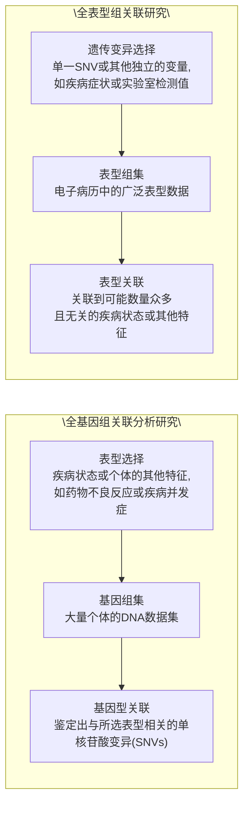

变量的设定。内生变量是指在模型中既受其他变量的影响，又对其他变量产生影响的变量。例如，安全需求可能受到基本心理需求的影响，并同时对爱和归属需求产生作用。外生变量则是在模型中只对其他变量产生影响，而不受其他变量影响的变量。例如，假设在模型中，基本心理需求仅影响其他潜变量，而不受其他潜变量的影响，这使得基本心理需求成为一个典型的外生变量。

对于内生变量的测量模型:

$$
Y = \Lambda_ {y} \eta + \epsilon \tag {10-9}
$$

其中， $Y$ 是内生显变量， $\Lambda_y$ 是内生显变量与内生潜变量 $\eta$ 之间的因子载荷矩阵， $\epsilon$ 是内生显变量的误差项。

对于外生变量的测量模型:

$$
X = \Lambda_ {x} \xi + \delta \tag {10-10}
$$

其中， $X$ 是外生显变量， $\Lambda_{x}$ 是外生显变量与外生潜变量 $\xi$ 之间的因子载荷矩阵， $\delta$ 是外生显变量的误差项。

结构模型:

$$
\eta = B \eta + \Gamma \xi + \zeta \tag {10-11}
$$

其中，$\eta$ 是内生潜变量，$B$ 是内生潜变量之间的效应矩阵（通常表示潜变量间的直接效应），$\Gamma$ 是外生潜变量 $\xi$ 对内生潜变量 $\eta$ 的影响矩阵，$\zeta$ 是内生潜变量的误差项。

将外生变量测量模型、内生变量测量模型和结构模型等各部分组合起来即得到一个完整的结构方程模型。在执行 SEM 分析时，常用的软件工具包括 LISREL、SAS、MPLUS、AMOS、EQS，以及 R 语言中的 “lavaan” 包。

## 10.3.2.2 多模态表型组数据分析

通过分析多模态数据的交互作用及其模式响应，能揭示不同表型之间的内在联系，理解生物系统的网络动态及其功能的相互依存性，以实现对生物系统的精确预测和深刻洞察。面对数据量的急剧增长和复杂度的提升，分析多模态高维数据显得尤为关键。

## （1）全基因组关联分析研究

在揭开生命复杂性的旅程中，精细的分析方法将破译基因到表型的转换。一切起始于DNA——生物特征的遗传密码所在。高通量测序技术的进步极大地丰富了基因数据，而全基因组关联分析（genome-wide association study，GWAS）研究能够识别特定遗传变异与表型特征的关联。自2005年首篇GWAS研究发表以来，根据2023年7月GWAS Catalog的数据，共有6459项研究被发表，揭示了537476个遗传变异与表型特征之间的联系。GWAS分析的线性回归模型表达式为:

$$
Y = W \alpha + X _ {s} \beta_ {s} + g + e \tag {10-12}
$$

$$
g \sim N (0, \sigma_ {A} ^ {2} \psi)
$$

$$
e \sim N (0, \sigma_ {e} ^ {2} I)
$$

在此模型中，Y 表示表型值，如疾病的状态或者生理特征的量化度量；W 是包含截距项在内的协变量矩阵，这些协变量可能包括年龄、性别、主要的环境因素等。 $\alpha$  是与协变量矩阵相对应的效应量向量，表示协变量对表型值的影响大小。 $X_{s}$  是 SNPs 下所有个体的基因型值的向量。 $\beta_{s}$  是遗传变异 s 对应的固定效应量，也就是 SNP 效应的大小。

$g$ 是捕获其他SNP多基因效应的随机效应，代表除了 $X_{s}$ 以外的所有遗传变异对表型的加性影响， $\sigma_A^2$ 表示表型的加性遗传变异， $\psi$ 是标准遗传关系矩阵。
$e$ 是剩余误差的随机效应， $\sigma_e^2$ 表示剩余方差， $I$ 是一个单位矩阵，用于在模型中加入剩余误差效应。

## (2) 精细定位

连锁不平衡（linkage disequilibrium，LD）描述了基因座之间非随机组合的遗传现象，通常表现为相邻基因座形成的 LD 模块。一方面，LD 模块的存在提高了 GWAS 发现因果 SNP 的可能性。当一个真正具有因果关系的位点位于 LD 模块内时，该模块内的所有 SNP 都会与表型表现出关联。这使得 GWAS 能够通过检测多个 SNP 的关联信号，更有效地识别致病或影响表型的基因区域。另一方面，LD 也可能导致 GWAS 无法直接鉴定出真正的因果 SNP。由于 LD 模块内 SNP 之间存在连锁关系，即使只有一个 SNP 与表型存在因果关系，其他 SNP 也会表现出关联信号。精细定位（fine mapping）分析旨在缩小 LD 模块的范围，区分真正具有因果关系的 SNP 和那些仅仅由于 LD 而表现出关联的 SNP。常用的精细定位方法包括:启发式 LD 算法、惩罚回归，以及贝叶斯精细定位。

① 启发式 LD 算法 启发式 LD 算法利用 GWAS 中具有显著关联信号的 SNPs，即 Tag SNPs，以及周围与其紧密连锁的 SNPs 来定位与疾病或特定性状相关的遗传变异。操作步骤包括:首先评估每个 SNP 与特定表型的相关性，通常采用 $\beta$ 值和 $p$ 值等统计指标；其次，根据既定的显著性水平，筛选出重要的 Tag SNPs；随后，以这些 Tag SNPs 为中心，延展搜索附近的 SNPs，通过连锁不平衡程度（$r^2$）定义 LD 模块，直到 $r^2$ 值下降至预设的阈值；最终，在每个 LD 模块中进行详细的关联分析，以确定与表型最紧密相关的 SNP，这些 SNP 有可能是致病的潜在因素。启发式 LD 算法的局限在于，它没有考虑多个 SNP 间可能存在的联合影响，也未能充分评价各 SNP 的生物学功能。
② 惩罚回归 在 GWAS 中，多个 SNPs 之间存在强相关性，导致传统回归模型在参数估计上不稳定。为了克服这一挑战，在精细定位分析中，惩罚回归模型如岭回归、LASSO 回归和弹性网络回归，通过加入惩罚项提高模型的稳健性。这些方法通过约束估计系数的大小，促使模型压缩不重要的变量系数至零，从而排除对预测没有贡献的变量，并增强模型的预测能力和解释力。LASSO 回归通过添加 $\mathrm{L}_1$ 正则化项，将系数的绝对值之和限制在一定阈值以下，推动模型生成一个稀疏解，即多数系数值为零的解，从而进行特征选择。岭回归通过添加 $\mathrm{L}_2$ 正则化项，将系数的平方和进行约束，使得模型中的所有系数被均匀压缩，而不是直接减少到零，这有助于处理多重共线性问题，但不会选择特征。弹性网络回归结合了 $\mathrm{L}_1$ 正则化和$\mathrm{L}_2$ 正则化，既能够产生稀疏模型，也能够处理变量间的高度相关性。然而，惩罚回归无法排除与Tag SNP强LD相关的非因果SNPs。

LASSO 回归公式:

$$
\min _ {\omega} \sum_ {i = 1} ^ {m} \left(y _ {i} - \sum_ {j = 1} ^ {d} x _ {i j} \omega_ {j}\right) ^ {2} + \lambda \sum_ {j = 1} ^ {d} | \omega_ {j} | \tag {10-13}
$$

岭回归公式:

$$
\min _ {\omega} \sum_ {i = 1} ^ {m} \left(y _ {i} - \sum_ {j = 1} ^ {d} x _ {i j} \omega_ {j}\right) ^ {2} + \lambda \sum_ {j = 1} ^ {d} \omega_ {j} ^ {2} \tag {10-14}
$$

弹性网络回归公式:

$$
\min _ {\omega} \sum_ {i = 1} ^ {m} \left(y _ {i} - \sum_ {j = 1} ^ {d} x _ {i j} \omega_ {j}\right) ^ {2} + \lambda \sum_ {j = 1} ^ {d} | \omega_ {j} | + \lambda \sum_ {j = 1} ^ {d} \omega_ {j} ^ {2} \tag {10-15}
$$

其中， $y_{i}$ 是第 $i$ 个样本的真实值， $x_{ij}$ 是第 $i$ 个样本的第 $j$ 个特征值。 $\omega_{j}$ 是第 $j$ 个特征值的回归系数。 $\lambda$ 是正则化参数，控制惩罚的强度。 $m$ 是样本的数量。 $d$ 是特征的数量。

③ 贝叶斯精细定位 贝叶斯精细定位方法基于贝叶斯统计学原理，结合先验知识估计SNPs与特定性状之间的关系强度。这些先验信息包括特定的基因组区域特性（如编码区、内含子、启动子和增强子区域）、染色质活跃度状态、组蛋白修饰标记（如甲基化和乙酰化）、进化上的保守性、连锁状态（如重组率）等。在此方法中，每个SNP被赋予一个后验包含概率（posterior inclusion probability, PIP），反映它是真正影响该表型的因果SNP的概率。基于PIP值，可以确定一个所谓的“可信集”（credible set），这是一个包含了潜在因果SNPs的最小集合，被认为在统计上有高概率包含至少一个真正的因果变异。贝叶斯方法能有效综合多种信息进行分析，但它的准确性依赖于先验信息的质量；如果依赖的信息来源有偏或不完整，结果可能受到影响。

此外，跨族群精细定位是一种集成多个族群样本的分析方法，旨在更准确地识别与表型真正相关的因果遗传变异。这种方法的前提假设是，不同人群之间疾病或表型的生物学基础是相同的，即真正的因果变异一致，但由于不同族群之间存在遗传背景的差异，同一等位基因标记与真实因果变异之间的LD模式不尽相同。通过对不同族群中与表型显著相关的标记SNP的LD模块取交集，可以缩小真实因果变异的可能区域范围。那些在多个族群中持续表现出统计关联的遗传信号，更大概率为真正的因果变异。

## (3) 多基因风险评分

多基因风险评分（polygenic risk score，PRS）是一种评估个体患病风险的多因素风险评分模型。它基于GWAS的结果，通过加权计算与疾病相关的多个基因位点效应值的总和，从而估计个体的遗传易感性。PRS 的计算公式如下:

$$
S = \sum_ {k = i} ^ {m} \beta_ {k} x _ {k} \tag {10-16}
$$

其中，$S$ 表示个体的基因多态性风险评分，$m$ 表示 SNP 的数量，$x_{k}$ 代表第 $k$ 个 SNP 的风险等位基因的个数（0、1 或 2），$\beta_{k}$ 是该 SNP 与疾病风险相关的效应值（如回归系数）。

一般来说，PRS得分越高，表明个体的患病风险越大。PRS模型可采用线性模型（如线性回归）或非线性模型（如神经网络）等方法来建立SNP特征与疾病风险之间的关系。常见的PRS工具包括PRSice、LDpred、PRS-CS、plink等。

PRS 计算存在两个主要的挑战，第一个挑战是 SNP 独立性问题。由于 GWAS 通常是对每个 SNP 单独进行关联检验，而 SNP 之间存在连锁不平衡现象，因此很难获得真正独立的 SNP 效应值估计。解决这个问题有两种主要的方法。第一种方法是聚集 + 阈值法（clumping + thresholding）。该方法首先选择 GWAS 中 p 值最小的那个 SNP，随后在一个固定距离的窗口内，排除与其 LD 值高于设定阈值的所有 SNP，这样保留下来的 SNP 在很大程度上是相互独立的了。接下来，根据预设的 p 值阈值进一步筛选出最终纳入 PRS 计算的 SNP 集合。另一种方法是  $\beta$  缩减法。该类方法的原理是考虑所有的 SNP，并基于它们之间的连锁不平衡情况调整 SNP 权重，如使用基于 LASSO 回归的 lassosum 方法或基于贝叶斯方法的 LDpred 算法。第二个主要的挑战是高维度问题，由于基因组数据中 SNP 位点的数量通常在百万量级，而样本数量远远少于此，这很容易导致模型过拟合。因此，对基因组数据进行合理的降维处理是 PRS 计算的一个关键环节，也是目前研究的一个重点和难点所在。

深度神经网络模型能够综合考虑遗传数据、生活习惯、临床指标等多种因素来预测个体发展疾病的风险。这种模型包括多个隐藏层，每层有多个神经元，以及合适的激活函数，如ReLU或Sigmoid。通过训练神经网络，模型通过反向传播和梯度下降算法调整权重和偏差，以减小预测误差。完成训练和验证后，得到的深度神经网络模型能够根据输入的遗传和临床数据预测个体发展疾病的风险。神经网络方法介绍请见本书第3章。

对于各类风险预测模型，模型评估和优化也很重要，这是确保模型性能和泛化能力的关键。评估模型通常采用交叉验证中的 K 折验证，具体方法请参见本书第 2 章 2.4 节。

## （4）表达数量性状基因座分析

GWAS 结果中大多数显著遗传风险变异位于非编码区域，不会直接影响编码蛋白的基因，为了阐明这些非编码区域风险变异的作用机制，可以通过表达数量性状基因座（expression quantitative trait locus, eQTL）分析，研究个体的基因型与基因表达水平之间的关联，系统鉴定出与基因表达水平显著相关的遗传变异。这些变异可能位于基因的调控区域，如启动子、增强子等，影响转录因子结合或染色质重塑等过程，进而调控基因的表达水平。因此，eQTL分析能够帮助解释这些非编码区变异的潜在功能意义，将疾病相关的遗传风险变异与其潜在的调控靶基因联系起来。eQTL分析常采用线性回归模型:

$$
Y = \beta_ {0} + \beta_ {1} X + \beta_ {2} C + \epsilon \tag {10-17}
$$

其中，Y 代表基因表达水平； $\beta_{0}$  代表截距项；X 代表基因型，通常编码为 0、1、2； $\beta_{1}$  是基因型的回归系数，表示基因型对基因表达水平的效应；C 表示协变量矩阵， $\beta_{2}$  是协变量的回归系数； $\epsilon$  代表残差项。

除了个体的基因型与基因表达水平之间的eQTL分析，还能将基因型与DNA甲基化水平、可变剪切比例、蛋白质表达水平等多种分子表型相关联，鉴定与其显著相关的遗传变异。

## (5) 共定位分析

共定位（colocalization）分析通过计算GWAS（表型1）显著位点和eQTL（表型2）显著位点共同定位在同一基因组区域的后验概率，来估计GWAS信号上的位点通过改变基因表达的生物学过程从而影响疾病的可能性。SNP是否与所选表型相关可能的配置共有5个，这里用 $S_0$ ， $S_{1}$ ， $S_{2}$ ， $S_{3}$ ， $S_{4}$ 来代表，对应5种假设分别为:

$H_{0}$ :表型1和表型2与某个基因组区域的所有SNP位点无显著相关。

$H_{1}/H_{2}$ :表型 1 或表型 2 与某个基因组区域的 SNP 位点显著相关。

$H_{3}$ :表型1和表型2与某个基因组区域SNP位点显著相关，但由不同因果变异位点驱动。

$H_{4}$ :表型1和表型2与某个基因组区域SNP位点显著相关，且由同一因果变异位点驱动。

接下来，在每个表型只有一个因果变异的假设下计算不同因果变异组合的后验概率，在给定观测数据 $D$ 的情况下，探究假设 $H_{h}(h = 1,2,3,4)$，根据贝叶斯公式，则有:

$$
P \left(H _ {h} | D\right) \propto \sum_ {S \in S _ {h}} P (D | S) P (S) \tag {10-18}
$$

其中， $P(H_{h}|D)$ 是给定观测数据 $D$ 后，假设 $H_{h}$ 的后验概率； $P(D|S)$ 是在假设 $H_{h}$ 成立的条件下观测到数据 $D$ 的似然； $P(S)$ 是假设 $H_{h}$ 或配置 $S$ 的先验概率。

该公式的解释为后验概率  $P(H_{h}|D)$  正比于每一个配置 S 的先验概率  $P(S)$  乘以它出现对应的似然，这里只是一个比例（而不是等式）。

例如，计算  $H_{4}$  成立的后验概率:

$$
\begin{array}{l} P P 4 = P \left(H _ {4} | D\right) \\ = \frac {P \left(H _ {4} | D\right)}{P \left(H _ {0} | D\right) + P \left(H _ {1} | D\right) + P \left(H _ {2} | D\right) + P \left(H _ {3} | D\right) + P \left(H _ {4} | D\right)} \\ \end{array}
$$

$$
= \frac {\frac {P (H _ {4} | D)}{P (H _ {0} | D)}}{1 + \frac {P (H _ {1} | D)}{P (H _ {0} | D)} + \frac {P (H _ {2} | D)}{P (H _ {0} | D)} + \frac {P (H _ {3} | D)}{P (H _ {0} | D)} + \frac {P (H _ {4} | D)}{P (H _ {0} | D)}} \tag {10-19}
$$

在这里计算了条件概率  $P(H_{4}|D)$  与所有可能的配置 S 出现的条件概率之和的比例。接下来，将每一项除以基线  $P(H_{0}|D)$ ，将后验概率表示为相对概率，而不是绝对概率。

该式中的分子和分母之比为:

$$
\frac {P (H _ {h} | D)}{P (H _ {0} | D)} = \sum_ {S \in S _ {h}} \frac {P (D | S)}{P (D | S _ {0})} \times \frac {P (S)}{P (S _ {0})} \tag {10-20}
$$

该等式中总和的第一个比例是每个配置的贝叶斯因子（bayes factor，BF），第二个比例是配置与基线配置相比的先验赔率（prior odds）。可以使用 Wakefield 方法从 $p$ 值或估计回归系数和方差计算每个变量的 BF。通过总结所有配置，可以有效地比较数据对一种备择假设与零假设的支持。

在贝叶斯共定位中，最关键的设想是第四种（$H_4$），即假设一个遗传位点同时影响GWAS中的疾病特征和eQTL中的基因表达。$H_4$的后验概率越高，就越能确信某个遗传位点在改变基因表达的过程中，对疾病有影响。PP4值的范围为 $0\sim 1$。通常，当后验概率大于0.75时，认为该位点很可能是一个共定位位点，指出了一个强有力的遗传关联信号。

## (6) 孟德尔随机化

孟德尔随机化（mendelian randomization，MR）是工具变量法（见本书第2章2.2节）在生物信息学中的重要应用，其基本思想为孟德尔遗传第二定律（自由组合定律），即在形成配子时，等位基因彼此分离，非等位基因自由组合，这一过程类似于随机对照实验中的随机分组。受孟德尔遗传第二定律的启发，研究人员发现SNP位点不仅符合因果时序关系（先因后果），而且不会受到后天环境等混杂因素的干扰，因此可以选择一组特定的SNP位点作为工具变量，从而对观察性研究中的因果关系进行推断。选择的SNP位点同样需要满足工具变量的三个条件，而在实际应用中往往不容易被满足。

单样本 MR（one-sample MR）是指在同一个研究中同时获得了样本的 SNP、暴露以及结果信息，但这对数据具有较高的要求，应用场景较为局限。在 MR 研究中，广泛应用的为两样本 MR 方法。两样本 MR 是指 SNP-暴露和 SNP-疾病间的关联信息分别来源于两个独立样本。

① 逆方差加权 逆方差加权（inverse variance weighted, IVW）法是孟德尔随机化分析中常用的一种方法，主要用于处理多个 SNP 位点作为工具变量的情况。其基本思想是根据每个 SNP 位点的估计方差对每个 SNP 估计的因果效应进行加权，使得估计方差较小（即估计更精确）的工具变量在最终的因果估计中占有更大的权重。记 $G = \{G_1, G_2, \cdots, G_m\}$ 为作为工具变量的 SNP，$T$ 为暴露因素，$Y$ 为结果变量。并假设第 $i$ 个工具变量 $G_{i}$ 对暴露和结果的因果效应估计分别为 $\widehat{b}_i^x$ 和 $\widehat{b}_i^y$ ，其对应的方差为 $\mathrm{Var}(\widehat{b}_i^x)$ 和 $\mathrm{Var}(\widehat{b}_i^y)$ ，可得 $G_{i}$ 对应的 $T - Y$ 因果效应估计值为:

$$
\widehat {a} _ {i} = \frac {\widehat {b} _ {i} ^ {y}}{\widehat {b} _ {i} ^ {x}} \tag {10-21}
$$

其标准误为:

$$
s e (\widehat {a} _ {i}) = \frac {\sqrt {\operatorname{Var} (\widehat {b} _ {i} ^ {y})}}{\widehat {b} _ {i} ^ {x}} \tag {10-22}
$$

对得到的多个因果效应估计  $\widehat{a}_{i} (i = 1, \cdots, m)$  应用逆方差加权法进行整合，建立加权线性回归模型

$$
\widehat {b} _ {i} ^ {y} = a _ {I V W} \widehat {b} _ {i} ^ {x} + \varepsilon_ {i} \tag {10-23}
$$

$$
\varepsilon_ {i} \sim N [ 0, \sigma^ {2} \operatorname{Var} (\widehat {b} _ {i} ^ {y}) ]
$$

其中， $a_{IVW}$ 为整合后的因果效应，得到IVW估计为:

$$
\hat {a} _ {I V W} = [ (\hat {b} ^ {x}) ^ {\prime} \Omega^ {- 1} \hat {b} ^ {x} ] ^ {- 1} (\hat {b} ^ {x}) ^ {\prime} \Omega^ {- 1} \hat {b} ^ {x} \tag {10-24}
$$

其中，$\Omega$ 为工具变量之间的协方差矩阵，相应的标准误为:

$$
s e \left(\hat {a} _ {I V W}\right) = \sqrt {\left[ \left(\hat {b} ^ {x}\right) ^ {\prime} \Omega^ {- 1} \hat {b} ^ {x} \right] ^ {- 1}} \tag {10-25}
$$

② MR-Egger 然而，当工具变量存在多效性（即遗传变异通过暴露以外的途径影响结果）问题时，使用 IVW 方法得到的因果效应估计值将会出现一定的偏差。MR-Egger 通过截距项来衡量工具变量间的平均多效性，其加权回归方程如下:

$$
\widehat {b} _ {i} ^ {y} = a _ {0} + a _ {E} \widehat {b} _ {i} ^ {x} + \varepsilon_ {i} \tag {10-26}
$$

$$
\varepsilon_ {i} \sim N [ 0, \sigma^ {2} \operatorname{Var} (\widehat {b} _ {i} ^ {y}) ]
$$

其中，$a_0$ 是截距项，$a_E$ 是感兴趣的因果效应参数，$\varepsilon_i$ 是误差项。与 IVW 不同，该模型弱化了工具变量的第二个条件，将其替换为 InSIDE（instrument strength independent of direct effect）假设，即每个 SNP 与暴露的关联（$\widehat{b}_i^x$）独立于 SNP 和结果的直接效应。在满足该假设的情况下，MR-Egger 回归可以提供一致性的因果效应估计。注意，当截距项 $a_0$ 等于 0 时，MR-Egger 退化为 IVW；当 $a_0$ 不等于 0 时，则说明模型中存在多效性问题。因此可以通过检验截距项 $a_0$ 是否显著，对所选的 SNP 位点是否满足工具变量的第二个条件（排他性限制）进行检验。

基于汇总数据的孟德尔随机化（summary-data-based mendelian randomization, SMR）是一种特定形式的 MR 分析，主要利用公开的 GWAS 汇总数据。它主要被用来检测遗传变异对某个表型的影响是否通过特定的中介表型（如某个基因表达水平）来实现。通过整合 eQTL 数据和 GWAS 数据，SMR 方法使研究者能够使用遗传变异作为工具变量，估计基因表达水平对疾病风险的因果影响。

以精神分裂症为例，研究人员利用精神分裂症 GWAS 汇总数据，以及遗传变异与脑组织转录组数据 eQTL 分析结果整合，开展共定位分析，鉴定在两者中均显著的共享位点，从而确定影响基因表达的非编码风险变异。随后，研究人员利用与基因表达相关的变异作为工具变量开展孟德尔随机化分析，通过将其基因结果关联除以基因暴露关联，评估基因表达水平对疾病风险的因果影响，厘清基因表达与疾病之间的因果关联。

$$
\widehat {\beta} _ {M R} = \frac {\beta_ {g Y}}{\beta_ {g X}} \tag {10-27}
$$

其中， $\beta_{gX}$  代表遗传变异对基因表达效应的估计； $\beta_{gY}$  代表遗传变异对精神分裂症效应的估计； $\widehat{\beta}_{MR}$  代表基因表达对精神分裂症因果关系的估计。

通过SMR分析，研究人员确定神经调节蛋白1（neuregulin 1，NRG1）是精神分裂症的因果效应基因。该基因在神经发育和突触形成过程中起关键作用。通过进一步的功能实验，研究人员阐明了NRG1如何增加精神分裂症发病风险的分子机制。此外，研究者还可能使用其他生物信息学工具，探索SNP如何影响可变剪切的变化、DNA甲基化水平、蛋白质表达水平和代谢组变化等，可以更深入理解这些遗传变异如何影响分子层面的不同表型而增加患病风险。

## (7) 全转录组关联研究

GWAS 分析遗传变异与表型的关联，而全转录组关联研究（transcriptome-wide association study，TWAS）通过对受到遗传变异显著调控的基因进行表型关联性检测，识别出那些可能通过遗传变异影响相关表型的基因。TWAS 方法首先利用多个 eQTL 数据集来训练基因表达预测模型，建立遗传变异与基因表达之间的遗传调控权重。接下来，这些带有遗传调控权重的模型被应用于预测更大 GWAS 群体中个体的基因表达水平。最后，通过建立预测基因表达与表型之间的关联，以确定基因与表型之间的调控关系。

考虑到组织特异性的转录调控，TWAS 会针对每个不同的组织分别进行基因表达的预测。PrediXcan 采用线性回归模型来拟合多个顺式 SNP（即位于基因周围 1 Mb 范围内的 SNP）与目标基因表达水平之间的关系。对于特定的基因 g，在包含 n 个个体的参考样本中，其表达水平与多个 SNP 变体之间的关系可以表示为:

$$
E _ {g} = \beta_ {0} + \beta_ {1} X + \epsilon
$$

其中， $E_{g}$  表示校正混杂因素（如年龄、性别和基因型主成分等）后的基因表达水平； $\beta_{0}$  表示截距项；X 代表基因型，通常编码为 0、1、2； $\beta_{1}$  是 SNP 权重的向量； $\epsilon$  表示误差项。

由于样本数量通常少于变量数量，直接使用传统的线性回归模型容易导致过度拟合和统计效能不足。为了解决这个问题，通常采用弹性网络回归模型来筛选重要的SNP并防止过度拟合。该模型通过以下优化公式估计系:

$$
\widehat {\beta} = \underset {\beta} {\mathrm{argmin}} \left\{\| E _ {g} - X \beta \| _ {2} ^ {2} + \lambda \left[ \alpha \| \beta \| _ {1} + \frac {1}{2} (1 - \alpha) \| \beta \| _ {2} ^ {2} \right] \right\} \tag {10-28}
$$

其中，$\widehat{\beta}$ 是线性组合的估计系数。$\|Eg - X\beta\|_2^2$ 是残差平方和项，用于最小化预测误差。$\alpha \| \beta \|_1$ 是 $\mathrm{L}_1$ 惩罚项，有助于模型的系数稀疏化；$\frac{1}{2}(1 - \alpha)\| \beta \|_2^2$ 是 $\mathrm{L}_2$ 惩罚项，用于收缩系数的大小以减少过拟合。$\alpha$ 是在 $\mathrm{L}_1$ 和 $\mathrm{L}_2$ 惩罚之间平衡的参数。$\lambda$ 是控制整体惩罚强度的参数，通过交叉验证的方式进行估计。

在弹性网络模型基础上，利用回归系数来估计GWAS样本中个体的基因表达水平。具体的预测公式为:

$$
\widehat {E} _ {i} = \sum_ {j = 1} ^ {m} \beta_ {j} G _ {i j} \tag {10-29}
$$

其中，$\widehat{E}_i$ 是第 $i$ 个个体的预测基因表达水平，$\beta_j$ 是上一步预测的第 $j$ 个SNP的回归系数。$G_{ij}$ 是第 $i$ 个个体在第 $j$ 个SNP上的基因型。

最后，将预测得到的基因表达水平与表型数据进行关联分析，通常采用线性回归模型来评估两者之间的关系。具体的回归模型如下:

$$
Y = \beta_ {0} + \beta_ {1} \widehat {E} + \beta_ {2} C + \epsilon \tag {10-30}
$$

其中， $Y$ 表示表型； $\beta_0$ 表示截距项； $\widehat{E}$ 表示基因表达水平； $\beta_{1}$ 是基因表达水平的回归系数，表示基因表达水平对表型的影响； $C$ 表示协变量矩阵； $\beta_{2}$ 是协变量的回归系数； $\epsilon$ 表示误差项。

## (8) 全表型组关联研究

若将 GWAS 视作寻找与特定表型相关的未知遗传变异的过程，那么全表型组关联研究则专注于从已知遗传变异出发，探索其与多种表型特征之间的复杂联系，是一种反向遗传学分析方法（图 10-5）。全表型组关联研究（phenome-wide association study，PheWAS）通常基于已有的生物学机制或遗传学背景，关注某种表型，应用该表型相关的特定遗传变异作为工具变量来分析其与大量疾病表型结局的关联，体现了它从“基因型或其他变量”到“表型”的反向遗传学研究特征。这些表型可能包括不同的疾病状态、定量生物标志物或药物反应性。以心血管疾病的 PheWAS 为例，假定已经鉴定了一个与心脏病发病率相关 SNP。在 PheWAS 研究中，研究人员以该 SNP 为研究对象，探究其与多种心血管相关表型，如心血管疾病本身、血压、血清胆固醇水平等的相关性。

对于分类表型，可以通过构建列联表并计算  $\chi^{2}$  统计量来应用卡方检验，以此评估基因型频率分布与表型类别之间的关联程度，同时计算出相应的比值比（odds ratio，OR）和 p 值，以量化基因型与表型之间的关联强度和统计显著性。

$$
\mathrm{logit} (p) \equiv \beta_ {0} + \beta_ {1} X + \beta_ {2} C \tag {10-31}
$$

其中，p 表示特定表型（如某种疾病）的概率； $\logit(p)$  表示 p 的对数概率； $\beta_{0}$  表示截距项；X 代表基因型，通常编码为 0、1、2， $\beta_{1}$  是基因型的回归系数；C 表示协


<details>
<summary>flowchart</summary>


</details>

图 10-5 全基因组关联分析研究与全表型组关联研究的对比（改绘自Bastarache et al., 2022）

变量矩阵， $\beta_{2}$  是协变量的回归系数。

对于连续表型，则可以采用方差分析来比较不同基因型组别间表型平均值的差异，或者使用线性回归分析来评估基因型对表型的影响，同时估计其效应大小和方向。在某些情况下，可以应用广义线性模型来处理表型数据的非正态分布特性。

$$
Y = \beta_ {0} + \beta_ {1} X + \beta_ {2} C + \epsilon \tag {10-32}
$$

其中，Y 表示表型值； $\beta_{0}$  表示截距项；X 代表基因型，通常编码为 0、1、2； $\beta_{1}$  是基因型的回归系数，表示基因型对表型的效应；C 表示协变量矩阵， $\beta_{2}$  是协变量的回归系数； $\epsilon$  是误差项。

在使用 PheWAS 时应谨慎对待假阳性发现。使用 Bonferroni 校正等方法可以调整统计显著性阈值，以适应在 PheWAS 中测试的表型数量。新的关联应通过在独立数据集或完全不同的人类、动物或细胞研究中的复制来验证。

## (9) 复合表型分析

复合表型（composite phenotype）是指由多个单独的表型特征或指标组合而成的综合特征。这种复合特征通常用于描述复杂的生物学现象或多维度的生物特性，能够提供比单一表型更全面和系统的信息。复合表型概念被应用于人类指纹花纹的研究，探讨个体的同一套基因组是如何影响不同十指上指纹花纹的形成，为“指纹模块现象”（中间三枚手指指纹高度相关）提供了表型组学和遗传学解释。Li等通过结合偏最小二乘路径建模和光谱聚类的策略定义复合表型，揭示了不同个体在高海拔驯化中的生理异质性。在模型适应度性能的评估中，基于复合表型的模型在高海拔适应过程中的氧饱和度变化建模方面比基于单一性状的模型更适合。由此可见，基于复合表型的新策略可能成为表型组学分析研究的一般策略。

光谱聚类（spectral clustering）是一种基于图论的聚类方法，通过对数据点构建相似度矩阵，进行特征值分解，以此将数据点投影到低维空间，再在低维空间中进行聚类。在复合表型分析中，光谱聚类可以用于将具有相似特征的样本（如具有相似基因表达谱或代谢谱的个体）归为一类，从而识别出潜在的复合表型亚群。同时，偏最小二乘路径建模（partial least squares path modeling，PLSPM）是一种SEM技术，用于研究变量之间的复杂关系，特别适用于小样本量和多重共线性的情况。在复合表型分析中，PLSPM可用于整合多种生物标志物（如基因表达、代谢产物、临床指标等），构建路径模型，探索这些生物标志物与复合表型之间的因果关系。以Li等的工作为例，具体步骤包括:

相似度矩阵构建，定义不同表型之间的相似度 $S_{ij}$，常用的相似度度量包括高斯核函数:

$$
S _ {i j} = \exp \left(- \frac {\| x _ {i} - x _ {j} \| ^ {2}}{2 \sigma^ {2}}\right) \tag {10-33}
$$

其中，$\| x_{i} - x_{j}\|^{2}$ 表示样本 $i$ 和 $j$ 间的欧氏距离，$\sigma$ 是带宽参数。

构建拉普拉斯矩阵 L，

$$
L = D - S \tag {10-34}
$$

其中，D 是对角矩阵，其对角元素  $D_{ii}$  是第 i 个样本的度（即相似度矩阵 S 中第 i 行元素之和）。

对拉普拉斯矩阵 $L$ 进行特征值分解，得到前 $k$ 个最小的特征值及其对应的特征向量，将样本投影到由这些特征向量构成的低维空间中。根据光谱聚类的结果，将28个生理特征分为14个组，这些组构成了复合表型的初步结构。在此基础上，进一步应用PLSPM来构建复合表型。

PLSPM 用于分析多个变量组之间的多重关系，并定义了 14 个潜在变量，每个潜在变量代表一个复合表型，通过计算潜在变量得分估计复合表型。

随后，通过将得分矩阵中的值与另一个权重矩阵相乘来计算潜在变量的得分，迭代求解潜变量得分和路径系数，目标是最大化潜变量与其观测指标之间的协方差。

最后，通过载荷矩阵和潜在变量得分来解释模型。载荷矩阵显示了每个指标变量对每个潜在变量的贡献程度，而潜在变量得分被用于定义复合表型，代表了高海拔适应过程中的不同生理方面。例如，某个潜在变量可能代表了与氧合相关的一系列生理特征，而另一个潜在变量可能代表了与心血管功能相关的特征。

## (10) 表型网络分析

表型数据的分析中，网络分析扮演着至关重要的角色。这是基于一种假设:表型数据之间存在着复杂的相互依赖和调控网络。网络分析的应用范围广泛，它被用来研究不同表型之间的相互关系和作用，揭示表型间的模式、集群以及关键节点。这种分析方法特别适用于识别与疾病相关的表型模式，预测疾病的风险和进展路径，揭示疾病的潜在生物学机制。此外，表型网络分析还有助于发现新的治疗靶点和药物响应标记物，为深入探索和理解生物系统中表型组学的内部关系及其间的相互作用提供了一个强大的分析工具。在网络分析方法中，加权基因共表达网络分析、蛋白质之间的相互作用网络分析和代谢网络分析等成了多组学研究中的关键方法。网络的基本概念、拓扑属性、网络分析中的具体算法等，详见第11章11.3节。

## 10.3.2.3 表型组学分析的新概念

在人类表型组项目中确立了其三个核心构成要素:可操作表型单位（operational phenotypic unit, OPU）、可操作表型模块（operational phenotypic module, OPM）和可操作表型群落（operational phenotypic community, OPC）。

## (1) 可操作表型单位 (OPU)

作为表型分析的基础单元，每个 OPU 代表一个独立的表型特征，如遗传特征或临床指标。OPU 之间的关系可以表现为不同的方向性和强度，揭示了各个表型特征之间的复杂相互作用。

## (2) 可操作表型模块 (OPM)

OPM 由相互作用的 OPU 集合构成，形成了群体级别的特征模块。每个 OPM 表示在特定组学表型下具有相似表型模式的个体群体。OPM 之间的关系不仅反映了不同方向和强度的相互作用，而且可能体现了不同生物学过程的协同或相互抑制。在多模块网络中，OPM 之间的相互作用进一步影响整体表型表现，对于理解复杂疾病和生物学特性的形成至关重要。

## (3) 可操作表型群落 (OPC)

OPC 代表了更高层面的特征模块，是由相互作用的 OPM 集合组成的。通常涉及多个跨组学平台，OPC 反映了不同层次的表型数据之间的关联性和动态相互作用。

从 OPU 到 OPM，再到 OPC，这个层次化的框架逐步深入，从单一表型特征的作用分析扩展到更广泛的生物学网络中的相互作用（图 10-6），打通了微观表型到宏观表型的壁垒。这种多层次的关系揭示了生物体内表型特征的复杂交互，为深入理解生物体的功能和行为提供了新的视角。在解析这些表型间复杂的相互依赖和调控关系方面，网络分析发挥着不可替代的作用。

通过解析 OPU-OPM-OPC 表型间关系，筛选相关性网络中的关键特征和枢纽节点，对从庞大的生物学数据中识别出有生物学意义的模块，揭示生物分子之间的紧密相互作用和功能联系具有重要作用。常规分析流程如下:

① 基于单一表型特征水平的 Spearman 秩相关系数检验分析，将相关性强 [如 abs(r)>0.95] 的表型记为一个表型簇，并对表型簇进行二次正则化主成分分析，其中第一个主成分得分定义为一个 OPU。
② 对 OPUs 进行两两相关性分析，建立 OPU 间的加权相邻矩阵 $abs(r) \times I(P\_FDR < 0.05)$，并使用 Newman's Community Detection 对同组学平台的 OPUs 聚类，每个 OPU 簇构成一个群体级别的特征模块 OPM。
③ 计算两个 OPMs 中所有 OPUs 的相关系数，并使用 Newman's Community Detection 社区检测方法对跨组学平台的 OPMs 聚类，每个 OPM 簇代表一个跨组学平台的 OPC。


<details>
<summary>flowchart</summary>

```mermaid
graph TD
  subgraph Top_OPU_n["Top_①[\"①识别OPU\n相似特征簇\"]"]
  Node1["3"] --> Node2["2"]
  Node2 --> Node3["1"]
  Node3 --> Node4["4"]
  Node4 --> Node5["5"]
  Node5 --> Node6["6"]
  Node6 --> Node7["7"]
  Node7 --> Node8["8"]
  Node8 --> Node9["9"]
  Node9 --> Node10["10"]
  Node10 --> Node11["11"]
  Node11 --> Node12["12"]
  end

  subgraph Middle_OPM_nOPU_OPU["Middle_②[\"②识别OPM\nOPU-OPU网络\"]"]
  Node3["3"] --> Node4["2"]
  Node4 --> Node5["1"]
  Node5 --> Node6["6"]
  Node6 --> Node7["7"]
  Node7 --> Node8["8"]
  Node8 --> Node9["9"]
  Node9 --> Node10["10"]
  Node10 --> Node11["11"]
  Node11 --> Node12["12"]
  Node12 --> Node13["13"]
  Node13 --> Node14["14"]
  Node14 --> Node15["15"]
  Node15 --> Node16["16"]
  end

  subgraph Bottom_OPC_nOPM_OPM["Bottom_③[\"③识别OPC\nOPM-OPM网络\"]"]
  Node3["3"] --> Node4["2"]
  Node4 --> Node5["1"]
  Node5 --> Node6["5"]
  Node6 --> Node7["7"]
  Node7 --> Node8["8"]
  Node8 --> Node9["9"]
  Node9 --> Node10["10"]
  Node10 --> Node11["11"]
  Node11 --> Node12["12"]
  Node12 --> Node13["13"]
  Node13 --> Node14["14"]
  Node14 --> Node15["15"]
  end

  subgraph Bottom_n["Bottom_④[\"相关性分析\n主成分分析\"]"]
    Node3
    Node4
    Node5
    Node6
    Node7
    Node8
    Node9
    Node10
    Node11
    Node12
  end
```
</details>

图10-6 表型-表型交互作用网络构建框架（图中所列方法可进一步拓展）

在上述例子中可以看出，社区检测在了解整个网络结构和功能中具有重要作用，是图论中的一个重要问题，旨在发现图中具有紧密连接的节点群体。同社区经常对应着功能相同或者关系比较紧密的节点集合，网络节点组内连接紧密，组间连接稀疏。社区结构是大规模网络中普遍存在的基本结构，经典社区结构检测方法包括基于图分割的K-L（Kernighan-Lin）算法、聚类算法；基于模块度优化的Louvain算法、动态标签传递算法（label propagation algorithm，LPA）等。

马克·纽曼（Mark Newman）在2003年首次提出了模块度（modularity）这一概念，并在2004年给出了其正式定义。模块度用于量化网络中的社区划分。例子中所使用的Girvan-Newman（GN）算法是一种用于识别网络社区结构的经典方法，也可以看作是一种聚类算法。GN算法通过迭代地移除图中具有最高边介数（betweenness）值的边，从而揭示网络中的社区结构。

GN算法的核心思想是利用边介数来评估边的重要性。边介数是指通过某条边的最短路径的数量，反映了该边在网络中作为桥梁的作用。具有高边介数的边通常位于社区之间的边界上，移除这些边可以有效地分割网络，揭示出社区结构。

边介数的计算公式如下:

$$
B (e) = \sum_ {s \neq t} \frac {\sigma_ {s t} (e)}{\sigma_ {s t}} \tag {10-35}
$$

其中，s 和 t 是两个节点； $\sigma_{st}$  表示从节点 s 到节点 t 的最短路径的总数； $\sigma_{st}(e)$  表示从节点 s 到节点 t 经过边 e 的最短路径数量。

算法步骤:

① 计算边介数 首先，计算图中每条边的介数。边介数是通过图中的最短路径算法计算得到的。

②移除最高介数的边 找到介数值最高的边，并将其从图中移除。
③ 重新计算边介数 每次移除边后，重新计算剩余图中每条边的介数。
④ 迭代重复 重复步骤2和步骤3，直到图中的所有边都被移除或达到预期的社区划分。

通过 GN 算法，可以生成一个层次结构的社区树（dendrogram），表示社区分裂的过程。在分析社区结构时，可以根据需要选择适当的层次来确定社区划分。例如，在树的某个层次剪断树干，就能得到相应规模的社区结构。

## 10.4 表型组学的应用

## 10.4.1 细胞与类器官表型组的应用

细胞表型的观察始于17世纪，罗伯特·胡克（Robert Hooke）首次使用显微镜对植物组织进行观察，并将观察到的结构称为“cellulae”，即细胞。在19世纪，马蒂亚斯·施莱登（Matthias Schleiden）和西奥多·施旺（Theodor Schwann）两位提出了细胞学说，他们认为所有生命体都由细胞组成。此后，科学家们开始对细胞进行更深入的研究。类器官（organoid）是指一种体外培养的三维细胞模型，其特点是具有某种特定器官的一些组织结构和功能特征。其培养过程为从多能干细胞或者成体细胞中获取干细胞，通过一系列的特定培养和分化的步骤，最后使这些细胞组成与真实器官相似的微型结构。类器官表型组学（phenomics of organoids）则是指旨在通过对类器官的结构、功能和分子特征等进行分析研究，来探索和理解类器官的特性和与之相关的生物学过程的一种研究方法（图10-7）。类器官表型组学的应用可以有助于深入理解类器官的形成、结构、功能等方面的信息，并且有助于筛选、评估药物的效果和了解药物对类器官的作用和影响。

## 10.4.1.1 生物学领域的应用

## (1) 研究细胞发育、分化等功能

利用细胞与类器官表型组技术，能够在不同时间点对细胞进行高分辨率的成像和详尽的表型分析，从而实现了对细胞发育过程的精准动态跟踪，包括细胞体积和形态的演变、细胞骨架和细胞极性的精细重构，以及细胞信号通路和互作网络的动态变化。例如，通过单细胞数据的降维、聚类、差异表达分析，可以识别关键的基因表达模式，鉴定不同亚群。对空间基因表达模式进行分析，可以揭示不同区域的基因表达差异，有助于了解组织中的细胞类型和相互作用。这些分析手段能够深入挖掘细胞命运决定的关键因素，揭示发育过程中的精妙分子机制，从而为细胞的发育与分化提供深入而全面的认识。


<details>
<summary>flowchart</summary>

```mermaid
graph TD
  subgraph Sources
  A["Human"] --> B["Animal"]
  A --> C["Animal"]
  D["Mouse"] --> E["Mouse"]
  F["Mouse"] --> G["Mouse"]
  H["Mouse"] --> I["Mouse"]
  J["Mouse"] --> K["Mouse"]
  L["Mouse"] --> M["Mouse"]
  N["Mouse"] --> O["Mouse"]
  P["Mouse"] --> Q["Mouse"]
  R["Mouse"] --> S["Mouse"]
  T["Mouse"] --> U["Mouse"]
  V["Mouse"] --> W["Mouse"]
  X["Mouse"] --> Y["Mouse"]
  Z["Mouse"] --> AA["Mouse"]
  AB["Mouse"] --> AC["Mouse"]
  AD["Mouse"] --> AE["Mouse"]
  AF["Mouse"] --> AG["Mouse"]
  AH["Mouse"] --> AI["Mouse"]
  AJ["Mouse"] --> AK["Mouse"]
  AL["Mouse"] --> AM["Mouse"]
  AN["Mouse"] --> AO["Mouse"]
  AP["Mouse"] --> AQ["Mouse"]
  AR["Mouse"] --> AS["Mouse"]
  AT["Mouse"] --> AU["Mouse"]
  AV["Mouse"] --> AW["Mouse"]
  AX["Mouse"] --> AY["Mouse"]
  AZ["Mouse"] --> BA["Mouse"]
  BB["Mouse"] --> BC["Mouse"]
  BD["Mouse"] --> BE["Mouse"]
  BF["Mouse"] --> BG["Mouse"]
  BH["Mouse"] --> BI["Mouse"]
  BJ["Mouse"] --> BK["Mouse"]
  BL["Mouse"] --> BM["Mouse"]
  BN["Mouse"] --> BO["Mouse"]
  BP["Mouse"] --> BR["Mouse"]
  BW["Mouse"] --> BX["Mouse"]
  BYD["Mouse"] --> BDQ["Mouse"]
  DBQ["Mouse"] --> DBQ
  end

  subgraph OriginalCells
  C1["Fibroblast Cell"] --> C2["Single Nuclear Cells"]
  C3["Purkinocytes"] --> C4["Purkinocytes"]
  C5["Other Cells"] --> C6["Other Cells"]
  end

  subgraph Fibroblasts
  F1["Fibroblast Cell"] --> F2["Fibroblast Cell"]
  F3["Purkinocytes"] --> F4["Purkinocytes"]
  F5["Other Cells"] --> F6["Other Cells"]
  end

  subgraph DendriticCells
  D1["Dendritic Cell"] --> D2["Dendritic Cell"]
  D3["Dendritic Cell"] --> D4["Dendritic Cell"]
  D5["Dendritic Cell"] --> D6["Dendritic Cell"]
  D7["Dendritic Cell"] --> D8["Dendritic Cell"]
  end

  subgraph LongTermCells
  L1["Long Term Cell"] --> L2["Long Term Cell"]
  L3["Long Term Cell"] --> L4["Long Term Cell"]
  L5["Long Term Cell"] --> L6["Long Term Cell"]
  L7["Long Term Cell"] --> L8["Long Term Cell"]
  L9["Long Term Cell"] --> L10["Long Term Cell"]
  end

  subgraph Organisms
  M1["Molecular Complex"] --> M2["Molecular Complex"]
  M3["Molecular Complex"] --> M4["Molecular Complex"]
  M5["Molecular Complex"] --> M6["Molecular Complex"]
  M7["Molecular Complex"] --> M8["Molecular Complex"]
  M9["Molecular Complex"] --> M10["Molecular Complex"]
  M11["Molecular Complex"] --> M12["Molecular Complex"]
  M13["Molecular Complex"] --> M14["Molecular Complex"]
  M15["Molecular Complex"] --> M16["Molecular Complex"]
  M17["Molecular Complex"] --> M18["Molecular Complex"]
  M19["Molecular Complex"] --> M20["Molecular Complex"]
  end

  subgraph Organometers
  O1A1["Anterior"] --> O2A1["Brain"]
  O2B1["Buscida"] --> O2C1["Brain"]
  O2D1["Dendritic"] --> O2E1["Brain"]
  O2F1["Gesophage"] --> O2G1["Brain"]
  O2H1["Ileum"] --> O2I1["Brain"]
  O2J1["Kervix"] --> O2K1["Brain"]
  O2L1["Brain"] --> O2M1["Brain"]
  O2N1["Sedentary"] --> O2O1["Brain"]
  O2P1["Brain"] --> O2Q1["Brain"]
  O2R1["Brain"] --> O2S1["Brain"]
  O2T1["Brain"] --> O2U1["Brain"]
  O2V1["Brain"] --> O2W1["Brain"]
  O2X1["Brain"] --> O2Y1["Brain"]
  O2Z1["Brain"] --> O2W2["Brain"]
  end

  subgraph Organometers
  OM1["Autectic"] --> OM2["Autectic"]
  OM3["Autectic"] --> OM4["Autectic"]
  OM5["Autectic"] --> OM6["Autectic"]
  OM7["Autectic"] --> OM8["Autectic"]
  OM9["Autectic"] --> OM10["Autectic"]
  OM11["Autectic"] --> OM12["Autectic"]
  OM13["Autectic"] --> OM14["Autectic"]
  OM15["Autectic"] --> OM16["Autectic"]
  OM17["Autectic"] --> OM18["Autectic"]
  OM19["Autectic"] --> OM20["Autectic"]
  OM21["Autectic"] --> OM22["Autectic"]
  OM23["Autectic"] --> OM24["Autectic"]
  OM25["Autectic"] --> OM26["Autectic"]
  OM27["Autectic"] --> OM28["Autectic"]
  OM29["Autectic"] --> OM30["Autectic"]
  end

  subgraph Organometers
  O3A1["Acumen"] --> O3B["Acumen"]
  O3C["Acumen"] --> O3D["Acumen"]
  O3E["Acumen"] --> O3F["Acumen"]
  O3G["Acumen"] --> O3H["Acumen"]
  O3I["Acumen"] --> O3J["Acumen"]
  O3K["Acumen"] --> O3L["Acumen"]
  O3M["Acumen"] --> O3N["Acumen"]
  O3O["Acumen"] --> O3P["Acumen"]
  O3Q["Acumen"] --> O3R["Acumen"]
  O3S["Acumen"] --> O3T["Acumen"]
  O3U["Acumen"] --> O3V["Acumen"]
  O3W["Acumen"] --> O3X["Acumen"]
  O3Y["Acumen"] --> O3Z["Acumen"]
  end

  subgraph Organometers
  OM5["Acumen融合"] --> OM6["Acumen融合"]
  OM7["Acumen融合"] --> OM8["Acumen融合"]
  OM9["Acumen融合"] --> OM10["Acumen融合"]
  end

  subgraph Organometers
  OM6["Acumen融合融合"] --> OM7["Acumen融合"]
  OM8["Acumen融合"] --> OM9["Acumen融合"]
  end

  subgraph TestingMethods
    EM1["Muscle Model: Heart Model"] -.-> EM2["Muscle Model: Heart Model"]
  end

  subgraph Methods
    EM3["Muscle Model: Heart Model"] -.-> EM4["Muscle Model: Heart Model"]
  end

  subgraph Methods
    EM5["Muscle Model: Heart Model"] -.-> EM6["Muscle Model: Heart Model"]
  end

  subgraph Methods
    EM7["Muscle Model: Heart Model"] -.-> EM8["Muscle Model: Heart Model"]
  end

  subgraph Methods
    EM9["Muscle Model: Heart Model"] -.-> EM10["Muscle Model: Heart Model"]
  end

  subgraph Methods
  EM10["Muscle Model: Heart Model"] -.-> EM11["Muscle Model: Heart Model"]
  end

  subgraph Methods
  EM12["Muscle Model: Heart Model"] -.-> EM13["Muscle Model: Heart Model"]
  end

  subgraph Methods
  EM14["Muscle Model: Heart Model"] -.-> EM15["Muscle Model: Heart Model"]
  end

  subgraph Methods
  EM16["Muscle Model: Heart Model"] -.-> EM17["Muscle Model: Heart Model"]
  end

  subgraph Methods
  EM18["Muscle Model: Heart Model"] -.-> EM19["Muscle Model: Heart Model"]
  end

  subgraph Methods
  EM20["Muscle Model: Heart Model"] -.-> EM21["Muscle Model: Heart Model"]
  end

  subgraph Methods
  EM22["Muscle Model: Heart Model"] -.-> EM23["Muscle Model: Heart Model"]
  end

  subgraph Methods
  EM24["Muscle Model: Heart Model"] -.-> EM25["Muscle Model: Heart Model"]
  end

  subgraph Methods
  EM26["Muscle Model: Heart Model"] -.-> EM27["Muscle Model: Heart Model"]
  end

  subgraph Methods
  EM28["Muscle Model: Heart Model"] -.-> EM29["Muscle Model: Heart Model"]
  end

  subgraph Methods
  EM30["Muscle Model: Heart Model"] -.-> EM31["Muscle Model: Heart Model"]
  end

  subgraph Methods
  EM32["Muscle Model: Heart Model"] -.-> EM33["Muscle Model: Heart Model"]
  end

  subgraph Methods
  EM34["Muscle Model: Heart Model"] -.-> EM35["Muscle Model: Heart Model"]
  end

  subgraph Methods
  EM36["Muscle Model: Heart Model"] -.-> EM37["Muscle Model: Heart Model"]
  end

  subgraph Methods
  EM38["Muscle Model: Heart Model"] -.-> EM39["Muscle Model: Heart Model"]
  end

  subgraph Methods
  EM40["Muscle Model: Heart Model"] -.-> EM41["Muscle Model: Heart Model"]
  end

  subgraph Methods
  EM42["Muscle Model: Heart Model"] -.-> EM43["Muscle Model: Heart Model"]
  end

  subgraph Methods
  EM44["Muscle Model: Heart Model"] -.-> EM45["Muscle Model: Heart Model"]
  end

  subgraph Methods
  EM46["Muscle Model: Heart Model"] -.-> EM47["Muscle Model: Heart Model"]
  end

  subgraph Methods
  EM48["Muscle Model: Heart Model"] -.-> EM49["Muscle Model: Heart Model"]
  end

  subgraph Methods
  EM50["Muscle Model: Heart Model"] -.-> EM51["Muscle Model: Heart Model"]
  end

  subgraph Methods
  EM52["Muscle Model: Heart Model"] -.-> EM53["Muscle Model: Heart Model"]
  end

  subgraph Methods
  EM54["Muscle Model: Heart Model"] -.-> EM55["Muscle Model: Heart Model"]
  end

  subgraph Methods
  EM56["Muscle Model: Heart Model"] -.-> EM57["Muscle Model: Heart Model"]
  end

  subgraph Methods
  EM58["Muscle Model: Heart Model"] -.-> EM59["Muscle Model: Heart Model"]
  end

  subgraph Methods
  EM60["Muscle Model: Heart Model"] -.-> EM61["Muscle Model: Heart Model"]
  end

  subgraph Methods
  EM62["Muscle Model: Heart Model"] -.-> EM63["Muscle Model: Heart Model"]
  end

  subgraph Methods
  EM64["Muscle Model: Heart Model"] -.-> EM65["Muscle Model: Heart Model"]
  end

  subgraph Methods
  EM66["Muscle Model: Heart Model"] -.-> EM67["Muscle Model: Heart Model"]
  end

  subgraph Methods
  EM68["Muscle Model: Heart Model"] -.-> EM69["Muscle Model: Heart Model"]
  end

  subgraph Methods
  EM70["Muscle Model: Heart Model"] -.-> EM71["Muscle Model: Heart Model"]
  end

  subgraph Methods
  EM72["Muscle Model: Heart Model"] -.-> EM73["Muscle Model: Heart Model"]
  end

  subgraph Methods
  EM74["Muscle Model: Heart Model"] -.-> EM75["Muscle Model: Heart Model"]
  end

  subgraph Methods
  EM76["Muscle Model: Heart Model"] -.-> EM77["Muscle Model: Heart Model"]
  end

  subgraph Methods
  EM78["Muscle Model: Heart Model"] -.-> EM79["Muscle Model: Heart Model"]
  end

  subgraph Methods
  EM80[Muscle Model: Heart Models/Groups/Models/Models/Models/Models/Models/Models/Models/Models/Models/Models/Models/Models/Models/Models/Models/Models/Models/Models/Models/Models/Models/Models/Models/Models/Models/Models/Models/Models/Models/Models/Models/Models/Models/Models/Models/Models/Models/Models/Models/Models/Models/Models/Models/Models/Models/Models/Models/Models/Models/Models/ Models

  subgraph Applications
    A_Phosphorylation [Cellular Development, Differentiation, Biological System Function, Gene Function, Genetic Function, Cancer Function, Cancer Machine Function, Cancer Screening Technology, Cancer Guidance, Cancer Diagnosis, Cancer Improvement, Cancer Improvement, Cancer Improvement, Cancer Improvement, Cancer Improvement, Cancer Improvement, Cancer Improvement, Cancer Improvement, Cancer Improvement, Cancer Improvement, Cancer Improvement, Cancer Improvement, Cancer Improvement, Cancer Improvement, Cancer Improvement, Cancer Improvement, Cancer Improvement, Cancer Improvement, Cancer Improvement, Cancer Improvement, Cancer Improvement, Cancer Improvement, Cancer Improvement, Cancer Improvement, Cancer Improvement, Cancer Improvement, Cancer Improvement, Cancer Improvement, Cancer Improvement, Cancer Improvement, Cancer Improvement, Cancer Improvement, Cancer Improvement, Cancer Improvement
```
</details>

图 10-7 细胞与类器官表型组研究总结示意图（改绘自 Zhang et al., 2024）

## (2) 研究生物系统功能

细胞与类器官表型组学研究能在体外重新构建系统模型，实现对系统的持久动态观测，进而深入探究生命系统的优化策略。通过模拟不同的环境条件和生理状态，能够更准确地理解生命系统如何在多样性挑战下实现协调与适应。此外，细胞与类器官表型组学也为揭示系统功能失衡的机制提供了理论基础，为开发针对系统性疾病的干预方法提供了新的思路，从而有效引导干预治疗措施。

## (3) 研究基因功能

细胞与类器官表型组学在揭示基因功能中发挥重要作用。例如，通过比较正常基因与突变基因在细胞和类器官层面的表型差异，准确地界定基因突变对生物体的影响。可以运用高效的基因编辑技术，在细胞模型中对目标基因进行敲除或激活，然后借助表型组学的手段来评估这些基因的改变对细胞功能的影响。通过观察基因敲除或过度表达对细胞响应的影响，也可以评估这些基因作为潜在药物靶点的可行性。

## 10.4.1.2 医学领域的应用

## （1）疾病建模与揭示致病机制

利用细胞与类器官表型组学技术可以实现精准的疾病建模，这为深入解析疾病机制和开发新药提供了强有力的支持。一方面，可以通过引入特定的基因突变来模拟遗传性疾病，揭示突变基因在疾病过程中的作用；另一方面，也可以使用患者自身疾病细胞建立模型。前者可以根据目标疾病类型，选择合适的细胞或组织模型，使用基因编辑或病毒载体等方式导入疾病相关突变或使特定基因异常表达，从多个层面开展表型组学分析，评估疾病导致的细胞形态变化、代谢途径改变、信号通路活性变化等，从而深入解析疾病机制。近期，中南大学的研究团队运用细胞和3D人脑类器官模型，对疾病机制进行了深入研究，揭示了GNL3基因的遗传调控和生物学功能。该研究发现，GNL3基因的异常表达可能导致细胞增殖和神经元分化异常，为理解双相情感障碍的遗传学基础和致病机制提供了重要依据。

## （2）药物筛选与毒理检测

通过观察药物处理后的细胞或类器官表型变化结合表型组学技术，可以对药效进行全面评估，实现对药物副作用的预测。借助高通量筛选技术产生大量的生物活性或化合物筛选数据，利用生物信息学工具和算法同时测试多个候选药物对细胞及类器官的影响，对筛选结果进行统计学分析，可以识别到具有生物学活性的分子，高效筛选出潜在的药物，加速药物的研发过程。同时，器官毒性问题一直是导致药物开发失败和批准后撤回的主要原因。类器官的出现可能为毒性预测提供更加精准的手段。通过模拟人体组织和脏器的三维细胞培养系统，如皮肤、肝、心肌等，可以在更接近体内环境的条件下对药物进行毒理检测。这些类器官模型保留了体内细胞和组织结构的多样性。通过观察药物处理后类器官的表型变化，能够更准确地预测药物在体内的毒性作用。

## （3）疾病精准诊疗

细胞与类器官表型组学在疾病精准诊疗方面表现出了显著的优势，从治疗前的分子诊断标志物鉴定，到治疗过程中的药物选择、效果监测、病情进展预测，再到治疗后的抵抗性分析，相关技术都扮演着关键角色。以白血病的治疗为例，利用细胞与类器官表型组学的方法，可以深入分析白血病患者样本的基因表达谱。这不仅可以帮助准确诊断白血病的类型，还有助于预测疾病的预后情况。更重要的是，这些信息还可以指导后续的治疗方案选择，使得治疗更加个体化、针对性更强。通过