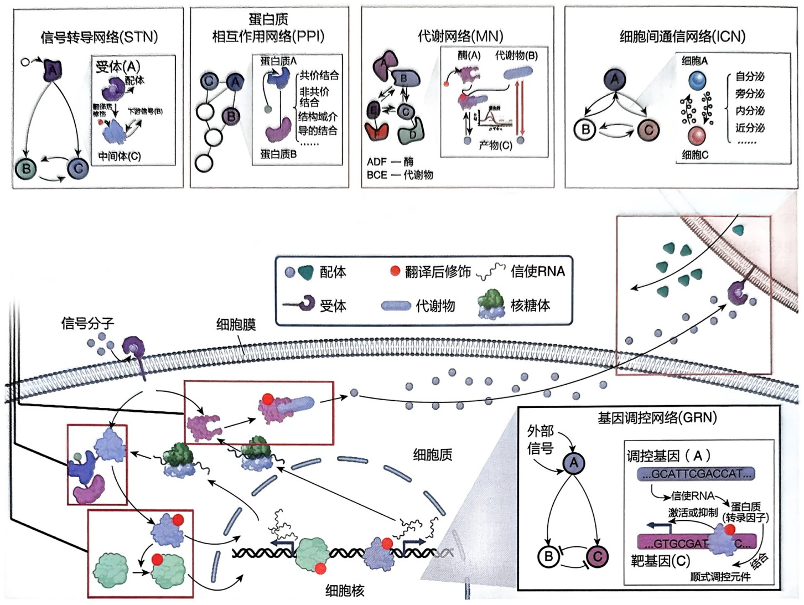
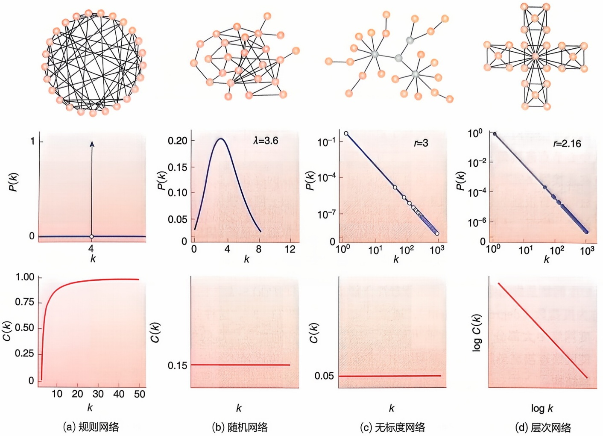
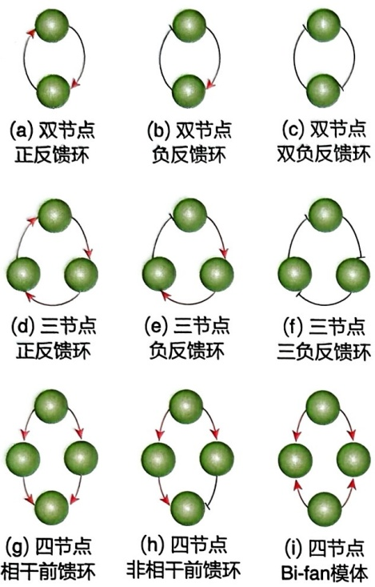
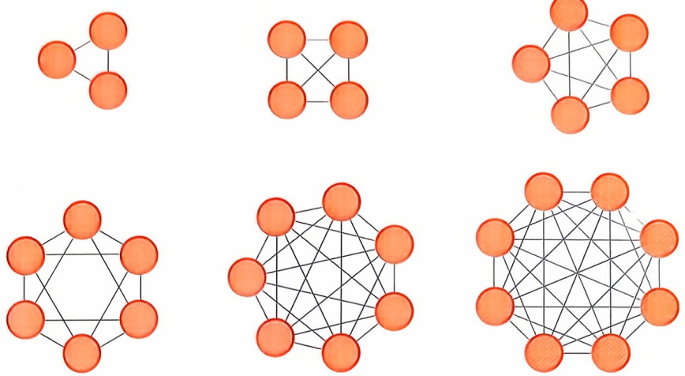
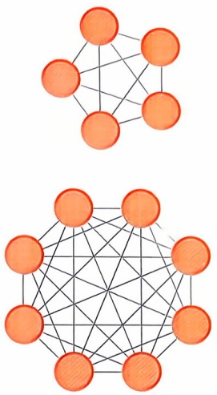
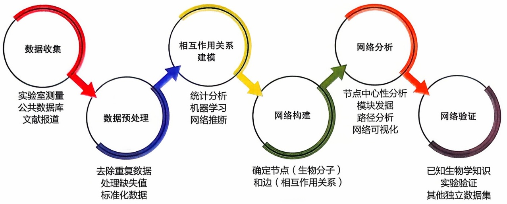
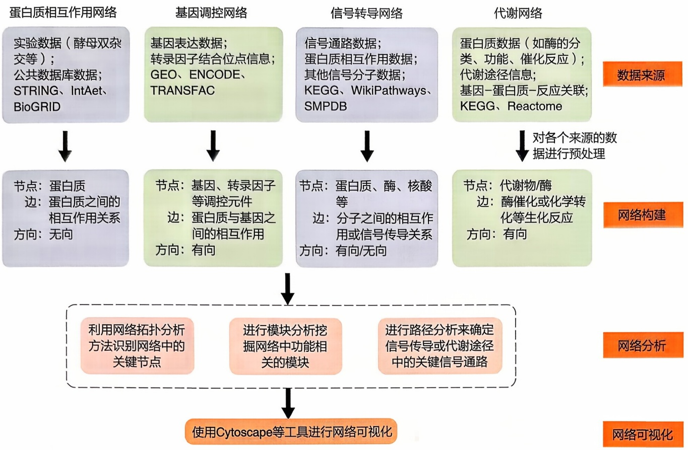
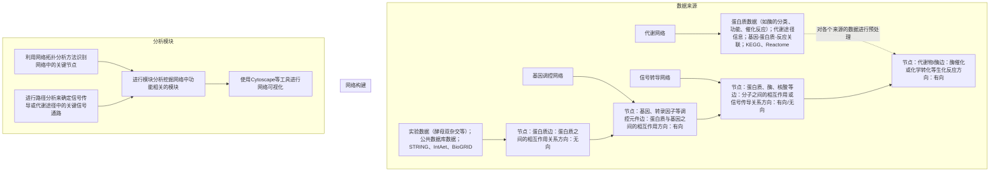

图11-2 整合的生物分子网络样例

包含了 5 种重要的生物分子网络:代谢网络、基因调控网络、蛋白质相互作用网络、细胞间通信网络以及信号转导网络

代谢网络（metabolic network，MN）、信号转导网络（signal transduction network, STN）和细胞间通信网络（intercellular communication network, ICN）是研究最为深入的生物分子网络。这些网络通常由参与生物过程的众多分子元件组成，其中基因和蛋白质是关键的构成要素（图11-2）。

然而，从系统的角度来看，关键在于元件之间的相互关系，而非元件本身。在生物分子网络中，关系可以体现为分子与分子之间的相互作用，或某种化学反应。为了清晰地重构和分析这些网络，首先需要明确网络的基本概念。

## 11.2.1.1 网络的定义

通常可以用图 $G = (V, E)$ 表示网络（network），其中 $V$ 是网络中节点的集合，每个节点代表一个生物分子；$E$ 是边的集合，每条边代表节点之间的相互关系。当 $V$ 中的两个节点 $A$ 与 $B$ 之间存在一条属于 $E$ 的边 $e_1$ 时，称边 $e_1$ 连接 $A$ 与 $B$ ，或者称 $A$ 连接于 $B$ ，也称为 $B$ 是 $A$ 的邻居。

## 11.2.1.2 有向网络与无向网络

根据网络中边的方向性，可以将网络分为有向网络和无向网络，如图 11-2 所示。有向网络（directed network）是指边存在方向性的网络，边代表节点之间的依赖关系。无向网络（undirected network）是指边不存在方向性的网络，边代表节点之间的关联关系。例如，基因调控网络是有向网络，其中转录因子调控基因的表达；蛋白质相互作用网络是无向网络，其中蛋白质相互结合，形成复合体。

## 11.2.1.3 加权网络

在现实世界中，网络中的边往往具有不同的意义或数值。例如，在交通网络中，连接两个城市的道路长度可能不同；在互联网中，两台电脑之间的网速可能不同。为了更好地描述这些差异，可以将网络中的边赋予不同的数值，称之为“权重”，这个网络就称为加权网络（weighted network）。如果网络中所有边的权重都相等，则称该网络为等权网络或无权网络（unweighted network）。

权重可以用来表示节点之间的距离、相关性、强度等信息，具体含义取决于网络和边本身所代表的意义。在生物网络中，边的权重可以用来表示基因表达水平的差异、蛋白质相互作用的强度、代谢反应的速率等信息。例如，在基因调控网络中，权重可以表示转录因子对靶基因表达的调控强度；在蛋白质相互作用网络中，权重可以表示蛋白质相互作用的亲和力；在代谢网络中，权重可以表示酶催化的反应速率。

## 11.2.1.4 二分网络

如果一个网络中的节点可以分为两个互不相交的集合，并且所有的边都连接着来自不同集合的节点，那么这个网络就称为二分网络（bipartite network）。二分网络就像一个“红蓝配”的游戏，红蓝两队的人只能与对方队伍的人配对。在现实世界中，二分网络可以用来描述很多事情，例如，“药物-疾病”网络:药物可以与特定的疾病蛋白结合，发挥治疗作用。这可以用二分网络来表示，其中药物是“红队”，疾病蛋白是“蓝队”。

## 11.2.1.5 网络中的路径与距离

网络中的路径是指一系列节点，其中每个节点都有一条边连接到紧随其后的节点。对包含节点数目有限的路径来说，第一个节点称为起点，最后一个节点称为终点，两者均可称为路径的端点，其余的节点称为路径的内点或中继点。这样的路径也称为连接起点与终点的路径。例如，图11-2中代谢网络中，从节点 $A$ 到 $E$ 的路径有 $l_{1} = \{ABCE\}$ 和 $l_{2} = \{ABE\}$ 。对无向网络来说，只要将路径的顺序颠倒就可以得到从原来的终点指向起点的路径，但是在有向网络中，起点与终点是不可逆的，如图11-2所示信号网络中节点由 $A$ 出发到节点 $B$ 间存在路径 $l = \{AB\}$，但 $B$ 不能找到路径回到 $A$。

网络中如果两个节点间能够由一条路径连接，则称这两个节点是连通的。所有能够彼此连通的节点和它们之间的边构成了一个连通分量。

路径中经过边的权重之和称为路径的权重，也称为路径的长度。对于等权网络而言，路径的长度即为路径中所经过边的数目，上述图11-2代谢网络中从节点 $A$ 到节点 $E$ 的路径中，$l_{1}$ 长度为3，$l_{2}$ 的长度为2。

在连接两个节点的所有路径中，长度最短的路径称为最短路径，最短路径的长度称为从起点到终点的距离，上述图11-2代谢网络中从节点 $A$ 到节点 $E$ 的距离为2。

## 11.2.2 常见生物网络及数据库

## 11.2.2.1 基因调控网络

基因调控网络是描述基因调控过程的网络图，它以转录因子等调控因子和受调控基因作为节点，以调控关系作为边的有向网络。根据转录因子是促进还是抑制受控基因的表达，调控网络中的边可以分为正调控和负调控。

常用的基因调控数据库包括 TRANSFAC、TRRD、RegulonDB 和 AnimalTFDB 数据库等（见第 4 章）。此外，JASPAR 和 DBD 等数据库也提供了丰富的有关转录调控的信息。

## 11.2.2.2 蛋白质相互作用网络

蛋白质互作是指两个或多个蛋白质之间发生的物理或遗传相互作用。蛋白质互作是生命活动的基础，在细胞的各种生命活动中发挥着重要的作用。蛋白质互作通常可以分为物理互作和遗传互作。物理互作是指蛋白质间通过空间构象或化学键彼此发生的结合，是蛋白质互作的主要研究对象。而遗传互作则是指在特殊环境下，蛋白质或其编码基因受到其他蛋白质或基因影响，常常表现为表型变化之间的相互关系。

蛋白质相互作用网络是系统显示蛋白质互作信息的基本方法。将蛋白质作为节点，相互作用关系作为边，将蛋白质组整体连接到一个系统网络当中。一般情况下，蛋白质相互作用网络是一个规模较大的无向网络。目前，蛋白质相互作用网络是研究最充分的生物分子网络，蛋白质相互作用网络也往往是规模最大的生物分子网络，常常包含数千甚至上万个节点以及为数更多的边。

目前，已经有大量蛋白质互作数据存储在公共数据库中，提供了大量的蛋白质相互作用信息，其中包括 BIND 数据库、DIP 数据库、MIPS 数据库和 BioGRID 数据库等（见第 4 章）。从这些数据库中，可以查询得到不同物种的蛋白质互作信息及其实验证据。

## 11.2.2.3 代谢网络和信号转导网络

## (1) 代谢通路和代谢网络

在生物化学中，代谢通路（metabolic pathway）是指细胞中代谢物在酶的作用下转化为新的代谢物过程中所发生的一系列生物化学反应。而代谢网络则是指由代谢反应以及调节这些反应的调控机制所组成的描述细胞内代谢和生理过程的网络。

代谢网络是研究细胞代谢过程的重要工具。它可以帮助我们了解细胞如何获取能量、合成生物分子，以及如何对环境变化做出反应。

## （2）信号转导通路和信号转导网络

生物中的信号转导是指细胞将一种类型的生物信号刺激转换为其他生物信号最终激活细胞反应的过程。同代谢通路一样，信号转导（signal transduction）的过程中多个生物分子在酶作用下按照一定顺序发生一系列生理化学反应，由此得到了信号转导通路。信号转导网络即是指参与信号转导通路的分子和酶以及其间所发生的生化反应所构成的网络。

信号转导网络是研究细胞信号转导过程的重要工具。它可以帮助我们了解细胞如何感知外界刺激、如何对刺激做出反应，以及如何与其他细胞进行交流。

## （3）代谢网络和信号转导网络的复杂性

代谢网络和信号转导网络中包括大量不同的通路，而每条通路也包含不同的生物分子之间的多种生理和化学反应，因此代谢网络具有不同于其他生物分子网络的复杂性。根据研究的目的常常需要构建不同层次的代谢网络。通常包括以下三种网络。

① 完全网络 最完整地保存代谢通路中各个反应，以及每个反应中的底物、产物和酶，如果同一个酶参与不同反应则在网络中应以不同的节点表示。
② 多反应物网络 网络包含参与生物通路的代谢物即底物、产物和酶的有向网络，其中每种代谢物只由一个节点表示，边由底物指向产物，酶与底物、产物之间的边则可以由双向边来表示，也可以作为边的属性。
③ 主要反应物网络 在一些研究中，研究者不关心代谢反应中的酶和其他一些辅因子，如提供磷酸键的 ATP 等，由此就得到了只包含主要代谢底物指向主要产物的网络。

## 11.2.2.4 细胞间通信网络

## (1) 细胞间通信: 细胞对话的艺术

细胞是生命的基本单位，但它们并非独立存在。为了维持生命活动，细胞需要相互交流，传递信息。这种细胞之间的对话被称为细胞间通信。细胞间通信对于维持生命至关重要。它可以帮助细胞协调活动、抵御外界侵袭、维持体内平衡。例如，当皮肤受到损伤时，细胞会通过细胞间通信释放信号，招募免疫细胞前来修复伤口。

## (2) 细胞间通信的多种方式

细胞间通信的方式多种多样，主要可以分为以下几类。

① 直接接触 细胞膜直接接触，通过跨膜蛋白传递信息。
② 旁分泌通信 细胞分泌信号分子，被附近细胞上的受体接收。
③ 内分泌通信 细胞分泌激素，通过血液循环传递到远处的靶细胞。
④ 自分泌通信 细胞分泌信号分子，作用于自身。

## （3）系统生物学研究细胞间通信网络

传统的生物学研究往往关注单个细胞，而系统生物学则将细胞间通信作为网络来进行研究。这种方法可以帮助我们更全面地理解细胞是如何相互作用的。

系统生物学研究细胞间通信网络的基本结构及其在信息传递过程中的作用原理。通过研究细胞间通信，我们可以找到新的治疗疾病的方法，如开发靶向细胞间通信通路的药物。

当前，构建细胞间通信网络的主要方法依赖于配体-受体相互作用。大多数基于scRNA-Seq数据的细胞间通信推断，通常被理解为一种共表达分析。这种分析利用一个细胞中的配体与另一细胞中相应受体的表达模式来推断由相应蛋白质结合介导的细胞间通信机制。然而，值得注意的是，转录本丰度与翻译出的蛋白质丰度并不总是直接相关，仅凭配体-受体对的表达并不能完全保证功能性细胞间通信的存在。同时，细胞间通信的方式还受其空间位置和距离的影响。因此，单独依靠单细胞RNA测序来预测细胞间通信是不够的，必须考虑空间分布趋势和实际的细胞类型分布。将组织学信息与空间数据相结合至关重要，以准确识别细胞间通信。最近的空间转录组技术进步使得将空间信息与转录组数据整合在一起成为可能，从而可以更好地理解细胞间通信网络的空间组织。此外，细胞在多细胞生物体内的通信是一个高度复杂和动态的过程，既涉及空间维度也包括时间维度。因此，还需要整合多种数据信息，如基因表达、表观遗传修饰和蛋白质相互作用。然而，目前的分析方法往往侧重于单一的数据模式，限制了我们对潜在相互作用的全面理解。因此，迫切需要能够整合多种数据模式的方法，以实现对细胞通信网络的整体构建。

## 11.2.3 生物网络的可视化原理和工具

生物网络图的可视化在系统生物学中扮演着重要的角色，通过展示和分析基因调控网络、蛋白质相互作用网络、代谢网络等复杂的生物系统，研究人员可以揭示生物系统的结构和功能。以下将详细介绍几种常用的生物网络图可视化的主要原理和工具。

## 11.2.3.1 生物网络的可视化原理

## (1) 圆形布局

也称为圆环布局或环形布局，是一种常见的网络可视化方法。其基本原理是将图中的节点（即生物分子如基因、蛋白质等）沿着一个圆周均匀排列，然后根据节点之间的关系（如相互作用、调控关系等）绘制边（即连线）。这种布局适用于展示周期性或对称结构。

## (2) 力导向布局

该算法模拟物理系统中的排斥力和吸引力，使节点的位置趋向于一个能量最小化的状态，从而展示网络中的簇和模块。在这种布局中，将边模拟为弹簧，连接的节点之间会施加吸引力，这种力使得相连的节点趋向彼此靠近。而排斥力类似于带同种电荷的粒子之间的排斥力，所有节点之间（无论是否直接连接）都会施加排斥力。排斥力一般与节点之间距离的倒数成正比，使节点间不会过于接近。例如，Fruchterman-Reingold算法常用于这种布局。在Fruchterman-Reingold算法中，吸引力的计算公式为:

$$
F _ {a t t r} (u, v) = C _ {s p r i n g} \times \log \left(\frac {d i s t}{l}\right) \times d i r \tag {11-1}
$$

其中，dist 是节点 $u$ 和 $v$ 之间的欧氏距离，dir 是从节点 $v$ 指向节点 $u$ 的单位向量，$l$ 是两个节点之间的理想距离，$C_{spring}$ 是决定弹簧力强度的常数。

排斥力的计算公式为:

$$
F _ {r e p} (u, v) = \frac {C _ {r e p}}{d i s t ^ {2}} \times d i r \tag {11-2}
$$

其中，dist 是节点 $u$ 和 $v$ 之间的欧氏距离，dir 是从节点 $u$ 指向节点 $v$ 的单位向量，$C_{rep}$ 是决定排斥力强度的常数。

## (3) 层次布局

适用于具有明确层次结构或方向性的网络。这种布局方法通过将节点按照某种层次或顺序排列，通常从上到下或从左到右，使得网络的层次关系清晰可见。每个层次代表一个特定的级别或阶段，例如，在基因调控网络中，上层节点可能是转录因子，下层节点是它们调控的基因。层次布局还可应用于信号转导路径以及代谢途径的构建。

## (4) 簇布局

适用于展示网络中具有明显簇结构或模块化特征的情况。簇布局的核心思想是将网络节点分组，根据它们的簇或模块关系进行排列，使得同一簇内的节点尽可能靠近，而不同簇之间的节点相对分离。簇布局能够清晰展示网络中的模块或簇结构，突出显示不同模块间的关系。通过将同一簇的节点靠近排列，减少了网络图中的混乱，提高了可读性。

## (5) 树状布局

该布局方式特别适用于那些自然呈现出分层结构的生物网络，如进化树、基因调控路径、分类树等。树状布局的方法如下:① 从根节点开始，布局通常从根节点开始，然后逐层展开。每一层的节点排列在一条水平线上，表示它们属于同一个层次。② 递归分布，从根节点开始，使用递归方法，逐层将节点在图中展开。每个节点的子节点根据父节点的位置左右分布，形成树状结构。③ 节点间距调整，根据树的深度和宽度调整节点之间的距离，确保图形的可读性和美观性。通常使用预定的间距，使得每一层的节点分布均匀。

## 11.2.3.2 生物网络的可视化工具

目前主要的生物网络可视化的主流方法主要由 Cytoscape 所实现。Cytoscape 最初于 2003 年发布，是一个开源的生物网络分析软件，专注于可视化生物网络数据和进行网络分析。它支持导入各种数据格式并提供丰富的分析插件，是功能强大且使用广泛的生物网络分析和可视化工具。

Cytoscape 主要特点有以下 4 点。

## (1) 网络可视化

Cytoscape 提供了丰富的网络可视化功能，用户可以将生物网络数据以图形方式呈现，帮助直观理解网络结构。

## (2) 数据导入和整合

支持导入多种数据格式，包括生物网络数据、基因表达数据等，便于用户整合不同数据源进行分析。

拓展阅读 11- 1

Cytoscape 网络分析平台简介

## （3）丰富的分析插件

Cytoscape 拥有大量的分析插件，用户可以根据需要选择安装不同的插件，进行网络分析、功能富集分析等。一些常见的 Cytoscape 插件包括:

① cytokegg 用于在 Cytoscape 中集成 KEGG 通路数据，帮助用户分析基因通路和功能富集。
② clustermaker2 用于进行网络聚类和聚类分析，帮助用户发现网络中的模块结构。

③ CytoNCA 提供网络中心性分析工具，包括节点度中心性、介数中心性等，帮助用户识别关键节点。

④ MCODE 用于网络模块检测，帮助用户识别网络中的密集连接模块。

⑤ BiNGO 用于进行功能富集分析，帮助用户了解网络中显著富集的生物学过程和通路。

## (4) 社区支持

Cytoscape 拥有庞大的用户社区和开发者社区，用户可以在社区中获取支持、分享经验和下载其他用户分享的插件。

除了 Cytoscape 外, 也还有其他的一些生物网络可视化平台和工具, 如 STRING、Pajek。其中, STRING 数据库提供了大量已知蛋白质-蛋白质相互作用数据, 其网页版和工具集可以帮助用户分析和可视化蛋白质相互作用网络。Pajek 是一个用于大型网络分析和可视化的软件, 可以处理包括生物网络在内的各种类型的复杂网络数据。

这些可视化的平台和工具可以帮助研究人员更好地理解生物网络结构、相互作用和通路信息，并为生物信息学和系统生物学领域的研究提供支持。

## 11.3 生物分子网络及特征

生物分子网络是系统生物学研究的核心概念之一，它将细胞内的各种生物分子及其相互作用以网络的形式进行表征。可以通过生物分子网络，可以从整体和系统的角度来理解生命活动，揭示细胞内部的复杂调控机制。

## 11.3.1 网络的拓扑属性

网络的拓扑属性是描述网络本身及其内部节点或边结构特征的测度。这些测度对进一步分析网络结构和探索关键节点有重要的意义。

## 11.3.1.1 连通度

连通度（degree）是描述单一节点的最基本的拓扑性质。节点 $v$ 的连通度是指网络中直接与 $v$ 相连的边的数目，如在图11-2中蛋白质相互作用网络节点 $A$ 的连通度为3。对于有向网络往往还要区分边的方向，由节点 $v$ 发出的边的数目称为节点 $v$ 的出度，指向节点 $v$ 的边数则称为节点 $v$ 的入度。在本章中，符号 $k$ 表示连通度，$k_{\mathrm{out}}$ 表示出度，$k_{\mathrm{in}}$ 表示入度。在图11-2蛋白质信号网络中，节点 $B$ 的入度为2，出度为1。

在网络中，每个节点都有连接其他节点的能力。连通度就是用来衡量一个节点连接能力和数量的指标。对于一个节点，它的连通度等于与其连接的边数。对于一个由 $N$ 个节点和 $L$ 条边组成的无向网络，其平均连通度为 $2L / N$ 。平均连通度可以用来衡量整个网络的连接程度。

连通度是一种简单而十分重要的拓扑属性。它可以帮助我们了解网络的结构和功能。研究表明，在生物分子网络中，连通度较大的节点往往发挥着重要的作用。例如，在蛋白质相互作用网络中，中心节点（hub，连通度较高的节点）往往是必需基因或其翻译产物的编码基因，它们对于支持生命基本活动至关重要。此外，人类蛋白质相互作用网络的研究表明，中心节点显著富集着与癌症等疾病相关的基因。因此，连通度可以作为一种重要的指标来识别生物分子网络中的关键节点，并进一步研究这些节点的功能和作用。

## 11.3.1.2 聚类系数

在许多网络中，如果节点 $v_{1}$ 连接于节点 $v_{2}$，节点 $v_{2}$ 连接于节点 $v_{3}$，那么节点 $v_{3}$ 很可能与 $v_{1}$ 相连接。这种现象被称为三角关系，它体现了部分节点间存在的密集连接性质。三角关系在社交网络、生物网络等许多现实网络中都普遍存在。例如，在社交网络中，如果 $A$ 是 $B$ 的朋友，$B$ 是 $C$ 的朋友，那么 $A$ 和 $C$ 也很有可能成为朋友。聚类系数（clustering coefficient，CC）是用来衡量网络中三角关系数量的指标。对于一个无向网络，节点 $v$ 的聚类系数定义为:

$$
C C _ {v} = \frac {n}{C _ {k} ^ {2}} = \frac {2 n}{k (k - 1)} \tag {11-3}
$$

其中，$n$ 表示在节点 $v$ 的所有 $k$ 个邻居间边的数目。在无向网络中由于 $n$ 的最大数目可以由邻居节点的两两组合数 $C_k^2 = k(k - 1)/2$ 来确定，所以 $CC$ 值位于 $[0, 1]$ 区间。当节点 $v$ 的所有邻居都彼此连接时，$v$ 的聚类系数 $CC_v = 1$；相反，当 $v$ 的邻居间不存在任何连接时，$CC_v = 0$。

在有向网络中，由于两个节点间可以存在两条方向相反的边，则标准化的聚类系数被定义为:

$$
C C _ {v} = \frac {n}{P _ {k} ^ {2}} = \frac {n}{k _ {\mathrm{out}} (k _ {\mathrm{out}} - 1)} \tag {11-4}
$$

其中， $k_{\mathrm{out}}$ 指 $v$ 的出度， $n$ 指所有 $v$ 所连接的节点彼此之间存在的边的数目。

## 11.3.1.3 介数

一个节点的介数（betweenness）是衡量这个节点出现在其他节点间最短路径中的比例。节点 $v$ 的介数 $B_{v}$ 定义如下:

$$
B _ {v} = \sum_ {i \neq j \neq v \in V} \frac {\sigma_ {i v j}}{\sigma_ {i j}} \tag {11-5}
$$

其中，$\sigma_{ij}$ 表示节点 $i$ 到节点 $j$ 的最短路径的条数，$\sigma_{ivj}$ 表示其中通过节点 $v$ 的路径条数。

介数也可以用标准化至 $[0,1]$ 区间的形式表示:

$$
B _ {v} = \frac {1}{(N - 1) (N - 2)} \sum_ {i \neq j \neq v \in V} \frac {\sigma_ {i v j}}{\sigma_ {i j}} \tag {11-6}
$$

式中，N 是网络中的节点数。介数表明了一个节点在其他节点彼此连接中所起的作用。介数越高，意味着在保持网络紧密连接性中节点越重要。

## 11.3.1.4 紧密度

紧密度（closeness）是描述一个节点到网络中其他所有节点平均距离的指标。节点 $v$ 的紧密度 $C_v$ 定义如下:

$$
C _ {v} = \frac {1}{N - 1} \sum_ {j \neq v \in V} d _ {v j} \tag {11-7}
$$

其中， $d_{vj}$  表示节点 v 到节点 j 的距离。紧密度测度衡量节点接近网络 “中心” 的程度，紧密度测度越小，节点越接近中心。

## 11.3.1.5 拓扑系数

类似于聚类系数，拓扑系数（topology coefficient）是反映互作节点间共享连接比例的测度，节点 $v$ 的拓扑系数 $T_{v}$ 可以定义为:

$$
T _ {v} = \frac {1}{| M _ {v} |} \sum_ {t \in M _ {v}} C _ {v, t} / \min \{k _ {v}, k _ {t} \} \tag {11-8}
$$

其中， $C_{v,t}$  表示与节点 v 和节点 t 都连接的节点数。 $M_{v}$  为所有与节点 v 分享邻居的节点集合。拓扑系数反映了节点的邻居间被其他节点连接在一起的比例。但同时，拓扑系数只考虑了网络的局部结构，而忽略了网络的全局结构。此外，拓扑系数对节点的度（连接数）非常敏感，度高的节点往往具有更高的拓扑系数。

## 11.3.1.6 直径

直径（diameter）是描述网络总体性质的一个属性。网络的直径是指网络中任意两个连通节点间距离的最大值。网络的直径代表了网络中节点连接可能出现的最远距离，标志着网络紧密的程度。

## 11.3.1.7 网络的平均距离

网络的平均距离也是描述网络总体性质的一个属性。网络的平均距离是指网络中任意两个连通节点距离的平均值，也是衡量网络紧密程度的重要指标。

## 11.3.1.8 连通度的分布函数和聚类系数函数

通过统计不同连通度的节点占全部节点的比例，能够得到一种重要的描述网络连通性的属性:连通度的分布函数  $P(k)$ ， $k=1,2\cdots$ 。而类似的还可以建立起随连通度变化的聚类系数函数  $CC(k)$ ，当自变量等于 k 时， $CC(k)$  即为连通度为 k 的节点聚类系数的平均值。与连通度分布函数  $P(k)$  类似， $CC(k)$  也广泛应用于描述网络结构的基本性质。相比于拓扑性质指标的平均数，由于连通度的分布函数以及依赖于连通度的聚类系数函数包含更多的信息，对分布函数的分析往往可以揭示更为深刻的网络性质。

## 11.3.2 无标度网络

无标度（scale free）网络于1999年首次被提出，近年来，人们在互联网和人际关系网络等社会学网络的研究中都发现了这一特性。无标度网络中，大部分节点通过少数中心节点连接到一起，这就意味着节点在网络中的地位是不平等的，中心枢纽节点在连接网络完整性方面起更加重要的作用。枢纽节点的存在使得无标度网络对意外故障具有很强的鲁棒性。因为即使少数枢纽节点失效，网络整体的连通性仍然能够保持。然而，无标度网络也因此对协同攻击更加脆弱。因为攻击者只需要集中攻击少数枢纽节点，就能够使整个网络瘫痪。

## 11.3.2.1 无标度网络定义

无标度网络是指网络中连通度的分布符合幂律分布，即 $P(\mathrm{k}) \sim k^{-\gamma}$ 的网络，式中 $\gamma$ 称为度指数（degree exponent），通常 $2 < \gamma < 3$ （图11-3）。这种分布说明，在无标度网络中大部分节点的连通度较低，但存在少数连通度非常高的枢纽节点（hub）使网络连接在一起。在这种网络中，平均连通度等标度已经不足以描述网络的规模和结构。

如果网络中节点间的连接完全是随机的，那么连通度的分布应该符合泊松分布或者在大尺度的情况下近似认为符合正态分布，即度的分布比较均匀，大部分节点的连通度都与平均连通度相差不多，只有极少数节点具有很低或很高的连通度（图11-3）。

小世界网络中，直径或网络平均距离与节点数目的对数成正比，即 $1 \sim \log(N)$。相反，大世界网络的平均距离正比于 $N$。对于包含大量节点的网络，其直径往往相对要小得多，任意两个节点间只需要较少的转接即可以连接在一起。一方面网络中包含有大量节点和边，表现出“大世界”的景象；另一方面，连接任意节点间的距离却相对较小，即网络的平均路径长度较短，呈现“小世界”的特征。这种“小世界”网络往往聚类系数也较小，是复杂系统网络的共同特性，因此成为目前网络研究分析的一个热点问题。

由于枢纽节点的存在，无标度网络通常具有小世界的特性，即平均路径长度较短、聚集系数较高。然而，无标度网络的直径通常远小于随机网络的直径。这是因为在无标度网络中，即使只经过少数的枢纽节点，就可以到达网络中的大部分节点。一般来说无标度网络直径的大小正比于网络中节点数目对数值的对数值， $1 \sim \log[\log(N)]$ 。由此可以发现无标度网络往往比一般小世界网络直径更小，联系更紧密，形成超小网络。

## 11.3.2.2 无标度网络形成的生物模型

为了解释包括大部分生物分子网络在内的复杂系统网络成为无标度网络的原因，Barabási 和 Albert 提出了形成无标度网络的 Barabási-Albert 模型。

图11-3 规则网络、随机网络、无标度网络和层次网络及其连通度分布和聚类系数函数趋势图

（a）规则网络（regular network），其连通度为固定值（分布符合 $\delta$ 函数），平均聚类系数为 $\frac{k - 2}{k - 1}$；（b）随机网络（random network），其连通度符合泊松分布（示意网络中 $\lambda = 3.6$），在大尺度情况下近似于服从正态分布平均聚类系数独立于连通度；（c）无标度网络（scale free network），其连通度分布符合幂律分布（示意网络中 $r = 3$），该无标度网络属于Barabási-Albert模型，平均聚类系数独立于连通度；（d）层次网络（hierarchical network），其连通度分布符合幂律分布（示意网络中 $r = 2.16$），平均聚类系数与连通度的倒数成正比

该模型首先从一个包含 $m_0$ 个节点的网络开始，其中 $m_0 \geqslant 2$ ，初始网络中每个节点的连通度都应该大于零，否则在后续过程中将无法与网络连接。而后，通过一个循环过程扩大网络，在每次循环中只增加一个节点，并依次按照概率 $\pi_i = \frac{k_i}{\sum_{v \in v} k_v}$ 决定是否与原网络中节点 $i$ 建立连接，其中 $k_i$ 是节点 $i$ 的连通度。因此，原有连通度较高的节点将更有机会与新加入节点连接，从而获得更高的连通度。按照这种机制构建起的网络即可以得到无标度网络。

根据这一模型，有学者提出蛋白质相互作用网络中出现无标度特性的原因在于基因复制，即在细胞分裂过程中复制产生的基因产物会与相同的蛋白质发生相互作用。与发生复制的蛋白质连接的蛋白质节点将会获得新的连接，因此，高度连接的节点更有可能与发生复制的基因产物发生互作，从而获得额外的连接，最终形成蛋白质相互作用网络的无标度特性。

同时，还有其他模型对蛋白质相互作用无标度网络的形成原因进行解释。例如，认为无标度特性是来自目前的诱饵-猎物模式的蛋白质相互作用检测方式和目前还远未完善的数据资源。在来自不同结构的随机网络背景中按照诱饵-猎物模式抽取部分网络，结果发现来自其他模型的数据也可能随机抽选出无标度的子网。

## 11.3.3 生物分子网络的模块性和层次性

## 11.3.3.1 生物分子网络的模块性

生物系统中普遍存在着模块化的现象。这意味着生物系统的许多功能是由多个相互作用的组件共同完成的。这些组件可以是蛋白质、核酸、细胞器等。生物分子网络中这种由许多分子相互联通形成的稳定结构，内部彼此高度连接，称为网络“模块”（module）。模块化的设计使得生物系统具有以下优点:① 提高效率，模块化可以将复杂的功能分解成更小的、更易于管理的子功能，从而提高系统的效率；② 增强鲁棒性，模块化可以使系统更加鲁棒，因为即使其中一个模块出现故障，其他模块仍然可以正常工作；③ 促进进化，模块化可以促进系统的进化，因为新的模块可以通过组合现有的模块来形成。

模块化的网络连通更为紧密。与同样规模的随机网络相比，虽然拥有相同的节点数与边数，模块化网络的连接却更为紧密，这一现象可以由聚类系数 CC 的提高表现出来。同时，模块化的网络往往也同时具有无标度的特性，即存在一些连通度较大的中心节点连接起不同的模块。连通度的分布  $P(k)$  符合 k 的幂律分布（图 11-3）。

此外，聚类系数依赖于连通度的函数 $C(k)$ 在网络的模块性判别中也起到了重要的指示作用。模块化的性质说明大型复杂网络是由内部密集互作的小模块通过少数中心节点连接在一起的。这就意味着，大型模块化网络中连通度较低的节点往往具有较高的聚类系数，而另一方面，连通度较高的节点连接了不同的模块，从而使其聚类系数比较低。

考虑到很多真实网络当中同时具备模块性、无标度性以及局部高连接性的特征，学者提出节点整合成为网络的过程类似一个循环迭代的过程，从而使网络成为一个层次性网络（图11-3）。在此类网络中，聚类系数函数 $C(k)$ 正比于 $k$ 的倒数（图11-3）。

研究显示，不同的生物分子网络往往表现出相似的性质。大部分的真实生物网络如代谢网络、蛋白质相互作用网络等都是无标度网络，其网络平均聚类系数都比具有同样大小和连通度分布的随机网络更高，且聚类系数均值正比于连通度的倒数，从而表明层次性也是生物网络的一项基本性质。

## 11.3.3.2 网络模体的定义与特征

网络模体（network motif）是指网络中出现次数显著超过随机网络中出现次数的子网模式。这里子网模式是指一组节点按照特定的顺序连接而成的结构。针对不同网络的研究显示，在真实的网络中不同的子网模式出现的频率并不一致，有些模式在网络中频繁出现，远远超过随机网络中期望出现的次数。在某些网络中，特定出现的模体甚至是整个网络的基本组织形式，网络可以被看作是这些网络模体的组合。在生物分子网络中，无论是有向网络还是无向网络，都包含有这些特殊的网络模体。在生物分子网络中搜索特殊模体有助于深入理解生物网络执行生物功能的基本形式，也有助于进一步从网络中发现节点间的功能联系。

图11-4 有向网络模体案例

(引自 Azeloglu & Iyengar, 2015)

## 11.3.3.3 生物网络中的常见模体及其作用

研究者从基因调控网络等有向网络中发现了一些特殊的模体，比较重要的有自调控环（auto-regulator loop，ARL）、前馈环（feedforward loop，FFL）和反馈环（feedback loop，FBL）等（图11-4）。

自调控环模体包括正向自调控环和负向自调控环，即转录因子促进或抑制自身转录的机制。在大肠杆菌基因调控网络中存在较多的自调控模体。

前馈环模体则是在很多物种中常见的一种调控机制，即转录因子A调控转录因子B和基因C，而同时转录因子B也调控基因C。事实上，由于调控机制本身可以为正向和负向，前馈环还可以分为8种不同的类型。出现频率较多的有两种，一种是全部正向调控的一致前馈

环，另一种是 A 正向调控 B 和 C，但 B 负向调控 C 的不一致前馈环。

反馈环由同一个转录因子同时调控多个基因的表达，转录因子通常是自调控的，而所有调控符号（正、负向）都相同，且受控基因都不再受其他因子调控。这种模块在随机网络中并不多见，但在针对大肠杆菌（Escherichia coli）基因调控网络的分析中发现该模块经常出现在与蛋白质组装和代谢通路相关的基因调控中。在此类问题中，由一个转录因子控制参与生物过程基因的表达，能够有效地保持受控基因的比例，提高效率。

除上述模体外，研究者在调控网络中还发现了其他一些模体，如密集重叠调控（dense overlapping regulation, DOR）、多输入模体（multi input motif, MIF）和调控链（regulatory chain, RC）等。这些不同的网络模体结构代表了不同的转录调控机制，对这些模体的研究将极大地帮助人们了解生物过程的控制机制。

在无向网络中也可能存在一些特殊的模体，在生物网络中出现的频率远超过随机的情形，其中比较重要的是全连接集（clique）。全连接集是指任意两点都被边连接在一起的子网。如果全连接集中包含 $n$ 个节点，则称这个全连接集为 $n$-全连接集（图11-5）。

## 11.3.3.4 网络模体搜索算法

网络模体搜索算法指在网络中寻找与模体同构子网的过程。要从一个包含 $N$ 个节点的网络搜索模体的过程包括:① 定义包含 $k$ 个节点的子网模式；② 在网络中搜索全部 $C_N^k$ 个包含 $k$ 个节点的节点子集，并检查其中结构与所搜寻的模式相符的个数；③ 将各个模式在真实网络中出现的频率和在大量随机网络背景中所出现的频数进行比较，从而发现网络模体。

网络模体搜索是指在复杂网络中寻找出现频率远超随机预期的局部子图模式的过程。这一过程在算法上属于非定常多项式（non-deterministic polynomial, NP）完全问题，这意味着解决这一问题的计算时间可能需要花费指数级的时间。对于包含更多节点的子网模式，网络中存在的组合数量将呈指数级增长，需要比较的类型也会随之增多。这导致了网络模体搜索的计算复杂度急剧上升，使得针对大型子网模式的搜索变得极具挑战性。目前，网络模体搜索主要集中在较小的子网

图11-5 全连接集

模式上，以降低算法复杂度。常用的搜索方法包括以下3点。

① 基于统计学的方法 通过统计分析网络中子图模式出现的频率，来识别网络模体。这种方法的计算效率较高，但对子网模式的结构限制较多。
② 基于图论的方法 利用图论算法来挖掘网络中具有特定结构特征的子图模式。这种方法的计算效率较低，但对子网模式的结构限制较少。
③ 基于机器学习的方法 利用机器学习算法来训练模型，自动识别网络模体。这种方法的计算效率较高，但需要大量的训练数据。

## 11.4 生物网络的构建

## 11.4.1 生物网络重构的基本概念和过程

在系统生物学中，生物网络重构是一项重要任务，涉及从分子水平到细胞、组织和整个生物体系的各个层级，将生物分子（如基因、蛋白质和代谢物）之间的相互作用关系表示为网络结构，从而对生物系统进行建模和分析。生物网络的构建是将生物学实体表示为节点，实体与实体间的相互作用关系表示为边。

生物网络重构的基本过程包括以下几个步骤，如图11-6所示。

① 数据收集 收集与研究对象相关的实验数据。这些数据可以来自实验室测量、公共数据库、文献等多个来源。例如，蛋白质相互作用数据可以来自高通量实验技术，基因调控数据可以来自转录因子结合位点的实验测定等。
②数据预处理 对收集到的数据进行预处理和清洗，以去除噪声和不可靠的数据，包括去除重复数据、处理缺失值、标准化数据等步骤，以确保数据的质量和一致性。
③ 相互作用关系建模 基于预处理好的数据，建立相互作用关系的模型。可以通过统计分析、机器学习、网络推断等方法来实现。例如，基于蛋白质相互作用实验数据，使用网络推断算法推断蛋白质之间的相互作用关系等。

flowchart

图11-6 生物网络重构的基本过程

④ 网络构建 根据建立的相互作用模型构建生物网络，将生物分子表示为节点，将它们之间的相互作用关系用边表示。网络构建的方式取决于具体研究问题涉及的网络类型和数据类型。
⑤ 网络分析 对构建的生物网络进行分析，揭示网络的特性和生物系统的行为。包括节点中心性分析、模块发掘、路径分析、网络可视化等，从而识别关键的生物分子、理解网络的功能和调控机制。
⑥ 网络验证 对构建的生物网络进行验证，确保网络的准确性和可靠性。验证的过程主要通过与已知生物学知识的比较、实验验证或与其他独立数据集的对比来实现。

在系统的视角里，重要的不是每个生物组件本身及其状态，而是关注组件之间的相互连接所构成的系统整体状态，形成“组件 $\rightarrow$ 网络 $\rightarrow$ 体外模型 $\rightarrow$ 表型”的系统生物学新范式。网络的结构决定了可能的功能状态，整个网络的功能状态可以通过细胞在特定环境中产生的多种数据进行评估，如基因组尺度的表达数据和表型数据。对于网络状态的控制通常通过干扰实验进行评估，网络干扰实验包括遗传干扰（基因敲除、通过抑制性RNA进行基因沉默、基因过表达等）、环境干扰（改变营养物质的可用性、改变温度或pH）、系统性干扰（通过适应性干扰），以及疾病状态等。这些干扰实验可用于评估网络的稳定性和功能性状态。

构建生物分子网络在生物科学领域具有重要的理论和应用价值，有助于揭示生物系统的组织结构、功能模块和调控机制，并发现复杂疾病和性状的重要生物标志物和分子机制。通过分析网络中与疾病相关的基因和蛋白质的位置及其相互作用，可以揭示疾病的潜在机制和关键调控通路，有助于寻找潜在的治疗靶点和药物作用靶点。

## 11.4.2 主要类型生物网络的重构过程

下面对于各种不同类型的生物网络，分别介绍构建的方法和过程，包括蛋白质相互作用网络、基因调控网络、代谢网络、信号转导网络等。图11-7展示的是各种生物网络的数据来源、构建方法，以及通用的网络分析和可视化流程。

flowchart

## 11.4.2.1 蛋白质相互作用网络构建

构建蛋白质-蛋白质相互作用（protein-protein interaction, PPI）网络通常基于三类数据来源（表11-1），第一类是研究者通过自己开展实验产生的PPI数据（如酵母双杂交、免疫共沉淀、质谱检测等），这些数据可以自行选择如何表示和存储；第二类是PPI数据库中的公共数据，这些数据库通过从文献报告的实验证据中提取PPI，是PPI数据的主要来源；第三类是混合数据库或预测数据库，这类数据库将不同的数据库提供的信息汇集在一起，并向用户提供数据的统一表示。预测数据库利用实验产生的蛋白质相互作用数据集，通过算法预测未知的潜在相互作用。随着人工智能的迅猛发展，越来越多的蛋白质结构以及蛋白质-蛋白质相互作用关系能够用AlphaFold3等工具预测，这将极大推动PPI网络构建的完整性和准确性。

表 11-1 蛋白质相互作用网络的三类数据来源

<table><tr><td>数据类别</td><td>来源</td><td>描述</td><td>挑战</td></tr><tr><td>实验数据</td><td>酵母双杂交、免疫共沉淀、质谱检测</td><td>直接从实验中产生的数据,如蛋白质相互作用实验</td><td rowspan="3">实验产生的误差;标识符不一致;数据冗余(同一蛋白质在多个数据库重复报道);数据选择(来源广泛,质量和类型有差异);映射外部信息时不准确、不完整</td></tr><tr><td>有实验证据支持的公共数据库</td><td>IntAct、MINT、STRING、UniHI、APID</td><td>从实验中收集整理获得的蛋白质相互作用数据</td></tr><tr><td>混合数据库和预测数据库</td><td>IMEx</td><td>利用其他数据库通过算法预测蛋白质的相互作用</td></tr></table>

图11-7 几种主要类型的生物网络重构流程图