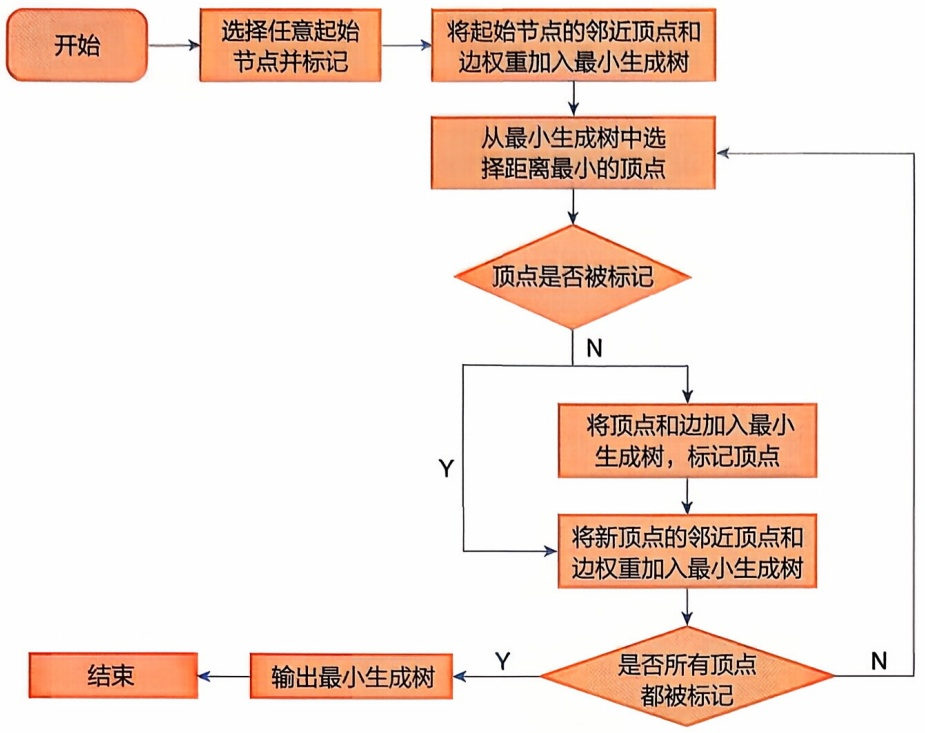
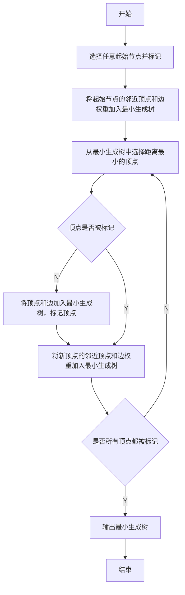
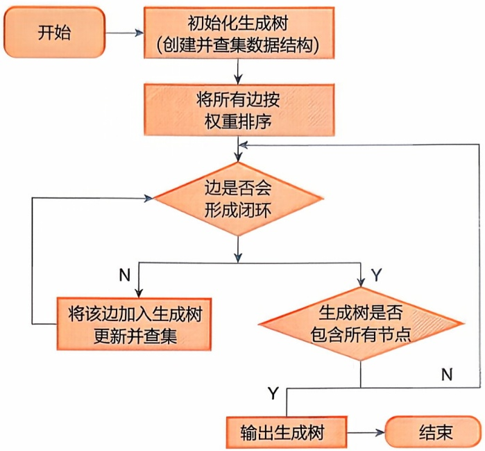
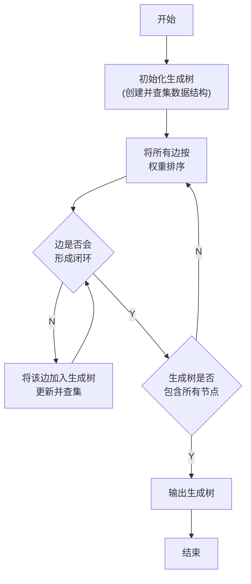
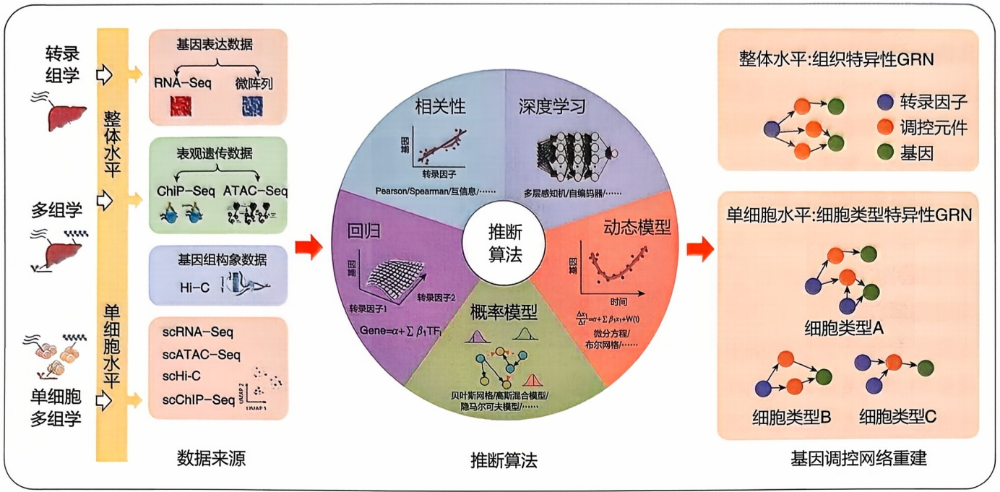
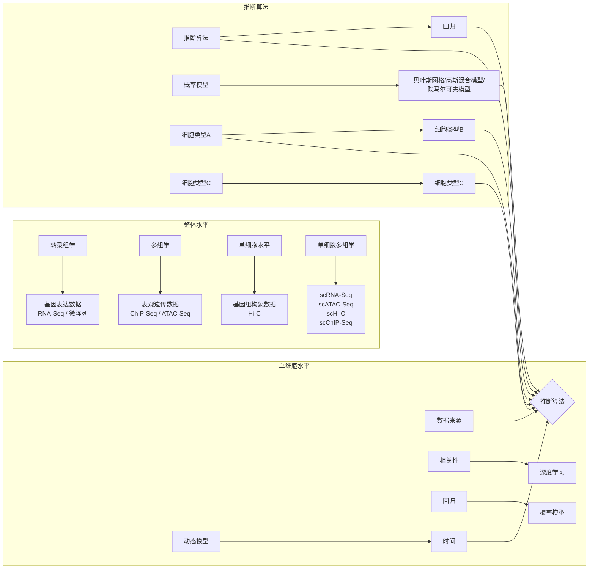
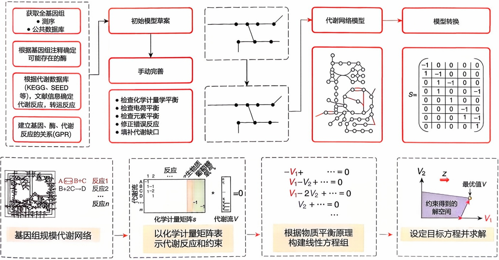
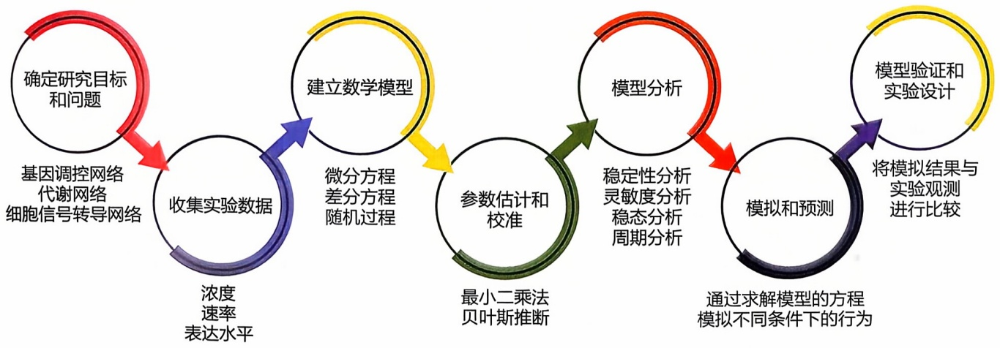

<details>
<summary>flowchart</summary>


</details>

图11-8 Prim算法流程图

在整合数据时,需要对不同来源的数据进行标准化和统一格式处理,包括对蛋白质或基因的标识符进行映射,统一命名规范和数据格式,以确保数据的一致性和可比性。常用的标识符包括 UniProt ID、Entrez Gene ID 等。此外,还需要对数据进行清洗和预处理,去除噪声和冗余数据,处理缺失值和离群值,以提高数据质量和可靠性。

PPI 网络中的每个节点代表一个蛋白质，如果实验数据或计算预测表明两个蛋白质之间存在相互作用，则在这两个蛋白质对应的节点之间创建一条边。边的属性根据相互作用的类型（物理相互作用和功能性相互作用）和强度来定义。相互作用强度的确定

可以参考定量实验数据或某些数据库（如STRING）的评分系统。初步构建PPI网络后，根据需要进行网络的优化和调整，可以删除信号弱的边，添加缺失的重要相互作用等。修正后的PPI网络可用于各种其他分析，如节点的中心性分析、模块识别等。酵母等模式生物的全蛋白质组水平的PPI网络已经被重构出来，人类等高等物种的蛋白质互作数据也在快速积累中。在这样庞大的网络上，需要采用各种计算方法对蛋白质网络进行分析。

构建蛋白质相互作用网络的常用算法包括:最小生成树算法、连通性算法、模块化算法等。

## (1) 最小生成树算法

一种用于求解连通图的最小生成树的方法。假设有一个由10个蛋白质构成的网络，每个蛋白质与其他蛋白质的互作有不同的可信度得分。使用最小生成树算法，我们可以找出连接这10个蛋白质的9条最可信的边，从而获得一个核心互作网络。常见的最小生成树算法包括Prim算法和Kruskal算法。

Prim 算法是一种贪心算法（greedy algorithm）。它以一个顶点作为起始点开始构建最小生成树，然后逐步扩展最小生成树。具体步骤如下（图 11-8）:

① 选择一个顶点作为起始点，将其加入最小生成树中。
② 从已加入最小生成树的顶点中选择一个距离最小的顶点，将其加入最小生成树中。
③ 更新其他顶点到最小生成树的距离。
④ 重复第 ② 步和第 ③ 步，直到所有顶点都加入最小生成树。

Kruskal 算法是一种基于边的贪心算法。它按照边的权值递增的顺序选择边，并且保证所选的边不会构成回路，直到生成树中含有 $n - 1$ 条边为止。具体步骤如下（图11-9）:

① 初始化一个空的最小生成树。
② 将图中所有的边按照权值递增的顺序排序。
③ 依次选择边，如果该边连接的两个顶点不在同一个连通分量中，则将该边加入最小生成树中。
④ 重复第 ③ 步，直到最小生成树中含有 $n - 1$ 条边，其中 $n$ 为图中顶点的个数。

## (2) 连通性算法

连通性算法专注于识别网络中高度相互关联的节点群体，即连通子图。在蛋白质相互作用网络中，有助于找出功能相关的蛋白质群集。在同一个包含10个蛋白质的网络中，连通性算法可能会识别出其中3个高度互相连接的蛋白质，这些蛋白质可能在某一特定生物过程（如凋亡）中



<details>
<summary>flowchart</summary>


</details>

图11-9 Kruskal算法流程图

起重要作用。连通性算法主要包括深度优先搜索（depth-first search，DFS）和广度优先搜索（breadth-first search，BFS），这两者都是常用的图遍历算法。DFS是在一条路径上尽可能深入，直到找不到新的未访问顶点时才回溯；BFS则是从根节点出发，逐层向下遍历树的节点。DFS通常更简单且空间效率更高，但可能会陷入死循环或深度过深的路径；而BFS通常更适用于找到最短路径或者层次遍历，但其空间复杂性可能较高。

## (3) 模块化算法

模块化算法通过检测网络中的高密度区域来识别模块或社群。社群检测算法最初主要用于社交网络分析，后来被应用到蛋白质相互作用网络和其他生物网络。模块通常对应于特定的生物过程或信号转导途径。通过模块化算法，我们可能会发现一组蛋白质通常在细胞分裂过程中同时被激活或抑制，形成一个功能模块，从而帮助我们基于模块内已知蛋白质的功能来推断未知蛋白质的功能。

## 11.4.2.2 基因调控网络重构

重构基因调控网络（gene regulatory network，GRN）首先需要获取相关的基因表达数据和调控元件的信息。基因表达数据主要通过芯片和 RNA-Seq 等技术产生，调控元件的信息可以来自公共数据库，包括转录因子结合位点数据库（如 TRANSFAC）、人类基因组功能元件数据库（如 ENCODE）和增强子数据库（如 SEdb）等。随着高通量多组学测序技术的进展，ATAC-Seq 可以用来识别可能被转录因子结合的染色质可及区域；Hi-C 技术可以测量全基因组染色质构象，以捕捉结构变化和染色质相互作用；ChIP-Seq 则可以捕获全基因组范围的蛋白质与 DNA 的相互作用，包括增强子和启动子的转录因子结合位点。然后，基于以上可用的数据，采用基因调控推断算法确定调控元件与基因的关联，重构出全局的基因调控网络，其中基因和调控元件分别作为网络中的节点，它们之间的相互作用作为网络中的边。调控网络可以分解为一小组常见的结构“基元”，这些基元出现的频率显著高于在随机网络中的频率，通过研究这些基元的典型示例行为，如自调节、前馈调节、反馈调节，可以以自底向上的方式深入理解整个调控网络的动态和功能。另外，基因组的空间或拓扑配置会影响基因表达，这些效应可以是全局的或局部的。例如，能量电荷本身通过改变基因组的几何排列来调节基因表达，增强子通过三维空间相互作用对远端目的基因的转录活性起调控作用。因此，除了将RNA聚合酶放置在基因组上的特定结合事件的网络外，基因组的表达调控状态还涉及染色质在细胞核内的三维空间构象的影响。



<details>
<summary>flowchart</summary>


</details>

图11-10 基因调控网络重构的过程及推断算法

基因调控网络重构涉及的数据来源、推断算法，以及构建过程（图11-10）。基因调控网络重构主要采用逆向工程策略，即以基因表达数据为输入，生成的调控网络结构为输出。

基因调控网络重构利用不同的数据来源，主要可以分为以下几类。

## （1）基于基因表达数据的推断方法

这类方法主要根据基因之间的共表达关系或差异表达模式来推断调控关系。例如，使用加权基因共表达网络分析（weighted gene co-expression network analysis, WGCNA）方法将具有相关表达模式的基因聚类为模块，并分析这些共表达模块与功能表型之间的关系；GENIE3 和 GRNBoost2 方法则是通过区分转录因子和靶基因，利用转录因子的表达预测靶基因的表达，从而生成有向的调控网络。

## （2）基于转录因子结合位点的预测方法

这类方法通过分析基因组序列中的转录因子结合位点来预测转录因子与基因之间的调控关系。利用转录因子结合基序数据库和匹配算法（如MEME、HOMER）预测转录因子在DNA序列上的结合位点，将预测的结合位点通过基因组位置与靶基因关联，通常根据最近邻原则或已知的调控元件位置。如ATAC2GRN、LISA和

SPIDER 利用染色质可及性数据来推断潜在的转录因子-基因调控元件。

## （3）基于转录因子结合实验数据的方法

这类方法利用转录因子结合数据（如 ChIP-Seq 或 CUT & Tag）来鉴定转录因子与靶基因之间的调控关系。ChIP-Seq 利用抗体特异性结合转录因子，然后进行 DNA 片段的测序，识别出全基因组范围内的实际转录因子结合位点。CUT & Tag 是一种更为精细的转录因子结合位点测序方法，通过结合和切割特定转录因子的 DNA 片段，进行高通量测序。

## （4）整合多种数据的方法

通过整合多种数据源，综合考虑不同层面的信息，以提高转录调控网络构建的精确性和可靠性。单细胞组学技术scRNA-Seq、scATAC-Seq、scHi-C和scChIP-Seq等生成的数据可以帮助我们推断特异性细胞类型和细胞状态下调控因子与目标基因之间的调控关系，并识别不同发育阶段和条件下的动态变化。一些多模态GRN推断方法如DeepMAPS、FigR、GLUE、scAI和SOMatic等，这些方法利用转录组和染色质可及性数据的整合，通过转录因子表达预测基因表达，并通过结合基序信息将转录因子分配给调控元件，从而进行更全面的网络推断。

基因调控网络推断应用统计和算法原理来揭示基因及其调控因子之间的调控连接关系，主要的推断算法包括:相关性分析、回归模型、概率模型、动态模型，以及深度学习算法。

① 基于相关性分析的推断方法 重建 GRN 的最常见方法之一就是进行相关性分析, 共表达的基因被认为在功能上是相关或共调控的。例如, 转录因子 (transcription factor, TF) 和其潜在靶基因的共表达可能表明两者之间存在调控关系。同样, 顺式调控元件 (cis-regulatory element, CRE) 及其靶基因可以通过关联 CRE 的可及性和潜在靶基因的表达水平来确定。常用的关联度量包括参数化的皮尔逊相关和非参数化的斯皮尔曼相关, 分别能够捕捉线性和非线性关联。线性相关可以有效检测到 TF 表达或 CRE 可及性增强导致基因表达成比例变化的关系。非线性相关可以捕捉到更复杂的关系, 可以更好地再现 TF、CRE 和基因之间的调控交互。

另外，还有基于信息论的方法推断调控网络，信息论模型的一个优势是其低计算成本，使得从低表达数据中发现大规模 GRN 成为可能。互信息的计算公式为:

$$
I (X; Y) = \sum_ {x \in X} \sum_ {y \in Y} p (x, y) \log \frac {p (x , y)}{p (x) p (y)} \tag {11-9}
$$

其中，$X$ 和 $Y$ 分别表示两个随机变量，$p(x, y)$ 表示 $X$ 和 $Y$ 同时发生的概率，$p(x)$ 和 $p(y)$ 分别表示 $X$ 和 $Y$ 单独发生的概率。互信息的值范围为 0 到正无穷，值越大表示两个变量之间的相关性越高。当互信息为 0 时，表示两个变量之间相互独立。

基于此类模型的 GRN 重构方法主要包括: REVEAL、RELEVANCE、ARACNE 及其改进算法 CLR、MRNET 和 FyNE 等。这些方法使用相关系数、欧几里得距离、或信息论得分（如互信息和条件互信息）来识别基因调控关系。

② 基于回归模型的推断方法 回归模型可以捕捉响应变量与多个预测变量之间的关系。在 GRN 推断的背景下，响应变量可以是基因的表达，分别回归于多个转录因子和顺式调控元件的表达或可及性。通过明确估计每个预测变量对响应变量（如基因表达）的影响，回归模型中的系数（如转录因子或顺式调控元件）可以解释为关联的强度，而系数的符号可以用来推断调控作用的方向。

对于一个简单的线性回归模型，其回归方程可以表示为:

$$
\hat {y} = \beta_ {0} + \beta_ {1} x \tag {11-10}
$$

其中，$y$ 代表响应变量；$x$ 表示预测变量；$\beta_{1}$ 表示斜率；$\beta_{0}$ 表示截距。而最小二乘回归的目标是通过最小化残差平方和得到最优的回归系数:

$$
\beta_ {1} = \frac {\sum_ {i = 1} ^ {n} (x _ {i} - \bar {x}) (y _ {i} - \bar {y})}{\sum_ {i = 1} ^ {n} (x _ {i} - \bar {x}) ^ {2}} \tag {11-11}
$$

$$
\beta_ {0} = \bar {y} - \beta_ {1} \bar {x} \tag {11-12}
$$

通过计算出 $\beta_0$ 和 $\beta_{1}$，从而确定最佳拟合的线性回归模型。

在使用普通最小二乘回归推断 GRN 的背景下，数据可能包含数千个转录因子或顺式调控元件，这取决于从目标基因的转录起始位点搜索的距离。重要的是，包含大量预测变量往往会导致过拟合，使模型变得过于复杂且泛化能力差。此外，如果预测变量之间存在强相关的情况，回归模型的表现不稳定，这在生物学背景下是很可能的，因为转录因子可以相互调控。为了解决这些问题，LASSO（least absolute shrinkage and selection operator）回归通过引入  $L_{1}$  正则化而具备了变量选择的能力，其目标函数中加入惩罚项会让这部分基因的回归系数减为 0，从而排除不重要的基因，减少最终估计的调控网络的复杂性（具体原理见第 2 章 2.4）。LASSO 生成的调控网络更加稀疏，因为通常一个基因只受到少数几个基因的调控，更符合生物学中的实际情况。但是当预测变量之间存在强相关性时，LASSO 模型会随机选择一个，而忽略其他与之高度相关的变量。

LASSO是广泛应用于从基因表达谱中推断调控网络的经典方法，但在处理大规模数据，特别是推断全基因组水平的基因调控网络时，准确性还有待提高。因此，有研究引入两种LASSO的扩展模型:$\mathrm{L_0}$ 正则化模型和 $\mathrm{L}_{1/2}$ 正则化模型，采用不同的正则化模型，目的是通过对回归系数施加不同的惩罚项，自动筛选出与结果最相关的变量（基因）。

转录因子与目标基因之间的调控关系可以近似地用一个线性关系表示:

$$
A X = B + \varepsilon \tag {11-13}
$$

其中， $A$ 表示候选转录因子的表达矩阵 $(m\times r)$ ； $B$ 表示所有目标基因的表达矩阵$(m\times n)$ ； $\varepsilon$ 表示误差矩阵 $(m\times n)$ ； $X$ 表示调控矩阵 $(r\times n)$ ，用于描述所有转录因子与目标基因之间的调控关系； $m$ 表示样本数量； $r$ 表示转录因子的数量； $n$ 表示目标基因的数量。在基因调控网络推断中，对于每个目标基因 $j$ ，都希望最小化

$AX_{.,J}$  和  $B_{.,J}$ ，从而选定少量的转录因子。

$$
\epsilon = \left\{ \begin{array}{l} \min \| A X _ {., J} - B _ {, J} \| _ {2} ^ {2} + \lambda \| X _ {., J} \| _ {0} (\mathrm{L} _ {0}) \\ \min \| A X _ {., J} - B _ {, J} \| _ {2} ^ {2} + \lambda \| X _ {., J} \| _ {1 / 2} ^ {1 / 2} (\mathrm{L} _ {1 / 2}) \\ \min \| A X _ {., J} - B _ {, J} \| _ {2} ^ {2} + \lambda \| X _ {., J} \| _ {1} (\mathrm{L} _ {1}) \end{array} \right.
$$

$$
X _ {., j, j} \in R ^ {r} \tag {11-14}
$$

$\lambda > 0$ 是正则化参数，这里应用迭代阈值的算法来解决 $\mathrm{L}_p\left(p = 1, \frac{1}{2}, 0\right)$ 正则化模型，较大的 $\lambda$ 值会增强稀疏性，可以让更少的特征被选中，而较小的 $\lambda$ 值则倾向于提高模型的准确性。给定一个基因 $j$ ，其表达谱数据是 $B_{.,j}$ 如果是 $\mathrm{L}_0$ 正则化模型旨在最小化 $AX_{.,j}$ 和 $B_{.,j}$ 之间的差异并最大化 $X_{.,j}$ 的稀疏性。选取不同的 $p$ 值来平衡模型的准确性和稀疏性。

此外，非参数方法（如基于树的回归）不假设数据中的任何固定结构，但可能不太易于解释且构建时计算量较大。

③ 概率模型 概率模型用于 GRN 推断通常采用图形模型的形式捕捉变量之间的依赖关系，如转录因子及其靶基因间的关系。这些方法旨在对每个转录因子与其靶基因之间调控关系的存在及强度进行建模，通过寻找最可能解释给定训练数据的关系来进行估计。这些概率度量可以在下游分析之前对调控作用进行过滤和优先排序，从而实现更有针对性的研究。然而，这些方法通常假设基因表达遵循特定的分布，如高斯分布，这可能不适用于所有基因。

贝叶斯网络是概率模型中的一种重要架构，广泛用于GRN推断。贝叶斯网络结合了贝叶斯定理和图论（详见第2章），用于定性建模GRN的特性。

④ 深度学习 深度学习近年来在生物信息学等多个领域获得了广泛关注。这些模型基于人工神经网络，并可以应用于多种架构以执行不同的任务，如多层感知机用于回归问题，自编码器用于降维。特别是，自编码器能够处理多种类型的输入，并学习它们之间的共同连接，表示潜在的调控关系。如循环神经网络（recurrent neural network，RNN）在 GRN 推断中表现非常优异，因为它能够对基因之间的非线性和动态交互进行建模。

深度学习方法通常需要非常大的训练数据集，构建的模型往往包含大量参数，需要大量计算资源，代价较高。另外，与传统统计模型相比，深度学习方法存在的挑战主要是提升模型的可解释性。

下面以最近提出的一种基于单细胞转录组数据重构调控网络的开源方法 TENET 为例介绍详细步骤。TENET 利用转移熵（transfer entropy，TE）来衡量基因间的因果关系，分为以下三步。

a. 数据输入和预处理:使用伪时间排序的 scRNA-Seq 数据作为输入，将细胞的转录组数据按时间顺序排列。
b. 计算转移熵:TENET 利用 JAVA 信息动态工具包（JIDT）计算选定基因对之间的双向成对 TE 值。转移熵通过估算基因对之间的互信息（mutual information, MI）的联合概率密度函数（probability density function, PDF）来计算。使用非线性非参数估计器“核估计器”，步长核函数的默认宽度为 0.5。TE 值衡量在考虑过去状态的情况下，一个基因对另一个基因的不确定性减少量。具体来说，TE 值计算基因 X 过去状态  $(X_{t-1})$  对基因 Y 当前状态  $(Y_{t})$  的影响。

c. 构建基因调控网络（GRN）:通过整合所有基因对的 TE 值来重建 GRN。应用数据处理不等式，迭代消除前馈环路，去除潜在的间接关系。例如，如果基因 X 通过基因 Y 调控基因 Z，则修剪基因 X 到基因 Z 的连接。使用 Benjamini-Hochberg 错误发现率（FDR）对显著连接进行筛选，确保网络中的连接具有统计显著性。通过计算目标基因（出向链接）的数量识别网络中的中心节点。

这种方法使 TENET 能够从单细胞 RNA 测序数据中有效地识别和验证关键基因调控因子。

## 11.4.2.3 代谢网络构建

代谢网络的研究对于理解生命体的生物化学过程以及疾病的发生机制具有重要意义。通过构建和分析代谢网络，可以揭示不同代谢途径之间的相互作用、调控机制以及代谢通路的整合方式。这有助于我们理解生物体的正常代谢过程，并为研究疾病的代谢紊乱提供线索。代谢网络描述了生物体内代谢反应之间的相互联系，其中代谢物被表示为节点，代谢物之间相互转化的反应则表示为边，从而通过网络揭示代谢途径、反应状态以及代谢产物的流动。

代谢网络的构建过程分为以下几个步骤:

① 构建初始代谢网络 根据收集到的代谢物和反应信息，可以构建一个初始的代谢网络，将代谢物表示为节点，用边连接代表相互转化的反应。
② 网络修剪和修正 初始代谢网络通常是一个较大且包含许多不相关代谢路径的网络，为提高网络的准确性和可靠性，需要进行网络修剪和修正，包括去除无关代谢路径、剪除低活性反应、添加缺失的反应等。
③ 参数化和约束条件设置 代谢网络的构建不仅涉及拓扑结构，还需要考虑代谢反应的速率和代谢物浓度等参数。参数化可以通过文献研究和实验数据进行，包括代谢酶的催化速率常数和代谢物的初始浓度等。此外，还可以根据生物体的生理特性和环境条件设置约束条件，如代谢通量范围和代谢物平衡等。
④ 模型验证和修正 构建完成的代谢网络需要进行验证和修正。可以使用实验数据对代谢网络进行模拟，并与实验结果进行比较，以验证网络模型的准确性和可靠性。如果模拟结果与实验数据存在差异，可以对网络模型进行修正，包括调整参数和网络结构等。

代谢网络构建的常用方法有以下几种:

① 基于代谢途径数据库 可以利用公共的代谢途径数据库（如 KEGG、Reactome、MetaCyc 等）来构建代谢网络。这些数据库提供了代谢途径的信息和相互作用关系，可以根据这些信息构建代谢网络。通过提取代谢途径中的代谢物和相互作用

用关系，将其表示为网络的节点和边。

② 基于代谢物共现关系 代谢物共现关系是指在多个样本或条件下，代谢物同时存在或变化的关系。这种关系可以通过分析代谢组学数据（如质谱数据等）得到。基于代谢物共现关系的方法可以根据共现模式构建代谢网络，将代谢物表示为节点，将共现关系表示为边。
③ 基于相关性分析 可以使用相关性分析方法来构建代谢网络。通过计算代谢物之间的相关性系数（如 Pearson 相关系数、Spearman 相关系数等），可以建立代谢物之间的关联网络。相关性分析可以揭示代谢物之间的共同变化和相互作用关系，从而构建代谢网络。
④ 基于机器学习方法 机器学习方法可以用于从大规模代谢组数据中学习代谢物之间的关系，并构建代谢网络。例如，基于决策树、随机森林、神经网络等机器学习算法，可以预测代谢物之间的相互作用关系。
⑤ 全基因组规模代谢网络模型（genome-scale metabolic model，GEM）是构建代谢网络的主流方法 基于特定生物体的基因组序列，将所有与代谢相关的基因、酶、生化反应和代谢物整合到一起，并将其转化为数学模型，从而表征细胞内复杂的代谢关联，模拟基因表达与代谢活动之间的相互作用，预测基因突变对细胞生长和目标代谢产物变化的影响，揭示基因型与表型之间的关联。全基因组规模代谢网络模型重构和分析模拟过程如图11-11所示，首先，从基因组数据库如NCBI等获取目标生物的基因组序列和注释信息，基因功能注释、蛋白质序列、代谢酶和代谢通路的相关数据，还可以通过查阅文献了解目标生物的已知代谢通路和酶信息，弥补数据库没有收录的情况。基于基因注释和数据库信息，将基因与其编码的酶和其催化的反应联系起来，即建立GPR关联（Gene-Protein-Reaction），GPR用来描述哪些基因参与特定的代谢反应。使用基因注释和代谢通路数据库，列出所有存在于目标生物中的代谢反应，包括底物、产物、酶、反应方向性等信息。然后，根据GPR和反应列表，构建初始代谢网络。目前，有一些半自动化构建GEM模型的工具，如ModelSEED、CarveMe、RAVEN等，这些工具提升了模型构建的效率。但是利用自动化工具构建的初始模型存在大量错误反应、缺失反应以及不完善的GPR对应关系，因此必须经过手动矫正和修补才能获得高质量的全基因组规模代谢网络模型。手动矫正主要关注代谢路径的完整性和反应方向的准确性，代谢反应中原子平衡等。根据文献和实验数据手动添加可能缺失的代谢反应，以确保模型能够反映目标生物的真实代谢能力。还应该关注ATP的生成和消耗，氧化还原平衡，确保模型能量代谢的合理性。

图11-11 全基因组规模代谢网络模型重构与通量平衡分析



<details>
<summary>flowchart</summary>

```mermaid
graph LR
  A["获取全基因组\n• 测序\n• 公共数据库"] --> B["初始模型草案"]
  C["根据基因组注释确定\n可能存在的酶"] --> B
  D["根据代谢数据库\n(KEGG、SEED\n等), 文献信息确定\n代谢反应, 转运反应"] --> B
  E["建立基因、酶、代谢\n反应的关系(GPR)"] --> B
  B --> F["手动完善"]
  F --> G["检查化学计量学平衡\n检查电荷平衡\n检查元素平衡\n修正错误反应\n填补代谢缺口"]
  G --> H["代谢网络模型"]
  H --> I["模型转换"]
  H --> J["&quot;S= (0-1, 0, 0, 0, 0)\n1, -1, 0, 0, 0\n0, 1, -1, 0, 0\n0, 1, 0, 0, -1\n0, 0, 1, 0, 0\n0, 0, 0, -1, 0\n0, 0, 0, 1, -1\n0, 0, 0, 0, 1"]"]
  subgraph Network["基因组规模代谢网络"]
    direction TB
  A --> B
  C --> B
  D --> B
  E --> B
  B --> F
  F --> G
  G --> H
  H --> I
    subgraph Matrix["以化学计量矩阵表示代谢反应和约束"]
      direction TB
  A --> K["反应"]
  A --> L["反应1"]
  A --> M["反应2"]
  A --> N["反应n"]
  K --> O{"+/-"}
  L --> O
  M --> O
  O --> P{"=0"}
  P --> Q["代谢流V"]
    end
    subgraph Matrix2["根据物质平衡原理\n构建线性方程组"]
      direction TB
  K --> R["-V1+ ... = 0\nV1-V2+ ... = 0\nV1-2V2+ ... = 0\nV2+ ... = 0\n..."]
  R --> S["设定目标方程并求解"]
    end
    subgraph Matrix3["约束得到的解空间"]
      direction TB
  S --> T["最优值V"]
    end
```
</details>

全基因组规模代谢网络模型包含数百种代谢物和上千个生化反应，非常复杂，可以用层级结构来理解网络功能，主要涉及四个层次:第一层是细胞的输入和输出，是一种粗粒度的描述，将底物作为输入，将生成物质及代谢副产物作为输出；第二层是代谢分区，以较细粒度将中间代谢分为分解代谢和合成代谢，分解代谢通过一系列趋同的通路将底物降解为重要代谢物（也称为前体），合成代谢通过一系列趋异的通路将前体或组件分子合成生物大分子；第三层是通路，在该层次描述上，代谢特征受到基本化学原理的影响，如化学结构和动力学调控，基于通路层次研究生化反应网络已受到广泛关注；第四层是各个具体的反应，该层次关注发生在细胞内部的所有生化反应，从最细粒度研究中间代谢。

重构出的全基因组规模代谢网络模型主要采用通量平衡分析方法进行分析和模拟，将在11.5详细介绍。

## 11.4.2.4 信号转导网络构建

信号转导网络通过调节细胞内外的信号传递过程，实现细胞间的通信和信号调控，具有复杂性和动态性，可以响应不同的外部刺激和内部状态。这些环境信号可以是生物学的，如细胞因子和趋化因子；也可以是物理化学的，如渗透压或 $\mathrm{pH}$ 。在多细胞生物体内，细胞主要通过细胞间连接通道、细胞外信号分子、神经递质以及细胞外基质等几种方式进行通信，这些信号转导模式依赖于潜在的化学反应网络。目前，信号转导网络的重建尚不完整，但正在朝着全面重建特定信号网络的方向进展。

信号转导网络通常基于蛋白质相互作用数据（如 STRING、BioGRID 等公共数据库或文献中收集得到的蛋白质相互作用数据）、信号通路数据（如 KEGG、WikiPathways、SMPDB 等公共数据库中获取的信息），以及生物学信号分子或位点数据（如蛋白质磷酸化位点信息）等进行构建。通过对各类数据的整合，可以构建出一个一致的网络。在构建信号转导网络时，对节点和边的属性定义是不可或缺的。为每个节点（蛋白质）定义的属性可以是基因名、功能、位置等；为每条边（相互作用或通路关系）定义的属性可以是信号转导方向、通路类型等。然后根据需要研究的问题选择信号转导网络的起始点，这里可以是一个或多个关键蛋白质，也可以是信号转导的起源，如外部刺激或细胞膜受体等。然后，使用路径搜索算法（如深度优先搜索、广度优先搜索，详见11.4.2）从起始点开始寻找与信号转导相关的路径，并根据已有的信号转导路径，扩展到新的蛋白质节点，以构建更完整的信号网络。如果有如蛋白质磷酸化的特殊信息，可将磷酸化位点信息整合进来，构建蛋白质磷酸化网络，并根据磷酸化位点信息确定磷酸化蛋白酶与底物的关系。磷酸化酶的活性和底物的可用性决定了特定信号通路的激活程度。信号转导网络的结构分析与其他类型网络类似，可以计算网络中各节点的中心性指标，如度中心性、介数中心性等，以识别关键节点，并利用网络社区结构分析方法识别网络中紧密连接的模块。另外，也可以利用Cytoscape等工具可视化和解析信号转导网络。除了基序和模块，串扰的概念也经常被用来描述信号网络中的相互作用，这一概念基于信号从其“主”通道或路径传播到另一个通道或路径的能力。

信号转导网络的构建主要有三种方法。

① 第一种方法是重建优选的高度连接节点 这种方法对给定网络组件（如蛋白质、离子或代谢产物）关联的所有化合物和反应进行描述。例如，钙离子（$\mathrm{Ca}^{2+}$）是一种广泛存在的重要信号分子，钙离子浓度在生命活动过程中受控的动态变化对于维持细胞的正常功能非常重要，可以调控多种细胞活动，这种复杂性来源于细胞是一个由多种钙离子通道、钙离子泵、钙离子转运体和钙离子结合蛋白等组成的精密系统。
② 第二种方法是识别信号模块 这些模块由在特定条件下一起发挥功能的组件组成，可以基于直观推理或网络属性的无偏评估来识别。这些模块允许对各种浓度的动力学进行详细分析，并有助于理解反馈机制等过程。例如，$\mathrm{Ca^{2+}}$ 结合蛋白通过与 $\mathrm{Ca^{2+}}$ 的结合，改变自身或目标蛋白的活性，进而调控下游目的基因的表达，最终使细胞能够产生特异的信号响应。研究者发现了钙传感器蛋白 CBL（钙调神经磷酸酶 B 样蛋白），并发现一种新的植物特异性 CBL 相互作用蛋白激酶家族 CIPK 作为主要的下游信号成分，从而以 CBL-CIPK 模块为核心构建了 $\mathrm{Ca^{2+}}$-CBL-CIPK 信号转导网络，揭示了钙信号网络促进植物对环境变化的响应和适应的各种生理过程的分子机制。
③ 第三种方法是识别将信号输入与信号输出连接起来的途径 例如，基于钙信号连接途径可以重构出基本的钙信号转导网络，当细胞受到刺激时，会通过磷酸肌醇途径产生三磷酸肌醇（$\mathrm{IP}_3$），诱导内质网膜上 $\mathrm{IP}_3$ 受体打开，大量钙离子释放，一部分到细胞质中，另一部分通过线粒体钙单向转运体（mitochondrial calcium uniporter，MCU）暂时进入线粒体，随后又通过位于线粒体膜上的 $\mathrm{Na}^+ -\mathrm{Ca}^{2+}$ 交换体（NCX）排到细胞质。细胞质中的 $\mathrm{Ca}^{2+}$ 可被位于内质网上的 $\mathrm{Ca}^{2+}$ 泵（SERCA）重新泵回到内质网内。研究者重构了心肌细胞中的钙信号转导网络，初步的模型包括钙调蛋白、磷脂腺肌醇受体，NCX等，通过实验测量不同情况下钙离子的浓度变化，模拟网络中钙信号的传播，与实验数据进行比对，最后修正模型。通过这种重构迭代优化，可以获得更准确和功能全面的钙离子信号转导网络，为理解复杂的生物信号转导机制提供了有力工具。

CytoTalk 方法利用单细胞转录组数据从头构建两个细胞类型间的信号转导网络。首先是构建从一个由细胞内和细胞间功能基因-基因相互作用组成的加权整合网络。利用两个基因之间的互信息，计算和加权细胞内功能基因相互作用。两个细胞内网络通过已知的配体-受体相互作用连接。集成网络中的节点通过细胞类型特异性表达和网络中配体/受体基因的接近度的组合进行加权。最后以整个集成网络作为输入，将信号网络的识别定义为 PCSF（prize-collecting steiner forest）问题，找到一个最佳子网络（关键节点的识别），这些节点通常与特定生物过程或疾病相关。

## 11.4.3 生物网络重构的工具

生物网络重构过程中涉及的各种系统生物学计算较为复杂, 通常需要使用通用或专用的工具辅助运算。表 11-2 列举了常用于构建系统生物学网络的软件工具。

表 11-2 系统生物学网络构建的软件工具

| 软件名 | 简介 |
| --- | --- |
| CellDesigner | 用于绘制生物通路图的工具,使用SBML格式来表示生物化学模型,可用于构建和可视化代谢途径、信号转导网络等 |
| Gephi | 开源的网络分析和可视化软件,提供了丰富的网络分析算法和可视化选项 |
| NetworkAnalyst | 集差异基因筛选、功能富集分析、基因网络构建等功能于一体的在线基因表达分析工具 |
| ARACNe | 基于信息论的工具,用于从基因表达数据推断调控网络 |
| TETRAMER | 依据时间序列或阶段性差异表达数据重建时间序列转录基因调控网络 |
| Metascape | 提供功能富集分析和网络可视化的综合工具,适用于基因调控网络的构建和分析 |
| ModelSEED | 基于RAST注释的基因组信息自动构建微生物和植物全基因组规模代谢网络模型 |
| CarveMe | 专用于构建全基因组规模代谢网络模型的自动化工具,Python工具包 |

## 11.5 生物系统建模

生物系统是极其复杂的非线性、非平衡系统，需要在高通量实验技术获得的海量生物信息基础上建立物理和数学模型，最终通过建模与实验相结合的手段来定量阐述生命现象的本质规律。建模在系统生物学中起到了对生物信息的实质性整合作用，通过模型的数学描述，各个层次的生物信息建立起定量或定性的关系。生物系统建模就是将生物系统的各个组成部分（如基因、蛋白质、代谢物等）及其相互作用转化为数学方程或模型，从而模拟和预测系统的行为。

## 11.5.1 生物系统建模的基础

在分子尺度上，生物化学反应是细胞内所有分子相互作用最基本的表现形式，其动力学行为可以通过统一的数学形式进行表征。生物体内的生物化学反应具有显著的随机性，必须采用随机性模型进行定量描述。

化学主方程是对系统状态改变过程的最基本和最本质的数学描述，其公式如式(11-15)所示，第一部分表示从前一个状态 $x - v_{j}$ 通过反应 $j$ 转移到状态 $x$ 的概率流入，第二部分表示从状态 $x$ 通过反应 $j$ 转移走的概率流出，描述了系统状态的概率如何流入和流出。

$$
\frac {\partial}{\partial t} P (x, t \mid x _ {0}, t _ {0}) = \sum_ {j = 1} ^ {M} [ a _ {j} (x - v _ {j}) P (x - v _ {j}, t \mid x _ {0}, t _ {0}) - a _ {j} (x) P (x, t \mid x _ {0}, t _ {0}) ] \tag {11-15}
$$

其中， $\frac{\partial}{\partial t} P(x,t|x_0,t_0)$ 是条件概率关于时间 $t$ 的偏导数，表达概率随时间的变化率；$a_{j}(x)$ 是反应趋向性函数，表示从状态 $x$ 到新状态的速率。

化学主方程描述了在给定初始状态的条件下，整体系统状态的概率密度函数随时间的演变过程。

下面以基因表达过程为例，介绍如何用生化反应系统的随机动力学模型进行相应的数学描述。单个基因表达的过程包括一系列生化反应:启动子的失活与激活状态之间的转变，DNA转录生成mRNA，mRNA翻译成蛋白质，mRNA和蛋白质的降解。可以写成相应的化学主方程:

$$
\begin{array}{l} \frac {\partial P (X _ {1} , X _ {2} , X _ {3} , t)}{\partial t} = \lambda_ {1} ^ {+} (n - X _ {1} + 1) P (X _ {1} - 1, X _ {2}, X _ {3}, t) \\ - \lambda_ {1} ^ {+} (n - X _ {1}) P (X _ {1}, X _ {2}, X _ {3}, t) \\ + \lambda_ {1} ^ {-} (X _ {1} + 1) P (X _ {1} + 1, X _ {2}, X _ {3}, t) \\ - \lambda_ {1} ^ {-} X _ {1} P (X _ {1}, X _ {2}, X _ {3}, t) \\ + \lambda_ {2} X _ {1} P (X _ {1}, X _ {2} - 1, X _ {3}, t) \\ - \lambda_ {2} X _ {1} P (X _ {1}, X _ {2}, X _ {3}, t) \\ + \delta_ {2} (X _ {2} + 1) P (X _ {1}, X _ {2} + 1, X _ {3}, t) \\ - \delta_ {2} X _ {2} P (X _ {1}, X _ {2}, X _ {3}, t) \\ + \lambda_ {3} X _ {2} P (X _ {1}, X _ {2}, X _ {3} - 1, t) \\ - \lambda_ {3} X _ {2} P (X _ {1}, X _ {2}, X _ {3}, t) \\ + \delta_ {3} (X _ {3} + 1) P (X _ {1}, X _ {2}, X _ {3} + 1, t) \\ - \delta_ {3} X _ {3} P (X _ {1}, X _ {2}, X _ {3}, t) \\ \end{array}
$$

$$
(0 \leqslant X _ {1} \leqslant n, X _ {2}, X _ {3} \geqslant 0) \tag {11-16}
$$

其中， $X_{1}$ 、 $X_{2}$ 、 $X_{3}$ 分别表示激活的启动子、mRNA和蛋白质的数量； $\lambda_1^-$ 和 $\lambda_1^+$ 分别为启动子的失活和激活速率； $\lambda_{2}$ 和 $\lambda_{3}$ 分别代表为转录和翻译的速率常数； $\delta_{2}$ 和$\delta_3$ 分别为mRNA和蛋白质降解的速率常数。上述公式假设该基因的拷贝数为 $n$ ，则失活的启动子个数为 $(n - X_1)$ 。

假设所有反应速率为常数，可以使用吉莱斯皮算法对基因表达过程进行随机模拟。吉莱斯皮算法的主要目的是通过依次模拟每个可能发生的化学反应来产生样本轨道，以达到模拟系统状态变化的目的。如果在时刻 $t$ 系统的状态为 $x$ ，下一次反应在时刻 $t + \tau$ 发生，并且所发生的反应是第 $\mu$ 个反应通道 $R_{\mu}$ ，那么系统的状态在 $(t,t + \tau)$ 时间区间内是 $x$ ，而在 $t + \tau$ 时刻变为 $x + v_{\mu}$ 。为了实现这个基本想法，关键是需要根据当前时刻的系统状态确定下一次反应在时间区间 $(t + \tau, t + \tau + d\tau)$ 内发生，并且所发生的是反应通道 $R_{\mu}$ 的概率 $P(\tau, \mu; x)d\tau$ 。具体步骤如下:

① 初始化  $X(0)=x_{0}$ ，并且令初始时刻 t=0;
② 计算  $a_{v}=a_{v}(x)(v=1,2,\cdots,M)$ ，并令  $a_{0}=\sum_{v=1}^{M}a_{\nu}$ ;
③ 产生一组随机数 $(\tau, \mu)$，其分布满足下面的概率密度函数，

若 $0 \leqslant \tau < \infty$ 且 $\mu = 1,2,\dots ,M,$

$$
P (\tau , \mu) = \alpha_ {\mu} e ^ {- \alpha_ {0} \tau}
$$

其余情况

$$
P (\tau , \mu) = 0
$$

④ 令 $t = t + \tau$，并根据反应通道 $R_{\mu}$ 更新分子个数；

⑤ 转到第二步进行迭代或结束模拟过程。

对于蛋白质分子之间的相互作用，可以基于物理的势能函数来进行抽象表征，反映客观存在于蛋白质分子之间的物理相互作用（参考第9章）。

对于干细胞增殖系统，可以用数学模型来描述组织内细胞数量的动态变化。细胞的状态可分为细胞周期和休眠期，细胞周期分为间期和分裂期两个阶段。间期包含 DNA 合成前期、DNA 合成期和 DNA 合成后期三个阶段。假设所有细胞的增殖率、凋亡率、分化率都是一样的，只考虑细胞数量的变化，可以将干细胞增殖描述为以下数学模型:即处于细胞分裂过程中的细胞总数为:

$$
S (t) = \int_ {0} ^ {\tau} s (t, a) d a \tag {11-17}
$$

其中，$\tau$ 表示一个细胞周期的时间，$\frac{s(t, a)}{S(t)}$ 表示处于分裂期细胞随细胞周期时间的分布，假设在细胞周期过程中的细胞死亡率为 $\gamma$，处于休眠期细胞数量的变化率由三部分组成:第一部分是离开休眠期进入细胞分裂过程的细胞数量变化率 $-\beta(Q)Q$；第二部分是分化为其他下游细胞的细胞数量变化率 $-\kappa Q$；第三部分由细胞分裂而新产生的休眠期细胞数量 $2s(t, \tau)$，这里 $\kappa$ 表示干细胞的分化率。

综上，得到 $s(t,a)$ 和 $Q(t)$ 满足细胞周期过程的方程为:

$$
\left\{ \begin{array}{l} \frac {\partial s (t , a)}{\partial t} + \frac {\partial s (t , a)}{\partial a} = - \gamma s (t, a) \quad (t > 0, 0 \leqslant a \leqslant \tau) \\ \frac {d Q}{d t} = 2 s (t, \tau) - [ \beta (Q) + \kappa ] Q \quad (t > 0) \\ Q (0) = Q _ {0} \\ s (t, 0) = \beta (Q) Q \quad (t > 0) \\ s (0, a) = g (a) \quad (0 \leqslant a \leqslant \tau) \end{array} \right. \tag {11-18}
$$

根据上面细胞周期过程模型推导得到描述干细胞数量变化的时滞微分方程组:

给定初始条件 $g(a) \geqslant 0$ ，并且令

$$
S (0) = \int_ {0} ^ {\tau} g (a) d a, \quad Q (0) = Q _ {0}
$$

当 $0 < t \leqslant \tau$ 时，

$$
\left\{ \begin{array}{l} \frac {d S}{d t} = - \gamma S + \beta (Q) Q - g (\tau - t) e ^ {- \gamma t} \\ \frac {d Q}{d t} = - [ \beta (Q) + \kappa ] Q + 2 g (\tau - t) e ^ {- \gamma t} \end{array} \right.
$$

当 $t > \tau$ 时，

$$
\left\{ \begin{array}{l} \frac {d S}{d t} = - \gamma S + \beta (Q) Q - \mathrm{e} ^ {- \gamma \tau} \beta \left(Q _ {\tau}\right) Q _ {\tau} \\ \frac {d Q}{d t} = - [ \beta (Q) + \kappa ] Q + 2 \mathrm{e} ^ {- \gamma \tau} \beta \left(Q _ {\tau}\right) Q _ {\tau} \end{array} \right. \tag {11-19}
$$

通过求解时滞微分方程组，能够描述干细胞增殖过程的动态变化。

$Q(t)$  表示在 t 时刻处于  $G_{0}$  期的干细胞总数； $s(t,a)$  表示在 t 时刻处于细胞分裂周期中从开始分裂到当前时刻的时间为 a 的细胞数量；a 表示细胞从进入细胞周期（ $G_{1}$  期）开始的时间；细胞死亡率为  $\gamma$ 。

运用数学对生物网络进行模型分析和模拟有助于推动我们理解生物系统的动态行为、预测其响应以及探索其潜在机制，其基本步骤和方法如图 11-12 所示:

① 确定研究目标和问题 明确所研究的生物网络的特定方面、行为或机制，包

图11-12 生物系统建模的基本过程



<details>
<summary>flowchart</summary>


</details>

括基因调控网络、代谢网络、细胞信号转导网络等。

② 收集实验数据 收集与生物网络相关的实验数据，如浓度、速率、表达水平等，这些数据可以用作模型的参数和初始条件。
③ 建立数学模型 基于生物网络的特性和动态行为，构建数学方程或计算模型来描述网络中的组分、相互作用和动态变化。模型可以基于微分方程、差分方程、随机过程等来表示。
④ 参数估计和校准 根据实验数据，对模型中的参数进行估计和校准，使用最小二乘法或贝叶斯推断等参数估计方法，通过拟合模型与实验观测数据的吻合程度比较来实现模型校准。
⑤ 模型分析 利用数学分析方法，对建立的模型进行分析，包括稳定性分析、灵敏度分析、稳态分析、周期分析等，这些分析可以帮助我们理解系统的稳定性、响应特性、关键因素等。
⑥ 模拟和预测 使用数值计算方法，对建立的模型进行模拟和预测。通过数值求解模型的方程，可以模拟生物网络在不同条件下的行为和响应，进一步验证模型的有效性。
⑦ 模型验证和实验设计 将模拟结果与实验观测进行比较，验证模型的准确性和可靠性。根据模型的预测，设计实验来验证模型的预测结果，并进一步完善和改进模型。

## 11.5.2 生物系统建模的方法

本节介绍生物系统建模的数学方法，主要有布尔网络、随机模型、微分方程、基于约束的建模方法等，以及如何用这些方法对基因调控网络、代谢网络和信号转导网络等不同类型的生物网络进行分析和模拟。

## 11.5.2.1 布尔网络

布尔网络是一种用于描述离散系统状态和相互作用的模型，常用于基因调控网络的定性建模分析。在布尔网络中，系统的每个元件可以处于两种状态之一，通常是开或关、激活或抑制等。在布尔网络模型中，给定一个初始状态，系统就在布尔函数的作用下从一个状态变迁到另一个状态。布尔网络可用于确定基因之间相互作用的定性关系，从而有助于发现药物作用靶点，并研究网络的动态行为及其与生物现象（如细胞状态）之间的关系。布尔网络模型也可用于信号转导网络的建模，基于“开/关”逻辑，描述信号分子与不同基因、蛋白质之间的相互作用。概率布尔网络模型是布尔网络模型的拓展，该模型中每个基因对应一个或多个布尔函数，每个迭代步骤中以一定概率选取其中一个函数预测其下一步的状态。概率布尔网络保留了布尔网络的部分特性，并且可以描述基因调控网络中的随机现象。

布尔网络的主要局限在于离散化步骤，基因表达通常不是完全激活或完全沉默的，这可能导致系统行为的细节丢失。此外，布尔网络需要处理噪声数据问题，阈值化的准确性将直接影响网络结构和功能分析的结果。

## 11.5.2.2 基于随机过程的建模

随机过程模拟方法考虑了生物网络中的随机性和噪声效应。例如，蒙特卡罗方法和随机微分方程模型可以用于描述生物网络中的随机变化和随机相互作用。这些方法对于研究生物系统中的噪声传播、稳定性和可变性具有重要意义。随机模拟算法可以分为精确随机模拟算法、近似随机模拟算法和混合模拟算法，

## （1）精确随机模拟算法

以一个生化反应系统为例，该系统由 N 种化学物质  $S_{1}, \cdots, S_{N}$  在混合良好的环境中通过 M 种反应  $R_{1}, \cdots, R_{M}$  相互作用。该假设又称空间均质性假设，即反应空间中的所有分子都均匀分布，在空间上不可区分。这里所讨论的所有随机算法只有在这个假设下才准确。精确随机方法是一类精确实现模型动力学的仿真算法，这类方法通过从联合反应概率密度函数中随机采样下一个要触发的反应  $R_{\mu}$  以及其触发时间  $\tau$ ，来明确地模拟每个反应事件。代表精确随机方法的公式如式 (11-20) 所示，其中  $a_{0}$  定义了所有倾向的总和  $a_{\mu}, \mu = 1, \cdots, M$

$$
p (\tau , \mu \mid \boldsymbol {x}, t) = a _ {\mu} (\boldsymbol {x}) \mathrm{e} ^ {- a _ {0} (\boldsymbol {x}) \tau}, \tag {11-20}
$$

四个采样步骤不同的精确随机方法有:直接法（direct method，DM）、第一反应法（first reaction method，FRM）、下一反应法（next reaction method，NRM）和基于拒绝的随机模拟算法（refusal-based stochastic simulation algorithm，RSSA）。DM 将上式中定义的概率密度函数拆分为两个标量概率密度函数；FRM 和 NRM 是 DM 的变体，依赖于暂定时间的定义；RSSA 采用接受-拒绝抽样技术，避免在特定条件下模拟过程中的倾向更新，从而缩短运行时间。

## （2）近似随机模拟算法

精确随机模拟方法通过逐一模拟每个系统事件，提供最准确的模型动力学实现。但是，当应用于大规模生物系统时，这种方法可能会变得非常缓慢，因为每个时间点可能触发数千个反应。近似算法通过减少运行时间来提高模拟效率，但代价是降低精度。除了考虑空间均匀性假设外，近似方法还引入了一种新的近似水平，即假设当一组反应事件的确切触发时间阈值足够接近时，它们可以在同一瞬间被触发。对于近似方法，较低的迭代次数显著降低了生成随机数对模拟策略整体性能的影响。近似算法包括 $\tau$ 跳跃法、化学Langevin法等，这里主要介绍 $\tau$ 跳跃法。

$\tau$ 跳跃法通过在一段时间间隔内同时发射一组反应来近似每个模拟步骤，避免为每个单独的反应产生单独的反应事件。该方法将模拟时间离散为长度 $\tau$ 的时间区间，称为跳跃时间，并在模拟过程中自适应定义。$\tau$ 的值必须满足所谓的跳跃条件，即它必须足够小，以确保在时间间隔 $[t, t + \tau]$ 内反应倾向不发生显著变化。这样，在给定 $x = x(t)$ 的时间间隔内，每个反应 $R_{j}$ 的倾向性可以近似为常数 $a_{j}(x)$。因此，在时间间隔 $\tau$ 内发生 $k_{j}$ 次反应的概率遵循泊松分布，其表达式为:

$$
p \{k _ {j} \mid \tau , x, t \} = \frac {[ a _ {j} (x) \tau ] ^ {k _ {j}}}{k _ {j} !} e ^ {- a _ {j} (x) \tau}. \tag {11-21}
$$