基于机器学习算法整合一致性打分，筛选精神分裂症的稳定标志物

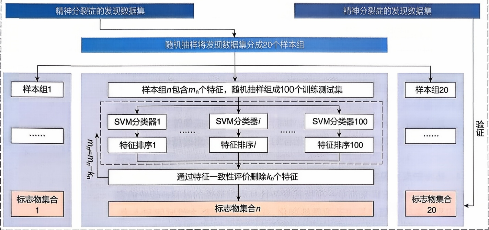

<details>
<summary>flowchart</summary>

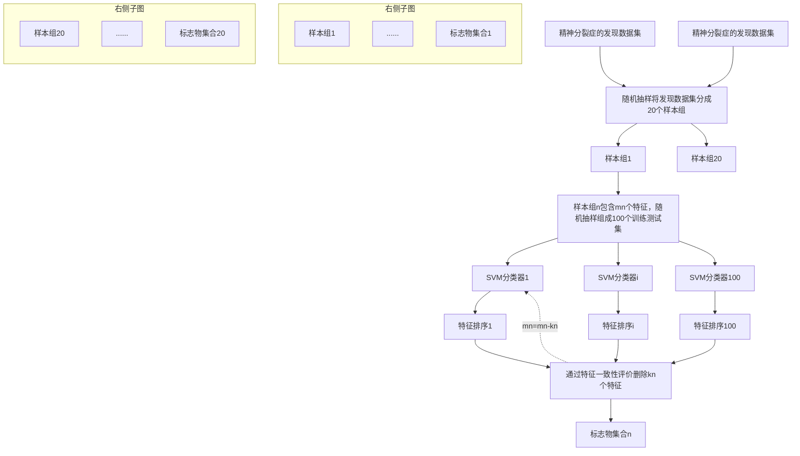
</details>

20个样本组筛选的标志物共有135个，充分验证其稳定性

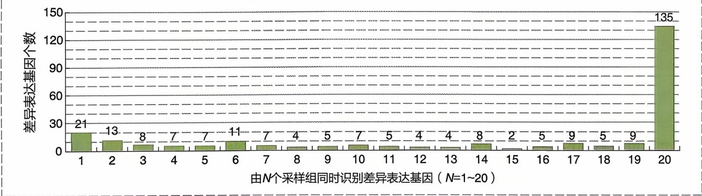

<details>
<summary>bar</summary>

| 采样组 | 差异表达基因个数 |
| --- | --- |
| 1 | 21 |
| 2 | 13 |
| 3 | 8 |
| 4 | 7 |
| 5 | 7 |
| 6 | 11 |
| 7 | 7 |
| 8 | 4 |
| 9 | 5 |
| 10 | 7 |
| 11 | 5 |
| 12 | 4 |
| 13 | 4 |
| 14 | 8 |
| 15 | 2 |
| 16 | 5 |
| 17 | 9 |
| 18 | 5 |
| 19 | 9 |
| 20 | 135 |
</details>

结合生物功能分析，发现精神分裂症的两个潜在药物靶标NF1和GABP

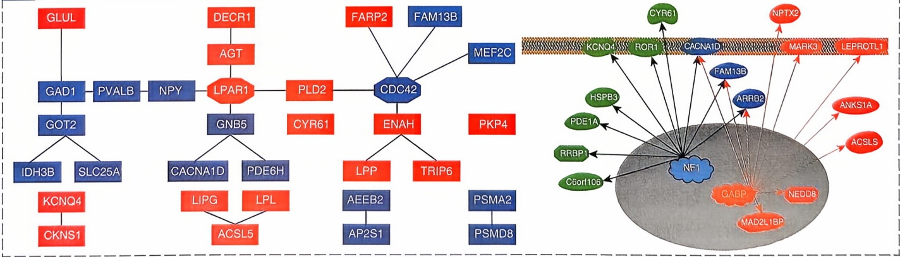

<details>
<summary>flowchart</summary>

This image displays a phylogenetic tree (a type of flowchart) illustrating the evolutionary relationships and gene expression pathways between various genes, including CDC42, ENAH, PLD2, and other genes.
</details>

图12-21 基于RFE-SVM筛选精神分裂症潜在靶点的工作流程

定性和可靠性。最后通过转录因子的富集分析，以识别明显高表达的转录因子结合位点。发现两个转录因子 NF1 和 GABP 在精神分裂症中发挥关键作用，有望成为精神分裂症潜在的药物靶标。

基于功能组学数据与机器学习的靶标发现新策略，使得筛选的稳定性和可靠性大大增加。并且，此策略以一种更有效的方式增加了潜在靶点的发现效率和准确性。从这个角度来说，它为发现原创药物靶标提供了新的策略，为药物的发现和开发开启了新的范式。

## 12.2.3 系统药物设计

## 12.2.3.1 网络药理学

网络药理学（network pharmacology）是以系统生物学理论为基础，利用生物信息学技术分析生物系统网络，选择特定的信号节点进行多靶点药物分子设计的一门新兴学科。2007年，发表在Nature Biotechnology的研究首次提出了网络药理学的概念，开启了药物与药物、药物与疾病以及疾病与疾病研究的新大门。网络药理学也常被称为系统药理学（systems pharmacology），其基本思想是药物通过与细胞中不同蛋白质相互作用达到治疗效果，并诱发不良反应，如图12-22所示。近年来，组学技术的广泛应用让我们得以全面追踪药物作用于机体的生物效应，包括药物预期的疗效与非预期的不良反应。因此，通过观测细胞、类器官或动物模型在药物作用下的基因表达转录组、蛋白质组、代谢组和表观组等分子变化，并解析这些分子之间的关联，就能够以分子相互作用网络的方式系统地揭示药物行使其功能的底层分子机制。

构建复杂生物网络是开展网络药理学的关键前提。常见的生物网络类型包括蛋白质-蛋白质相互作用（protein-protein interaction，PPI）网络、基因调控网络（gene regulation network，GRN）、代谢网络（metabolic network，MN）等。在网络药理学研究中，常将药物-靶标互作（drug-target interaction，DTI）网络、疾病靶点网络与PPI、GRN等生物网络整合，形成更为复杂高维的生物网络。其中，DTI网络的构建是基于药物-靶标蛋白质的二元关系，包括DrugBank、TTD、ChEMBL等多个公开数据库都包含高质量的药物-靶标相互作用数据（见表12-9）。

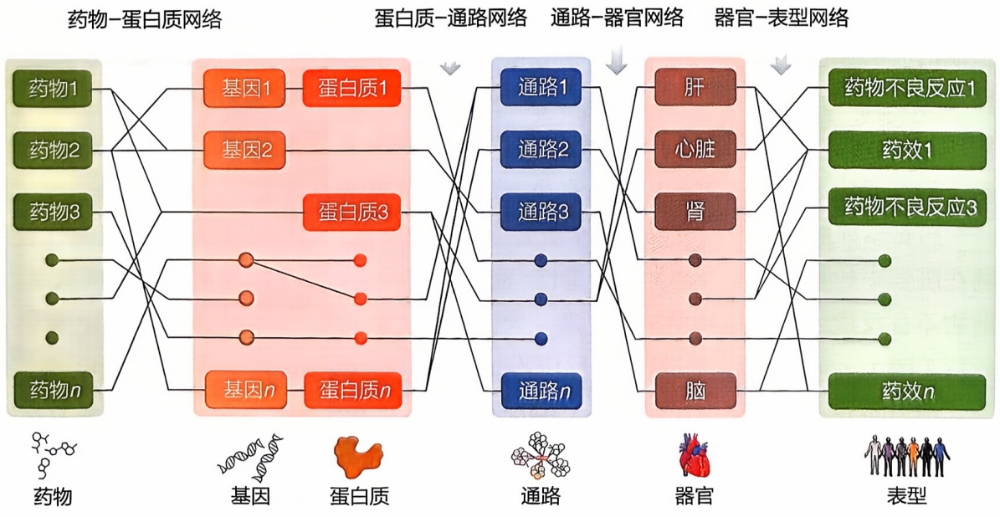

<details>
<summary>flowchart</summary>

```mermaid
graph LR
  subgraph Protein_Network["Protein-Network [\"药物-蛋白质网络\"]"]
  A["药物1"] --> B["基因1"]
  A --> C["基因2"]
  A --> D["药物3"]
  A --> E["药物n"]
  B --> F["蛋白质1"]
  C --> G["蛋白质3"]
  D --> H["基因n"]
  E --> I["蛋白质n"]
  end

  subgraph Transcription_Network ["蛋白质-通路网络"]
  J["通路1"] --> K["通路2"]
  J --> L["通路3"]
  J --> M["通路n"]
  end

  subgraph Organism_Network ["通路-器官网络"]
  N["肝"] --> O["心脏"]
  N --> P["肾"]
  N --> Q["脑"]
  end

  subgraph Form_Type_Network ["器官-表型网络"]
  R["药物不良反应1"] --> S["药效1"]
  T["药物不良反应3"] --> U["药效n"]
  end

  F -.-> J
  G -.-> L
  H -.-> M
  I -.-> M
  K -.-> N
  L -.-> N
  M -.-> N
  O -.-> N
  P -.-> N
  Q -.-> N
  R -.-> S
  S -.-> T
  T -.-> U
  U -.-> N
```
</details>

图12-22 网络药理学的

基本思想

基于复杂药物生物网络，可以开展经典的网络分析或智能学习，以发现新的药物靶点、药物再利用（drug repurposing）、药物相互作用（drug-drug interaction, DDI）等。通过发现药物生物网络中节点的关系，提取网络的枢纽节点或是网络特征模块，是揭示药物药理毒理分子基础的常用方法策略（参考第11章11.3）。例如，有研究发现，在药物-疾病关联复杂网络中，与验证药物在网络距离相近的未验证药物，更有可能出现在临床试验中。类似的基于距离的指标也被用于在蛋白质-蛋白质相互作用网络中描述疾病与疾病的相近关系。

网络药理学也是当前探索中国及世界各国传统药物（traditional medicine）药理及毒理分子基础的一种主要研究策略。传统中药（traditional Chinese medicine, TCM）是我国独特的医药资源宝库。对于揭示中医药的科学内涵，面临三个关键挑战:首先，需要深入机体内部，理清传统中医理论与现代基因、蛋白质、细胞等微观因素之间的关系；其次，采用目前医学常用的单因素还原分析方法容易忽略中医宝贵的整体特色，难以“守正”；第三，传统中医药在微观层次的数据积累相对薄弱，因此需要从微观和系统角度阐释中医药的“整体”特色，这也对信息科学提出了挑战。人工智能的出现和多种人工智能技术为传统中药研究提供了新的结合点和支持。

中医药具有整体观和辨证论治为特色的理论体系。中药及其方剂具有多成分、多靶点、协同作用的特点。中医药网络药理学通过研究“疾病-基因-靶点-药物”相互作用网络，系统性地解析中医里证候（如寒证、热证）的生物分子网络和中药及方剂在人体中的协同作用。近年来网络药理学结合多组学测序、系统生物学等新技术，极大地推动了中药药效机制研究。

## 12.2.3.2 系统计算毒理学

药物是一种化学物质，具备影响机体生理、生化和病理过程的能力，被用于预防、诊断和治疗各种疾病。理想情况下，一种“高效低毒”的药物应当具备“魔术子弹”特征，即能够准确地作用于疾病部位，同时对健康组织不造成任何损害。然而，这种完美的药物在实际应用中并不存在。药物进入机体后，通常难以特异性地靶向病灶部位和目标疗效靶蛋白。因此，药物在发挥治疗效果的同时，往往伴随一些非预期的有害反应，通常被称为药物不良反应（adverse drug reaction, ADR），或俗称毒副作用或副作用。根据1972年世界卫生组织（World Health Organization, WHO）国际药物监测合作中心的定义，药物不良反应是指在正常剂量用于预防、诊断、治疗疾病或调节生理机能的情况下，出现的非预期有害反应。

药物诱导的毒副作用可以在各个脏器或组织中发生。在化学层面，药物或其代谢物在脏器中的异常累积会诱发脏器毒性。药物不良反应是药物脏器毒性的临床表型。药物不良反应发生的生物学机制复杂，大体包括上靶效应（on-target effect）、脱靶效应（off-target effect）、过敏超敏反应（anaphylactic or hypersensitivity response）、药代动力学异常及个体遗传差异等。其中，近 $70\%$ 的药物不良反应是通过上靶效应机制诱发，具有明显的剂量依赖，也称之为过剂量效应（overdose effect）。近 $20\%$ 的不良反应或源于药物作用于疗效靶点之外的非预期蛋白质，即脱靶效应机制；这些非预期的药物-蛋白质相互作用难以预测，故也称之为特异质机制（idiosyncratic mechanism）。然而，药物与不良反应之间呈现多对多的冗余关系，这种复杂性使得采用常规和计算实验方法揭示导致不良反应的分子机制，以及进一步预测药物的临床安全性变得困难重重。

## （1）药物不良反应相关数据库

检索生物信息学数据库是获取药物不良反应相关信息的常见生物信息学方法，常用的药物不良反应数据库见表12-10。

表 12-10 药物不良反应相关公共资源数据库

| 数据库 | 简述 |
| --- | --- |
| VigiBase | 世界卫生组织全球个案安全报告数据库 |
| FAERS | 美国 FDA 对上市产品的上市后安全监督计划 |
| ADReCS | 包含 ADR 术语的标准化、层级化、数字化及药物-ADR 关系信息 |
| SIDER | 包含有关上市药品及其药物不良反应的信息 |
| ADReCS-Target | 药物不良反应相关靶点蛋白质数据库 |
| ADMETNet | 一个关于药代动力学和毒理学网络的知识库 |
| NetInfer | 基于网络的推理方法预测靶标及药物不良反应 |
| admetSAR | 提供 ADMET 相关手动整理的数据,并支持 ADMET 预测 |
| ADMETlab2.0 | 系统评估 ADMET 特性以及一些理化性质 |

## (2) 药物不良反应机制探索与计算评估

如图 12-23 所示，当前生物信息学辅助药物不良反应机制研究与评估的方法策略可大致归纳为 4 个主要内容:① 确定药物集。药物集可来自已有数据库如 ADReCS 或 SIDER，或是从药物不良反应呈报系统如 FAERS 报告、电子医疗报告、药物说明书、文献报道等途径获取。②药物特征。将药物的表型特征、结构特征、药物靶点、药物关联通路、药物扰动下基因表达谱等信息中的一组或多组相关数据向量化或二维嵌入。③构建预测评估模型。选取研究对象，选择合适的统计方法、机器学习、深度学习等技术构建相应的评估预测模型。④机制探索。通过基于模型的特征提取，比较药物集之间的特征差异，揭示药物诱导不良反应发生的理化特性、结构特征以及基因调控或互作靶点的差异，从而揭示不良反应发生的潜在分子基础。

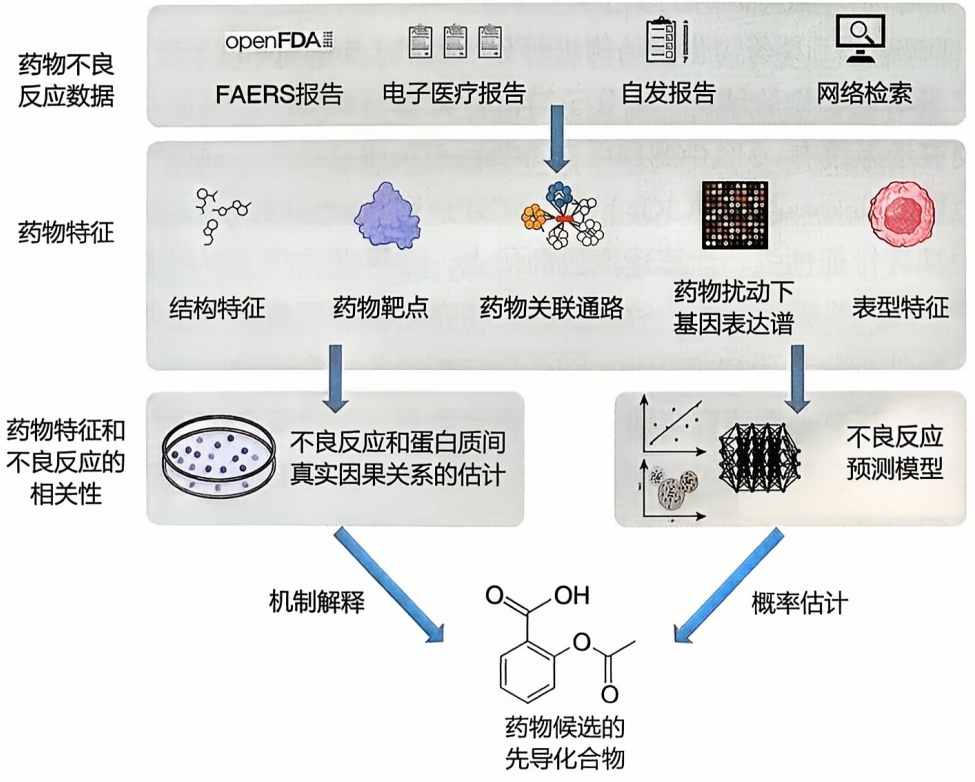

<details>
<summary>flowchart</summary>

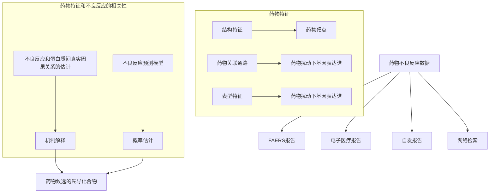
</details>


<details>
<summary>text_image</summary>

拓展阅读12-3
药物不良反应分类
系统（ADReCS）
</details>

图12-23 基于计算机的药物不良反应评估流程图

目前药物不良反应计算评估的方法大致可以分为以下六类:① 基于化学理化性质和结构的研究方法；② 基于药物靶点的研究方法；③ 基于药物诱导基因表达谱变化的研究方法；④ 基于生物途径扰动的研究方法；⑤ 基于分子互作网络的研究方法；⑥ 基于人工智能的新进展。以下是详细的方法介绍。

① 基于化学理化性质和结构的研究方法 该方法策略认为药物的生物活性是由药物的化学结构决定, 药物小分子的毒性与其化学组成及结构特征是相关。因此, 目前多数计算机毒性预测专家系统基于药物的构效关系（structure-activity relationship, SAR）或定量构效关系（quantitative structure-activity relationship, QSAR）构建数学模型。构建 QSAR 预测模型通常需要将药物的化学结构进行量化表征, 即用分子描述符（molecular descriptor）描述分子结构属性变量, 这些变量是一系列由实验测得或计算获得的物理化学和图形拓扑结构等参数。常见的分子描述符量化工具包括 RDKit 和 PaDEL-descriptor 等。QSAR 模型的构建通常采用基于规则模型（rule-based model）或基于统计模型（statistic-based model), 这些模型在药物的急性毒性预测上表现出色, 但其受限于专家的知识与经验对于系统规则的制定。成功的产品包括 DEREK 和 TOPKAT 等, 它们集成了一系列的数学模型, 从化合物的构效关系及特定毒性相关化学基团或药效团等方面综合地对小分子的毒性进行评估。

另外，也有一些模型系统基于药物的分子结构特征进行毒性预测。这些模型常用采用RDKit等工具药物化学结构进行分子指纹（fingerprint）表征，即通过分子结构片段来表示化合物的结构，将分子结构转化成一系列二进制的指纹序列。常见的分子指纹表示系统有:MACCSFP、PubChemFP、SubstructureFP、Atom PairesFP、DaylightPF、Klekota-Roth（KR）FP、MHFP和MorganFP等。使用分子指纹表征分子结构具有特征性强、计算速度快的优点，近年来被广泛应用于药物设计和计算毒理学。然而，基于药物结构的评估方法存在生物学可解释性差等问题。为增加模型的可解释性，一些研究将药物-不良反应相互作用和药物-基因表达变化结合起来进行分析。其中一项研究提出一种机器分类器，通过结合化学结构和基因表达特征，显著提高不良反应的可预测性。基于基因表达转换的生物术语特征有助于理解药物的作用机制。

② 基于药物靶点的研究方法 构建药物作用蛋白质互作靶点网络是揭示药物诱导毒副作用底层分子机制最有效的方法之一，也常被用于预测和评估药物不良反应。该策略采用高通量虚拟对接（docking）、网络分析、机器学习及文献挖掘等方法，预测药物潜在的作用靶点，进而基于靶点的生物学功能评估小分子的毒性。得益于小分子与蛋白质相互作用的相关实验数据公开、3D 蛋白质结构数据的存在及高性能计算技术的发展，数百种药物利用反向对接方法产生了大量包含数百个靶点的大型药物靶点谱。虽然不良反应相关蛋白质信息有限，但基于配体或反向对接方法预测药物靶点可以成功地运用于不良反应的预测和机制研究。一项研究通过反向对接软件 INVDOCK 预测药物与已知不良反应相关靶点的相互作用，从而成功地预测了 12 种在市抗艾滋病药物的不良反应。

美国食品药品监督管理局（Food and Drug Administration, FDA）开发的 PHASE（Public Health Assessment via Structural Evaluation）模型是该策略的一个典型应用。PHASE 模型通过 4 个主要步骤来评估药物的安全性:a. 结构相似性评估。构建受控药物数据库，使用分子指纹等方法量化新药物与受控药物的结构相似性。b. 生物靶点预测。综合利用多种结构和目标信息预测生物靶点、作用模式和结合亲和力。c. 分子对接。基于虚拟筛选评估化合物与靶点活性位点间的相互作用，通过生成数千个潜在结构构象，使用打分函数评估复合物的相互作用情况，预测其结合能量（参考第 9 章 9.3）。d. 专家审查。对相似性和结合预测进行专家审查，确保新物质对公共安全构成的风险与维持适当的疼痛治疗相平衡。例如，FDA 曾利用 PHASE 模型来揭示卡痛叶的潜在分子毒理机制。卡痛叶长期被作为处方麻醉品的一种替代品，用于治疗疼痛和缓解阿片类药物戒断症状；然而，其会导致严重或致命的并发症，底层毒理机制不明。FDA 基于 PHASE 模型，开展靶点预测，总结出卡痛叶具备类阿片类药物特征，并确认了其会带来致命的健康风险。因此，在缺乏实验数据的情况下，PHASE 模型依旧能够利用历史数据，对新药的药理学特性和潜在风险开展系统性的探索，支持 FDA 对新药的安全性进行快速响应和监管决策。

③ 基于药物诱导基因表达谱变化的研究方法 基于系统生物学的思想，通过比较分析处理原代或肿瘤细胞的药物诱导基因表达谱（drug-induced gene expression, DIGE）变化信息，有助于开展药物重定位、靶点预测，以及不良反应和耐药机制等研究。Connectivity map（CMap）是第一个基于基因表达的高通量筛选平台，通过收集超过1300种生物活性小分子处理的肿瘤细胞系全基因组转录表达数据，以促进发现药物、基因和疾病间的功能联系。LINCS（NIH Library of Integrated Network-based Cellular Signatures）旨在发现细胞对扰动反应的基本原理，其中LINCS L1000项目收集了超过3万种动物在不同时间点、剂量和细胞系的基因表达图谱。一项研究利用CMap数据挖掘药物作用下显著差异表达基因，并基于改进的朴素贝叶斯网络模型，通过药物-基因-不良反应相互作用网络实现高通量药物安全性分析。

④ 基于生物途径扰动的研究方法 生物途径是细胞分子通过系列相互作用实现细胞功能，如物质代谢、信号转导和表达调控等。最全面的真核生物生物途径相关信息已被收录于京都基因和基因组百科全书KEGG中，其中基因与生物过程的相关注释信息也可从基因本体（Gene Ontology，GO）中获取。相较于细胞中全基因表达谱的变化，药物对细胞生物途径及其组成基因的扰动被认为更为保守和具有生物学意义。一项研究基于假设“能够调节相同途径的药物可能会引起类似的不良反应”，利用药物-靶点信息，借助虚拟对接和逻辑回归算法挖掘不良反应-生物通路的关系。另一项研究通过大规模分析临床表型数据、生物通路和药物-靶点关系识别具有代表性的不良反应-生物通路组合，有效地发现生物途径和不良反应的关联。

⑤ 基于分子互作网络的研究方法 类似生物途径，蛋白质-蛋白质相互作用（PPI）网络以蛋白质为网络的节点，蛋白质之间的物理相互作用表示为边，构成复杂的网络，能够很好地反映细胞中的分子动态关系。其中，STRING 蛋白质网络是代表性的 PPI 网络。在探究药物的药理与药毒中，可以将药物-靶点互作关系、药物-疾病、疾病-靶点、药物-基因调控等多元信息整合在 PPI 网络中，以此构建出一个覆盖药物-靶点-疾病的多元异质网络。基于该异质网络，可以开展各种自由度、连通度等网络特性分析，挖掘比较不同药物的分子网络特性和相互关系，从而揭示药物诱导不良反应的分子基础和评估新药的安全性。一项研究提出一种基于稀疏典型相关分析（sparse canonical correlation analysis）的方法，将药物作用蛋白质和不良反应联系起来；相较于基于化学结构预测不良反应等方法，表现出更好的性能。还有一些研究关注药物的表示学习，一项研究通过构建药物异构网络，提出一种基于元路径的异构信息网络嵌入方法，整合药物信息和不良反应信息并学习药物表示，有效提高不良反应预测的准确性。

⑥ 基于人工智能的新进展 近年来，人工智能技术的迅猛发展也惠及了药物毒性研究领域，并在药物安全性评估方面取得了一些实质性进展。借助人工智能领域所发展出的丰富算法，可以有效地从大量嘈杂的数据中提取化学结构和生物系统信号，以此大大提高不良反应的预测准确性。一项研究利用改进的分子图编码卷积神经网络提取药物化学特征，显著提高急性口服毒性的预测准确性。近期还有一些研究利用循环神经网络和卷积神经网络来预测不良反应，另一项研究使用基于拓扑的新型多任务深度神经网络进行毒性的定量预测。

## 12.2.4 智能药物设计

随着各种高通量技术与检测方法的推广应用，生物医药领域的数据呈指数级递增。这类大数据具有维数高、噪声干扰强、数据结构复杂等特点，传统分析方法难以充分发现数据内部所蕴含的底层关联与规律，建立新的计算方法以实现系统性、智能化的生物医药数据挖掘，成为当前药物设计领域的重要挑战。

## 12.2.4.1 生物信息在小分子化学药物筛选中的应用

经典药物研发大量依赖于实验，耗时费力，成本居高不下。而人工智能技术能显著提高药物研发效率。基于蛋白质结构和功能信息，采用分子生成、虚拟建库和以人工智能为特征计算技术直接进行药物虚拟筛选已被证明能提高药物发现效率。

目前，基于人工智能的药物筛选主要有两种思路。第一种是分析已知活性分子的特征，通过对比待测化合物与已知活性化合物的相似性，构建结构-活性关系或药效基团模型来预测其药理学性质，称为间接药物设计，也称为基于配体的药物设计（ligand-based drug design，LBDD），常用方法包括定量构效关系、药效基团模型、受体映射、基于分子形状的叠合等。基于配体的人工智能筛选工作流程一般为:从数据库或文献中收集已知的活性化合物信息作为训练数据；根据分子结构选择合适的表示方法；建立生物活性和分子表示之间的关系模型；应用模型预测待测化合物的生物特性。第二种是模拟化合物与蛋白质靶点在三维空间上的相互作用，从而预测化合物对靶蛋白的作用方式，称为直接药物设计，也称为基于结构的药物设计（structure-based drug design，SBDD）。基于结构的虚拟筛选方法一般通过特定算法模拟化合物和蛋白质的相互作用，并依赖已知的蛋白质三维结构。其中最常用的方法是分子对接（molecular docking），用于预测小分子与蛋白质的结合方式和结合强度（参考第9章9.3）。分子对接在加速药物发现方面起着至关重要的作用，使其更快速、更便宜和更有效。在实际工作中，根据已知信息的多少可以选择相应的研究方法，当然已知信息越多越准确的时候，结果就越可靠。常见分子对接工具如AutoDock等。

## 12.2.4.2 生物信息在组合用药预测中的应用

肿瘤的药物疗法经常出现耐药性问题。尤其是靶向疗法，用药初期抗癌效果显著，后期就会出现各种耐药性问题。为了解决肿瘤细胞的耐药性问题，研究者对癌症基因组进行不断地探索，尝试利用联合用药来寻求新的治疗方案。联合用药是为了达到某种治疗目的而采用的两种或两种以上药物同时或先后应用的治疗策略，具有提高疗效，延缓耐药性以及减少药物毒副作用的优势。但随着药物个数的增加，药物组合的可能性呈指数增长，加上每种药物有不同的剂量，单靠实验筛选变得越来越困难。近年来，药物研发机构开始运用生物信息智能计算技术来研发快速高效的药物组合药效计算预测方法。一般而言，组合用药筛选的计算流程如图12-24所示。

药物联用后，会产生药效学和药动学上的相互作用。根据其相互作用的类型，可以将药物组合大致分为4种，药物合用的作用效果小于单药的作用效果，为抑制作用（suppressive）；药物合用的作用效果小于、等于、大于两药的单用的作用效果之和，分别称为拮抗（antagonistic）、加和（additive），以及协同（synergistic）作用。评估药物相互作用的等效线，如图 12-25 所示。

图12-24 组合用药筛选的计算流程

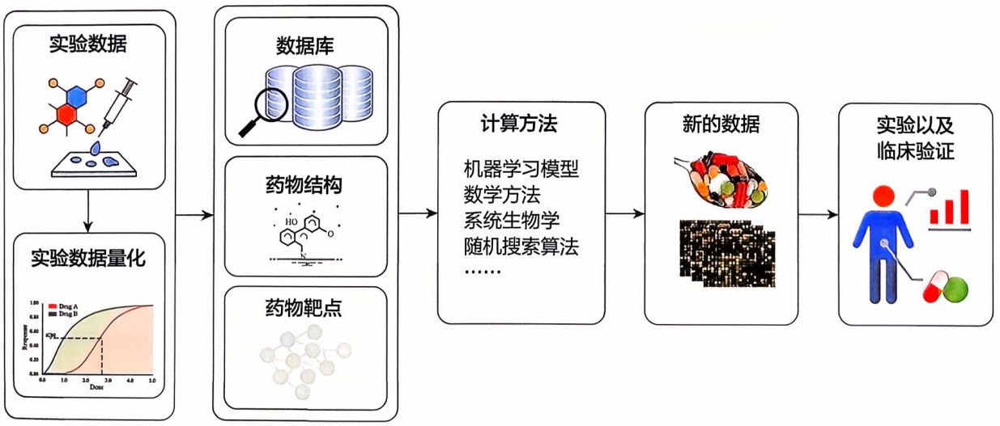

<details>
<summary>flowchart</summary>

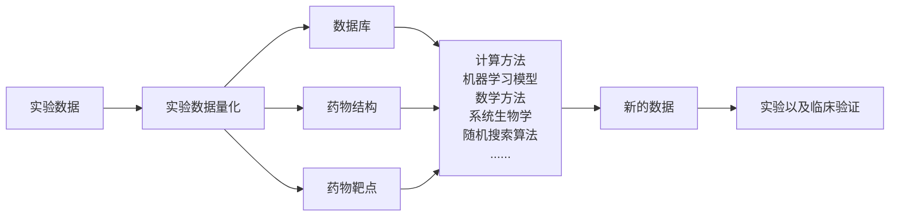
</details>

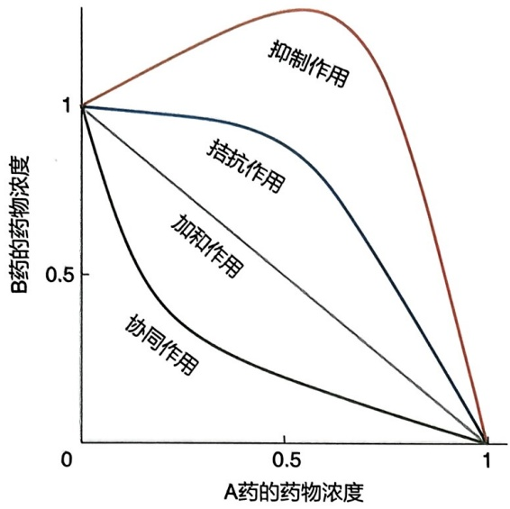

<details>
<summary>line</summary>

| A药的药物浓度 | 抑制作用 (B药的药物浓度) | 拮抗作用 (B药的药物浓度) | 加和作用 (B药的药物浓度) | 协同作用 (B药的药物浓度) |
| --- | --- | --- | --- | --- |
| 0 | 1 | 1 | 1 | 1 |
| 1 | 0 | 0 | 0 | 0 |
</details>

图12-25 药物相互作用的等效线

横轴和纵轴代表药物浓度，截点表示单一药物达到某一药效（如 $50\%$ 细胞抑制率）时的浓度。每条曲线代表药效（$50\%$）曲线。绿色代表协同组合用药，黑色代表加和组合用药，蓝色代表拮抗组合用药，橙色代表抑制组合用药

目前，已经存在一些用于协同药物组合预测的方法和模型被报道和使用，例如，针对协同抗癌药物组合筛选的人工智能系统，基于多成分多靶点药物的网络效应，结合癌症的基因表达谱特征，采用机器学习算法，提取出具有协同作用的抗癌药物组合的网络靶向特征，并将其应用于潜在协同药物组合的排序筛选。该系统将协同用药预测吻合度/准确率(PC index)从原先的 $61\%$ 提升到$78\%$ ，极大地提高了联合药物筛选的效率。该方法先后在B-细胞淋巴癌、乳腺癌和肺癌细胞系上分别进行了验证，最后利用斑马

鱼肿瘤模型，验证出一组具有强协同作用且低毒的抗乳腺癌协同药物组合。此外，一些研究团队探索了反馈系统控制算法、随机搜索算法、统计模型和基于因子的多尺度模型等来预测组合药物在不同剂量配比下的药效，以便为未来的临床应用提供更多线索。

## 12.2.4.3 生物信息在大分子药物设计中的应用

随着单克隆抗体、双特异性抗体以及抗体药物偶联物（antibody-drug conjugate, ADC）药物的相关研究不断发展，抗体药物已经成为药物研发的新热点。2019年新冠疫情暴发以来，由多种抗体混合而成的“鸡尾酒抗体”可能有助于治疗和预防新冠感染，引发新冠抗体研发的井喷趋势。随着抗体结构数据的快速增长，针对抗体药物研究的生物信息学人工智能设计工具也不断发展，主要集中在抗原表位预测和单克隆抗体设计方面，其代表性的方法如下。

## (1) 抗原表位预测

① T 细胞表位智能识别及预测 T 细胞表位的识别和免疫应答的诱导在个体的免疫系统中起关键作用，基于 T 细胞抗原表位的合成肽可被用于激活 T 细胞。T 细胞表位预测的关键点之一是预测主要组织相容性复合体（major histocompatibility complex，MHC）的结合肽，而 MHC 是高等脊椎动物蛋白质中最具多态性的蛋白质。如此广泛的等位基因肽结合偏好难以用实验筛选，因此需要生物信息学预测的参与。T 细胞表位的预测通常涉及特定的 MHC I 类或 MHC II 类等位基因的肽结合特异性，然后用生物信息学软件预测表位。现有的 T 细胞表位预测方法可以根据其基础算法分为支持向量机、隐马尔可夫模型（HMM）、定量构效关系（QSAR）分析以及基于结构的方法。T 细胞表位识别及预测工具如表 12-11 所示。
② B 细胞表位智能识别及预测 与 T 细胞不同，B 细胞表位主要识别不连续的空间表位。由于必须考虑抗原的三维结构，预测构象型 B 细胞表位就更复杂。在该领域，复旦大学团队致力于蛋白抗原 B 细胞表位预测的智能算法研究，研发了抗原空间表位预测系列工具SEPPA，不仅从空间结构和理化特征方面进行了深入研究，还创新性地引入了亚细胞定位、宿主物种、翻译后糖基化修饰及抗体信息等特征，显著提升了B细胞表位预测的准确性，成为B细胞表位预测的基准算法（图12-26）。表12-12详细列出了B细胞表位识别及预测的工具。

表 12-11 T 细胞表位识别及预测工具

| 名称 | 简述 |
| --- | --- |
| IMGT Repertoire | 包含人白细胞抗原(HLA)和TCR序列的排列注释 |
| AntiJen | 提供MHC、抗原肽转运蛋白体(TAP)、B细胞和T细胞抗原等相互作用多肽的实验和预测数据 |
| Allele frequenciesNet Database | 概述HLA频率和细胞因子多态性 |
| IEDB | 包含来自各种物种的免疫表位数据 |
| ElliPro | 通过改善建模软件和可视化平台来预测和展示表位 |
| NetMHC | 基于人工神经网络模型预测多肽与HLA结合 |
| seq2HLA | 利用RNA-Seq数据进行HLA分型,精确到4位分型结果 |
| OptiType | 对HLA I型基因进行分型,精确到4位分型结果 |
| HLAscan | 利用全基因组测序(WGS)与全外显子组测序(WES)数据预测HLA基因型 |
| HLAforest | 利用RNA-Seq数据进行HLA分型,精确到4位分型结果 |

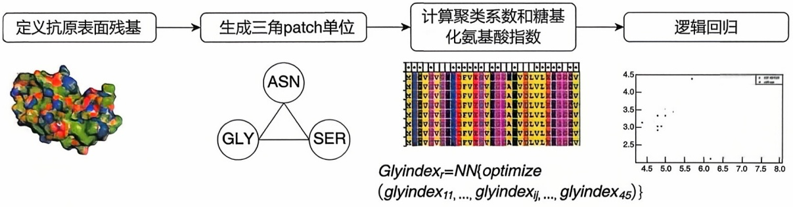

<details>
<summary>flowchart</summary>

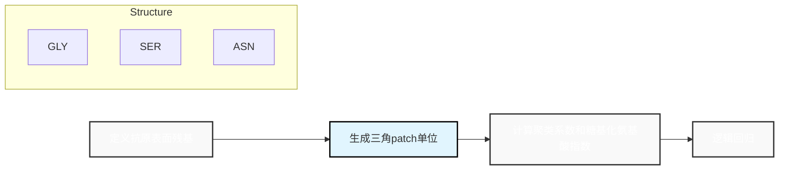
</details>

图12-26 空间表位预测在输入抗原后，SEPPA3.0综合考虑糖基化位点对空间微环境的影响，设计了糖基化相关的全新分类参数，同时引入反向“校正”，对糖蛋白抗原空间表位进行预测

表 12-12 B 细胞表位识别及预测工具

| 名称 | 简述 |
| --- | --- |
| HaptenDB | 包含引起免疫反应的半抗原特异性、交叉反应性抗体和在诊断中抗体的使用等信息 |
| DiscoTope 2.0 | 利用表面可及性和表位倾向氨基酸评分预测不连续 B 细胞表位的三维结构 |
| Epitopia | 预测蛋白质三维结构或线性序列中的免疫原性区域 |
| SEPPA 2.0 | 引入抗原亚细胞定位及宿主物种信息构建预测模型,可进行抗原蛋白空间表位预测 |
| SEPPA 3.0 | 空间表位预测平台,首款糖基化蛋白抗原的表位预测工具 |
| SEPPA-mAb | 空间表位预测平台,首款抗体特异性表位的在线预测工具 |

③ 其他方法预测 部分优选的肽锚点氨基酸位置的组合称为模体。在抗原表位的预测过程中，检索序列的方法即通过使用模体文库对目标肽段氨基酸序列中的特定序列进行检索，这是抗原表位预测最古老也最广泛使用的方法。乔·达马罗（Joe D'Amaro）等开发的计算机程序模体（MOTIF），收集了所有已知的亲和 HLA-A\*0201 的模体。另外一种广泛使用的表位预测工具是 SYFPEITHI，它也是基于模体检索方法的软件。但由于并不是所有的结合肽都具有可识别的模体，这类基于检索模体的预测算法的精度仅为 $60\% \sim 70\%$ 。基于结构的表位预测方法能够大大提升预测算法的精度，除本文介绍的表位识别的方法外，在合成蛋白疫苗的设计过程中还可以应用分子结合能和分子动力学、亲疏水性和电荷结合力等方法，以进一步提高设计合成的肽疫苗的免疫原性和生物安全性。

## (2) 单克隆抗体智能设计

免疫信息学已经极大地改变了单克隆抗体产业。目前，已有很多本地及云程序被开发出来，并被用于抗体的应用研究。这些软件主要聚焦的功能包括:①生成特定抗体互补决定区（complementary determining region, CDR），代表性的软件如Abnum；②确定抗体重链和轻链的亚类，较为经典的工具如SUBIM；③构建特定序列的抗体三维结构，工具包括RosettaAntibody、PIGS、SWISS-MODEL、AbM等。除此以外，需要关注的问题还包括:检查给定的抗体序列中可能存在的测序错误（如AbCheck），评估抗体的人源化程度（SHAB），以及预测抗体亲和力、抗体的凝聚性和半衰期等。

## 12.2.4.4 生物信息在疫苗研发中的应用

人工智能在疫苗研发中产生了广泛而深刻的影响，涵盖多个方面，包括病毒分析、药物设计和临床试验优化等。首先，通过深度学习算法对病毒基因组进行高效的序列分析，以更好地了解其结构和功能。其次，利用机器学习对大量分子进行虚拟筛选，以识别可能的疫苗候选物质。在临床试验阶段，可以应用自然语言处理和数据挖掘技术，加速患者招募过程，提高临床试验效率等。

例如，疫苗研发面临一个重要科学问题，即免疫原是否具有足够的保护范围。解决这个问题的关键是准确地衡量不同抗原蛋白之间的抗原性距离。目前存在许多针对特定病原体（如流感病毒、登革病毒、口蹄疫病毒等）的抗原性距离计算工具，但这些方法大多需要大量实验数据作为训练，对于突发或新发传染病的应对能力不足。

疫苗研究在线信息网（Vaccine Investigation and OnLine Information Network, VIOLIN）是专为疫苗设计而开发的网站，包含大量疫苗相关的数据库和软件。例如，Vaxign（vaccine design）是一种基于反向疫苗学原理的疫苗靶点预测与分析系统。Vaxign 包括两个部分:一是 Vaxign Query，可直接查询 Vaxign 网站已预测好的结果；二是动态交互部分，即对输入的序列进行交互分析和可视化。Vaxign 集成了一系列分析软件，包括预测 MHC I 类及 MHC II 类结合能力的 Vaxitope、预测蛋白质跨膜方式的 TMHMM 等。常用的免费计算机辅助疫苗设计工具见表 12-13。

## 12.2.5 生物信息学在膜靶向药物研究中的应用

## 12.2.5.1 细胞膜与药物活性的关系

细胞膜最重要的功能之一是维持细胞内环境稳态，确保细胞生命活动的正常进行。这一功能的实现得益于细胞膜精妙的选择渗透性屏障作用。因此，细胞膜结构的损伤可能会带来致命的后果。多黏菌素就是自然界中存在的一类天然抗生素，通过破坏细菌的膜结构，达到杀灭细菌的效果。值得注意的是，多黏菌素主要抑制革兰氏阴性细菌的生长，这一类细菌除细胞膜外，还拥有一层特殊的细菌外膜结构，由脂多糖（lipopolysaccharide，LPS）、磷脂和外膜蛋白组成。细菌外膜是典型的非对称性膜结构，其外小页脂质主要由LPS组成，而内小页脂质则主要是磷脂分子。自然条件下，细菌外膜中的脂质形成稳定的分子间相互作用，从而构成了对外源有害物质（如抗生素药物）的渗透屏障，提高细菌的逆境生存能力。多黏菌素是一类脂肽类抗生素，通过与细菌外膜LPS结合，破坏细菌外膜结构完整性，最终导致细菌死亡。但传统的实验手段很难精确地分析药物分子与生物膜结构之间的相互作用，大大限制了膜靶向药物活性机制的探究。

表 12-13 一些免费计算机辅助疫苗设计工具

| 名称 | 简述 |
| --- | --- |
| EpiPredict | 6种HLA-DR/DQ及人TAP配体预测 |
| NetChop | 蛋白酶体酶切位点预测 |
| PAProC | PAProCI预测人及酵母20S蛋白酶体酶切位点;PAProCII预测组成性与免疫蛋白酶体酶切位点 |
| PREDEP |  |
| ProPred | 51种HLA-DR配体预测,用于预测杂合性T细胞表位 |
| ProPred1 | 47种MHCI类配体预测,集成蛋白酶体酶切位点预测 |
| SDAP 2.0 | 变应原3D结构及免疫球蛋白E(IgE)表位数据库,预测变应原交叉反应及IgE结合位点 |
| SYFPEITHI | 200种以上MHCI类配体预测和60种以上HLAII类配体预测 |

分子动力学模拟技术作为一种“时间放大镜”，使得技术人员能够在原子级尺度实时观测生物分子之间的相互作用和运动细节，近年来已经成为生物、化学、药学等领域的研究热点。细胞膜系统的分子模拟体系是研究膜靶向药物的重要手段，具体包括细胞膜结构搭建、小分子结构搭建和参数化、模拟体系组装、分子模拟以及数据分析等步骤。在一个具体案例中，研究人员利用此方法发现了多黏菌素在细菌外膜上的聚集现象，并能快速将细菌外膜亲水头部区域的钙离子置换出来。正是这些复杂的细胞膜-药物相互作用，多黏菌素破坏了细菌外膜的结构完整性，最终导致细菌死亡(图12-27)。

尽管这些理论模拟研究为深入理解多黏菌素的抗菌活性机制提供了新的见解，然而，在大多数研究中细菌外膜结构模型是理想化设置的，细菌外膜中多样的脂质类型和丰富的修饰种类往往被忽视，从而难以反映细菌外膜真实的结构特征这阻碍了对多黏菌素抗菌机制的深入分析。近年来，随着脂质组学技术的发展，细胞膜脂质组成的定量分析使得构建更高生物真实度的细胞膜结构模型成为可能。此外，增强采样技术使得分子动力学模拟在研究药物跨膜运动的过程中发挥着越来越重要的作用。例如。研究人员发现多黏菌素在细菌外膜内部形成的一种特殊的折叠式构象，从而更完美地与细菌外膜结合。当然，在利用生物信息学分析技术的同时，结合化学生物学和分子药理学手段，可以进一步验证药物分子关键官能团的功能，从而建立全面深入的膜靶向药物结构-活性关系的数字化模型。

图12-27 抗菌肽多黏菌素与细菌外膜相互作用示意图

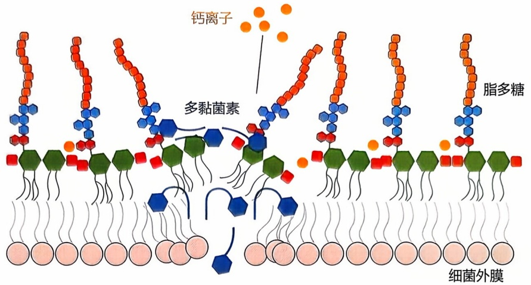

<details>
<summary>text_image</summary>

钙离子
多黏菌素
脂多糖
细菌外膜
</details>

## 12.2.5.2 细胞膜与药物耐药的关系

随着抗生素药物的不断使用，细菌耐药性已经成为一个新的全球性医疗问题。细胞膜系统作为重要的天然渗透屏障，与细菌耐药性的产生密切相关。一方面，细菌通过改变细胞膜脂质结构降低渗透能力，从而减少抗生素进入胞内，削弱抗生素效果；另一方面，外排泵可以将药物分子从细胞内运输至细胞外，降低有效药物浓度，也是形成抗生素耐药性的重要机制。对革兰氏阴性菌而言，细菌外膜LPS修饰是产生抗生素耐药的普遍机制，通过非特异性地降低外膜渗透性，可以导致广谱的细菌耐药。然而，LPS修饰如何改变细菌外膜渗透性并造成细菌耐药的物理学机制一直困扰着研究人员。

细胞膜系统的分子模拟体系为探究脂质结构变化与细胞膜结构性能之间的关系提供了一种高精度的分析方法。在具体案例中，研究人员分析了LPS磷酸乙醇胺修饰、阿拉伯糖胺修饰、脱脂酰化修饰对细菌外膜结构的影响，这些修饰可以促进LPS分子间形成更多的极性相互作用，增强细菌外膜结构稳定性，抑制药物对细菌外膜的结合以及药物分子在外膜内的构象变化（图12-28）。在这些作用的影响下，细菌产生了更强的防御能力，成为细菌形成抗生素耐药的物理学机制。此外，鲍曼不动杆菌还可能发生LPS完全丢失的现象，导致奇特的多黏菌素依赖型耐药，即细菌只能在有多黏菌素的环境下才能正常生长。利用计算方法，研究人员揭示了多黏菌素以“补丁结合”的方式吸附到外膜表面，并通过介导磷脂分子间相互作用来稳定细菌外膜结构（图12-28），从而提高细菌的生存能力。此外，结合大尺度粗粒化分子模拟技术，还可以进一步分析多黏菌素与LPS糖链的相互作用过程，发现LPS中的酸性多糖能够招募大量的钙离子，促进LPS分子间形成复杂的交叉作用网络，屏蔽了抗生素与LPS分子脂质A部分的接触，在近原子水平上揭示革兰氏阴性菌对多价阳离子型抗生素广谱耐药的内在机制。

图12-28 细菌外膜结构重塑导致抗生素耐药示意图

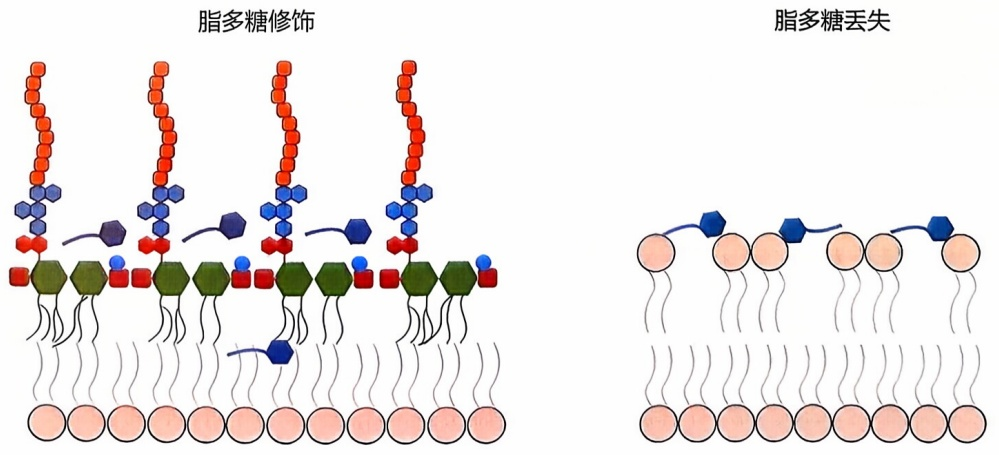

## 12.2.5.3 细胞膜与药物毒性的关系

药物潜在毒性是药物研发面临的一大难题。多黏菌素就因肾毒性而一度被禁止使用，多黏菌素诱发肾毒性的比例高达 $60\%$ ，临床表现包括蛋白尿、血尿和急性肾小管坏死，严重者可出现急性肾功能衰竭。静脉注射给药后，多黏菌素在肾中大量积累，而几乎不在肝、肺、心脏等器官中出现，这种现象与肾小管上皮细胞大量重吸收多黏菌素有关。经肾重吸收后，肾小管上皮细胞内的多黏菌素浓度可达胞外浓度的4760倍。这说明肾重吸收多黏菌素导致胞内累积可能是造成肾毒性的源头。但目前对多黏菌素与肾细胞相互作用机制的认识还很不充分。

细胞膜及其膜蛋白计算体系为研究药物毒性机制提供了新的思路。例如，通过建立肾小管上皮细胞膜三维结构模型，结合分子模拟和原子力显微成像技术，分析了不同多黏菌素对肾细胞膜的结构影响。结果表明，虽然不同的多黏菌素均能快速吸附到细胞膜表面，但对细胞膜造成结构损伤的程度具有明显差异；重要的是，不同的多黏菌素插入肾细胞膜的深度不同，异常增强细胞膜的渗透性，干扰细胞正常代谢活动。这从细胞膜损伤的角度揭示了多黏菌素肾毒性的潜在机制（图12-29），并初步探索了多黏菌素的结构-肾毒性关系。此外，膜蛋白体系的分子模拟还揭示了多黏菌素对离子通道蛋白的结合，从而导致离子通道维持在开放构象（图12-29），造成钾离子持续外流和细胞膜电位紊乱，最终导致肾小管上皮细胞的代谢障碍。这些基于生物信息学的研究从全新的角度探索了药物与肾脏细胞相互作用的机制，并为后续药物毒性的优化设计提供了指导。

在未来工作中如何构建具有“生物学真实度”的细胞膜体系，从更大的空间尺度、更长的时间尺度上分析药物与细胞膜系统的相互作用，将是进一步完善膜靶向药物药理机制，建立膜靶向药物理性设计策略的重要方向。

细胞膜损伤

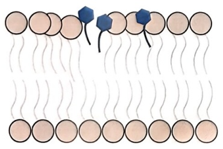

<details>
<summary>natural_image</summary>

Diagram showing wavy lines and circular elements with blue hexagonal shapes above (no text or symbols)
</details>

离子通道功能干扰

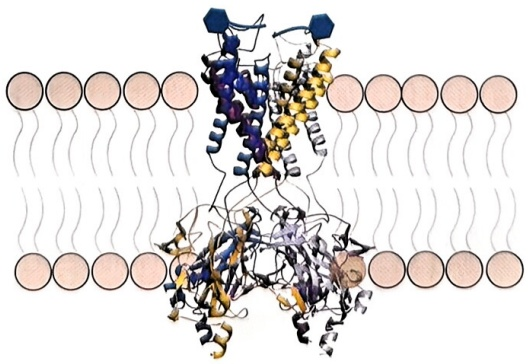

<details>
<summary>natural_image</summary>

Molecular structure diagram showing protein-ligand binding with helices and strands (no text or labels)
</details>

图12-29 膜靶向药物与肾细胞膜系统相互作用示意图

## 12.2.6 智能药学的展望

本节着重介绍了生物信息学在靶点发现、毒性评估、智能药物设计和膜靶向药物等领域中的应用，帮助理解生物信息学在药物研发中的重要性和潜在价值。但生物信息学在药物研发的应用远不止上述层面，在一些前沿的领域，发挥着不可或缺的作用。例如，在药物递送等领域，生物信息学优化了纳米颗粒设计，以获得靶向、有效的治疗。在联合药物开发中，生物信息学模拟药物相互作用以识别最佳组合，提高治疗结果。对于蛋白降解靶向嵌合体（proteolysis targeting chimera，PROTAC）来说，生物信息学有助于识别目标蛋白和设计有效分子。在ADC开发中，它识别合适的抗体靶点并优化接头化学。基于新抗原的疗法通过识别个性化免疫疗法的独特肿瘤标志物而受益于生物信息学。在新辅助化疗中，生物信息学预测肿瘤反应并监测最低限度的残留疾病，指导有效的治疗计划。总体而言，生物信息学在新药设计和治疗方法的发现及优化中发挥着关键作用，加速了研发进程，在推动了更加高效且个性化的药物开发和疾病治疗过程中具有巨大的应用潜力。

信息计算技术的快速发展和人类各组学计划的实施使得基于大数据的医药生物信息智能技术与产品成为未来促进新药研发的主要趋势之一。尽管表型药物发现方法很大程度被靶标发现方法所取代，将原始概念和现代工具和策略相结合的现代表型药物发现再次兴起。未来应更注重生物信息智能计算技术与新药研发各环节的互相渗透，形成干湿结合、面向应用转化的创新研究范式。

## 12.3 智能育种

## 12.3.1 智慧农业与智能育种

农业是国民经济的主体，是立国之本、兴国之器、强国之基。近年来，随着高通量测序、人工智能、遥感传感以及物联网等技术的快速发展及其在农业领域的广泛应用，农业领域产生了大量的数据，包括作物组学数据、作物生长状况、病虫害检测信息以及地块环境信息等。以大数据解析与利用为主要研究内容之一的生物信息学在智慧农业设施、智能育种、农副产品生产和生态环境保护等诸多方面正发挥着越来越重要的作用（图12-30）。

农业现代化，种子是基础。随着全球人口的增长、人们生活需求的提高以及生态环境的变化，如何在有限的耕地资源上实现粮食等农产品的高产、优质、高效生产，是全世界农业生产面临的巨大挑战。优良的种子作为农业的“芯片”，是确保粮食安全的关键基础。传统的良种选育主要依靠育种工作者的目力和经验，并结合生物学统计数据分析，根据个体的表型性状进行选择或淘汰。这种“经验育种”存在周期长、随机性大、综合评价能力弱等缺点。近年来，生物技术、信息技术革命催生了基因编辑、深度学习等前沿技术，驱动动植物育种从“经验育种”和“分子育种”向“智能育种”和“设计育种”转变，推动国际种业发展进入“育种4.0”时代。研究人员充分发挥生物信息学的多学科交叉优势，利用机器学习、数据挖掘等先进的数据分析技术建立育种相关生物信息分析方法、模型、流程与软件，精准鉴定种质资源，大规模挖掘农艺性状相关基因及生物分子网络，准确建立基因型与表型的关联关系，智能构建基因组选择预测模型，快速开发迭代分子编辑工具，助推育种工作向智能育种方向迈进。

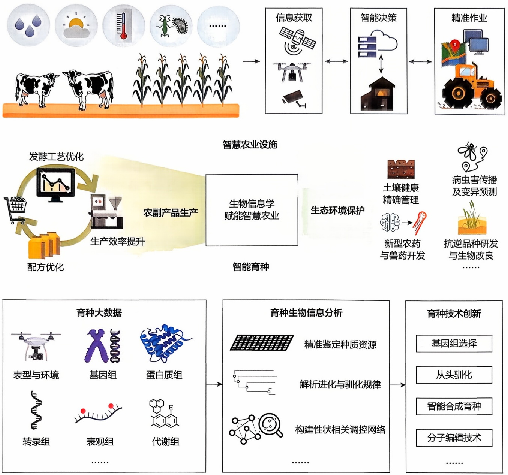

生物信息学还可以根据农业生产过程中的大量监测数据，构建预测模型助力农作物的精细化、自动化管理，进而降低人力成本，提升农业生产效率，提高农作物的产量和品质。利用卫星遥感、传感器、物联网等技术构建的智能化控制系统，对农田环境、土壤质量、作物生长等进行实时监测，获取多维度、多时空尺度的农作物种植数据，进一步利用大数据、人工智能等技术构建预测模型，实现灌溉、施肥、

图12-30 生物信息学在农业中的应用