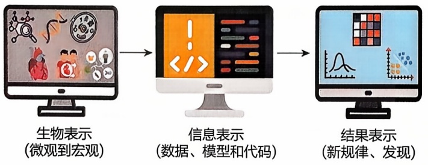
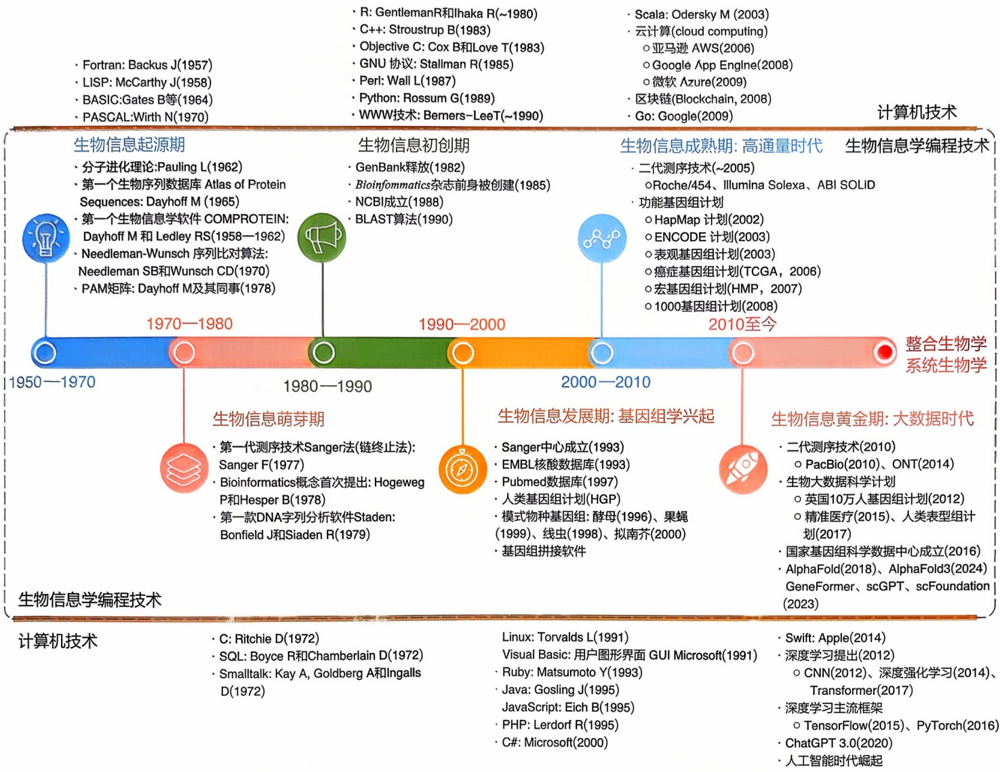
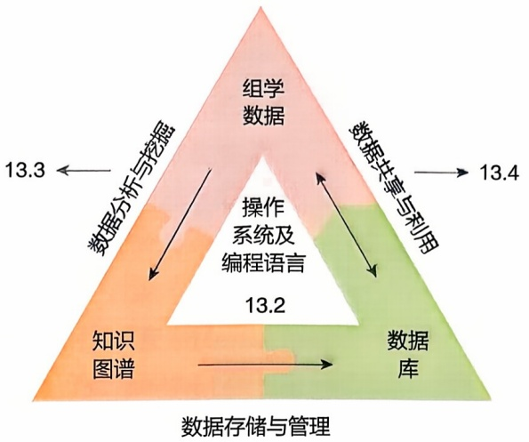
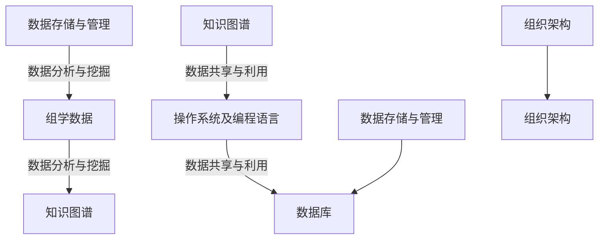

3. Ally A, Balasundaram M, Carlsen R, et al. Comprehensive and integrative genomic characterization of hepatocellular carcinoma [J]. Cell, 2017, 169(7): 1327-1341.
4. Altschul S F, Gish W, Miller W, et al. Basic local alignment search tool [J]. Journal of molecular biology, 1990, 215(3): 403-410.
5. Bai J P, Abernethy D R. Systems pharmacology to predict drug toxicity: integration across levels of biological organization [J]. Annual review of pharmacology and toxicology, 2013, 53: 451-473.
6. Bulik-Sullivan B, Finucane H K, Anttila V, et al. An atlas of genetic correlations across human diseases and traits [J]. Nature genetics, 2015, 47(11): 1236-1241.
7. Cai M C, Xu Q, Pan Y J, et al. ADReCS: an ontology database for aiding standardization and hierarchical classification of adverse drug reaction terms [J]. Nucleic acids research, 2015, 43: D907-D913.
8. Chen W, Chen L, Zhang X, et al. Convergent selection of a WD40 protein that enhances grain yield in maize and rice [J]. Science, 2022, 375(6587): eabg7985.
9. Chia R, Sabir M S, Bandres-Ciga S, et al. Genome sequencing analysis identifies new loci associated with Lewy body dementia and provides insights into its genetic architecture [J]. Nature genetics, 2021, 53(3): 294-303.
10. Farmer H, McCabe N, Lord C J, et al. Targeting the DNA repair defect in BRCA mutant cells as a therapeutic strategy [J]. Nature, 2005, 434(7035): 917-921.
11. He Y, Xiang Z, Mobley H L. Vaxign: the first web-based vaccine design program for reverse vaccinology and applications for vaccine development [J]. Journal of biomedicine biotechnology, 2010, 2010: 297505.
12. Hopkins A. Network pharmacology [J]. Nature biotechnology, 2007, 25(10): 1110-1111.
13. Huang L H, He Q S, Liu K, et al. ADReCS-Target: target profiles for aiding drug safety research and application [J]. Nucleic acids research, 2018, 46(D1): D911-D917.
14. Ivanov S M, Lagunin A A, Poroikov V V. In silico assessment of adverse drug reactions and associated mechanisms [J]. Drug discovery today, 2016, 21(1): 58-71.
15. Koboldt D C, Fulton R S, McLellan M D, et al. Comprehensive molecular portraits of human breast tumours [J]. Nature, 2012, 490(7418): 61-70.
16. Lappalainen T, Sammeth M, Friedlander M R, et al. Transcriptome and genome sequencing uncovers functional variation in humans [J]. Nature, 2013, 501(7468): 506-511.
17. Li B, Sun C, Li J, et al. Targeted genome-modification tools and their advanced applications in crop breeding [J]. Nature reviews genetics, 2024, 25: 603-

622.

18. Liu C, Ma Y, Zhao J, et al. Computational network biology: data, models, and applications [J]. Physics reports, 2019, 846: 1-66.
19. Liu Z, Liu R, Gao H, et al. Genetic architecture of the inflammatory bowel diseases across East Asian and European ancestries [J]. Nature genetics, 2023, 55(5): 796-806.
20. Manolio T A, Collins F S, Cox N J, et al. Finding the missing heritability of complex diseases [J]. Nature, 2009, 461(7265): 747-753.
21. McClellan J, King M C. Genetic heterogeneity in human disease [J]. Cell, 2010, 141(2): 210-217.
22. Niu Y, Teng X, Zhou H, et al. Characterizing mobile element insertions in 5 675 genomes [J]. Nucleic acids research, 2022, 50(5): 2493-2508.
23. Potter S C, Luciani A, Eddy S R, et al. HMMER web server: 2018 update [J]. Nucleic acids research, 2018, 46(W1): W200-W204.
24. Rashid M, Toh T B, Hool L, et al. Optimizing drug combinations against multiple myeloma using a quadratic phenotypic optimization platform (QPOP) [J]. Science translational medicine, 2018, 453(10): 1-17.
25. Shi Y, Niu Y, Zhang P, et al. Characterization of genome-wide STR variation in 6487 human genomes [J]. Nature communication, 2023, 14(1): 2092.
26. Sircar A, Kim E T, Gray J J. RosettaAntibody: antibody variable region homology modeling server [J]. Nucleic acids research, 2009, 37(W1): W474-W479.
27. Varadi M, Anyango S, Deshpande M, et al. AlphaFold Protein Structure Database: massively expanding the structural coverage of protein-sequence space with high-accuracy models [J]. Nucleic acids research, 2022, 50(D1): D439-D444.
28. Walker R L, Ramaswami G, Hartl C, et al. Genetic control of expression and splicing in developing human brain informs disease mechanisms [J]. Cell, 2019, 179(3): 750-771.
29. Wang M, Zhang Z, Liu J, et al. Gefitinib and fostamatinib target EGFR and SYK to attenuate silicosis: a multi-omics study with drug exploration [J]. Signal transduction and targeted therapy, 2022, 7(1): 157.
30. Wojcik G L, Graff M, Nishimura K K, et al. Genetic analyses of diverse populations improves discovery for complex traits [J]. Nature, 2019, 570(7762): 514-518.
31. Yu H, Lin T, Meng X, et al. A route to de novo domestication of wild allotetraploid rice [J]. Cell, 2021, 184(5): 1156-1170.
32. Zhang P, Luo H, Li Y, et al. NyuWa genome resource: a deep whole-genome sequencing-based variation profile and reference panel for the Chinese population [J]. Cell reports, 2021, 37(7): 110017.
33. Zhang R, Shen S, Wei Y, et al. A large-scale genome-wide gene-gene interaction study of lung cancer susceptibility in Europeans with a trans-ethnic validation in Asians [J]. Journal of thoracic oncology, 2022, 17(8): 974-990.
34. Zhang X E, Liu C, Dai J, et al. Enabling technology and core theory of synthetic biology [J]. Science China life sciences, 2023, 66(8): 1742-1785.
35. Zhou Y, Zhang Y, Lian X, et al. Therapeutic target database update 2022: facilitating drug discovery with enriched comparative data of targeted agents [J]. Nucleic acids research, 2022, 50(D1): D1398-D1407.
36. Zitnik M, Agrawal M, Leskovec J. Modeling polypharmacy side effects with graph convolutional networks [J]. Bioinformatics, 2018, 34(13): i457-i466.

编者:纪志梁（厦门大学）

何顺民（中国科学院生物物理研究所）

徐娟（哈尔滨医科大学）

曹志伟（复旦大学）

朱峰（浙江大学）

蒋绪凯（山东大学）

廖明帜（西北农林科技大学）

马闯（西北农林科技大学）

审读:陈超（中南大学）

## 生物信息学实验基础

生物信息学实验的主要目的是利用计算工具和算法（通过编程实现）来处理和分析生物学数据，以解答生物学问题和推动生物科学的发展。本章将首先简要介绍常用的生物信息学编程语言，然后从技术和原理角度重点介绍两个在生物信息学学习和研究中经常涉及的核心主题:其一是建立生物信息学数据分析流程，旨在将大量生物数据转化为有意义的知识图谱；其二是开发生物学数据库，有效地将生物数据和知识图谱呈现给终端用户。这些内容将帮助读者掌握如何利用编程技术高效处理生物数据，实现从数据到知识的转化和应用。同时，本章还将帮助读者更好地理解和应用前面章节中介绍的生物信息学案例，并结合相关编程技术应用于生物信息学研究中。

## 13

## 13.1 生物信息学实验概述

生物信息学是一门跨学科的科学领域，它将生物学、计算机科学和数学等学科相结合，旨在利用计算机技术处理、分析和理解生物学数据。生物信息学实验就是利用计算和数据分析的方法来解决生物学问题的一类实验。和传统的“湿实验”（wet experiment，如分子克隆、蛋白质电泳等）不同，生物信息学实验通常称为“干实验”（dry experiment），主要依赖计算机、算法和数据库。在生物信息学实验过程中，编程技术扮演着举足轻重的角色，它是实验的重要组成部分，为研究人员提供了强大的工具和方法来解决生物学中的复杂问题。生物信息学编程的目的是将复杂的生物问题转化为可以用信息化方法（包括代码和模型）表示并进行计算和分析从而发现新规律（图13-1），主要用于以下几个方面:①处理和分析大量的生物数据，帮助知识发现；②构建数学模型和计算模型，模拟生物系统的行为和变化；③推动新方法和工具的开发，可以提高数据分析的准确性和效率；④实现自动化流程搭建，提高数据处理和分析的效率；⑤搭建在线数据库和分析平台，为研究人员提供便捷的数据访问和分析工具。

随着生物学研究的不断深入和技术的飞速发展，生物信息学编程技术也在不断地演变和改进。实际上，在生物信息学的整个发展进程中，计算机技术的发展历程与生物技术的革新相辅相成（图13-2），生物技术的革新推动了生物学数据的产生和积累，而计算机技术的发展则为处理和分析这些数据提供了必要的工具和方法。

生物信息学编程技术的发展可以追溯到20世纪70年代。随着DNA测序技术的发展，生物学家们开始面临大量的生物数据。传统的人工计算方法无法高效地处理这些数据，于是科学家们开始转向计算机技术。早期的生物信息学编程技术主要集中在序列比对、基因预测和蛋白质结构预测等方面，使用的主要编程语言包括Perl和C等。

随着时间的推移，生物信息学编程技术得到了迅速的发展和普及。1990年前后，随着人类基因组计划的启动，生物信息学编程技术迎来了一个爆发式的增长期。生物学家们需要处理大量的基因组数据，这促进了生物信息学编程技术的快速发展。在这个阶段，生物信息学编程技术的应用领域不断扩展，包括基因组序列分析、蛋白质结构预测、基因表达分析、系统生物学建模等。



<details>
<summary>flowchart</summary>


</details>

图13-1 生物问题的信息表示

21世纪初，随着高通量测序技术的发展，生物信息学编程技术又迎来了一个重要的转折点。高通量测序技术使得科学家们能够以前所未有的速度和成本获得大量的生物数据，这进一步推动了生物信息学编程技术的发展。在这个阶段，生物信息学编程技术开始融合更多的数据科学技术，如机器学习和深度学习等，以处理和分析这些大规模的生物数据。



<details>
<summary>state_timeline</summary>

| Time Period | Technologies |
| --- | --- |
| 1950—1970 | Fortran: Backus J(1957)<br>LISP: McCarthy J(1958)<br>BASIC:Gates B等(1964)<br>PASCAL:Wirth N(1970) |
| 1970—1980 | 分子进化理论:Pauling L(1962)<br>第一个生物序列数据库 Atlas of Protein Sequences: Dayhoff M (1965)<br>第一个生物信息学软件 COMPROTEIN: Dayhoff M 和 Ledley RS(1958—1962)<br>Needleman-Wunsch 序列比对算法: Needleman SB和Wunsch CD(1970)<br>PAM矩阵: Dayhoff M及其同事(1978) |
| 1980—1990 | R: GentlemanR和Ihaka R(~1980)<br>C++: Stroustrup B(1983)<br>Objective C: Cox B和Love T(1983)<br>GNU 协议: Stallman R(1985)<br Perl: Wall L(1987)<br>Python: Rossum G(1989)<br>WWW技术: Berners-LeeT(~1990) |
| 1990—2000 | Scala: Odersky M (2003)<br>云计算 (cloud computing)<br>○亚马逊 AWS(2006)<br>○Google App Engln(2008)<br>○微软 Azure(2009)<br>区块链(Blockchain, 2008)<br>Go: Google(2009) |
| 2000—2010 | 生物信息成熟期: 高通量时代<br>二代测序技术(~2005)<br>○Roche/454、Illumina Solexa、ABI SOLID<br>功能基因组计划<br>○HapMap 计划(2002)<br>○ENCODE 计划(2003)<br>○表观基因组计划(2003)<br>○癌症基因组计划(TCGA, 2006)<br>○宏基因组计划(HMP, 2007)<br>○1000基因组计划(2008) |
| 2010至今 | 生物信息学编程技术 |
| 2010至今 | 整合生物学系统生物学 |
| 2010至今 | 生物信息黄金期: 大数据时代<br>二代测序技术(2010)<br>○PacBio(2010)、ONT(2014)<br>生物大数据科学计划<br>○英国10万人基因组计划(2012)<br>○精准医疗(2015)、人类表型组计划(2017)<br>国家基因组科学数据中心成立(2016)<br>AlphaFold(2018)、AlphaFold3(2024) GeneFormer、scGPT、scFoundation (2023) |
| 2010至今 | 生物信息学编程技术 |
| 2010至今 | 计算机技术 |
| 2010至今 | 生物信息学编程技术 |
| 2010至今 | 计算机技术 |
| 2010至今 | 生物信息学编程技术 |
| 2010至今 | 计算机技术 |
| 2010至今 | 计算机技术 |
| 2010至今 | 计算机技术 |
| 2010至今 | 计算机技术 |
| 2010至今 | 计算机技术 |
| 2010至今 | 计算机技术 |
| 2010至今 | 计算机技术 |
| 2010至今 | 计算机技术 |
</details>

到了当今，生物信息学编程技术已经成为生物学研究中不可或缺的一部分，大语言模型的发展也让生物信息学编程技术进入新的阶段。它在基因组学、转录组学、蛋白质组学、代谢组学等多个领域发挥着重要作用。生物信息学编程技术不仅能够帮助科学家们处理和分析生物数据，还能够提供生物学模型的构建和模拟等功能。随着技术的不断进步，生物信息学编程技术也在不断地演进和改进，为生物学研究提供了更强大的工具和方法。

在生物信息学编程技术的发展过程中，有几个关键的技术和方法对其起到了重要的推动作用。首先是早期的序列比对和基因预测方法，这些方法的发展和广泛使用为生物信息学编程技术的发展奠定了基础。其次是机器学习和深度学习等数据科学技术的应用。随着生物数据规模的不断增大，传统的生物信息学方法已经无法有效处理这些数据。因此，科学家们开始将机器学习和深度学习等数据科学技术引入生物信息学编程技术中，以提高数据处理和分析的效率和准确性。这些技术的应用使得生物信息学编程技术更加强大和灵活。此外，开源软件和开放数据资源的出现也极大地促进了生物信息学编程技术的发展。越来越多的生物信息学工具和数据库成了开源软件，科学家们可以自由地获取和使用这些工具和数据资源，从而加速了

图13-2 生物信息学编程技术与计算机技术的发展历程

生物信息学编程技术的应用和发展。

总的来说，从早期的序列比对和基因预测到如今的机器学习和深度学习等数据科学技术的应用，生物信息学编程技术的发展经历了多个阶段。随着生物学研究的不断深入和技术的不断进步，生物信息学编程技术将继续发挥着重要的作用，推动着生物学研究的不断发展。生物信息学常用的编程语言主要包括以下几种。

① C/C++ C/C++ 是一种高性能的编程语言，在生物信息学领域通常用于开发性能要求较高的生物信息学工具和算法。一些序列比对、蛋白质结构预测等底层任务的工具可能是用 C 或 C++ 编写的。
② Perl Perl 曾经是生物信息学中最流行的编程语言之一，在生物信息学领域有着较长的历史。Perl 是一种灵活、强大的编程语言。许多经典的生物信息学工具和软件都是用 Perl 语言编写的，尤其在早期序列分析任务中都可以找到 Perl 的身影，如 BioPerl、EMBOSS、GBrowse、RepeatMasker 等，不过现在基本被 Python 所替代。
③ Python Python 是一种简单易学、功能强大的编程语言，在生物信息学领域得到了广泛应用。它拥有丰富的生物信息学相关的库和工具，如 BioPython、Pandas、NumPy 等，可以用于处理生物序列、进行数据分析和可视化等任务。
④ R R 语言是一种专门用于统计学和数据分析的编程语言, 因为免费开源和拓展性等优点, 在生物信息学的统计分析和可视化中得到广泛应用。其中, Bioconductor 是一个专门为生物信息学开发的 R 包生态系统, 提供了丰富的生物信息学工具。
⑤ Java Java 是一种跨平台的编程语言，在生物信息学中也有一定的应用。Java 语言的特点是稳定、可靠，适合开发大型的生物信息学软件和系统。一些生物信息学工具和平台，如 BioJava、Cytoscape、Picard、GATK、InterProScan 等，主要是用 Java 编写的。
⑥ Julia Julia 是一种新兴的高性能编程语言，被设计用于高性能科学计算，具有动态类型、高性能和易于编写的特点，在生物信息学中也有一些应用。
⑦ MATLAB MATLAB 是一种用于数学建模和工程计算的语言，生物信息学中在数学建模和仿真方面有时会使用 MATLAB。但是，MATLAB 是一款商业软件，需要购买许可证才能使用，限制了其使用范围。
⑧ Bash/Shell 脚本 Bash 是一种 Unix 和 Linux 操作系统中常用的命令行解释器，而 Shell 是一种用于与操作系统内核进行交互的命令语言，也是一种脚本语言。在生物信息学中，它常用于处理文件、运行一系列命令以及批量处理任务。
⑨ Web 技术 在生物信息学研究中，Web 技术被广泛应用于构建在线工具、数据库查询界面和数据可视化平台等，为生物学研究提供了便捷的访问和使用方式。常见的 Web 应用框架如 Django、Flask 和 Ruby on Rails 等，被用于构建生物信息学数据库查询界面和在线工具。
⑩ 数据库技术 数据库技术在生物信息学中也起着关键作用，根据类型的不同可分为关系型数据库（RDBMS）、非关系型数据库（NoSQL）和分布式数据库。利用数据库技术,可以为生物学研究设计专用数据库,通常包含特定类型的生物学数据和相应的查询接口。生物学数据库的开发常涉及数据库技术和 Web 技术的融合应用,前面章节提到的生物学数据库都是通过类似方式构建而成的。

生物信息实验要求读者具备一定的编程基础。虽然选择合适的编程语言或技术取决于具体的应用场景、任务需求以及个人偏好，但是不同编程语言在语法及功能方面具有较高的相似性，掌握其中一门编程语言之后，很容易拓展学习其他编程语言。特别需要指出的是，借助 ChatGPT 和 DeepSeek 等大语言模型的代码生成、测试和解读能力，只要给出正确的提示，这些大语言模型就可以协助完成特定的编码任务。在生物信息学实践中，读者不需要从头开始构



<details>
<summary>flowchart</summary>


</details>

图13-3 本章主要章节之间的关系

建完整的应用程序，而是可以在 ChatGPT 或 DeepSeek 生成的代码基础上进行补充和完善。ChatGPT 或 DeepSeek 能够提供初步的代码框架、解决方案和具体实现，读者则可以根据实际需求进行调整和优化。此外，大语言模型还可以生成和执行单元测试，帮助识别和修复潜在的错误，确保代码的稳定性和可靠性。因此，在生物信息学实验中，合理使用大语言模型不仅可以加速写代码过程、提高代码质量，还能实现不同语言之间的代码转换，使得生物信息学编程更加高效和精确。

在接下来的章节中，首先介绍当前常用的生物信息学编程语言，包括Linux系统及Shell脚本语言、Python编程语言和R编程语言（13.2）；再分别介绍生物信息学数据分析流程搭建（目的是将数据转化为知识图谱；13.3）和生物学数据库开发（将生物数据/知识图谱呈现给终端用户；13.4），这两个主题在日常的生物信息学学习和研究中经常涉及。本章主要章节的关系如图13-3所示。需要说明的是，生物信息学实验涉及大量的学习内容，由于篇幅所限，本章节不能囊括所有的主题内容，对生物信息学实践感兴趣的读者可以进一步学习本书对应的实验教材。

## 13.2 Linux 系统及常用编程语言简介

Linux是生物信息学实验的首选操作系统之一。由于其开源性、稳定性和强大的命令行工具，Linux成了生物信息学研究人员开展实验的理想平台。Shell脚本语言是一种在Linux操作系统中由Shell（命令解释器）执行的编程语言，用于实现自动化任务、批处理操作以及系统管理等功能。R是一种专为统计分析和数据可视化设计的编程语言，广泛用于生物信息学等数据科学领域。Python是一种通用编程语言，以其简洁易用的语法和丰富的库生态系统而闻名，广泛应用于数据科学、机器学习（包括深度学习）、Web开发等领域。

## 13.2.1 Linux 操作系统

操作系统通常分为 Windows、Linux 和 Mac OS 等几种。其中，Linux 操作系统在生物信息学领域得到了广泛的应用，主要因为它具备开放性、灵活性、强大的命令行界面、免费开源、出色的稳定性以及高度的可定制性等特点。越来越多的生物信息学软件和工具都支持在 Linux 系统上运行，选用 Linux 系统进行生物信息学实验有以下 6 个主要优势。

## (1) 稳定性和性能

Linux 系统以其稳定性和高效性能而著称，特别适合处理大型生物信息学数据集和进行复杂计算。许多高性能计算集群和超级计算机都运行 Linux 操作系统，这为生物信息学研究提供了强大的计算支持。

## (2) 开源软件生态系统

Linux 拥有丰富的开源软件资源，这对于生物信息学研究尤为重要。大量的生物信息学工具和软件包都是在 Linux 环境下开发和优化的，如 BLAST、Bowtie 和 GATK 等。这些工具在 Linux 上通常具有更好的性能和兼容性。

## （3）强大的命令行工具

Linux 提供了强大的命令行界面（command line interface，CLI），允许用户通过脚本和命令行工具高效地处理和分析数据。常用的命令行工具如 grep、awk、sed 和 sort 等，可以轻松地进行数据筛选、处理和格式转换。此外，Linux 的 Shell 脚本编程（如 bash 脚本）使得自动化数据处理和分析成为可能，大大提高了工作效率。

## （4）软件包管理和更新

Linux 系统通常配备了强大的包管理器（如 apt、yum、dnf 和 pacman 等），方便用户安装、更新和管理软件包。这使得生物信息学研究人员能够轻松获取最新的软件版本和更新，确保他们的研究工具保持最新版本。

## (5) 社区和支持

Linux 拥有庞大的用户社区和丰富的在线资源，研究人员可以通过论坛、邮件列表和文档快速找到问题的解决方案。此外，许多生物信息学工具和软件的开发者社区也主要集中在 Linux 平台上，这使得用户能够获得及时的支持和帮助。

## (6) 自定义和灵活性

Linux 系统的高度可定制性允许用户根据自己的需求配置和优化系统环境。研究人员可以选择合适的发行版（如 Ubuntu、CentOS、Debian 等）以及特定的内核和软件配置，以满足特定的研究需求。这些发行版在 Linux 的基础上添加了一些额外的软件和设置，以使它们更适合不同的用途，如桌面计算、服务器管理等。Linux 作为一个强大的操作系统，被广泛用于各种用途，包括个人电脑、服务器、嵌入式系统、超级计算机等。它具有稳定性、安全性和可定制性等优点，因此受到了许多人的喜爱和使用。

虽然 Windows 在日常办公中广受欢迎，Linux 因其稳定性、性能、丰富的开源软件资源、强大的命令行工具和灵活性，成了生物信息学实验的理想平台。无论是在数据处理、分析，还是在高性能计算和自动化工作流程方面，Linux 都为生物信息学研究提供了强有力的支持（表 13-1）。对于新手来说，Linux 可能需要一些时间来学习，但一旦掌握了基本概念，它可以成为一个强大的工具，用于完成各种计算机任务。

## 13.2.1.1 Linux 系统的安装

Linux本身是免费的，读者可以在各个Linux发行版的官方网站上找到安装包。下载的iso光盘映像文件可以刻录成光盘或制作成U盘启动盘，从而在安装Linux操作系统时使用，具体的安装过程读者可以自行查阅资料，这里不再赘述。关于

表 13-1 Linux 与 Windows 系统之间的比较

| 比较 | Linux | Windows |
| --- | --- | --- |
| 用户界面 | 主要依赖命令行界面(CLI),学习曲线较陡 | 图形用户界面(GUI),用户友好,易于操作 |
| 软件生态系统 | 广泛的开源软件支持,如BLAST、Bowtie、GATK | 支持许多商业软件,如Geneious、CLC Genomics Workbench |
| 命令行工具 | 强大的命令行工具和脚本支持,如awk、sed、grep | 命令行工具功能有限,PowerShell虽强大但不及Linux |
| 高性能计算支持 | 支持高性能计算集群和并行计算框架,如MPI、Hadoop | 对高性能计算集群的支持不如Linux,主要依赖第三方解决方案 |
| 硬件兼容性 | 部分硬件驱动支持较弱,需要手动配置 | 驱动支持全面,设备兼容性好 |
| 系统稳定性 | 高稳定性,适合长时间运行计算任务 | 较高稳定性,但系统更新可能影响长时间运行的任务 |
| 安全性 | 权限管理和安全机制完善,开源使得安全漏洞修复迅速 | 安全机制较完善,但需要依赖定期的系统更新和杀毒软件 |
| 成本 | 开源和免费,软件采购成本低 | 商业授权需要费用,增加软件采购成本 |
| 开发工具 | 支持多种开发工具和编程语言,如GCC、Python、R | 强大的集成开发环境(IDE)如Visual Studio,广泛的编程语言支持 |
| 文献管理和写作 | 支持LaTeX等科学写作工具,也支持文献管理工具Zotero、Mendeley、LibreOffice等 | 支持Microsoft Office、EndNote、Mendeley、Zotero等文献管理和写作工具 |
| 数据可视化和分析 | 支持强大的数据分析能力,但是图形化工具比较少 | 支持Excel、GraphPad Prism、OriginLab等图形用户界面的数据可视化和分析工具 |
| 学习曲线 | 需要掌握一定的系统管理和命令行操作知识 | 用户界面友好,适合不熟悉命令行操作的用户 |
| 网络共享和远程访问 | 通过SSH、NFS、Samba等实现高效的网络共享和远程访问 | 通过远程桌面、Samba等实现网络共享和远程访问,但配置较复杂 |
| 开源工具支持 | 广泛的开源工具和库,性能和兼容性较好 | 部分开源工具在Windows上的兼容性和性能不如Linux |
| 数据处理和自动化 | 强大的数据处理和自动化能力,通过脚本实现复杂任务 | 数据处理和自动化能力有限,依赖第三方工具如PowerShell和批处理脚本 |
| 平台无关性 | 适合高性能计算环境和服务器,广泛用于科学研究和数据分析 | 适合个人电脑和工作站,适合日常办公和商业软件使用 |

Linux 系统的最低硬件要求，取决于所使用的 Linux 发行版。通常而言，这不是一个需要过多担心的问题。以 Ubuntu 22.04 为例，它的默认安装要求为 2 GHz 双核处理器、4 GB RAM（系统内存）和 25 GB 硬盘空间，对于现代大多数计算机而言，基本上可以满足需求。

当完成上述 Linux 发行版的安装后，在开机时就可以选择进入 Linux 系统了。随着技术的发展，产生了更简便的 Linux 系统进入方式。在 2016 年，微软也开发了适用于 Linux 的 Windows 子系统（Windows Subsystem for Linux, WSL），可以在 Windows 计算机上同时访问 Windows 和 Linux 两个操作系统。通过 WSL，开发人员可以安装 Linux 发行版（如 Ubuntu、OpenSUSE、Kali、Debian、Arch Linux 等），并直接在 Windows 上使用 Linux 应用程序和 Bash 命令行等工具，不用进行任何修改，也无须承担传统虚拟机或双启动设置带来的资源占用问题。因此，读者只需要在 Windows 上安装 WSL（或 WSL2）加任意 Linux 发行版就可以在 Windows 上体验 Linux 操作系统，极大地方便了用户需求，同时对上述的 25 GB 硬盘空间的需求也降低了很多，通常只需要占用 1 GB 即可。而且，通过 WSL 启动的 Linux 系统可以和 Windows 共享文件，对于生物信息学研究中频繁的文件读写和查看有很大帮助。

当然，如果不想在自己的计算机上同时安装两个操作系统，另一种选择是使用虚拟机技术。虚拟机是安装在主机操作系统上，但可以模拟整个硬件环境，允许在虚拟环境中安装另一个操作系统的一款软件，其中主机操作系统称为宿主操作系统，而虚拟化的操作系统称为客户操作系统。使用虚拟机的主要优点是，对客户操作系统的任何更改都不会影响宿主操作系统，因为它们依赖于虚拟环境中的模拟硬件。最终，虚拟机在硬盘上只留下一系列文件，不会对物理硬件做出实际更改。其中，最常用的虚拟机软件是 VMware，其中 VMware Server 可以免费使用。这种方法对 Windows 和 Mac OS 用户都是可以实现的。

## 13.2.1.2 Linux系统的配置

在生物信息学的研究中，配置 Linux 系统是非常常见的，因为 Linux 系统在生物信息学研究中具有广泛的应用。不过随着 Linux 桌面的日趋成熟和人性化，这种所谓的“基本配置”已经越来越少了。这里选择入门用户最常问到的一些问题，以便读者能够尽快上手。

① 基本工具安装 安装基本的 Linux 命令行工具，如文本编辑器（如 nano、vim 或 emacs）、文件管理器（如 Nautilus 或 Thunar）等。
② 包管理器 了解和使用 Linux 的包管理器，如 APT、YUM、DNF 等，以便安装和更新软件包。
③ 终端模拟器 使用合适的终端模拟器, 如 GNOME Terminal 或 KDE Konsole, 以便在命令行界面上工作。
④ 用户权限管理 了解如何管理用户和权限，以确保研究数据的安全性和隐私性。

⑤ 软件环境管理 使用虚拟环境管理工具，如 Conda、virtualenv 等，以隔离不同项目的依赖关系和软件包。
⑥ 生物信息学工具安装 安装常用的生物信息学工具，如 BLAST、Bowtie、Samtools、BEDTools 等，以及相关的依赖项。

⑦ 编程环境 设置合适的编程环境，如 Python、R 或 Perl，以便进行数据分析和脚本编写。

⑧ 数据库管理 了解在 Linux 系统中管理生物信息学数据库，如 MySQL、PostgreSQL 数据库管理软件等。

⑨ 版本控制 使用版本控制系统, 如 Git, 来管理和跟踪研究项目的代码和数据。

⑩ 数据备份和存储 建立有效的数据备份和存储策略，以防止数据丢失或损坏。

⑪ 网络连接 配置网络连接，以便在需要时下载数据、更新软件包或与其他研究人员合作。
⑫ 安全性 采取必要的安全措施，如防火墙配置、定期更新系统和软件包、限制对系统的远程访问等，以确保系统的安全性。

这些是在 Linux 系统上进行生物信息学研究时的一些基本配置方面。根据具体的研究需求和工作流程，可能还需要进一步定制和配置系统。此外，随着技术和工具的不断发展，配置可能需要不断更新和调整。

## 13.2.1.3 Linux系统的组成

Linux 系统由多个部分组成，这些组件协同工作以提供完整的操作系统环境。以下是 Linux 系统的主要组成部分。

① 内核（Kernel） Linux 内核是操作系统的核心部分，它负责管理硬件资源，包括处理器、内存、设备驱动程序、文件系统等。内核控制着计算机的基本功能，并提供了用户空间程序与硬件之间的接口。
② Shell Shell 是用户与 Linux 系统之间的交互界面。它接受用户的命令并将其传递给内核执行。Linux 系统支持多种不同的 Shell，如 Bash（Bourne Again Shell）、Zsh、Fish 等。Bash 是最常见的 Shell。

③ 文件系统 Linux 使用文件系统来组织和管理文件和目录。常见的文件系统包括 Ext4、XFS、Btrfs 等。文件系统是用于存储和访问文件的关键组成部分。
④ 系统库 系统库包含一组共享的代码和函数，用于支持应用程序的开发和运行。这些库包括 C 标准库（libc）以及其他用于网络、图形、多媒体等功能的库。
⑤ 用户空间工具和应用程序 Linux 系统提供了大量的命令行工具和图形应用程序，用于执行各种任务，包括文件管理、文本编辑、网络通信、编程开发等。一些常见的用户空间工具包括 ls、cp、mv、grep、sed、awk 等。
⑥ 服务和守护进程 Linux 系统可以运行各种服务和守护进程，如 Web 服务器（如 Apache、Nginx）、数据库服务器（如 MySQL、PostgreSQL）、邮件服务器（如 Postfix、Exim）、日志服务（如 syslogd）等。这些服务在后台运行并提供特定功能。
⑦ 图形用户界面（可选） 虽然 Linux 系统通常以命令行界面为主，但也可以安装图形用户界面（graphical user interface，GUI）来提供更友好的桌面环境。常见的 Linux 桌面环境包括 GNOME、KDE、Xfce 等。

⑧ 网络协议栈 Linux 系统包含了完整的网络协议栈，支持各种网络通信，包括 TCP/IP 协议、HTTP、FTP、SSH 等。这使得 Linux 成为网络服务器和网络设备的理想选择。
⑨ 设备驱动程序 Linux 内核支持许多不同类型的硬件设备，但某些硬件可能需要特定的设备驱动程序来与操作系统协同工作。这些驱动程序通常以内核模块的形式提供。
⑩ 包管理器 大多数 Linux 发行版都提供了包管理器，用于方便地安装、更新和卸载软件包。常见的包管理器包括 APT（Debian/Ubuntu）、YUM/DNF（Red Hat/CentOS）、Pacman（Arch Linux）等。

这些组成部分协同工作，构成了一个完整的 Linux 操作系统，提供了稳定、灵活和可定制的计算环境。用户可以根据自己的需求和偏好对 Linux 系统进行定制和配置。在生物信息学的研究中，对于 Linux 系统层面的更改和操作较少，因此，读者可以首先将重心放在后文的介绍中，学有余力的话，可以再次了解 Linux 的系统构造。

## 13.2.1.4 Linux常用命令介绍

在生物信息学中,使用 Linux 系统是非常常见的,因为 Linux 提供了强大的命令行工具和环境,适用于数据分析、文件处理、脚本编写等任务。表 13-2 是一些常用的 Linux 命令(其中,\$为命令提示符,#为注释符号),它们在生物信息学中经常使用。限于篇幅,在这里主要介绍命令用途,具体用法参考在线资源。

表 13-2 Linux 基础命令

<table><tr><td>命令</td><td>功能</td><td>示例</td><td>输出</td></tr><tr><td>echo</td><td>在终端输出文本</td><td>$ echo "Hello, Bioinformatics!"</td><td>Hello, Bioinformatics!</td></tr><tr><td>cd</td><td>切换工作目录</td><td>$ cd ~/bioinformatics/data</td><td>切换到 ~bioinformatics/data</td></tr><tr><td>ls</td><td>列出当前目录中的文件和文件夹</td><td>$ ls</td><td>如:data1.fasta data2.fasta results/</td></tr><tr><td>pwd</td><td>显示当前工作目录的路径</td><td>$ pwd</td><td>如:/home/user/bioinformatics</td></tr><tr><td>mkdir</td><td>创建新的目录</td><td>$ mkdir project1</td><td>创建 project1 目录</td></tr><tr><td>touch</td><td>创建空文件</td><td>$ touch results.txt</td><td>创建 results.txt 文件</td></tr><tr><td>mv</td><td>移动文件或重命名文件</td><td>$ mv data1.fasta data/$ mv results.txt new_results.txt</td><td>文件移动或重命名</td></tr><tr><td>cp</td><td>复制文件或目录</td><td>$ cp data2.fasta data_backup/</td><td>复制 data2.fasta 到 data_backup/</td></tr><tr><td>rm</td><td>删除文件或目录</td><td>$ rm unwanted_file.txt</td><td>删除 unwanted_file.txt 文件</td></tr><tr><td>ln</td><td>创建链接文件</td><td>$ ln -s /path/to/data1.fasta data1_link.fasta</td><td>创建符号链接 data1_link.fasta</td></tr><tr><td>cat</td><td>查看文件内容</td><td>$ cat sequence.fasta</td><td>显示 sequence.fasta 内容</td></tr><tr><td>wc</td><td>计算文件的行数、字数和字符数</td><td>$ wc sequence.fasta</td><td>1000 5000 30000 sequence.fasta</td></tr><tr><td>sort</td><td>对文本文件进行排序</td><td>$ sort expression.txt&gt; sorted_expression.txt</td><td>排序并输出到 sorted_expression.txt</td></tr><tr><td>uniq</td><td>从排序后的文件中删除重复行</td><td>$ uniq sorted_data.txt &gt; unique_data.txt</td><td>删除重复行</td></tr><tr><td>less more</td><td>查看长文本文件的内容</td><td>$ less annotation.txt</td><td>分页显示文件内容,特别适用于长文本</td></tr><tr><td>head tail</td><td>查看文件的前几行或后几行</td><td>$ head -n 10 data.txt $ tail -n 20 data.txt</td><td>显示 data.txt 的前 10 行或后 20 行</td></tr><tr><td>gzip</td><td rowspan="4">压缩和解压缩文件</td><td rowspan="4">$ gzip data.txt $ gunzip data.txt.gz $ bzip2 data.txt $ bunzip2 data.txt.bz2</td><td rowspan="4">压缩或解压缩文件</td></tr><tr><td>gunzip</td></tr><tr><td>bzip2</td></tr><tr><td>bunzip2</td></tr><tr><td>tar</td><td>创建和解压缩归档文件</td><td>$ tar -cvf project_data.tar data/ $ tar -czvf project_data.tar.gz data/ $ tar -xvf project_data.tar</td><td>创建或解压缩归档文件</td></tr><tr><td>df</td><td>显示磁盘空间使用情况</td><td>$ df -h</td><td>显示磁盘使用情况</td></tr><tr><td>which</td><td>查找可执行文件的路径</td><td>$ which blastp</td><td>显示 blastp 的路径</td></tr><tr><td>top</td><td>监视系统的进程和资源使用情况</td><td>$ top</td><td>显示系统进程信息,按'q'退</td></tr><tr><td>vim</td><td>强大的文本编辑器,适用于编辑配置文件和脚本</td><td>$ vim script.py</td><td>编辑 script.py 文件</td></tr><tr><td>grep</td><td>在文本中查找模式</td><td>$ grep "gene_name" sequence.fasta</td><td>搜索 sequence.fasta 中的 gene_name</td></tr><tr><td>sed</td><td>文本替换和编辑</td><td>$ sed 's/old_gene/new_gene/g' data.txt</td><td>替换 data.txt 中的 old_gene 为 new_gene</td></tr><tr><td>awk</td><td>文本处理</td><td>$ awk '{print $2}' data.txt</td><td>输出 data.txt 的第二列</td></tr></table>

这些是在生物信息学中经常使用的一些基本 Linux 命令，而这些命令还有更加丰富的参数可以追加以实现更加完善的功能。通过熟练掌握这些命令，读者可以更有效地处理生物信息学数据和进行分析。根据具体的需求，还可以使用更多高级的命令和工具来执行特定任务。

## 13.2.2 Shell 脚本编程

## 13.2.2.1 Shell 简介

Shell 是一个用 C 语言编写的程序，它是用户使用 Linux 的桥梁。Shell 既是一种命令语言，又是一种程序设计语言。Shell 提供了一个界面，用户可以通过这个界面访问 Linux 操作系统内核的服务。通过使用 Shell 编写的脚本称为 Shell 脚本（Shell script)，计算机界所说的 Shell 通常都是指 Shell 脚本，但 Shell 和 Shell script 是两个不同的概念，习惯上 “Shell 编程” 一般是指 Shell 脚本编程，不是指开发 Shell 自身。对于 Shell 编程所依赖的环境而言跟后面介绍的 Python、R 编程一样，只要有一个能编写代码的文本编辑器和一个能解释执行的脚本解释器就可以了。其中 Shell 脚本解释器种类众多，常见的有:

- Bourne Shell (/usr/bin/sh 或/bin/sh)
- Bourne Again Shell (/bin/bash)
- C Shell (/usr/bin/csh)
- K Shell (/usr/bin/ksh)
- Shell for Root (/sbin/sh)

本书中关注的是 Bash，也就是 Bourne Again Shell，由于易用和免费，Bash 在日常工作中被广泛使用。同时，Bash 也是大多数 Linux 系统默认的 Shell。但是在一般情况下，编写 Shell 脚本并不区分 Bourne Shell 和 Bourne Again Shell，所以，像 #!/bin/sh，它同样也可以改为 #!/bin/bash。其中，#! 告诉系统其后路径所指定的程序即是 Shell 脚本解释器的具体种类。

## 13.2.2.2 Shell 脚本

打开文本编辑器（可以使用 vi/vim 命令来创建文件），新建一个文件 test.sh，扩展名为 sh（sh 代表 shell），扩展名并不影响脚本执行，见名知意即可。输入一些代码，第一行一般是这样:

```shell
#!/bin/bash
```

提醒:#! 是一个约定的标记，它告诉系统这个脚本需要什么解释器来执行，即使用哪一种 Shell。

运行 Shell 脚本有两种方法:

① 作为可执行程序使用 “chmod +x./test.sh” 命令使脚本 test.sh 具有可执行权限，利用 “./test.sh” 执行脚本:

注意，一定要写成./test.sh，而不是 test.sh，运行其他二进制的程序也一样，直接写 test.sh，Linux 系统会去环境变量（PATH）里寻找有没有叫 test.sh 的，而只有 /bin, /sbin, /usr/bin, /usr/sbin 等在 PATH 里，当前目录通常不在 PATH 里，所以写成 test.sh 是会找不到命令的，要用./test.sh 告诉系统说，就在当前目录找。

② 作为解释器参数，这种运行方式是直接运行解释器，其参数就是 Shell 脚本的文件名，如 “/bin/sh test.sh”。

这种方式运行的脚本，不需要在第一行指定解释器信息，其实写了也不会起作用的。以上就是对 Shell 脚本的初次尝试，在生物信息学中，Shell 编程是一项重要的技能，它允许研究人员自动化数据分析流程、处理大量文件和执行复杂的任务。下面是一些其他常见的 Shell 编程概念和示例，以帮助读者了解 Shell 编程在生物信息学中的应用。

## 13.2.2.3 Shell 变量

在 Shell 编程中，变量是用来存储数据值的符号名称。这些数据值可以是文本、数字、文件路径、命令的输出结果等。变量的使用允许在脚本中存储和操作数据，使得脚本更加灵活和可定制。下面是有关变量和赋值的详细说明。

## (1) 变量命名规则

① 变量名称由字母、数字和下划线组成。
② 变量名称必须以字母或下划线开头。
③ 变量名称通常区分大小写（例如，myVar 和 myvar 是不同的变量）。
④ 一些特殊字符（如空格、标点符号等）通常不被允许，因此最好避免使用它们。

## (2) 变量的赋值

要将一个值赋给变量，使用等号 = 运算符。如 myVar="Hello, World!", 将创建一个名为 myVar 的变量，其值为 “Hello, World!”

## (3) 引用变量

在后续的命令中,可以使用 \$符号引用变量的值。myVar 变量的引用方式为\$myVar。

## (4) 重新赋值变量

可以随时重新赋值一个已存在的变量。如 myVar="New Value", 这将更新 myVar 的值为 "New Value"。

## (5) 删除变量

要删除一个变量，可以使用 unset 命令。如 unset myVar，这将删除 myVar 变量，使其不再可用。

## (6) 变量的替换

将变量的值嵌入其他字符串中。

## (7) 双引号和单引号

在字符串中使用双引号 "会允许变量替换，而单引号" 会将整个字符串视为纯文本。

## (8) 特殊变量

Shell 还定义了一些特殊的变量，如 \$0（脚本名称）、\$1、\$2 等（命令行参数）以及 \$#（命令行参数的数量）等。

变量的使用是 Shell 编程中的关键概念之一，它允许脚本中存储和操作数据，使得脚本可以根据不同的情况执行不同的操作。在生物信息学中，读者可以使用变量来存储文件路径、工具参数、分析结果等，以实现数据处理和分析的自动化。

## 13.2.2.4 Shell 条件循环语句

条件和循环语句是 Shell 编程中的两个重要概念，它们在生物信息学中经常用于处理和分析数据。以下是关于这两个概念的详细说明。