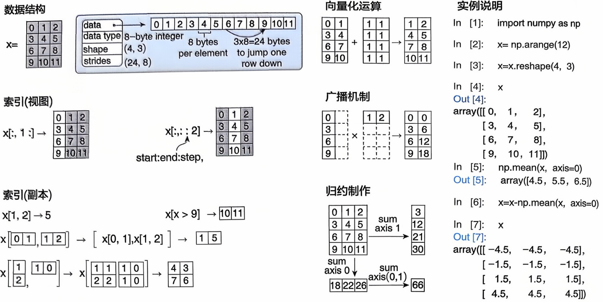
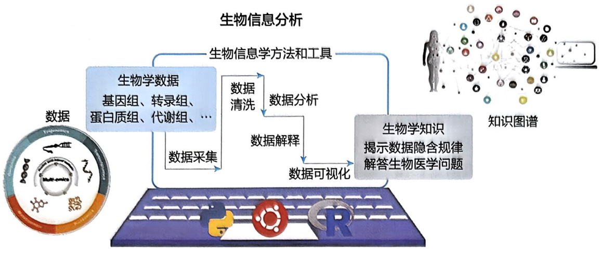
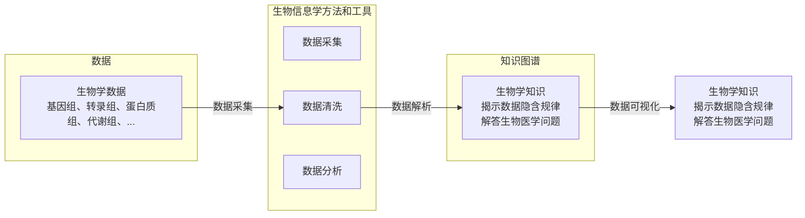
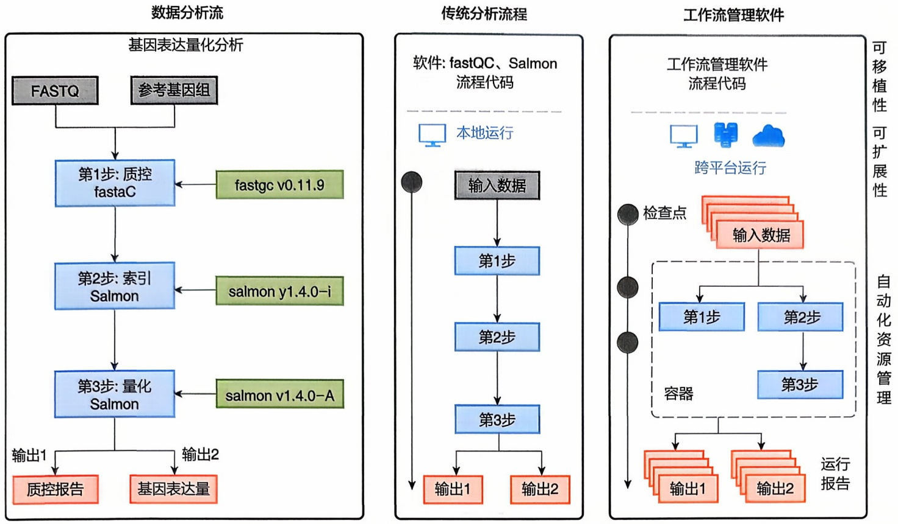
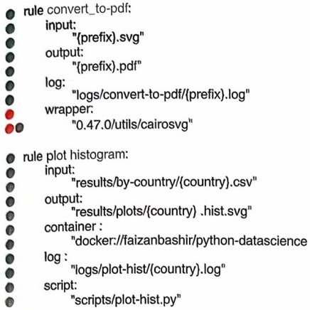
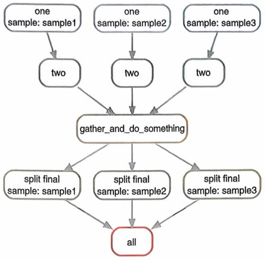
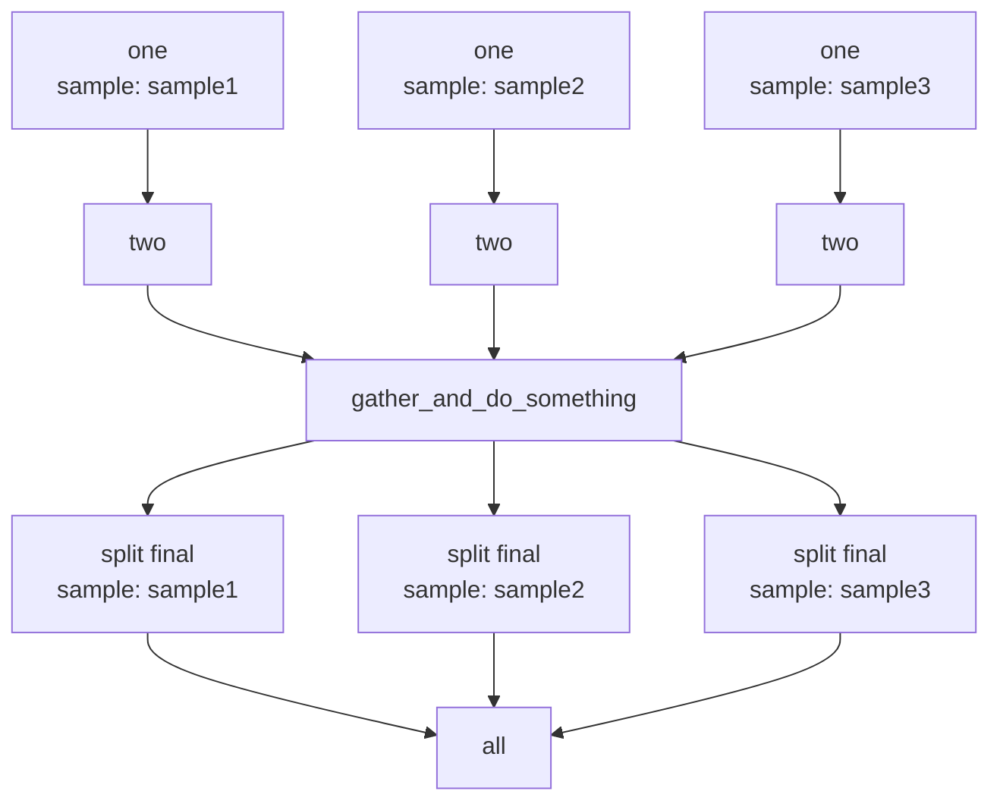
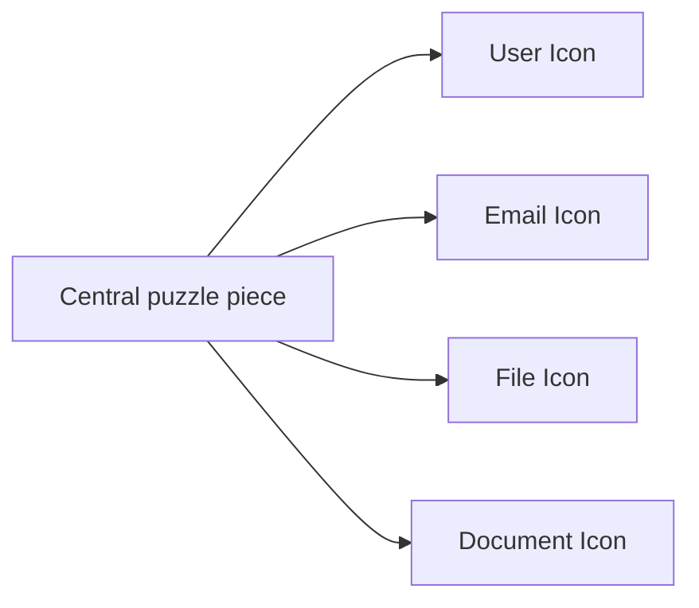

## (2) 代码缩进

在 Python 编程中，代码缩进是一个非常重要的概念。Python 使用缩进来表示代码块，而不是像其他编程语言那样使用花括号 {} 或关键字 begin 和 end。正确的缩进不仅使代码更具可读性，而且是 Python 语法的强制要求。Python 强制要求在同一级别的代码块中使用一致的缩进，而控制结构（如 if 语句、循环、函数和类定义）要求后续的代码块进行缩进。尽量避免在同一个项目中混合使用空格和制表符进行缩进。最好选择一种方式并保持一致。PEP 8（Python 增强提案）推荐使用 4 个空格进行缩进，而不是制表符。

## (3) 对象与变量

在Python中，一切都是对象。对象包含数据（称为属性或成员变量）和可以操作这些数据的方法（称为成员函数或方法），每个对象都属于某个类（类型）。变量是指向对象的名称，用于存储和操作数据。变量通过赋值操作符 $=$ 进行定义和赋值。Python中的对象可以分为可变对象和不可变对象。可变对象是可以在原地修改的对象，如列表、字典、集合等。不可变对象是指不可以在原地修改的对象，如字符串、整数、元组等。

## (4) 常用数据结构

与 R 类似，Python 的常用数据结构包括:数字（number）、字符串（string）、列表（list）、元组（tuple）、字典（dictionary）和集合（set）等 6 种（表 13-8）。

表 13-8 Python 常用数据结构

<table><tr><td>数据结构</td><td>特点</td><td>操作示例</td></tr><tr><td rowspan="4">数字</td><td rowspan="4">有序且不可变,用于存储数值,包括整数类型(int)、浮点数类型(float)、布尔类型(bool)、复数类型(complex)</td><td># 整数 (int)my_int = 42print(type(my_int)) # 输出:</td></tr><tr><td># 浮点数 (float)my_float = 3.14print(type(my_float)) # 输出:</td></tr><tr><td># 复数 (complex)my_complex = 1 + 2jprint(type(my_complex)) # 输出:</td></tr><tr><td># 数学操作sum = my_int + my_floatproduct = my_int * my_complexprint(sum) # 输出: 45.14print(product) # 输出: (42+84j)</td></tr><tr><td>字符串</td><td>有序且不可变,用于存储字符,可以使用单引号(')、双引号('')和三引号('')指定,使用“+”号连接两个字符串</td><td># 创建字符串my_str = "Hello, World!"# 访问字符串元素print(my_str[0]) # 输出: Hprint(my_str[-1]) # 输出: !# 字符串切片print(my_str[7:12]) # 输出: World</td></tr><tr><td rowspan="3"></td><td rowspan="3"></td><td># 字符串连接new_str = my_str + "How are you?"print(new_str) # 输出: Hello, World! How are you?</td></tr><tr><td># 字符串分割words = my_str.split(", ")print(words) # 输出: ['Hello', 'World!']</td></tr><tr><td># 字符串格式化name = "Alice"age = 25info = f"My name is {name} and I am {age} years old."print(info) # 输出: My name is Alice and I am 25 years old.</td></tr><tr><td rowspan="6">列表</td><td rowspan="6">有序且可变,用于存储任意类型的对象,使用“[]”标识</td><td># 创建列表my_list = [1, 2, 3, 4, 5]</td></tr><tr><td># 访问列表元素print(my_list[0]) # 输出: 1print(my_list[-1]) # 输出: 5</td></tr><tr><td># 修改列表元素my_list[0] = 10print(my_list) # 输出: [10, 2, 3, 4, 5]</td></tr><tr><td># 添加元素my_list.append(6)print(my_list) # 输出: [10, 2, 3, 4, 5, 6]</td></tr><tr><td># 删除元素my_list.remove(3)print(my_list) # 输出: [10, 2, 4, 5, 6]</td></tr><tr><td># 列表切片print(my_list[1:4]) # 输出: [2, 4, 5]</td></tr><tr><td rowspan="3">元组</td><td rowspan="3">有序且不可变,用于存储任意类型的对象,使用“()”标识</td><td># 创建元组my_tuple = (1, 2, 3, 4, 5)</td></tr><tr><td># 访问元组元素print(my_tuple[0]) # 输出: 1print(my_tuple[-1]) # 输出: 5</td></tr><tr><td># 元组切片print(my_tuple[1:4]) # 输出: (2, 3, 4)</td></tr><tr><td rowspan="3">字典</td><td rowspan="3">无序且可变,用于存储键值对,其中键值都是Python对象,使用“{}”标识</td><td># 创建字典my_dict = {"name":"Alice", "age":25, "city":"New York"}</td></tr><tr><td># 访问字典元素print(my_dict["name"]) # 输出: Alice</td></tr><tr><td># 修改字典元素my_dict["age"] = 25print(my_dict) # 输出: {'name':'Alice', 'age':25, 'city':'New York'}</td></tr><tr><td>集合</td><td>无序且可变,用于存储不重复的元素,可以看作只有键没有值的字典,使用“{}”或者set()函数创建集合</td><td># 添加字典元素my_dict["email"] = "alice@example.com"print(my_dict) # 输出: {'name':'Alice', 'age':25,'city':'New York', 'email':'alice@example.com'}# 删除字典元素del my_dict["city"]print(my_dict) # 输出: {'name':'Alice', 'age':25,'email':'alice@example.com'}# 遍历字典for key, value in my_dict.items():print(f"{key}:{value}")# 创建集合my_set = {1, 2, 3, 4, 5}# 添加元素my_set.add(6)print(my_set) # 输出: {1, 2, 3, 4, 5, 6}# 删除元素my_set.remove(3)print(my_set) # 输出: {1, 2, 4, 5, 6}# 集合操作set1 = {1, 2, 3}set2 = {3, 4, 5}# 交集print(set1 &amp; set2) # 输出: {3}# 并集print(set1 | set2) # 输出: {1, 2, 3, 4, 5}# 差集print(set1 - set2) # 输出: {1, 2}</td></tr></table>

## (5) Python 控制语句

和其他语言类似，Python 控制语句用于控制程序的执行流程，包括条件判断、循环以及跳转等。其中在条件判断语句中，if、elif、else 用于基于条件选择执行路径；在循环语句中，for 和 while 用于重复执行代码块，break 和 continue 用于控制循环流程。

## (6) 函数定义与调用

def 关键字用于定义函数，函数是一组可以重复使用的代码块。return 语句用于返回函数的结果。

## (7) 异常处理

try、except 和 finally 语句用于捕获和处理可能发生的异常，确保程序的健壮性。

## 13.2.4.4 Python 数据操作

Python 提供了丰富的运算符和操作符来执行各种常见的数据分析，包括算术运算（用于执行基本的数学运算）、比较运算（用于比较两个值，结果为布尔值 True 或 False）、逻辑运算（用于组合布尔表达式或反转布尔值）、位运算（用于对整数的二进制位进行操作）、成员运算（用于检查某个值是否在序列中存在）、身份运算（用于比较两个对象是否是同一个对象）。此外，Python 还提供了标准函数库（包）用于特定功能的数据运算，常见的包括 math 库、random 库、statistics 库。此外，还有诸如 NumPy 包、SciPy 包、Pandas 包等第三方库用于执行特定功能的数据操作和探索分析（表 13-9）。

表 13-9 Python 常用数据操作函数库

<table><tr><td>库/包</td><td>主要功能</td><td>示例代码</td></tr><tr><td>math</td><td>提供数学函数,如三角函数、对数函数、幂函数等</td><td>import mathprint(math.sqrt(16)) # 输出: 4.0print(math.factorial(5)) # 输出: 120print(math.pi) # 输出: 3.141592653589793</td></tr><tr><td>random</td><td>提供随机数生成、随机选择、打乱序列等功能</td><td>import randomprint(random.randint(1,10)) # 输出: 1 ~ 10 随机整数print(random.choice('apple', 'banana', 'cherry'))# 输出: 从列表中随机选择一个元素</td></tr><tr><td>statistics</td><td>提供统计计算功能,如均值、中位数、方差等</td><td>import statisticsdata = [1, 2, 3, 4, 5]print(statistics.mean(data)) # 输出: 3print(statistics.median(data)) # 输出: 3print(statistics.stdev(data))# 输出: 1.5811388300841898</td></tr><tr><td>NumPy</td><td>支持大型、多维数组和矩阵的数学运算</td><td>import numpy as nparray = np.array([1, 2, 3, 4, 5])print(np.mean(array)) # 输出: 3.0print(np.sqrt(array)) # 输出: [1. 1.414213561.73205081 2. 2.23606798]</td></tr><tr><td>SciPy</td><td>提供科学计算功能,如优化、插值、积分等</td><td>from scipy import optimizedef f(x):return x**2 + 5*x + 6</td></tr><tr><td></td><td></td><td>result = optimize.minimize(f, 0)print(result.x) # 输出: 优化后的最小值位置</td></tr><tr><td>Pandas</td><td>高效的数据处理和分析,适合处理结构化数据(数据框)</td><td>import pandas as pddata = {'Name':['Alice', 'Bob', 'Charlie'], 'Age':[25, 30, 35]}df = pd.DataFrame(data)print(df)</td></tr><tr><td>statsmodels</td><td>提供统计模型和计量经济学工具</td><td>import statsmodels.api as smimport numpy as npimport pandas as pd# 创建示例数据np.random.seed(0)X = np.random.rand(100) * 10y = 2.5 * X + np.random.randn(100) * 2</td></tr><tr><td></td><td></td><td># 将数据转换为 DataFrame data = pd.DataFrame({'X':X, 'y':y}) # 添加常数列用于回归模型的截距 X_with_const = sm.add_constant(data['X']) # 创建和拟合线性回归模型 model = sm.OLS(data['y'], X_with_const) results = model.fit() # 输出回归结果摘要 print(results.summary())</td></tr><tr><td>scikit-learn</td><td>机器学习库,提供分类、回归、聚类等算法</td><td>from sklearn.datasets import load_iris from sklearn.model_selection import train_test_split from sklearn.svm import SVC from sklearn.metrics import accuracy_score # 加载数据集 iris = load_iris() X, y = iris.data, iris.target # 划分数据集 X_train, X_test, y_train, y_test = train_test_split (X, y, test_size=0.3, random_state=42) # 训练模型 model = SVC() model.fit(X_train, y_train) # 预测和评估 y_pred = model.predict(X_test) accuracy = accuracy_score(y_test, y_pred) print(f"Accuracy: {accuracy}")</td></tr><tr><td>TensorFlow</td><td>深度学习框架,支持大规模机器学习和神经网络</td><td>import tensorflow as tf # 创建一个简单的模型 model = tf.keras.Sequential([tf.keras.layers.Dense(10, activation='relu', input_shape=(4,)), tf.keras.layers.Dense(3, activation='softmax')]) # 编译模型 model.compile(optimizer='adam', loss='sparse_categorical_crossentropy', metrics=['accuracy']) print("Model summary:") model.summary()</td></tr><tr><td>Keras</td><td>高级深度学习 API,基于 TensorFlow,简化模型构建</td><td>from keras.models import Sequential from keras.layers import Dense # 创建一个简单的模型 model = Sequential([Dense(10, activation='relu', input_shape=(4,)), Dense(3, activation='softmax')) # 编译模型 model.compile(optimizer='adam', loss='sparse_categorical_crossentropy', metrics=['accuracy']) print("Model summary:") model.summary()</td></tr><tr><td rowspan="2">PyTorch</td><td rowspan="2">深度学习框架,支持动态图和张量计算</td><td>import torchimport torch.nn as nnimport torch.optim as optim# 创建一个简单的模型class SimpleNN(nn.Module):def __init__(self):super(SimpleNN,self).__init__()self.fc1 = nn.Linear(4, 10)self.fc2 = nn.Linear(10, 3)def forward(self, x):x = torch.relu(self.fc1(x))x = self.fc2(x)return x</td></tr><tr><td>model = SimpleNN()# 打印模型结构print(model)</td></tr><tr><td>BeautifulSoup</td><td>用于从网页抓取数据的库,支持HTML 和 XML解析</td><td>from bs4 import BeautifulSoupimport requests# 获取网页内容response = requests.get('https://ngdc.cncb.ac.cn')soup = BeautifulSoup(response.content,'html.parser')# 提取网页标题title = soup.title.stringprint(f"Webpage title: {title}")</td></tr></table>

这里重点介绍一下 NumPy（Numerical Python），它是一个开源 Python 库，几乎应用于科学和工程的所有领域。它是在 Python 中处理数值数据的通用标准，也是科学 Python 和 PyData 生态系统的核心。从初学者到经验丰富的研究人员都在利用 NumPy 从事最先进的科学和工业研发工作。NumPy API 广泛用于 Pandas、SciPy、Matplotlib、scikit-learn、scikit-image 以及其他大多数数据科学和科学 Python 软件包。

NumPy 库包含多维数组和矩阵数据结构。NumPy 提供了 ndarray（一个同构的 $n$ 维数组对象），并提供了对其进行高效操作的方法。NumPy 可用于对数组执行各种数学运算。它为 Python 增加了功能强大的数据结构，保证了数组和矩阵的高效计算，并提供了一个庞大的高级数学函数库，从而可以对这些数组和矩阵进行操作（图 13-4）。

## 13.2.4.5 Python 可视化

Python 常用的可视化库包括 Matplotlib、Seaborn 和 Plotly 等。其中，Matplotlib 是一个强大的 2D 绘图库，可以创建各种类型的图表。Seaborn 是基于 Matplotlib 的高级可视化库，提供了更丰富的统计图表和更美观的默认样式，可以通过极简的代码，做出具有分析价值而又十分美观的图形。Seaborn 可以实现 Python 环境下的绝大部分探索性分析的任务，而且对 Python 的其他库（如 Numpy、Pandas 和 SciPy）有很好的支持。Plotly 提供了交互式图表，适用于网页应用和交互式数据分析（表 13-10）。



<details>
<summary>flowchart</summary>

```mermaid
graph LR
  subgraph Data_Structure ["数据结构"]
  A["x="] --> B["data type: 8-byte integer\nshape (4, 3)\nstrides (24, 8)"]
  B --> C["0 1 2 3 4 5 6 7 8 9 10 11"]
  C --> D["8 bytes per element"]
  D --> E["3x8=24 bytes to jump one row down"]
  end

  subgraph Quantization_Olning ["向量化运算"]
  F["0 1\n3 4\n6 7\n9 10"] --> G["1 1\n1 1\n1 1\n1 1"]
  G --> H["1 2\n4 5\n7 8\n10 11"]
  end

  subgraph Broadcast_Mechanism ["广播机制"]
  I["0\n3\n6\n9"] --> J{"x"}
  J --> K["0\n3\n6\n9"]
  K --> L["1 2\n3 6\n6 12\n9 18"]
  end

  subgraph Archiving_Management ["归约制作"]
  M["0 1 2\n3 4 5\n6 7 8\n9 10 11"] --> N{"sum axis 1\n21\n30"}
  N --> O["3\n12\n21\n30"]
  O --> P["sum axis 0\naxis(0,1)\n66"]
  P --> Q["66"]
  end

  subgraph Output_Out_of_Limit ["实例说明"]
    R["&quot;In [1"]: import numpy as np"]
    S["&quot;In [2"]: x=np.arange(12)"]
    T["&quot;In [3"]: x=x.reshape(4, 3)"]
    U["&quot;In [4"]: x\nOut["4"]: array([[0, 1, 2],[3, 4, 5],[6, 7, 8],[9, 10, 11]])"]
    V["&quot;In [5"]: np.mean(x, axis=0)\nOut["5"]: array([4.5, 5.5, 6.5])"]
    W["&quot;In [6"]: x=x-np.mean(x, axis=0)"]
    X["&quot;In [7"]: x\nOut["7"]: array([[-4.5, -4.5, -4.5],[-1.5, -1.5, -1.5],[1.5, 1.5, 1.5],[4.5, 4.5, 4.5]])"]
  end

  %% Connections between steps
  A -.-> B
  B -.-> C
  C -.-> D
  D -.-> E
  E -.-> F
  F -.-> G
  G -.-> H
  H -.-> I
  I -.-> J
  J -.-> K
  K -.-> L
  L -.-> M
  M -.-> N
  N -.-> O
  O -.-> P
  P -.-> Q
  Q -.-> R
  R -.-> S
  S -.-> T
  T -.-> U
  U -.-> V
  V -.-> W
  W -.-> X
```
</details>

图13-4 NumPy库的功能

表 13-10 Python 常用可视化包

| 库/包 | Matplotlib | Seaborn | Plotly |
| --- | --- | --- | --- |
| 示例代码 | import matplotlib.pyplot as pltimport numpy as np# 创建示例数据x = np.linspace(0, 10, 100)y = np.sin(x)# 创建图形和轴plt.figure(figsize=(10, 6))# 绘制线图plt.plot(x, y, label='Sine Wave', color='b',linestyle='-', marker='o')# 添加标题和标签plt.title('Sine Wave Example')plt.xlabel('x-axis')plt.ylabel('y-axis')# 添加图例plt.legend()# 显示图形plt.grid(True)plt.show() | import seaborn as sns import pandas as pd# 创建示例数据data = pd.DataFrame({'x':np.arange(10),'y':np.random.rand(10)*100,'category':['A', 'B']*5})# 创建散点图sns.scatterplot(data=data, x='x', y='y',hue='category',style='category')# 添加标题plt.title('Seaborn Scatter Plot')# 显示图形plt.show() | import plotly.graph_objects as goimport numpy as np# 创建示例数据x = np.linspace(0, 10, 100)y = np.cos(x)# 创建图形对象fig = go.Figure()# 添加线图fig.add_trace(go.Scatter (x=x, y=y, mode='lines+markers', name='Cosine Wave'))# 添加标题和轴标签fig.update_layout(title='Cosine Wave Example',xaxis_title='x-axis',yaxis_title='y-axis')# 显示图形fig.show() |

## (1) Matplotlib

Matplotlib 作为 Python 中最受欢迎的数据可视化库之一，为数据科学家和研究人员提供了丰富而灵活的工具，用于创建引人入胜的图形和图表。其强大的功能和直观的接口使得图形可视化变得更加简单，同时为用户提供了极大的自定义和控制权。

Matplotlib 支持各种图形类型，包括线图、散点图、柱状图、饼图等，以及 3D 图形的绘制。用户可以轻松创建具有各种格式和样式的图形，以满足不同的需求。通过简单的 API 调用，Matplotlib 使得生成高质量的图表成为一项轻松而富有创造性的任务。Matplotlib 的可视化不仅仅局限于静态图形，它还支持动画和交互性可视化。通过嵌入式绘图和交互式工具包，用户能够创建交互式图表，使得数据探索和解释更加直观和深入。

总的来说，Matplotlib 作为一个功能强大而灵活的图形可视化库，不仅适用于初学者，也深受专业用户的喜爱。其丰富的功能、清晰的文档和强大的社区支持使得 Matplotlib 成为数据科学和可视化领域不可或缺的工具，为用户提供了展示数据、理解趋势和传达发现的有效手段。

## (2) Seaborn

Seaborn 是一个基于 Matplotlib 的 Python 数据可视化库，专注于提供各种吸引人且信息丰富的统计图形。其设计灵感来自 R 语言中的 ggplot2，旨在让用户能够通过简单的方法创建美观而又有力的可视化图表。下面是对 Seaborn 图形可视化的简要说明。Seaborn 提供了一系列高级接口，使得绘制统计图形变得轻松而直观。通过 Seaborn，用户可以利用少量的代码轻松创建各种图形，包括散点图、折线图、直方图、箱线图等，以及更高级的统计图形，如核密度估计图和小提琴图。其中一项显著特征是 Seaborn 的配色方案和图形样式，这些都经过精心设计，使得生成的图形在审美上更具吸引力。用户可以通过简单的命令更改整体图形的外观，而不必深入研究每个绘图元素。

Seaborn 的功能强大之处在于其与 Pandas 数据框架的良好集成。用户可以直接使用 Pandas 数据框架中的列来绘制图形，而不必进行复杂的数据准备。这种无缝集成简化了数据可视化的流程，使得从数据探索到图形呈现更加流畅。

在创建图形方面, Seaborn 提供了一些高级函数, 如 'relplot' 和 'catplot', 这些函数允许用户根据数据集中的变量关系轻松创建多个子图, 从而更全面地理解数据。此外, Seaborn 还支持在单个图形中绘制多个子图, 以便比较不同方面的数据。对于统计关系的可视化, Seaborn 提供了 'lmplot' 函数, 该函数支持绘制线性回归模型的散点图, 并在图形中展示回归线的拟合情况。这有助于直观地了解两个变量之间的关系及其拟合程度。

总体而言，Seaborn 作为一个强大而灵活的数据可视化工具，为用户提供了轻松绘制各种统计图形的能力，使得数据的探索和解释变得更加直观和高效。其出色的设计和简单易用的接口使得它成为数据科学家和分析师们首选的可视化库之一。

## 13.2.4.6 Python生物信息学软件包

在生物信息学中，有大量基于Python语言开发的软件包用于处理特定类型的生物学数据，下面列举几例来说明。

① Biopython Biopython 是一个开源的、非商业性质的 Python 包，用于计算生物学和生物信息学领域。Biopython 能处理各种生物学数据，如 DNA、RNA 和蛋白质序列，同时也允许用户通过编程的方式访问在线生物信息数据库（如 NCBI）。Biopython 包含的模块涉及序列处理和比对、数据库查询、蛋白质结构、基因结构等，大大拓展了其功能。
② Pysam Pysam 是一个与 SAM/BAM 格式（用于存储 DNA 测序数据）交互的 Python 库，为生物信息学和基因组学领域提供了强大的功能。主要功能包括读取和写入 SAM/BAM 文件，提供对测序比对数据的灵活访问，以及执行各种基因组学分析任务，如覆盖深度计算、变异检测和序列比对统计。Pysam 的接口设计使得用户能够方便地操作和分析大规模 DNA 测序数据，为生物信息学研究提供了高效而可扩展的工具。
③ Scanpy Scanpy 是与 Anndata（一种数据结构）联合开发的用于分析单细胞基因表达数据的可扩展工具包。它包括预处理、可视化、聚类、轨迹推断和差异表达测试。基于 Python 的实现可高效处理超过 100 万个细胞的数据集。
④ PyDESeq2 PyDESeq2 是 DESeq2 方法在 Python 上的实现，用于对大量 RNA-Seq 数据进行差异表达分析（differential expression analysis, DEA），最初是用 R 语言实现的。目前还处在持续开放阶段，后续还会添加很多功能。
⑤ Pybedtools Pybedtools 是著名基因组研究工具 Bedtools 的 Python 版, Pybedtools 封装并扩展了 BEDTools, 可在 Python 中进行特征级操作。
⑥ PySCeS PySCeS 是一个用于细胞系统科学计算和仿真的 Python 库。它为复杂系统的数据分析、可视化和仿真提供了多种工具。利用 PySCeS，用户可以以交互和直观的方式执行仿真、分析数据和可视化结果。
⑦ NetworkX NetworkX 是一个用于创建、操作和研究复杂网络的结构、动态和功能的 Python 软件包。

## 13.3 数据分析流程搭建

随着生物数据量和复杂性的增加，数据分析流程的可扩展性与可重复性变得至关重要。在生物信息学数据分析中，将数据转化为有用的信息涉及多种工具的组合使用、参数的优化及复杂数据集的管理。为了解决这些挑战，工作流管理系统应运而生。它们简化管道开发、优化资源利用、管理软件安装和版本，并能在多种计算平台上运行，从而实现分析流程的可移植性和共享性。



<details>
<summary>flowchart</summary>


</details>

图13-5 生物信息学数据分析基本过程

## 13.3.1 生物信息分析流程搭建简介

生物信息学数据分析流程的搭建旨在建立一个系统化的方法来处理生物学数据，包括一系列数据处理、分析和解释步骤，旨在从生物学实验中产生的原始数据中提取有用的生物学信息（图13-5）。

以下是一个简要的生物信息分析流程搭建过程。

## (1) 数据采集和预处理

针对某个问题，获取相关数据、进行质控和可能的格式转换。

① 数据获取 收集生物学实验生成的数据，如基因组测序数据（DNA 测序、RNA 测序）、蛋白质质谱数据、表型数据等。
② 质量控制 检查数据的质量，识别并处理潜在的质量问题，如测序错误、低质量读数等。
③ 数据格式转换 将原始数据转换为常用的生物信息学数据格式，如 FASTQ、SAM/BAM、BED、VCF 等，以便进一步的分析。

## (2) 数据分析

针对不同类型的数据，采用的分析方法和工具也不一样。

① 序列比对 对测序数据进行序列比对，将测序片段与参考基因组或转录组进行比对，以确定它们的位置和变异。
② 差异表达分析 对 RNA 测序数据进行差异表达分析，识别在不同条件下基因表达的差异。
③ 通路和功能富集分析 将差异表达基因集合映射到生物通路和功能注释数据库，以了解这些基因的生物学意义。
④ 蛋白质鉴定和定量 对质谱数据进行蛋白质鉴定和定量，识别蛋白质并测量其表达水平。
⑤ 突变分析 对 DNA 测序数据进行突变分析，识别基因突变、单核苷酸多态性（SNP）等变异。

## (3) 数据可视化

利用不同的方法或者工具对不同类型的结果数据进行可视化展示。

① 生成图表 使用数据可视化工具（如 ggplot2、matplotlib 等）创建图表和图形，以展示分析结果。
② 绘制热图 用于可视化基因表达、蛋白质表达或其他多维数据。
③ 制作通路图 展示通路和功能富集分析结果的图表。
④ 制作基因组浏览器图 可视化基因、变异和注释在基因组上的位置。

## （4）结果解释和报告

根据图表结果，解释数据中隐含的生物学意义。

① 解释生物学意义 解释分析结果，理解差异表达基因的生物学功能和潜在的生物学意义。
② 生成报告 创建报告文档，将分析结果以可理解的方式呈现给其他研究人员或利益相关者。

## (5) 结果验证和实验设计优化

对分析结果进行进一步实验验证或者优化分析流程。

① 根据分析结果，设计验证实验以确认潜在生物学发现。
② 根据实验结果和反馈，优化实验设计和生物信息分析流程。

## (6) 文献综述和科研交流

将分析结果呈现到论文或者报告中。

① 撰写和发表研究论文，以分享发现和方法。
② 参与学术会议和研讨会，与同行分享研究成果和经验。

## (7) 持续优化和改进

根据新的需求，持续优化分析流程。

① 持续融合新的生物信息学工具、技术和方法。
② 参与生物信息学社区，与其他研究人员交流并分享经验，从用户获取反馈信息。

以上是生物信息分析流程的一般概述。具体的分析流程将取决于研究问题和数据类型。传统的分析流程通常使用定制脚本或 Make 文件进行开发，可以简化数据的重复分析过程。然而，这些传统流程通常与本地计算基础设施高度耦合，且缺乏充分的文档、参数跟踪和工具版本控制。在运行到其他设备时，传统管道需要手动安装，难以共享和维护，结果的复现性也常常受到影响。因此，对于数据密集型任务，可以使用工作流管理软件来处理复杂的数据分析工作流程。目前正在使用和开发中的工作流管理软件超过 150 种，包括 Nextflow、Snakemake 等。不同工作流管理软件之间的一个主要区别在于易用性、灵活性和功能丰富性之间的权衡。随着生物信息学领域的不断发展，分析工具和方法也在不断演进，因此持续学习和改进是非常重要的。生物信息学家通常需要具备数据分析、统计学和编程等多方面的技能，以便有效地进行生物学数据分析。以下以基因表达量化分析为例，分别介绍经典的分析流程和基于工作流管理软件 Snakemake 的使用方法（图 13-6）。为了在 Linux 系统上实践这两个分析流程，需要预先安装好相关软件和程序包。如果已经安装好 Anaconda 环境，可以很方便地利用下面 Conda 命令来安装依赖软件包:



图13-6 生物信息学数据分析流程的比较（以基因表达量化分析为例）

```txt
# 安装fastQC、Salmon、Snakemake软件
conda install bioconda::fastqc
conda install bioconda::salmon
conda install snakemake
```

## 13.3.2 基于 Shell 的分析流程搭建

## 13.3.2.1 基于 Shell 的流程简介

基于 Shell 的分析流程搭建可以帮助用户自动化执行一系列命令和任务，使数据处理、分析和报告生成过程更加高效，这对于处理大规模数据分析和批处理任务尤其有用。下面是搭建基于 Shell 的分析流程的一般步骤。

## （1）明确任务和目标

确定要执行的任务和分析的目标。这可以包括数据清洗、统计分析、可视化、报告生成等各种任务。

## (2) 准备工作环境

创建一个适当的工作目录，将数据和分析脚本放在其中，并确保有适当的权限来执行所需要的操作。

## (3) 编写 Shell 脚本

使用文本编辑器创建一个 Shell 脚本（通常以 .sh 为文件扩展名），在其中编写一系列 Shell 命令和任务。以下是一些常见的 Shell 命令示例:

① 数据清洗 使用 awk、sed 或 grep 等命令来处理和过滤数据。
② 统计分析 调用 R、Python 或其他统计软件的命令来执行数据分析。
③ 数据可视化 使用命令行绘图工具或调用可视化库来生成图表。
④ 报告生成 使用 echo 命令和文本操作来创建报告文本。

## 13.3.2.2 基于 Shell 的实例分析

以下是一个使用 Shell 脚本实现图 13-6 中基因表达量化分析的示例:这个脚本首先利用 fastQC 进行质量控制，然后利用 Salmon 创建索引基因表达量化分析。

```shell
#!/bin/bash
```

# 设置变量

```shell
FASTQ_DIR="/path/to/fastq/files"
TRANSCRIPTOME_FASTA="/path/to/transcriptome.fa.gz" # 转录组
    FASTA 文件路径
OUTPUT_DIR="/path/to/output"
FASTQC_OUTPUT="\${OUTPUT_DIR}/fastqc_results"
SALMON_INDEX_DIR="\${OUTPUT_DIR}/salmon_index"
SALMON_OUTPUT="\${OUTPUT_DIR}/salmon_quant"
```

# 创建输出目录

```shell
mkdir -p ${FASTQC_OUTPUT}
mkdir -p ${SALMON_INDEX_DIR}
mkdir -p ${SALMON_OUTPUT}
```

# 第1步:质量控制（FastQC）

```shell
echo "Running FastQC..."
for file in \${FASTQ_DIR}/*.fastq.gz; do
    fastqc -o \${FASTQC_OUTPUT} \${file}
done
echo "FastQC complete."
```

# 第2步:创建 Salmon 索引

```shell
echo "Creating Salmon index..."
salmon index -t ${TRANSCRIPTOME_FASTA} -i ${SALMON_INDEX_DIR}
-p 8
echo "Salmon index created at ${SALMON_INDEX_DIR}."
```

# 第3步:转录组数据比对和定量（Salmon）

```batch
echo "Running Salmon..."
```

```shell
for file in \${FASTQ_DIR}/*_R1_*.fastq.gz; do
    SAMPLE_NAME=\$(basename \${file} | sed
's/_R1_.*.fastq.gz//')
    R1=\${file}
    R2=\${FASTQ_DIR}/\${SAMPLE_NAME}_R2_*.fastq.gz

    salmon quant -i \${SALMON_INDEX_DIR} -l A \
    -1 \${R1} -2 \${R2} \textbackslash{}
    -p 8 --validateMappings -o \${SALMON_OUTPUT}/\${SAMPLE_NAME}
done
echo "Salmon quantification complete."

# 输出完成消息
echo "Analysis complete. Results are in \${OUTPUT_DIR."
```

将以上代码保存在名为 runRNAquant.sh 的 Shell 脚本文件中。该脚本的代码详细解释如下:

## (1) 设置变量

① FASTQ\_DIR 输入的 FASTQ 文件所在目录。
② OUTPUT\_DIR 分析结果的输出目录。
③ FASTQC\_OUTPUT FastQC 分析结果的输出目录。
④ SALMON\_INDEX\_DIR Salmon 索引的输出目录。
⑤ SALMON\_OUTPUT Salmon 定量分析结果的输出目录。
⑥ TRANSCRIPTOME\_FASTA 转录组 FASTA 文件的路径。

## (2) 创建输出目录

使用 mkdir -p 命令创建输出目录，如果目录不存在则创建。

## （3）质量控制（FastQC）

对每个 FASTQ 文件运行 FastQC，并将结果输出到指定目录。

## (4) 创建 Salmon 索引

使用 salmon index 命令根据转录组 FASTA 文件创建索引，指定输出目录和线程数。

## (5) 转录组数据比对和定量（Salmon）

① 对每个样本运行 Salmon 定量分析，指定索引、输入文件和输出目录。
② -1 A 参数指定自动检测文库类型。
③ -p 8 指定使用的线程数，可以根据实际情况调整。
④ -validateMappings 选项用于启用映射验证，提高定量精度。

## (6) 输出完成消息

脚本运行完成后，输出提示信息。

## (7) 注意事项

① 运行此脚本前，请确保已安装 FastQC 和 Salmon，并将其可执行文件路径添加到系统环境变量中。
② 确保指定的文件路径和目录存在并且正确。
③ 根据计算资源和数据量调整 -p 参数，以优化性能。
④ 使用 echo 命令输出有关每个步骤的消息，以便在运行脚本时了解进展情况。
⑤ 在分析完成后，可以使用 rm 命令删除不再需要的中间文件，以节省存储空间。

以上步骤完成了自动化和管理数据分析流程。利用该流程有助于确保分析的一致性，减少手动干预的需要，并提高了工作效率。要在 Shell 终端中运行这个示例脚本，需要:

① 为脚本添加执行权限 使用 chmod 命令为 Shell 脚本添加执行权限:

```batch
chmod +x runRNAquant.sh
```

② 执行脚本 运行 Shell 脚本以启动整个分析流程:

```txt
./runRNAquant.sh
```

③ 自动化和调度 根据需要，可以将 Shell 脚本与自动化工具（如 cron 任务）结合使用，以按计划自动执行分析任务。
④ 日志记录和错误处理 在 Shell 脚本中添加适当的日志记录和错误处理，以便跟踪分析的进展并识别问题。
⑤ 结果保存和报告 将分析结果保存到适当的位置，并生成报告或图表，以便进一步解释和分享。
⑥ 维护和改进 定期维护和改进 Shell 脚本，以适应新的需求和数据。

## 13.3.2.3 基于 Snakemake 的分析流程搭建

## (1) Snakemake 简介

Snakemake 是一个基于 Python 的用于创建可重复和可扩展数据分析工作流程的免费工具。通过 Snakemake 可以定义一系列任务以及这些任务之间的依赖关系，构建一个可重复、可维护和可扩展的工作流程，从而无须人工干预即可执行数千至数万个数据集。Snakemake 还拥有强大的并行处理能力，它可以根据任务之间的依赖关系，有效利用任何计算平台，智能地并行执行任务，从而加快整个工作流程的运行速度（图 13-7）。

简单来说，Snakemake 有以下优点:

① 可读性强（readability） 使用 Snakemake 时，数据分析工作流程是通过 Python 上一种易读、适应性强且功能强大的规范语言来定义的。每个规则（rule）描述分析中的一个步骤，定义如何从输入文件获取输出文件，规则之间的依赖关系会自动确定。
② 易移植（portability） 通过与 Conda 软件包管理器和容器虚拟化的集成，

## 声明式工作流



<details>
<summary>text_image</summary>

rule convert_to-pdf:
input:
"(prefix).svg"
output:
"(prefix).pdf"
log:
"logs/convert-to-pdf/(prefix).log"
wrapper:
"0.47.0/utils/cairosvg"

rule plot histogram:
input:
"results/by-country/(country).csv"
output:
"results/plots/(country) .hist.svg"
container :
"docker://faizanbashir/python-datascience
log :
"logs/plot-hist/(country).log"
script:
"scripts/plot-hist.py"
</details>

## 自动化任务调度



<details>
<summary>flowchart</summary>


</details>

## 并行和分布式执行


<details>
<summary>flowchart</summary>

This diagram illustrates a process flow with multiple nodes and directional arrows, showing how inputs are processed through intermediate stages to produce final outputs.
</details>


可扩展性


<details>
<summary>flowchart</summary>


</details>


每个流程步骤的所有软件依赖关系都会在执行时自动部署。

③ 模块化管理（modularization） 通过直接将脚本和 Jupyter notebook 集成，快速实施分析步骤。轻松创建和使用可重复使用的工具包装器，并将数据分析拆分成独立的模块。
④ 透明（transparency） 自动、交互、独立的报告确保了从结果到所用步骤、参数、代码和软件的完全透明。
⑤ 可扩展（scalability）结合 Conda，工作流可以被无缝扩展到服务器、集群、网格和云环境，当整理好流程以后，只需要简单替换几个参数，就能快速开始分析一个新的数据。

最后，Snakemake 可包含对所需要软件的描述，这些软件将自动部署到任何执行环境中。

## (2) Snakemake 使用方法介绍

① Snakemake 的基本用法 在 Snakemake 中，可以使用类似于 Python 的语法来描述任务和规则，根据 Snakefile 中指定的规则来定义数据分析流程。Snakemake 的基本组成单位叫 “rule”，即 “规则”。每个规则（rule）定义了一个任务，规定了输入（input）、输出（output）以及执行任务所需要的命令（action），形成一个完整的工作流。语法如下:

```txt
rule Name:
    input:
        "path/to/inputfile", "path/to/other/inputfile"
    output:
```

图13-7 Snakemake的主要特点