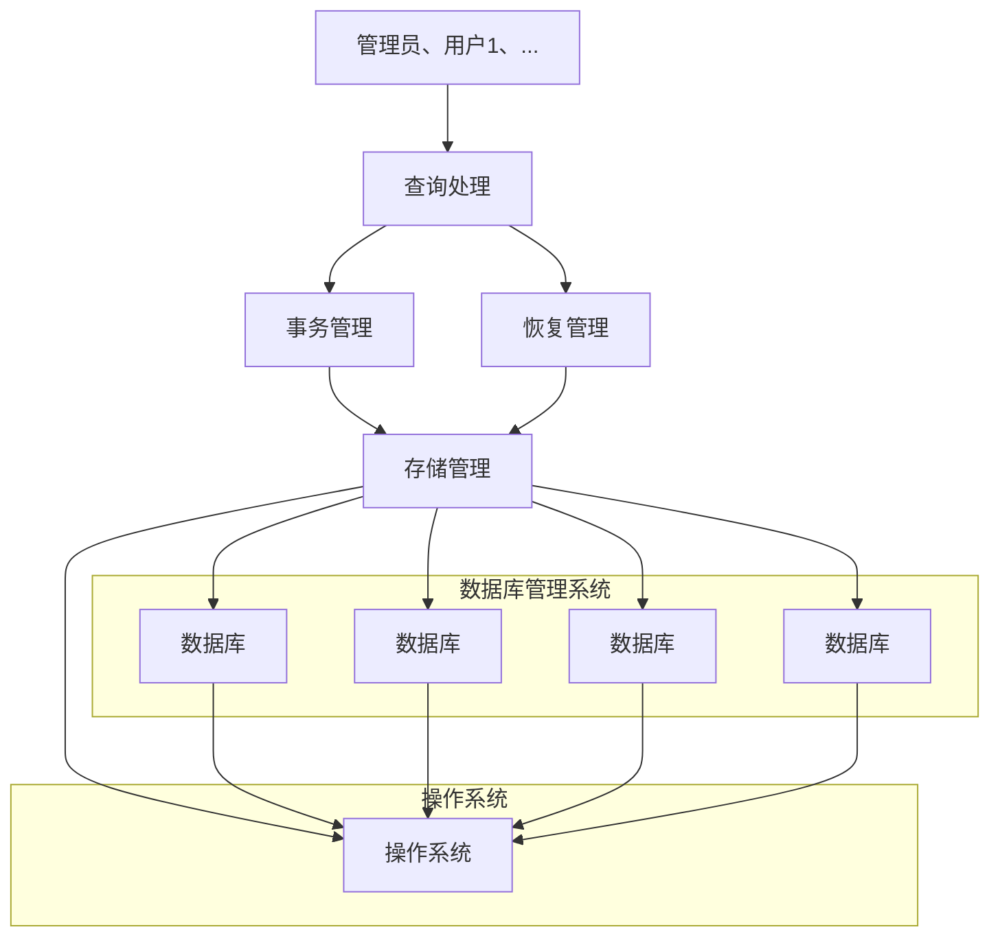
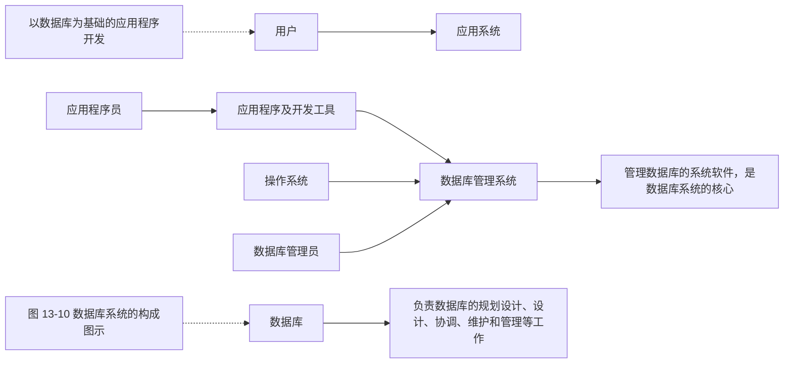

```txt
"path/to/outputfile", "path/to/another/outputfile"
shell:
    "somecommand {input} {output}"
```

Snakemake 可以根据这些规则自动解析依赖关系，确保任务按照正确的顺序执行，且仅执行需要的任务，从而最大限度地提高效率。默认情况下，Shell 命令将使用 bash shell 调用。

例如，如果需要对文件进行排序，可以在 Shell 中使用 sort 函数来实现:

```batch
sort dataset.txt > dataset.sorted.txt
```

上述任务可以使用 Snakemake 来进行定义:

```yaml
rule sort:
  input:
    "path/to/dataset.txt"
  output:
    "dataset.sorted.txt"
  shell:
    "sort {input} > {output}"
```

在这个示例中，定义了一个名为 sort 的规则，input 指令将 dataset.txt 作为输入文件，path/to/dataset.txt 指定了输入文件的路径，output 指令将 dataset.sorted.txt 作为输出文件。

在 Shell 命令字符串中,可以通过大括号表示法引用命令的元素。通过指定 {input} 来引用输入文件,通过指定 {output} 来引用输出文件。换句话说,Snakemake 会在执行命令之前将 {input} 替换为 path/to/dataset.txt,进行排序操作后,输出排序后的内容存储在 dataset.sorted.txt 文件中。

对于执行的命令部分，也可以用Python语法实现:

```python
rule sort:
  input:
    "path/to/{dataset}.txt"
  output:
    "{dataset}.sorted.txt"
  run:
    with open(output[0],"w")as out:
      for l in sorted(open(input[0])):
        print(l,file=out)
```

为了让代码更简洁，也可以把执行命令的部分封装到外部脚本中（Python、R、Julia、Rust、Bash等）。例如，在下面示例中，把执行的命令封装到一个名为myscript.py的Python脚本中:

```yaml
rule sort:
  input:
    "path/to/{dataset}.txt"
  output:
    "{dataset}.sorted.txt"
  script:
    "scripts/myscript.py"
```

② Snakemake 的高级功能 通常情况下，将一条规则概括为适用于多个数据集是非常有用的。为此，可以使用通配符。自动解决多个命名通配符是 Snakemake 的主要特点和优势。如下示例:

```yaml
rule sort:
  input:
    "path/to/{dataset}.txt"
  output:
    "{dataset}.sorted.txt"
  shell:
    "sort {input} > {output}"
```

假设 dataset 变量被指定为 test，则这段代码指定的文件名为 path/to/test.txt 和 test.sorted.txt。值得注意的是，输入和输出中的通配符名称必须完全相同。通常情况下，输入和输出中都会出现相同的通配符，当然也可以只在输出中使用通配符，而不在输入部分使用。在一个文件名中使用多个通配符可能会造成歧义，例如，output:“{dataset}.{group}.txt”假设有一个名为 101.B.normal.txt 的文件，难以判断它应该是 dataset=101.B 和 group=normal，还是 dataset=101 和 group=B.normal。

因此，通配符可以用正则表达式来进行限制。在这里，可以使用\d+作为相应的正则表达式，将通配符数据集限制为只包含数字。在Snakemake 3.8.0以上版本，有3种限制通配符的方法。

首先，通配符可以通过添加一个用逗号分隔的正则表达式在文件模式中进行限制:

```javascript
output: "{dataset,\d+}.{group}.txt"
```

其次，可以通过关键字 wildcard\_constraints 在规则中对通配符进行限制:

```yaml
rule sort:
  input:
    "path/to/{dataset}.txt"
  output:
    "{dataset}/file.{group}.txt"
  wildcard_constraints:
```

```snap
dataset="\\d+" shell:
    "sort --group {wildcards.group} < {input} > {output}"
```

最后，还可以定义适用于所有规则的全局通配符约束:

```yaml
wildcard_constraints:
  dataset="\d+"

rule a:
  ...

rule b:
  ...
```

如果命令有多个输入或输出文件，可通过索引 {input[0]} 和 {input[1]} 引用:

```python
rule sort_and_annotate:
  input:
    "path/to/{dataset}.txt",
    "path/to/annotation.txt"
  output:
    "{dataset}.sorted.txt"
  shell:
    "paste <(sort {input[0]}) {input[1]} > {output}"
```

也可以为这些文件指定一个名字（如a和b），并通过名字对它们进行引用:

```txt
rule sort_and_annotate:
  input:
    a="path/to/{dataset}.txt",
    b="path/to/annotation.txt"
  output:
    "{dataset}.sorted.txt"
  shell:
    "paste <(sort {input.a}) {input.b} > {output}"
```

输入文件可以是 Python 列表，这样就可以轻松汇总参数或样本:

```python
rule aggregate:
  input:
    ["{dataset}/a.txt".format(dataset=dataset) for dataset in
      DATASETS]
  output:
```

```txt
"aggregated.txt"
shell:
...
```

上述表达式有两种简化方法。首先，第一种方法，可以使用 expand 函数:

```python
rule aggregate:
  input:
    expand("{dataset}/a.txt", dataset=DATASETS)
  output:
    "aggregated.txt"
  shell:
    ...
```

注意，这里的 dataset 并不是通配符，因为 Snakemake 已通过展开语句解决了这个问题。expand 函数还允许组合不同的变量，例如:

```txt
rule aggregate:
  input:
    expand("{dataset}/a.{ext}", dataset=DATASETS, ext=FORMATS)
  output:
    "aggregated.txt"
  shell:
    ...
```

如果FORMATS=[“txt”，“csv”]包含所需要的输出格式列表，那么expand将自动合并任何带有这些扩展名的数据集。

此外，第一个参数也可以是字符串列表。在这种情况下，转换将应用于列表中的所有元素。例如:

```txt
expand(["{{dataset}/a.{ext}", "{dataset}/b.{ext}"], dataset=
    DATASETS, ext=FORMATS)
```

结果为:

```json
["ds1/a.txt","ds1/b.txt","ds2/a.txt","ds2/b.txt","ds1/a.csv","
    ds1/b.csv","ds2/a.csv","ds2/b.csv"]
```

默认情况下，expand 使用 Python 中的 itertools 函数 product，该函数可生成所提供通配符值的所有组合。不过，通过插入第二个位置参数，可以用任何组合函数（如 zip）来替代:

```txt
expand(["{{dataset}/a.{ext}", "{dataset}/b.{ext}"], zip,
    dataset=DATASETS, ext=FORMATS)
```

结果为:

```json
["ds1/a.txt","ds1/b.txt","ds2/a.csv","ds2/b.csv"]
```

也可以在展开时屏蔽通配符表达式,这样它就会被保留,如 expand("{{dataset}}/a.{ext}",ext=FORMATS)将创建包含所有 ext 值的字符串,但以通配符“{dataset}"开头。

第二种方式是利用 multiext 函数。multiext 提供了扩展的简化变体，允许定义一组输出或输入文件，它们只是扩展名不同而已:

```yaml
rule plot:
  input:
    ...
  output:
    multiext("some/plot", ".pdf", ".svg", ".png")
  shell:
    ...
```

其效果与编写 expand（“some/plot{ext}”，ext=[“.pdf”“.svg”“.png”]）相同，但使用的语法更简单。此外，使用 multiext 定义输出是对具有多个输出文件的规则使用工作流缓存的唯一方法。

默认情况下，Snakemake 会执行 Snakefile 文件中的第一条规则。这就在文件开头产生了伪规则，可用于定义类似于 GNU Make 的编译目标，在流程中一个添加目标规则，定义了工作流成功完成时应生成的文件或结果，通常定义为 “all”。

```python
rule all:
    input:
        "D1.sorted.txt",
        "D2.sorted.txt",
        "D3.sorted.txt"

rule sort:
    input:
        "path/to/{dataset}.txt"
    output:
        "{dataset}.sorted.txt"
    shell:
        "sort {input} > {output}"
```

对于 all 规则，也可以使用 Python 代码定义:

```python
DATASETS = ["D1", "D2", "D3"]

rule all:
```

```python
input:
  ["{dataset}.sorted.txt".format(dataset=ds)
    for ds in DATASETS]
```

或者:

```txt
rule all:
  input:
    expand("{dataset}.sorted.txt", dataset=DATASETS)
```

这里，对于之前定义的 Python 列表 DATASETS 中的每个数据集，都会请求 {dataset}/file.A.txt 文件。在此示例中，Snakemake 会自动识别这些数据集是由上述 sort 规则的多个应用创建的。除此之外，也可以通过 default\_target 指令显式地将一条规则标记为默认目标，从而覆盖这一行为，将第一条规则作为默认目标。该指令在组合多个已存在的工作流程时特别有用:

```python
rule all:
  input:
    expand("{dataset}.sorted.txt", dataset=DATASETS)
    default_target: true
```

需要注意的是，无论这条规则出现在 Snakefile 文件的哪个位置，它都将是默认目标。通常情况下，建议将默认目标规则（以及所有其他可作为可选目标的规则）放在文件顶部，以便于查找。

③ Snakemake 的运行参数 Snakemake 的运行参数非常多, 常用的有以下几个:

- p: 打印运行的 Shell 命令。
- n: 只展示需要完成的步骤，不运行。
- F: 强制运行所有步骤。
- j: 并行运行多个任务。

假设，在同一目录下的 Snakefile 中定义了工作流程，在没有目标的情况下执行工作流程，将第一条规则定义目标。也可以指定目标（如 D1.sorted.txt）执行工作流程:

```batch
snakemake D1.sorted.txt
```

Snakemake 可以将整个工作流程组织成有向无环图（directed acyclic graph, DAG），并可视化输出（需要借助 dot 命令）:

```batch
snakemake --dag | dot -Tsvg > dag.svg
```

## 13.3.2.4 Snakemake 实例分析

以下仍然以图 13-6 中基因表达量化分析为例，说明如何使用 Snakemake 来实现分析流程搭建。需要编写一个 Snakemake 工作流文件（Snakefile）和一个配置文件（config.yaml）。以下是如何实现这一流程的详细步骤。

## (1) 目录结构前

首先，创建一个项目目录结构，如下所示:

```txt
project/
|---- Snakefile
|---- config.yaml
|---- data/
| |---- fastq_files/          # 放置 FASTQ 文件
| |---- transcriptome.fa.gz  # 转录组 FASTA 文件
|---- results/
|---- logs/
```

## (2) config.yaml 配置文件

创建一个 config.yaml 文件来存储路径和其他配置信息:

```yaml
fastq_dir: "data/fastq_files"
output_dir: "results"
fastqc_output: "results/fastqc_results"
salmon_index_dir: "results/salmon_index"
salmon_output: "results/salmon_quant"
transcriptome_fasta: "data/transcriptome.fa.gz"
threads: 8
```

## (3) Snakefile 工作流文件

编写 Snakefile，定义工作流规则:

```python
import os

# 读取配置文件
configfile: "config.yaml"

# 获取样本列表
samples = [os.path.basename(f).split('_R1_')[0] for f in glob_wildcards(os.path.join(config["fastq_dir"],
"{sample}_R1_*.fastq.gz")).sample]
```

```python
# 定义工作流的最终目标，即所有样本的FastQC报告和Salmon定量结果
rule all:
    input:
        expand(os.path.join(config["fastqc_output"],
"{sample}_R1_fastqc.zip"), sample=samples),
        expand(os.path.join(config["fastqc_output"],
"{sample}_R2_fastqc.zip"), sample=samples),
        os.path.join(config["salmon_index_dir"],
```

```python
"versionInfo.json"),
expand(os.path.join(config["salmon_output"],
"{sample}", "quant.sf"), sample=samples)

# 定义FastQC质量控制步骤，对R1和R2 FASTQ文件分别运行FastQC
rule fastqc:
input:
    R1 = os.path.join(config["fastq_dir"],
        "{sample}_R1_*.fastq.gz"),
    R2 = os.path.join(config["fastq_dir"],
        "{sample}_R2_*.fastq.gz")
output:
    R1 = os.path.join(config["fastqc_output"],
        "{sample}_R1_fastqc.zip"),
    R2 = os.path.join(config["fastqc_output"],
        "{sample}_R2_fastqc.zip")
log:
    os.path.join("logs", "{sample}_fastqc.log")
shell:
    """
    fastqc {input.R1} -o {config[fastqc_output]} > {log} 2>&1
    fastqc {input.R2} -o {config[fastqc_output]} >> {log} 2>&1
    """
```

\# 定义Salmon索引创建步骤，根据转录组FASTA文件创建索引
rule salmon\_index:

```python
input:
  transcriptome = config["transcriptome_fasta"]
output:
  index_dir = directory(config["salmon_index_dir"])
log:
  os.path.join("logs", "salmon_index.log")
shell:
    """
    salmon index -t {input.transcriptome} \
    -i {output.index_dir} \
    -p {config[threads]} \
    > {log} 2>&1
    """
```

\# 定义Salmon定量分析步骤，对每个样本运行Salmon定量分析

```python
rule salmon_quant:
  input:
    index = os.path.join(config["salmon_index_dir"],
      "versionInfo.json"),
    R1 = os.path.join(config["fastq_dir"],
      "{sample}_R1_*.fastq.gz"),
    R2 = os.path.join(config["fastq_dir"],
"{sample}_R2_*.fastq.gz")
  output:
    quant = os.path.join(config["salmon_output"], "{sample}",
      "quant.sf")
  log:
    os.path.join("logs", "{sample}_salmon_quant.log")
  shell:
    """
    salmon quant -i {config[salmon_index_dir]} -l A \
    -1 {input.R1} -2 {input.R2} \
    -p {config[threads]} --validateMappings \
    -o {config[salmon_output]}/{wildcards.sample} \
    > {log} 2>&1
    """
```

## (4) 运行 Snakemake 工作流

在项目目录下运行以下命令启动工作流:

```txt
snakemake --cores 8
```

其中 --cores 8 指定使用的线程数，可以根据实际情况调整。

至此，完成了一个自动化的、可重复执行的分析流程，方便管理和执行质量控制和基因表达量化分析。

## 13.4 数据库开发基础

在生物信息学中，数据库开发是指设计、创建和维护用于存储生物学数据的数据库系统的过程。这些数据库可能包含基因组序列、蛋白质结构、基因表达数据、遗传变异信息等。生物信息学数据库开发人员需要熟悉生物信息学中常用的数据格式，如 FASTA、BED、GFF 等，以及了解生物信息学领域常用的数据分析工具和算法。针对特定生物学数据，需要设计数据库的结构，创建适当的数据表，定义数据之间的关系，并确保数据存储和检索的高效性和准确性。生物信息学数据库开发对于生物学研究和生物信息学应用的发展起着至关重要的作用，它为科学家们提供了一个有效管理和利用生物学数据的平台。

## 13.4.1 数据库概述

数据库在各种信息系统、应用程序以及软件中扮演着核心和关键的角色，也是信息科学技术的重要组成部分。数据库技术解决了信息处理过程中大量数据的组织、存储、管理、查询和统计等应用问题，从而减少数据冗余，实现数据共享，保障数据一致性，并实现数据的快速检索和统计分析等功能。这一技术不仅在通用信息管理中具有广泛应用，还在生物信息学领域发挥了关键作用。

生物信息学作为一门跨学科的科学领域，其目标是利用计算机科学和信息技术的方法来处理和分析生物学数据。以下是一些关于生物信息学中不同类型数据库的描述以及一些常见的数据库示例。

① 基因组数据库 这些数据库包含各种生物物种的基因组序列信息，允许研究人员查找和比对基因，以深入了解基因的功能、结构和演化。常见的基因组数据库包括 GenBank、Ensembl、Phytozome、Genome Warehouse（GWH）等。
② 蛋白质数据库 这些数据库存储了大量蛋白质的序列和结构信息，帮助科研人员寻找蛋白质相互作用、功能和结构相关信息。著名的蛋白质数据库包括 UniProt、Protein Data Bank（PDB）等。
③ 序列比对数据库 这些数据库包含多种生物物种的 DNA、RNA 和蛋白质序列比对信息，用于识别相似序列并推测新基因的功能或进化关系。最常用的工具之一是 BLAST。
④ 生物信息工具数据库 这类数据库提供各种生物信息学工具和软件的资源，用于进行序列分析、结构预测、通路分析等生物信息学任务。Bioconda、Bioconductor 和 EMBOSS 是常见的工具集合。
⑤ 药物数据库 这些数据库包含大量药物分子的信息，帮助研究人员发现新的药物候选物和了解药物的作用机制。常见的药物数据库包括 DrugBank、ChEMBL 等。
⑥ 代谢通路数据库 这类数据库记录了生物体内代谢通路的信息，有助于理解细胞代谢过程以及与疾病相关的代谢途径。KEGG 和 Reactome 是常用的代谢通路数据库。
⑦ 基因表达数据库 这些数据库记录了基因在不同生理和病理条件下的表达水平, 有助于研究基因的调控机制和与疾病的关联。Gene Expression Omnibus (GEO) 是其中一个广泛使用的资源。

生物信息学数据库的建立和维护对于推动生命科学和医学领域的研究进展至关重要。它们为科研人员提供了丰富的数据资源，有助于更好地理解生物系统的运作方式和疾病的发病机制。此外，这些数据库促进了数据共享、多学科合作，从而加速了科学研究的进展。可以看出，生物信息学中数据库应用非常广泛，因此，有必要去了解数据库的基本概念，从而更好地指导开发高性能，综合性强的生物信息学数据库平台。


<details>
<summary>flowchart</summary>


</details>

图 13-8 数据、数据库、数据库管理系统、数据库系统的关系

## 13.4.1.1 数据库的四个基本概念

在数据库领域，有四个基本概念不容忽视，它们分别是数据（data）、数据库（database，DB）、数据库管理系统（database management system，DBMS）以及数据库系统（database system，DBS），四者关系如图13-8所示。

数据是数据库中存储的基本对象, 用于记录符号

化的信息以描述事物。数据的表现形式多种多样，包括文本、图片、音频和视频等，都可以以数字化方式存储在计算机中。此外，数据的含义（数据语义）与数据的结构密切相关，它涉及对数据进行解释和说明的过程。数据的结构，如采用树状结构或哈希表，也对数据的管理和存储方式产生影响。

数据库类似于一个永久储存数据的仓库，具有三个主要特征:永久储存、有组织性和共享性。永久储存意味着数据一直存在且不会随时间改变。有组织性指数据之间存在特定的关联和组织方式，这可能涉及数据的存储结构和连接方式。共享性表示多个应用程序可以从数据库中检索数据，实现数据共享。

数据库管理系统是一种用于数据库管理的系统平台，由相互关联数据的集合和管理数据的程序模块组成。数据库管理系统设计的主要目的是方便、高效地管理海量数据，极大地提高了数据使用和维护的效率，不仅可以根据实际需求创建或删除数据库，还可对数据库对象进行管理。随着数据管理技术的不断发展，出现了多种数据库管理系统，较为常用的有MySQL、PostgreSQL、SQL Server、SQLite、Oracle等。数据库管理系统程序模块主要由存储管理程序、查询处理程序、事务管理程序、恢复管理程序组成。存储管理程序用于存储空间分配和数据存储，可自动分配服务器硬盘空间，将数据存入服务器的数据库中。查询处理程序主要用于处理用户输入的查询语句，一般为SQL语句。通常一个事务对应一个具体的工作任务，如银行的面向用户的储蓄业务，事务管理程序主要用于数据库的事务处理，可控制和管理事务并发问题，有效保障数据库管理系统事务执行。恢复管理程序主要用于数据库管理系统操作日志管理，可记录用户在数据库上进行的操作，当发生异常情况时，可将数据库中的数据恢复到发生异常情况前的状态。DBMS架构如图13-9所示。

数据库系统是指引入数据库后的计算机应用系统。数据库系统通常包括硬件和软件，由数据库、数据库管理系统、应用程序及开发工具、数据库管理员（database administrator，DBA）、用户等组成（图13-10）。数据库系统有以下一些特点。

① 数据结构化 数据库系统通过整体数据结构化来管理数据，这是数据库与文件系统的关键区别之一。整体结构化意味着数据库不再仅仅为单个应用程序提供数据支持，而是为整个组织或企业提供支持。这涉及数据如何连接以及采用何种结构来满足各个应用程序的需求。
② 数据的共享性高、冗余度低且易扩充 数据库系统允许多个应用程序共享相同的数据，而不需要冗余存储。这减少了数据存储的空间占用。此外，扩充数据库系统的容量相对容易，与扩充多个独立的数据“仓库”相比更加便捷。

③ 数据的独立性高 数据库系统的独立性意味着更改数据的物理存储结构不会影响外部应用程序对数据的访问。这种独立性有助于保持逻辑独立性，使用户应用程序与数据的物理存储分离。
④ 数据由数据库管理系统统一管理 数据库管理系统负责数据的加载、卸载和管理，统一控制数据库的操作。

## 13.4.1.2 数据库中的 SQL 语言

结构化查询语言（structured query language, SQL）是一种用于程序设计以及数据查询、存取、更新的语言。它具有多种特点，包括操作一体化、使用方式灵活、非过程化，以及简洁的语言和简单的语法格式。SQL 语言主要由以下 6 部分组成。


<details>
<summary>flowchart</summary>


</details>

图13-9 DBMS架构

① 数据定义语言（DDL） DDL 包括 CRE-

ATE、ALTER 和 DROP 等语句，用于操作数据库和表的结构。它主要用于创建和修改数据库，增加或删除表，以及修改表的列或字段等。

② 数据操作语言（DML） DML 包括 SELECT、INSERT、UPDATE 和 DELETE 等语句，用于操作表中的数据。INSERT 语句用于向表中插入数据，UPDATE 语句用于修改表中数据，DELETE 语句用于删除表中的一行、多行或全部数据。
③ 数据控制语言（DCL） DCL 包括 REVOKE、DENY 和 GRANT 等语句，用于管理数据库用户的权限。REVOKE 语句用于回收用户或角色的权限，DENY 语句用于禁止用户或角色的权限，GRANT 语句用于分配用户或角色的权限。


<details>
<summary>flowchart</summary>


</details>

④ 数据查询语言（DQL） DQL 主要包含 SELECT 语句，通常与 FROM 和 WHERE 子句组合使用，用于查询表中的数据。
⑤ 指针控制语言（CCL） CCL 包括 DECLARE CURSOR、FETCH INTO 和 UPDATE WHERE CURRENT 等语句，用于对一个或多个表进行单独的操作。
⑥ 事务处理语言（TPL） TPL 包括 BEGIN TRANSACTION、COMMIT 和 ROLLBACK 等语句，主要用于确保每一条 DML 语句成功执行，以确保事务的完整性。

这些不同部分组成了 SQL 语言的核心，使其成为广泛用于管理和操作数据库的强大工具。

## 13.4.1.3 数据库中的数据模型

数据模型是数据库系统的核心，它在数据库管理系统的设计中扮演着关键角色。数据模型通常包括三个主要部分:数据结构、数据操作和完整性约束条件。这些组成部分在描述数据库的不同方面起着重要作用。

## (1) 数据结构

数据结构涉及数据的类型、内容、特性以及数据之间的关系。它主要用于描述数据库的静态特性。数据模型通过数据结构来定义数据库中存储信息的形式和组织方式。

## (2) 数据操作

数据操作指的是数据库中的对象可以执行的操作，如对数据表执行查询、删除、新增、修改等操作。这方面规定了数据库的动态行为，即对存储的数据如何进行操作和处理。

## (3) 完整性约束条件

为了确保数据的准确性和相容性，完整性约束条件规定了数据库的状态以及状态变化时所必须满足的条件。这有助于维护数据的一致性和完整性。

根据数据模型的特性，可以将数据模型分为以下主要类型:

① 网状型数据模型 最早用于数据库管理系统的数据模型之一。它采用网状结构来表示实体以及实体之间的联系，这些联系通常是多对多的关系（m:n）。网状型数据模型常用于处理节点之间复杂的关系。
② 层次型数据模型 位于网状型数据模型之后，采用树状结构来表示实体之间的联系，通常是一对多的关系（1:n）。层次型数据模型包含一个根节点以及多个子节点和叶节点，其中每个节点代表一个实体。删除根节点会导致子节点和叶节点的数据也被删除。
③ 关系型数据模型 目前最常用的数据模型之一，它使用数据表来表示实体之间的联系，操作对象是二维表。关系型数据模型被广泛应用于数据库管理系统，如MySQL、Oracle、SQL Server等。
④ 面向对象型数据模型 这种数据模型以面向对象的方式设计数据库系统，包括类和继承等特性。它的数据结构面向对象，以对象为单位进行存储，每个对象包

含属性和联系信息。

这些不同类型的数据模型为数据库系统提供了不同的工具和方法，以满足各种不同的应用需求。关系型数据模型因其广泛的应用和灵活性而成为最常见的选择，但其他模型在特定情况下也有其用武之地。

## 13.4.2 关系型数据库介绍

在生物信息学的广阔领域中，数据的收集、存储和分析是关键的任务之一。随着生物学研究的不断发展，日益积累了大量的生物学数据，涵盖了基因组、蛋白质、基因表达、代谢通路等众多方面。这些数据不仅对基础生物学的研究至关重要，还在药物研发、疾病理解和医疗决策等领域发挥着关键作用。

为了有效地管理和利用这些海量生物信息学数据，关系型数据库成了不可或缺的工具之一。本章将介绍关系型数据库为生物信息学研究提供的强大支持。

## 13.4.2.1 关系型数据库概念

关系型数据库是指采用了关系模型来组织数据的数据库，其以行和列的形式存储数据，以便于用户理解。关系型数据库这一系列的行和列被称为表，一组表组成了数据库。用户通过查询来检索数据库中的数据，而查询是一个用于限定数据库中某些区域的执行代码。关系模型可以简单理解为二维表格模型，而一个关系型数据库就是由二维表及其之间的关系组成的一个数据组织，如图13-11所示。

同样，关系型数据库作为一种常用于存储和管理结构化数据的数据库系统，除了表格外，它还包括以下要点:

① 主键（primary key） 每个表格通常有一个主键，用于唯一标识表中的每一行记录。主键确保数据的唯一性和一致性。

学生信息表

| 学号 | 姓名 | 性别 | 联系电话 | &lt;其他> |
| --- | --- | --- | --- | --- |
| 2409001 | 张一 | 男 | 025-1256 | ... |
| 2409002 | 王二 | 男 | 025-1268 | ... |
| 2409003 | 李三 | 女 | 025-1279 | ... |
| 2409004 | 刘四 | 女 | 025-1272 | ... |

教师信息表

| 工号 | 姓名 | 性别 | 联系电话 | &lt;其他> |
| --- | --- | --- | --- | --- |
| 1706007 | 陈一 | 男 | 025-1299 | ... |
| 1909005 | 杨二 | 男 | 025-1243 | ... |
| 2003004 | 朱三 | 女 | 025-1280 | ... |
| 2205014 | 卢四 | 男 | 025-1277 | ... |

成绩表

| 学号 | 课程编号 | 成绩 | 是否及格 | &lt;其他> |
| --- | --- | --- | --- | --- |
| 2409001 | 1001 | 90 | 是 | ... |
| 2409001 | 1002 | 88 | 是 | ... |
| 2409001 | 1003 | 95 | 是 | ... |
| 2409002 | 1001 | 75 | 是 | ... |
| 2409002 | 1006 | 56 | 否 | ... |
| 2409003 | 1006 | 78 | 是 | ... |

课程表

| 课程编号 | 课程名称 | 工号 | &lt;其他> |
| --- | --- | --- | --- |
| 1001 | 生物信息学 | 2205014 | ... |
| 1002 | 生物统计学 | 1909005 | ... |
| 1003 | Linux基础 | 2101008 | ... |
| 1004 | R语言编程 | 2003004 | ... |
| 1005 | Python语言 | 1810006 |  |
| 1006 | 基因组学 | 2205014 |  |

图13-11 关系型数据库中表的设计和联系

② 外键（foreign key） 外键用于建立表格之间的关联关系。它指向其他表格的主键，用于在不同表格之间建立关系，从而支持数据的引用完整性。
③ SQL SQL 是一种用于管理关系型数据库的标准查询语言。它允许用户执行各种操作，包括数据查询、插入、更新和删除。

从未来发展的角度来看，关系型数据库在生物信息学领域的优势显而易见。首先，它提供了操作方便的界面，通过应用程序和后台连接，使用户能够轻松地对生物信息学数据进行操作。这种操作便捷性对于生物信息学研究人员来说至关重要，因为需要频繁地查询、分析和更新大量的遗传信息。其次，关系型数据库在数据维护方面表现出色，具有良好的完整性，包括实体完整性、参照完整性和用户定义完整性。这有助于降低生物信息学数据中的冗余和不一致性，确保数据的质量和可靠性。第三，关系型数据库提供了多种便于访问数据的工具和对象，如视图、存储过程、触发器和索引。这些功能有助于研究人员更轻松地检索和分析复杂的生物信息学数据集。另外，关系型数据库在安全性方面也有显著优势。通过权限分配和管理，它们能够提供更高级别的数据保护，确保只有授权用户可以访问敏感的生物信息。此外，关系型数据库还具有较低的成本，因为它们允许根据业务需求即时开通所需要的资源，无须在业务初期采购昂贵的硬件。这有助于降低生物信息学项目的初始资本投入，同时避免资源的浪费。最后，关系型数据库具备高性能，能够快速高效地处理数据库查询和事务。这对于处理大规模生物信息学数据和应对高并发需求非常重要。此外，它们支持快速部署和弹性扩展，有助于加速生物信息学项目的上线，缩短项目周期。

因此，关系型数据库在生物信息学中扮演着不可或缺的角色，为研究人员提供了强大的数据管理和分析工具，可以帮助更好地理解和利用生物学数据。

## 13.4.2.2 关系型数据库中的数据检索和分析

在生物信息学研究中，使用关系型数据库进行数据检索和分析是一项关键任务。SQL是一种强大的工具，用于从数据库中提取所需要的信息。下面首先介绍一些关于如何进行生物信息学数据检索和分析的基础示例。

① 基本数据检索 使用 SQL 进行基本的数据检索非常简单。例如，要查找特定基因的序列信息，可以执行以下 SQL 查询:

```sql
SELECT sequence
FROM genes
WHERE gene_name = 'YOUR_GENE_NAME';
```

这将返回指定基因的序列信息。

② 多条件查询 生物信息学研究通常需要根据多个条件来检索数据。例如，可能需要查找在特定组织中高表达的基因。以下是一个示例查询:

```sql
SELECT gene_name, expression_level
FROM gene_expression
WHERE tissue = 'brain' AND expression_level > 100;
```

这将返回在大脑组织中表达水平超过 100 的基因列表。

③ 连接表格 数据库中的数据通常分布在多个表格中，可以使用 SQL 的连接操作来检索相关信息。例如，要获取基因和蛋白质信息，可以执行以下查询:

```sql
SELECT genes.gene_name, proteins.protein_name
FROM genes
JOIN proteins ON genes.gene_id = proteins.gene_id;
```

这将返回基因和与之相关的蛋白质信息。

④ 聚合函数 在生物信息学中，可能需要计算数据的统计信息。SQL 提供了各种聚合函数，如 SUM、AVG、COUNT 等。例如，要计算某个基因表达水平的平均值，可以执行以下查询:

```sql
SELECT AVG(expression_level)
FROM gene_expression
WHERE gene_name = 'YOUR_GENE_NAME';
```

这将返回该基因的平均表达水平。

⑤ 子查询 子查询允许在一个查询中嵌套另一个查询，以便更复杂的数据检索和分析。例如，可以使用子查询查找在多个组织中高表达的基因:

```sql
SELECT gene_name
FROM gene_expression
WHERE expression_level > (SELECT AVG(expression_level) FROM gene_expression);
```

这将返回表达水平高于平均水平的基因列表。

以上示例说明了如何使用 SQL 进行生物信息学数据的检索和分析。根据具体的研究需求，可以进一步扩展和自定义查询以获得所需要的信息。掌握 SQL 查询技能对于生物信息学研究非常重要，因为它可以帮助有效地挖掘和分析大量的生物数据，同样可以和前端工程师一起开发更加快速和便捷的生物信息学平台。

## 13.4.2.3 关系型数据库中的数据管理和维护

在处理生物信息学数据时，必须认识到数据库的动态性。科学研究不断取得新的突破，实验结果也不断涌现，因此数据库的数据需要定期更新以反映最新的科学进展。这可能涉及基因组序列的更新、蛋白质注释的修订以及新的基因表达数据的添加。只有保持数据的及时性，数据库才能为研究人员提供有价值的信息。

数据丢失或损坏可能会带来灾难性的后果，因此定期备份数据库是维护数据完整性的关键。备份策略应该包括完全备份和增量备份，以确保数据可以在需要时进行可靠的还原。这样可以最大限度地减少因硬件故障、数据错误或其他问题导致的风险。当不可避免地发生数据损坏或丢失时，需要建立可靠的数据恢复机制。这包括使用备份进行数据还原，或者采用其他数据修复方法，以最小化数据不可用的时间。数据库性能对于生物信息学研究至关重要，因为这些数据库通常包含大量数据。性能优化可以