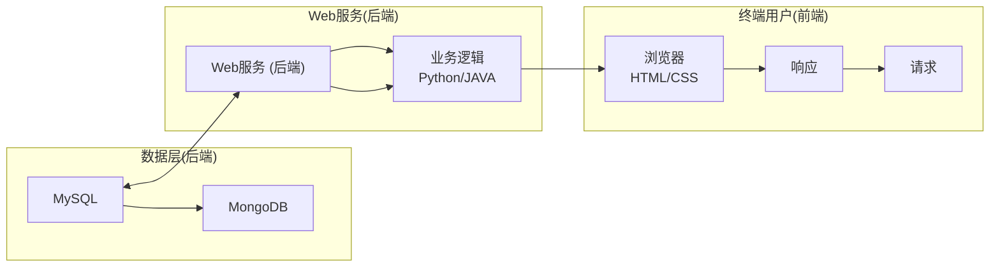

通过各种方式实现，包括索引的优化、查询性能的改进和硬件升级。这确保了用户可以快速、高效地访问所需要的数据。数据安全性是不可忽视的因素，特别是在处理敏感信息，如个体基因组数据时。访问控制、数据加密和审计机制是确保数据不被未经授权的访问和泄漏的关键工具。最后，合规性和长期数据存储也是数据库管理的重要方面。确保数据库遵守相关法规，如 HIPAA、GDPR 等，以及制定适当的数据归档策略，以确保数据的长期访问性，有助于维护数据库的可靠性和合法性。

综合来看，数据库管理和维护是生物信息学研究的基础，它们确保了数据库的数据质量、可用性和安全性，为科研人员和医疗专业人员提供了可靠的数据资源，促进了生物信息学领域的不断进步。

## 13.4.2.4 关系型数据库管理系统

在生物信息学领域，合适的数据库管理系统对于存储、管理和分析海量生物学数据至关重要。不同的数据库管理系统具有各自的特点和适用场景，因此在选择合适的数据库时，需要考虑项目的规模、性能需求以及预算等因素。表13-11是关于常见的关系型数据库管理系统在生物信息学中的应用以及其优点和缺点的综合性讨论。

表 13-11 关系型数据库之间的比较

| 数据库管理系统 | 适用场景在生物信息学中的联系 | 优点 | 缺点 |
| --- | --- | --- | --- |
| MySQL | 存储和查询生物信息学数据,如基因组序列、蛋白质信息、实验数据等。适用于小型生物信息学项目,如基因分析和小规模实验数据的管理 | 高性能、易用简单、开发者社区活跃 | 数据安全性不够牢固、不支持分布式数据库实现、部分功能不如商用数据库完善 |
| Oracle | 支持大规模生物信息学项目的管理,包括基因组数据的存储、生物通路分析和大规模生物数据库的维护。适用于大型生物信息学研究中,如生物医学研究和大规模基因组学项目 | 丰富的特性、高性能、支持大型企业应用程序 | 昂贵的价格、不适用于小规模项目、性能不如某些开源数据库 |
| SQL Server | 用于中等规模生物信息学项目,如生物数据仓库的建设、实验室数据管理和生物信息学工具的支持。适用于中等规模的生物信息学应用,如教育、生物医学研究等 | 易于部署和使用、良好的数据恢复能力 | 适用范围较窄,不太适用于大规模企业 |
| PostgreSQL | 提供数据存储和管理的系统,适用于中大型的生物信息学应用,如生物信息学工具的开发和数据集成。适用于需要多版本并发控制和完整事务支持的生物信息学项目 | 开源商业集成、完整的事务支持、多版本并发控制 | 性能稍逊于某些其他数据库 |

总而言之，选择适合项目需求的数据库管理系统对于生物信息学研究的成功至关重要。不同的数据库系统具有不同的优势和劣势，因此，在想搭建生物信息学平台要做出选择时，需要根据具体情况仔细权衡各方面的因素。

## 13.4.3 非关系型数据库介绍

传统的关系型数据库（如 MySQL）以表格形式存储数据，并使用结构化查询语言（SQL）来管理和检索数据。然而，随着数据的不断增长和多样化，非关系型数据库（NoSQL）应运而生。非关系型数据库是一种更加灵活的数据存储方法，通常不要求固定的模式，适用于大规模数据和半结构化数据。非关系型数据库主要包括以下几种类型。

## (1) 文档数据库

① 概述 文档数据库以类似于 JSON 或 XML 的文档格式存储数据。
② 应用 用于存储和查询半结构化数据，如日志、博客帖子、文章内容等。
③例子 MongoDB、CouchDB。

## (2) 列族数据库

① 概述 列族数据库以列簇的形式存储数据，适用于高写入和高可扩展性的场景。
② 应用 用于时间序列数据、日志、传感器数据等。
③例子 Apache Cassandra、HBase。

## (3) 键值存储

① 概述 键值存储将数据存储为键值对，适用于快速的键值查找和存储。
② 应用 用于缓存、用户会话管理、用户偏好设置等。
③例子 Redis、Amazon DynamoDB。

## (4) 图数据库

① 概述 图数据库用于存储和查询图形数据结构，适用于关系复杂的数据。
② 应用 用于社交网络分析、生物信息学中的蛋白质相互作用网络等。
③例子 Neo4j、Amazon Neptune。

非关系型数据库在生物信息学中也有一定的潜在应用，包括:① 存储和查询生物学数据，如基因组序列、蛋白质结构、生物通路等。② 处理大规模的实验数据，如基因表达数据、DNA 测序数据。③ 构建生物信息学工具和平台，支持研究人员进行生物学研究和分析。

尽管本节不深入讨论非关系型数据库的细节，但非关系型数据库为生物信息学提供了灵活、可扩展、高性能的数据存储和查询解决方案，能够更好地应对生物信息学领域的数据特点和挑战。这些数据库系统在帮助研究人员存储、管理和分析生物学数据方面发挥了关键作用，推动生物信息学研究的进展。同时，读者也可以根据自己的兴趣和需要进一步学习有关特定数据库类型的深入信息。

## 13.4.4 生物信息学数据库应用开发

## 13.4.4.1 数据库开发简介

生物信息学数据库应用开发是一个综合性的领域，涵盖了数据库设计、前后端框架的构建以及可视化系统的开发等多个方面（图13-12）。在这里，将简要介绍生物信息学数据库应用开发的主要内容和流程，以帮助读者朋友更好地理解这一领域。

图13-12 生物信息学数据库开发基本组成部分


<details>
<summary>flowchart</summary>


</details>

① 数据采集与处理 生物信息学数据库通常需要整合各种来源的数据，包括基因组数据、蛋白质信息、生物通路等。数据采集和处理包括数据获取、清洗、转换和标准化，确保数据的质量和一致性。
② 数据库设计 生物信息学数据库的设计是整个应用的基础。在这一阶段，开发者需要考虑数据的结构化和组织，以及如何存储和管理生物信息数据。常见的数据库类型包括关系型数据库（如 MySQL、PostgreSQL）和非关系型数据库（如 MongoDB），选择适合项目需求的数据库类型非常重要。
③ 后端框架 开发一个稳健的后端框架是关键。这包括选择合适的编程语言和框架来构建应用程序的逻辑部分。常用的编程语言包括 Python、Java 和 Ruby，而框架如 Django、Flask、Ruby on Rails 等可加速开发过程。
④ API 开发 提供合适的 API 接口，以便前端和其他应用能够与数据库交互。这些 API 应该能够支持数据查询、检索和更新等操作，同时保护数据的安全性和隐私。
⑤ 前端开发 前端开发负责创建用户界面，使用户能够轻松地访问和操作数据库中的数据。使用 HTML、CSS 和 JavaScript 等技术来构建交互式的界面，以提供用户友好的体验。
⑥ 可视化系统 生物信息学数据库通常包括图表、数据可视化和报告生成功能，以帮助研究人员更好地理解数据。使用图形库和可视化工具，将数据以可视化的方式呈现出来，有助于数据的解释和分析。
⑦ 在线分析软件 一些生物信息学数据库还提供在线分析工具，允许用户对数据进行实时分析和处理。这需要集成合适的分析算法和工具，并确保计算资源的可用性和性能。
⑧ 安全性和维护 确保数据库应用的安全性对于生物信息学非常关键。实施身份验证、授权和数据加密措施，同时定期备份和监测系统以保持应用的稳定性和可用性。

在开发生物信息学数据库应用时，理解生物信息学领域的特点和需求非常重要。这包括对基因组学、蛋白质组学和分子生物学等领域的基本知识，以便更好地满足研究人员和科学家的需求。总之，生物信息学数据库应用开发涉及多个关键步骤，从数据库设计到前端界面的构建，都需要仔细考虑。通过合理的规划和开发，可以为生物信息学研究提供强大的工具和平台，促进该领域的发展和创新。

## 13.4.4.2 数据库开发实践

下面以鸢尾花数据集 iris 为例，实现一个简单的在线数据库（只包含一个表格）展示鸢尾花数据信息。数据库端选用 MySQL、业务端和用户端采用 Shiny 技术。需要考虑数据库设计、数据处理和可视化三个主要部分。以下是一个基本的设计思路。

## (1) 数据收集

iris 数据集由英国统计学家和生物学家罗纳德·费希尔（Ronald Fisher）收集提供，包含 150 个记录，每条记录都有 4 个特征（萼片长度:sepal length；萼片宽度:sepal width；花瓣长度:petal length；花瓣宽度:petal width；均以 cm 为单位）和 1 个物种类别标签。

## (2) 数据库设计

首先，在MySQL中创建一个数据库和一个表来存储iris数据集。以下是创建表的SQL脚本:

```sql
CREATE DATABASE iris_db;
USE iris_db;
CREATE TABLE iris (
  id INT AUTO_INCREMENT PRIMARY KEY,
  sepal_length FLOAT,
  sepal_width FLOAT,
  petal_length FLOAT,
  petal_width FLOAT,
  species VARCHAR(50)
);
```

其次，使用 R 包将 iris 数据集导入 MySQL 数据库。以下是具体的 R 包代码:

\# 安装并加载必要的R包

```r
install.packages("DBI")
install.packages("RMySQL")

library(DBI)
library(RMySQL)
```

\# 连接到MySQL数据库

```txt
con<- dbConnect(RMySQL::MySQL(), user = 'root',
```

```python
password = 'root', dbname = 'iris_db', host = 'localhost')

# 加载 iris 数据集
data(iris)

# 写入 iris 数据到 MySQL 表中
dbWriteTable(con, "iris", iris, row.names = FALSE,
    append = TRUE)

# 断开连接
dbDisconnect(con)
```

## (3) 构建 Shiny 应用

使用 Shiny 构建一个简单的交互式数据库，用表格和图表方式展示和分析 iris 数据集。数据库包括 UI 和 Server 两部分内容。

① UI 部分

```r
library(shiny)

ui <- fluidPage(
  titlePanel("Iris 数据集展示"),
  sidebarLayout(
    sidebarPanel(
      selectInput("species", "选择物种",
      choices = unique(iris\$Species)),
      actionButton("search", "搜索")
  ),
  mainPanel(
    tableOutput("iris_table"),
    plotOutput("sepal_plot"),
    plotOutput("petal_plot")
  )
)
)
```

② Server 部分

```r
library(shiny)
library(DBI)
library(RMySQL)
```

```r
server <- function(input, output) {
    con <- dbConnect(RMySQL::MySQL(), user = 'root',
        password = 'root', dbname = 'iris_db',
        host = 'localhost')

    observeEvent(input\$search, {
        species <- input\$species
        query <- paste("SELECT * FROM iris WHERE species = '',
            species, "", sep = "")
        iris_data <- dbGetQuery(con, query)

        output\$iris_table <- renderTable({
            iris_data
        })

        output\$sepal_plot <- renderPlot({
            plot(iris_data\$sepal_length, iris_data\$sepal_width,
                main = "Sepal Length vs Width",
                xlab = "Sepal Length", ylab = "Sepal Width",
                col = iris_data\$species)
        })

        output\$petal_plot <- renderPlot({
            plot(iris_data\$petal_length, iris_data\$petal_width,
                main = "Petal Length vs Width",
                xlab = "Petal Length", ylab = "Petal Width",
                col = iris_data\$species)
        })
    })

    onSessionEnded(function() {
        dbDisconnect(con)
    })
}

shinyApp(ui = ui, server = server)
```

## (4) 部署

将 Shiny 应用部署到 Shiny Server 或其他支持 R Shiny 的服务器上，以便用户可以通过浏览器访问和使用该应用。

## ※ 推荐阅读

1. Alser M, Lawlor B, Abdill R J, et al. Packaging and containerization of computational methods [J]. Nature protocols, 2024, 19: 2529-2539.
点评:该文系统介绍了在计算生物学和生物信息学领域中，打包（packaging）和容器化（containerization）技术的应用与实践。这些技术通过整合软件工具及其依赖环境，简化了复杂计算方法的安装与部署，极大地提升了工具的可用性和可重复性。
2. Gentleman R, Carey V J, Huber W, et al. Bioinformatics and computational biology solutions using R and Bioconductor [M]. Heidelberg: Springer, 2021.

点评:该书深入讲解了如何利用 R 语言及 Bioconductor 工具进行生物信息学数据分析。书中涵盖了基因组学、转录组学和蛋白质组学的常见数据处理流程，着重介绍了标准化分析工作流的设计和实现，特别适合生物信息学领域初学者和中级研究人员参考。

3. Ma X K, Yu Y, Huang T, et al. Bioinformatics software development: principles and future directions [J]. The innovation life, 2024, 2(3): 100083.

点评:该文系统阐述了生物信息学软件开发的原则和未来的发展方向，强调了人工智能（AI）在加速和增强生物信息学软件开发过程中的重要性，并展望了AI增强的云计算如何为自主研究铺平道路。

4. Younens-Clark K. Mastering Python for bioinformatics: how to write flexible, documented, tested Python code for research computing [M]. California: O'Reilly Media, 2021.

点评:该书介绍使用Python进行生物信息学编程，除了编程本身，还涵盖了文档、测试可重复性等话题，并通过实例如解析FASTA/FASTQ文件来学习生物信息学编程技巧。

## ※ 思考与练习题

1. 为什么编程在生物信息学中扮演了重要角色？
2. 生物信息学数据分析流程的核心要素有哪些？
3. 构建生物学数据库时需要考虑哪些设计原则？
4. 思考如何将不同的组学数据类型存储在 R 或者 Python 对应的数据结构中。分别使用 R 和 Python 代码实现这些数据的存储和简单操作（如子集提取、聚合统计或可视化）。
5. 如何为大规模组学数据（如单细胞转录组数据）选择更高效的存储和处理工具（如 R 中的 Seurat 对象、SingleCellExperiment 或 Python 中的 AnnData 对象）?

讨论其优缺点，并实现一个简单的例子。

6. 结合 ChatGPT 或 DeepSeek 以及本章的编程基础知识，综合使用 Shell、R 和 Python 编程技术，尝试实现本书前面的章节中不同组学的基本分析流程搭建。
7. 借助 ChatGPT 或 DeepSeek 的代码生成能力，针对某个具体分析任务（如基因表达量化分析），实现一个 Nextflow 分析流程。
8. 基于 MySQL 和 Python 技术，尝试开发一个涉及多个表格的生物信息学数据库（辅助使用 ChatGPT）。
9. 在生物信息学数据分析中，常常需要使用不同的算法（如聚类、分类、降维等）来处理复杂的生物数据。请分析并讨论以下问题:

(1) 如何选择适合不同类型组学数据的算法?
（2）对于高维数据（如基因表达数据），常用的降维算法有哪些？请分别简述它们的优缺点。
(3) 实现一个基于 PCA 或 t-SNE 的降维过程, 使用 R 或 Python 对基因表达数据进行降维并可视化。

10. 数据清洗和预处理是生物信息学分析中的重要步骤。请完成以下任务:

（1）选择一个常见的组学数据类型（如基因表达数据、甲基化数据等），进行数据清洗和预处理（如去除缺失值、标准化、去除低表达基因等）。
（2）使用R或Python代码实现数据清洗和预处理过程，并对结果进行可视化（例如，绘制标准化后的基因表达热图）。

## ※ 讨论题

1. R 和 Python 在生物信息学中的应用都很广泛。请分析两者在生物信息学中的优缺点，特别是在数据处理、可视化和算法实现方面的表现。在实际的生物学研究中，哪种语言更为适合？为什么？
2. 在生物信息学研究中，数据质量对分析结果的影响非常大。请讨论在基因组学和转录组学数据处理中，常见的数据质量控制步骤（如数据去除、过滤、归一化等）。哪些步骤是必不可少的，哪些步骤可以根据具体情况灵活调整？
3. 随着多组学技术的广泛应用，如何将来自不同组学（如基因组学、转录组学、蛋白质组学等）的数据进行有效整合和分析，成为一个重要的研究方向。请讨论多组学数据整合的挑战、方法和潜在的应用前景。
4. 开放源代码的生物信息学工具（如 Bioconductor 等）和封闭源代码的商业软件（如 GeneSpring 等）各有优缺点。请讨论它们在使用中的不同之处，包括其可访问性、可定制性、成本和性能等方面。哪种工具更适合大规模生物数据分析？

## ※ 参考文献

1. Di T P, Chatzou M, Floden E, et al. Nextflow enables reproducible computational workflows [J]. Nature biotechnology, 2017, 35: 316-319.
2. Gentleman R C, Carey V J, Bates D M, et al. Bioconductor: open software development for computational biology and bioinformatics [J]. Genome biology, 2004, 5: R80.
3. Harris C R, Millman K J, van der Walt S J, et al. Array programming with NumPy [J]. Nature, 2020, 585: 357-362.
4. Köster J, Rahmann S. Snakemake: a scalable bioinformatics workflow engine [J]. Bioinformatics, 2012, 28(19): 2520-2522.
5. Wratten L, Wilm A, Göke J. Reproducible, scalable, and shareable analysis pipelines with bioinformatics workflow managers [J]. Nature methods, 2021, 18: 1161-1168.

编者:陈迪俊（南京大学）

余光创（南方医科大学）

审读:章 张（中国科学院北京基因组研究所）

I 型错误（type I error） 36

Ⅱ型错误（type Ⅱ error） 36

## B

倍数法（fold-change） 19

备择假设（alternative hypothesis） 35

变分自编码器（variational autoencoder，VAE） 105

变量（variable） 27

变异系数（coefficient of variation） 29

标准差（standard deviation） 29

标准误差（standard error） 34

表达数量性状基因座（expression quantitative trait locus, eQTL） 389

表型组（phenome） 366

## C

参数（parameter） 28

参数估计（parameter estimation） 32

残差神经网络（residual neural network, ResNet） 102

测量模型（measurement model） 384

层次聚类（hierarchical clustering） 80

长短期记忆（long short-term memory, LSTM） 103

超参数（hyperparameter） 94

超几何分布（hypergeometric distribution） 49

重复序列（repetitive sequence） 149

抽样分布（sampling distribution） 33

次梯度（subgradient） 69

错误发现率（false discovery rate, FDR） 45

## D

大语言模型（large language model, LLM） 107

代谢组学（metabonomics） 350

单侧检验（one-sided test） 36

单核苷酸多态性（single nucleotide polymorphism, SNP） 68

单因素方差分析（one-way ANOVA） 41

等距特征映射（isometric mapping, ISOMAP） 77

低维空间嵌入（low dimensional embedding） 77

独立性卡方检验（chi-square test for independence） 48

多尺度表型组学（multiscale phenomics） 373

多重检验校正（multiple test correction） 45

## F

Fisher 精确检验（Fisher's exact test） 49

反事实（counterfactual） 82

反事实结果（counterfactual outcome） 83

方差（variance） 29

方差分析（analysis of variance, ANOVA） 41

非参数检验（non-parametric test） 52

峰度（kurtosis） 30

符号秩检验（signed rank test） 52

## G

高维尺度分析（multidimensional scaling，MDS） 77

个体（individual） 26

个体处理稳定性假设（stable unit treatment value assumption, SUTVA） 85

个体因果效应（individual causal effect，ICE） 83

## J

基本局部比对搜索工具（Basic Local Alignment Search Tool, BLAST） 153

机器学习（machine learning，ML） 16,93

极差（range） 29

假设检验（hypothesis testing） 32

监督学习（supervised learning） 94

检验统计量（test statistic） 35

简单随机抽样（simple random sampling） 27

交叉验证（cross-validation） 74

结构模型（structural model） 385

结构因果模型（struetnral cansal model、SCM） 82

结构约束 LASSO（structure constraint LASSO） 71

结果回归（outcome regression, OR） 86

精准医学（precision medicine） 464

局部线性嵌入（local linear embedding） 78

局部线性映射（local linear mapping） 78

拒绝域（rejection region） 35

卷积神经网络（convolutional neural network，CNN） 101

均值（mean） 28

## K

卡方分布（chi-square distribution） 47

可忽略性（ignorability） 83

扩散模型（diffusion model） 107

## L

列联表（contingency table） 48

临界值（critical value） 35

岭回归（ridge regression） 67

## M

曼-惠特尼 U 检验（Mann-Whitney U test） 52

敏感性分析（sensitivity analysis） 87

模型评估（model assessment） 73

模型选择（model selection） 73

## N

拟合优度检验（goodness of fit test） 47

## P

p 值 (p value) 19, 36

配对数据（paired data） 38

偏度（skewness） 29

频数频率表（frequency and relative frequency table） 30

## Q

潜在变量（latent variables） 384

潜在结果模型（potential outcome model, POM） 82

强化学习（reinforcement learning） 94

全表型组关联研究（phenome-wide association study, Phe-WAS） 394

全基因组关联分析（genome-wide association study, GWAS）
68, 386

## R

人工智能（artificial intelligence，AI） 92

融合 LASSO (fused LASSO) 71

## S

散点图（scatter plot） 31

深度学习（deep learning, DL） 96

生成对抗网络（generative adversarial network, GAN） 105

生物统计学（biostatistics） 26

生物信息学（bioinformatics） 2

数据类型（data type） 27

数据特征（data feature） 27

双侧检验（two-sided test） 36

双稳健估计（doubly robust, DR） 86

双因素方差分析（two-way ANOVA） 42

水平（level） 42

四分位距（interquartile range, IQR） 29

随机抽样模型（random sampling model） 27

随机区组（randomized block） 42

## T

Transformer 网络 107

t 分布式随机邻域嵌入（t-distributed stochastic neighbor embedding, t-SNE） 78

t 检验（t-test） 37

条件可忽略性（conditional ignorability） 84

同源（homologous） 150

统计量（statistic） 27

统计推断（statistical inference） 32

统计学（statistics） 26

统计学习（statistical learning） 16

统一流形逼近与投影（uniform manifold approximation and projection, UMAP）78

图 LASSO（graph LASSO） 71

图卷积网络（graph convolution network） 102

## W

网络模体（network motif） 429

韦尔奇 t 检验（Welch's t-test） 38

伪关联（spurious association） 81

无监督学习（unsupervised learning） 94

## X

系统生物学（systems biology） 416

显著性检验（significance test） 36

显著性水平（significance level） 35

限制性内切酶（restriction endonuclease） 148

相关分析（correlation analysis） 19

箱线图（box-plot） 31

辛普森悖论（Simpson's paradox） 81

学生 t 分布（Student's t-distribution） 34

循环神经网络（recurrent neural network, RNN） 103

## Y

样本（sample） 26

样本容量（sample size） 27

药物不良反应（adverse drug reaction, ADR） 500

耶茨连续性校正（Yates's continuity correction） 49

隐马尔可夫模型（hidden Markov model，HMM） 63

原假设（null hypothesis） 35

## Z

Z检验（Z-test） 37

折线图（line chart） 30

正性假设（positivity） 84

支持向量机（support vector machine, SVM） 74

直方图（histogram） 31

秩（rank） 52

秩和检验（rank sum test） 52

置信区间（confidence interval） 34

中位数（median） 28

众数（mode） 29

主成分分析（principal component analysis, PCA） 77

自由度（degree of freedom, df） 34

总体（population） 26

组间方差（variance between laboratories） 41

组内方差（variance within laboratory） 41

坐标下降法（coordinate descent） 69

## 郑重声明

高等教育出版社依法对本书享有专有出版权。任何未经许可的复制、销售行为均违反《中华人民共和国著作权法》，其行为人将承担相应的民事责任和行政责任；构成犯罪的，将被依法追究刑事责任。为了维护市场秩序，保护读者的合法权益，避免读者误用盗版书造成不良后果，我社将配合行政执法部门和司法机关对违法犯罪的单位和个人进行严厉打击。社会各界人士如发现上述侵权行为，希望及时举报，我社将奖励举报有功人员。

反盗版举报电话（010）58581999 58582371

反盗版举报邮箱 dd@hep.com.cn

通信地址 北京市西城区德外大街4号 高等教育出版社知识产权与法律事务部

邮政编码 100120


<details>
<summary>text_image</summary>

100
</details>

## “101计划”核心教材 生物科学领域

普通生物学 / 赵进东 金力

生物化学（上、下册）/ 昌增益 施一公 王新泉

细胞与分子生物学 / 陈晔光 陈建国

遗传学和发育生物学 / 许田 金力

生理学原理 / 王世强 梅岩艾 朱景宁

微生物学 / 邓子新 陈峰 陈向东

神经生物学导论 / 饶毅 梅林 段树民

生物物理学 / 施一公 汤超 王宏伟

普通生态学 / 方精云 唐志尧 王志恒

生物信息学 / 陈铭 吕晖

免疫生物学 / 董晨

普通生物学实验 / 林宏辉 赵进东

生物化学实验 / 周丛照 昌增益 施一公

细胞与分子生物学实验 / 陈建国 陈晔光

现代遗传学实验 / 许田 金力

生理学和神经生物学实验 / 朱景宁 高志华 王世强 梅岩艾

生物信息学实验 / 陈铭 吕晖 陈迪俊

普通生态学实验 / 唐志尧 吉成均