# Chapter 1: Where in the Genome Does DNA Replication Begin?

原始 PDF 第 27–90 页。

## WHERE IN THE GENOme DOeS DNA REPLICATIOn BEGIN?

## Algorithmic Warmup

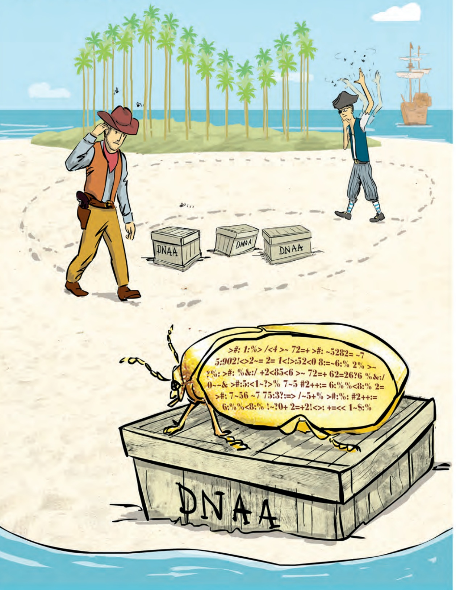

---

W H E R E I N T H E G E N O M E D O E S D N A R E P L I C AT I O N B E G I N ?

## A Journey of a Thousand Miles. . .

**Genome replication** is one of the most important tasks carried out in the cell. Before a cell can divide, it must first replicate its genome so that each of the two daughter cells inherits its own copy. In 1953, James Watson and Francis Crick completed their [landmark paper](http://www.nature.com/nature/dna50/watsoncrick.pdf) on the DNA double helix with a now-famous phrase:

It has not escaped our notice that the specific pairing we have postulated immediately suggests a possible copying mechanism for the genetic material.

They conjectured that the two strands of the parent DNA molecule unwind during replication, and then each parent strand acts as a template for the synthesis of a new strand. As a result, the replication process begins with a pair of complementary strands of DNA and ends with two pairs of complementary strands, as shown in Figure 1.1.

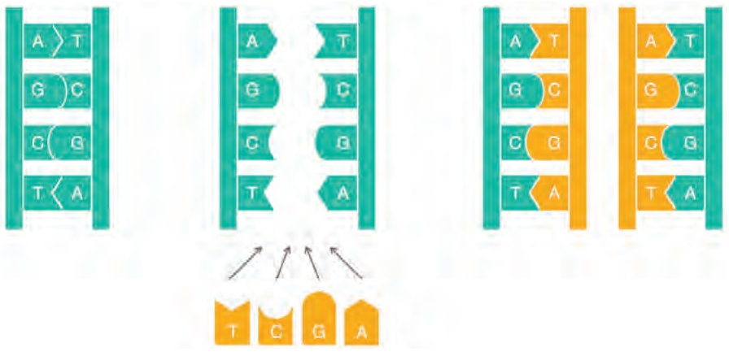

<details>
<summary>text_image</summary>

A > T
G C
C G
T < A
A > T
G C
C G
T < A
A > T
G C
C G
T < A
A > T
G C
C G
T < A
T C G A
</details>

FIGURE 1.1 A naive view of DNA replication. Nucleotides adenine (A) and thymine (T) are complements of each other, as are cytosine (C) and guanine (G). Complementary nucleotides bind to each other in DNA.

Although Figure 1.1 models DNA replication on a simple level, the details of replication turned out to be much more intricate than Watson and Crick imagined; as we will see, an astounding amount of molecular logistics is required to ensure DNA replication.

At first glance, a computer scientist might not imagine that these details have any computational relevance. To mimic the process in Figure 1.1 algorithmically, we only need to take a string representing the genome and return a copy of it! Yet if we take

3

---

C H A P T E R 1

the time to review the underlying biological process, we will be rewarded with new algorithmic insights into analyzing replication.

Replication begins in a genomic region called the **replication origin** (denoted oriC) and is performed by molecular copy machines called **DNA polymerases**. Locating oriC presents an important task not only for understanding how cells replicate but also for various biomedical problems. For example, some gene therapy methods use genetically engineered mini-genomes, which are called **viral vectors** because they are able to penetrate cell walls (just like real viruses). Viral vectors carrying artificial genes have been used in agriculture to engineer frost-resistant tomatoes and pesticide-resistant corn. In 1990, gene therapy was first successfully performed on humans when it saved the life of a four-year-old girl suffering from Severe Combined Immunodeficiency Disorder; the girl had been so vulnerable to infections that she was forced to live in a sterile environment.

The idea of gene therapy is to intentionally infect a patient who lacks a crucial gene with a viral vector containing an artificial gene that encodes a therapeutic protein. Once inside the cell, the vector replicates and eventually produces many copies of the therapeutic protein, which in turn treats the patient’s disease. To ensure that the vector actually replicates inside the cell, biologists must know where oriC is in the vector’s genome and ensure that the genetic manipulations that they perform do not affect it.

In the following problem, we assume that a genome has a single oriC and is represented as a **DNA string**, or a string of nucleotides from the four-letter alphabet $\left\{ \mathbb { A } , \mathbb { C } , \mathbb { G } , \mathbb { T } \right\}$

## Finding Origin of Replication Problem:

**Input**: A DNA string Genome.

**Output**: The location of oriC in Genome.


**STOP and Think:** Does this biological problem represent a clearly stated computational problem?

Although the Finding Origin of Replication Problem asks a legitimate biological ques tion, it does not present a well-defined computational problem. Indeed, biologists would immediately plan an experiment to locate oriC: for example, they might delete various short segments from the genome in an effort to find a segment whose deletion

4

---

W H E R E I N T H E G E N O M E D O E S D N A R E P L I C AT I O N B E G I N ?

stops replication. Computer scientists, on the other hand, would shake their heads and demand more information before they can even start thinking about the problem.

Why should biologists care what computer scientists think? Computational methods are now the only realistic way to answer many questions in modern biology. First, these methods are much faster than experimental approaches; second, the results of many experiments cannot be interpreted without computational analysis. In particular, existing experimental approaches to oriC prediction are rather time consuming. As a result, oriC has only been experimentally located in a handful of species. Thus, we would like to design a computational approach to find oriC so that biologists are free to spend their time and money on other tasks.

## Hidden Messages in the Replication Origin

## DnaA boxes

In the rest of this chapter, we will focus on the relatively easy case of finding oriC in bacterial genomes, most of which consist of a single circular chromosome. Research has shown that the region of the bacterial genome encoding oriC is typically a few hundred nucleotides long. Our plan is to begin with a bacterium in which oriC is known, and then determine what makes this genomic region special in order to design a computational approach for finding oriC in other bacteria. Our example is Vibrio cholerae, the bacterium that causes cholera; here is the nucleotide sequence appearing in its oriC:

atcaatgatcaacgtaagcttctaagcatgatcaaggtgctcacacagtttatccacaac ctgagtggatgacatcaagataggtcgttgtatctccttcctctcgtactctcatgacca cggaaagatgatcaagagaggatgatttcttggccatatcgcaatgaatacttgtgactt gtgcttccaattgacatcttcagcgccatattgcgctggccaaggtgacggagcgggatt acgaaagcatgatcatggctgttgttctgtttatcttgttttgactgagacttgttagga tagacggtttttcatcactgactagccaaagccttactctgcctgacatcgaccgtaaat tgataatgaatttacatgcttccgcgacgatttacctcttgatcatcgatccgattgaag atcttcaattgttaattctcttgcctcgactcatagccatgatgagctcttgatcatgtt tccttaaccctctattttttacggaagaatgatcaagctgctgctcttgatcatcgtttc

How does the bacterial cell know to begin replication exactly in this short region within the much larger Vibrio cholerae chromosome, which consists of 1,108,250 nucleotides? There must be some “hidden message” in the oriC region ordering the cell to begin replication here. Indeed, we know that the initiation of replication is mediated by **DnaA**, a protein that binds to a short segment within the oriC known as a **DnaA box**. You can think of the DnaA box as a message within the DNA sequence telling the

5

---

C H A P T E R 1

DnaA protein: “bind here!” The question is how to find this hidden message without knowing what it looks like in advance — can you find it? In other words, can you find something that stands out in oriC? This discussion motivates the following problem.

## Hidden Message Problem:

Find a “hidden message” in the replication origin.

**Input**: A string Text (representing the replication origin of a genome).

**Output**: A hidden message in Text.


**STOP and Think:** Does this problem represent a clearly stated computational problem?

Hidden messages in “The Gold-Bug”

Although the Hidden Message Problem poses a legitimate intuitive question, it again makes absolutely no sense to a computer scientist because the notion of a “hidden message” is not precisely defined. The oriC region of Vibrio cholerae is currently just as puzzling as the parchment discovered by William Legrand in Edgar Allan Poe’s story “The Gold-Bug”. Written on the parchment was the following:

```csv
53++!305))6*;4826)4+. )4+);806*;48!8'60))85;1+(; :+*8
!83(88)5*!;46(;88*96*?;8)*+(;485);5*!2:*+(;4956*2(5
*-4)8'8*;4069285);)6!8)4++;1(+9;48081;8:8+1;48!85:4
)485!528806*81(+9;48;(88;4(+?34;48)4+;161;:188;+?;
```

Upon seeing the parchment, the narrator remarks, “Were all the jewels of Golconda awaiting me upon my solution of this enigma, I am quite sure that I should be unable to earn them”. Legrand retorts, “It may well be doubted whether human ingenuity can construct an enigma of the kind which human ingenuity may not, by proper application, resolve”. He reasons that the three consecutive symbols "**;48**" appear with surprising frequency on the parchment:

```csv
53++!305))6*;4826)4+. )4+);806*;48!8'60))85;1+(; :+*8
!83(88)5*!;46(;88*96*?;8)*+(;485);5*!2:*+(;4956*2(5
*-4)8'8*;4069285);)6!8)4++;1(+9;48081;8:8+1;48!85;4
)485!528806*81(+9;48;(88;4(+?34;48)4+;161;;188;+?;
```

6

---

W H E R E I N T H E G E N O M E D O E S D N A R E P L I C AT I O N B E G I N ?

Legrand had already deduced that the pirates spoke English; he therefore assumed that the high frequency of ";48" implied that it encodes the most frequent English word, "THE". Substituting each symbol, Legrand had a slightly easier text to decipher, which would eventually lead him to the buried treasure. Can you decode this message too?

$$
\begin{array}{l} (5 3 + +! 3 0 5)) 6 * \text {THE} 2 6) \mathrm{H} +.) \mathrm{H} +) \text {TE} 0 6 * \text {THE}! \mathrm{E} ^ {\prime} 6 0)) \mathrm{E} 5 \mathrm{T} 1 + (\mathrm{T}: + * \mathrm{E} \\ \text {!E3(EE)5*!TH6(TEE*96*?TE)* + (THE5)T5*!2:* + (TH956*2(5} \\ * - \mathrm{H}) \mathrm{E} ^ {\prime} \mathrm{E} * \text {TH0692E5)T)6!E}) \mathrm{H} + + \mathrm{T1} (+ 9 \text {THE0E1TE:E} + 1 \text {THE!E5TH} \\ \text {)HE5!52EE06*E1(+9THET(EETH(+?3HTHE)H + T161T:1EET + ?T} \\ \end{array}
$$

## Counting words

Operating under the assumption that DNA is a language of its own, let’s borrow Legrand’s method and see if we can find any surprisingly frequent “words” within the oriC of Vibrio cholerae. We have added reason to look for frequent words in the oriC because for various biological processes, certain nucleotide strings often appear surprisingly often in small regions of the genome. For example, **ACTAT** is a surprisingly frequent substring of

## ACAACTATGCATACTATCGGGAACTATCCT.

We use the term **k-mer** to refer to a string of length k and define COUNT(Text, Pattern) as the number of times that a k-mer Pattern appears as a substring of Text. Following the above example,

$$
\text {COUNT} (\text {ACAACTATGCATACTATCGGGAACTATCCT, ACTAT}) = 3.
$$

Note that COUNT(CG**ATATA**TCC**ATA**G, **ATA**) is equal to 3 (not 2) since we should account for overlapping occurrences of Pattern in Text.

To compute COUNT(Text, Pattern), our plan is to “slide a window” down Text, checking whether each k-mer substring of Text matches Pattern. We will therefore refer to the k-mer starting at position i of Text as Text(i, k). Throughout this book, we will often use **0-based indexing**, meaning that we count starting at 0 instead of 1. In this case, Text begins at position 0 and ends at position |Text|  1 (|Text| denotes the number of symbols in Text). For example, if Text = GACCATACTG, then Text(4, 3) = ATA. Note that the last k-mer of Text begins at position |Text|  k, e.g., the last 3-mer of GACCATACTG starts at position 10  3 = 7. This discussion results in the following pseudocode for computing COUNT(Text, Pattern).

7

---

C H A P T E R 1

[1A](http://rosalind.info/problems/1a)

STOP

[1B](http://rosalind.info/problems/1b)

```txt
PATTERNCOUNT(Text, Pattern)
    count ← 0
    for i ← 0 to |Text| - |Pattern|
        if Text(i, |Pattern|) = Pattern
            count ← count + 1
    return count
```

The Frequent Words Problem

We say that Pattern is a **most frequent k-mer** in Text if it maximizes COUNT(Text, Pattern) among all k-mers. You can see that **ACTAT** is a most frequent 5-mer for Text = ACA**ACTAT**GCAT**ACTAT**CGGGA**ACTAT**CCT, and **ATA** is a most frequent 3-mer for Text = CG**ATATA**TCC**ATA**G.

**STOP and Think:** Can a string have multiple most frequent k-mers?

We now have a rigorously defined computational problem.

## Frequent Words Problem:

Find the most frequent k-mers in a string.

**Input**: A string Text and an integer k.

**Output**: All most frequent k-mers in Text.

A straightforward algorithm for finding the most frequent k-mers in a string Text checks all k-mers appearing in this string (there are |Text|  k + 1 such k-mers) and then computes how many times each k-mer appears in Text. To implement this algorithm, called **FREQUENTWORDS**, we will need to generate an array COUNT, where COUNT(i) stores COUNT(Text, Pattern) for $P a t t e r n = T e x t \big ( i , k \big )$ (see Figure 1.2).


<details>
<summary>text_image</summary>

Text A C T G A C T C C C A C C C C
COUNT 2 1 1 1 2 1 1 3 1 1 1 3 3
</details>

FIGURE 1.2 The array COUNT for Text = ACTGACTCCCACCCC and k = 3. For example, COUNT(0) = COUNT(4) = 2 because ACT (shown in boldface) appears twice in Text at positions 0 and 4.

8

---

W H E R E I N T H E G E N O M E D O E S D N A R E P L I C AT I O N B E G I N ?

```python
FREQUENTWORDS(Text, k)
    FrequentPatterns ← an empty set
    for i ← 0 to |Text| - k
        Pattern ← the k-mer Text(i, k)
        COUNT(i) ← PATTERNCOUNT(Text, Pattern)
    maxCount ← maximum value in array COUNT
    for i ← 0 to |Text| - k
        if COUNT(i) = maxCount
            add Text(i, k) to FrequentPatterns
    remove duplicates from FrequentPatterns
    return FrequentPatterns
```

## STOP and Think: How fast is FREQUENTWORDS?

Although **FREQUENTWORDS** finds most frequent k-mers, it is not very efficient. Each call to **PATTERNCOUNT**(Text, Pattern) checks whether the k-mer Pattern appears in position 0 of Text, position 1 of Text, and so on. Since each k-mer requires $\big | T e x t \big | - k + 1$ such checks, each one requiring as many as k comparisons, the overall number of steps of **PATTERNCOUNT**(Text, Pattern) is $\left( \left| T e x t \right| - k + 1 \right)$ · k. Furthermore, **FREQUENTWORDS** must call **PATTERNCOUNT** |Text|  k + 1 times (once for each k-mer of Text), so that its overall number of steps is (|Text|  k + 1) $\left( \left| T e x t \right| - k + 1 \right)$ · k. To simplify the matter, computer scientists often say that the runtime of **FREQUENTWORDS** has an upper bound of $| T e x t | ^ { 2 }$ · k steps and refer to the **complexity** of this algorithm as $\mathcal { O } \big ( | T e x t | ^ { 2 } \cdot k \big )$ (see **DETOUR: Big-O Notation**).

**CHARGING STATION (The Frequency Array):** If |Text| and k are small, as is the case when looking for DnaA boxes in the typical bacterial oriC, then an algorithm with running time of $\mathcal { O } \big ( | T e x t | ^ { 2 } \cdot k \big )$ is perfectly acceptable. But once we find some new biological application requiring us to solve the Frequent Words Problem for a very long Text, we will quickly run into trouble. Check out this Charging Station to learn about solving the Frequent Words Problem using a frequency array, a data structure that will also help us solve new coding challenges later in the chapter.

STOP

PAGE 52

PAGE

39

9

---

C H A P T E R 1

Frequent words in Vibrio cholerae

Figure 1.3 reveals the most frequent k-mers in the oriC region from Vibrio cholerae.

<table><tr><td>k</td><td>3</td><td>4</td><td>5</td><td>6</td><td>7</td><td>8</td><td>9</td></tr><tr><td>count</td><td>25</td><td>12</td><td>8</td><td>8</td><td>5</td><td>4</td><td>3</td></tr><tr><td rowspan="4">k-mers</td><td>tga</td><td>atga</td><td>gatca</td><td>tgatca</td><td>atgatca</td><td>atgatcaa</td><td>atgatcaag</td></tr><tr><td></td><td></td><td>tgatc</td><td></td><td></td><td></td><td>cttgatcat</td></tr><tr><td></td><td></td><td></td><td></td><td></td><td></td><td>tcttgatca</td></tr><tr><td></td><td></td><td></td><td></td><td></td><td></td><td>ctcttgatc</td></tr></table>

FIGURE 1.3 The most frequent k-mers in the oriC region of Vibrio cholerae for k from 3 to 9, along with the number of times that each k-mer occurs.


**STOP and Think:** Do any of the counts in Figure 1.3 seem surprisingly large?

For example, the 9-mer **ATGATCAAG** appears three times in the oriC region of Vibrio cholerae — is it surprising?

atcaatgatcaacgtaagcttctaagc**ATGATCAAG**gtgctcacacagtttatccacaac ctgagtggatgacatcaagataggtcgttgtatctccttcctctcgtactctcatgacca cggaaag**ATGATCAAG**agaggatgatttcttggccatatcgcaatgaatacttgtgactt gtgcttccaattgacatcttcagcgccatattgcgctggccaaggtgacggagcgggatt acgaaagcatgatcatggctgttgttctgtttatcttgttttgactgagacttgttagga tagacggtttttcatcactgactagccaaagccttactctgcctgacatcgaccgtaaat tgataatgaatttacatgcttccgcgacgatttacctcttgatcatcgatccgattgaag atcttcaattgttaattctcttgcctcgactcatagccatgatgagctcttgatcatgtt tccttaaccctctattttttacggaaga**ATGATCAAG**ctgctgctcttgatcatcgtttc

We highlight a most frequent 9-mer instead of using some other value of k because experiments have revealed that bacterial DnaA boxes are usually nine nucleotides long. The probability that there exists a 9-mer appearing three or more times in a randomly generated DNA string of length 500 is approximately 1/1300 (see **DETOUR: Probabilities of Patterns in a String**). In fact, there are four different 9-mers repeated three or more times in this region: **ATGATCAAG**, CTTGATCAT, TCTTGATCA, and CTCTTGATC.

The low likelihood of witnessing even one repeated 9-mer in the oriC region of Vibrio cholerae leads us to the working hypothesis that one of these four 9-mers may represent a potential DnaA box that, when appearing multiple times in a short region, jump-starts replication. But which one?


10

---

W H E R E I N T H E G E N O M E D O E S D N A R E P L I C AT I O N B E G I N ?

**STOP and Think:** Is any one of the four most frequent 9-mers in the oriC of Vibrio cholerae “more surprising” than the others?


## Some Hidden Messages are More Surprising than Others

Recall that nucleotides A and T are complements of each other, as are C and G. Having one strand of DNA and a supply of “free floating” nucleotides as shown in Figure 1.1, one can imagine the synthesis of a **complementary strand** on a **template strand**. This model of replication was confirmed by Meselson and Stahl in 1958 (see **DETOUR: The Most Beautiful Experiment in Biology**). Figure 1.4 shows a template strand **AGTCGCATAGT** and its complementary strand **ACTATGCGACT**.

At this point, you may think that we have made a mistake, since the complementary strand in Figure 1.4 reads out **TCAGCGTATCA** from left to right rather than **ACTATGCGACT**. We have not: each DNA strand has a direction, and the complementary strand runs in the opposite direction to the template strand, as shown by the arrows in Figure 1.4. Each strand is read in the $5 ^ { \prime } \rightarrow 3 ^ { \prime }$ direction (see **DETOUR: Directionality of DNA Strands** to learn why biologists refer to the beginning and end of a strand of DNA using the terms $5 ^ { \prime }$ and 3’).


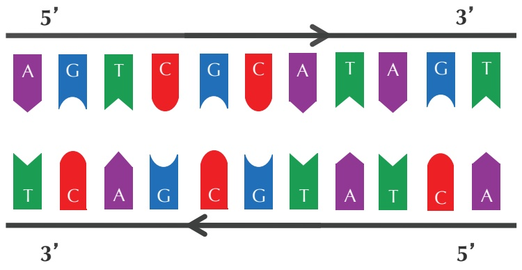

<details>
<summary>text_image</summary>

5' → 3'
A G T C G C A T A G T
T C A G C G T A T C A
3' → 5'
</details>

FIGURE 1.4 Complementary strands run in opposite directions.

Given a nucleotide $p ,$ we denote its complementary nucleotide as ${ \overline { { p } } } .$ The **reverse complement** of a string $P a t t e r n = p _ { 1 } \cdot \cdot \cdot p _ { n }$ is the string ${ \overline { { P a t t e r n } } } = { \overline { { p _ { n } } } } \cdot \cdot \cdot { \overline { { p _ { 1 } } } }$ formed by taking the complement of each nucleotide in Pattern, then reversing the resulting string. We will need the solution to the following problem throughout this chapter.

11

---

C H A P T E R 1

[1C](http://rosalind.info/problems/1c)

STOP

## Reverse Complement Problem:

Find the reverse complement of a DNA string.

**Input**: A DNA string Pattern.

**Output**: Pattern, the reverse complement of Pattern.

**STOP and Think:** Look again at the four most frequent 9-mers in the oriC region of Vibrio cholerae from Figure 1.3. Now do you notice anything surprising?

Interestingly, among the four most frequent 9-mers in the oriC region of Vibrio cholerae, **ATGATCAAG** and **CTTGATCAT** are reverse complements of each other, resulting in the following six occurrences of these strings.

atcaatgatcaacgtaagcttctaagc**ATGATCAAG**gtgctcacacagtttatccacaac ctgagtggatgacatcaagataggtcgttgtatctccttcctctcgtactctcatgacca cggaaag**ATGATCAAG**agaggatgatttcttggccatatcgcaatgaatacttgtgactt gtgcttccaattgacatcttcagcgccatattgcgctggccaaggtgacggagcgggatt acgaaagcatgatcatggctgttgttctgtttatcttgttttgactgagacttgttagga tagacggtttttcatcactgactagccaaagccttactctgcctgacatcgaccgtaaat tgataatgaatttacatgcttccgcgacgatttacct**CTTGATCAT**cgatccgattgaag atcttcaattgttaattctcttgcctcgactcatagccatgatgagct**CTTGATCAT**gtt tccttaaccctctattttttacggaaga**ATGATCAAG**ctgctgct**CTTGATCAT**cgtttc

Finding a 9-mer that appears six times (either as itself or as its reverse complement) in a DNA string of length 500 is far more surprising than finding a 9-mer that appears three times (as itself). This observation leads us to the working hypothesis that **ATGATCAAG** and its reverse complement **CTTGATCAT** indeed represent DnaA boxes in Vibrio cholerae. This computational conclusion makes sense biologically because the DnaA protein that binds to DnaA boxes and initiates replication does not care which of the two strands it binds to. Thus, for our purposes, both **ATGATCAAG** and **CTTGATCAT** represent DnaA boxes.

However, before concluding that we have found the DnaA box of Vibrio cholerae, the careful bioinformatician should check if there are other short regions in the Vibrio cholerae genome exhibiting multiple occurrences of **ATGATCAAG** (or **CTTGATCAT**). After all, maybe these strings occur as repeats throughout the entire Vibrio cholerae genome, rather than just in the oriC region. To this end, we need to solve the following problem.

12

---

W H E R E I N T H E G E N O M E D O E S D N A R E P L I C AT I O N B E G I N ?

## Pattern Matching Problem:

Find all occurrences of a pattern in a string.

**Input**: Strings Pattern and Genome.

**Output**: All starting positions in Genome where Pattern appears as a substring.

After solving the Pattern Matching Problem, we discover that **ATGATCAAG** appears 17 times in the following positions of the Vibrio cholerae genome:

116556, 149355, **151913**, **152013**, **152394**, 186189, 194276, 200076, 224527, 307692, 479770, 610980, 653338, 679985, 768828, 878903, 985368

With the exception of the three occurrences of **ATGATCAAG** in oriC at starting positions **151913**, **152013**, and **152394**, no other instances of **ATGATCAAG** form **clumps**, i.e., appear close to each other in a small region of the genome. You may check that the same conclusion is reached when searching for **CTTGATCAT**. We now have strong statistical evidence that **ATGATCAAG**/**CTTGATCAT** may represent the hidden message to DnaA to start replication.

**STOP and Think:** Can we conclude that **ATGATCAAG**/**CTTGATCAT** also represents a DnaA box in other bacterial genomes?

## An Explosion of Hidden Messages

Looking for hidden messages in multiple genomes

We should not jump to the conclusion that **ATGATCAAG**/**CTTGATCAT** is a hidden message for all bacterial genomes without first checking whether it even appears in known oriC regions from other bacteria. After all, maybe the clumping effect of **ATGATCAAG**/**CTTGATCAT** in the oriC region of Vibrio cholerae is simply a statistical fluke that has nothing to do with replication. Or maybe different bacteria have different DnaA boxes . .

Let’s check the proposed oriC region of Thermotoga petrophila, a bacterium that thrives in extremely hot environments; its name derives from its discovery in the water beneath oil reservoirs, where temperatures can exceed 80 Celsius.

[1D](http://rosalind.info/problems/1d)

STOP

13

---

C H A P T E R 1

aactctatacctcctttttgtcgaatttgtgtgatttatagagaaaatcttattaactga aactaaaatggtaggtttggtggtaggttttgtgtacattttgtagtatctgatttttaa ttacataccgtatattgtattaaattgacgaacaattgcatggaattgaatatatgcaaa acaaacctaccaccaaactctgtattgaccattttaggacaacttcagggtggtaggttt ctgaagctctcatcaatagactattttagtctttacaaacaatattaccgttcagattca agattctacaacgctgttttaatgggcgttgcagaaaacttaccacctaaaatccagtat ccaagccgatttcagagaaacctaccacttacctaccacttacctaccacccgggtggta agttgcagacattattaaaaacctcatcagaagcttgttcaaaaatttcaatactcgaaa cctaccacctgcgtcccctattatttactactactaataatagcagtataattgatctga

This region does not contain a single occurrence of **ATGATCAAG** or **CTTGATCAT**! Thus, different bacteria may use different DnaA boxes as “hidden messages” to the DnaA protein.

Application of the Frequent Words Problem to the oriC region above reveals that the following six 9-mers appear in this region three or more times:

| AACCTACCA | AAACCTACC | ACCTACCAC |
| --- | --- | --- |
| CCTACCACC | GGTAGGTTT | TGGTAGGTT |

Something peculiar must be happening because it is extremely unlikely that six different 9-mers will occur so frequently within a short region in a random string. We will cheat a little and consult with Ori-Finder, a software tool for finding replication origins in DNA sequences. This software chooses **CCTACCACC** (along with its reverse complement **GGTGGTAGG**) as a working hypothesis for the DnaA box in Thermotoga petrophila. Together, these two complementary 9-mers appear five times in the replication origin:

aactctatacctcctttttgtcgaatttgtgtgatttatagagaaaatcttattaactga aactaaaatggtaggttt**GGTGGTAGG**ttttgtgtacattttgtagtatctgatttttaa ttacataccgtatattgtattaaattgacgaacaattgcatggaattgaatatatgcaaa acaaa**CCTACCACC**aaactctgtattgaccattttaggacaacttcag**GGTGGTAGG**ttt ctgaagctctcatcaatagactattttagtctttacaaacaatattaccgttcagattca agattctacaacgctgttttaatgggcgttgcagaaaacttaccacctaaaatccagtat ccaagccgatttcagagaaacctaccacttacctaccactta**CCTACCACC**cgggtggta agttgcagacattattaaaaacctcatcagaagcttgttcaaaaatttcaatactcgaaa **CCTACCACC**tgcgtcccctattatttactactactaataatagcagtataattgatctga

## The Clump Finding Problem

Now imagine that you are trying to find oriC in a newly sequenced bacterial genome. Searching for “clumps” of **ATGATCAAG**/**CTTGATCAT** or **CCTACCACC**/**GGTGGTAGG** is unlikely to help, since this new genome may use a completely different hidden message! Before we lose all hope, let’s change our computational focus: instead of finding clumps of a specific k-mer, let’s try to find every k-mer that forms a clump in the genome. Hopefully, the locations of these clumps will shed light on the location of oriC.

14

---

W H E R E I N T H E G E N O M E D O E S D N A R E P L I C AT I O N B E G I N ?

Our plan is to slide a window of fixed length L along the genome, looking for a region where a k-mer appears several times in short succession. The parameter value L = 500 reflects the typical length of oriC in bacterial genomes.

We defined a k-mer as a “clump” if it appears many times within a short interval of the genome. More formally, given integers L and t, a k-mer Pattern forms an **(L, t)-clump** inside a (longer) string Genome if there is an interval of Genome of length L in which this k-mer appears at least t times. (This definition assumes that the k-mer completely fits within the interval.) For example, **TGCA** forms a (25, 3)-clump in the following Genome:

gatcagcataagggtccC**TGCA**A**TGCA**TGACAAGCC**TGCA**GTtgttttac

From our previous examples of oriC regions, **ATGATCAAG** forms a (500, 3)-clump in the Vibrio cholerae genome, and **CCTACCACC** forms a (500, 3)-clump in the Thermotoga petrophila genome. We are now ready to formulate the following problem.

## Clump Finding Problem:

Find patterns forming clumps in a string.

**Input**: A string Genome, and integers k, L, and t.

**Output**: All distinct k-mers forming (L, t)-clumps in Genome.

**CHARGING STATION (Solving the Clump Finding Problem):** You can solve the Clump Finding Problem by simply applying your algorithm for the Frequent Words Problem to each window of length L in Genome. However, if your algorithm for the Frequent Words Problem is not very efficient, then such an approach may be impractical. For example, recall that **FREQUENTWORDS** has $\mathcal { O } \big ( L ^ { 2 } \cdot k \big )$ running time. Applying this algorithm to each window of length L in Genome will result in an algorithm with OL<sup>2</sup> · k · |Genome| running time. Moreover, even if we use a faster algorithm for the Frequent Words Problem (like the one described when we introduce a frequency array on page 39), the running time remains high when we try to analyze a bacterial — let alone human — genome. Check out this Charging Station to learn about a more efficient approach for solving the Clump Finding Problem.

Let’s look for clumps in the Escherichia coli (E. coli) genome, the workhorse of bacterial genomics. We find hundreds of different 9-mers forming (500, 3)-clumps in the E. coli

[1E](http://rosalind.info/problems/1e)

PAGE 44

15

---

C H A P T E R 1


genome, and it is absolutely unclear which of these 9-mers might represent a DnaA box in the bacterium’s oriC region.

**STOP and Think:** Should we give up? If not, what would you do now?

At this point, an unseasoned researcher might give up, since it appears that we do not have enough information to locate oriC in E. coli. But a fearless veteran bioinformatician would try to learn more about the details of replication in the hope that they provide new algorithmic insights into finding oriC.

## The Simplest Way to Replicate DNA

We are now ready to discuss the replication process in more detail. As illustrated in Figure 1.5 (top), the two complementary DNA strands running in opposite directions around a circular chromosome unravel, starting at oriC. As the strands unwind, they create two **replication forks**, which expand in both directions around the chromosome until the strands completely separate at the **replication terminus** (denoted terC). The replication terminus is located roughly opposite to oriC in the chromosome.

An important thing to know about replication is that a DNA polymerase does not wait for the two parent strands to completely separate before initiating replication; instead, it starts copying while the strands are unraveling. Thus, just four DNA polymerases, each responsible for one half-strand, can all start at oriC and replicate the entire chromosome. To start replication, a DNA polymerase needs a **primer**, a short complementary segment (shown in red in Figure 1.5) that binds to the parent strand and jump starts the DNA polymerase. After the strands start separating, each of the four DNA polymerases starts replication by adding nucleotides, beginning with the primer and proceeding around the chromosome from oriC to terC in either the clockwise or counterclockwise direction. When all four DNA polymerases have reached terC, the chromosome’s DNA will have been completely replicated, resulting in two pairs of complementary strands (Figure 1.5 (bottom)), and the cell is ready to divide.

Yet while you were reading the description above, biology professors were writing a petition to have us fired and sent back to Biology 101. And they would be right, because our exposition suffers from a major flaw; we only described the replication process in this way so that you can better appreciate what we are about to reveal.

The problem with our current description is that it assumes that DNA polymerases can copy DNA in either direction along a strand of DNA (i.e., both $5 ^ { \prime } \rightarrow 3 ^ { \prime }$ and $3 ^ { \prime } \rightarrow 5 ^ { \prime } )$ .

16

---

W H E R E I N T H E G E N O M E D O E S D N A R E P L I C AT I O N B E G I N ?

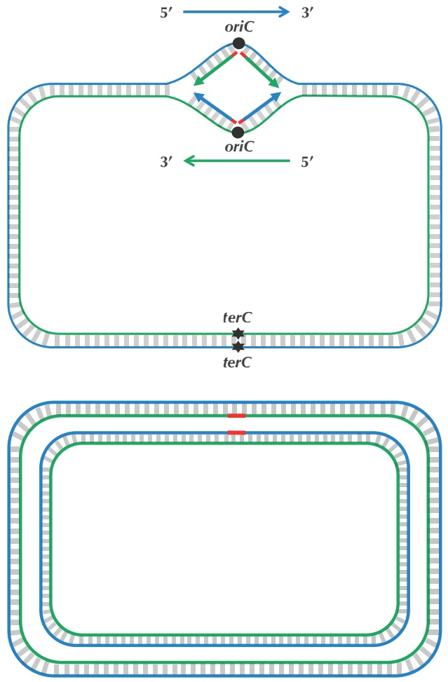

FIGURE 1.5 (Top) Four imaginary DNA polymerases at work replicating a chromosome as the replication forks extend from oriC to terC. The blue strand is directed clockwise, and the green strand is directed counterclockwise. (Bottom) Replication is complete.

However, nature has not yet equipped DNA polymerases with this ability, as they are **unidirectional**, meaning that they can only traverse a template strand of DNA in the $3 ^ { \prime } \rightarrow 5 ^ { \prime }$ direction. Notice that this is opposite from the $5 ^ { \prime } \rightarrow 3 ^ { \prime }$ direction of DNA.

**STOP and Think:** If you were a unidirectional DNA polymerase, how would you replicate DNA? How many DNA polymerases would be needed to complete this task?


17

---

C H A P T E R 1

The unidirectionality of DNA polymerase requires a major revision to our naive model of replication. Imagine that you decided to walk along DNA from oriC to terC. There are four different half-strands of parent DNA connecting oriC to terC, as highlighted in Figure 1.6. Two of these half-strands are traversed from oriC to terC in the $5 ^ { \prime } \rightarrow 3 ^ { \prime }$ direction and are thus called **forward half-strands** (represented by thin blue and green lines in Figure 1.6). The other two half-strands are traversed from oriC to terC in the $3 ^ { \prime } \rightarrow 5 ^ { \prime }$ direction and are thus called **reverse half-strands** (represented by thick blue and green lines in Figure 1.6).

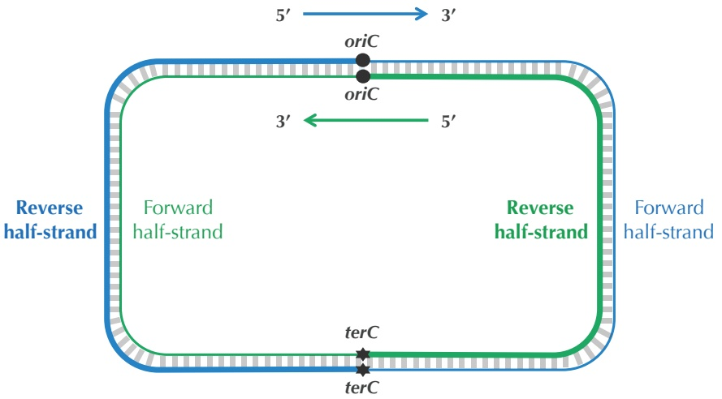

<details>
<summary>flowchart</summary>

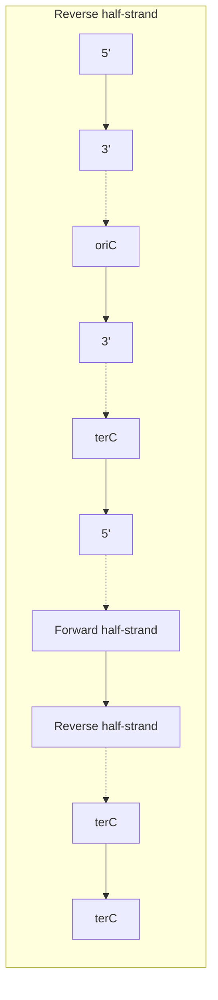
</details>

FIGURE 1.6 Complementary DNA strands with forward and reverse half-strands shown as thin and thick lines, respectively.

## Asymmetry of Replication

While biologists will feel at home with the following description of DNA replication, computer scientists may find it overloaded with new terms. If it seems too biologically complex, then feel free to skim this section, as long as you believe us that the replication process is **asymmetric**, i.e., that forward and reverse half-strands have very different fates with respect to replication.

18

---

W H E R E I N T H E G E N O M E D O E S D N A R E P L I C AT I O N B E G I N ?

Since a DNA polymerase can only move in the reverse $( 3 ^ { \prime } \rightarrow 5 ^ { \prime } )$ direction, it can copy nucleotides non-stop from oriC to terC along reverse half-strands. However, replication on forward half-strands is very different because a DNA polymerase cannot move in the forward $( 5 ^ { \prime } \rightarrow 3 ^ { \prime } )$ direction; on these half-strands, a DNA polymerase must replicate backwards toward oriC. Take a look at Figure 1.7 to see why this must be the case.

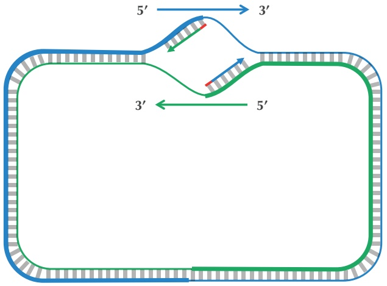

<details>
<summary>flowchart</summary>


</details>

FIGURE 1.7 Replication begins at oriC (primers shown in red) with the synthesis of fragments on the reverse half-strands (shown by thick lines). A DNA polymerase must wait until the replication fork has opened some (small) distance before it starts copying the forward half-strands (shown by thin lines) back toward oriC.

On a forward half-strand, in order to replicate DNA, a DNA polymerase must wait for the replication fork to open a little (approximately 2,000 nucleotides) until a new primer is formed at the end of the replication fork; afterwards, the DNA polymerase starts replicating a small chunk of DNA starting from this primer and moving backward in the direction of oriC. When the two DNA polymerases on forward half-strands reach oriC, we have the situation shown in Figure 1.8. Note the contrast between this figure and Figure 1.5.

After this point, replication on each reverse half-strand progresses continuously; however, a DNA polymerase on a forward half-strand has no choice but to wait again until the replication fork has opened another 2,000 nucleotides or so. It then requires a new primer to begin synthesizing another fragment back toward oriC. On the whole, replication on a forward half-strand requires occasional stopping and restarting, which

19

---

C H A P T E R 1

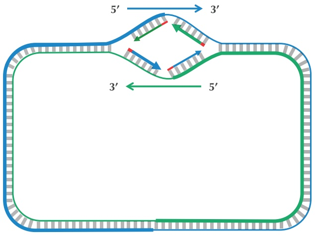

<details>
<summary>flowchart</summary>

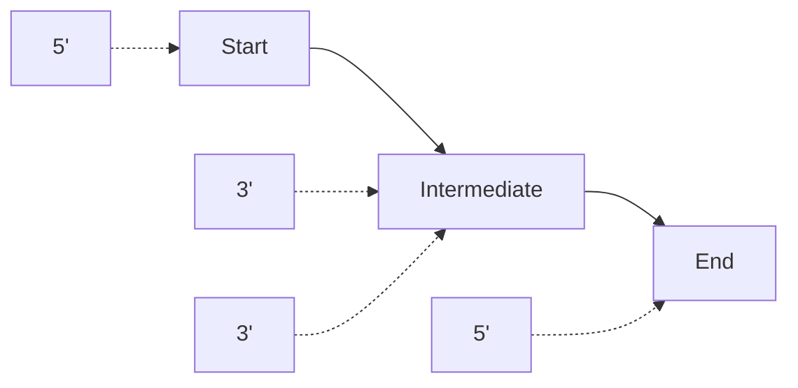
</details>

FIGURE 1.8 The daughter fragments are now synthesized (with some delay) on the forward half-strands (shown by thin lines).

results in the synthesis of short **Okazaki fragments** that are complementary to intervals on the forward half-strand. You can see these fragments forming in Figure 1.9 (top).

When the replication fork reaches $t e r C ,$ the replication process is almost complete, but gaps still remain between the disconnected Okazaki fragments (Figure 1.9 (middle)).

Finally, consecutive Okazaki fragments are sewn together by an enzyme called **DNA ligase**, resulting in two intact daughter chromosomes, each consisting of one parent strand and one newly synthesized daughter strand, as shown in Figure 1.9 (bottom). In reality, DNA ligase does not wait until after all the Okazaki fragments have been replicated to start sewing them together.

Biologists call a reverse half-strand a **leading half-strand** since a single DNA poly merase traverses this half-strand non-stop, and they call a forward half-strand a **lagging half-strand** since it is used as a template by many DNA polymerases stopping and starting replication. If you are confused about the differences between the leading and lagging half-strands, you are not alone — we and legions of biology students are also confused. The confusion is exacerbated by the fact that different textbooks use different terminology depending on whether the authors intend to refer to a leading template half-strand or a leading half-strand that is being synthesized from a (lagging) template half-strand. You hopefully see why we have chosen the terms “reverse” and “forward” half-strands in an attempt to mitigate some of this confusion.

20

---

W H E R E I N T H E G E N O M E D O E S D N A R E P L I C AT I O N B E G I N ?

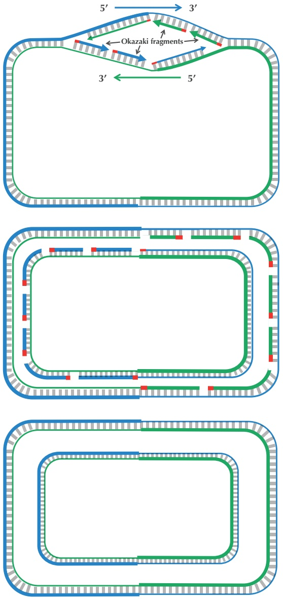

FIGURE 1.9 (Top) The replication fork continues growing. Only one primer is needed for each of the reverse half-strands (shown by thick lines), while the forward half-strands (shown by thin lines) require multiple primers in order to synthesize Okazaki fragments. Two of these primers are shown in red on each forward half-strand. (Middle) Replication is nearly complete, as all daughter DNA is synthesized. However, half of each daughter chromosome contains disconnected Okazaki fragments. (Bottom) Okazaki fragments have been sewn together, resulting in two intact daughter chromosomes.

21

---

C H A P T E R 1

## Peculiar Statistics of the Forward and Reverse Half-Strands

## Deamination

In the last section, we saw that as the replication fork expands, DNA polymerase synthesizes DNA quickly on the reverse half-strand but suffers delays on the forward half-strand. We will explore the asymmetry of DNA replication to design a new algorithm for finding oriC.

How in the world can the asymmetry of replication possibly help us locate oriC? Notice that since the replication of a reverse half-strand proceeds quickly, it lives doublestranded for most of its life. Conversely, a forward half-strand spends a much larger amount of its life single-stranded, waiting to be used as a template for replication. This discrepancy between the forward and reverse half-strands is important because single-stranded DNA has a much higher mutation rate than double-stranded DNA. In particular, if one of the four nucleotides in single-stranded DNA has a greater tendency than other nucleotides to mutate in single-stranded DNA, then we should observe a shortage of this nucleotide on the forward half-strand.

Following up on this thought, let’s compare the nucleotide counts of the reverse and forward half-strands. If these counts differ substantially, then we will design an algorithm that attempts to track down these differences in genomes for which oriC is unknown. The nucleotide counts for Thermotoga petrophila are shown in Figure 1.10.

|  | #C | #G | #A | #T |
| --- | --- | --- | --- | --- |
| Entire strand | 427419 | 413241 | 491488 | 491363 |
| Reverse half-strand | 219518 | 201634 | 243963 | 246641 |
| Forward half-strand | 207901 | 211607 | 247525 | 244722 |
| Difference | +11617 | -9973 | -3562 | +1919 |

FIGURE 1.10 Counting nucleotides in the Thermotoga petrophila genome on the forward and reverse half-strands.


**STOP and Think:** Do you notice anything interesting about the nucleotide counts in Figure 1.10?

Although the frequencies of A and T are practically identical on the two half-strands, C is more frequent on the reverse half-strand than on the forward half-strand, resulting in a difference of $219518-207901= +11617.$ Its complementary nucleotide G is less

22

---

W H E R E I N T H E G E N O M E D O E S D N A R E P L I C AT I O N B E G I N ?

frequent on the reverse half-strand than on the forward half-strand, resulting in a difference of $201634 - 211607 = -9973$

It turns out that we observe these discrepancies because cytosine (C) has a tendency to mutate into thymine (T) through a process called **deamination**. Deamination rates rise 100-fold when DNA is single-stranded, which leads to a decrease in cytosine on the forward half-strand, thus forming mismatched base pairs T-G. These mismatched pairs can further mutate into T-A pairs when the bond is repaired in the next round of replication, which accounts for the observed decrease in guanine (G) on the reverse half-strand (recall that a forward parent half-strand synthesizes a reverse daughter half-strand, and vice-versa).

**STOP and Think:** If deamination changes cytosine to thymine, why do you think that the forward half-strand still has some cytosine?

## The skew diagram

Let’s see if we can take advantage of these peculiar statistics caused by deamination to locate oriC. As Figure 1.10 illustrates, the difference between the total amount of guanine and the total amount of cytosine is negative on the reverse half-strand $( 2 1 1 6 0 7 - 2 0 7 9 0 1 = 3 7 0 6 )$ and positive on the forward half-strand $(201634 - 219518 =$ 17884). Thus, our idea is to traverse the genome, keeping a running total of the difference between the counts of G and C. If this difference starts increasing, then we guess that we are on the forward half-strand; on the other hand, if this difference starts decreasing, then we guess that we are on the reverse half-strand. See Figure 1.11.

**STOP and Think:** Imagine that you are reading through the genome (in the $5 ^ { \prime } \rightarrow 3 ^ { \prime }$ direction) and notice that the difference between the guanine and cytosine counts just switched its behavior from decreasing to increasing. Where in the genome are you?

Since we don’t know the location of oriC in a circular genome, let’s linearize it (i.e., select an arbitrary position and pretend that the genome begins here), resulting in a linear string Genome. We define $\mathrm{SKEW}_{i}  (  Greenme )$ as the difference between the total number of occurrences of G and the total number of occurrences of C in the first i nucleotides of Genome. The **skew diagram** is defined by plotting $S \mathrm { K E W } _ { i }$ (Genome) as i ranges from 0 to |Genome|, where $\mathrm { S K E W } _ { 0 } \mathrm { ( } G e n o m e \mathrm { ) }$ is set equal to zero. Figure 1.12 shows a skew diagram for a short DNA string.

STOP

STOP

23

---

C H A P T E R 1

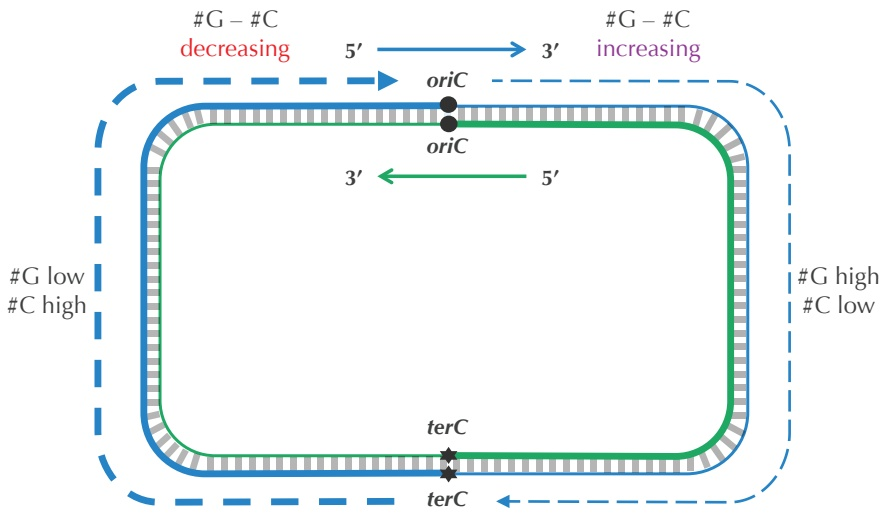

<details>
<summary>flowchart</summary>

```mermaid
graph LR
  subgraph Top_Left["#G - #C decreasing"]
    direction TB
  Start((Start)) --> oriC1["oriC"]
  Start --> oriC2["oriC"]
  Start --> TerC1["terC"]
  Start --> TerC2["terC"]
  Start --> TerC3["terC"]
  TerC1 --> TerC3
  TerC2 --> TerC3
  TerC3 --> TerC1
  TerC3 --> TerC2
  TerC3 --> TerC1
  TerC3 --> TerC2
  TerC3 --> TerC1
  TerC3 --> TerC2
  TerC3 --> TerC1
  TerC3 --> TerC2
  TerC3 --> TerC1
  TerC3 --> TerC2
  TerC3 --> TerC1
  TerC3 --> TerC2
  TerC3 --> TerC1
```
</details>

FIGURE 1.11 Because of deamination, each forward half-strand has a shortage of cytosine compared to guanine, and each reverse half-strand has a shortage of guanine compared to cytosine. The dashed blue line illustrates an imaginary walk along the outer strand of the genome counting the difference between the counts of G and C. We assume that the difference between these counts is positive on the forward half-strand and negative on the reverse half-strand.

Note that we can compute $\mathrm{SKEW}_{i+1}  (  Genone )$ from $\mathrm{SKEW}_{i}  (  Greenme )$ according to the nucleotide in position i of Genome. If this nucleotide is G, then $\begin{aligned} & SKEW _{i+1}  (  Genome )   =\\ \end{aligned}$ $\mathrm{SKEW}_{i} (Genome)+1;$ if this nucleotide is C, then $\mathrm{SKEW_{i+1}(Genome) = SKEW_i(Genome) -}$ 1; otherwise, $\mathsf{SKEW}_{i+1}\big(Genome\big)=\mathsf{SKEW}_{i}\big(Genome\big)$

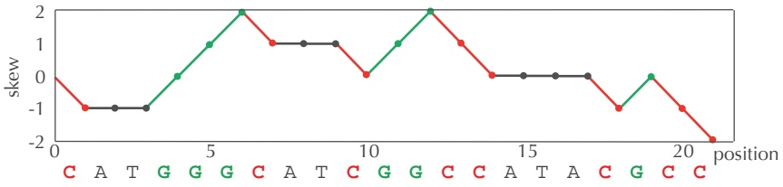

<details>
<summary>line</summary>

| Position | Skew |
| --- | --- |
| 0 | 0 |
| 1 | -1 |
| 2 | -1 |
| 3 | -1 |
| 4 | 0 |
| 5 | 1 |
| 6 | 2 |
| 7 | 1 |
| 8 | 1 |
| 9 | 1 |
| 10 | 0 |
| 11 | 1 |
| 12 | 2 |
| 13 | 1 |
| 14 | 0 |
| 15 | 0 |
| 16 | 0 |
| 17 | 0 |
| 18 | -1 |
| 19 | 0 |
| 20 | -1 |
| 21 | -2 |
</details>

FIGURE 1.12 The skew diagram for Genome = CATGGGCATCGGCCATACGCC.

Figure 1.13 depicts the skew diagram for a linearized E. coli genome. Notice the very clear pattern! It turns out that the skew diagram for many bacterial genomes has a

24

---

W H E R E I N T H E G E N O M E D O E S D N A R E P L I C AT I O N B E G I N ?

similar characteristic shape.

**STOP and Think:** After looking at the skew diagram in Figure 1.13, where do you think that oriC is located in E. coli?


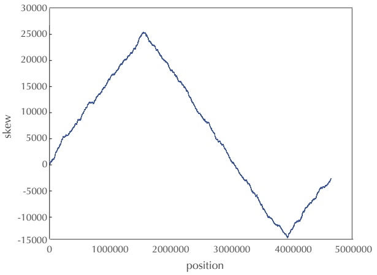

<details>
<summary>line</summary>

| position | skew |
| --- | --- |
| 0 | 0 |
| ~1500000 | ~25000 |
| ~3900000 | ~-14000 |
| ~4600000 | ~-2500 |
</details>

FIGURE 1.13 The skew diagram for E. coli achieves a maximum and minimum at positions 1550413 and 3923620, respectively.

Let’s follow the $5 ^ { \prime } \rightarrow 3 ^ { \prime }$ direction of DNA and walk along the chromosome from terC to oriC (along a reverse half-strand), then continue on from oriC to terC (along a forward half-strand). In Figure 1.11, we saw that the skew is decreasing along the reverse half-strand and increasing along the forward half-strand. Thus, the skew should achieve a minimum at the position where the reverse half-strand ends and the forward half-strand begins, which is exactly the location of oriC! We have just developed an algorithm for locating oriC: it should be found where the skew attains a minimum.

## Minimum Skew Problem:

Find a position in a genome where the skew diagram attains a minimum.

**Input**: A DNA string Genome.

**Output**: All integer(s) i minimizing SKEW<sub>i</sub>(Genome) among all values of i (from 0 to |Genome|).


25

---

C H A P T E R 1


**STOP and Think:** Note that the skew diagram changes depending on where we start our walk along the circular chromosome. Do you think that the minimum of the skew diagram points to the same position in the genome regardless of where we begin walking to generate the skew diagram?

## Some Hidden Messages are More Elusive than Others

Solving the Minimum Skew Problem now provides us with an approximate location of oriC at position 3923620 in E. coli. In an attempt to confirm this hypothesis, let’s look for a hidden message representing a potential DnaA box near this location. Solving the Frequent Words Problem in a window of length 500 starting at position 3923620 (shown below) reveals no 9-mers (along with their reverse complements) that appear three or more times! Even if we have located oriC in E. coli, it appears that we still have not found the DnaA boxes that jump-start replication in this bacterium . .

aatgatgatgacgtcaaaaggatccggataaaacatggtgattgcctcgcataacgcggt atgaaaatggattgaagcccgggccgtggattctactcaactttgtcggcttgagaaaga cctgggatcctgggtattaaaaagaagatctatttatttagagatctgttctattgtgat ctcttattaggatcgcactgccctgtggataacaaggatccggcttttaagatcaacaac ctggaaaggatcattaactgtgaatgatcggtgatcctggaccgtataagctgggatcag aatgaggggttatacacaactcaaaaactgaacaacagttgttctttggataactaccgg ttgatccaagcttcctgacagagttatccacagtagatcgcacgatctgtatacttattt gagtaaattaacccacgatcccagccattcttctgccggatcttccggaatgtcgtgatc aagaatgttgatcttcagtg


## STOP and Think: What would you do next?

Before we give up, let’s examine the oriC of Vibrio cholerae one more time to see if it provides us with any insights on how to alter our algorithm to find DnaA boxes in E. coli. You may have noticed that in addition to the three occurrences of **ATGATCAAG** and three occurrences of its reverse complement **CTTGATCAT**, the Vibrio cholerae oriC contains additional occurrences of **ATGATCAAC** and **CATGATCAT**, which differ from **ATGATCAAG** and **CTTGATCAT** in only a single nucleotide:

26

---

W H E R E I N T H E G E N O M E D O E S D N A R E P L I C AT I O N B E G I N ?

atca**ATGATCAAC**gtaagcttctaagc**ATGATCAAG**gtgctcacacagtttatccacaac ctgagtggatgacatcaagataggtcgttgtatctccttcctctcgtactctcatgacca cggaaag**ATGATCAAG**agaggatgatttcttggccatatcgcaatgaatacttgtgactt gtgcttccaattgacatcttcagcgccatattgcgctggccaaggtgacggagcgggatt acgaaag**CATGATCAT**ggctgttgttctgtttatcttgttttgactgagacttgttagga tagacggtttttcatcactgactagccaaagccttactctgcctgacatcgaccgtaaat tgataatgaatttacatgcttccgcgacgatttacct**CTTGATCAT**cgatccgattgaag atcttcaattgttaattctcttgcctcgactcatagccatgatgagct**CTTGATCAT**gtt tccttaaccctctattttttacggaaga**ATGATCAAG**ctgctgct**CTTGATCAT**cgtttc

Finding eight approximate occurrences of our target 9-mer and its reverse complement in a short region is even more statistically surprising than finding the six exact occurrences of **ATGATCAAG** and its reverse complement **CTTGATCAT** that we stumbled upon in the beginning of our investigation. Furthermore, the discovery of these approximate 9-mers makes sense biologically, since DnaA can bind not only to “perfect” DnaA boxes but to their slight variations as well.

We say that position i in k-mers $p _ { 1 } \cdots p _ { k }$ and $q _ { 1 } \cdots q _ { k }$ is a **mismatch** if $p _ { i } \neq q _ { i }$ . The number of mismatches between strings p and q is called the **Hamming distance** between these strings and is denoted HAMMINGDISTANCE $( p , q )$

## Hamming Distance Problem:

Compute the Hamming distance between two strings.

**Input**: Two strings of equal length.

**Output**: The Hamming distance between these strings.

We say that a k-mer Pattern appears as a substring of Text with at most d mismatches if there is some k-mer substring Pattern’ of Text having d or fewer mismatches with Pattern, i.e., HAMMINGDISTANCE(Pattern, Pattern0)  d. Our observation that a DnaA box may appear with slight variations leads to the following generalization of the Pattern Matching Problem.

## Approximate Pattern Matching Problem:

Find all approximate occurrences of a pattern in a string.

**Input**: Strings Pattern and Text along with an integer d.

**Output**: All starting positions where Pattern appears as a substring of Text with at most d mismatches.

[1G](http://rosalind.info/problems/1g)

[1H](http://rosalind.info/problems/1h)

27

---

C H A P T E R 1

Our goal now is to modify our previous algorithm for the Frequent Words Problem in order to find DnaA boxes by identifying frequent k-mers, possibly with mismatches. Given strings Text and Pattern as well as an integer d, we define COUNT<sub>d</sub>(Text, Pattern) as the number of occurrences of Pattern in Text with at most d mismatches. For example,

$$
\text {COUNT} _ {1} (\text {AACAAGCATAAACATTAAAGAG, AAAAA}) = 4
$$

because **AAAAA** appears four times in this string with at most one mismatch: **AACAA**, **ATAAA**, **AAACA**, and **AAAGA**. Notice that two of these occurrences overlap.


**EXERCISE BREAK:** Compute COUNT<sub>2</sub>(AACAAGCATAAACATTAAAGAG, AAAAA).

Computing COUNT<sub>d</sub>(Text, Pattern) simply requires us to compute the Hamming distance between Pattern and every k-mer substring of Text, as follows.

```python
APPROXIMATEPATTERNCOUNT(Text, Pattern, d)
    count ← 0
    for i ← 0 to |Text| - |Pattern|
        Pattern' ← Text(i, |Pattern|)
        if HAMMINGDISTANCE(Pattern, Pattern') ≤ d
            count ← count + 1
    return count
```


**EXERCISE BREAK:** Implement **APPROXIMATEPATTERNCOUNT**. What is its running time?

A **most frequent k-mer with up to d mismatches** in Text is simply a string Pattern maximizing COUNT<sub>d</sub>(Text, Pattern) among all k-mers. Note that Pattern does not need to actually appear as a substring of Text; for example, as we saw above, **AAAAA** is the most frequent 5-mer with 1 mismatch in **AACAA**GC**ATAAACA**TT**AAAGA**G, even though it does not appear exactly in this string. Keep this in mind while solving the following problem.


## Frequent Words with Mismatches Problem:

Find the most frequent k-mers with mismatches in a string.

**Input**: A string Text as well as integers k and d.

**Output**: All most frequent k-mers with up to d mismatches in Text.

28

---

W H E R E I N T H E G E N O M E D O E S D N A R E P L I C AT I O N B E G I N ?

**CHARGING STATION (Solving the Frequent Words with Mismatches Problem):** One way to solve the above problem is to generate all $4 ^ { k } \; k \mathrm { - m e r s } \; P a t t e r n ,$ compute $\mathrm { C O U N T } _ { d } \big ( T _ { } { e x t } , P a t t e r n , d \big )$ for each k-mer, and then output k-mers with the maximum number of approximate occurrences. This is an inefficient approach in practice, since many of the $4 ^ { k }$ k-mers that this method analyzes should not be considered because neither they nor their mutated versions (with up to d mismatches) appear in Text. Check out this Charging Station to learn about a better approach that avoids analyzing such hopeless k-mers.

We now redefine the Frequent Words Problem to account for both mismatches and reverse complements. Recall that Pattern refers to the reverse complement of Pattern.

## Frequent Words with Mismatches and Reverse Complements Problem:

Find the most frequent k-mers (with mismatches and reverse complements) in a string.

**Input**: A DNA string Text as well as integers k and d.

**Output**: All k-mers Pattern that maximize the sum $COUNT _ { d } (Text,Patterm) +$ $\mathrm { C O U N T } _ { d } \big ( T e x t , \overline { { P a t t e r n } } \big )$ over all possible k-mers.

## A Final Attempt at Finding DnaA Boxes in E. coli

We now make a final attempt to find DnaA boxes in E. coli by finding the most frequent 9-mers with mismatches and reverse complements in the region suggested by the minimum skew as oriC. Although the minimum of the skew diagram for E. coli is found at position 3923620, we should not assume that its oriC is found exactly at this position due to random fluctuations in the skew. To remedy this issue, we could choose a larger window size $( \mathrm { e . g . } ,   L = 1 0 0 0 )$ , but expanding the window introduces the risk that we may bring in other clumped 9-mers that do not represent DnaA boxes but appear in this window more often than the true DnaA box. It makes more sense to try a small window either starting, ending, or centered at the position of minimum skew.

Let’s cross our fingers and identify the most frequent 9-mers (with 1 mismatch and reverse complements) within a window of length 500 starting at position 3923620 of the E. coli genome. Bingo! The experimentally confirmed DnaA box in E. coli (**TTATCCACA**) is a most frequent 9-mer with 1 mismatch, along with its reverse complement **TGTGGATAA**:

PAGE 47

[1J](http://rosalind.info/problems/1j)

29

---

C H A P T E R 1

aatgatgatgacgtcaaaaggatccggataaaacatggtgattgcctcgcataacgcggt atgaaaatggattgaagcccgggccgtggattctactcaactttgtcggcttgagaaaga cctgggatcctgggtattaaaaagaagatctatttatttagagatctgttctattgtgat ctcttattaggatcgcactgccc**TGTGGATAA**caaggatccggcttttaagatcaacaac ctggaaaggatcattaactgtgaatgatcggtgatcctggaccgtataagctgggatcag aatgagggg**TTATACACA**actcaaaaactgaacaacagttgttc**TTTGGATAA**ctaccgg ttgatccaagcttcctgacagag**TTATCCACA**gtagatcgcacgatctgtatacttattt gagtaaattaacccacgatcccagccattcttctgccggatcttccggaatgtcgtgatc aagaatgttgatcttcagtg

You will notice that we highlighted an interior interval of this sequence with darker text. This region is the experimentally verified oriC of E. coli, which starts 37 nucleotides after position 3923620, where the skew reaches its minimum value.

We were fortunate that the DnaA boxes of E. coli are captured in the window that we chose. Moreover, while **TTATCCACA** represents a most frequent 9-mer with 1 mis match and reverse complements in this 500-nucleotide window, it is not the only one: GGATCCTGG, GATCCCAGC, GTTATCCAC, AGCTGGGAT, and CTGGGATCA also appear four times with 1 mismatch and reverse complements.


**STOP and Think:** In this chapter, every time we find oriC, we seem to find some other surprisingly frequent 9-mers. Why do you think this is?

We do not know what purpose — if any — these other 9-mers serve in the E. coli genome, but we do know that there are many different types of hidden messages in genomes; these hidden messages have a tendency to cluster within a genome, and most of them have nothing to do with replication. One example is the regulatory DNA motifs responsible for gene expression that we will study in Chapter 2. The important lesson is that existing approaches to oriC prediction remain imperfect and sometimes inconclusive. However, even providing biologists with a small collection of 9-mers as candidate DnaA boxes is a great aid as long as one of these 9-mers is correct.

Thus, the moral of this chapter is that even though computational predictions can be powerful, bioinformaticians should collaborate with biologists to verify their computational predictions. Or improve these predictions: the next question hints at how oriC predictions can be carried out using **comparative genomics**, a bioinformatics approach that uses evolutionary similarities to answer difficult questions about genomes.


**STOP and Think:** Salmonella enterica is a close relative of E. coli that causes typhoid fever and foodborne illness. After having learned what DnaA boxes look like in E. coli, how would you search for DnaA boxes in Salmonella enterica?

30

---

W H E R E I N T H E G E N O M E D O E S D N A R E P L I C AT I O N B E G I N ?

You will have an opportunity to look for DnaA boxes in Salmonella enterica in the epilogue, which will feature a “Challenge Problem” asking you to apply what you have learned to a real dataset. Some chapters also have an “Open Problems” section outlining unanswered research questions.

## Epilogue: Complications in oriC Predictions

In this chapter, we have considered three genomes and found three different hypoth esized 9-mers encoding DnaA boxes: **ATGATCAAG** in Vibrio cholerae, **CCTACCACC** in Thermotoga petrophila, and **TTATCCACA** in E. coli. We must warn you that finding oriC is often more complex than in the three examples we considered. Some bacteria have even fewer DnaA boxes than E. coli, making it difficult to identify them. The terC region is often located not directly opposite to oriC but may be significantly shifted, resulting in reverse and forward half-strands having substantially different lengths. The position of the skew minimum is often only a rough indicator of oriC position, which forces researchers to expand their windows when searching for DnaA boxes, bringing in extra neous repeated substrings. Finally, skew diagrams do not always look as nice as that of E. coli; for example, the skew diagram for Thermotoga petrophila is shown in Figure 1.14.

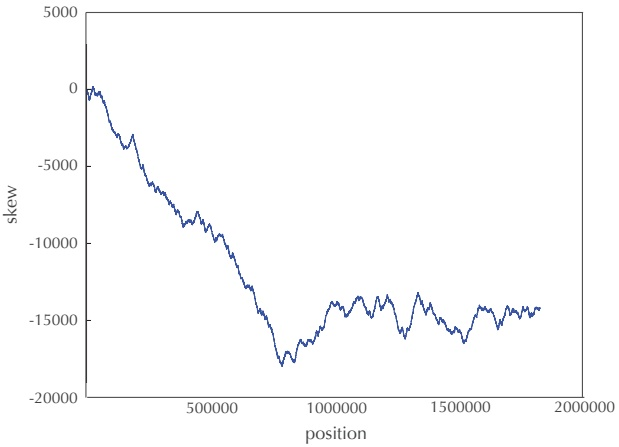

<details>
<summary>line</summary>

| position | skew |
| --- | --- |
| 0 | ~0 |
| 500000 | ~-9000 |
| 1000000 | ~-14000 |
| 1500000 | ~-16000 |
| 2000000 | ~-14000 |
</details>

FIGURE 1.14 The skew diagram for Thermotoga petrophila achieves a minimum at position 787199 but does not have the same nice shape as the skew diagram for E. coli.

**STOP and Think:** What evolutionary process could possibly explain the shape of the skew diagram for Thermotoga petrophila?


31

---

C H A P T E R 1

Since the skew diagram for Thermotoga petrophila is complex and the oriC for this genome has not even been experimentally verified, there is a chance that the region predicted by Ori-Finder as the oriC region for Thermotoga petrophila (or even for Vibrio cholerae) is actually incorrect!

You now should have a good sense of how to locate oriC and DnaA boxes computationally. We will take the training wheels off and ask you to solve a challenge problem.

**CHALLENGE PROBLEM:** Find DnaA boxes in Salmonella enterica.

32

---

W H E R E I N T H E G E N O M E D O E S D N A R E P L I C AT I O N B E G I N ?

## Open Problems

Multiple replication origins in a bacterial genome

Biologists long believed that each bacterial chromosome has only one oriC. Wang et al., 2011 genetically modified E. coli by inserting a synthetic oriC a million nucleotides away from the bacterium’s known oriC. To their surprise, E. coli continued business as usual, starting replication at both locations!

Following the publication of this paper, the search for naturally occurring bacteria with multiple oriCs immediately started. In 2012, Xia raised doubts about the “single oriC” postulate and gave examples of bacteria with highly unusual skews. In fact, having more than one oriC makes sense in the light of evolution: if the genome is long and replication is slow, then multiple replication origins would decrease the amount of time that the bacterium must spend replicating its DNA.

For example, Wigglesworthia glossinidia, a symbiotic bacterium living in the intestines of tsetse flies, has the atypical skew diagram shown in Figure 1.15. Since this diagram has at least two pronounced local minima, Xia argued that this bacterium may have two or more oriC regions.

We should be careful with Xia’s hypothesis that this bacterium has two oriCs, as there may be alternative explanations for multiple local minima in the skew. For example, **genome rearrangements** (which we will study in Chapter 6) move genes within a genome and often reposition them from the forward to the reverse half-strand and vice-versa, thus resulting in irregularities in the skew diagram. One example of a genome rearrangement is a **reversal**, which flips around a segment of chromosome and switches it to the opposite strand; Figure 1.16 shows what happens to the skew diagram after a reversal.

Another difficulty is presented by the fact that different species of bacteria may exchange genetic material in **horizontal gene transfer**. If a gene from the forward half-strand of one bacterium is transferred to the reverse half-strand of another (or vice-versa), then we will observe an irregularity in the skew diagram. As a result, the question about the number of oriCs of Wigglesworthia glossinidia remains unresolved.

However, if you could demonstrate that there exist two sets of identical DnaA boxes in the vicinity of two local minima in the skew diagram of Wigglesworthia glossinidia, then you would have the first solid evidence in favor of multiple bacterial oriCs. Maybe simply applying your solution for the Frequent Words with Mismatches and Reverse Complements Problem will reveal these DnaA boxes. Can you find other bacterial genomes where a single oriC is in doubt and check whether they indeed have multiple oriCs?

33

---

C H A P T E R 1

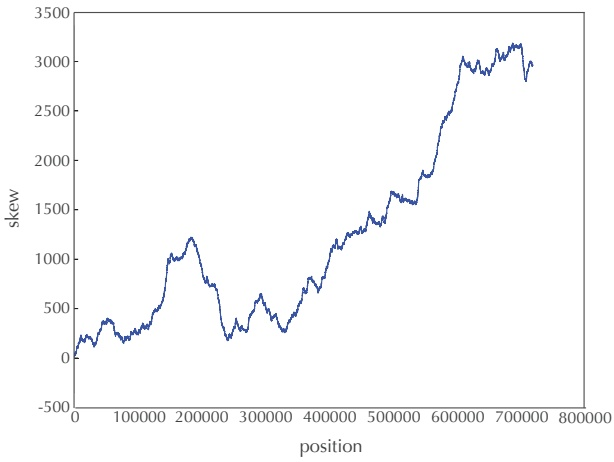

<details>
<summary>line</summary>

| position | skew |
| --- | --- |
| 0 | ~100 |
| 50000 | ~350 |
| 100000 | ~250 |
| 150000 | ~1000 |
| 200000 | ~1200 |
| 250000 | ~250 |
| 300000 | ~600 |
| 350000 | ~300 |
| 400000 | ~800 |
| 450000 | ~1250 |
| 500000 | ~1650 |
| 550000 | ~1850 |
| 600000 | ~2950 |
| 650000 | ~3150 |
| 700000 | ~2950 |
</details>

FIGURE 1.15 The skew diagram for Wigglesworthia glossinidia.

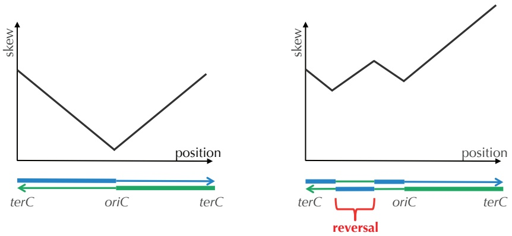

FIGURE 1.16 (Left) $\mathsf { A n ^ { \prime } i d e a l ^ { \prime \prime } }$ V-shaped skew diagram that achieves minimum skew at $o r { \dot { I } } C ,$ The skew diagram decreases along the reverse half-strand (shown by a thick line) and increases along the forward half-strand (shown by a thin line). We assume that a circular chromosome was cut at $t e r C ,$ resulting in a linear chromosome that starts and ends at terC. (Right) A skew diagram after a reversal that switches segments between the reverse and forward strands and alters the skew diagram. As before, the skew diagram still decreases along the segments of the genome shown by thick lines and increases along the segments shown by thin lines.

34

---

W H E R E I N T H E G E N O M E D O E S D N A R E P L I C AT I O N B E G I N ?

## Finding replication origins in archaea

**Archaea** are unicellular organisms so distinct from other life forms that biologists have placed them into their own **domain of life** separate from bacteria and eukaryotes. Al though archaea are visually similar to bacteria, they have some genomic features that are more closely related to eukaryotes. In particular, the replication machinery of archaea is more similar to eukaryotes than bacteria. Yet archaea use a much greater variety of energy sources than eukaryotes, feeding on ammonia, metals, or even hydrogen gas.

Figure 1.17 shows the skew diagram of Sulfolobus solfataricus, a species of archaea growing in acidic volcanic springs in temperatures over $8 0 ^ { \circ } \; \mathsf { C } .$ In its skew diagram, you can see at least three local minima, represented by deep valleys, in addition to many more shallow valleys.

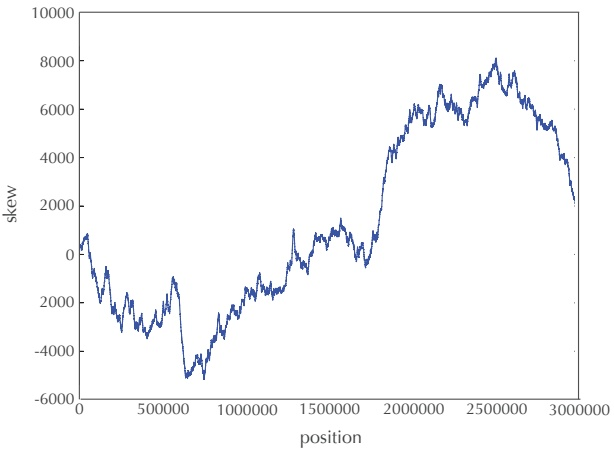

<details>
<summary>line</summary>

| position | skew |
| --- | --- |
| 0 | ~500 |
| 500000 | ~-3000 |
| 1000000 | ~-2000 |
| 1500000 | ~500 |
| 2000000 | ~6000 |
| 2500000 | ~7500 |
| 3000000 | ~2500 |
</details>

FIGURE 1.17 The skew diagram of Sulfolobus solfataricus.

Lundgren et al., 2004 demonstrated experimentally that Sulfolobus solfataricus indeed has three oriCs. Since then, multiple oriCs have been identified in many other archaea. However, no accurate computational approach has been developed to identify multiple oriCs in a newly sequenced archaea genome. For example, the methane-producing archaea Methanococcus jannaschii is considered the workhorse of archaea genomics, but its oriC(s) still remain unidentified! Its skew diagram (shown in Figure 1.18) suggests that it may have multiple oriCs: can you find them?

35

---

C H A P T E R 1

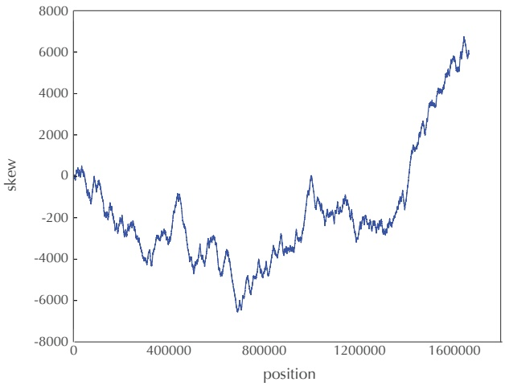

<details>
<summary>line</summary>

| position | skew |
| --- | --- |
| 0 | ~0 |
| 400000 | ~-3500 |
| 800000 | ~-6500 |
| 1200000 | ~-2500 |
| 1600000 | ~6000 |
</details>

FIGURE 1.18 The skew diagram for Methanococcus jannaschii.

Finding replication origins in yeast

If you think that finding replication origins in bacteria is a complex problem, wait until you analyze replication origins in more complex organisms like yeast or humans, which have hundreds of replication origins. Among various yeast species, the yeast Saccharomyces cerevisiae has the best characterized replication origins. It has approximately 400 different oriCs, many of which may be used during the replication of any single yeast cell.

Having a large number of oriCs results in dozens of replication forks hurtling towards each other from different locations in the genome in ways that are not yet completely understood. However, researchers have discovered that the replication origins of S. cerevisiae share a (somewhat variable) pattern called the **ARS Consensus Sequence** (**ACS**). The ACS is the binding site for the so-called **Origin Recognition Complex**, which initiates the loading of additional proteins required for origin firing. Many ACSs correspond to the following canonical thymine-rich pattern of length 11.

Here, the notation (X/Y) indicates that either nucleotide X or nucleotide Y may appear in that position.

However, various ACSs may differ from this canonical pattern, with lengths varying from 11 to 17 nucleotides. For example, the 11-nucleotide long pattern shown above is often part of a 17-nucleotide pattern:

36

---

W H E R E I N T H E G E N O M E D O E S D N A R E P L I C AT I O N B E G I N ?

$$
(\mathrm{T} / \mathrm{A}) (\mathrm{T} / \mathrm{A}) (\mathrm{T} / \mathrm{A}) (\mathrm{T} / \mathrm{A}) \mathbf {T T T A T} (\mathbf {G} / \mathbf {A}) \mathbf {T T T} (\mathbf {T} / \mathbf {A}) (\mathbf {G} / \mathbf {T}) (\mathrm{T} / \mathrm{G}) (\mathrm{T} / \mathrm{C})
$$

Recently, some progress has been made in characterizing the ACS in a few other yeast species. In some species like S. bayanus, the ACS is almost identical to that of S. cerevisiae, while in others such as K. lactis, it is very different. More alarmingly, at least for bioinformaticians, in some yeast species such as S. pombe, the Origin Recognition Complex binds to loosely defined AT-rich regions, which makes it next to impossible to find replication origins based on sequence analysis alone.

Despite recent efforts, finding oriCs in yeast remains an open problem, and no accurate software exists for predicting origins of replication from the sequence of yeast genomes. Can you explore this problem and devise an algorithm to predict replication origins in yeast?

Computing probabilities of patterns in a string

In the main text, we told you that the probability that a random DNA string of length 500 contains a 9-mer appearing three or more times is approximately 1/1300. In **DETOUR: Probabilities of Patterns in a String**, we describe a method to estimate this probability, but it is rather inaccurate. This open problem is aimed at finding better approximations or even deriving exact formulas for probabilities of patterns in strings.

We start by asking a question: what is the probability that a specific k-mer Pattern will appear (at least once) as a substring of a random string of length N? This question proved to be not so simple and was first addressed by Solov’ev, 1966 (see also Sedgewick and Flajolet, 2013).

The first surprise is that different k-mers may have different probabilities of appearing in a random string. For example, the probability that $P a t t e r n = 0 1$ appears in a random binary string of length 4 is 11/16, while the probability that $P a t t e r n = 1 1$ appears in a random binary string of length 4 is $8 / 1 6 .$ . This phenomenon is called the **overlapping words paradox** because different occurrences of Pattern can overlap each other for some patterns $\left(  e.g. , 11 \right)$ but not others $(  e.g. , 01 )$ . See **DETOUR: The Overlapping Words Paradox**.

We are interested in computing the following probabilities for a random N-letter string in an A-letter alphabet:

$\operatorname* { P r } \bigl ( N , A , P a t t e r n , t \bigr )$ , the probability that a string Pattern appears at least t times in a random string;
$\operatorname* { P r } ^ { * } \bigl ( N , A , P a t t e r n , t \bigr )$ , the probability that a string Pattern and its reverse complement Pattern appear at least t total times in a random string.

PAGE 52

PAGE 62

37

---

C H A P T E R 1

Note that the above two probabilities are relatively straightforward to compute. Several variants of these questions are open:

$\operatorname* { P r } _ { d } \bigl ( N , A , P a t t e r n , t \bigr )$ , the probability that a string Pattern approximately appears at least t times in a random string (with at most d mismatches);
$\operatorname* { P r } \bigl ( N , A , k , t \bigr )$ , the probability that there exists any k-mer appearing at least t times in a random string;
$\operatorname* { P r } _ { d }   \left( N , A , k , t \right)$ , the probability that there exists any k-mer with at least t approximate occurrences in a random string (with at most d mismatches).

---

W H E R E I N T H E G E N O M E D O E S D N A R E P L I C AT I O N B E G I N ?

## Charging Stations

## The frequency array

To make **FREQUENTWORDS** faster, we will think about why this algorithm is slow in the first place. It slides a window of length k down Text, identifying a k-mer Pattern of Text at each step. For each such k-mer, it must slide a window down the entire length of Text in order to compute PATTERNCOUNT(Text, Pattern). Instead of doing all this sliding, we aspire to slide a window down Text only once. As we slide this window, we will keep track of the number of times that each k-mer Pattern has already appeared in Text, updating these numbers as we proceed.

To achieve this goal, we will first order all $4 ^ { k }$ k-mers **lexicographically** (i.e., according to how they would appear in the dictionary) and then convert them into the $4 ^ { k }$ different integers between 0 and $4 ^ { k } - 1$ . Given an integer $k ,$ we define the **frequency array** of a string Text as an array of length $4 ^ { k } )$ , where the i-th element of the array holds the number of times that the i-th k-mer (in the lexicographic order) appears in Text (Figure 1.19).

| k-mer | AA | AC | AG | AT | CA | CC | CG | CT | GA | GC | GG | GT | TA | TC | TG | TT |
| --- | --- | --- | --- | --- | --- | --- | --- | --- | --- | --- | --- | --- | --- | --- | --- | --- |
| index | 0 | 1 | 2 | 3 | 4 | 5 | 6 | 7 | 8 | 9 | 10 | 11 | 12 | 13 | 14 | 15 |
| frequency | 3 | 0 | 2 | 0 | 1 | 0 | 0 | 0 | 0 | 1 | 3 | 1 | 0 | 0 | 1 | 0 |

FIGURE 1.19 The lexicographic order of DNA 2-mers (top), along with the index of each 2-mer in this order (middle), and the frequency array for AAGCAAAGGTGGG (bottom). For example, the frequency array at index 10 is equal to 3 because GG, the tenth DNA 2-mer according to lexicographic order, occurs three times in AAGCAAAGGTGGG.

To compute the frequency array, we need to determine how to transform a k-mer Pattern into an integer using a function PATTERNTONUMBER(Pattern). We also should know how to reverse this process, transforming an integer between 0 and $4 ^ { k } - 1$ into a k-mer using a function NUMBERTOPATTERN(index, k). Figure 1.19 illustrates that PATTERNTONUMBER(GT) = 11 and NUMBERTOPATTERN(11, 2) = GT.

## EXERCISE BREAK: Compute the following:

1. PATTERNTONUMBER(ATGCAA)
2. NUMBERTOPATTERN(5437, 7)
3. NUMBERTOPATTERN(5437, 8)


39

---

C H A P T E R 1


## CHARGING STATION (Converting Patterns Into Numbers and Vice-Versa):

Check out this Charging Station to see how to implement PATTERNTONUMBER and NUMBERTOPATTERN.

The pseudocode below generates a frequency array by first initializing every element in the frequency array to zero $( 4 ^ { k }$ operations) and then making a single pass down Text (approximately $\left| T e x t \right| \cdot k$ operations). For each k-mer Pattern that we encounter, we add 1 to the value of the frequency array corresponding to Pattern. As before, we refer to the k-mer beginning at position i of Text as Text $( i , k )$


```python
COMPUTINGFREQUENCIES(Text, k)
    for i ← 0 to 4^k - 1
        FREQUENCYARRAY(i) ← 0
    for i ← 0 to |Text| - k
        Pattern ← Text(i, k)
        j ← PATTERNNUMBER(Pattern)
        FREQUENCYARRAY(j) ← FREQUENCYARRAY(j) + 1
    return FREQUENCYARRAY
```

We now have a faster algorithm for the Frequent Words Problem. After generating the frequency array, we can find all most frequent k-mers by simply finding all k-mers corresponding to the maximum element(s) in the frequency array.

```python
FASTERFREQUENTWORDS(Text, k)
    FrequentPatterns ← an empty set
    FREQUENCYARRAY ← COMPUTINGFREQUENCIES(Text, k)
    maxCount ← maximal value in FREQUENCYARRAY
    for i ← 0 to 4^k - 1
        if FREQUENCYARRAY(i) = maxCount
            Pattern ← NUMBERTOPATTERN(i, k)
            add Pattern to the set FrequentPatterns
    return FrequentPatterns
```

40

---

W H E R E I N T H E G E N O M E D O E S D N A R E P L I C AT I O N B E G I N ?

**CHARGING STATION (Finding Frequent Words by Sorting):** Although **FASTERFREQUENTWORDS** is fast for small k (i.e., you can use it to find DnaA boxes in an oriC region), it becomes impractical when k is large. If you are familiar with sorting algorithms and are interested in seeing a faster algorithm, check out this Charging Station.

**EXERCISE BREAK:** Our claim that **FASTERFREQUENTWORDS** is faster than **FREQUENTWORDS** is only correct for certain values of |Text| and k. Estimate the running time of **FASTERFREQUENTWORDS** and characterize the values of |Text| and k when **FASTERFREQUENTWORDS** is indeed faster than **FREQUENTWORDS**.

Converting patterns to numbers and vice-versa

Our approach to computing PATTERNTONUMBER(Pattern) is based on a simple observation. If we remove the final symbol from all lexicographically ordered k-mers, the resulting list is still ordered lexicographically (think about removing the final letter from every word in a dictionary). In the case of DNA strings, every (k  1)-mer in the resulting list is repeated four times (Figure 1.20).

| AAA | AAC | AAG | AAT | ACA | ACC | ACG | ACT |
| --- | --- | --- | --- | --- | --- | --- | --- |
| AGA | AGC | AGG | AGT | ATA | ATC | ATG | ATT |
| CAA | CAC | CAG | CAT | CCA | CCC | CCG | CCT |
| CGA | CGC | CGG | CGT | CTA | CTC | CTG | CTT |
| GAA | GAC | GAG | GAT | GCA | GCC | GCG | GCT |
| GGA | GGC | GGG | GGT | GTA | GTC | GTG | GTT |
| TAA | TAC | TAG | TAT | TCA | TCC | TCG | TCT |
| TGA | TGC | TGG | TGT | TTA | TTC | TTG | TTT |

FIGURE 1.20 If we remove the final symbol from all lexicographically ordered DNA 3-mers, we obtain a lexicographic order of (red) 2-mers, where each 2-mer is repeated four times.

Thus, the number of 3-mers occurring before **AG**T is equal to four times the number of 2-mers occurring before **AG** plus the number of 1-mers occurring before T. Therefore,

$$
\begin{array}{l} \text {PATTERNTONUMBER} (\mathbf {A G T}) = 4 \cdot \text {PATTERNTONUMBER} (\mathbf {A G}) + \text {SYMBOLTONUMBER} (\mathrm{T}) \\ = 8 + 3 = 1 1, \\ \end{array}
$$


41

---

C H A P T E R 1


where SYMBOLTONUMBER(symbol) is the function transforming symbols $\mathbb { A } ,   \mathbb { C } ,   \mathbb { G } ,$ and T into the respective integers 0, 1, 2, and 3.

If we remove the final symbol of Pattern, denoted LASTSYMBOL(Pattern), then we will obtain a (k  1)-mer that we denote as PREFIX(Pattern). The preceding observation therefore generalizes to the formula

$$
\begin{array}{r l} \text {PATTERNTONUMBER} (\text {Pattern}) & = 4 \cdot \text {PATTERNTONUMBER} (\text {PREFIX} (\text {Pattern})) + \\ & \quad \text {SYMBOLTONUMBER} (\text {LASTSYMBOL} (\text {Pattern})). \end{array} (*)
$$

This equation leads to the following **recursive algorithm**, i.e., a program that calls itself. If you want to learn more about recursive algorithms, see **DETOUR: The Towers of Hanoi**.


```cmake
PATTERNNUMBER(Pattern)
    if Pattern contains no symbols
        return 0
    symbol ← LASTSYMBOL(Pattern)
    Prefix ← PREFIX(Pattern)
    return 4 · PATTERNNUMBER(Prefix) + SYMBOLNUMBER(symbol)
```

In order to compute the inverse function NUMBERTOPATTERN(index, k), we return to (\*) above, which implies that when we divide index = PATTERNTONUMBER(Pattern) by 4, the remainder will be equal to SYMBOLTONUMBER(symbol), and the quotient will be equal to PATTERNTONUMBER(PREFIX(Pattern)). Thus, we can use this fact to peel away symbols at the end of Pattern one at a time, as shown in Figure 1.21.


**STOP and Think:** Once we have computed NUMBERTOPATTERN(9904, 7) in Figure 1.21, how would you compute NUMBERTOPATTERN(9904, 8)?

In the pseudocode below, we denote the quotient and the remainder when dividing integer n by integer m as QUOTIENT $( n , m )$ and REMAINDER $( n , m )$ , respectively. For example, QUOTIENT $(11,4)  = 2$ and REMAINDER $( 11,4 ) =3.$ . This pseudocode uses the function NUMBERTOSYMBOL(index), which is the inverse of SYMBOLTONUMBER and transforms the integers 0, 1, 2, and 3 into the respective symbols $\mathbb { A } ,   \mathbb { C } ,   \mathbb { G } ,$ and T.

42

---

W H E R E I N T H E G E N O M E D O E S D N A R E P L I C AT I O N B E G I N ?

| n | QUOTIENT(n, 4) | REMAINDER(n, 4) | NUMBERTO SYMBOL |
| --- | --- | --- | --- |
| 9904 | 2476 | 0 | A |
| 2476 | 619 | 0 | A |
| 619 | 154 | 3 | T |
| 154 | 38 | 2 | G |
| 38 | 9 | 2 | G |
| 9 | 2 | 1 | C |
| 2 | 0 | 2 | G |

FIGURE 1.21 When computing Pattern = NUMBERTOPATTERN(9904, 7), we divide 9904 by 4 to obtain a quotient of 2476 and a remainder of 0. This remainder represents the final nucleotide of Pattern, or NUMBERTOSYMBOL(0) = A. We then iterate this process, dividing each subsequent quotient by 4, until we obtain a quotient of 0. The symbols in the nucleotide column, read upward from the bottom, yield Pattern = GCGGTAA.

```python
NUMBERTOPATTERN(index , k)
    if k = 1
        return NUMBERTOSYMBOL(index)
    prefixIndex ← QUOTIENT(index, 4)
    r ← REMAINDER(index, 4)
    symbol ← NUMBERTOSYMBOL(r)
    PrefixPattern ← NUMBERTOPATTERN(prefixIndex, k - 1)
    return concatenation of PrefixPattern with symbol
```

## Finding frequent words by sorting

To see how sorting can help us find frequent k-mers, we will consider a motivating example when k = 2. Given a string Text = AAGCAAAGGTGGG, list all its 2-mers in the order they appear in Text, and convert each 2-mer into an integer using PATTERNTONUMBER to produce an array INDEX, as shown below.

| 2-mer | AA | AG | GC | CA | AA | AA | AG | GG | GT | TG | GG | GG |
| --- | --- | --- | --- | --- | --- | --- | --- | --- | --- | --- | --- | --- |
| INDEX | 0 | 2 | 9 | 4 | 0 | 0 | 2 | 10 | 11 | 14 | 10 | 10 |

We will now sort INDEX to generate an array SORTEDINDEX, as shown in Figure 1.22.

**STOP and Think:** How can the sorted array in Figure 1.22 help us find frequent words?


43

---

C H A P T E R 1

| 2-mer | AA | AA | AA | AG | AG | CA | GC | GG | GG | GG | GT | TG |
| --- | --- | --- | --- | --- | --- | --- | --- | --- | --- | --- | --- | --- |
| SORTEDINDEX | 0 | 0 | 0 | 2 | 2 | 4 | 9 | 10 | 10 | 10 | 11 | 14 |
| COUNT | 1 | 2 | 3 | 1 | 2 | 1 | 1 | 1 | 2 | 3 | 1 | 1 |

FIGURE 1.22 Lexicographically sorted 2-mers in AAGCAAAGGTGG (top), along with arrays SORTEDINDEX (middle) and COUNT (bottom).

Since identical k-mers clump together in the sorted array (like (0, 0, 0) for AA or (10, 10, 10) for GG in Figure 1.22), frequent k-mers are the longest runs of identical integers in SORTEDINDEX. This insight leads to **FINDINGFREQUENTWORDSBYSORTING**, whose pseudocode is shown below. This algorithm uses an array COUNT for which COUNT(i) computes the number of times that the integer at position i in the array SORTEDINDEX appears in the first i elements of this array (Figure 1.22 (bottom)). In the pseudocode for **FINDINGFREQUENTWORDSBYSORTING**, we assume that you already know how to sort an array using an algorithm **SORT**.

```python
FINDINGFREQUENTWORDSBYSORTING(Text , k)
    FrequentPatterns ← an empty set
    for i ← 0 to |Text| - k
        Pattern ← Text(i, k)
        INDEX(i) ← PATTERNNUMBER(Pattern)
        COUNT(i) ← 1
    SORTEDINDEX ← SORT(INDEX)
    for i ← 1 to |Text| - k
        if SORTEDINDEX(i) = SORTEDINDEX(i - 1)
            COUNT(i) = COUNT(i - 1) + 1
    maxCount ← maximum value in the array COUNT
    for i ← 0 to |Text| - k
        if COUNT(i) = maxCount
            Pattern ← NUMBERTOPATTERN(SORTEDINDEX(i), k)
            add Pattern to the set FrequentPatterns
    return FrequentPatterns
```


Solving the Clump Finding Problem

**Note:** This Charging Station assumes that you have read **CHARGING STATION: The Frequency Array**.

44

---

W H E R E I N T H E G E N O M E D O E S D N A R E P L I C AT I O N B E G I N ?

The pseudocode below slides a window of length L down Genome. After computing the frequency array for the current window, it identifies $( L , t )$ -clumps simply by finding which k-mers occur at least t times within the window. To keep track of these clumps, our algorithm uses an array CLUMP of length $4 ^ { k }$ whose values are all initialized to zero. For each value of i between 0 and $4 ^ { k } - 1$ , we will set CLUMP(i) equal to 1 if NUMBERTOPATTERN $( i , k )$ forms an $( L , t )$ -clump in Genome.

<div class="docvortex-algorithm" style="white-space: pre-wrap; font-family:monospace;">
CLUMPFINDING(Genome, k, t, L)
    FrequentPatterns ← an empty set
    for i ← 0 to $4^k - 1$
        CLUMP(i) ← 0
    for i ← 0 to |Genome| - L
        Text ← the string of length L starting at position i in Genome
        FREQUENCYARRAY ← COMPUTINGFREQUENCIES(Text, k)
        for index ← 0 to $4^k - 1$
            if FREQUENCYARRAY(index) ≥ t
                CLUMP(index) ← 1
    for i ← 0 to $4^k - 1$
        if CLUMP(i) = 1
            Pattern ← NUMBERTOPATTERN(i, k)
            add Pattern to the set FrequentPatterns
    return FrequentPatterns
</div>

## EXERCISE BREAK: Estimate the running time of CLUMPFINDING.

CLUMPFINDING makes $\big | G e n o m e \big | - L + 1$ iterations, generating a frequency array for a string of length L at each iteration. Since this task takes roughly $4 ^ { k } + L   .$ · k time, the overall running time of CLUMPFINDING is $\mathcal { O } \Big ( \big | G e n o m e \big | \cdot \big ( 4 ^ { k } + L \cdot k \big ) \Big )$ . As a result, when searching for DnaA boxes $( k = 9 )$ in a typical bacterial genome (|Genome| $> 1 0 0 0 0 0 0 )$ **CLUMPFINDING** becomes too slow.

**STOP and Think:** Can you speed up **CLUMPFINDING** by eliminating the need to generate a new frequency array at every iteration?

To improve **CLUMPFINDING**, we observe that when we slide our window of length L one symbol to the right, the frequency array does not change much, and so regener-

STOP

45

---

C H A P T E R 1

ating the frequency array from scratch is inefficient. For example, Figure 1.23 shows the frequency arrays (k = 2) for the 13-mers Text = **AA**GCAAAGGTGGG and Text<sup>0</sup> = AGCAAAGGTGG**GC** starting at positions 0 and 1 of the 14-mer **AA**GCAAAGGTGG**GC**. These two frequency arrays differ in only two elements corresponding to the first k-mer in Text (**AA**) and the last k-mer in Text’ (**GC**). Specifically, the frequency array value corresponding to the **first** k-mer of Text is **reduced** by 1 in the frequency array of Text’, and the frequency array value corresponding to the **last** k-mer of Text is **increased** by 1 in the frequency array of Text’.

This observation helps us modify **CLUMPFINDING** as shown below. Note that we now only call **COMPUTINGFREQUENCIES** once, updating the frequency array as we go along.

```txt
BETTERCLUMPFINDING(Genome, k, t, L)
    FrequentPatterns ← an empty set
    for i ← 0 to 4^k - 1
        CLUMP(i) ← 0
    Text ← Genome(0, L)
    FREQUENCYARRAY ← COMPUTINGFREQUENCIES(Text, k)
    for i ← 0 to 4^k - 1
        if FREQUENCYARRAY(i) ≥ t
            CLUMP(i) ← 1
    for i ← 1 to |Genome| - L
        FirstPattern ← Genome(i - 1, k)
        index ← PATTERNNUMBER(FirstPattern)
        FREQUENCYARRAY(index) ← FREQUENCYARRAY(index) - 1
        LastPattern ← Genome(i + L - k, k)
        index ← PATTERNNUMBER(LastPattern)
        FREQUENCYARRAY(index) ← FREQUENCYARRAY(index) + 1
        if FREQUENCYARRAY(index) ≥ t
            CLUMP(index) ← 1
    for i ← 0 to 4^k - 1
        if CLUMP(i) = 1
            Pattern ← NUMBERTOPATTERN(i, k)
            add Pattern to the set FrequentPatterns
    return FrequentPatterns
```

46

---

W H E R E I N T H E G E N O M E D O E S D N A R E P L I C AT I O N B E G I N ?

| k-mer | AA | AC | AG | AT | CA | CC | CG | CT | GA | GC | GG | GT | TA | TC | TG | TT |
| --- | --- | --- | --- | --- | --- | --- | --- | --- | --- | --- | --- | --- | --- | --- | --- | --- |
| INDEX | 0 | 1 | 2 | 3 | 4 | 5 | 6 | 7 | 8 | 9 | 10 | 11 | 12 | 13 | 14 | 15 |
| frequency | 3 | 0 | 2 | 0 | 1 | 0 | 0 | 0 | 0 | 1 | 3 | 1 | 0 | 0 | 1 | 0 |
| $frequency'$ | 2 | 0 | 2 | 0 | 1 | 0 | 0 | 0 | 0 | 2 | 3 | 1 | 0 | 0 | 1 | 0 |

FIGURE 1.23 The frequency arrays for two consecutive substrings of length 13 starting at positions 0 and 1 of AAGCAAAGGTGGGC are very similar to each other.

Solving the Frequent Words with Mismatches Problem

**Note:** This Charging Station uses some notation from **CHARGING STATION: The Frequency Array**.

To prevent having to generate all $4 ^ { k }   k { \mathrm { - m e r s } }$ in order to solve the Frequent Words with Mismatches Problem, our goal is to consider only those k-mers that are **close** to a k-mer in Text, i.e., those with Hamming distance at most d from this k-mer. Given a k-mer Pattern, we therefore define its **d-neighborhood** NEIGHBORS(Pattern, d) as the set of all k-mers that are close to Pattern. For example, NEIGHBORS(ACG, 1) consists of ten 3-mers:

ACG CCG GCG TCG AAG AGG ATG ACA ACC ACT

**EXERCISE BREAK:** Estimate the size of NEIGHBORS(Pattern, d).

We will also use an array CLOSE of size $4 ^ { k }$ whose values we initialize to zero. In the **FREQUENTWORDSWITHMISMATCHES** pseudocode below, we set CLOSE(i) = 1 whenever Pattern = NUMBERTOPATTERN(i, k) is close to some k-mer in Text. This allows us to apply **APPROXIMATEPATTERNCOUNT** only to close k-mers, a smarter approach than applying it to all k-mers.

**CHARGING STATION (Generating the Neighborhood of a String): FREQUENTWORDSWITHMISMATCHES** also calls **NEIGHBORS**(Pattern, d), a function that generates the d-neighborhood of a k-mer Pattern. Check out this Charging Station to learn how to implement this function.

**STOP and Think:** Although **FREQUENTWORDSWITHMISMATCHES** is faster than the naive algorithm described in the main text for the typical parameters used in oriC searches, it is not necessarily faster for all parameter values. For which parameter values is **FREQUENTWORDSWITHMISMATCHES** slower than the naive algorithm?

PAGE 39

PAGE 49

STOP

47

---

C H A P T E R 1


```python
FREQUENTWORDSWITHMISMATCHES(Text, k, d)
    FrequentPatterns ← an empty set
    for i ← 0 to 4^k - 1
        CLOSE(i) ← 0
        FREQUENCYARRAY ← 0
    for i ← 0 to |Text| - k
        Neighborhood ← NEIGHBORS(Text(i, k), d)
        for each Pattern from Neighborhood
            index ← PATTERNNUMBER(Pattern)
            CLOSE(index) ← 1
    for i ← 0 to 4^k - 1
        if CLOSE(i) = 1
            Pattern ← NUMBERTOPATTERN(i, k)
            FREQUENCYARRAY(i) ← APPROXIMATEPATTERNCOUNT(Text, Pattern, d)
    maxCount ← maximal value in FREQUENCYARRAY
    for i ← 0 to 4^k - 1
        if FREQUENCYARRAY(i) = maxCount
            Pattern ← NUMBERTOPATTERN(i, k)
            add Pattern to the set FrequentPatterns
    return FrequentPatterns
```

**CHARGING STATION (Finding Frequent Words with Mismatches by Sorting):** If you are familiar with sorting and are interested in seeing an even faster algorithm for the Frequent Words with Mismatches Problem, check out this Charging Station.

48

---

W H E R E I N T H E G E N O M E D O E S D N A R E P L I C AT I O N B E G I N ?

## Generating the neighborhood of a string

Our goal is to generate the d-neighborhood NEIGHBORS(Pattern, d), the set of all k-mers whose Hamming distance from Pattern does not exceed d. We will first generate the 1-neigborhood of Pattern using the following pseudocode.

<div class="docvortex-algorithm" style="white-space: pre-wrap; font-family:monospace;">
IMMEDIATENEIGHBORS(Pattern)
    Neighborhood ← the set consisting of the single string Pattern
    for i = 1 to |Pattern|
        symbol ← i-th nucleotide of Pattern
        for each nucleotide x different from symbol
            Neighbor ← Pattern with the i-th nucleotide substituted by x
            add Neighbor to Neighborhood
    return Neighborhood
</div>

Our idea for generating NEIGHBORS(Pattern, d) is as follows. If we remove the first symbol of Pattern (denoted FIRSTSYMBOL(Pattern)), then we will obtain a (k  1)-mer that we denote by SUFFIX(Pattern).

**STOP and Think:** If we know NEIGHBORS(SUFFIX(Pattern), d), how does it help us construct NEIGHBORS(Pattern, d)?

Now, consider a (k  1)-mer Pattern’ belonging to NEIGHBORS(SUFFIX(Pattern), d). By the definition of the d-neighborhood NEIGHBORS(SUFFIX(Pattern), d), we know that HAMMINGDISTANCE(Pattern<sup>0</sup>, SUFFIX(Pattern)) is either equal to d or less than d. In the first case, we can add FIRSTSYMBOL(Pattern) to the beginning of Pattern in order to obtain a k-mer belonging to NEIGHBORS(Pattern, d). In the second case, we can add any symbol to the beginning of Pattern’ and obtain a k-mer belonging to NEIGHBORS(Pattern, d).

In the following pseudocode for **NEIGHBORS**, we use the notation symbol • Text to denote the concatenation of a character symbol and a string Text, e.g., A • GCATG = AGCATG.


49

---

C H A P T E R 1


```python
NEIGHBORS(Pattern, d)
    if d = 0
        return {Pattern}
    if |Pattern| = 1
        return {A, C, G, T}
    Neighborhood ← an empty set
    SuffixNeighbors ← NEIGHBORS(SUFFIX(Pattern), d)
    for each string Text from SuffixNeighbors
        if HAMMINGDISTANCE(SUFFIX(Pattern), Text) < d
            for each nucleotide x
                add x • Text to Neighborhood
        else
            add FIRSTSYMBOL(Pattern) • Text to Neighborhood
    return Neighborhood
```

**STOP and Think:** Consider the following questions.

1. What is the running time of **NEIGHBORS**?
2. **NEIGHBORS** generates all k-mers of Hamming distance at most d from Pattern. Modify **NEIGHBORS** to generate all k-mers of Hamming distance exactly d from Pattern.

If you are still learning how recursive algorithms (like **NEIGHBORS**) work, you may want to implement an iterative version of **NEIGHBORS** instead, shown below.

```python
ITERATIVENEIGHBORS(Pattern, d)
    Neighborhood ← set consisting of single string Pattern
    for j = 1 to d
        for each string Pattern' in Neighborhood
            add IMMEDIATEVENEIGHBORS(Pattern') to Neighborhood
            remove duplicates from Neighborhood
    return Neighborhood
```

50

---

W H E R E I N T H E G E N O M E D O E S D N A R E P L I C AT I O N B E G I N ?

Finding frequent words with mismatches by sorting

**Note:** This Charging Station uses some notation from **CHARGING STATION: Finding Frequent Words by Sorting**.

The following pseudocode reduces the Frequent Words with Mismatches Problem to sorting.

```txt
FINDINGFREQUENTWORDSWITHMISMATCHESBYSORTING(Text, k, d)
    FrequentPatterns ← an empty set
    Neighborhoods ← an empty list
    for i ← 0 to |Text| - k
        add NEIGHBORS(Text(i, k), d) to Neighborhoods
    form an array NEIGHBORHOODARRAY holding all strings in Neighborhoods
    for i ← 0 to |Neighborhoods| - 1
        Pattern ← NEIGHBORHOODARRAY(i)
        INDEX(i) ← PATTERNNUMBER(Pattern)
        COUNT(i) ← 1
    SORTEDINDEX ← SORT(INDEX)
    for i ← 0 to |Neighborhoods| - 1
        if SORTEDINDEX(i) = SORTEDINDEX(i + 1)
            COUNT(i + 1) ← COUNT(i) + 1
    maxCount ← maximum value in array COUNT
    for i ← 0 to |Neighborhoods| - 1
        if COUNT(i) = maxCount
            Pattern ← NUMBERTOPATTERN(SORTEDINDEX(i), k)
            add Pattern to FrequentPatterns
    return FrequentPatterns
```


51

---

C H A P T E R 1

## Detours

## Big-O notation

Computer scientists typically measure an algorithm’s efficiency in terms of its **worstcase running time**, which is the largest amount of time an algorithm can take for the most difficult input of a given size. The advantage to considering the worst-case running time is that we are guaranteed that our algorithm will never behave worse than our worst-case estimate.

**Big-O notation** compactly describes the running time of an algorithm. For example, if your algorithm for sorting an array of n numbers takes roughly $n ^ { 2 }$ operations for the most difficult dataset, then we say that the running time of your algorithm is $\mathcal { O } \big ( n ^ { 2 } \big )$ In reality, depending on your implementation, it may use any number of operations, such as $1 . 5 n ^ { 2 } ,   n ^ { 2 } + n + 2 ,$ or $0 . 5 n ^ { 2 } + 1 ;$ all these algorithms are $\mathcal { O } \big ( n ^ { 2 } \big )$ because big-O notation only cares about the term that grows the fastest with respect to the size of the input. This is because as n grows very large, the difference in behavior between two $\mathcal { O } \big ( n ^ { 2 } \big )$ functions, like $9 9 9 \cdot n ^ { 2 }$ and $n ^ { 2 } + 3 n + 9 9 9 9 9 9 9 ,$ , is negligible when compared to the behavior of functions from different classes, say $\mathcal { O } \big ( n ^ { 2 } \big )$ and $\mathcal { O } \big ( n ^ { 6 } \big )$ . Of course, we would prefer an algorithm requiring $1 / 2 \cdot n ^ { 2 }$ steps to an algorithm requiring $1 0 0 0 \cdot n ^ { 2 }$ steps.

When we write that the running time of an algorithm is $\mathcal { O } \big ( n ^ { 2 } \big )$ , we technically mean that it does not grow faster than a function with a leading term of $\left[ c \cdot n ^ { 2 } \right]$ , for some constant c. Formally, a function $f ( n )$ is Big-O of function $g ( n )$ , or $\mathcal { O } ( g ( n ) )$ , when $f ( n ) \leq c \cdot g ( n )$ for some constant c and sufficiently large n.

## Probabilities of patterns in a string

We mentioned that the probability that some 9-mer appears 3 or more times in a random DNA string of length 500 is approximately 1/1300. We assure you that this calculation does not appear out of thin air. Specifically, we can generate a **random string** modeling a DNA strand by choosing each nucleotide for any position with probability $1 / 4 .$ . The construction of random strings can be generalized to an arbitrary alphabet with A symbols, where each symbol is chosen with probability $1 / A$


**EXERCISE BREAK:** What is the probability that two randomly generated strings of length n in an A-letter alphabet are identical?

We now ask a simple question: what is the probability that a specific k-mer Pattern will appear (at least once) as a substring of a random string of length N? For example,

52

---

W H E R E I N T H E G E N O M E D O E S D N A R E P L I C AT I O N B E G I N ?

say that we want to find the probability that "01" appears in a random **binary string** (A = 2) of length 4. Here are all possible such strings.

| 0000 | 0001 | 0010 | 0011 | 0100 | 0101 | 0110 | 0111 |
| --- | --- | --- | --- | --- | --- | --- | --- |
| 1000 | 1001 | 1010 | 1011 | 1100 | 1101 | 1110 | 1111 |

Because "01" is a substring of 11 of these 4-mers, and because each 4-mer could be generated with probability 1/16, the probability that "01" appears in a random binary 4-mer is 11/16.

**STOP and Think:** What is the probability that $P a t t e r n = 1 1$ appears as a substring of a random binary 4-mer?

Surprisingly, changing Pattern from "01" to "11" changes the probability that it appears as a substring of a random binary string. Indeed, "**11**" appears in only 8 binary 4-mers:

| 0000 | 0001 | 0010 | 0011 | 0100 | 0101 | 0110 | 0111 |
| --- | --- | --- | --- | --- | --- | --- | --- |
| 1000 | 1001 | 1010 | 1011 | 1100 | 1101 | 1110 | 1111 |

As a result, the probability of "11" appearing in a random binary string of length 4 is $8 / 1 6 = 1 / 2$

**STOP and Think:** Why do you think that "11" is less likely than "01" to appear as a substring of a random binary 4-mer?

Let $\operatorname* { P r } \bigl ( N , A , P a t t e r n , t \bigr )$ denote the probability that a string Pattern appears t or more times in a random string of length N formed from an alphabet of A letters. We saw that $Pr(4,2, 01,1)  = 11/16$ while $Pr(4,2, 11,1)  = 1/2$ . Interestingly, when we make t greater than 1, we see that "01" is less likely to appear multiple times than "11". For example, the probability of finding "01" twice or more in a random binary 4-mer is given by $Pr(4,2, 01,2) =1/16$ because "0101" is the only binary 4-mer containing "01" twice, and yet $Pr(4,2, 11,2) = 3/16$ because binary 4-mers "0111", "1110" and "1111" all have at least two occurrences of "11".

**EXERCISE BREAK:** Compute Pr(100, 2, "01", 1).

We have seen that different k-mers have different probabilities of occurring multiple times as a substring of a random string. In general, this phenomenon is called the **overlapping words paradox** because different substring occurrences of Pattern can

STOP

STOP

53

---

C H A P T E R 1

PAGE 62

overlap each other for some choices of Pattern but not others (see **DETOUR: The Overlapping Words Paradox**).

For example, there are two overlapping occurrences of $``11$ in $`` 1110 '' ,$ , and three overlapping occurrences of $``11$ in "1111"; yet occurrences of "01" can never overlap with each other, and so "01" can never occur more than twice in a binary 4-mer. The overlapping words paradox makes computing $\operatorname* { P r } \bigl ( N , A , P a t t e r n , t \bigr )$ a rather complex problem because this probability depends heavily on the particular choice of Pattern. In light of the complications presented by the overlapping words paradox, we will try to approximate $\operatorname* { P r } \bigl ( A , N , P a t t e r n , t \bigr )$ rather than compute it exactly.

To approximate $\operatorname* { P r } \bigl ( N , A , P a t t e r n , t \bigr )$ , we will assume that the k-mer Pattern is not overlapping. As a toy example, say we we wish to count the number of **ternary strings** $( A = 3 )$ of length $7$ that contain "01" at least twice. Apart from the two occurrences of $01$ , we have three remaining symbols in the string. Let’s assume that these symbols are all $^ { \cdot \cdot } 2 ^ { \cdot \cdot }$ . The two occurrences of "**01**" can be inserted into "222" in ten different ways to form a $7 \mathrm { - m e r } ,$ as shown below.

| 0101222 | 0120122 | 0122012 | 0122201 | 2010122 |
| --- | --- | --- | --- | --- |
| 2012012 | 2012201 | 2201012 | 2201201 | 2220101 |

We inserted these two occurrences of $01$ into "222", but we could have inserted them into any other ternary 3-mer. Because there are $3 ^ { 3 } = 2 7$ ternary 3-mers, we obtain an approximation of $1 0 \cdot 2 7 = 2 7 0$ for the number of ternary 7-mers that contain two or more instances of "01". Because there are $3 ^ { 7 } = 2 1 8 7$ ternary $7 - \mathrm { m e r s } ,$ we estimate the probability $Pr (7,3, 01,2)$ as 270/2187.

STOP

**STOP and Think:** Is 270/2187 a good approximation for $Pr(7,3, 01,2)?$ Is the true probability $Pr (7,3, 01,2)$ larger or smaller than 270/2187?

To generalize the above method to approximate $\operatorname* { P r } \bigl ( N , A , P a t t e r n , t \bigr )$ for arbitrary parameter values, consider a string Text of length N having at least t occurrences of a k-mer Pattern. If we select exactly t of these occurrences, then we can think about Text as a sequence of $n = N - t \cdot k$ symbols interrupted by t insertions of the k-mer Pattern. If we fix these n symbols, then we wish to count the number of different strings Text that can be formed by inserting t occurrences of Pattern into a string formed by these n symbols.

For example, consider again the problem of embedding two occurrences of $01$ into $222 \left( n = 3 \right)$ , and note that we have added five copies of a capital $\mathrm { { \bf X } }$ below each 7-mer.

54

---

W H E R E I N T H E G E N O M E D O E S D N A R E P L I C AT I O N B E G I N ?

| 0101222 | 0120122 | 0122012 | 0122201 | 2010122 |
| --- | --- | --- | --- | --- |
| X X XXX | X XX XX | X XXX X | X XXXX | XX X XX |
| 2012012 | 2012201 | 2201012 | 2201201 | 2220101 |
| XX XX X | XX XXX | XXX X X | XXX XX | XXXX X |

What do the $\mathrm { { } ^ { \prime } X ^ { \prime \prime } }$ mean? Instead of counting the number of ways to insert two occurrences of "01" into "222", we can count the number of ways to select two of the five $\mathrm { { \bf X } }$ to color blue.

**XX**XXX XXXXX XXXXX XXXXX X**XX**XX

XXXXX XXXXX XX**XX**X XXXXX XXX**XX**

In other words, we are counting the number of ways to choose 2 out of 5 objects, which can be counted by the binomial coefficient ${ \binom { 5 } { 2 } }   =   1 0 .$ . More generally, the binomial coefficient ${m \choose k}$ represents the number of ways to choose k out of m objects and is equal to $m! \big/ k! \big(m - k\big)$ !

**STOP and Think:** How many ways are there to implant t instances of a (nonoverlapping) k-mer into a string of length n to produce a string of length $n + t \cdot k ?$

To approximate $\operatorname* { P r } \bigl ( N , A , P a t t e r n , t \bigr )$ , we want to count the number of ways to insert t instances of a k-mer Pattern into a fixed string of length $n = N - t \cdot k .$ We will therefore have $n + t$ occurrences of $\mathrm { { \bf X } }$ , from which we must select t for the placements of Pattern, giving a total of ${ \binom { n + t } { t } }$ . We then need to multiply ${ \binom { n + t } { t } }$ by the number of strings of length n into which we can insert t instances of Pattern to have an approximate total of ${ \binom { n + t } { t } } \cdot A ^ { n }$ (the actual number will be smaller because of over-counting). Dividing by the number of strings of length N, we have our desired approximation,

$$
\Pr (N, A, P a t t e r n, t) \approx \frac {\binom {n + t} {t} \cdot A ^ {n}}{A ^ {N}} = \frac {\binom {N - t \cdot (k - 1)} {t}}{A ^ {t \cdot k}}.
$$

We will now compute the probability that the specific 5-mer ACTAT occurs at least $t = 3$ times in a random DNA string $( A = 4 )$ of length $N = 3 0$ . Since $n = N - t \cdot k = 1 5$ our estimated probability is

$$
\Pr (3 0, 4, \text {ACTAT}, 3) \approx \frac {\binom {3 0 - 3 \cdot 4} {3}}{4 ^ {1 5}} = \frac {8 1 6}{1 0 7 3 7 4 1 8 2 4} \approx 7. 5 9 9 \cdot 1 0 ^ {- 7}.
$$

The exact probability is closer to $7 . 5 7 2 \cdot 1 0 ^ { - 7 }$ , illustrating that our approximation is relatively accurate for non-overlapping patterns. However, it becomes inaccurate for overlapping patterns, e.g., $\operatorname* { P r } \bigl ( 3 0 , 4 , \mathbb { A } \mathbb { A } \mathbb { A } \mathbb { A } , 3 \bigr ) \approx 1 . 1 4 8 \cdot 1 0 ^ { - 3 }$


55

---

C H A P T E R 1

We should not be surprised that the probability of finding ACTAT in a random DNA string of length 30 is so low. However, remember that our original goal was to approximate the probability that there exists some 5-mer appearing three or more times. In general, the probability that some k-mer appears t or more times in a random string of length N formed over an A-letter alphabet is written $\operatorname* { P r } \bigl ( N , A , k , t \bigr )$

We approximated $\operatorname* { P r } \bigl ( N , A , P a t t e r n , t \bigr )$ as

$$
p = \frac {\binom {N - t \cdot (k - 1)} {t}}{A ^ {t \cdot k}}.
$$

Notice that the approximate probability that Pattern does not appear t or more times is therefore $1 - p$ . Thus, the probability that all $A ^ { k }$ patterns appear fewer than t times in a random string of length N can be approximated as

$$
(1 - p) ^ {A ^ {k}}.
$$

Moreover, the probability that there exists a k-mer appearing t or more times should be 1 minus this value, which gives us the following approximation:

$$
\operatorname * {P r} (N, A, k, t) \approx 1 - (1 - p) ^ {A ^ {k}}.
$$

Your calculator may have difficulty with this formula, which requires raising a number close to 1 to a very large power and can cause round-off errors. To avoid this, if we assume that $p$ is about the same for any Pattern, then we can approximate $\operatorname* { P r } \bigl ( N , A , k , t \bigr )$ by multiplying $p$ by the total number of k-mers $A ^ { k }$

$$
\Pr (N, A, k, t) \approx p \cdot A ^ {k} = \frac {\binom {N - t \cdot (k - 1)} {t}}{A ^ {t \cdot k}} \cdot A ^ {k} = \frac {\binom {N - t \cdot (k - 1)} {t}}{A ^ {(t - 1) \cdot k}}.
$$

We acknowledge again that this approximation is a gross over-simplification, since the probability $\operatorname* { P r } \bigl ( N , A , P a t t e r n , t \bigr )$ varies across different choices of k-mers and because it assumes that occurrences of different k-mers are independent events. For example, in the main text, we wish to approximate $\mathrm { P r } \big ( 5 0 0 , 4 , 9 , 3 \big )$ , and the above formula results in the approximation

$$
\Pr (5 0 0, 4, 9, 3) \approx \frac {\binom {5 0 0 - 3 \cdot 8} {3}}{4 ^ {(3 - 1) \cdot 9}} = \frac {1 7 8 6 1 9 0 0}{6 8 7 1 9 4 7 6 7 3 6} \approx \frac {1}{3 8 4 7}.
$$

Because of overlapping strings, this approximation deviates from the true value of $\mathrm { P r } \big ( 5 0 0 , 4 , 9 , 3 \big )$ , which is closer to 1/1300.

---

W H E R E I N T H E G E N O M E D O E S D N A R E P L I C AT I O N B E G I N ?

## The most beautiful experiment in biology

The Meselson-Stahl experiment, conducted in 1958 by Matthew Meselson and Franklin Stahl, is sometimes called “the most beautiful experiment in biology”. In the late 1950s, biologists debated three conflicting models of DNA replication, illustrated in Figure 1.24. The **semiconservative hypothesis** (recall Figure 1.1 from page 3), suggested that each parent strand acts as a template for the synthesis of a daughter strand. As a result, each of the two daughter molecules contains one parent strand and one newly synthesized strand. The **conservative hypothesis** proposed that the entire double-stranded parent DNA molecule serves as a template for the synthesis of a new daughter molecule, resulting in one molecule with two parent strands and another with two newly synthesized strands. The **dispersive hypothesis** proposed that some mechanism breaks the DNA backbone into pieces and splices intervals of synthesized DNA, so that each of the daughter molecules is a patchwork of old and new double-stranded DNA.

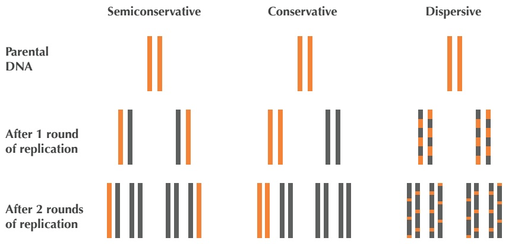

<details>
<summary>text_image</summary>

Semiconservative
Conservative
Dispersive
Parental
DNA
After 1 round
of replication
After 2 rounds
of replication
</details>

FIGURE 1.24 Semiconservative, conservative, and dispersive models of DNA replication make different predictions about the distribution of DNA strands after replication. Yellow strands indicate $^ { 1 5 } \mathrm { N }$ (heavy) segments of DNA, and black strands indicate $^ { 1 4 } \mathbb { N }$ (light) segments. The Meselson-Stahl experiment began with DNA consisting of 100% $\left[ 1 { \widetilde { 5 } } _ { \mathrm { N } } \right]$

Meselson and Stahl’s insight was that one isotope of nitrogen, **Nitrogen-14** $( ^ { 1 4 } \mathrm { N } )$ is lighter and more abundant than Nitrogen-15 $( ^ { 1 5 } \mathrm { N } )$ . Knowing that DNA naturally contains $^ { 1 4 } \mathrm { N }$ , Meselson and Stahl grew E. coli for many rounds of replication in a $^ { 1 5 } \mathrm { N }$ medium, which caused the bacteria to gain weight as they absorbed the heavier isotope into their DNA. When they were confident that the bacterial DNA was saturated with $^ { 1 5 } \mathrm { N } ,$ they transferred the heavy E. coli cells to a less dense $^ { 1 4 } \mathrm { N }$ medium.

57

---

C H A P T E R 1

STOP

**STOP and Think:** What do you think happened when the “heavy” E. coli replicated in the “light” 14<sub>N</sub> medium?

The brilliance of the Meselson-Stahl experiment is that all newly synthesized DNA would contain exclusively $^ { 1 4 } \mathrm { N } ,$ and the three existing hypotheses for DNA replication predicted different outcomes for how this $^ { 1 4 } \mathrm { N }$ isotope would be incorporated into DNA. Specifically, after one round of replication, the conservative model predicted that half the E. coli DNA would still have only $^ { 1 5 } \mathrm { N }$ and therefore be heavier whereas the other half would have only $^ { 1 4 } \mathrm { N }$ and be lighter. Yet when they attempted to separate the E. coli DNA according to weight by using a centrifuge after one round of replication, all of the DNA had the same density! Just like that, they had refuted the conservative hypothesis once and for all.

Unfortunately, this experiment was not able to eliminate either of the other two models, as both the dispersive and semiconservative hypotheses predicted that all of the DNA after one round of replication would have the same density.

STOP

**STOP and Think:** What would the dispersive and semiconservative models predict about the density of E. coli DNA after two rounds of replication?

Let’s first consider the dispersive model, which says that each daughter strand of DNA is formed by half mashed up pieces of the parent strand, and half new DNA. If this hypothesis were true, then after two replication cycles, any daughter strand of DNA should contain about 25% $^ { 1 5 } \mathrm { N }$ and about $75\%\;^{14} N$ . In other words, all the DNA should still have the same density. And yet when Meselson and Stahl spun the centrifuge after two rounds of E. coli replication, this is not what they observed!

Instead, they found that the DNA divided into two different densities. This is exactly what the semiconservative model predicted: after one cycle, every cell should possess one $^ { 1 4 } \mathrm { N }$ strand and one $^ { 1 5 } \mathrm { N }$ strand; after two cycles, half of the DNA molecules should have one $^ { 1 4 } \mathrm { N }$ strand and one $^ { 1 5 } \mathrm { N }$ strand, while the other half should have two $^ { 1 4 } \mathrm { N }$ strands, producing the two different densities they noticed.

STOP

**STOP and Think:** What does the semi-conservative model predict about the density of E. coli DNA after three rounds of replication?

Meselson and Stahl had rejected the conservative and dispersive hypotheses of repli cation, and yet they wanted to make sure that the semiconservative hypothesis was confirmed by further E. coli replication. This model predicted that after three rounds of

---

W H E R E I N T H E G E N O M E D O E S D N A R E P L I C AT I O N B E G I N ?

replication, one-quarter of the DNA molecules should still have a $^ { 1 5 } \mathrm { N }$ strand, causing 25% of the DNA to have an intermediate density, whereas the remaining 75% should be lighter, having only $^ { 1 4 } \mathrm { N }$ . This is indeed what Meselson and Stahl witnessed in the lab, and the semiconservative hypothesis has stood strong to this day.

## Directionality of DNA strands

The sugar component of a nucleotide has a ring of five carbon atoms, which are labeled as $1 ^ { \prime } ,   2 ^ { \prime } ,   3 ^ { \prime } ,   4 ^ { \prime } ,$ and $5 ^ { \prime }$ in Figure 1.25 (left). The $5 ^ { \prime }$ atom is joined onto the phosphate group in the nucleotide and eventually to the $3 ^ { \prime }$ end of the neighboring nucleotide. The $3 ^ { \prime }$ atom is joined onto another neighboring nucleotide in the nucleic acid chain. As a result, we call the two ends of the nucleotide the $5 ^ { \prime } \cdot$ **end** and the **3’-end** (pronounced “five prime end” and "three prime end”, respectively).

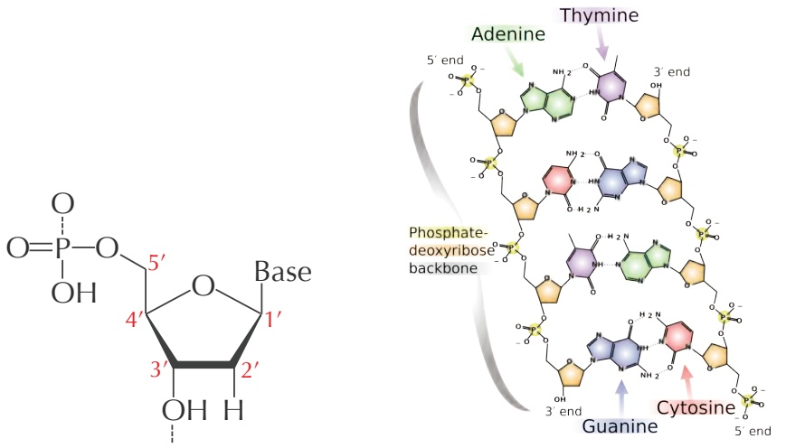

FIGURE 1.25 A nucleotide with sugar ring carbon atoms labeled $1 ^ { \prime } ,   2 ^ { \prime } ,   3 ^ { \prime } ,   4 ^ { \prime } ,$ and $5 ^ { \prime } .$

When we zoom out to the level of the double helix, we can see in Figure 1.25 (right) that any DNA fragment is oriented with a $3 ^ { \prime }$ atom on one end and a $5 ^ { \prime }$ atom on the other end. As a standard, a DNA strand is always read in the $5 ^ { \prime } \rightarrow 3 ^ { \prime }$ direction. Note that the orientations run opposite to each other in complementary strands.

59

---

C H A P T E R 1

## The Towers of Hanoi

The **Towers of Hanoi** puzzle consists of three vertical pegs and a number of disks of different sizes, each with a hole in its center so that it fits on the pegs. The disks are initially stacked on the left peg (peg 1) so that disks increase in size from the top down (Figure 1.26). The puzzle is played by moving one disk at a time between pegs, with the goal of moving all disks from the left peg (peg 1) to the right peg (peg 3). However, you are not allowed to place a disk on top of a smaller disk.

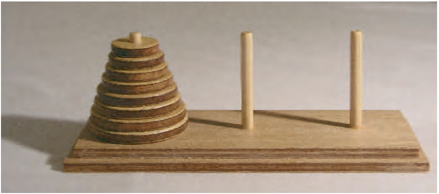

<details>
<summary>natural_image</summary>

Wooden model of a spiral pyramid on a base, with two vertical rods placed beside it (no text or symbols visible)
</details>

FIGURE 1.26 The Towers of Hanoi puzzle.

## Towers of Hanoi Problem:

Solve the Towers of Hanoi puzzle.

**Input**: An integer n.

**Output**: A sequence of moves that will solve the Towers of Hanoi puzzle with n disks.


**STOP and Think:** What is the minimum number of steps needed to solve the Towers of Hanoi Problem for three disks?

Let’s see how many steps are required to solve the Towers of Hanoi Problem for four disks. The first important observation is that sooner or later you will have to move the largest disk to the right peg. However, in order to move the largest disk, we first have to move all three smallest disks off the first peg. Furthermore, these three smallest disks

60

---

W H E R E I N T H E G E N O M E D O E S D N A R E P L I C AT I O N B E G I N ?

must all be on the same peg because the largest disk cannot be placed on top of another disk. Thus, we first have to move the top three disks to the middle peg (7 moves), then move the largest disk to the right peg (1 move), then again move the three smallest disks from the middle peg to the top of the largest disk on the right peg (another 7 moves), for a total of 15 moves.

More generally, let T(n) denote the minimum number of steps required to solve the Towers of Hanoi puzzle with n disks. To move n disks from the left peg to the right peg, you first need to move the n  1 smallest disks from the left peg to the middle peg (T(n  1) steps), then move the largest disk to the right peg (1 step), and finally move the n  1 smallest disks from the middle peg to the right peg (T(n  1) steps). This yields the recurrence relation

$$
T (n) = 2 T (n - 1) + 1.
$$

**STOP and Think:** Using the above recurrence relation, can you find a formula for T(n) that does not require recursion?

We now have a recursive algorithm to move n disks from the left peg to the right peg. We will use three variables (each taking a different value from 1, 2, and 3) to denote the three pegs: startPeg, destinationPeg, and transitPeg. These three variables always represent different pegs, and so startPeg + destinationPeg + transitPeg is always equal to 1 + 2 + 3 = 6. **HANOITOWERS**(n, startPeg, destinationPeg) moves n disks from startPeg to destinationPeg (using transitPeg as a temporary destination).

```python
HANOITOWERS(n, startPeg, destinationPeg)
    if n = 1
        Move top disk from startPeg to destinationPeg
        return
    transitPeg = 6 - startPeg - destinationPeg
    HANOITOWERS(n - 1, startPeg, transitPeg)
    Move top disk from startPeg to destinationPeg
    HANOITOWERS(n - 1, transitPeg, destinationPeg)
    return
```

Even though this algorithm may seem straightforward, moving a 100-disk tower would require more steps than the number of atoms in the universe! The fast growth of the number of moves required by **HANOITOWERS** is explained by the fact that every time


61

---

C H A P T E R 1

**HANOITOWERS** is called for n disks, it calls itself twice for $n - 1$ , which in turn triggers four calls for $n - 2 ,$ and so on. For example, a call to HANOITOWERS $( 4 , 1 , 3 )$ results in calls HANOITOWERS $( 3 , 1 , 2 )$ and **HANOITOWERS**(3, 2, 3); these calls, in turn, call **HANOITOWERS**(2, 1, 3), **HANOITOWERS**(2, 3, 2), **HANOITOWERS**(2, 2, 1), and **HANOITOWERS**(2, 1, 3).

## The overlapping words paradox

We illustrate the overlapping words paradox with a two-player game called “Best Bet for Simpletons”. Player 1 selects a binary k-mer A, and Player 2, knowing what A is, selects a different binary k-mer B. The two players then flip a coin multiple times, with coin flips represented by strings of $`` \mathbf { 1 }  ''$ (“heads”) and "0" (“tails”); the game ends when A or B appears as a block of k consecutive coin flips.


**STOP and Think:** Do the two players always have the same chance of winning?

At first glance, you might guess that every k-mer has an equal chance of winning. Yet suppose that Player 1 chooses "00" and Player 2 chooses "10". After two flips, either Player 1 wins $( 0 0 ^ { \mathfrak { n } } )$ , Player 2 wins $( 1 0 )$ , or the game continues ("01" or "11"). If the game continues, then Player 1 should surrender, since Player 2 will win as soon as “tails” $( `` 0 '' )$ is next flipped. Player 2 is therefore three times more likely to win!

It may seem that Player 1 should have the advantage by simply selecting the “strongest” k-mer. However, an intriguing feature of Best Bet for Simpletons is that if $k > 2 ,$ then Player 2 can always choose a k-mer B that beats A, regardless of Player 1’s choice of A. Another surprise is that Best Bet for Simpletons is a **non-transitive game**: if A defeats $B ,$ and B defeats $C ,$ then we cannot automatically conclude that A defeats C (c.f. [rock-paper-scissors](http://en.wikipedia.org/wiki/Rock-paper-scissors)).

The analysis of Best Bet for Simpletons is based on the notion of a **correlation polynomial**. We say that B **i-overlaps** with A if the last i digits of A coincide with the first i digits of B. For example, $``110110$ 1-overlaps, 2-overlaps, and 5-overlaps with "011011", as shown in Figure 1.27.

Given two k-mers A and $B ,$ the correlation of A and B, denoted CORR $\left( A , B \right) \; =$ $\left( c _ { 0 } , \cdots , c _ { k - 1 } \right)$ , is a k-letter binary word such that $c _ { i } = 1$ if B (k  i)-overlaps with A, and 0 otherwise. The correlation polynomial of A and B is defined as

$$
K _ {A, B} (t) = c _ {0} + c _ {1} \cdot t + c _ {2} \cdot t ^ {2} + \dots + c _ {k - 1} \cdot t ^ {k - 1}.
$$

62

---

W H E R E I N T H E G E N O M E D O E S D N A R E P L I C AT I O N B E G I N ?

<div class="docvortex-algorithm" style="white-space: pre-wrap; font-family:monospace;">
CORR(A, B)
B = 110110
B = 110110
B = 110110
B = 110110
B = 110110
B = 110110
A = 011011
</div>

FIGURE 1.27 The correlation of k-mers $A   =   011011$ and $B   =   110110$ is the string "010011".

For the strings A and B in Figure 1.27, their correlation is "010011" and their correlation polynomial is $K _ { A , B } \big ( t \big ) = t + t ^ { 4 } + t ^ { 5 }$

Next, we write $K _ { A , B }$ as shorthand for $K _ { A , B } \big ( 1 / 2 \big )$ . For the example in Figure 1.27, $K _ { A , B } = { \textstyle { \frac { 1 } { 2 } } } + { \textstyle { \frac { 1 } { 1 6 } } } + { \textstyle { \frac { 1 } { 3 2 } } } = { \textstyle { \frac { 1 9 } { 3 2 } } }$ . John Conway suggested the following deceivingly simple formula to compute the odds that B will defeat A:

$$
\frac {K _ {A , A} - K _ {A , B}}{K _ {B , B} - K _ {B , A}}
$$

Conway never published a proof of this formula, and Martin Gardner, a leading popular mathematics writer, said the following about the formula:

I have no idea why it works. It just cranks out the answer as $i f$ by magic, like so many of Conway’s other algorithms.

63

---

C H A P T E R 1

## Bibliography Notes

Using the skew to find replication origins was first proposed by Lobry, 1996 and also described in Grigoriev, 1998. Grigoriev, 2011 provides an excellent introduction to the skew approach, and Sernova and Gelfand, 2008 gave a review of algorithms and software tools for finding replication origins in bacteria. Lundgren et al., 2004 demonstrated that archaea may have multiple oriCs. Wang et al., 2011 inserted an artificial oriC into the E. coli genome and showed that it triggers replication. Xia, 2012 was the first to conjecture that bacteria may have multiple replication origins. Gao and Zhang, 2008 developed the Ori-Finder software program for finding bacterial replication origins.

Liachko et al., 2013 provided the most comprehensive description of the replication origins of yeast. Solov’ev, 1966 was the first to derive accurate formulas for approximating the probabilities of patterns in a string. Gardner, 1974 wrote an excellent introductory article about the Best Bet for Simpletons paradox. Guibas and Odlyzko, 1981 provided an excellent coverage of the overlapping words paradox that illustrates the complexity of computing the probabilities of patterns in a random text. They also derived a rather complicated proof of Conway’s formula for Best Bet for Simpletons. Sedgewick and Flajolet, 2013 gave an overview of various approaches for computing the probabilities of patterns in a string.

64

---

W H E R E I N T H E G E N O M E D O E S D N A R E P L I C AT I O N B E G I N ?

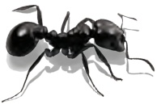

65
