# Chapter 2: Which DNA Patterns Play the Role of Molecular Clocks?

原始 PDF 第 91–140 页。

## WHICH DNA PATTERNS PLAY THE ROLE OF MOLECULAR CLOCKS?

Randomized Algorithms


---

W H I C H D N A PAT T E R N S P L AY T H E R O L E O F M O L E C U L A R C L O C K S ?

## Do We Have a “Clock” Gene?

The daily schedules of animals, plants, and even bacteria are controlled by an internal timekeeper called the **circadian clock**. Anyone who has experienced the misery of jet lag knows that this clock never stops ticking. Rats and research volunteers alike, when placed in a bunker, naturally maintain a roughly 24-hour cycle of activity and rest in total darkness. And, like any timepiece, the circadian clock can malfunction, resulting in a genetic disease known as **delayed sleep-phase syndrome** (**DSPS**).

The circadian clock must have some basis on the molecular level, which presents many questions. How do individual cells in animals and plants (let alone bacteria) know when they should slow down or increase the production of certain proteins? Is there a “clock gene”? Can we explain why heart attacks occur more often in the morning, while asthma attacks are more common at night? And can we identify genes that are responsible for “breaking” the circadian clock to cause DSPS?

In the early 1970s, Ron Konopka and Seymour Benzer identified mutant flies with abnormal circadian patterns and traced the flies’ mutations to a single gene. Biologists needed two more decades to discover a similar clock gene in mammals, which was just the first piece of the puzzle. Today, many more circadian genes have been discovered; these genes, having names like timeless, clock, and cycle, orchestrate the behavior of hundreds of other genes and display a high degree of evolutionary conservation across species.

We will first focus on plants, since maintaining the circadian clock in plants is a matter of life and death. Consider how many plant genes should pay attention to the time when the sun rises and sets; indeed, biologists estimate that over a thousand plant genes are circadian, including the genes related to photosynthesis, photo reception, and flowering. These genes must somehow know what time it is in order to change their gene transcript production, or **gene expression**, throughout the day (see **DETOUR: Gene Expression**).

It turns out that every plant cell keeps track of day and night independently of other cells, and that just three plant genes, called LCY, CCA1, and TOC1, are the clock’s master timekeepers. Such regulatory genes, and the **regulatory proteins** that they encode, are often controlled by external factors (e.g., nutrient availability or sunlight) in order to allow organisms to adjust their gene expression.

For example, regulatory proteins controlling the circadian clock in plants coordinate circadian activity as follows. TOC1 promotes the expression of LCY and CCA1, whereas LCY and CCA1 repress the expression of TOC1, resulting in a **negative feedback loop**. In the morning, sunlight activates the transcription of LCY and CCA1, triggering the

PAGE 108

67

---

C H A P T E R 2

repression of TOC1 transcription. As light diminishes, so does the production of LCY and CCA1, which in turn do not repress TOC1 any more. Transcription of TOC1 peaks at night and starts promoting the transcription of LCY and CCA1, which in turn repress the transcription of TOC1, and the cycle begins again.

LCY, CCA1, and TOC1 are able to control the transcription of other genes because the regulatory proteins that they encode are **transcription factors**, or master regulatory proteins that turn other genes on and off. A transcription factor regulates a gene by binding to a specific short DNA interval called a **regulatory motif**, or **transcription factor binding site**, in the gene’s **upstream region**, a 600-1000 nucleotide-long region preceding the start of the gene. For example, CCA1 binds to AAAAAATCT in the upstream region of many genes regulated by CCA1.

The life of a bioinformatician would be easy if regulatory motifs were completely conserved, but the reality is more complex, as regulatory motifs may vary at some positions, e.g., CCA1 may instead bind to AAGAACTCT. But how can we locate these regulatory motifs without knowing what they look like in advance? We need to develop algorithms for **motif finding**, the problem of discovering a “hidden message” shared by a collection of strings.

## Motif Finding Is More Difficult Than You Think

Identifying the evening element

<strong><u>PAGE 10</u></strong>**8**

In 2000, Steve Kay used **DNA arrays** (see **DETOUR: DNA Arrays**) to determine which genes in the plant Arabidopsis thaliana are activated at different times of the day. He then extracted the upstream regions of nearly 500 genes that exhibited circadian behavior and looked for frequently appearing patterns in their upstream regions. If you concatenated these upstream regions into a single string, you would find that AAAATATCT is a surprisingly frequent word, appearing 46 times.


**EXERCISE BREAK:** What is the expected number of occurrences of a 9-mer in 500 random DNA strings, each of length 1000?

Kay named AAAATATCT the **evening element** and performed a simple experiment to prove that it is indeed the regulatory motif responsible for circadian gene expression in Arabidopsis thaliana. After he mutated the evening element in the upstream region of one gene, the gene no longer exhibited circadian behavior.

68

---

W H I C H D N A PAT T E R N S P L AY T H E R O L E O F M O L E C U L A R C L O C K S ?

Whereas the evening element in plants is very conserved, and thus easy to find, motifs having many mutations are more elusive. For example, if you infect a fly with a bacterium, the fly will switch on its **immunity genes** to fight the infection. Thus, some of the genes with elevated expression levels after the infection are likely to be immunity genes. Indeed, some of these genes have 12-mers similar to **TCGGGGATTTCC** in their upstream regions, the binding site of a transcription factor called **NF-**kB that activates various immunity genes in flies. However, NF-kB binding sites are nowhere near as conserved as the evening element. Figure 2.1 shows ten NF-kB binding sites from the Drosophila melanogaster genome; the most popular nucleotides in every column are shown by upper case colored letters.


<details>
<summary>text_image</summary>

1 T C G G G G g T T T t t
2 c C G G t G A c T T a C
3 a C G G G G A T T T t C
4 T t G G G G A c T T t t
5 a a G G G G A c T T C C
6 T t G G G G A c T T C C
7 T C G G G G A T T c a t
8 T C G G G G A T T c C t
9 T a G G G G A a c T a C
10 T C G G G t A T a a C C
</details>

FIGURE 2.1 The ten candidate NF-kB binding sites appearing in the Drosophila melanogaster genome. The upper case colored letters indicate the most frequent nucleotide in each column.

## Hide and seek with motifs

Our aim is to turn the biological challenge of finding regulatory motifs into a computational problem. Below, we have implanted a 15-mer hidden message at a randomly selected position in each of ten randomly generated DNA strings. This example mimics a transcription factor binding site hiding in the upstream regions of ten genes.

1 atgaccgggatactgataaaaaaaagggggggggcgtacacattagataaacgtatgaagtacgttagactcggcgccgccg
2 acccctattttttgagcagatttagtgacctggaaaaaaaatttgagtacaaaacttttccgaataaaaaaaaaggggggga
3 tgagtatccctgggatgacttaaaaaaaagggggggtgctctcccgatttttgaatatgtaggatcattcgccagggtccga
4 gctgagaattggatgaaaaaaaagggggggtccacgcaatcgcgaaccaacgcggacccaaaggcaagaccgataaaggaga
tcccttttgcggtaatgtgccgggaggctggttacgtagggaagccctaacggacttaataaaaaaaagggggggcttatag
6 gtcaatcatgttcttgtgaatggatttaaaaaaaaggggggggaccgcttggcgcacccaaattcagtgtgggcgagcgcaa
7 cggttttggcccttgttagaggcccccgtaaaaaaaagggggggcaattatgagagagctaatctatcgcgtgcgtgttcat
8 aacttgagttaaaaaaaagggggggctggggcacatacaagaggagtcttccttatcagttaatgctgtatgacactatgta
9 ttggcccattggctaaaagcccaacttgacaaatggaagatagaatccttgcataaaaaaaagggggggaccgaaagggaag
10 ctggtgagcaacgacagattcttacgtgcattagctcgcttccggggatctaatagcacgaagcttaaaaaaaaggggggga

69

---

C H A P T E R 2


## STOP and Think: Can you find the implanted hidden message?

This is a simple problem: applying an algorithm for the Frequent Words Problem to the concatenation of these strings will immediately reveal the most frequent 15-mer shown below as the implanted pattern. Since these short strings were randomly generated, it is unlikely that they contain other frequent 15-mers.

1 atgaccgggatactgat**AAAAAAAAGGGGGGG**ggcgtacacattagataaacgtatgaagtacgttagactcggcgccgccg
2 acccctattttttgagcagatttagtgacctggaaaaaaaatttgagtacaaaacttttccgaata**AAAAAAAAGGGGGGG**a
3 tgagtatccctgggatgactt**AAAAAAAAGGGGGGG**tgctctcccgatttttgaatatgtaggatcattcgccagggtccga
4 gctgagaattggatg**AAAAAAAAGGGGGGG**tccacgcaatcgcgaaccaacgcggacccaaaggcaagaccgataaaggaga
5 tcccttttgcggtaatgtgccgggaggctggttacgtagggaagccctaacggacttaat**AAAAAAAAGGGGGGG**cttatag
6 gtcaatcatgttcttgtgaatggattt**AAAAAAAAGGGGGGG**gaccgcttggcgcacccaaattcagtgtgggcgagcgcaa
7 cggttttggcccttgttagaggcccccgt**AAAAAAAAGGGGGGG**caattatgagagagctaatctatcgcgtgcgtgttcat
8 aacttgagtt**AAAAAAAAGGGGGGG**ctggggcacatacaagaggagtcttccttatcagttaatgctgtatgacactatgta
9 ttggcccattggctaaaagcccaacttgacaaatggaagatagaatccttgcat**AAAAAAAAGGGGGGG**accgaaagggaag
10 ctggtgagcaacgacagattcttacgtgcattagctcgcttccggggatctaatagcacgaagctt**AAAAAAAAGGGGGGG**a

Now imagine that instead of implanting exactly the same pattern into all sequences, we mutate the pattern before inserting it into each sequence by randomly changing the nucleotides at four randomly selected positions within each implanted 15-mer, as shown below.

1 atgaccgggatactgat**AgAAgAAAGGttGGG**ggcgtacacattagataaacgtatgaagtacgttagactcggcgccgccg
2 acccctattttttgagcagatttagtgacctggaaaaaaaatttgagtacaaaacttttccgaata**cAAtAAAAcGGcGGG**a
3 tgagtatccctgggatgactt**AAAAtAAtGGaGtGG**tgctctcccgatttttgaatatgtaggatcattcgccagggtccga
4 gctgagaattggatg**cAAAAAAAGGGattG**tccacgcaatcgcgaaccaacgcggacccaaaggcaagaccgataaaggaga
5 tcccttttgcggtaatgtgccgggaggctggttacgtagggaagccctaacggacttaat**AtAAtAAAGGaaGGG**cttatag
6 gtcaatcatgttcttgtgaatggattt**AAcAAtAAGGGctGG**gaccgcttggcgcacccaaattcagtgtgggcgagcgcaa
7 cggttttggcccttgttagaggcccccgt**AtAAAcAAGGaGGGc**caattatgagagagctaatctatcgcgtgcgtgttcat
8 aacttgagtt**AAAAAAtAGGGaGcc**ctggggcacatacaagaggagtcttccttatcagttaatgctgtatgacactatgta
9 ttggcccattggctaaaagcccaacttgacaaatggaagatagaatccttgcat**ActAAAAAGGaGcGG**accgaaagggaag
10 ctggtgagcaacgacagattcttacgtgcattagctcgcttccggggatctaatagcacgaagctt**ActAAAAAGGaGcGG**a

The Frequent Words Problem is not going to help us, since **AAAAAAAAGGGGGGG** does not even appear in the sequences above. Perhaps, then, we could apply our solution to the Frequent Words with Mismatches Problem. However, in Chapter 1, we implemented an algorithm for the Frequent Words with Mismatches Problem aimed at finding hidden messages with a small number of mismatches and a small k-mer size (e.g., one or two mismatches for DnaA boxes of length 9). This algorithm will become too slow when searching for the implanted motif above, which is longer and has more mutations.

Furthermore, concatenating all the sequences into a single string is inadequate because it does not correctly model the biological problem of motif finding. A DnaA box is a pattern that clumps, or appears frequently, within a relatively short interval of the genome. In contrast, a regulatory motif is a pattern that appears at least once (perhaps with variation) in each of many different regions that are scattered throughout the genome.

70

---

W H I C H D N A PAT T E R N S P L AY T H E R O L E O F M O L E C U L A R C L O C K S ?

## A brute force algorithm for motif finding

Given a collection of strings Dna and an integer d, a k-mer is a **(k, d)-motif** if it appears in every string from Dna with at most d mismatches. For example, the implanted 15-mer in the strings above represents a (15, 4)-motif.

## Implanted Motif Problem:

Find all (k, d)-motifs in a collection of strings.

**Input**: A collection of strings Dna, and integers k and d.

**Output**: All (k, d)-motifs in Dna.

**Brute force search** (also known as **exhaustive search**) is a general problem-solving tech nique that explores all possible candidate solutions and checks whether each candidate solves the problem. Such algorithms require little effort to design and are guaranteed to produce a correct solution, but they may take an enormous amount of time, and the number of candidates may be too large to check.

A brute force approach for solving the Implanted Motif Problem is based on the observation that any (k, d)-motif must be at most d mismatches apart from some k-mer appearing in one of the strings of Dna. Therefore, we can generate all such k-mers and then check which of them are (k, d)-motifs. If you have forgotten how to generate these k-mers, recall **CHARGING STATION: Generating the Neighborhood of a String**.

<div class="docvortex-algorithm" style="white-space: pre-wrap; font-family:monospace;">
MOTIFENUMERATION(Dna, k, d)
    Patterns ← an empty set
    for each k-mer Pattern in Dna
        for each k-mer Pattern' differing from Pattern by at most d mismatches
            if Pattern' appears in each string from Dna with at most d mismatches
                add Pattern' to Patterns
    remove duplicates from Patterns
    return Patterns
</div>

**MOTIFENUMERATION** is unfortunately rather slow for large values of k and $d ,$ and so we will try a different approach instead. Maybe we can detect an implanted pattern simply by identifying the two most similar k-mers between each pair of strings in Dna? However, consider the implanted 15-mers **AgAAgAAAGGttGGG** and **cAAtAAAAcGGGGcG**, each of which differs from **AAAAAAAAGGGGGGG** by four mismatches. Although these

PAGE 49

[2A](http://rosalind.info/problems/2a)

71

---

C H A P T E R 2

15-mers look similar to the correct motif **AAAAAAAAGGGGGGG**, they are not so similar when compared to each other, having eight mismatches:

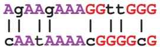

Since these two implanted patterns are so different, we should be concerned whether we will be able to find them by searching for the most similar k-mers among pairs of strings in Dna.

In the rest of the chapter, we will benchmark our motif finding algorithms by using a particularly challenging instance of the Implanted Motif Problem. The **Subtle Motif Problem** refers to implanting a 15-mer with four random mutations in ten randomly generated 600 nucleotide-long strings (the typical length of many upstream regulatory regions). The instance of the Subtle Motif Problem that we will use has the implanted 15-mer **AAAAAAAAGGGGGGG**.

It turns out that thousands of pairs of randomly occurring 15-mers in our dataset for the Subtle Motif Problem are fewer than 8 nucleotides apart from each other, preventing us from identifying the true implanted motifs by pairwise comparisons.

## Scoring Motifs

From motifs to profile matrices and consensus strings

Although the Implanted Motif Problem offers a useful abstraction of the biological problem of motif finding, it has some limitations. For example, when Steve Kay used a DNA array to infer the set of circadian genes in plants, he did not expect that all genes in the resulting set would have the evening element (or its variants) in their upstream regions. Similarly, biologists do not expect that all genes with an elevated expression level in infected flies must be regulated by NF-kB. DNA array experiments are inherently noisy, and some genes identified by these experiments have nothing to do with the circadian clock in plants or immunity genes in flies. For such noisy datasets, any algorithm for the Implanted Motif Problem would fail, because as long as a single sequence does not contain the transcription factor binding site, a (k, d)-motif does not exist!

A more appropriate problem formulation would score individual instances of motifs depending on how similar they are to an “ideal” motif (i.e., a transcription factor binding site that binds the best to the transcription factor). However, since the ideal

72

---

W H I C H D N A PAT T E R N S P L AY T H E R O L E O F M O L E C U L A R C L O C K S ?

motif is unknown, we attempt to select a k-mer from each string and score these k-mers depending on how similar they are to each other.

To define scoring, consider t DNA strings, each of length n, and select a k-mer from each string to form a collection Motifs, which we represent as a t ⇥ k **motif matrix**. In Figure 2.2, which shows the motif matrix for the NF-kB binding sites from Figure 2.1, we indicate the most frequent nucleotide in each column of the motif matrix by upper case letters. If there are multiple most popular nucleotides in a column, then we arbitrarily select one of them to break the tie. Note that positions 2 and 3 are the most conserved (nucleotide G is completely conserved in these positions), whereas position 10 is the least conserved.

By varying the choice of k-mers in each string, we can construct a large number of different motif matrices from a given sample of DNA strings. Our goal is to select k-mers resulting in the most “conserved” motif matrix, meaning the matrix with the most upper case letters (and thus the fewest number of lower case letters). Leaving aside the question of how we select such k-mers, we will first focus on how to score the resulting motif matrices, defining SCORE(Motifs) as the number of unpopular (lower case) letters in the motif matrix Motifs. Our goal is to find a collection of k-mers that minimizes this score.

**EXERCISE BREAK:** The minimum possible value of SCORE(Motifs) is 0 (if all rows in the t ⇥ k matrix Motifs are the same). What is the maximum possible value of SCORE(Motifs) in terms of t and k?


We can construct the 4 ⇥ k **count matrix** COUNT(Motifs) counting the number of oc currences of each nucleotide in each column of the motif matrix; the (i, j)-th element of COUNT(Motifs) stores the number of times that nucleotide i appears in column j of Motifs. We will further divide all of the elements in the count matrix by t, the number of rows in Motifs. This results in a **profile matrix** P = PROFILE(Motifs) for which $P _ { i , j }$ is the frequency of the i-th nucleotide in the j-th column of the motif matrix. Note that the elements of any column of the profile matrix sum to 1.

Finally, we form a **consensus string**, denoted CONSENSUS(Motifs), from the most popular nucleotides in each column of the motif matrix (ties are broken arbitrarily). If we select Motifs correctly from the collection of upstream regions, then CONSENSUS(Motifs) provides an ideal candidate regulatory motif for these regions. For example, the consensus string for the NF-kB binding sites in Figure 2.2 is **TCGGGGATTTCC**.

73

---

C H A P T E R 2

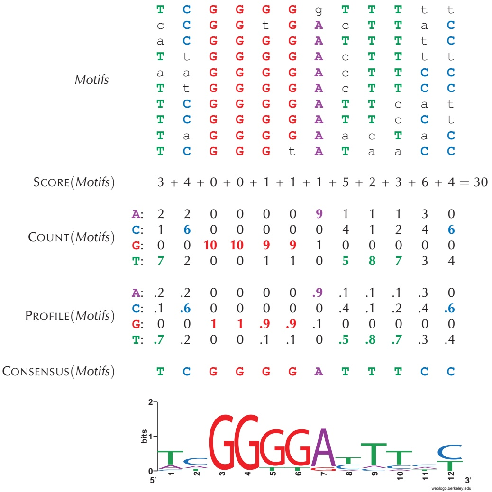

<details>
<summary>heatmap</summary>

| Category | Row 1 | Row 2 | Row 3 | Row 4 | Row 5 | Row 6 | Row 7 | Row 8 | Row 9 | Row 10 |
| --- | --- | --- | --- | --- | --- | --- | --- | --- | --- | --- |
| Motifs | T | C | G | G | G | G | g | T | T | t |
| Motifs | c | C | G | G | t | G | A | c | T | a |
| Motifs | a | C | G | G | G | G | A | T | T | t |
| Motifs | T | t | G | G | G | G | A | c | T | t |
| Motifs | a | a | G | G | G | G | A | c | T | C |
| Motifs | T | t | G | G | G | G | A | c | T | C |
| Motifs | T | C | G | G | G | G | A | T | c | a |
| Motifs | T | C | G | G | G | G | A | T | c | C |
| Motifs | T | a | G | G | G | G | A | a | c | a |
| Motifs | T | C | G | G | G | t | A | T | a | C |
</details>

FIGURE 2.2 From motif matrix to count matrix to profile matrix to consensus string to motif logo. The NF-kB binding sites form a $1 0 \times 1 2$ motif matrix, with the most frequent nucleotide in each column shown in upper case letters and all other nucleotides shown in lower case letters. SCORE(Motifs) counts the total number of unpopular (lower case) symbols in the motif matrix. The motif matrix results in $\mathsf { a }   4 \times 1 2$ count matrix holding the nucleotide counts in every column of the motif matrix; a profile matrix holding the frequencies of nucleotides in every column of the motif matrix; and a consensus string formed by the most frequent nucleotide in each column of the count matrix. Finally, the motif logo is a common way to visualize the conservation of various positions within a motif. The total height of the letters depicts the information content of the position.

74

---

W H I C H D N A PAT T E R N S P L AY T H E R O L E O F M O L E C U L A R C L O C K S ?

Towards a more adequate motif scoring function

Consider the second column (containing 6 C, 2 A, and 2 T) and the final column (containing 6 C and 4 T) in the motif matrix from Figure 2.2. Both of these columns contribute 4 to SCORE(Motifs).

**STOP and Think:** Does scoring these two columns equally make sense biologically?

For many biological motifs, certain positions feature two nucleotides with roughly the same ability to bind to a transcription factor. For example, the sixteen nucleotide-long CSRE transcription factor binding site in the yeast S. cerevisiae consists of five strongly conserved positions in addition to eleven weakly conserved positions, each of which features two nucleotides with similar frequencies (Figure 2.3).

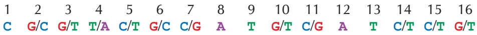

<details>
<summary>text_image</summary>

1 2 3 4 5 6 7 8 9 10 11 12 13 14 15 16
C G/C G/T T/A C/T G/C C/G A T G/T C/G A T C/T C/T G/T
</details>

FIGURE 2.3 The CSRE transcription factor binding site in S. cerevisiae is 16 nucleotides long, but only five of these positions (1, 8, 9, 12, 13) are strongly conserved. The remaining 11 positions can take one of two different nucleotides.

Following this example, a more appropriate representation of the consensus string **TCGGGGATTTCC** for the NF-kB binding sites should include viable alternatives to the most popular nucleotides in each column (see Figure 2.4). In this sense, the last column $( 6 \mathrm { ~ C , ~ } 4 \mathrm { ~ T ) }$ in the motif matrix from Figure 2.2 is “more conserved” than the second column $( 6 \; \mathbb { C } , 2 \; \mathbb { A } , 2 \; \mathbb { T } )$ and should receive a lower score.

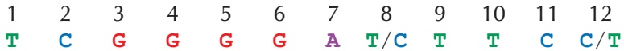

<details>
<summary>text_image</summary>

1 2 3 4 5 6 7 8 9 10 11 12
T C G G G G A T/C T T C C/T
</details>

FIGURE 2.4 Taking nucleotides in each column of the NF-kB binding site motif matrix from Figure 2.2 with frequency at least 0.4 yields a representation of the NF-kB binding sites with ten strongly conserved positions and two weakly conserved positions (8 and 12).


75

---

C H A P T E R 2

Entropy and the motif logo

Every column of PROFILE(Motifs) corresponds to a **probability distribution**, or a collection of nonnegative numbers that sum to 1. For example, the second column in Figure 2.2 corresponds to the probabilities 0.2, 0.6, 0.0, and 0.2 for $\mathbb { A } , \mathbb { C } , \mathbb { G } ,$ and $\mathbb { T } ,$ respectively.

**Entropy** is a measure of the uncertainty of a probability distribution $( p _ { 1 } , \cdots , p _ { N } )$ and is defined as

$$
H (p _ {1}, \dots , p _ {N}) = - \sum_ {i = 1} ^ {N} p _ {i} \cdot \log_ {2} (p _ {i}).
$$

For example, the entropy of the probability distribution (0.2, 0.6, 0.0, 0.2) corresponding to the second column of the profile matrix in Figure 2.2 is

$$
- (0. 2 \log_ {2} 0. 2 + 0. 6 \log_ {2} 0. 6 + 0. 0 \log_ {2} 0. 0 + 0. 2 \log_ {2} 0. 2) \approx 1. 3 7 1,
$$

whereas the entropy of the more conserved final column (0.0, 0.6, 0.0, 0.4) is

$$
- (0. 0 \log_ {2} 0. 0 + 0. 6 \log_ {2} 0. 6 + 0. 0 \log_ {2} 0. 0 + 0. 4 \log_ {2} 0. 4) \approx 0. 9 7 1,
$$

and the entropy of the very conserved 5th column (0.0, 0.0, 0.9, 0.1) is

$$
- (0. 0 \log_ {2} 0. 0 + 0. 0 \log_ {2} 0. 0 + 0. 9 \log_ {2} 0. 9 + 0. 1 \log_ {2} 0. 1) \approx 0. 4 6 7.
$$

Note that technically, $\log _ { 2 } 0$ is not defined, but in the computation of entropy, we assume that $0 \cdot \log _ { 2 } 0$ is equal to 0.


**STOP and Think:** What are the maximum and minimum possible values for the entropy of a probability distribution containing four values?

The entropy of the completely conserved third column of the profile matrix in Figure 2.2 is 0, which is the minimum possible entropy. On the other hand, a column with equally-likely nucleotides (all probabilities equal to $1 / 4 )$ has maximum possible entropy $- 4 \cdot 1 / 4 \cdot \log _ { 2 } \left( 1 / 4 \right)   =   2$ . In general, the more conserved the column, the smaller its entropy. Thus, entropy offers an improved method of scoring motif matrices: the entropy of a motif matrix is defined as the sum of the entropies of its columns. In this book, we will continue to use SCORE(Motifs) for simplicity, but the entropy score is used more often in practice.

76

---

W H I C H D N A PAT T E R N S P L AY T H E R O L E O F M O L E C U L A R C L O C K S ?

**EXERCISE BREAK:** Compute the entropy of the NF-kB motif matrix from Figure 2.2.


Another application of entropy is the **motif logo**, a diagram for visualizing motif conservation that consists of a stack of letters at each position (see the bottom of Figure 2.2). The relative sizes of letters indicate their frequency in the column. The total height of the letters in each column is based on the **information content** of the column, which is defined as $2 - H { \bigl ( } p _ { 1 } , \cdots , p _ { N } { \bigr ) }$ . The lower the entropy, the higher the information content, meaning that tall columns in the motif logo are highly conserved.

## From Motif Finding to Finding a Median String

The Motif Finding Problem

Now that we have a good grasp of scoring a collection of k-mers, we are ready to formulate the Motif Finding Problem.

## Motif Finding Problem:

Given a collection of strings, find a set of k-mers, one from each string, that minimizes the score of the resulting motif.

**Input**: A collection of strings Dna and an integer k.

**Output**: A collection Motifs of k-mers, one from each string in Dna, minimizing SCORE(Motifs) among all possible choices of k-mers.

A brute force algorithm for the Motif Finding Problem, **BRUTEFORCEMOTIFSEARCH**, considers every possible choice of k-mers Motifs from Dna (one k-mer from each string of n nucleotides) and returns the collection Motifs having minimum score. Because there are $n - k + 1$ choices of k-mers in each of t sequences, there are $( n   -   k   +   1 ) ^ { t }$ different ways to form Motifs. For each choice of Motifs, the algorithm calculates SCORE(Motifs), which requires k · t steps. Thus, assuming that k is much smaller than n, the overall running time of the algorithm is $\mathcal { O } \big ( n ^ { t } \cdot k \cdot t \big )$ . We need to come up with a faster algorithm!

Reformulating the Motif Finding Problem

Because **BRUTEFORCEMOTIFSEARCH** is inefficient, we will think about motif finding in a different way. Instead of exploring all Motifs in Dna and deriving the consensus

77

---

C H A P T E R 2

string from Motifs afterwards,

$$
\text {Motifs} \rightarrow \text {CONSENSUS} (\text {Motifs}),
$$

we will explore all potential k-mer consensus strings first and then find the best possible collection Motifs for each consensus string,

$$
\text {CONSENSUS} (\text {Motifs}) \rightarrow \text {Motifs}.
$$

To reformulate the Motif Finding Problem, we need to devise an alternative way of computing SCORE(Motifs). Until now, we have computed SCORE(Motifs), the number of lower case letters in the motif matrix, column-by-column. For example, in Figure 2.2, we computed SCORE(Motifs) for the NF-kB motif matrix as

$$
3 + 4 + 0 + 0 + 1 + 1 + 1 + 5 + 2 + 3 + 6 + 4 = 3 0.
$$

Figure 2.5 illustrates that SCORE(Motifs) can just as easily be computed row-by-row as

$$
3 + 4 + 2 + 4 + 3 + 2 + 3 + 2 + 4 + 3 = 3 0.
$$

Note that each element in the latter sum represents the number of mismatches between the consensus string **TCGGGGATTTCC** and a motif in the corresponding row of the motif matrix, $\mathbf { i . e . } ,$ the Hamming distance between these strings. For the first row of the motif matrix in Figure 2.5, d(**TCGGGGATTTCC**, **TCGGGG**g**TTT**tt) = 3.

Given a collection of k-mers $\mathit { M o t i f s } = \left\{ M o t i f _ { 1 } , . . . , M o t i f _ { t } \right\}$ and a k-mer Pattern, we now define d(Pattern, Motifs) as the sum of Hamming distances between Pattern and each $M o t i f _ { i } ,$

$$
d (\text {Pattern}, \text {Motifs}) = \sum_ {i = 1} ^ {t} \text {HAMMINGDISTANCE} (\text {Pattern}, \text {Motif} _ {i}).
$$

Because SCORE(Motifs) corresponds to counting the lower case elements of Motifs column-by-column and $d \big ( \mathsf { C O N S E N S U S } \big ( M o t i f s \big ) , M o t i f s \big )$ corresponds to counting these elements row-by-row, we obtain that

$$
\text {SCORE} (M o t i f s) = d (\text {CONSENSUS} (M o t i f s), M o t i f s).
$$

---

W H I C H D N A PAT T E R N S P L AY T H E R O L E O F M O L E C U L A R C L O C K S ?

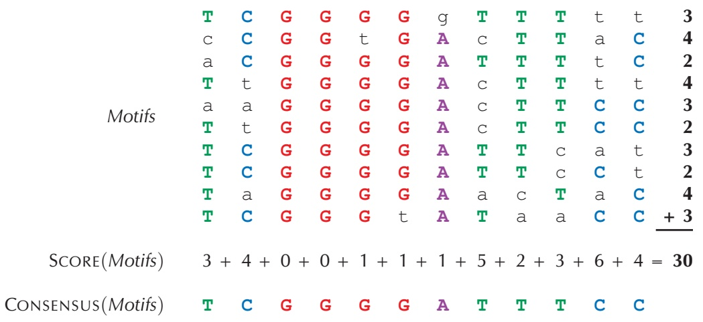

<details>
<summary>flowchart</summary>

This diagram illustrates a hierarchical motif structure and their corresponding score calculation, showing how individual motifs are summed to produce consensus scores.
</details>

FIGURE 2.5 The motif and score matrices in addition to the consensus string for the NF-kB binding sites, reproduced from Figure 2.2. Rather than count the non-consensus elements (i.e., lower case nucleotides) column-by-column, we can count them row-by-row, as highlighted on the right of the motifs matrix. Each value at the end of a row corresponds to the Hamming distance between that row and the consensus string.

This equation gives us an idea. Instead of searching for a collection of k-mers Motifs minimizing SCORE(Motifs), let’s instead search for a potential consensus string Pattern minimizing d(Pattern, Motifs) among all possible k-mers Pattern and all possible choices of k-mers Motifs in Dna. This problem is equivalent to the Motif Finding Problem.

## Equivalent Motif Finding Problem:

Given a collection of strings, find a pattern and a collection of k-mers (one from each string) that minimizes the distance between all possible patterns and all possible collections of k-mers.

**Input**: A collection of strings Dna and an integer k.

**Output**: A k-mer Pattern and a collection of k-mers Motifs, one from each string in Dna, minimizing d(Pattern, Motifs) among all possible choices of Pattern and Motifs.

79

---

C H A P T E R 2

## The Median String Problem

But wait a second — have we not just made our task more difficult? Instead of having to search for all $M o t i f _ { S } ,$ , we now have to search all Motifs as well as all k-mers Pattern. The key observation for solving the Equivalent Motif Finding Problem is that, given Pattern, we don’t need to explore all possible collections Motifs in order to minimize $d { \big ( } P a t t e r n , M o t i f s { \big ) }$

To explain how this can be done, we define MOTIFS(Pattern, Dna) as a collection of k-mers that minimizes d(Pattern, Motifs) for a given Pattern and all possible sets of k-mers Motifs in Dna. For example, for the strings Dna shown below, the five colored 3-mers represent MOTIFS(**AAA**, Dna).

```txt
ttaccttAAC
gATAtctgtc
Dna ACGgcgttcg
ccctAAAagag
cgtcAGAggt
```


**STOP and Think:** Given a collection of strings Dna and a k-mer Pattern, design a fast algorithm for generating MOTIFS(Pattern, Dna).

The reason why we don’t need to consider all possible collections Motifs in Dna = $\left\{ D n a _ { 1 } , . . . , D n a _ { t } \right\}$ is that we can generate the k-mers in MOTIFS(Pattern, Dna) one at a time; that is, we can select a k-mer in $D n a _ { i }$ independently of selecting k-mers in all other strings in Dna. Given a k-mer Pattern and a longer string Text, we use d(Pattern, Text) to denote the minimum Hamming distance between Pattern and any k-mer in Text,

$$
d (\text {Pattern}, \text {Text}) = \min _ {\text {all} k \text {-mers Pattern' in Text}} \text {HAMMINGDISTANCE} (\text {Pattern}, \text {Pattern'}).
$$

For example,

$$
d (\text {GATTCTCA, gcaaaGACGCTGAccaa}) = 3.
$$

A k-mer in Text that achieves the minimum Hamming distance with Pattern is denoted MOTIF(Pattern, Text). For the above example,

$$
\text {Motif} (\text {GATTCTCA,gcaaaGACGCTGAccaa}) = \text {GACGCTGA}.
$$

80

---

W H I C H D N A PAT T E R N S P L AY T H E R O L E O F M O L E C U L A R C L O C K S ?

We note that the notation MOTIF(Pattern, Text) is ambiguous because there may be multiple k-mers in Text that achieve the minimum Hamming distance with Pattern. For example, MOTIF(**AAG**, gc**AAT**cct**CAG**c) could be either **AAT** or **CAG**. However, this ambiguity does not affect the following analysis.

Given a k-mer Pattern and a set of strings $D n a = \left\{ D n a _ { 1 } , . . . , D n a _ { t } \right\}$ , we define $d { \big ( } P a t t e r n , D n a { \big ) }$ as the sum of distances between Pattern and all strings in Dna,

$$
d (P a t t e r n, D n a) = \sum_ {i = 1} ^ {t} d (P a t t e r n, D n a _ {i}).
$$

For example, for the strings Dna shown below, $d(\mathbb{A}\mathbb{A}\mathbb{A},Dna)=1+1+2+0+1=5$

<div class="docvortex-algorithm" style="white-space: pre-wrap; font-family:monospace;">
        ttaccttAAC 1
        gATAtctgtc 1
Dna     ACGgcgttcg 2
        ccctAAAgag 0
        cgtcAGAggt 1
</div>

Our goal is to find a k-mer Pattern that minimizes d(Pattern, Dna) over all k-mers Pattern, the same task that the Equivalent Motif Finding Problem is trying to achieve. We call such a k-mer a **median string** for Dna.

## Median String Problem:

Find a median string.

**Input**: A collection of strings Dna and an integer k.

**Output**: A k-mer Pattern minimizing d(Pattern, Dna) among all k-mers Pattern.

Notice that finding a median string requires solving a double minimization problem. We must find a k-mer Pattern that minimizes $d { \big ( } P a t t e r n , D n a { \big ) }$ , where this function is itself computed by taking a minimum over all choices of k-mers from each string in Dna. The pseudocode for a brute-force algorithm, **MEDIANSTRING**, is given below.


81

---

C H A P T E R 2


```python
MEDIANSTRING(Dna, k)
    distance ← ∞
    for each k-mer Pattern from AA . . .AA to TT . . .TT
        if distance > d(Pattern, Dna)
            distance ← d(Pattern, Dna)
            Median ← Pattern
    return Median
```

**CHARGING STATION (Solving the Median String Problem):** Although this pseudocode is short, it is not without potential pitfalls. Check out this Charging Station if you fall into one of them.

**STOP and Think:** Instead of making a time-consuming search through all possible k-mers in **MEDIANSTRING**, can you only search through all k-mers that appear in Dna?

Why have we reformulated the Motif Finding Problem?

To see why we reformulated the Motif Finding Problem as the equivalent Median String Problem, consider the runtimes of **MEDIANSTRING** and **BRUTEFORCEMOTIFS**. The former algorithm computes d(Pattern, Dna) for each of the $4 ^ { k } \; k \mathrm { - m e r s }$ Pattern. Each computation of $d { \big ( } P a t t e r n , D n a { \big ) }$ requires a single pass over each string in Dna, which requires approximately k · n · t operations for t strings of length n in Dna. Therefore, **MEDIANSTRING** has a running time of $\mathcal { O } \Big ( 4 ^ { k } \cdot n \cdot k \cdot t \Big )$ , which in practice compares favorably with the $\mathcal { O } \big ( n ^ { t } \cdot k \cdot t \big )$ running time of **BRUTEFORCEMOTIFSEARCH** because the length of a motif (k) typically does not exceed 20 nucleotides, whereas t is measured in the thousands.

The Median String Problem teaches an important lesson, which is that sometimes rethinking how a problem is formulated can lead to dramatic improvements in the runtime required to solve it. In this case, our simple observation that SCORE(Motifs) could just as easily be computed row-by-row as column-by-column produced the faster **MEDIANSTRING** algorithm.

Of course, the ultimate test of a bioinformatics algorithm is how it performs in practice. Unfortunately, since **MEDIANSTRING** has to consider $4 ^ { k }$ k-mers, it becomes too slow for the Subtle Motif Problem, for which k = 15. We will run **MEDIANSTRING**

82

---

W H I C H D N A PAT T E R N S P L AY T H E R O L E O F M O L E C U L A R C L O C K S ?

with k = 13 in the hope that it will capture a substring of the correct 15-mer motif. The algorithm still requires half a day to run on our computer and returns the median string **AAAAAtAGaGGGG** (with distance 29). This 13-mer is not a substring of the implanted pattern **AAAAAAAAGGGGGGG**, but it does come close.

**STOP and Think:** How can a slightly incorrect median string of length 13 help us find the correct median string of length 15?

We have thus far assumed that the value of k is known in advance, which is not the case in practice. As a result, we are forced to run our motif finding algorithms for different values of k and then try to deduce the correct motif length. Since some regulatory motifs are rather long — later in the chapter, we will search for a biologically important motif of length 20 — **MEDIANSTRING** may be too slow to find them.

## Greedy Motif Search

Using the profile matrix to roll dice

Many algorithms are iterative procedures that must choose among many alternatives at each iteration. Some of these alternatives may lead to correct solutions, whereas others may not. **Greedy algorithms** select the “most attractive” alternative at each iteration. For example, a greedy algorithm in chess might attempt to capture an opponent’s most valuable piece at every move. Yet anyone who has played chess knows that this strategy of looking only one move ahead will likely produce disastrous results. In general, most greedy algorithms typically fail to find an exact solution of the problem; instead, they are often fast **heuristics** that trade accuracy for speed in order to find an approximate solution. Nevertheless, for many biological problems that we will study in this book, greedy algorithms will prove quite useful.

In this section, we will explore a greedy approach to motif finding. Again, let Motifs be a collection of k-mers taken from t strings Dna. Recall from our discussion of entropy that we can view each column of PROFILE(Motifs) as a four-sided biased die. Thus, a profile matrix with k columns can be viewed as a collection of k dice, which we will roll to randomly generate a k-mer. For example, if the first column of the profile matrix is (**0.2**, **0.1**, **0.0**, **0.7**), then we generate A as the first nucleotide with probability **0.2**, C with probability **0.1**, G with probability **0.0**, and T with probability **0.7**.

In Figure 2.6, we reproduce the profile matrix for the NF-kB binding sites from Figure 2.2, where the lone colored entry in the i-th column corresponds to the i-th


83

---

C H A P T E R 2

nucleotide in **ACGGGGATTACC**. The probability Pr(**ACGGGGATTACC**|Profile) that Profile generates **ACGGGGATTACC** is computed by simply multiplying the highlighted entries in the profile matrix.

$$
\begin{array}{l l} & \text {A: .2 .2 .0 .0 .0 .0 .9 .1 .1 .1 .3 .0} \\ \text {Profile} & \text {C: .1 .6 .0 .0 .0 .0 .0 .0 .4 .1 .2 .4 .6} \\ & \text {G: .0 .0 1 1 .9 .9 .1 .0 .0 .0 .0 .0 .0} \\ & \text {T: .7 .2 .0 .0 .1 .1 .0 .5 .8 .7 .3 .4} \end{array}
$$

$$
\Pr (\text {ACGGGGATTACC} | \text {Profile}) = . 2 \cdot . 6 \cdot 1 \cdot 1 \cdot . 9 \cdot . 9 \cdot . 9 \cdot . 5 \cdot . 8 \cdot . 1 \cdot . 4 \cdot . 6 = 0. 0 0 0 8 3 9 8 0 8
$$

**FIGURE 2.6** We can generate a random string based on a profile matrix by selecting the i-th nucleotide in the string with the probability corresponding to that nucleotide in the i-th column of the profile matrix. The probability that a profile matrix will produce a given string is given by the product of individual nucleotide probabilities.

A k-mer tends to have a higher probability when it is more similar to the consensus string of a profile. For example, for the NF-kB profile matrix shown in Figure 2.6 and its consensus string **TCGGGGATTTCC**,

$$
\begin{array}{l} \Pr (\mathbf {T C G G G A T T T C C} | \text {Profile}) = 0. 7 \cdot 0. 6 \cdot 1. 0 \cdot 1. 0 \cdot 0. 9 \cdot 0. 9 \cdot 0. 9 \cdot 0. 5 \cdot 0. 8 \cdot 0. 7 \cdot 0. 4 \cdot 0. 6 \\ = 0. 0 2 0 5 7 5 3, \\ \end{array}
$$

which is larger than the value of Pr(**ACGGGGATTACC**|Profile) = 0.000839808 that we computed in Figure 2.6.


**EXERCISE BREAK:** Compute Pr(**TCGTGGATTTCC**|Profile), where Profile is the matrix shown in Figure 2.6.

Given a profile matrix Profile, we can evaluate the probability of every k-mer in a string Text and find a **Profile-most probable** k-mer in Text, i.e., a k-mer that was most likely to have been generated by Profile among all k-mers in Text. For the NF-kB profile matrix, **ACGGGGATTACC** is the Profile-most probable 12-mer in ggt**ACGGGGATTACC**t. Indeed, every other 12-mer in this string has probability 0. In general, if there are multiple Profile-most probable k-mers in Text, then we select the first such k-mer occurring in Text.

84

---

W H I C H D N A PAT T E R N S P L AY T H E R O L E O F M O L E C U L A R C L O C K S ?

## Profile-most Probable k-mer Problem:

Find a Profile-most probable k-mer in a string.

**Input**: A string Text, an integer $k ,$ and a $4 \times k$ matrix Profile.

**Output**: A Profile-most probable k-mer in $T e x t .$

Our proposed greedy motif search algorithm, **GREEDYMOTIFSEARCH**, tries each of the k-mers in $D n a _ { 1 }$ as the first motif. For a given choice of k-mer $M o t i f _ { 1 }$ in $D n a _ { 1 }$ , it then builds a profile matrix Profile for this lone k-mer, and sets $M o t i f _ { 2 }$ equal to the Profile-most probable k-mer in $D n a _ { 2 }$ . It then iterates by updating Profile as the profile matrix formed from $M o t i f _ { 1 }$ and $M o t i f _ { 2 } ,$ and sets $M o t i f _ { 2 }$ equal to the Profile-most probable k-mer in $D n a _ { 3 }$ . In general, after finding $i - 1$ k-mers Motifs in the first $i - 1$ strings of Dna, **GREEDYMOTIFSEARCH** constructs Profile(Motifs) and selects the Profile-most probable k-mer from $D n a _ { i }$ based on this profile matrix. After obtaining a k-mer from each string to generate a collection Motifs, **GREEDYMOTIFSEARCH** tests to see whether Motifs outscores the current best scoring collection of motifs and then moves $M o t i f _ { 1 }$ one symbol over in $D n a _ { 1 . }$ , beginning the entire process of generating Motifs again.

<div class="docvortex-algorithm" style="white-space: pre-wrap; font-family:monospace;">
GREEDYMOTIFSEARCH(Dna, k, t)
    BestMotifs ← motif matrix formed by first k-mers in each string from Dna
    for each k-mer Motif in the first string from Dna
        Motif₁ ← Motif
        for i = 2 to t
            form Profile from motifs Motif₁, ..., Motifᵢ₋₁
            Motifᵢ ← Profile-most probable k-mer in the i-th string in Dna
        Motifs ← (Motif₁, ..., Motifₜ)
        if SCORE(Motifs) &lt; SCORE(BestMotifs)
            BestMotifs ← Motifs
    return BestMotifs
</div>

If you are not satisfied with the performance of **GREEDYMOTIFSEARCH** — even if you implemented it correctly — then wait until we discuss this algorithm in the next section.

## Analyzing greedy motif finding

In contrast to **MEDIANSTRING**, **GREEDYMOTIFSEARCH** is fast and can be run with $k   =   1 5$ to solve the Subtle Motif Problem (recall that we settled for $k   =   1 3$ in the


85

---

C H A P T E R 2


case of **MEDIANSTRING**). However, it trades speed for accuracy and returns the 15- mer **gtAAAtAgaGatGtG** (total distance: 58), which is very different from the true implanted motif **AAAAAAAAGGGGGGG**.

**STOP and Think:** Why does **GREEDYMOTIFSEARCH** perform so poorly?

At first glance, **GREEDYMOTIFSEARCH** may seem like a reasonable algorithm, but it is not! Let’s see whether **GREEDYMOTIFSEARCH** will find the (4, 1)-motif **ACGT** implanted in the following strings Dna:

```txt
ttACCTtaac
gATGTctgtc
acgGCGTtag
ccctaACGAg
cgtcagAGGT
```

We will assume that the algorithm has already correctly chosen the implanted 4-mer **ACCT** from the first string in Dna and constructed the corresponding Profile:

```yaml
A: 1 0 0 0
C: 0 1 1 0
G: 0 0 0 0
T: 0 0 0 1
```

The algorithm is now ready to search for a Profile-most probable 4-mer in the second sequence. The issue, however, is that there are so many zeros in the profile matrix that the probability of every 4-mer but **ACCT** is zero! Thus, unless **ACCT** is present in every string in Dna, there is little chance that **GREEDYMOTIFSEARCH** will find the implanted motif. Zeroes in the profile matrix are not just a minor annoyance but rather a persistent problem that we must address.

## Motif Finding Meets Oliver Cromwell

What is the probability that the sun will not rise tomorrow?

In 1650, after the Scots proclaimed Charles II as king during the English Civil War, Oliver Cromwell made a famous appeal to the Church of Scotland. Urging them to see the error of their royal alliance, he pleaded,

86

---

W H I C H D N A PAT T E R N S P L AY T H E R O L E O F M O L E C U L A R C L O C K S ?

I beseech you, in the bowels of Christ, think it possible that you may be mistaken.

The Scots rejected the appeal, and Cromwell invaded Scotland in response. His quotation later inspired the statistical maxim called **Cromwell’s rule**, which states that we should not use probabilities of 0 or 1 unless we are talking about logical statements that can only be true or false. In other words, we should allow a small probability for extremely unlikely events, such as “this book was written by aliens” or “the sun will not rise tomorrow”. We cannot speak to the likelihood of the former event, but in the 18th Century, the French mathematician Pierre-Simon Laplace actually estimated the probability that the sun will not rise tomorrow (1/1826251), given that it has risen every day for the past 5000 years. Although this estimate was ridiculed by his contemporaries, Laplace’s approach to this question now plays an important role in statistics.

In any observed data set, there is the possibility, especially with low-probability events or small data sets, that an event with nonzero probability does not occur. Its observed frequency is therefore zero; however, setting the empirical probability of the event equal to zero represents an inaccurate oversimplification that may cause problems. By artificially adjusting the probability of rare events, these problems can be mitigated.

## Laplace’s Rule of Succession

Cromwell’s rule is relevant to the calculation of the probability of a string based on a profile matrix. For example, consider the following Profile:

$$
\begin{array}{l l} \text {Profile} & \mathbf {A}: \quad . 2 \quad . 2 \quad . 0 \quad . 0 \quad . 0 \quad . 0 \quad . 9 \quad . 1 \quad . 1 \quad . 1 \quad . 3 \quad . 0 \\ & \mathbf {C}: \quad . 1 \quad . 6 \quad . 0 \quad . 0 \quad . 0 \quad . 0 \quad . 0 \quad . 4 \quad . 1 \quad . 2 \quad . 4 \quad . 6 \\ & \mathbf {G}: \quad . 0 \quad . 0 \quad \mathbf {1} \quad 1 \quad . \mathbf {9} \quad . \mathbf {9} \quad . 1 \quad . 0 \quad . 0 \quad . 0 \quad . 0 \quad . 0 \\ & \mathbf {T}: \quad . 7 \quad . 2 \quad . 0 \quad . \mathbf {0} \quad . 1 \quad . 1 \quad . 0 \quad . 5 \quad . 8 \quad . 7 \quad . 3 \quad . 4 \\ | P r o f i l e) & = \quad . 7 \cdot . 6 \cdot \mathbf {1} \cdot . \mathbf {0} \cdot . \mathbf {9} \cdot . \mathbf {9} \cdot . 5 \cdot . 8 \cdot . 7 \cdot . 4 \cdot . 6 = 0 \end{array}
$$

The fourth symbol of **TCGTGGATTTCC** causes Pr(**TCGTGGATTTCC**|Profile) to equal zero. As a result, the entire string is assigned a zero probability, even though **TCGTGGATTTCC** differs from the consensus string at only one position. For that matter, **TCGTGGATTTCC** has the same low probability as **AAATCTTGGAA**, which is very different from the consensus string.

In order to improve this unfair scoring, bioinformaticians often substitute zeroes with small numbers called **pseudocounts**. The simplest approach to introducing pseudocounts, called **Laplace’s Rule of Succession**, is similar to the principle that Laplace

87

---

C H A P T E R 2

used to calculate the probability that the sun will not rise tomorrow. In the case of motifs, pseudocounts often amount to adding 1 (or some other small number) to each element of COUNT(Motifs). For example, say that we have the following motif, count, and profile matrices:

<table><tr><td rowspan="4">Motifs</td><td>T</td><td>A</td><td>A</td><td>C</td></tr><tr><td>G</td><td>T</td><td>C</td><td>T</td></tr><tr><td>A</td><td>C</td><td>T</td><td>A</td></tr><tr><td>A</td><td>G</td><td>G</td><td>T</td></tr></table>

<table><tr><td rowspan="4">COUNT(Motifs)</td><td>A:</td><td>2</td><td>1</td><td>1</td><td>1</td><td rowspan="4">PROFILE(Motifs)</td><td>2/4</td><td>1/4</td><td>1/4</td><td>1/4</td></tr><tr><td>C:</td><td>0</td><td>1</td><td>1</td><td>1</td><td>0</td><td>1/4</td><td>1/4</td><td>1/4</td></tr><tr><td>G:</td><td>1</td><td>1</td><td>1</td><td>0</td><td>1/4</td><td>1/4</td><td>1/4</td><td>0</td></tr><tr><td>T:</td><td>1</td><td>1</td><td>1</td><td>2</td><td>1/4</td><td>1/4</td><td>1/4</td><td>2/4</td></tr></table>

Laplace’s Rule of Succession adds 1 to each element of COUNT(Motifs), updating the two matrices to the following:

<table><tr><td rowspan="4">COUNT(Motifs)</td><td>A: 2+1 1+1 1+1 1+1</td><td rowspan="4">PROFILE(Motifs)</td><td>3/8 2/8 2/8 2/8</td></tr><tr><td>C: 0+1 1+1 1+1 1+1</td><td>1/8 2/8 2/8 2/8</td></tr><tr><td>G: 1+1 1+1 1+1 0+1</td><td>2/8 2/8 2/8 1/8</td></tr><tr><td>T: 1+1 1+1 1+1 2+1</td><td>2/8 2/8 2/8 3/8</td></tr></table>


**STOP and Think:** How would you use Laplace’s Rule of Succession to address the shortcomings of **GREEDYMOTIFSEARCH**?

An improved greedy motif search

The only change we need to introduce to **GREEDYMOTIFSEARCH** in order to eliminate zeroes from the profile matrices that it constructs is to replace line 6 of the pseudocode for **GREEDYMOTIFSEARCH**:

form Profile from motifs Motif<sub>1</sub>, ... Motif<sub>i</sub>1

with the following line:

88

---

W H I C H D N A PAT T E R N S P L AY T H E R O L E O F M O L E C U L A R C L O C K S ?

**apply Laplace’s Rule of Succession** to form Profile from motifs Motif<sub>1</sub>, ... Motif<sub>i</sub>1

We now will apply Laplace’s Rule of Succession to search for the (4, 1)-motif **ACGT** implanted in the following strings Dna:

<div class="docvortex-algorithm" style="white-space: pre-wrap; font-family:monospace;">
ttACCTtaac
gATGTctgtc
Dna acgGCGTtag
ccctaACGAg
cgtcagAGGT
</div>

Again, let’s assume that the algorithm has already chosen the implanted 4-mer **ACCT** from the first sequence. We can construct the corresponding count and profile matrices using Laplace’s Rule of Succession:

Motifs ACCT

<table><tr><td rowspan="4">COUNT(Motifs)</td><td>A: 1+1 0+1 0+1 0+1</td><td rowspan="4">PROFILE(Motifs)</td><td>2/5 1/5 1/5 1/5</td></tr><tr><td>C: 0+1 1+1 1+1 0+1</td><td>1/5 2/5 2/5 1/5</td></tr><tr><td>G: 0+1 0+1 0+1 0+1</td><td>1/5 1/5 1/5 1/5</td></tr><tr><td>T: 0+1 0+1 0+1 1+1</td><td>1/5 1/5 1/5 2/5</td></tr></table>

We use this profile matrix to compute the probabilities of all 4-mers in the second string from Dna:

| gATG | ATGT | TGTc | GTct | Tctg | ctgt | tgtc |
| --- | --- | --- | --- | --- | --- | --- |
| $1/5^{4}$ | $4/5^{4}$ | $1/5^{4}$ | $4/5^{4}$ | $2/5^{4}$ | $2/5^{4}$ | $1/5^{4}$ |

There are two Profile-most probable 4-mers in the second sequence (**ATGT** and **GT**ct); let’s assume that we get lucky again and choose the implanted 4-mer **ATGT**. We now have the following motif, count, and profile matrices:

<table><tr><td rowspan="4">COUNT(Motifs)</td><td>A: 2+1 0+1 0+1 0+1</td><td rowspan="4">PROFILE(Motifs)</td><td>3/6 1/6 1/6 1/6</td></tr><tr><td>C: 0+1 1+1 1+1 0+1</td><td>1/6 2/6 2/6 1/6</td></tr><tr><td>G: 0+1 0+1 1+1 0+1</td><td>1/6 1/6 2/6 1/6</td></tr><tr><td>T: 0+1 1+1 0+1 2+1</td><td>1/6 2/6 1/6 3/6</td></tr></table>

89

---

C H A P T E R 2

We use this profile matrix to compute the probabilities of all 4-mers in the third string from Dna:

| acgG | cgGC | gGCG | GCGT | CGTt | GTta | Ttag |
| --- | --- | --- | --- | --- | --- | --- |
| $12/6^{4}$ | $2/6^{4}$ | $2/6^{4}$ | $12/6^{4}$ | $3/6^{4}$ | $2/6^{4}$ | $2/6^{4}$ |

Again, there are two Profile-most probable 4-mers in the second sequence (acgG and **GCGT**). This time, we will assume that acgG is selected instead of the implanted 4-mer **GCGT**. We now have the following motif, count, and profile matrices:

<table><tr><td rowspan="3">Motifs</td><td>ACCT</td></tr><tr><td>ATGT</td></tr><tr><td>acgG</td></tr></table>

<table><tr><td rowspan="4">COUNT(Motifs)</td><td>A: 3+1 0+1 0+1 1+1</td><td rowspan="4">PROFILE(Motifs)</td><td>4/7 1/7 1/7 1/7</td></tr><tr><td>C: 0+1 2+1 1+1 0+1</td><td>1/7 3/7 2/7 1/7</td></tr><tr><td>G: 0+1 0+1 2+1 1+1</td><td>1/7 1/7 3/7 2/7</td></tr><tr><td>T: 0+1 1+1 0+1 2+1</td><td>1/7 2/7 1/7 3/7</td></tr></table>

We use this profile matrix to compute probabilities of all 4-mers in the fourth string from Dna:

| ccct | ccta | ctaA | taAC | aACG | ACGA | CGAg |
| --- | --- | --- | --- | --- | --- | --- |
| $18/7^{4}$ | $3/7^{4}$ | $2/7^{4}$ | $1/7^{4}$ | $16/7^{4}$ | $36/7^{4}$ | $2/7^{4}$ |

Despite the fact that we missed the implanted 4-mer in the third sequence, we have now found the implanted 4-mer in the fourth string in Dna as the Profile-most probable 4-mer **ACGA**. This provides us with the following motif, count, and profile matrices:

<table><tr><td rowspan="4">Motifs</td><td>ACCT</td></tr><tr><td>ATGT</td></tr><tr><td>acgG</td></tr><tr><td>ACGA</td></tr></table>

<table><tr><td rowspan="4">COUNT(Motifs)</td><td>A: 4+1 0+1 0+1 0+1</td><td rowspan="4">PROFILE(Motifs)</td><td>5/8 1/8 1/8 2/8</td></tr><tr><td>C: 0+1 3+1 1+1 0+1</td><td>1/8 4/8 2/8 1/8</td></tr><tr><td>G: 0+1 0+1 3+1 1+1</td><td>1/8 1/8 4/8 2/8</td></tr><tr><td>T: 0+1 1+1 0+1 2+1</td><td>1/8 2/8 1/8 3/8</td></tr></table>

We now use this profile to compute the probabilities of all 4-mers in the fifth string in Dna:

90

---

W H I C H D N A PAT T E R N S P L AY T H E R O L E O F M O L E C U L A R C L O C K S ?

| cgtc | gtca | tcag | cagA | agAG | gAGG | AGGT |
| --- | --- | --- | --- | --- | --- | --- |
| $1/8^{4}$ | $8/8^{4}$ | $8/8^{4}$ | $8/8^{4}$ | $10/8^{4}$ | $8/8^{4}$ | $60/8^{4}$ |

The Profile-most probable 4-mer of the fifth string in Dna is **AGGT**, the implanted 4-mer. As a result, **GREEDYMOTIFSEARCH** has produced the following motif matrix, which implies the correct consensus string **ACGT**:

<table><tr><td rowspan="2"></td><td>ACCT</td></tr><tr><td>ATGT</td></tr><tr><td rowspan="3">Motifs</td><td>acgG</td></tr><tr><td>ACGA</td></tr><tr><td>AGGT</td></tr><tr><td>CONSENSUS(Motifs)</td><td>ACGT</td></tr></table>

You have now seen the power of pseudocounts illustrated on a small example. Running **GREEDYMOTIFSEARCH** with pseudocounts to solve the Subtle Motif Problem returns a collection of 15-mers Motifs with SCORE(Motifs) = 41 and CONSENSUS(Motifs) = **AAAAAtAgaGGGGtt**. Thus, Laplace’s Rule of Succession has provided a great improvement over the original **GREEDYMOTIFSEARCH**, which returned the consensus string **gTtAAAtAgaGatGtG** with SCORE(Motifs) = 58.

You may be satisfied with the performance of **GREEDYMOTIFSEARCH**, but you should know by now that your authors are never satisfied. Can we design an even more accurate motif finding algorithm?

## Randomized Motif Search

Rolling dice to find motifs

We will now turn to **randomized algorithms** that flip coins and roll dice in order to search for motifs. Making random algorithmic decisions may sound like a disastrous idea — just imagine a chess game in which every move would be decided by rolling a die. However, an 18th Century French mathematician and naturalist, Comte de Buffon, first proved that randomized algorithms are useful by randomly dropping needles onto parallel strips of wood and using the results of this experiment to accurately approximate the constant p (see **DETOUR: Buffon’s Needle**).

Randomized algorithms may be nonintuitive because they lack the control of traditional algorithms. Some randomized algorithms are **Las Vegas algorithms**, which


PAGE 109

91

---

C H A P T E R 2

deliver solutions that are guaranteed to be exact, despite the fact that they rely on making random decisions. Yet most randomized algorithms, including the motif finding algorithms that we will consider in this chapter, are **Monte Carlo algorithms**. These algorithms are not guaranteed to return exact solutions, but they do quickly find ap proximate solutions. Because of their speed, they can be run many times, allowing us to choose the best approximation from thousands of runs.

We previously defined PROFILE(Motifs) as the profile matrix constructed from a collection of k-mers Motifs in Dna. Now, given a collection of strings Dna and an arbitrary 4 ⇥ k matrix Profile, we define MOTIFS(Profile, Dna) as the collection of k-mers formed by the Profile-most probable k-mers in each sequence from Dna. For example, consider the following Profile and Dna:

<table><tr><td rowspan="5">Profile</td><td>A: 4/5</td><td>0</td><td>0</td><td>1/5</td><td></td><td>ttaccttaac</td></tr><tr><td>C: 0</td><td>3/5</td><td>1/5</td><td>0</td><td></td><td>gatgtctgtc</td></tr><tr><td>G: 1/5</td><td>1/5</td><td>4/5</td><td>0</td><td>Dna</td><td>acggcgttag</td></tr><tr><td>T: 0</td><td>1/5</td><td>0</td><td>4/5</td><td></td><td>ccctaacgag</td></tr><tr><td></td><td></td><td></td><td></td><td></td><td>cgtcagaggt</td></tr></table>

Taking the Profile-most probable 4-mer from each row of Dna produces the following 4-mers (shown in red):

|  | ttaccttaac |
| --- | --- |
|  | gatgtctgtc |
| Motifs(Profile, Dna) | acggcgttag |
|  | ccctaacgag |
|  | cgtcagaggt |

In general, we can begin from a collection of randomly chosen k-mers Motifs in Dna, construct PROFILE(Motifs), and use this profile to generate a new collection of k-mers:

Why would we do this? Because our hope is that MOTIFS(PROFILE(Motifs), Dna) has a better score than the original collection of k-mers Motifs. We can then form the profile matrix of these k-mers,

and use it to form the most probable k-mers,

92

---

W H I C H D N A PAT T E R N S P L AY T H E R O L E O F M O L E C U L A R C L O C K S ?

MOTIFS(PROFILE(MOTIFS(PROFILE(Motifs), Dna)), Dna) .

We can continue to iterate. . .

. . PROFILE(MOTIFS(PROFILE(MOTIFS(PROFILE(Motifs), Dna)), Dna)). . .

for as long as the score of the constructed motifs keeps improving, which is exactly what **RANDOMIZEDMOTIFSEARCH** does. To implement this algorithm, you will need to randomly select the initial collection of k-mers that form the motif matrix Motifs. To do so, you will need a **random number generator** (denoted RANDOM(N)) that is equally likely to return any integer from 1 to N. You might like to think about this random number generator as an unbiased N-sided die.

```python
RANDOMIZEDMOTIFSEARCH(Dna, k, t)
    randomly select k-mers Motifs = (Motif₁, ..., Motifₜ) in each string from Dna
    BestMotifs ← Motifs
    while forever
        Profile ← PROFILE(Motifs)
        Motifs ← MOTIFS(Profile, Dna)
        if SCORE(Motifs) < SCORE(BestMotifs)
            BestMotifs ← Motifs
        else
            return BestMotifs
```

**EXERCISE BREAK:** Prove that **RANDOMIZEDMOTIFSEARCH** will eventually terminate.

Since a single run of **RANDOMIZEDMOTIFSEARCH** may generate a rather poor set of motifs, bioinformaticians usually run this algorithm thousands of times. On each run, they begin from a new randomly selected set of k-mers, selecting the best set of k-mers found in all these runs.

Why randomized motif search works

At first glance, **RANDOMIZEDMOTIFSEARCH** appears to be doomed. How can this algorithm, which starts from a random guess, possibly find anything useful? To explore **RANDOMIZEDMOTIFSEARCH**, let’s run it on five short strings with the implanted (4, 1)-motif ACGT (shown in upper case letters below) and imagine that it chooses the

[2F](http://rosalind.info/problems/2f)

93

---

C H A P T E R 2

following 4-mers Motifs (shown in red) at the first iteration. As expected, it misses the implanted motif in nearly every string.

<table><tr><td rowspan="2"></td><td>ttACCTtaac</td></tr><tr><td>gATGTctgtc</td></tr><tr><td rowspan="3">Dna</td><td>ccgGCGTtag</td></tr><tr><td>cactaACGAg</td></tr><tr><td>cgtcagAGGT</td></tr></table>

Below, we construct the profile matrix PROFILE(Motifs) of the chosen 4-mers.

<table><tr><td colspan="4">Motifs</td><td colspan="5">PROFILE(Motifs)</td></tr><tr><td>t</td><td>a</td><td>a</td><td>c</td><td>A:</td><td>0.4</td><td>0.2</td><td>0.2</td><td>0.2</td></tr><tr><td>G</td><td>T</td><td>c</td><td>t</td><td>C:</td><td>0.2</td><td>0.4</td><td>0.2</td><td>0.2</td></tr><tr><td>c</td><td>c</td><td>g</td><td>G</td><td>G:</td><td>0.2</td><td>0.2</td><td>0.4</td><td>0.2</td></tr><tr><td>a</td><td>c</td><td>t</td><td>a</td><td>T:</td><td>0.2</td><td>0.2</td><td>0.2</td><td>0.4</td></tr><tr><td>A</td><td>G</td><td>G</td><td>T</td><td></td><td></td><td></td><td></td><td></td></tr></table>

We can now compute the probabilities of every 4-mer in Dna based on this profile matrix. For example, the probability of the first 4-mer in the first string of Dna is $\mathrm{PR}(\mathrm{ttt\&AC}|\mathrm{Proflle}) = 0.2 \cdot 0.2 \cdot 0.2 \cdot 0.2 = 0.0016$ . The maximum probabilities in every row are shown in red below.

| ttAC | tACC | ACCT | CCTt | CTta | Ttaa | taac |
| --- | --- | --- | --- | --- | --- | --- |
| .0016 | .0016 | .0128 | .0064 | .0016 | .0016 | .0016 |
| gATG | ATGT | TGTc | GTct | Tctg | ctgt | tgtc |
| .0016 | .0128 | .0016 | .0032 | .0032 | .0032 | .0016 |
| ccgG | cgGC | gGCG | GCGT | CGTt | GTta | Ttag |
| .0064 | .0036 | .0016 | .0128 | .0032 | .0016 | .0016 |
| cact | acta | ctaA | taAC | aACG | ACGA | CGAg |
| .0032 | .0064 | .0016 | .0016 | .0032 | .0128 | .0016 |
| cgtc | gtca | tcag | cagA | agAG | gAGG | AGGT |
| .0016 | .0016 | .0016 | .0032 | .0032 | .0032 | .0128 |

We select the most probable 4-mer in each row above as our new collection Motifs (shown below). Notice that this collection has captured all five implanted motifs in Dna!

94

---

W H I C H D N A PAT T E R N S P L AY T H E R O L E O F M O L E C U L A R C L O C K S ?

<div class="docvortex-algorithm" style="white-space: pre-wrap; font-family:monospace;">
ttACCTtaac
gATGTctgtc
Dna ccgGCGTtag
cactaACGAg
cgtcagAGGT
</div>

**STOP and Think:** How is it possible that randomly chosen k-mers have led us to the correct implanted k-mer? If you think we manufactured this example, select your own initial 4-mers and see what happens.


For the Subtle Motif Problem with implanted 15-mer **AAAAAAAAGGGGGGG**, when we run **RANDOMIZEDMOTIFSEARCH** 100,000 times (each time with new randomly selected k-mers), it returns the 15-mers shown in Figure 2.7 as the lowest scoring collection Motifs across all iterations, resulting in the consensus string **AAAAAAAAacaGGGG** with score 43. These strings are only slightly less conserved than the collection of implanted (15, 4)-motifs with score 40 (or the motif returned by **GREEDYMOTIFSEARCH** with score 41), and it largely captures the implanted motif. Furthermore, unlike **GREEDYMOTIFSEARCH**, **RANDOMIZEDMOTIFSEARCH** can be run for a larger number of iterations to discover better and better motifs.

<table><tr><td></td><td></td><td>Score</td></tr><tr><td rowspan="10">Motifs</td><td>AAAtAcAgACAGcGt</td><td>5</td></tr><tr><td>AAAAAAtAgCAGGGt</td><td>3</td></tr><tr><td>tAAAAtAAACAGcGG</td><td>3</td></tr><tr><td>AcAgAAAAAaAGGGG</td><td>3</td></tr><tr><td>AAAAtAAAACTcGcGa</td><td>4</td></tr><tr><td>AtAgAcgAACACGGt</td><td>6</td></tr><tr><td>cAAAAAgAgaAGGGG</td><td>4</td></tr><tr><td>AtAgAAAAggAaGGG</td><td>5</td></tr><tr><td>AAgAAAAAaAGaGG</td><td>3</td></tr><tr><td>cAtAAtgAACTcGtGa</td><td>7</td></tr><tr><td>CONSENSUS(Motifs)</td><td>AAAAAAAAACAGGGG</td><td>43</td></tr></table>

FIGURE 2.7 The lowest scoring collection of strings Motifs produced by 100,000 runs of RANDOMIZEDMOTIFSEARCH, along with their consensus string and score for the Subtle Motif Problem.

95

---

C H A P T E R 2


**STOP and Think:** Does your run of **RANDOMIZEDMOTIFSEARCH** return a similar consensus string? How many times do you need to run **RANDOMIZEDMOTIFSEARCH** to obtain the implanted (15, 4)-motif with distance 40?

Although the motifs returned by **RANDOMIZEDMOTIFSEARCH** are slightly less conserved than the motifs returned by **MEDIANSTRING**, **RANDOMIZEDMOTIFSEARCH** has the advantage of being able to find longer motifs (since **MEDIANSTRING** becomes too slow for longer motifs). In the epilogue, we will see that this feature is important in practice.

## How Can a Randomized Algorithm Perform So Well?

In the previous section, we began with a collection of implanted motifs (with consensus ACGT) that resulted in the following profile matrix.

| A: | 0.8 | 0.0 | 0.0 | 0.2 |
| --- | --- | --- | --- | --- |
| C: | 0.0 | 0.6 | 0.2 | 0.0 |
| G: | 0.2 | 0.2 | 0.8 | 0.0 |
| T: | 0.0 | 0.2 | 0.0 | 0.8 |

If the strings in Dna were truly random, then we would expect that all nucleotides in the selected k-mers would be equally likely, resulting in an expected Profile in which every entry is approximately 0.25:

| A: | 0.25 | 0.25 | 0.25 | 0.25 |
| --- | --- | --- | --- | --- |
| C: | 0.25 | 0.25 | 0.25 | 0.25 |
| G: | 0.25 | 0.25 | 0.25 | 0.25 |
| T: | 0.25 | 0.25 | 0.25 | 0.25 |

Such a **uniform profile** is essentially useless for motif finding because no string is more probable than any other according to this profile and because it does not provide any clues on what an implanted motif looks like.

At the opposite end of the spectrum, if we were incredibly lucky, we would choose the implanted k-mers Motifs from the very beginning, resulting in the first of the two profile matrices above. In practice, we are likely to obtain a profile somewhere in between these two extremes, such as the following:

96

---

W H I C H D N A PAT T E R N S P L AY T H E R O L E O F M O L E C U L A R C L O C K S ?

| A: | 0.4 | 0.2 | 0.2 | 0.2 |
| --- | --- | --- | --- | --- |
| C: | 0.2 | 0.4 | 0.2 | 0.2 |
| G: | 0.2 | 0.2 | 0.4 | 0.2 |
| T: | 0.2 | 0.2 | 0.2 | 0.4 |

This profile matrix has already started to point us toward the implanted motif ACGT, i.e., ACGT is the most likely 4-mer that can be generated by this profile. Fortunately, **RANDOMIZEDMOTIFSEARCH** is designed so that subsequent steps have a good chance of leading us toward this implanted motif (although it is not certain).

If you still doubt the efficacy of randomized algorithms, consider the following argument. We have already noticed that if the strings in Dna were random, then **RANDOMIZEDMOTIFSEARCH** would start from a nearly uniform profile, and there would be nothing to work with. However, the key observation is that the strings in Dna are not random because they include the implanted motif! These multiple occurrences of the same motif may create a bias in the profile matrix, directing it away from the uniform profile and toward the implanted motif. For example, consider again the original randomly selected k-mers Motifs (shown in red):

|  | ttACCTtaac |
| --- | --- |
|  | gATGTctgtc |
| Dna | ccgGCGTtag |
|  | cactaACGAg |
|  | cgtcagAGGT |

You will see that the 4-mer **AGGT** in the last string happened to capture the implanted motif simply by chance. In fact, the profile formed from the remaining 4-mers (**taac**, **GTct**, **ccgG**, and **acta**) is uniform.

**EXERCISE BREAK:** Compute the probability that ten randomly selected 15- mers from ten 600-nucleotide long strings (such as in the Subtle Motif Problem) capture at least one implanted 15-mer.

Although the probability that randomly selected k-mers match all implanted motifs is negligible, the probability that they capture at least one implanted motif is significant. Even in the case of difficult motif finding problems for which this probability is small, we can run **RANDOMIZEDMOTIFSEARCH** many times, so that it will almost certainly catch at least one implanted motif, thus creating a statistical bias pointing toward the correct motif.


97

---

C H A P T E R 2

Unfortunately, capturing a single implanted motif is often insufficient to steer **RANDOMIZEDMOTIFSEARCH** to an optimal solution. Therefore, since the number of starting positions of k-mers is huge, the strategy of randomly selecting motifs is often not as successful as in the simple example above. The chance that these randomly selected k-mers will be able to guide us to the optimal solution is relatively small.


**EXERCISE BREAK:** Compute the probability that ten randomly selected 15- mers from the ten 600-nucleotide long strings in the Subtle Motif Problem capture at least two implanted 15-mers.

## Gibbs Sampling

Note that **RANDOMIZEDMOTIFSEARCH** may change all t strings in Motifs in a single iteration. This strategy may prove reckless, since some correct motifs (captured in Motifs) may potentially be discarded at the next iteration. **GIBBSSAMPLER** is a more cautious iterative algorithm that discards a single k-mer from the current set of motifs at each iteration and decides to either keep it or replace it with a new one. This algorithm thus moves with more caution in the space of all motifs, as illustrated below.

```txt
ttaccttaac        ttaccttaac
gatatctgtc       gatatctgtc
acggcgttcg  → acggcgttcg
ccctaaagag            ccctaaagag
cgtcagaggt          cgtcagaggt
```

```txt
ttaccttaac        ttaccttaac
gatatctgtc       gatatctgtc
acggcgttcg  → acggcgttcg
ccctaaagag          ccctaaagag
cgtcagaggt          cgtcagaggt
```

## RANDOMIZEDMOTIFSEARCH

(may change all k-mers in one step)

## GIBBSSAMPLER

(changes one k-mer in one step)

Like **RANDOMIZEDMOTIFSEARCH**, **GIBBSSAMPLER** starts with randomly chosen k-mers in each of t DNA sequences, but it makes a random rather than a deterministic choice at each iteration. It uses randomly selected k-mers $\mathit { M o t i f s } = \left( M o t i f _ { 1 } , \cdots , M o t i f _ { t } \right)$ to come up with another (hopefully better scoring) set of k-mers. In contrast with **RANDOMIZEDMOTIFSEARCH**, which deterministically defines new motifs as

98

---

W H I C H D N A PAT T E R N S P L AY T H E R O L E O F M O L E C U L A R C L O C K S ?

**GIBBSSAMPLER** randomly selects an integer i between 1 and t and then randomly changes a single k-mer $M o t i f _ { i }$

To describe how **GIBBSSAMPLER** updates Motifs, we will need a slightly more advanced random number generator. Given a probability distribution $\left( p _ { 1 } , \cdots , p _ { n } \right)$ , this random number generator, denoted RANDOM $\left( p _ { 1 } , \cdots , p _ { n } \right)$ , models an n-sided biased die and returns integer i with probability $p _ { i } .$ . For example, the standard six-sided fair die represents the random number generator

$$
\text {RANDOM} (1 / 6, 1 / 6, 1 / 6, 1 / 6, 1 / 6, 1 / 6),
$$

whereas a biased die might represent the random number generator

$$
\text {RANDOM} (0. 1, 0. 2, 0. 3, 0. 0 5, 0. 1, 0. 2 5).
$$

**GIBBSSAMPLER** further generalizes the random number generator by using the function RANDOM $\left( p _ { 1 } , \cdots , p _ { n } \right)$ defined for any set of non-negative numbers, i.e., not necessarily satisfying the condition $\textstyle \sum _ { i = 1 } ^ { n } p _ { i } = 1$ . Specifically, if $\begin{array} { r } { \sum _ { i = 1 } ^ { n } p _ { i } = C > 0 , } \end{array}$ , then RANDOM $\left( p _ { 1 } , \cdots , p _ { n } \right)$ is defined as RANDOM $\left( p _ { 1 } / C , \cdots , p _ { n } / C \right)$ , where $\left( p _ { 1 } / C , \cdots , p _ { n } / C \right)$ is a probability distribution. For example, given the values $\left( p _ { 1 } , p _ { 2 } , p _ { 3 } \right) = \left( 0 . 1 , 0 . 2 , 0 . 3 \right)$ with $0 . 1 + 0 . 2 + 0 . 3 = 0 . 6 ,$

$$
\begin{array}{l} \text {RANDOM} (0. 1, 0. 2, 0. 3) = \text {RANDOM} (0. 1 / 0. 6, 0. 2 / 0. 6, 0. 3 / 0. 6) \\ = \text { RANDOM } (1 / 6, 1 / 3, 1 / 2). \\ \end{array}
$$

**STOP and Think:** Implement RANDOM $\left( p _ { 1 } , \cdots , p _ { n } \right)$ so that it uses RANDOM(X) (for an appropriately chosen integer X) as a subroutine.

We have previously defined the notion of a Profile-most probable k-mer in a string. We now define a **Profile-randomly generated k-mer** in a string Text. For each k-mer Pattern in Text, compute the probability $\mathrm { P r ( } P a t t e r n | P r o f i l e \mathrm { ) }$ , resulting in $n = \left| T e x t \right| - k + 1$ probabilities $\left( p _ { 1 } , \cdots , p _ { n } \right)$ . These probabilities do not necessarily sum to 1, but we can still form the random number generator RANDOM $\left( p _ { 1 } , \cdots , p _ { n } \right)$ based on them. **GIBBSSAMPLER** uses this random number generator to select a Profile-randomly generated k-mer at each step: if the die rolls the number $i ,$ then we define the Profile-randomly generated k-mer as the i-th k-mer in Text. While the pseudocode below repeats this procedure N times, in practice **GIBBSSAMPLER** depends on various stopping rules that are beyond the scope of this chapter.


99

---

C H A P T E R 2

[2G](http://rosalind.info/problems/2g)

STOP

```txt
GIBBSSAMPLER(Dna, k, t, N)
randomly select k-mers Motifs = (Motif₁, ..., Motifₜ) in each string from Dna
BestMotifs ← Motifs
for j ← 1 to N
    i ← RANDOM(t)
    Profile ← profile matrix formed from all strings in Motifs except for Motifi
    Motifi ← Profile-randomly generated k-mer in the i-th sequence
    if SCORE(Motifs) < SCORE(BestMotifs)
        BestMotifs ← Motifs
return BestMotifs
```

**STOP and Think:** Note that in contrast to **RANDOMIZEDMOTIFSEARCH**, which always moves from higher to lower scoring Motifs, **GIBBSSAMPLER** may move from lower to higher scoring Motifs. Why is this reasonable?

## Gibbs Sampling in Action

We illustrate how **GIBBSSAMPLER** works on the same strings Dna that we considered before. Imagine that, at the initial step, the algorithm has chosen the following 4-mers (shown in red) and has randomly selected the third string for removal.

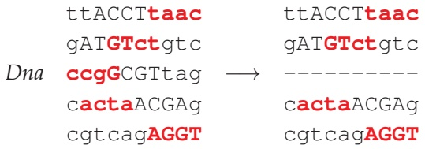

<details>
<summary>flowchart</summary>

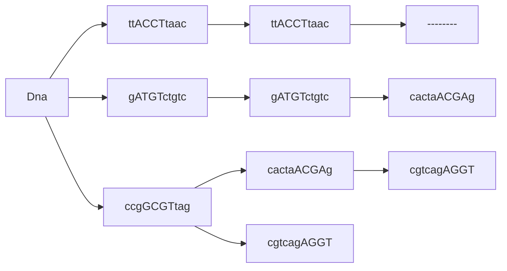
</details>

This results in the following motif, count, and profile matrices.

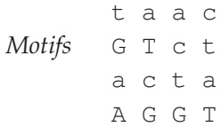

<details>
<summary>text_image</summary>

Motifs
t a a c
G T c t
a c t a
A G G T
</details>

| COUNT(Motifs) | A: 2 1 1 1C: 0 1 1 1G: 1 1 1 0T: 1 1 1 2 | PROFILE(Motifs) | A: 2/4 1/4 1/4 1/4C: 0 1/4 1/4 1/4G: 1/4 1/4 1/4 0T: 1/4 1/4 1/4 2/4 |
| --- | --- | --- | --- |

100

---

W H I C H D N A PAT T E R N S P L AY T H E R O L E O F M O L E C U L A R C L O C K S ?

Note that the profile matrix is only slightly more conserved than the uniform profile, making us wonder whether we have any chance to be steered toward the implanted motif. We now use this profile matrix to compute the probabilities of all 4-mers in the deleted string ccgGCGTtag:

| ccgG | cgGC | gGCG | GCGT | CGTt | GTta | Ttag |
| --- | --- | --- | --- | --- | --- | --- |
| 0 | 0 | 0 | 1/128 | 0 | 1/256 | 0 |

Note that all but two of these probabilities are zero. This situation is similar to the one we encountered with **GREEDYMOTIFSEARCH**, and as before, we need to augment zero probabilities with small pseudocounts to avoid disastrous results.

Application of Laplace’s Rule of Succession to the count matrix above yields the following updated count and profile matrices:

| COUNT(Motifs) | A: 3 2 2 2C: 1 2 2 2G: 2 2 2 1T: 2 2 2 3 | PROFILE(Motifs) | A: 3/8 2/8 2/8 2/8C: 1/8 2/8 2/8 2/8G: 2/8 2/8 2/8 1/8T: 2/8 2/8 2/8 3/8 |
| --- | --- | --- | --- |

After adding pseudocounts, the 4-mer probabilities in the deleted string ccgGCGTtag are recomputed as follows:

| ccgG | cgGC | gGCG | GCGT | CGTt | GTta | Ttag |
| --- | --- | --- | --- | --- | --- | --- |
| $4/8^4$ | $8/8^4$ | $8/8^4$ | $24/8^4$ | $12/8^4$ | $16/8^4$ | $8/8^4$ |

Since these probabilities sum to $C = 8 0 / 8 ^ { 4 }$ , our hypothetical seven-sided die is represented by the random number generator

$$
\begin{array}{l} \text {RANDOM} \left(\frac {4 / 8 ^ {4}}{8 0 / 8 ^ {4}}, \frac {8 / 8 ^ {4}}{8 0 / 8 ^ {4}}, \frac {8 / 8 ^ {4}}{8 0 / 8 ^ {4}}, \frac {2 4 / 8 ^ {4}}{8 0 / 8 ^ {4}}, \frac {1 2 / 8 ^ {4}}{8 0 / 8 ^ {4}}, \frac {1 6 / 8 ^ {4}}{8 0 / 8 ^ {4}}, \frac {8 / 8 ^ {4}}{8 0 / 8 ^ {4}}\right) \\ = \operatorname{RANDOM} \left(\frac {4}{8 0}, \frac {8}{8 0}, \frac {8}{8 0}, \frac {2 4}{8 0}, \frac {1 2}{8 0}, \frac {1 6}{8 0}, \frac {8}{8 0}\right). \\ \end{array}
$$

Let’s assume that after rolling this seven-sided die, we arrive at the Profile-randomly generated 4-mer GCGT (the fourth 4-mer in the deleted sequence). The deleted string ccgGCGTtag is now added back to the collection of motifs, and **GCGT** substitutes the previously chosen ccgG in the third string in Dna, as shown below. We then roll a fair five-sided die and randomly select the first string from Dna for removal.

101

---

C H A P T E R 2

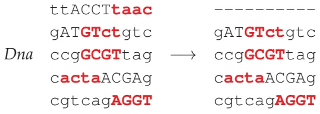

<details>
<summary>flowchart</summary>

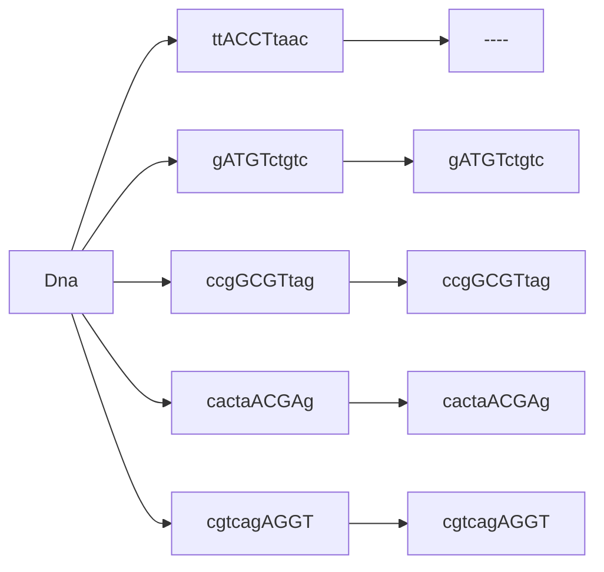
</details>

After constructing the motif and profile matrices, we obtain the following:

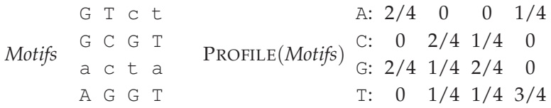

<details>
<summary>flowchart</summary>


</details>

Note that the profile matrix looks more biased toward the implanted motif than the previous profile matrix did. We update the count and profile matrices with pseudocounts:

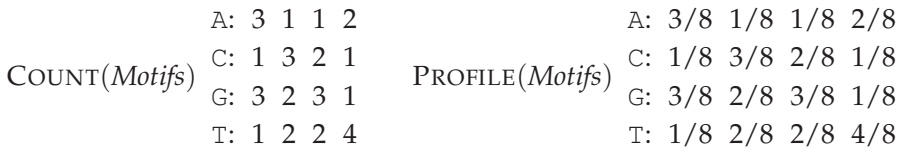

<details>
<summary>flowchart</summary>

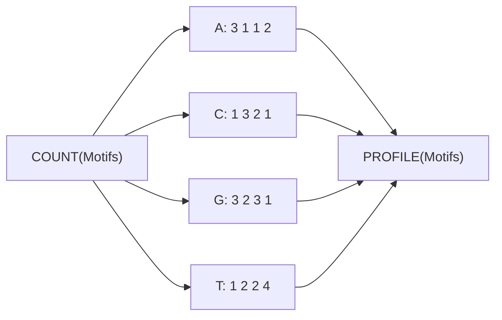
</details>

Then, we compute the probabilities of all 4-mers in the deleted string ttACCTtaac:

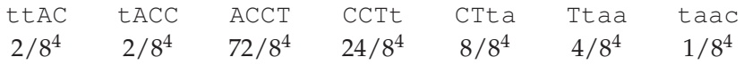

<details>
<summary>text_image</summary>

ttAC tACC ACCT CCTt CTta Ttaa taac
2/8^4 2/8^4 72/8^4 24/8^4 8/8^4 4/8^4 1/8^4
</details>

When we roll a seven-sided die, we arrive at the Profile-randomly generated k-mer **ACCT**, which we add to the collection Motifs. After rolling the five-sided die once again, we randomly select the fourth string for removal.

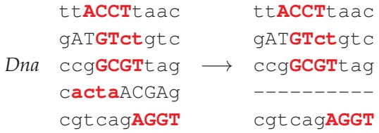

<details>
<summary>flowchart</summary>

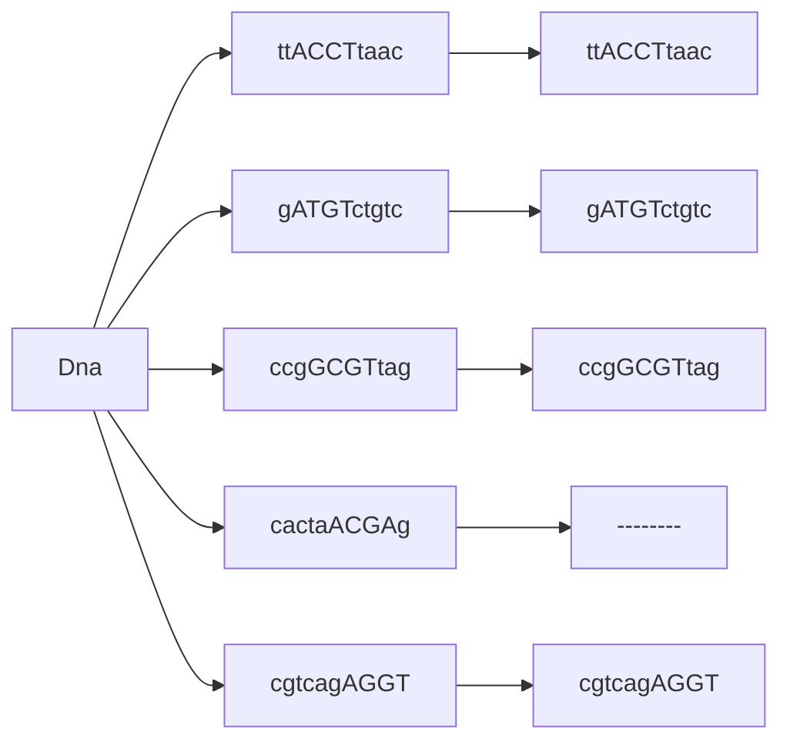
</details>

We further add pseudocounts and construct the resulting count and profile matrices:

102

---

W H I C H D N A PAT T E R N S P L AY T H E R O L E O F M O L E C U L A R C L O C K S ?

<table><tr><td rowspan="4">Motifs</td><td>A C C T</td></tr><tr><td>G T c t</td></tr><tr><td>G C G T</td></tr><tr><td>A G G T</td></tr></table>

| COUNT(Motifs) | A: 3 1 1 1C: 1 3 3 1G: 3 2 3 1T: 1 2 1 5 | PROFILE(Motifs) | A: 3/8 1/8 1/8 1/8C: 1/8 3/8 3/8 1/8G: 3/8 2/8 3/8 1/8T: 1/8 2/8 1/8 5/8 |
| --- | --- | --- | --- |

We now compute the probabilities of all 4-mers in the deleted string cactaACGAg:

| cact | acta | ctaA | taAC | aACG | ACGA | CGAg |
| --- | --- | --- | --- | --- | --- | --- |
| $15/8^4$ | $9/8^4$ | $2/8^4$ | $1/8^4$ | $9/8^4$ | $27/8^4$ | $2/8^4$ |

We need to roll a seven-sided die to produce a Profile-randomly generated 4-mer. Assuming the most probable scenario in which we select **ACGA**, we update the selected 4-mers as follows:

<table><tr><td rowspan="2"></td><td>ttACCTtaac</td></tr><tr><td>gATGTctgtc</td></tr><tr><td rowspan="3">Dna</td><td>ccgGCGTtag</td></tr><tr><td>cactaACGAg</td></tr><tr><td>cgtcagAGGT</td></tr></table>

You can see that the algorithm is beginning to converge. Rest assured that a subsequent iteration will produce all implanted motifs after we select the second string in Dna (when the incorrect 4-mer GTct will likely change into the implanted (4, 1)-motif ATGT).

**STOP and Think:** Run **GIBBSSAMPLER** on the Subtle Motif Problem. What do you find?

Although **GIBBSSAMPLER** performs well in many cases, it may converge to a suboptimal solution, particularly for difficult search problems with elusive motifs. A **local optimum** is a solution that is optimal within a small neighboring set of solutions, which is in contrast to a **global optimum**, or the optimal solution among all possible solutions. Since **GIBBSSAMPLER** explores just a small subset of solutions, it may “get stuck” in a local optimum. For this reason, similarly to **RANDOMIZEDMOTIFSEARCH**, it should be run many times with the hope that one of these runs will produce the best-scoring


103

---

C H A P T E R 2

PAGE 112

motifs. Yet convergence to a local optimum is just one of many issues we must consider in motif finding; see **DETOUR: Complications in Motif Finding** for some other challenges.

When we run **GIBBSSAMPLER** 2,000 times on the Subtle Motif Problem with implanted 15-mer **AAAAAAAAGGGGGGG** (each time with new randomly selected k-mers for N = 200 iterations), it returns a collection Motifs with consensus **AAAAAAgAGGGGGGt** and SCORE(Motifs) equal to 38. This score is even lower than the score of 40 expected from the implanted motifs!

## Epilogue: How Does Tuberculosis Hibernate to Hide from Antibiotics?

**Tuberculosis (TB)** is an infectious disease that is caused by the Mycobacterium tuberculo sis bacterium (MTB) and is responsible for over a million deaths each year. Although the spread of TB has been greatly reduced due to antibiotics, strains that resist all available treatments are now emerging. MTB is successful as a pathogen because it can persist in humans for decades without causing disease; in fact, one-third of the world population has **latent MTB infections**, in which MTB lies dormant within the host’s body and may or may not reactivate at a later time. The widespread prevalence of latent infections makes it difficult to control TB epidemics. Biologists are therefore interested in finding out what makes the disease latent and how MTB activates itself within a host.

It remains unclear why MTB can stay latent for so long and how it survives during latency. The resistance of latent TB to antibiotics implies that MTB may have an ability to shut down expression of most genes and stay dormant, not unlike bears hibernating in the winter. Hibernation in bacteria is called **sporulation** because many bacteria form protective and metabolically dormant **spores** that can survive in tough conditions, allowing the bacteria to persist in the environment until conditions improve.

**Hypoxia**, or oxygen shortage, is often associated with latent forms of TB. Biologists have found that MTB becomes dormant in low-oxygen environments, presumably with the idea that the host’s lungs will recover enough to potentially spread the disease in the future. Since MTB shows a remarkable ability to survive for years without oxygen, it is important to identify MTB genes responsible for the development of the latent state under hypoxic conditions. Biologists are interested in finding a **transcription factor** that “senses” the shortage of oxygen and starts a genetic program that affects the expression of many genes, allowing MTB to adapt to hypoxia.

In 2003, biologists found the **dormancy survival regulator** (**DosR**), a transcription factor that regulates many genes whose expression dramatically changes under hypoxic

104

---

W H I C H D N A PAT T E R N S P L AY T H E R O L E O F M O L E C U L A R C L O C K S ?

conditions. However, it remained unclear how DosR regulates these genes, and its transcription factor binding site remained unknown. In an attempt to resolve this puzzle, biologists performed a DNA array experiment and found 25 genes whose expression levels significantly changed in hypoxic conditions. Given the upstream regions of these genes, each of which is 250 nucleotides long, we would like to discover the “hidden message” that DosR uses to control the expression of these genes.

To simplify the problem a bit, we have selected just 10 of the 25 genes, resulting in the **DosR dataset**. We will try to identify motifs in this dataset using the arsenal of motif finding tools that we have developed. However, we will not give you a hint about the DosR motif.

What k-mer size should we choose in order to analyze the DosR dataset using **MEDIANSTRING** and **RANDOMIZEDMOTIFSEARCH**? Taking a wild guess and running these algorithms for k from 8 to 12 returns the consensus strings shown below.

<table><tr><td colspan="3">MEDIANSTRING</td><td colspan="3">RANDOMIZEDMOTIFSEARCH</td></tr><tr><td>k</td><td>Consensus</td><td>Score</td><td>k</td><td>Consensus</td><td>Score</td></tr><tr><td>8</td><td>CATCGGCC</td><td>11</td><td>8</td><td>CCGACGGG</td><td>13</td></tr><tr><td>9</td><td>GGCGGGGAC</td><td>16</td><td>9</td><td>CCATCGGCC</td><td>16</td></tr><tr><td>10</td><td>GGTGGCCACC</td><td>19</td><td>10</td><td>CCATCGGCCC</td><td>21</td></tr><tr><td>11</td><td>GGACTTCCGGC</td><td>20</td><td>11</td><td>ACCTTCGGCCC</td><td>25</td></tr><tr><td>12</td><td>GGACTTCCGGCC</td><td>23</td><td>12</td><td>GGACCAACGGCC</td><td>28</td></tr></table>

**STOP and Think:** Can you infer the DosR binding site from these median strings?

What do you think is the length of the binding site?

Note that although the consensus strings returned by **RANDOMIZEDMOTIFSEARCH** generally deviate from the median strings, the consensus 12-mer (**GGACCAACGGCC**, with score 28) is very similar to the median string (**GGACTTCCGGCC**, with score 23).

While the motifs returned by **RANDOMIZEDMOTIFSEARCH** are slightly less conserved than the motifs returned by **MEDIANSTRING**, the former algorithm has the advantage of being able to find longer motifs (since **MEDIANSTRING** becomes too slow for longer motifs). The motif of length 20 returned by **RANDOMIZEDMOTIFSEARCH** is **CGGGACCTACGTCCCTAGCC** (with score 57). As shown below, the consensus strings of length 12 found by **RANDOMIZEDMOTIFSEARCH** and **MEDIANSTRING** are “embedded” with small variations in the longer motif of length 20:


105

---

C H A P T E R 2

# GGACCAACGGCC CGGGACCTACGTCCCTAGCC GGACTTCCGGCC

Finally, in 2,000 runs with N = 200, **GIBBSSAMPLER** returned the same consensus string of length 20 for the DosR dataset as **RANDOMIZEDMOTIFSEARCH** but generated a different collection of motifs with a smaller score of 55.

As you have seen in this chapter, different motif finding algorithms generate somewhat different results, and it remains unclear how to identify the DosR motif in MTB. Try to answer this question and find all putative DosR motifs in MTB as well as all genes that they regulate. We will provide the upstream regions of all 25 genes identified in the DosR study to help you address the following problem.

**CHALLENGE PROBLEM:** Infer the profile of the DosR motif and find all its putative occurrences in Mycobacterium tuberculosis.

106

---

W H I C H D N A PAT T E R N S P L AY T H E R O L E O F M O L E C U L A R C L O C K S ?

## Charging Stations

Solving the Median String Problem

The first potential issue with implementing **MEDIANSTRING** is writing a function to compute $\begin{array} { r } { d \big ( P a t t e r n , D n a \big ) = \sum _ { i = 1 } ^ { t } d \big ( P a t t e r n , D n a _ { i } \big ) } \end{array}$ , the sum of distances between Pattern and each string in $Dna = \left\{ Dna_{1}, \cdots , Dna_{t} \right\}$ . This task is achieved by the following pseudocode.

```python
DISTANCE BETWEENPATTERNANDSTRINGS(Pattern, Dna)
    k ← |Pattern|
    distance ← 0
    for each string Text in Dna
        HammingDistance ← ∞
        for each k-mer Pattern' in Text
            if HammingDistance > HAMMINGDISTANCE(Pattern, Pattern')
                HammingDistance ← HAMMINGDISTANCE(Pattern, Pattern')
        distance ← distance + HammingDistance
    return distance
```

To solve the Median String Problem, we need to iterate through all possible $4 ^ { k } ~ k -$ mers Pattern before computing $d { \big ( } P a t t e r n , D n a { \big ) }$ The pseudocode below is a modification of **MEDIANSTRING** using the function NUMBERTOPATTERN (implemented in **CHARGING STATION: Converting Patterns Into Numbers and Vice-Versa**), which is applied to convert all integers from 0 to $4 ^ { k } - 1$ into all possible k-mers.

```python
MEDIANSTRING(Dna, k)
    distance ← ∞
    for i ← 0 to 4^k - 1
        Pattern ← NUMBERTOPATTERN(i, k)
        if distance > DISTANCEBETWEENPATTERNANDSTRINGS(Pattern, Dna)
            distance ← DISTANCEBETWEENPATTERNANDSTRINGS(Pattern, Dna)
            Median ← Pattern
    return Median
```


107

---

C H A P T E R 2

## Detours

## Gene expression

Genes encode proteins, and proteins dictate cell function. To respond to changes in their environment, cells must therefore control their protein levels. The flow of information from DNA to RNA to protein means that the cell can adjust the amount of proteins that it produces during both transcription (DNA to RNA) and translation (RNA to protein).

Transcription begins when an RNA polymerase binds to a **promoter sequence** on the DNA molecule, which is often located just upstream from the starting point for transcription. The initiation of transcription is a convenient control point for the cell to regulate gene expression since it is at the very beginning of the protein production process. The genes transcribed in a cell are controlled by various transcription regulators that may increase or suppress transcription.

## DNA arrays

A **DNA array** is a collection of DNA molecules attached to a solid surface. Each spot on the array is assigned a unique DNA sequence called a **probe** that measures the expression level of a specific gene, known as a **target**. In most arrays, probes are synthesized and then attached to a glass or silicon chip (Figure 2.8).


<details>
<summary>text_image</summary>

Diagram illustrating molecular rearrangement or transformation process with wavy lines and colored dots indicating states or components.
</details>

FIGURE 2.8 Fluorescently labeled DNA binds to a complementary probe on a DNA array.

Fluorescently labeled targets then bind to their corresponding probe (e.g., when their sequences are complementary), generating a fluorescent signal. The strength of this signal depends upon the amount of target sample that binds to the probe at a given spot. Thus, the higher the expression level of a gene, the higher the intensity of its fluorescent signal on the array. Since an array may contain millions of probes, biologists can measure the expression of many genes in a single array experiment. The DNA array

108

---

W H I C H D N A PAT T E R N S P L AY T H E R O L E O F M O L E C U L A R C L O C K S ?

experiment that identified the evening element in Arabidopsis thaliana measured the expression of 8,000 genes.

## Buffon’s needle

Comte de Buffon was a prolific 18th Century naturalist whose writings on natural history were popular at the time. However, his first paper was in mathematics; in 1733, he wrote an essay on a Medieval French game called “Le jeu de franc carreau”. In this game, a single player flips a coin into the air, and the coin lands on a checkerboard. The player wins if the coin lands completely within one of the squares on the board, and loses otherwise (Figure 2.9 (left)). Buffon asked a natural question: what is the probability that the player wins?


FIGURE 2.9 (Left) A game of “franc carreau” with four coins. Two of the coins have landed within one of the squares of the checkerboard and are considered winners, whereas the other two have landed on a boundary and are considered losers. (Right) Three coins shown on a single square of the checkerboard (the green outside square); one coin is a loser, another is a winner, and the third corresponds to a boundary case. You can see that if the coin has radius $r ,$ then the probability of winning the game corresponds to the probability that the center of the coin (shown as a red dot) lands within the blue square, which has side length 1  2r. This probability is the ratio of the squares’ areas, which is $( 1 - 2 r ) ^ { 2 }$

Let’s assume that the checkerboard consists of just a single square with side length 1, that the coin has radius $r < 1 / 2 ,$ and that the center of the coin always lands within the square. Then the player can only win if the center of the circle falls within an imaginary

109

---

C H A P T E R 2

central square of side length $1 - 2 r$ (Figure 2.9 (right)). Assuming that the coin lands anywhere on the larger square with uniform probability, then the probability that the coin falls completely within the smaller square is given by the ratio of the areas of the two squares, or $( 1 - 2 r ) ^ { 2 }$

Four decades later, Buffon published a paper describing a similar game in which the player uniformly drops a needle onto a floor covered by long wooden panels of equal width. In this game, which has become known as **Buffon’s needle**, the player wins if the needle falls entirely within one of the panels. Note that computing the probability of a win is now complicated by the fact that the needle is described by an orientation in addition to its position. Nevertheless, the first game gives us an idea for how to solve this problem: once we fix a position for the center of the needle, its collection of different possible orientations sweep out a circle (Figure 2.10 (left)).


FIGURE 2.10 (Left) Once we fix a point for the center of the needle (shown as a red dot), its collection of possible orientations sweep out a circle. In the circle on the left, the needle will always lie within the dark brown panel, regardless of its orientation. In the circle on the $\operatorname { r i g h t } ,$ one of the two needles lies within the dark brown panel, whereas another is shown crossing over into the adjacent panel. (Right) Once we fix a point $( x , y )$ for the center of the needle, there is a critical angle $\alpha ( x )$ such that all angles between $- \alpha ( x )$ and $\alpha ( x )$ will cause the needle to cross over into the next panel. In this figure, the length of the needle is equal to the width of the panel.

The probability that the player wins depends on the length of the needle with respect to the distance between wooden panels. We will assume that both of these lengths are

110

---

W H I C H D N A PAT T E R N S P L AY T H E R O L E O F M O L E C U L A R C L O C K S ?

equal to 2, and we will find the probability of a loss instead of a win. To this end, we first ask a simpler question: if the center of the needle were to land in the same place every time, then what is the likelihood that the needle crosses a panel?

To address this question, let’s map the panel into which the needle falls onto a coordinate plane, with the y-axis dividing the panel into two smaller panels of width 1 (Figure 2.10 (right)). If the center of the needle lands at position $( x , y )$ with $x > 0 ,$ then its orientation can be described by an angle $\theta ,$ where $\theta$ ranges from $- \pi / 2$ to $\pi / 2$ radians. If $\theta = 0 ,$ , then the needle will cross the line $y = 1 ; { \mathrm { i f } }   \theta = \pi / 2 ,$ , then the needle will not cross the line $y = 1$ . Yet more importantly, since the needle’s center position is fixed, there must be some critical angle $\alpha ( x )$ such that the needle always touches this line if $- \alpha ( x ) \leq \theta \leq \alpha ( x )$ . If the needle is dropped randomly, then any value of q is equally likely, and so we obtain that the probability of a loss given this position of the needle is equal to $2 \cdot \alpha ( x ) / \pi$

Following the same reasoning, the needle can take any position x with equal probability. To find the probability of a loss, Pr(loss), we must therefore compute an “average” of the values $2 \cdot \alpha ( x ) / \pi$ as x continuously ranges from 1 to 1. This average can be represented using an integral,

$$
\Pr (\text {loss}) = \frac {\int_ {- 1} ^ {1} \frac {2 \cdot \alpha (x)}{\pi} \mathrm{d} x}{1 - (- 1)} = \int_ {- 1} ^ {1} \frac {\alpha (x)}{\pi} \mathrm{d} x = 2 \int_ {0} ^ {1} \frac {\alpha (x)}{\pi} \mathrm{d} x.
$$

Revisiting Figure 2.10 (right), applying some basic trigonometry tells us that cos $\alpha ( x )$ is equal to $1 - x ,$ so that $\alpha ( x ) = \operatorname { a r c c o s } ( 1 - x )$ . After making this substitution into the above equation — and consulting our dusty calculus textbook — $\operatorname* { P r } ( \mathrm { l o s s } )$ must be equal to $2 / \pi$ . It is not difficult to see that this probability will be the same when the needle is dropped onto any number of wooden panels.

But what does Buffon’s needle have to do with randomized algorithms? In 1812, none other than Laplace pointed out that Buffon’s needle could be used to approximate $\pi ,$ and the world’s first Monte Carlo algorithm was born. Specifically, we can approximate the probability $P _ { e }$ of a loss empirically by dully flipping a needle into the air thousands of times (or asking a computer to do it for us). Once we have computed this empirical probability, we can conclude that $P _ { e }$ is approximately equal to $2 / \pi ,$ and thus

$$
\pi \approx \frac {2}{P _ {e}}.
$$

111

---

C H A P T E R 2


**STOP and Think:** How does this approximation change in the following cases?

1. The needle is shorter than the width between panels.
2. The needle is longer than the width between panels.

## Complications in motif finding

Motif finding becomes difficult if the **background nucleotide distribution** in the sample is skewed. In this case, searching for k-mers with the minimum score or entropy may lead to a biologically irrelevant motif composed from the most frequent nucleotides in the sample. For example, if A has frequency 85% and T, G, and C have frequencies of $5 \% ,$ then k-mer AA...AA may represent a motif with minimum score, thus disguising biologically relevant motifs. For example, the relevant motif GCCG with score 5 in the example below loses out to the motif **aaaa** with score 1.

```txt
taaaaGTCGa
acGCTGaaaa
Dna aaaaGCCTat
aCCCGaataa
agaaaaGGCG
```

<strong><u>PAGE 11</u></strong>**2**

To find biologically relevant motifs in samples with biased nucleotide frequencies, you may therefore want to use a generalization of entropy called “relative entropy” (see **DETOUR: Relative Entropy**).

Another complication in motif finding is that many motifs are best represented in a different alphabet than the alphabet of 4 nucleotides. Let W denote either A or T, S denote either G or C, K denote either G or T, and Y denote either C or T. Now, consider the motif CSKWYWWATKWATYYK, which represents the CSRE motif in yeast (recall Figure 2.3 from page 75). This strong motif in a hybrid alphabet corresponds to $2 ^ { 1 1 }$ different motifs in the standard 4-letter alphabet of nucleotides. However, each of these $2 ^ { 1 1 }$ motifs is too weak to be found by the algorithms we have considered in this chapter.

## Relative entropy

Given a collection of strings Dna, the **relative entropy** of a $4 \times k$ profile matrix $P = \left( p _ { r , j } \right)$ is defined as

112

---

W H I C H D N A PAT T E R N S P L AY T H E R O L E O F M O L E C U L A R C L O C K S ?

$$
\sum_ {j = 1} ^ {k} \sum_ {r \in \{\mathrm{A}, \mathrm{C}, \mathrm{G}, \mathrm{T} \}} p _ {r, j} \cdot \log_ {2} (p _ {r, j} / b _ {r}) =
$$

$$
\sum_ {j = 1} ^ {k} \sum_ {r \in \{\mathrm{A}, \mathrm{C}, \mathrm{G}, \mathrm{T} \}} p _ {r, j} \cdot \log_ {2} (p _ {r, j}) - \sum_ {j = 1} ^ {k} \sum_ {r \in \{\mathrm{A}, \mathrm{C}, \mathrm{G}, \mathrm{T} \}} p _ {r, j} \cdot \log_ {2} (b _ {r}),
$$

where $b _ { r }$ is the frequency of nucleotide r in Dna. Note that the sum in the expression for entropy is preceded by a negative sign $\begin{array} { r } { \bigl ( - \sum _ { j = 1 } ^ { k } \sum _ { r \in \bigl \{ \mathbb { A } , \mathbb { C } , \mathbb { G } , \mathbb { T } \bigr \} } p _ { r , j } \cdot \log _ { 2 } \bigl ( p _ { r , j } \bigr ) \bigr ) } \end{array}$ , whereas the sum on the left side of the relative entropy equation does not have this negative sign. Therefore, although we minimized the entropy of a motif matrix, we will now attempt to maximize the relative entropy.

The term $\begin{array} { r } { - \sum _ { j = 1 } ^ { k } \sum _ { r \in \big \{ \mathbb { A } , \mathbb { C } , \mathbb { G } , \mathbb { T } \big \} } p _ { r , j } \cdot \log _ { 2 }   \left( b _ { r } \right) } \end{array}$ is called the **cross-entropy** of the profile matrix $P ;$ note that the relative entropy of a profile matrix is simply the difference between the profile’s cross-entropy and its entropy. For example, the relative entropy for the motif GCCG in the example from **DETOUR: Complications in Motif Finding** is equal to $9.85 - 3.53 = 6.32$ , as shown below. In this example, $b _ { \mathbb { A } } = 0 . 5 ,   b _ { \mathbb { C } } = 0 . 1 8 ,$ $b _ { \mathbb { G } } = 0 . 2 ,$ , and $b _ { \mathrm { T } } = 0 . 1 2$

<table><tr><td rowspan="2"></td><td>G</td><td>T</td><td>C</td><td>G</td></tr><tr><td>G</td><td>C</td><td>T</td><td>G</td></tr><tr><td rowspan="3">Motifs</td><td>G</td><td>C</td><td>C</td><td>T</td></tr><tr><td>C</td><td>C</td><td>C</td><td>G</td></tr><tr><td>G</td><td>G</td><td>C</td><td>G</td></tr><tr><td rowspan="4">PROFILE(Motifs)</td><td>A: 0.0</td><td>0.0</td><td>0.0</td><td>0.0</td></tr><tr><td>C: 0.2</td><td>0.6</td><td>0.8</td><td>0.0</td></tr><tr><td>G: 0.8</td><td>0.2</td><td>0.0</td><td>0.8</td></tr><tr><td>T: 0.0</td><td>0.2</td><td>0.2</td><td>0.2</td></tr><tr><td>Entropy</td><td colspan="4"> $0.72 + 1.37 + 0.72 + 0.72 = 3.53$ </td></tr><tr><td>Cross-entropy</td><td colspan="4"> $2.35 + 2.56 + 2.47 + 2.47 = 9.85$ </td></tr></table>

For the more conserved but irrelevant motif aaaa, the relative entropy is equal to $4.18 - 0.72 = 3.46,$ , as shown below. Thus, GCCG loses to aaaa with respect to entropy but wins with respect to relative entropy.

PAGE 112

113

---

C H A P T E R 2

<table><tr><td rowspan="5">Motifs</td><td></td><td>a</td><td>a</td><td>a</td><td>a</td></tr><tr><td></td><td>a</td><td>a</td><td>a</td><td>a</td></tr><tr><td></td><td>a</td><td>a</td><td>a</td><td>a</td></tr><tr><td></td><td>a</td><td>t</td><td>a</td><td>a</td></tr><tr><td></td><td>a</td><td>a</td><td>a</td><td>a</td></tr><tr><td rowspan="4">PROFILE(Motifs)</td><td>A:</td><td>1.0</td><td>0.8</td><td>1.0</td><td>1.0</td></tr><tr><td>C:</td><td>0.0</td><td>0.0</td><td>0.0</td><td>0.0</td></tr><tr><td>G:</td><td>0.0</td><td>0.0</td><td>0.0</td><td>0.0</td></tr><tr><td>T:</td><td>0.0</td><td>0.2</td><td>0.0</td><td>0.0</td></tr><tr><td colspan="2">Entropy</td><td colspan="4"> $0.0 + 0.72 + 0.0 + 0.0 = 0.72$ </td></tr><tr><td colspan="2">Cross-entropy</td><td colspan="4"> $0.94 + 1.36 + 0.94 + 0.94 = 4.18$ </td></tr></table>

114

---

W H I C H D N A PAT T E R N S P L AY T H E R O L E O F M O L E C U L A R C L O C K S ?

## Bibliography Notes

Konopka and Benzer, 1971 bred flies with abnormally short (19 hours) and long (28 hours) circadian rhythms and then traced these abnormalities to a single gene. Harmer et al., 2000 discovered the evening transcription factor binding site that orchestrates the circadian clock in plants. Excellent coverage of this discovery is given by Cristianini and Hahn, 2006. Park et al., 2003 found a transcription factor that mediates the hypoxic response of Mycobacterium tuberculosis.

Hertz and Stormo, 1999 described the first greedy algorithm for motif finding. The general framework for Gibbs sampling was described by Geman and Geman, 1984 and was named Gibbs sampling in reference to its similarities with some approaches in statistical mechanics (Josiah Willard Gibbs was one of the founders of statistical mechanics). Lawrence et al., 1993 adapted Gibbs sampling for motif finding.


115
