# Chapter 3: How Do We Assemble Genomes?

原始 PDF 第 141–206 页。

## HOW DD WE ASSEMBLE GENOMES?


---

H O W D O W E A S S E M B L E G E N O M E S ?

## Exploding Newspapers

Imagine that we stack a hundred copies of the June 27, 2000 edition of the New York Times on a pile of dynamite, and then we light the fuse. We ask you to further suspend your disbelief and assume that the newspapers are not all incinerated but instead explode cartoonishly into smoldering pieces of confetti. How could we use the tiny snippets of newspaper to figure out what the news was on June 27, 2000? We will call this crazy conundrum the **Newspaper Problem** (see Figure 3.1).


FIGURE 3.1 Don’t try this at home! Crazy as it may seem, the Newspaper Problem serves as an analogy for the computational framework of genome assembly.

The Newspaper Problem is even more difficult than it may seem. Because we had multiple copies of the same edition of the newspaper, and because we undoubtedly lost some information in the blast, we cannot simply glue together one of the newspaper copies in the same way that we would assemble a jigsaw puzzle. Instead, we need to use overlapping fragments from different copies of the newspaper to reconstruct the day’s news, as shown in Figure 3.2.

Fine, you ask, but what do exploding newspapers have to do with biology? Determining the order of nucleotides in a genome, or **genome sequencing**, presents a fundamental task in bioinformatics. Genomes vary in length; your own genome is roughly 3 billion

117

---

C H A P T E R 3

atshirt, appı e have not yet named mation is welc

shirt, appruximately $6 ^ { \prime } 2 ^ { n }$ 17 yet named any suspects is welcomed. 'ease cai

FIGURE 3.2 In the Newspaper Problem, we need to use overlapping shreds of paper to figure out the news.

nucleotides long, whereas the genome of Amoeba dubia, an amorphous unicellular organism, is approximately 200 times longer! This unicellular organism competes with the rare Japanese flower Paris japonica for the title of species with the longest genome.

The first sequenced genome, belonging to a fX174 bacterial phage (i.e., a virus that preys on bacteria), had only 5,386 nucleotides and was completed in 1977 by Frederick Sanger. Four decades after this Nobel Prize-winning discovery, genome sequencing has raced to the forefront of bioinformatics research, as the cost of genome sequencing plummeted. Because of the decreasing cost of sequencing, we now have thousands of sequenced genomes, including those of many mammals (Figure 3.3).

To sequence a genome, we must clear some practical hurdles. The largest obstacle is the fact that biologists still lack the technology to read the nucleotides of a genome from beginning to end in the same way that you would read a book. The best they can do is sequence much shorter DNA fragments called **reads**. The reasons why researchers can sequence small pieces of DNA but not long genomes warrant their own discussion in **DETOUR: A Short History of DNA Sequencing Technologies**. In this chapter, our aim is to turn an apparent handicap into a useful tool for assembling the genome back together.

The traditional method for sequencing genomes is described as follows. Researchers take a small tissue or blood sample containing millions of cells with identical DNA, use biochemical methods to break the DNA into fragments, and then sequence these fragments to produce reads (Figure 3.4). The difficulty is that researchers do not know where in the genome these reads came from, and so they must use overlapping reads to reconstruct the genome. Thus, putting a genome back together from its reads, or **genome assembly**, is just like the Newspaper Problem.

Even though researchers have sequenced many genomes, a giant genome like that of Amoeba dubia still remains beyond the reach of modern sequencing technologies. You might guess that the barrier to sequence such a genome would be experimental, but that is not true; biologists can easily generate enough reads to analyze a large genome, but assembling these reads still presents a major computational challenge.


118

---

H O W D O W E A S S E M B L E G E N O M E S ?


<details>
<summary>text_image</summary>

2010
bat
panda
neanderthal
2009
cow
horse
elephant
2007
cat
opossum
2006
macaque
2005
dog
chimpanzee
2004
rat
2002
mouse
2000
human
</details>

FIGURE 3.3 The first mammals with sequenced genomes.


<details>
<summary>flowchart</summary>

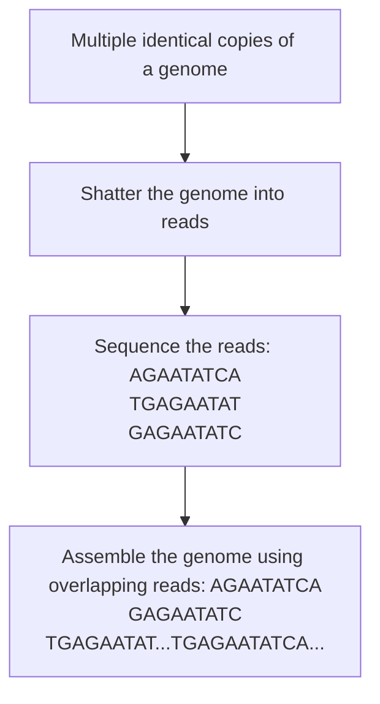
</details>

FIGURE 3.4 In DNA sequencing, many identical copies of a genome are broken in random locations to generate short reads, which are then sequenced and assembled into the nucleotide sequence of the genome.

119

---

C H A P T E R 3

## The String Reconstruction Problem

Genome assembly is more difficult than you think

Before we introduce a computational problem modeling genome assembly, we will take a moment to discuss a few practical complications that make genome assembly more difficult than the Newspaper Problem.

First, DNA is double-stranded, and we have no way of knowing a priori which strand a given read derives from, meaning that we will not know whether to use a read or its reverse complement when assembling a particular strand of a genome. Second, modern sequencing machines are not perfect, and the reads that they generate often contain errors. Sequencing errors complicate genome assembly because they prevent us from identifying all overlapping reads. Third, some regions of the genome may not be covered by any reads, making it impossible to reconstruct the entire genome.

Since the reads generated by modern sequencers often have the same length, we may safely assume that reads are all k-mers for some value of k. The first part of this chapter will assume an ideal — and unrealistic — situation in which all reads come from the same strand, have no errors, and exhibit **perfect coverage**, so that every k-mer substring of the genome is generated as a read. Later, we will show how to relax these assumptions for more realistic datasets.

Reconstructing strings from k-mers

We are now ready to define a computational problem modeling genome assembly. Given a string Text, its **k-mer composition** COMPOSITION<sub>k</sub>(Text) is the collection of all k-mer substrings of Text (including repeated k-mers). For example,

$$
\text {COMPOSITION} _ {3} (\text {TATGGGGTGC}) = \{\text {ATG, GGG, GGG, GGT, GTG, TAT, TGC, TGG} \}.
$$

Note that we have listed k-mers in **lexicographic order** (i.e., how they would appear in a dictionary) rather than in the order of their appearance in TATGGGGTGC. We have done this because the correct ordering of reads is unknown when they are generated.

## String Composition Problem:

Generate the k-mer composition of a string.

**Input**: A string Text and an integer k.

**Output**: COMPOSITION<sub>k</sub>(Text), where the k-mers are arranged in lexicographic order.


120

---

H O W D O W E A S S E M B L E G E N O M E S ?

Solving the String Composition Problem is a straightforward exercise, but in order to model genome assembly, we need to solve its inverse problem.

## String Reconstruction Problem:

Reconstruct a string from its k-mer composition.

**Input**: An integer k and a collection Patterns of k-mers.

**Output**: A string Text with k-mer composition equal to Patterns (if such a string exists).

Before we ask you to solve the String Reconstruction Problem, let’s consider the following example of a 3-mer composition:

## AAT ATG GTT TAA TGT

The most natural way to solve the String Reconstruction Problem is to mimic the solution of the Newspaper Problem and “connect” a pair of k-mers if they overlap in k  1 symbols. For the above example, it is easy to see that the string should start with TAA because there is no 3-mer ending in TA. This implies that the next 3-mer in the string should start with AA. There is only one 3-mer satisfying this condition, AAT:

TAA

AAT

In turn, AAT can only be extended by ATG, which can only be extended by TGT, and so on, leading us to reconstruct **TAATGTT**:

**TAA**

AAT

ATG

TGT

GTT

**TAATGTT**

It looks like we are finished with the String Reconstruction Problem and can let you move on to the next chapter. To be sure, let’s consider another 3-mer composition:

AAT ATG ATG ATG CAT CCA GAT GCC GGA GGG GTT TAA TGC TGG TGT

121

---

C H A P T E R 3


## EXERCISE BREAK: Reconstruct a string with this 3-mer composition.

If we start again with TAA, then the next 3-mer in the string should start with AA, and there is only one such 3-mer, AAT. In turn, AAT can only be extended by ATG:

| TAA |
| --- |
| AAT |
| ATG |
| TAATG |

ATG can be extended either by TGC, or TGG, or TGT. Now we must decide which of these 3-mers to choose. Let’s select TGT:

| TAA |
| --- |
| AAT |
| ATG |
| TGT |
| TAATGT |

After TGT, our only choice is GTT:

| TAA |
| --- |
| AAT |
| ATG |
| TGT |
| GTT |
| TAATGTT |

Unfortunately, now we are stuck at GTT because no 3-mers in the composition start with TT! We could try to extend TAA to the left, but no 3-mers in the composition end with TA.

You may have found this trap on your own and already discovered how to escape it. Like a good chess player, if you think a few steps ahead, then you would never extend ATG by TGT until reaching the end of the genome. With this thought in mind, let’s take a step back, extending ATG by TGC instead:

| TAA |
| --- |
| AAT |
| ATG |
| TGC |
| TAATGC |

122

---

H O W D O W E A S S E M B L E G E N O M E S ?

Continuing the process, we obtain the following assembly:

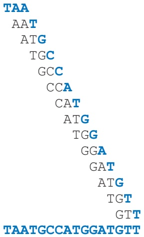

<details>
<summary>flowchart</summary>

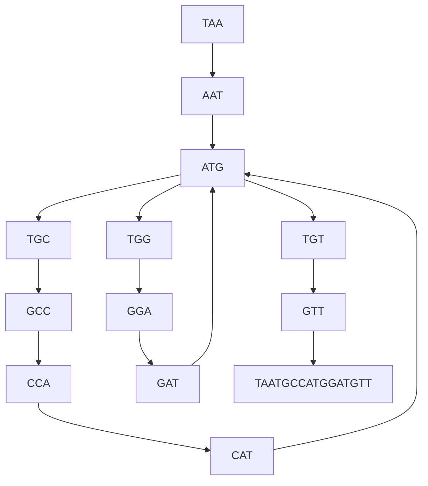
</details>

Yet this assembly is incorrect because we have only used fourteen of the fifteen 3-mers in the composition (we omitted GGG), making our reconstructed genome one nucleotide too short.

Repeats complicate genome assembly

The difficulty in assembling this genome arises because ATG is repeated three times in the 3-mer composition, which causes us to have the three choices TGG, TGC, and TGT by which to extend ATG. Repeated substrings in the genome are not a serious problem when we have just fifteen reads, but with millions of reads, repeats make it much more difficult to “look ahead” and construct the correct assembly.

If you followed **DETOUR: Probabilities of Patterns in a String** from Chapter 1, you know how unlikely it is to witness a long repeat in a randomly generated sequence of nucleotides. You also know that real genomes are anything but random. Indeed, approximately 50% of the human genome is made up of repeats, e.g., the approximately 300 nucleotide-long **Alu sequence** is repeated over a million times, with only a few nucleotides inserted/deleted/substituted each time (see **DETOUR: Repeats in the Human Genome**).

An analogy illustrating the difficulty of assembling a genome with many repeats is the Triazzle® jigsaw puzzle (Figure 3.5). People usually put together jigsaw puzzles by connecting matching pieces. However, every piece in the Triazzle matches more than one other piece; in Figure 3.5, each frog appears several times. If you proceed carelessly,

PAGE 52

PAGE 172

123

---

C H A P T E R 3

then you will likely match most of the pieces but fail to fit the remaining ones. And yet the Triazzle has only 16 pieces, which should give us pause about assembling a genome from millions of reads.

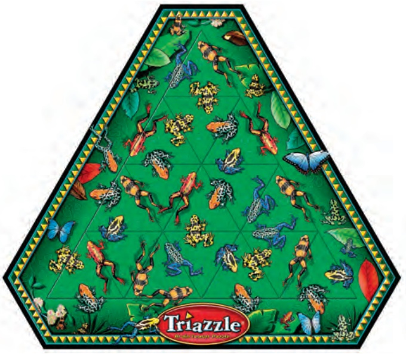

<details>
<summary>natural_image</summary>

Triazzle logo featuring colorful insect and butterfly illustrations on a green triangular background (no text or symbols on the illustration itself)
</details>

FIGURE 3.5 Each Triazzle has only sixteen pieces but carries a warning: “It’s Harder than it Looks!”


**EXERCISE BREAK:** Design a strategy for assembling the Triazzle puzzle.

## String Reconstruction as a Walk in the Overlap Graph

From a string to a graph

Repeats in a genome necessitate some way of looking ahead to see the correct assembly in advance. Returning to our previous example, you may have already found that **TAATGCCATGGGATGTT** is a solution to the String Reconstruction Problem for the collection of fifteen 3-mers in the last section, as illustrated below. Note that we use a different color for each interval of the string between occurrences of **ATG**.

124

---

H O W D O W E A S S E M B L E G E N O M E S ?

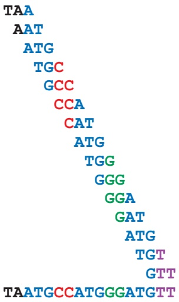

<details>
<summary>text_image</summary>

TAA
AAT
ATG
TGC
GCC
CCA
CAT
ATG
TGG
GGG
GGA
GAT
ATG
TGT
GTT
TAATGCCATGGGATGTT
</details>

**STOP and Think:** Is this the only solution to the String Reconstruction Problem for this collection of 3-mers?

In Figure 3.6, consecutive 3-mers in **TAATGCCATGGGATGTT** are linked together to form the **genome path**.


<details>
<summary>flowchart</summary>

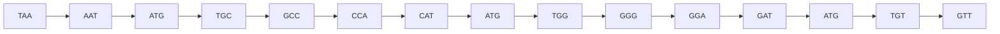
</details>

FIGURE 3.6 The fifteen color-coded 3-mers making up TAATGCCATGGGATGTT are joined into the genome path according to their order in the genome.

## String Spelled by a Genome Path Problem:

Reconstruct a string from its genome path.

**Input**: A sequence of k-mers Pattern<sub>1</sub>, . . . , Pattern<sub>n</sub> such that the last $k - 1$ symbols of $P a t t e r n _ { i }$ are equal to the first $k - 1$ symbols of $P a t t e r n _ { i + 1 }$ for $1 \leq n - 1$

**Output**: A string Text of length $k + n - 1$ such that the i-th k-mer in Text is equal to Patterni (for $1 \leq i \leq n )$

Reconstructing a genome from its genome path is easy: as we proceed from left to right, the 3-mers “spell” out **TAATGCCATGGGATGTT**, adding one new symbol to the genome

STOP

[3B](http://rosalind.info/problems/3b)

125

---

C H A P T E R 3

STOP

at each new 3-mer. Unfortunately, constructing this string’s genome path requires us to know the genome in advance.

**STOP and Think:** Could you construct the genome path if you knew only the genome’s 3-mer composition?

In this chapter, we will use the terms **prefix** and **suffix** to refer to the first k  1 nucleotides and last k  1 nucleotides of a k-mer, respectively. For example, PREFIX(**TAA**) = **TA** and SUFFIX(**TAA**) = **AA**. We note that the suffix of a 3-mer in the genome path is equal to the prefix of the following 3-mer in the path. For example, SUFFIX(**TAA**) = PREFIX(**AAT**) = **AA** in the genome path for **TAATGCCATGGGATGTT**.

This observation suggests a method of constructing a string’s genome path from its k-mer composition: we will use an arrow to connect any k-mer Pattern to a k-mer Pattern’ if the suffix of Pattern’ is equal to the prefix of Pattern’.

STOP

**STOP and Think:** Apply this rule to the 3-mer composition of **TAATGCCATGGGATGTT**. Are you able to reconstruct the genome path of **TAATGCCATGGGATGTT**?

If we follow the rule of connecting two 3-mers with an arrow every time the suffix of one is equal to the prefix of the other, then we will connect all consecutive 3-mers in **TAATGCCATGGGATGTT** as in Figure 3.6. However, because we don’t know this genome in advance, we wind up having to connect many other pairs of 3-mers as well. For example, each of the three occurrences of **ATG** should be connected to **TGC**, **TGG**, and **TGT**, as shown in Figure 3.7.

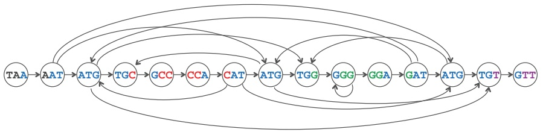

<details>
<summary>flowchart</summary>


</details>

FIGURE 3.7 The graph showing all connections between nodes representing the 3-mer composition of TAATGCCATGGGATGTT. This graph has fifteen nodes and 25 edges. Note that the genome can still be spelled out by walking along the horizontal edges from TAA to GTT.

126

---

H O W D O W E A S S E M B L E G E N O M E S ?

Figure 3.7 presents an example of a **graph**, or a network of **nodes** connected by **edges**. This particular graph is an example of a **directed graph**, whose edges have a direction and are represented by arrows (as opposed to **undirected graphs** whose edges do not have directions). If you are unfamiliar with graphs, see **DETOUR: Graphs**.

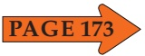

## The genome vanishes

The genome can still be traced out in the graph in Figure 3.7 by following the horizontal path from **TAA** to **GTT**. But in genome sequencing, we do not know in advance how to correctly order reads. Therefore we will arrange the 3-mers lexicographically, which produces the **overlap graph** shown in Figure 3.8. The genome path has disappeared!

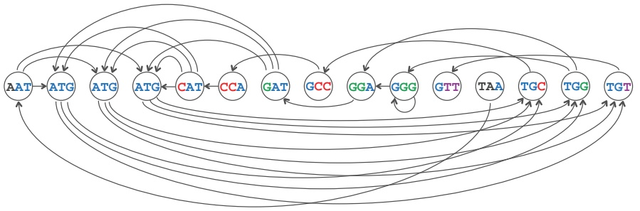

<details>
<summary>flowchart</summary>

This diagram illustrates a multi-stage genetic or metabolic process involving enzymes (AAT, ATG, CAT, CCA, GAT, GCC, GGA, GGG, GTT, TAA, TGC, TGG, TGT) and their interactions with various downstream components.
</details>

FIGURE 3.8 The same graph as the one in Figure 3.7 with 3-mers ordered lexicographically. The path through the graph representing the correct assembly is now harder to see.

The genome path may have disappeared to the naked eye, but it must still be there, since we have simply rearranged the nodes of the graph. Indeed, Figure 3.9 (top) highlights the genome path spelling out **TAATGCCATGGGATGTT**. However, if we had given you this graph to begin with, you would have needed to find a path through the graph visiting each node exactly once; such a path “explains” all the 3-mers in the 3-mer composition of the genome. Although finding such a path is currently just as difficult as trying to assemble the genome by hand, the graph nevertheless gives us a nice way of visualizing the overlap relationships between reads.

**STOP and Think:** Can any other strings be reconstructed by following a path visiting all the nodes in Figure 3.8?


127

---

C H A P T E R 3

To generalize the construction of the graph in Figure 3.8 to an arbitrary collection of k-mers Patterns, we form a node for each k-mer in Patterns and connect k-mers Pattern and Pattern’ by a directed edge if SUFFIX(Pattern) = PREFIX(Pattern’). The resulting graph is called the **overlap graph** on these k-mers, denoted OVERLAP(Patterns).


## Overlap Graph Problem:

Construct the overlap graph of a collection of k-mers.

**Input**: A collection Patterns of k-mers.

**Output**: The overlap graph OVERLAP(Patterns).

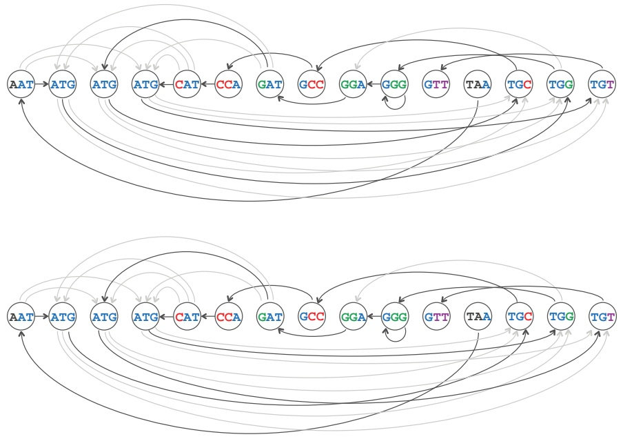

FIGURE 3.9 (Top) The genome path spelling out TAATGCCATGGGATGTT, highlighted in the overlap graph. (Bottom) Another Hamiltonian path in the overlap graph spells the genome TAATGGGATGCCATGTT. These two genomes differ by exchanging the positions of CC and GG but have the same 3-mer composition.

128

---

H O W D O W E A S S E M B L E G E N O M E S ?

## Two graph representations

If you have never worked with graphs before, you may be wondering how to represent graphs in your programs. To make a brief digression from our discussion of genome assembly, consider the graph in Figure 3.10 (top). We can move around this graph’s nodes without changing the graph (e.g., the graphs in Figure 3.7 and Figure 3.8 are the same). As a result, when we are representing a graph computationally, the only information we need to store is the pair of nodes that each edge connects.

There are two standard ways of representing a graph. For a directed graph with n nodes, the $n \times n$ **adjacency matrix** $( A _ { i , j } )$ is defined by the following rule: $A _ { i , j } = 1$ if a directed edge connects node i to node $j ,$ and $A _ { i , j } = 0$ otherwise. Another (more memory-efficient) way of representing a graph is to use an **adjacency list**, for which we simply list all nodes connected to each node (see Figure 3.10).

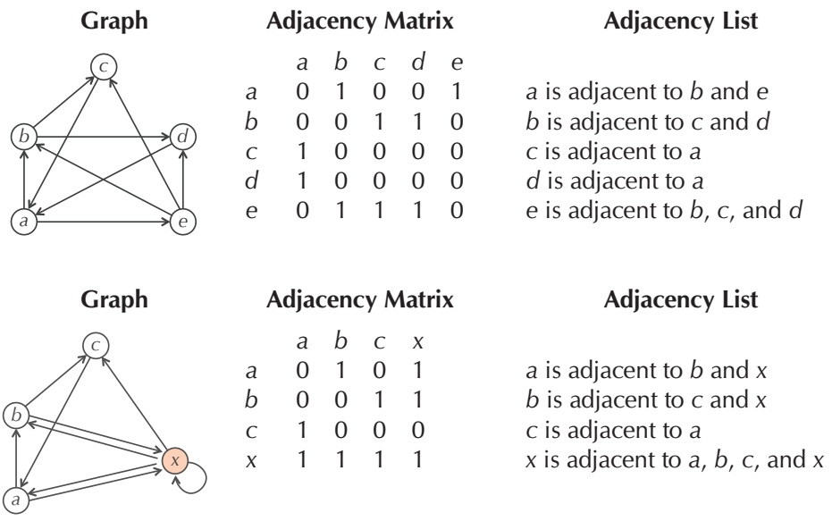

FIGURE 3.10 (Top) A graph with five nodes and nine edges, followed by its adjacency matrix and adjacency list. (Bottom) The graph produced by gluing nodes d and e into a single node $X _ { r }$ along with the new graph’s adjacency matrix and adjacency list.

129

---

C H A P T E R 3


Hamiltonian paths and universal strings

We now know that to solve the String Reconstruction Problem, we are looking for a path in the overlap graph that visits every node exactly once. A path in a graph visiting every node once is called a **Hamiltonian path**, in honor of the Irish mathematician William Hamilton (see **DETOUR: The Icosian Game**). As Figure 3.9 illustrates, a graph may have more than one Hamiltonian path.

## Hamiltonian Path Problem:

Construct a Hamiltonian path in a graph.

**Input**: A directed graph.

**Output**: A path visiting every node in the graph exactly once (if such a path exists).

We do not ask you to solve the Hamiltonian Path Problem yet, since it is not clear how we could design an efficient algorithm for it. Instead, we want you to meet Nicolaas de Bruijn, a Dutch mathematician. In 1946, de Bruijn was interested in solving a purely theoretical problem, described as follows. A **binary string** is a string composed only of 0’s and 1’s; a binary string is **k-universal** if it contains every binary k-mer exactly once. For example, **0001110100** is a 3-universal string, as it contains each of the eight binary 3-mers (**000**, **001**, **011**, **111**, **110**, **101**, **010**, and **100**) exactly once.

Finding a k-universal string is equivalent to solving the String Reconstruction Prob lem when the k-mer composition is the collection of all binary k-mers. Thus, finding a k-universal string is equivalent to finding a Hamiltonian path in the overlap graph formed on all binary k-mers (Figure 3.11). Although the Hamiltonian path in Figure 3.11 can easily be found by hand, de Bruijn was interested in constructing k-universal strings for arbitrary values of k. For example, to find a 20-universal string, you would have to consider a graph with over a million nodes. It is absolutely unclear how to find a Hamiltonian path in such a huge graph, or even whether such a path exists!

Instead of searching for Hamiltonian paths in huge graphs, de Bruijn developed a completely different (and somewhat non-intuitive) way of representing a k-mer composition using a graph. Later in this chapter, we will learn how he used this method to construct universal strings.


**EXERCISE BREAK:** Construct a 4-universal string. How many different 4- universal strings can you construct?

130

---

H O W D O W E A S S E M B L E G E N O M E S ?

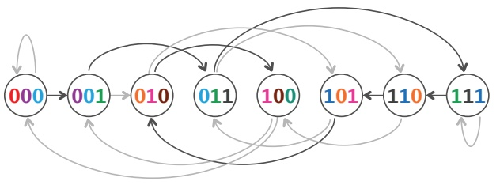

<details>
<summary>flowchart</summary>

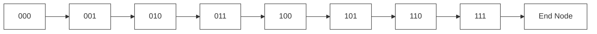
</details>

FIGURE 3.11 A Hamiltonian path highlighted in the overlap graph of all binary 3-mers. This path spells out the 3-universal binary string 0001110100.

## Another Graph for String Reconstruction

Gluing nodes and de Bruijn graphs

Let’s again represent the genome **TAATGCCATGGGATGTT** as a sequence of its 3-mers:

## TAA AAT ATG TGC GCC CCA CAT ATG TGG GGG GGA GAT ATG TGT GTT

This time, instead of assigning these 3-mers to nodes, we will assign them to edges, as shown in Figure 3.12. You can once again reconstruct the genome by following this path from left to right, adding one new nucleotide at each step. Since each pair of consecutive edges represent consecutive 3-mers that overlap in two nucleotides, we will label each node of this graph with a 2-mer representing the overlapping nucleotides shared by the edges on either side of the node. For example, the node with incoming edge **CAT** and outgoing edge **ATG** is labeled **AT**.

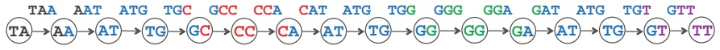

<details>
<summary>flowchart</summary>

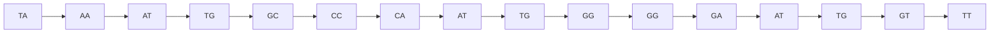
</details>

FIGURE 3.12 Genome TAATGCCATGGGATGTT represented as a path with edges (rather than nodes) labeled by 3-mers and nodes labeled by 2-mers.

Nothing seems new here until we start **gluing** identically labeled nodes. In Fig ure 3.13 (top panels), we bring the three **AT** nodes closer and closer to each other until they have been glued into a single node. Note that there are also three nodes labeled by **TG**, which we glue together in Figure 3.13 (middle panels). Finally, we glue together

131

---

C H A P T E R 3

the two nodes labeled GG (**GG** and **GG**), as shown in Figure 3.13 (bottom panels), which produces a special type of edge called a **loop** connecting GG to itself.

The number of nodes in the resulting graph (Figure 3.13 (bottom right)) has reduced from 16 to 11, while the number of edges stayed the same. This graph is called the **de Bruijn graph** of TAATGCCATGGGATGTT, denoted $\mathrm { D E B R U I J N } _ { 3 }$ (TAATGCCATGGGATGTT) Note that this de Bruijn graph has three different edges connecting **AT** to **TG**, representing three copies of the repeat **ATG**.

In general, given a genome Text, $\mathrm { P A T H G R A P H } _ { k } ( T e x t )$ is the path consisting of $\big | T e x t \big | - k + 1$ edges, where the i-th edge of this path is labeled by the i-th k-mer in Text and the i-th node of the path is labeled by the i-th (k  1)-mer in Text. The de Bruijn graph DEBRUIJN<sub>k</sub>(Text) is formed by gluing identically labeled nodes in $\mathrm { P A T H G R A P H } _ { k } ( T e x t )$


## De Bruijn Graph from a String Problem:

Construct the de Bruijn graph of a string.

**Input**: A string Text and an integer $k .$

**Output**: $\mathrm { D E B R U I J N } _ { k } ( T e x t )$


## STOP and Think: Consider the following questions.

1. If we gave you the de Bruijn graph $\mathrm { D E B R U I J N } _ { k } ( T e x t )$ without giving you Text, could you reconstruct Text?
2. Construct the de Bruijn graphs $\mathrm { D E B R U I J N } _ { 2 } ( T e x t )$ , DE $\mathrm { B R U I J N } _ { 3 } \big ( T e x t \big )$ , and DE $\mathrm { B R U I J N _ { 4 } } \big ( T e x t \big )$ for Text = **TAATGCCATGGGATGTT**. What do you notice?
3. How does the graph $\mathrm { D E B R U I J N } _ { 3 }$ (**TAATGCCATGGGATGTT**) compare to DE $\mathrm { B R U I J } _ { 3 }$ (**TAATGGGATGCCATGTT**)?


**CHARGING STATION (The Effect of Gluing on the Adjacency Matrix):** Figure 3.10 (bottom) shows how the gluing operation affects the adjacency matrix and adjacency list of a graph. Check out this Charging Station to see how gluing works for a de Bruijn graph.

132

---

H O W D O W E A S S E M B L E G E N O M E S ?

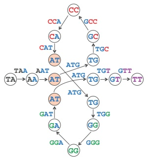

<details>
<summary>flowchart</summary>

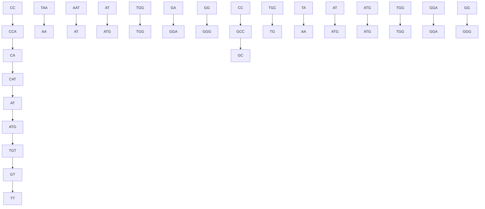
</details>

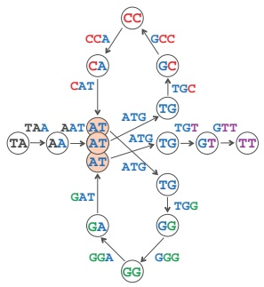

<details>
<summary>flowchart</summary>

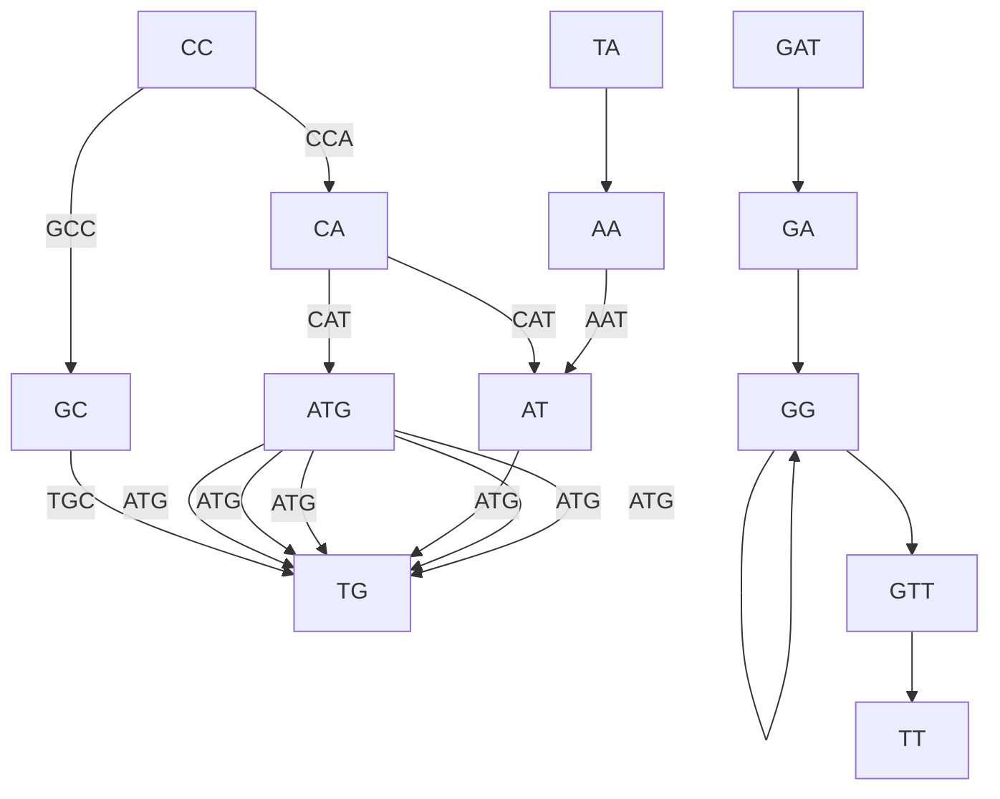
</details>

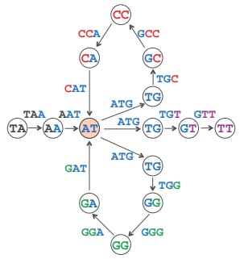

<details>
<summary>flowchart</summary>

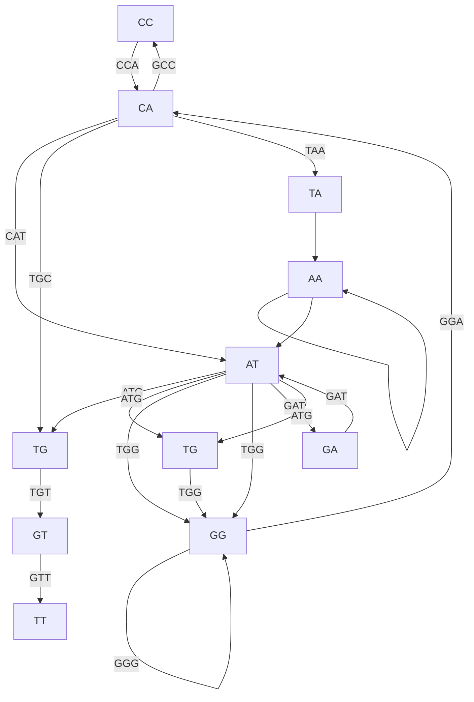
</details>

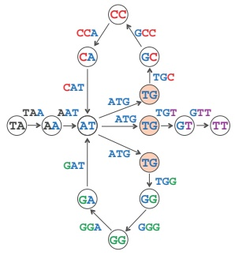

<details>
<summary>flowchart</summary>

This flowchart illustrates a genetic sequence or gene structure with multiple branches and directional transitions, likely representing a biological process or gene expression.
</details>

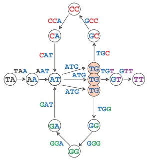

<details>
<summary>flowchart</summary>

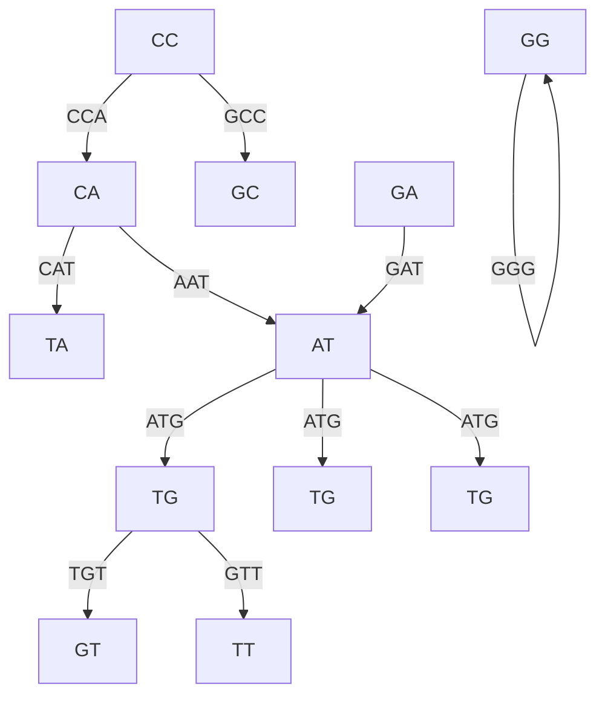
</details>

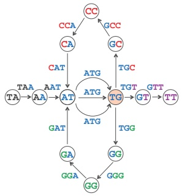

<details>
<summary>flowchart</summary>

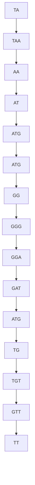
</details>

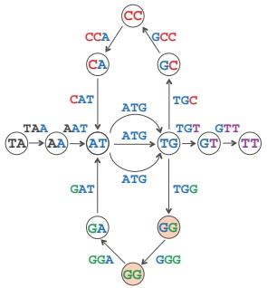

<details>
<summary>flowchart</summary>

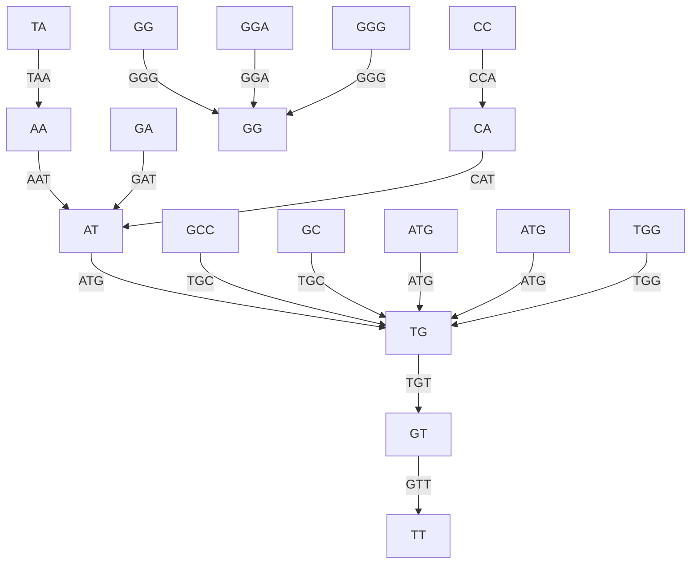
</details>

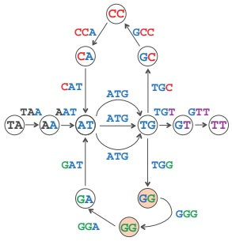

<details>
<summary>flowchart</summary>

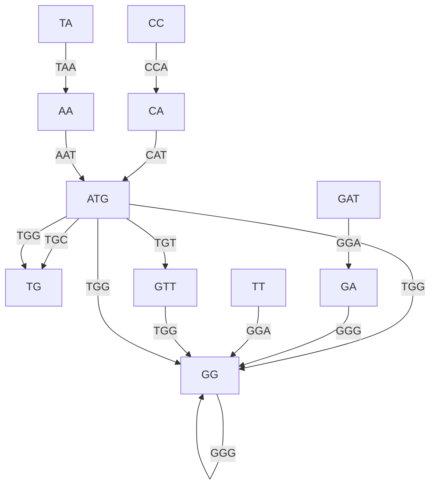
</details>

DEBRUIJN<sub>3</sub>(TAATGCCATGGGATGTT)

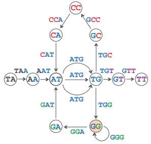

<details>
<summary>flowchart</summary>

This diagram illustrates a genetic cycle or gene expression pathway involving AT, TAA, and GG genes with associated regulatory elements like ATG and GGA.
</details>

FIGURE 3.13 (Top panels) Bringing the three nodes labeled AT in Figure 3.12 closer (left) and closer (middle) to each other to eventually glue them into a single node (right). (Middle panels) Bringing the three nodes labeled TG closer (left) and closer (middle) to each other to eventually glue them into a single node (right). (Bottom panels) Bringing the two nodes labeled GG closer (left) and closer (middle) to each other to eventually glue them into a single node (right). The path with 16 nodes from Figure 3.12 has been transformed into the graph DEBRUIJN<sub>3</sub>(TAATGCCATGGGATGTT) with eleven nodes.

133

---

C H A P T E R 3

## Walking in the de Bruijn Graph

## Eulerian paths

Even though we have glued together nodes to form the de Bruijn graph, we have not changed its edges, and so the path from **TA** to **TT** reconstructing the genome is still hiding in DEBRUIJ $\mathrm { N } _ { 3 }$ (**TAATGCCATGGGATGTT**) (Figure 3.14), although this path has become “tangled” after gluing. Therefore, solving the String Reconstruction Problem reduces to finding a path in the de Bruijn graph that visits every edge exactly once. Such a path is called an **Eulerian Path** in honor of the great mathematician Leonhard Euler (pronounced “oiler”).

## Eulerian Path Problem:

Construct an Eulerian path in a graph.

**Input**: A directed graph.

**Output**: A path visiting every edge in the graph exactly once (if such a path exists).

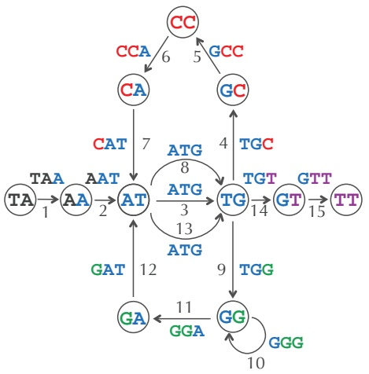

<details>
<summary>flowchart</summary>

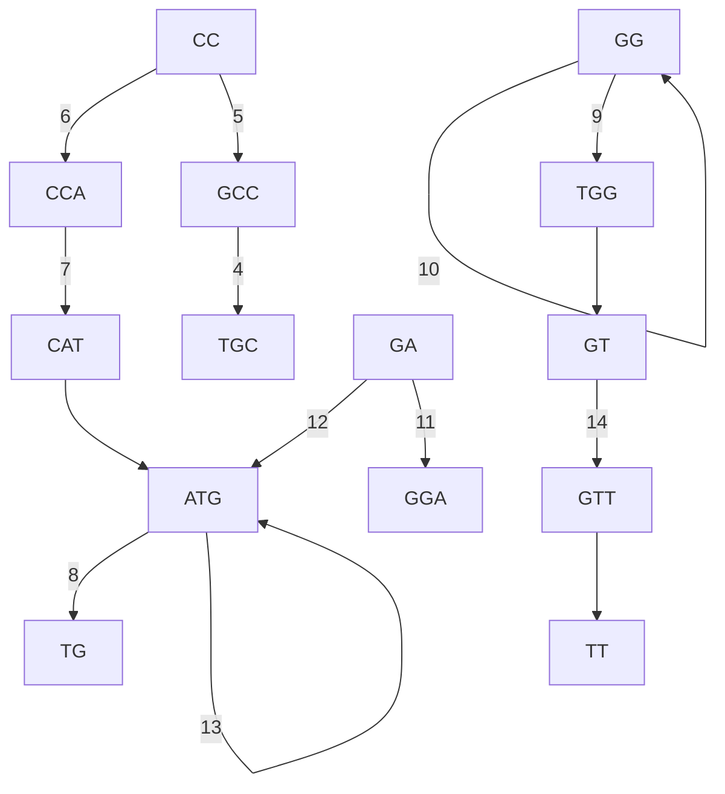
</details>

FIGURE 3.14 The path from TA to TT spelling out the genome TAATGCCATGGGATGTT has become “tangled” in the de Bruijn graph. The numbering of the fifteen edges of the path indicates an Eulerian path reconstructing the genome.

134

---

H O W D O W E A S S E M B L E G E N O M E S ?

We now have an alternative way of solving the String Reconstruction Problem that amounts to finding an Eulerian path in the de Bruijn graph. But wait — to construct the de Bruijn graph of a genome, we glued together nodes of $\mathrm { P A T H G R A P H } _ { k } ( T e x t )$ . However, constructing this graph requires us to know the correct ordering of the k-mers in Text!

**STOP and Think:** Can you construct DEBRUIJN<sub>k</sub>(Text) if you don’t know Text but you do know its k-mer composition?

Another way to construct de Bruijn graphs

Figure 3.15 (top) represents the 3-mer composition of **TAATGCCATGGGATGTT** as a composition graph COMPOSITIONGRAPH<sub>3</sub>(**TAATGCCATGGGATGTT**). As with the de Bruijn graph, each 3-mer is assigned to a directed edge, with its prefix labeling the first node of the edge and its suffix labeling the second node of the edge. However, the edges of this graph are **isolated**, meaning that no two edges share a node.

**STOP and Think:** Given Text = **TAATGCCATGGGATGTT**, glue identically labeled nodes in COMPOSITIONGRAPH<sub>3</sub>(Text). How does the resulting graph differ from DEBRUIJN<sub>3</sub>(Text) obtained by gluing the identically labeled nodes in $\mathrm { P A T H G R A P H } _ { 3 } ( T e x t ) ?$

Figure 3.15 shows how $\mathrm { { \sf C O M P O S I T I O N G R A P H } } _ { 3 } ( T e x t )$ changes after gluing nodes with the same label, for Text = **TAATGCCATGGGATGTT**. These operations glue the fifteen isolated edges in $\mathrm { { \sf C O M P O S I T I O N G R A P H } } _ { 3 } ( T e x t )$ into the path $\mathrm { P A T H G R A P H } _ { 3 } ( T e x t )$ Follow-up gluing operations proceed in exactly the same way as when we glued nodes of $\mathrm { P A T H G R A P H } _ { 3 } ( T e x t )$ , which results in $\mathrm { D E B R U I J N } _ { 3 } ( T e x t )$ . Thus, we can construct the de Bruijn graph from this genome’s 3-mer composition without knowing the genome!

For an arbitrary string Text, we define $\mathsf { C O M P O S I T I O N G R A P H } _ { k } ( { \it T e x t } )$ as the graph consisting of $\big | T e x t \big | - k + 1$ isolated edges, where edges are labeled by k-mers in Text; every edge labeled by a k-mer edge connects nodes labeled by the prefix and suffix of this k-mer. The graph COMPOSITIONG $\scriptstyle \mathrm { R A P H } _ { k } { \big ( } T e x t { \big ) }$ is just a collection of isolated edges representing the k-mers in the k-mer composition of Text, meaning that we can construct $\mathsf { C O M P O S I T I O N G R A P H } _ { k } ( { \mathit { T e x t } } )$ from the k-mer composition of Text. Gluing nodes with the same label in $\mathsf { C O M P O S I T I O N G R A P H } _ { k } ( { \mathit { T e x t } } )$ produces DE $\scriptstyle \mathrm { B R U I J N } _ { k } { \big ( } T e x t { \big ) }$

Given an arbitrary collection of k-mers Patterns (where some k-mers may appear multiple times), we define COMPOSITIONGRAPH(Patterns) as a graph with |Patterns| isolated edges. Every edge is labeled by a k-mer from Patterns, and the starting and

STOP

STOP

135

---

C H A P T E R 3

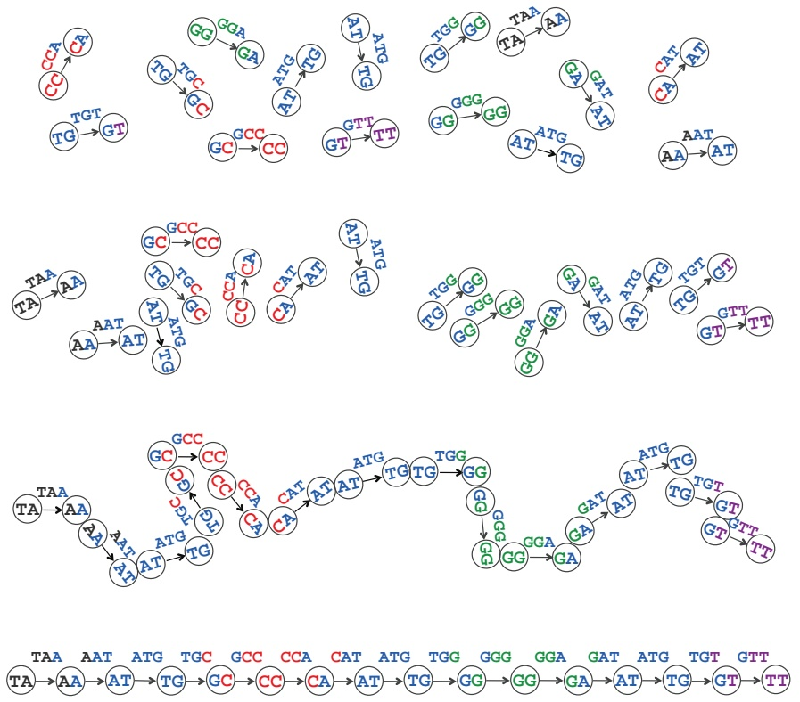

<details>
<summary>flowchart</summary>

This image displays a DNA sequencing chromatography (DNA sequencing) workflow, showing the sequence of nucleotides and their corresponding ATG/TGG sequences.
</details>

FIGURE 3.15 Gluing some identically labeled nodes transforms the graph COMPOSITIONGRAPH<sub>3</sub>(TAATGCCATGGGATGTT) (top) into the graph PATHGRAPH<sub>3</sub>(TAATGCCATGGGATGTT) (bottom). Gluing all identically labeled nodes produces DEBRUIJN<sub>3</sub>(TAATGCCATGGGATGTT) from Figure 3.14.

ending nodes of an edge are labeled by the prefix and suffix of the k-mer labeling that edge. We then define DEBRUIJN(Patterns) by gluing identically labeled nodes in COMPOSITIONGRAPH(Patterns), which yields the following algorithm.

## DEBRUIJN(Patterns)

represent every k-mer in Patterns as an isolated edge between its prefix and suffix glue all nodes with identical labels, yielding the graph DEBRUIJN(Patterns) **return** DEBRUIJN(Patterns)

136

---

H O W D O W E A S S E M B L E G E N O M E S ?

Constructing de Bruijn graphs from k-mer composition

Constructing the de Bruijn graph by gluing identically labeled nodes will help us later when we generalize the notion of de Bruijn graph for other applications. We will now describe another useful way to construct de Bruijn graphs without gluing.

Given a collection of k-mers Patterns, the nodes of DEBRUIJN<sub>k</sub>(Patterns) are simply all unique (k  1)-mers occurring as a prefix or suffix of 3-mers in Patterns. For example, say we are given the following collection of 3-mers:

**AAT ATG ATG ATG CAT CCA GAT GCC GGA GGG GTT TAA TGC TGG TGT**

Then the set of eleven unique 2-mers occurring as a prefix or suffix in this collection is as follows:

**AA AT CA CC GA GC GG GT TA TG TT**

For every k-mer in Patterns, we connect its prefix node to its suffix node by a directed edge in order to produce DEBRUIJN(Patterns). You can verify that this process produces the same de Bruijn graph that we have been working with (Figure 3.16).

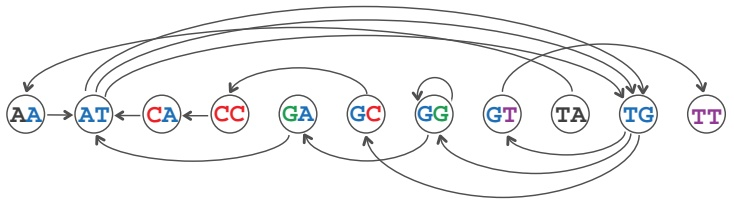

<details>
<summary>flowchart</summary>

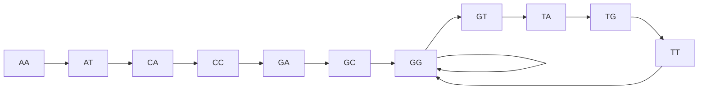
</details>

FIGURE 3.16 The de Bruijn graph above is the same as the graph in Figure 3.14, although it has been drawn differently.

## De Bruijn Graph from k-mers Problem:

Construct the de Bruijn graph of a collection of k-mers.

**Input**: A collection of k-mers Patterns.

**Output**: The de Bruijn graph DEBRUIJN(Patterns).


137

---

C H A P T E R 3

## De Bruijn graphs versus overlap graphs

We now have two ways of solving the String Reconstruction Problem. We can either find a Hamiltonian path in the overlap graph or find an Eulerian path in the de Bruijn graph (Figure 3.17). Your inner voice may have already started complaining: was it really worth my time to learn two slightly different ways of solving the same problem? After all, we have only changed a single word in the statements of the Hamiltonian and Eulerian Path Problems, from finding a path visiting every node exactly once to finding a path visiting every edge exactly once.

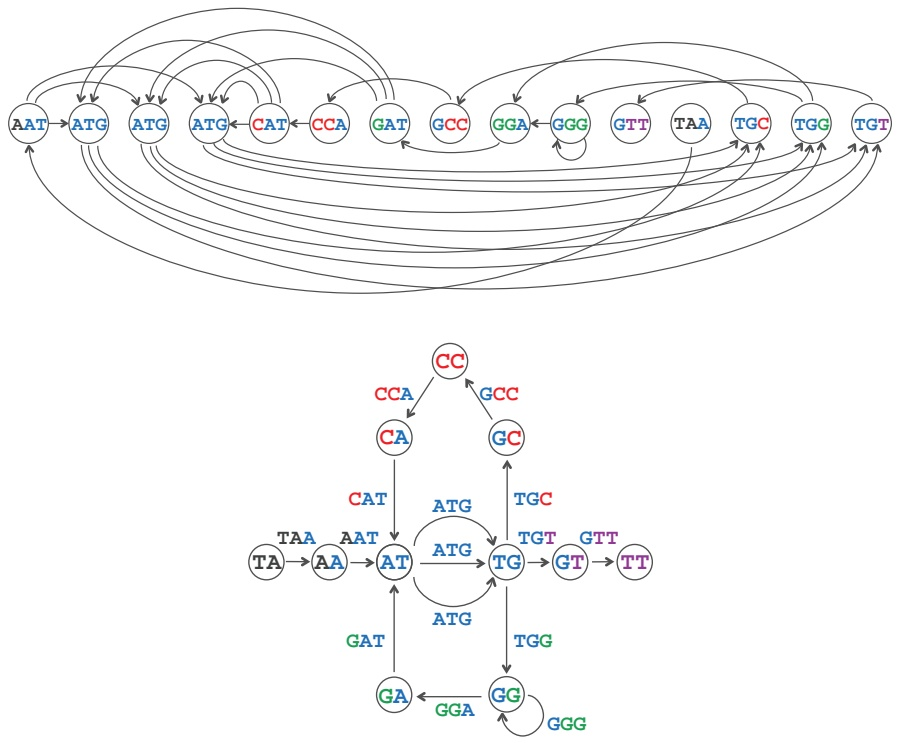

FIGURE 3.17 The overlap graph (top) and de Bruijn graph (bottom) for the same collection of 3-mers.


**STOP and Think:** Which graph would you rather work with, the overlap graph or the de Bruijn graph?

138

---

H O W D O W E A S S E M B L E G E N O M E S ?

Our guess is that you would probably prefer working with the de Bruijn graph, since it is smaller. However, this would be the wrong reason to choose one graph over the other. In the case of real assembly problems, both graphs will have millions of nodes, and so all that matters is finding an efficient algorithm for reconstructing the genome. If we can find an efficient algorithm for the Hamiltonian Path Problem, but not for the Eulerian path Problem, then you should select the overlap graph even though it looks more complex.

The choice between these two graphs is the pivotal decision of this chapter. To help you make this decision, we will ask you to hop onboard our bioinformatics time machine for a field trip to the 18th Century.

## The Seven Bridges of Königsberg

Our destination is 1735 and the Prussian city of Königsberg. This city, which today is Kaliningrad, Russia, comprised both banks of the Pregel River as well as two river islands; seven bridges connected these four different parts of the city, as illustrated in Figure 3.18 (top). Königsberg’s residents enjoyed taking walks, and they asked a simple question: Is it possible to set out from my house, cross each bridge exactly once, and return home? Their question became known as the **Bridges of Königsberg Problem**.

**EXERCISE BREAK:** Does the Bridges of Königsberg Problem have a solution?

In 1735, Leonhard Euler drew the graph in Figure 3.18 (bottom), which we call Königsberg; this graph’s nodes represent the four sectors of the city, and its edges represent the seven bridges connecting different sectors. Note that the edges of Königsberg are **undirected**, meaning that they can be traversed in either direction.

**STOP and Think:** Redefine the Bridges of Königsberg Problem as a question about the graph Königsberg.

We have already defined an Eulerian path as a path in a graph traversing each edge of a graph exactly once. A cycle that traverses each edge of a graph exactly once is called an **Eulerian cycle**, and we say that a graph containing such a cycle is **Eulerian**. Note that an Eulerian cycle in Königsberg would immediately provide the residents of the city with the walk they had wanted. We now can redefine the Bridges of Königsberg Problem as an instance of the following more general problem.

STOP

139

---

C H A P T E R 3

## Eulerian Cycle Problem:

Find an Eulerian cycle in a graph.

**Input**: A graph.

**Output**: An Eulerian cycle in this graph, if one exists.

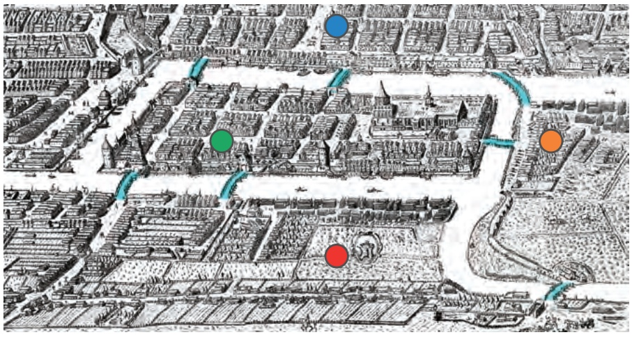

<details>
<summary>text_image</summary>

Historical map illustration showing European city layout with marked locations and directional arrows indicating movement or change.
</details>

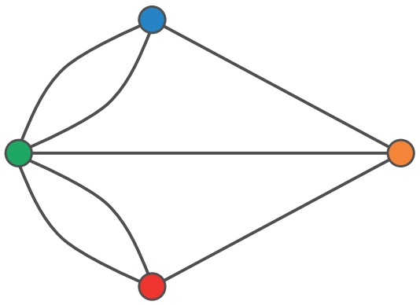

<details>
<summary>flowchart</summary>

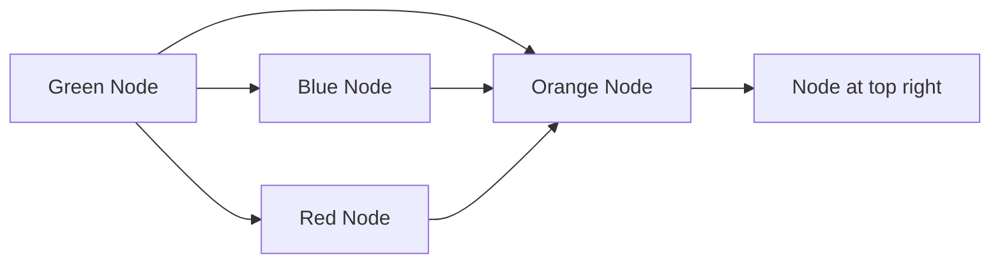
</details>

FIGURE 3.18 (Top) A map of Königsberg, adapted from Joachim Bering’s 1613 illus tration. The city was made up of four sectors represented by the blue, red, yellow, and green dots. The seven bridges connecting the different parts of the city have been highlighted to make them easier to see. (Bottom) The graph Königsberg.

140

---

H O W D O W E A S S E M B L E G E N O M E S ?

Euler solved the Bridges of Königsberg Problem, showing that no walk can cross each bridge exactly once (i.e., the graph Königsberg is not Eulerian), which you may have already figured out for yourself. Yet his real contribution, and the reason why he is viewed as the founder of **graph theory**, a field of study that still flourishes today, is that he proved a theorem dictating when a graph will have an Eulerian cycle. His theorem immediately implies an efficient algorithm for constructing an Eulerian cycle in any Eulerian graph, even one having millions of edges. Furthermore, this algorithm can easily be extended into an algorithm constructing an Eulerian path (in a graph having such a path), which will allow us to solve the String Reconstruction Problem by using the de Bruijn graph.

On the other hand, it turns out that no one has ever been able to find an efficient algorithm solving the Hamiltonian Path Problem. The search for such an algorithm, or for a proof that an efficient algorithm does not exist for this problem, is at the heart of one of the most fundamental unanswered questions in computer science. Computer scientists classify an algorithm as **polynomial** if its running time can be bounded by a polynomial in the length of the input data. On the other hand, an algorithm is **exponential** if its runtime on some datasets is exponential in the length of the input data.

**EXERCISE BREAK:** Classify the algorithms that we encountered in Chapter 1 as polynomial or exponential.

Although Euler’s algorithm is polynomial, the Hamiltonian Path Problem belongs to a special class of problems for which all attempts to develop a polynomial algorithm have failed (see **DETOUR: Tractable and Intractable Problems**). Yet instead of trying to solve a problem that has stumped computer scientists for decades, we will set aside the overlap graph and instead focus on the de Bruijn graph approach to genome assembly.

For the first two decades following the invention of DNA sequencing methods, biologists assembled genomes using overlap graphs, since they failed to realize that the Bridges of Königsberg held the key to DNA assembly (see **DETOUR: From Euler to Hamilton to de Bruijn**). Indeed, overlap graphs were used to assemble the human genome. It took bioinformaticians some time to figure out that the de Bruijn graph, first constructed to solve a completely theoretical problem, was relevant to genome assembly. Moreover, when the de Bruijn graph was brought to bioinformatics, it was considered an exotic mathematical concept with limited practical applications. Today, the de Bruijn graph has become the dominant approach for genome assembly.


PAGE 176

PAGE 177

141

---

C H A P T E R 3

## Euler’s Theorem

We will now explore Euler’s method for solving the Eulerian Cycle Problem. Euler worked with undirected graphs like Königsberg, but we will consider an analogue of his algorithm for directed graphs so that his method will apply to genome assembly.

Consider an ant, whom we will call Leo, walking along the edges of an Eulerian cycle. Every time Leo enters a node of this graph by an edge, he is able to leave this node by another, unused edge. Thus, in order for a graph to be Eulerian, the number of incoming edges at any node must be equal to the number of outgoing edges at that node. We define the indegree and outdegree of a node v (denoted IN(v) and $\operatorname { O U T } ( v )$ respectively) as the number of edges leading into and out of v. A node v is balanced if $\mathrm { I N } \big ( v \big ) { = } \mathrm { O U T } \big ( v \big )$ , and a graph is **balanced** if all its nodes are balanced. Because Leo must always be able to leave a node by an unused edge, any Eulerian graph must be balanced. Figure 3.19 shows a balanced graph and an unbalanced graph.

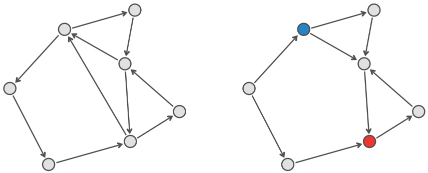

FIGURE 3.19 Balanced (left) and unbalanced (right) directed graphs. For the (unbalanced) blue node $v , \mathsf { I N } ( v ) = 1$ and $\mathsf { O U T } ( v ) = 2 ,$ , whereas for the (unbalanced) red node $w , \mathsf { I N } ( w ) = 2$ and $\dot { \mathsf { O U T } } ( \pmb { w } ) = 1$


**STOP and Think:** We now know that every Eulerian graph is balanced; is every balanced graph Eulerian?

The graph in Figure 3.20 is balanced but not Eulerian because it is **disconnected**, meaning that some nodes cannot be reached from other nodes. In any disconnected graph, it is impossible to find an Eulerian cycle. In contrast, we say that a directed graph is **strongly connected** if it is possible to reach any node from every other node.

142

---

H O W D O W E A S S E M B L E G E N O M E S ?

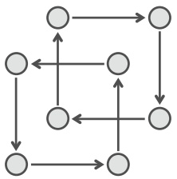

<details>
<summary>flowchart</summary>

```mermaid
graph LR
  A["Node 1"] --> B["Node 2"]
  C["Node 3"] --> D["Node 4"]
  E["Node 5"] --> F["Node 6"]
  G["Node 7"] --> H["Node 8"]
  I["Node 9"] --> J["Node 10"]
  K["Node 11"] --> L["Node 12"]
  M["Node 13"] --> N["Node 14"]
  O["Node 15"] --> P["Node 16"]
  Q["Node 17"] --> R["Node 18"]
  S["Node 19"] --> T["Node 20"]
  U["Node 21"] --> V["Node 22"]
  W["Node 23"] --> X["Node 24"]
  Y["Node 25"] --> Z["Node 26"]
  AA["Node 27"] --> AB["Node 28"]
  AC["Node 29"] --> AD["Node 30"]
  AE["Node 31"] --> AF["Node 32"]
  AG["Node 33"] --> AH["Node 34"]
  AI["Node 35"] --> AJ["Node 36"]
  AK["Node 37"] --> AL["Node 38"]
  AM["Node 39"] --> AN["Node 40"]
  AO["Node 41"] --> AP["Node 42"]
  AQ["Node 43"] --> AR["Node 44"]
  AS["Node 45"] --> AT["Node 46"]
  AU["Node 47"] --> AV["Node 48"]
  AW["Node 49"] --> AX["Node 50"]
  A --> B
  B --> C
  C --> D
  D --> E
  E --> F
  F --> G
  G --> H
  H --> I
  I --> J
  J --> K
  K --> L
  L --> M
  M --> N
  N --> O
  O --> P
  P --> Q
  Q --> R
  R --> S
  S --> T
  T --> U
  U --> V
  V --> W
  W --> X
  X --> Y
  Y --> Z
  Z --> AA
  AA --> AB
  AB --> AC
  AC --> AD
  AD --> AE
  AE --> AF
  AF --> AG
  AG --> AH
  AH --> AI
  AI --> AJ
  AJ --> AK
  AK --> AL
  AL --> AM
  AM --> AN
  AN --> AO
  AO --> AP
  AP --> AQ
```
</details>

FIGURE 3.20 A balanced, disconnected graph.

We now know that an Eulerian graph must be both balanced and strongly connected. Euler’s Theorem states that these two conditions are sufficient to guarantee that an arbitrary graph is Eulerian. As a result, it implies that we can determine whether a graph is Eulerian without ever having to draw any cycles.

**Euler’s Theorem:** Every balanced, strongly connected directed graph is Eulerian.

Proof. Let Graph be an arbitrary balanced and strongly connected directed graph. To prove that Graph has an Eulerian cycle, place Leo at any node $v _ { 0 }$ of Graph (the green node in Figure 3.21), and let him randomly walk through the graph under the condition that he cannot traverse the same edge twice.

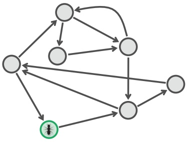

<details>
<summary>flowchart</summary>

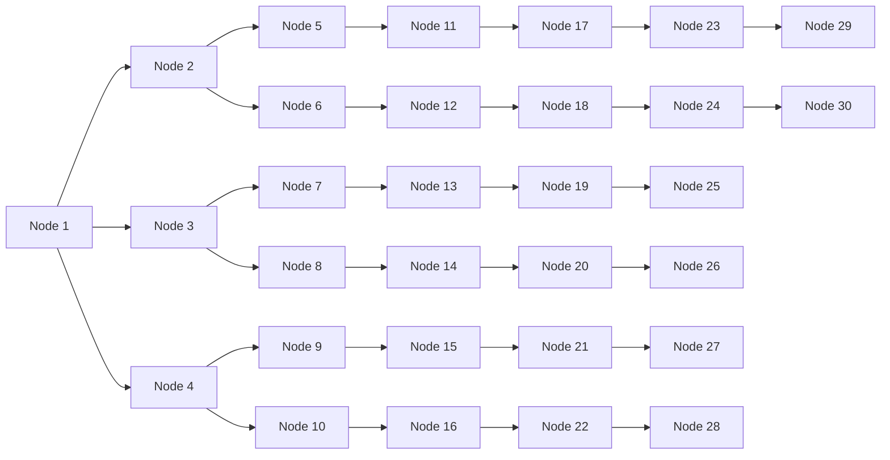
</details>

FIGURE 3.21 Leo starts at the green node $v _ { 0 }$ and walks through a balanced and strongly connected graph.

If Leo were incredibly lucky — or a genius — then he would traverse each edge exactly once and return back to $v _ { 0 } .$ . However, odds are that he will “get stuck" somewhere before he can complete an Eulerian cycle, meaning that he reaches a node and finds no unused edges leaving that node.

143

---

C H A P T E R 3


**STOP and Think:** Where is Leo when he gets stuck? Can he get stuck in any node of the graph or only in certain nodes?

It turns out that the only node where Leo can get stuck is the starting node $v _ { 0 } !$ The reason why is that Graph is balanced: if Leo walks into any node other than $v _ { 0 }$ (through an incoming edge), then he will always be able to escape via an unused outgoing edge. The only exception to this rule is the starting node $v _ { 0 } ,$ since Leo used up one of the outgoing edges of $v _ { 0 }$ on his first move. Now, because Leo has returned to $v _ { 0 } ,$ the result of his walk was a cycle, which we call $C y c l e _ { 0 }$ (Figure 3.22 (left)).

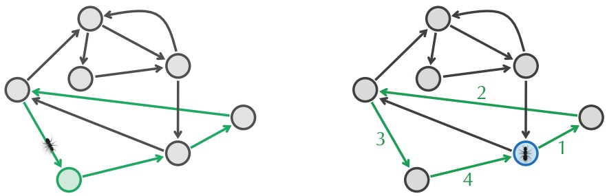

FIGURE 3.22 (Left) Leo produces a cycle $C y c I e _ { 0 }$ (formed by green edges) when he gets stuck at the green node $V _ { 0 }$ . In this case, he has not yet visited every edge in the graph. (Right) Starting at a new node $v _ { 1 }$ (shown in blue), Leo first travels along $C y c I e _ { 0 } ,$ returning to $v _ { 1 }$ . Note that the blue node $V _ { 1 } ,$ unlike the green node $V _ { 0 } ,$ , has unused outgoing and incoming edges.


**STOP and Think:** Is there a way to give Leo different instructions so that he selects a longer walk through the graph before he gets stuck?

As we mentioned, if $C y c l e _ { 0 }$ is Eulerian, then we are finished. Otherwise, because Graph is strongly connected, some node on $C y c l e _ { 0 }$ must have unused edges entering it and leaving it (why?). Naming this node $v _ { 1 }$ , we ask Leo to start at $v _ { 1 }$ instead of $v _ { 0 }$ and traverse $C y c l e _ { 0 }$ (thus returning to $v _ { 1 } )$ , as shown in Figure 3.22 (right).

Leo is probably annoyed that we have asked him to travel along the exact same cycle, since as before, he will eventually return to $v _ { 1 }$ , the node where he started. However, now there are unused edges starting at this node, and so he can continue walking from $v _ { 1 }$ , using a new edge each time. The same argument as the one that we used before implies that Leo must eventually get stuck at $v _ { 1 }$ . The result of Leo’s walk is a new cycle, $C y c l e _ { 1 }$ (Figure 3.23), which is larger than $C y c l e _ { 0 }$

144

---

H O W D O W E A S S E M B L E G E N O M E S ?

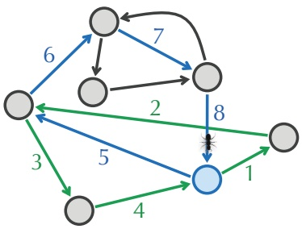

<details>
<summary>flowchart</summary>

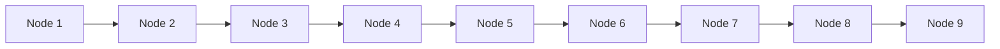
</details>

FIGURE 3.23 After traversing the previously constructed green cycle $C y c I e _ { 0 } ,$ , Leo continues walking and eventually produces a larger cycle $C y c I e _ { 1 }$ formed of both the green and the blue cycles put together into a single cycle.

If $C y c l e _ { 1 }$ is an Eulerian cycle, then Leo has completed his job. Otherwise, we select a node $v _ { 2 }$ in $C y c l e _ { 1 }$ that has unused edges entering it and leaving it (the red node in Figure 3.24 (left)). Starting at $v _ { 2 } ,$ , we ask Leo to traverse $C y c l e _ { 1 } ,$ returning to $v _ { 2 } ,$ as shown in Figure 3.24 (left). Afterwards, he will randomly walk until he gets stuck at $v _ { 2 } ,$ creating an even larger cycle that we name $C y c l e _ { 2 }$

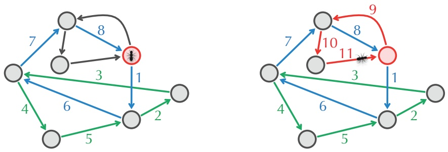

FIGURE 3.24 (Left) Starting at a new node $V _ { 2 }$ (shown in red), Leo first travels along the previously constructed $C y c I e _ { 1 }$ (shown as green and blue edges). (Right) After completing the walk through $C y c I e _ { 1 }$ , Leo continues randomly walking through the graph and finally produces an Eulerian cycle.

In Figure 3.24 (right), $C y c l e _ { 2 }$ happens to be Eulerian, although this is certainly not the case for an arbitrary graph. In general, Leo generates larger and larger cycles at each iteration, and so we are guaranteed that sooner or later some $C y c l e _ { m }$ will traverse all the edges in Graph. This cycle must be Eulerian, and so we (and Leo) are finished.

145

---

C H A P T E R 3


**STOP and Think:** Formulate and prove an analogue of Euler’s Theorem for undirected graphs.

## From Euler’s Theorem to an Algorithm for Finding Eulerian Cycles

Constructing Eulerian cycles

The proof of Euler’s Theorem offers an example of what mathematicians call a **constructive proof**, which not only proves the desired result, but also provides us with a method for constructing the object we need. In short, we track Leo’s movements until he inevitably produces an Eulerian cycle in a balanced and strongly connected graph Graph, as summarized in the following pseudocode.


```txt
EULERIANCYCLE(Graph)
    form a cycle Cycle by randomly walking in Graph (don't visit the same edge twice!)
    while there are unexplored edges in Graph
        select a node newStart in Cycle with still unexplored edges
        form Cycle' by traversing Cycle (starting at newStart) and then randomly walking
        Cycle ← Cycle'
    return Cycle
```

It may not be obvious, but a good implementation of **EULERIANCYCLE** will work in linear time. To achieve this runtime speedup, you would need to use an efficient data structure in order to maintain the current cycle that Leo is building as well the list of unused edges incident to each node and the list of nodes on the current cycle that have unused edges.

From Eulerian cycles to Eulerian paths

We can now check if a directed graph has an Eulerian cycle, but what about an Eulerian path? Consider the de Bruijn graph in Figure 3.25 (left), which we already know has an Eulerian path, but which does not have an Eulerian cycle because nodes **TA** and **TT** are not balanced. However, we can transform this Eulerian path into an Eulerian cycle by adding a single edge connecting **TT** to **TA**, as shown in Figure 3.25 (right).


**STOP and Think:** How many unbalanced nodes does a graph with an Eulerian path have?

146

---

H O W D O W E A S S E M B L E G E N O M E S ?

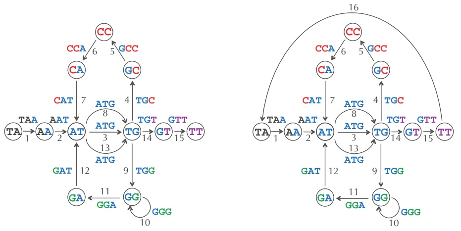

FIGURE 3.25 Transforming an Eulerian path (left) into an Eulerian cycle (right) by adding an edge.

More generally, consider a graph that does not have an Eulerian cycle but does have an Eulerian path. If an Eulerian path in this graph connects a node v to a different node w, then the graph is **nearly balanced**, meaning that all its nodes except v and w are balanced. In this case, adding an extra edge from w to v transforms the Eulerian path into an Eulerian cycle. Thus, a nearly balanced graph has an Eulerian path if and only if adding an edge between its unbalanced nodes makes the graph balanced and strongly connected.

You now have a method to assemble a genome, since the String Reconstruction Problem reduces to finding an Eulerian path in the de Bruijn graph generated from reads.

**EXERCISE BREAK:** Find an analogue of the nearly balanced condition that will determine when an undirected graph has an Eulerian path.

The analogue of Euler’s theorem for undirected graphs immediately implies that there is no Eulerian path in 18th Century Königsberg, but the story is different in modern-day Kaliningrad (see **DETOUR: The Seven Bridges of Kaliningrad**).

Constructing universal strings

Now that you know how to use the de Bruijn graph to solve the String Reconstruction Problem, you can also construct a k-universal string for any value of k. We should note

[3G](http://rosalind.info/problems/3g)
[3H](http://rosalind.info/problems/3h)
AGE 178

147

---

C H A P T E R 3

that de Bruijn was interested in constructing k-universal circular strings. For example, **00011101** is a 3-universal circular string, as it contains each of the eight binary 3-mers exactly once (Figure 3.26).


<details>
<summary>text_image</summary>

0 0
1 0
0 1
1 1
</details>

FIGURE 3.26 The circular 3-universal string 00011101 contains each of the binary 3-mers (000, 001, 011, 111, 110, 101, 010, and 100) exactly once.

## k-Universal Circular String Problem:

Find a k-universal circular string.

**Input**: An integer k.

**Output**: A k-universal circular string.

Like its analogue for linear strings, the k-Universal Circular String Problem is just a specific case of a more general problem, which requires us to reconstruct a circular string given its k-mer composition. This problem models the assembly of a circular genome containing a single chromosome, like the genomes of most bacteria. We know that we can reconstruct a circular string from its k-mer composition by finding an Eulerian cycle in the de Bruijn graph constructed from these k-mers. Therefore, we can construct a k-universal circular binary string by finding an Eulerian cycle in the de Bruijn graph constructed from the collection of all binary k-mers (Figure 3.27).

## EXERCISE BREAK: How many 3-universal circular strings are there?

Even though finding a 20-universal circular string amounts to finding an Eulerian cycle in a graph with over a million edges, we now have a fast algorithm for solving this problem. Let $B i n a r y S t r i n g s _ { k }$ be the set of all $2 ^ { k }$ binary k-mers. The only thing we need to do is to solve the k-Universal Circular String Problem is to find an Eulerian cycle in DEBRUIJN(BinaryStrings<sub>k</sub>). Note that the nodes of this graph represent all possible


148

---

H O W D O W E A S S E M B L E G E N O M E S ?

binary (k  1)-mers. A directed edge connects (k  1)-mer Pattern to (k  1)-mer Pattern in this graph if there exists a k-mer whose prefix is Pattern and whose suffix is Pattern’.


<details>
<summary>flowchart</summary>


</details>

FIGURE 3.27 (Top) A graph consisting of eight isolated directed edges, one for each binary 3-mer. The nodes of each edge correspond to the 3-mer’s prefix and suffix. (Bottom) Gluing identically labeled nodes in the graph on top results in a de Bruijn graph containing four nodes. An Eulerian cycle through the edges 000 ! 001 ! 011 ! 111 ! 110 ! 101 ! 010 ! 100 ! 000 yields the 3-universal circular string 00011101.

**STOP and Think:** Figure 3.28 illustrates that DEBRUIJN(BinaryStrings<sub>4</sub>) is balanced and strongly connected and is thus Eulerian. Can you prove that for any k, DEBRUIJN(BinaryStrings<sub>k</sub>) is Eulerian?


<details>
<summary>flowchart</summary>

```mermaid
graph LR
  n001["001"] -->|0011| n011["011"]
  n001 -->|0010| n010["010"]
  n010 -->|0101| n101["101"]
  n010 -->|0101| n111["111"]
  n101 -->|1011| n011
  n101 -->|1010| n100["100"]
  n101 -->|13| n110["110"]
  n110 -->|12| n111
  n110 -->|5| n100
  n100 -->|16| n000["000"]
  n000 -->|2| n001
  n000 -->|7| n010
  n000 -->|6| n100
  n011 -->|3| n001
  n011 -->|9| n101
  n011 -->|10| n111
  n011 -->|4| n110
```
</details>

FIGURE 3.28 An Eulerian cycle spelling the cyclic 4-universal string 0000110010111101 in DEBRUIJN(BinaryStrings<sub>4</sub>).

149

---

C H A P T E R 3

## Assembling Genomes from Read-Pairs

From reads to read-pairs

Previously, we described an idealized form of genome assembly in order to build up your intuition about de Bruijn graphs. In the rest of the chapter, we will discuss a number of practically motivated topics that will help you appreciate the advanced methods used by modern assemblers.

We have already mentioned that assembling reads sampled from a randomly generated text is a trivial problem, since random strings are not expected to have long repeats. Moreover, de Bruijn graphs become less and less tangled when read length increases (Figure 3.29). As soon as read length exceeds the length of all repeats in a genome (provided the reads have no errors), the de Bruijn graph turns into a path. However, despite many attempts, biologists have not yet figured out how to generate long and accurate reads. The most accurate sequencing technologies available today generate reads that are only about 300 nucleotides long, which is too short to span most repeats, even in short bacterial genomes.


FIGURE 3.29 The graph DEBRUIJN<sub>4</sub>(TAATGCCATGGGATGTT) (top right) is less tangled than the graph DEBRUIJN<sub>3</sub>(TAATGCCATGGGATGTT) (top left). The graph $\mathsf { D E B R U I I N } _ { 5 }$ (TAATGCCATGGGATGTT) (bottom) is a path.

We saw earlier that the string **TAATGCCATGGGATGTT** cannot be uniquely reconstructed from its 3-mer composition since another string (**TAATGGGATGCCATGTT**) has the same 3-mer composition.

150

---

H O W D O W E A S S E M B L E G E N O M E S ?

**STOP and Think:** What additional experimental information would allow you to uniquely reconstruct the string **TAATGCCATGGGATGTT** ?


Increasing read length would help identify the correct assembly, but since increasing read length presents a difficult experimental problem, biologists have suggested an indirect way of increasing read length by generating **read-pairs**, which are pairs of reads separated by a fixed distance d in the genome (Figure 3.30). You can think about a read-pair as a long “gapped” read of length $k + d + k$ whose first and last k-mers are known but whose middle segment of length d is unknown. Nevertheless, read-pairs contain more information than k-mers alone, and so we should be able to use them to improve our assemblies. If only you could infer the nucleotides in the middle segment of a read-pair, you would immediately increase the read length from k to $2 \cdot k + d .$


<details>
<summary>chemical</summary>

RNA secondary structure diagram showing nucleotide combinations and base pairs
</details>

FIGURE 3.30 Read-pairs sampled from TAATGCCATGGGATGTT and formed by reads of length 3 separated by a gap of length 1. A simple but inefficient way to assemble these read-pairs is to construct the de Bruijn graph of individual reads (3-mers) within the read-pairs.

## Transforming read-pairs into long virtual reads

Let Reads be the collection of all 2N k-mer reads taken from N read-pairs. Note that a read-pair formed by k-mer reads $R e a d _ { 1 }$ and $R e a d _ { 2 }$ corresponds to two edges in the de Bruijn graph $\mathrm { D E B R U I J N } _ { k } { \big ( } R e a d s { \big ) }$ . Since these reads are separated by distance d in the genome, there must be a path of length $k + d + 1 \; \mathrm { i n } \; \mathrm { D E B R U I J N } _ { k } ( R e a d s )$ connecting the node at the beginning of the edge corresponding to $R e a d _ { 1 }$ with the node at the end of the edge corresponding to $R e a d _ { 2 } ,$ , as shown in Figure 3.31. If there is only one path of length $k + d + 1$ connecting these nodes, or if all such paths spell out the same string, then we can transform a read-pair formed by reads $R e a d _ { 1 }$ and $R e a d _ { 2 }$ into a virtual read of length $2 \cdot k + d$ that starts as $R e a d _ { 1 }$ , spells out this path, and ends with Read<sub>2</sub>.

151

---

C H A P T E R 3

For example, consider the de Bruijn graph in Figure 3.31, which is generated from all reads present in the read-pairs in Figure 3.30. There is a unique string spelled by paths of length $k + d + 1 = 5$ between edges labeled **AAT** and **CCA** within a read-pair represented by the gapped read **AAT**-**CCA**. Thus, from two short reads of length k, we have generated a long virtual read of length $2 \cdot k + d ,$ achieving computationally what researchers still cannot achieve experimentally! After preprocessing the de Bruijn graph to produce long virtual reads, we can simply construct the de Bruijn graph from these long reads and use it for genome assembly.


<details>
<summary>flowchart</summary>

This diagram illustrates a genetic or structural model showing the relationships between various codon sequences (TA, AA, AT, TG, TT) and their associated amino acids (CCA, GCC, CAT, ATG, GAT, GGA, TGC, GT, GTT, TT).
</details>

FIGURE 3.31 The highlighted path of length $k + d + 1 = 3 + 1 + 1 = 5$ between the edges labeled AAT and CCA spells out AATGCCA. (There are three such paths because there are three possible choices of edges labeled ATG.) Thus, the gapped read AAT-CCA can be transformed into a long virtual read AATGCCA.

Although the idea of transforming read-pairs into long virtual reads is used in many assembly programs, we have made an optimistic assumption: “If there is only one path of length $k + d + 1$ connecting these nodes, or if all such paths spell out the same string $\cdots . ^ { \prime \prime } .$ In practice, this assumption limits the application of the long virtual read approach to assembling read-pairs because highly repetitive genomic regions often contain multiple paths of the same length between two edges, and these paths often spell different strings (Figure 3.32). If this is the case, then we cannot reliably transform a read-pair into a long read. Instead, we will describe an alternative approach to analyzing read-pairs.

152

---

H O W D O W E A S S E M B L E G E N O M E S ?


FIGURE 3.32 (Left) The highlighted path in DEBRUIJN<sub>3</sub>(AATCTGACATATGG) spells out the long virtual read AATCTGACA, which is a substring of AATCTGACATATGG. (Right) The highlighted path in the same graph spells out the long virtual read AATATGACA, which does not occur in AATCTGACATATGG.

## From composition to paired composition

Given a string Text, $\textsf { a } \big ( k , d \big )$ -mer is a pair of k-mers in Text separated by distance d. We use the notation $\left( P a t t e r n _ { 1 } \: \middle | \: P a t t e r n _ { 2 } \right)$ to refer to a $( k , d )$ -mer whose k-mers are $P a t t e r n _ { 1 }$ and $P a t t e r n _ { 2 }$ . For example, (**ATG** | **GGG**) is a $( 3 , 4 )$ -mer in **TAATGCCATGGGATGTT**. The $( k , d )$ -mer composition of Text, denoted PAIREDCOMPOSITION $\mathbb { I } _ { k ,   d } \big ( T _ { } { e x t } \big )$ , is the collection of all $( k , d )$ -mers in Text (including repeated $( k , d ) \text {-} \operatorname { m e r s } )$ . For example, here is PAIREDCOMPOSITION<sub>3</sub>,1(**TAATGCCATGGGATGTT**):


<details>
<summary>text_image</summary>

TAA GCC
AAT CCA
ATG CAT
TGC ATG
GCC TGG
CCA GGG
CAT GGA
ATG GAT
TGG ATG
GGG TGT
GGA GTT
TAATGCCATGGGATGTT
</details>

**EXERCISE BREAK:** Generate the (3, 2)-mer composition of the string **TAATGCCATGGGATGTT**.


153

---

C H A P T E R 3

Since the order of $( 3 , 1 )$ -mers in PAIREDCOMPOSITION(TAATGCCATGGGATGTT) is unknown, we list them according to the lexicographic order of the 6-mers formed by their concatenated 3-mers:

$$
(\mathbf {A A T} \mid \mathbf {C C A}) (\mathbf {A T G} \mid \mathbf {C A T}) (\mathbf {A T G} \mid \mathbf {G A T}) (\mathbf {C A T} \mid \mathbf {G G A}) (\mathbf {C C A} \mid \mathbf {G G G}) (\mathbf {G C C} \mid \mathbf {T G G})
$$

$$
\left(\mathbf {G G A} \mid \mathbf {G T T}\right) \left(\mathbf {G G G} \mid \mathbf {T G T}\right) \left(\mathbf {T A A} \mid \mathbf {G C C}\right) \left(\mathbf {T G C} \mid \mathbf {A T G}\right) \left(\mathbf {T G G} \mid \mathbf {A T G}\right)
$$

Note that whereas there are repeated 3-mers in the 3-mer composition of this string, there are no repeated (3, 1)-mers in its paired composition. Furthermore, although TAATGCCATGGGATGTT and TAAATGCCATGGGATGTT have the same 3-mer composition, they have different (3, 1)-mer compositions. Thus, if we can generate the (3, 1)-mer composition of these strings, then we will be able to distinguish between them. But how can we reconstruct a string from its $( k , d )$ -mer composition? And can we adapt the de Bruijn graph approach for this purpose?

## String Reconstruction from Read-Pairs Problem:

Reconstruct a string from its paired composition.

**Input**: A collection of paired k-mers PairedReads and an integer d.

**Output**: A string Text with $( k , d )$ -mer composition equal to PairedReads (if such a string exists).

## Paired de Bruijn graphs

Given a $(k,d) - \mathrm{mer} \left( a_{1} \cdots a_{k} \mid b_{1}, \cdots b_{k} \right)$ , we define its **prefix** and **suffix** as the following $\left( k - 1 , d + 1 \right)$ -mers:

$$
\text {PREFIX} ((a _ {1} \dots a _ {k} \mid b _ {1}, \dots b _ {k})) = (a _ {1} \dots a _ {k - 1} \mid b _ {1} \dots b _ {k - 1})
$$

$$
\text {SUFFIX} ((a _ {1} \dots a _ {k} \mid b _ {1}, \dots b _ {k})) = (a _ {2} \dots a _ {k} \mid b _ {2} \dots b _ {k})
$$

For example, ${ \tt P R E F I X } ( ( { \tt G A C } \: | \: { \tt T C A } ) ) = ( { \tt G A } \: | \: { \tt T C } ) \; { \tt a n d } \; { \tt S U F F I X } ( ( { \tt G A C } \: | \: { \tt T C A } ) ) = ( { \tt A C } \: | \: { \tt C A } )$

Note that for consecutive $( k , d )$ -mers appearing in Text, the suffix of the first $( k , d ) -$ mer is equal to the prefix of the second $( k , d ) - \mathrm { m e r } .$ For example, for the consecutive $( k , d ) \mathrm { - m e r s } ( \mathtt { T A A }   |   \mathtt { G C C } )$ and $\left( \begin{matrix} { \mathbb { A } \mathbb { A } \mathbb { T } \; \big | \; \mathbb { C } \mathbb { C } \mathbb { A } } \\ \end{matrix} \right)$ in **TAATGCCATGGGATGTT**,

$$
\text {SUFFIX} \left(\left(\mathbf {T A A} \mid \mathbf {G C C}\right)\right) = \text {PREFIX} \left(\left(\mathbf {A A T} \mid \mathbf {C C A}\right)\right) = \left(\mathbf {A A} \mid \mathbf {C C}\right).
$$

154

---

H O W D O W E A S S E M B L E G E N O M E S ?

Given a string Text, we construct a graph $\mathrm { P A T H G R A P H } _ { k ,   d }   \left( T e x t \right)$ that represents a path formed by $| T _ { } { e x t } | - ( k + d + k ) + 1$ edges corresponding to all $( k , d )$ -mers in Text. We label edges in this path by $( k,d )-mers$ and label the starting and ending nodes of an edge by its prefix and suffix, respectively (Figure 3.33).


<details>
<summary>flowchart</summary>

```mermaid
graph LR
  A["TAGC"] --> B["AACC"]
  B --> C["ATCA"]
  C --> D["TGTG"]
  D --> E["GCTG"]
  E --> F["CCGG"]
  F --> G["CAGG"]
  G --> H["ATGA"]
  H --> I["TGTG"]
  I --> J["GGTG"]
  J --> K["GGGT"]
  K --> L["GATT"]
```
</details>

FIGURE 3.33 $\mathsf { P A T H G R A P H } _ { 3 , } .$ 1(TAATGCCATGGGATGTT). Each (3, 1)-mer has been displayed as a two-line expression to save space.

The paired de Bruijn graph, denoted $\mathrm { D E B R U I J N } _ { k , d } \big ( T e x t \big )$ , is formed by gluing identically labeled nodes in $\mathrm { P A T H G R A P H } _ { k ,   d }   \left( T e x t \right)$ (Figure 3.34). Note that the paired de Bruijn graph is less tangled than the de Bruijn graph constructed from individual reads.

**STOP and Think:** It is easy to construct a paired de Bruijn graph from a string Text. But how can we construct the paired de Bruijn graph from the $( k , d )$ -mer composition of Text?

We define $\mathsf { C O M P O S I T I O N G R A P H } _ { k ,   d } \big ( \mathit { T e x t } \big )$ as the graph consisting of $\big | T _ { } { e x t } \big | - \big ( k + d +$ $k ) + 1$ isolated edges that are labeled by the $( k,d )-mers$ in Text, and whose nodes are labeled by the prefixes and suffixes of these labels (see Figure 3.35). As you may have guessed, gluing identically labeled nodes in PAIREDCOMPOSITI $\mathrm { O N G R A P H } _ { k ,   d }   \left( T e x t \right)$ results in exactly the same de Bruijn graph as gluing identically labeled nodes in $\mathrm { P A T H G R A P H } _ { k ,   d }   \left( T e x t \right)$ . Of course, in practice, we will not know Text; however, we can form $\mathsf { C O M P O S I T I O N G R A P H } _ { k , d } \big ( \mathit { T e x t } \big )$ directly from the $( k ,   d )$ -mer composition of Text, and the gluing step will result in the paired de Bruijn graph of this composition. The genome can be reconstructed by following an Eulerian path in this de Bruijn graph.

## A pitfall of paired de Bruijn graphs

We saw earlier that every solution of the String Reconstruction Problem corresponds to an Eulerian path in the de Bruijn graph constructed from a k-mer composition. Likewise, every solution of the String Reconstruction from Read-Pairs Problem corresponds to an Eulerian path in the Paired de Bruijn graph constructed from a $( k , d )$ -mer composition.


155

---

C H A P T E R 3


FIGURE 3.34 (Top) $\mathsf { P A T H G R A P H } _ { 3 , 1 }$ (TAATGCCATGGGATGTT) is formed by eleven edges and twelve nodes. Only two of these nodes have the same label, (TG | AT). (Middle) Bringing the two identically labeled nodes closer to each other in preparation for gluing. (Bottom) The paired de Bruijn graph $\mathsf { D E B R U I I N } _ { 3 , 1 }$ (TAATGCCATGGGATGTT) is obtained from $\mathsf { P A T H G R A P H } _ { 3 , 1 }$ (TAATGCCATGGGATGTT) by gluing the nodes sharing the label (TG | AT). This paired de Bruijn graph has a unique Eulerian path, which spells out TAATGCCATGGGATGTT.


**EXERCISE BREAK:** In the paired de Bruijn graph shown in Figure 3.36, reconstruct the genome spelled by the following Eulerian path of (2, 1)-mers:

$$
(\mathrm{AG} \mid \mathrm{AG}) \rightarrow (\mathrm{GC} \mid \mathrm{GC}) \rightarrow (\mathrm{CA} \mid \mathrm{CT}) \rightarrow (\mathrm{AG} \mid \mathrm{TG}) \rightarrow (\mathrm{GC} \mid \mathrm{GC}) \rightarrow (\mathrm{CT} \mid \mathrm{CT}) \rightarrow
$$

$$
(\mathrm{T} \mathrm{G} \mid \mathrm{T} \mathrm{G}) \rightarrow (\mathrm{GC} \mid \mathrm{GC}) \rightarrow (\mathrm{CT} \mid \mathrm{CA}).
$$

We also saw that every Eulerian path in the de Bruijn graph constructed from a k-mer composition spells out a solution of the String Reconstruction Problem. But is this the case for the paired de Bruijn graph?

156

---

H O W D O W E A S S E M B L E G E N O M E S ?


<details>
<summary>flowchart</summary>

```mermaid
graph LR
  A["ATGA"] --> B["ATG"]
  B --> C["TGAT"]
  C --> D["CAGG"]
  D --> E["CATGGA"]
  E --> F["ATGA"]
  F --> G["GCCTGG"]
  G --> H["CCGG"]
  I["AATCCA"] --> J["AATCA"]
  J --> K["CCGG"]
  L["CCA GGG"] --> M["CCGG"]
  N["TAA GCC"] --> O["AATCC"]
  O --> P["TGGATG"]
  Q["TGGATG"] --> R["GGTG"]
  S["TGC ATG"] --> T["GTAT"]
  U["TGC TG"] --> V["GGTGT"]
  W["GGTT GTT"] --> X["GATT"]
  Y["GGGT"] --> Z["GGAGTT"]
```
</details>

FIGURE 3.35 The graph COMPOSITIONGR $\mathsf { A P H } _ { 3 , 1 }$ (TAATGCCATGGGATGTT) is a collection of isolated edges. Each edge is labeled by a (3, 1)-mer in TAATGCCATGGGATGTT; the starting node of an edge is labeled by the prefix of the edge’s (3, 1)-mer, and the ending node of an edge is labeled by the suffix of this $( 3 , 1 )$ -mer. Gluing identically labeled nodes yields the paired de Bruijn graph shown in Figure 3.34 (bottom).


<details>
<summary>flowchart</summary>

```mermaid
graph LR
  A["A"] -->|"AG\nAG"| G["G"]
  G -->|"AG\nTG"| A
  G -->|"GC\nGC"| C["C"]
  C -->|"CA\nCT"| A
  C -->|"CT\nCA"| T["T"]
  T -->|"TG\nTG"| G
  T -->|"CT\nCT"| C
  A -.->|"AG" | G
  G -.->|"GG" | C
  C -.->|"CT" | T
```
</details>

FIGURE 3.36 A paired de Bruijn graph constructed from a collection of nine (2, 1)-mers.

**STOP and Think:** The graph shown in Figure 3.36 has another Eulerian path:

$$
\begin{array}{l}\left(\mathrm{AG} \mid \mathrm{AG}\right)\rightarrow \left(\mathrm{GC} \mid \mathrm{GC}\right)\rightarrow \left(\mathrm{CT} \mid \mathrm{CT}\right)\rightarrow \left(\mathrm{TG} \mid \mathrm{TG}\right)\rightarrow \left(\mathrm{GC} \mid \mathrm{GC}\right)\rightarrow \left(\mathrm{CA} \mid \mathrm{CT}\right)\rightarrow\\\left(\mathrm{AG} \mid \mathrm{TG}\right)\rightarrow \left(\mathrm{GC} \mid \mathrm{GC}\right)\rightarrow \left(\mathrm{CT} \mid \mathrm{CA}\right). \text {Can you reconstruct a genome spelled by}\\\text {this path?}\end{array}
$$

If you attempted the preceding question, then you know that not every Eulerian path in the paired de Bruijn graph constructed from a $( k , d )$ -mer composition spells out a solution of the String Reconstruction from Read-Pairs Problem. You are now ready to solve this problem and become a genome assembly expert.

STOP

[3J](http://rosalind.info/problems/3j)

157

---

C H A P T E R 3


**CHARGING STATION (Generating All Eulerian Cycles):** You know how to construct a single Eulerian cycle in a graph, but it remains unclear how to find all possible Eulerian cycles, which will be helpful when solving the String Reconstruction from Read-Pairs Problem. Check out this Charging Station to see how to generate all Eulerian cycles in a graph.


**CHARGING STATION (Reconstructing a String Spelled by a Path in the Paired de Bruijn Graph):** To solve the String Reconstruction from Read-Pairs Problem, you will need to reconstruct a string from its path in the paired de Bruijn graph. Check out this Charging Station to see an example of how this can be done.

## Epilogue: Genome Assembly Faces Real Sequencing Data

Our discussion of genome assembly has thus far relied upon various assumptions. Accordingly, applying de Bruijn graphs to real sequencing data is not a straightforward procedure. Below, we describe practical challenges introduced by quirks in modern sequencing technologies and some computational techniques that have been devised to address these challenges. In this discussion, we will first assume that reads are generated as k-mers instead of read-pairs for the sake of simplicity.

## Breaking reads into k-mers

Given a k-mer substring of a genome, we define its **coverage** as the number of reads to which this k-mer belongs. We have taken for granted that a sequencing machine can generate all k-mers present in the genome, but this assumption of “perfect k-mer coverage” does not hold in practice. For example, the popular Illumina sequencing technology generates reads that are approximately 300 nucleotides long, but this technology still misses many 300-mers present in the genome (even if the average coverage is very high), and nearly all the reads that it does generate have sequencing errors.


**STOP and Think:** Given a set of reads having imperfect k-mer coverage, can you find a parameter l < k so that the same reads have perfect l-mer coverage? What is the maximum value of this parameter?

Figure 3.37 (left) shows four 10-mer reads that capture some but not all of the 10-mers in an example genome. However, if we take the counterintuitive step of breaking these

158

---

H O W D O W E A S S E M B L E G E N O M E S ?

reads into shorter 5-mers (Figure 3.37, right), then these 5-mers exhibit perfect coverage. This **read breaking** approach, in which we break reads into shorter k-mers, is used by many modern assemblers.


<details>
<summary>flowchart</summary>

```mermaid
graph TD
  A["ATGCCGTATGGACAACGACT"] --> B["ATGCCGTATGGACAACGACT"]
  C["ATGCCGTATG"] --> D["GCCGTATGGA"]
  E["GCCGTATG"] --> F["GTATGGACAA"]
  G["GACAACGACT"] --> H["GACAACGACT"]
  B --> I["ATGCC"]
  I --> J["TGCCG"]
  J --> K["GCCGT"]
  K --> L["CCGTA"]
  L --> M["CGTAT"]
  M --> N["GTATG"]
  N --> O["TATGG"]
  O --> P["ATGGA"]
  P --> Q["TGGAC"]
  Q --> R["GGACA"]
  R --> S["GACAA"]
  S --> T["ACAAC"]
  T --> U["CAACG"]
  U --> V["AACGA"]
  V --> W["ACGAC"]
  W --> X["CGACT"]
```
</details>

FIGURE 3.37 Breaking 10-mer reads (left) into 5-mers results in perfect coverage of a genome by 5-mers (right).

Read breaking must deal with a practical trade-off. On the one hand, the smaller the value of k, the larger the chance that the k-mer coverage is perfect. On the other hand, smaller values of k result in a more tangled de Bruijn graph, making it difficult to infer the genome from this graph.

## Splitting the genome into contigs

Even after read breaking, most assemblies still have gaps in k-mer coverage, causing the de Bruijn graph to have missing edges, and so the search for an Eulerian path fails. In this case, biologists often settle on assembling **contigs** (long, contiguous segments of the genome) rather than entire chromosomes. For example, a typical bacterial sequencing project may result in about a hundred contigs, ranging in length from a few thousand to a few hundred thousand nucleotides. For most genomes, the order of these contigs along the genome remains unknown. Needless to say, biologists would prefer to have the entire genomic sequence, but the cost of ordering the contigs into a final assembly and closing the gaps using more expensive experimental methods is often prohibitive.

Fortunately, we can derive contigs from the de Bruijn graph. A path in a graph is called **non-branching** if $\mathrm { I N } ( v ) = \mathrm { O U T } ( v ) = 1$ for each intermediate node v of this path,

159

---

C H A P T E R 3

i.e., for each node except possibly the starting and ending node of a path. A **maximal non-branching path** is a non-branching path that cannot be extended into a longer non-branching path. We are interested in these paths because the strings of nucleotides that they spell out must be present in any assembly with a given k-mer composition. For this reason, contigs correspond to strings spelled by maximal non-branching paths in the de Bruijn graph. For example, the de Bruijn graph in Figure 3.38, constructed for the 3-mer composition of **TAATGCCATGGGATGTT**, has nine maximal non-branching paths that spell out the contigs **TAAT**, **TGTT**, **TGCCAT**, **ATG**, **ATG**, **ATG**, **TGG**, **GGG**, and **GGAT**. In practice, biologists have no choice but to break genomes into contigs, even in the case of perfect coverage (like in Figure 3.38), since repeats prevent them from being able to infer a unique Eulerian path.


<details>
<summary>flowchart</summary>

This diagram illustrates a genetic sequence or gene structure transformation, showing how various codons (TA, AA, AT, ATG, GG, TT) are converted into transgenic (TG), heterozygous (TGT), and homozygous (GG) variants.
</details>

FIGURE 3.38 Breaking the graph DEBRUIJN<sub>3</sub>(TAATGCCATGGGATGTT) into nine maximal non-branching paths representing contigs TAAT, TGTT, TGCCAT, ATG, ATG, ATG, TGG, GGG, and GGAT.


## Contig Generation Problem:

Generate the contigs from a collection of reads (with imperfect coverage).

**Input**: A collection of k-mers Patterns.

**Output**: All contigs in DEBRUIJN(Patterns).

160

---

H O W D O W E A S S E M B L E G E N O M E S ?

**CHARGING STATION (Maximal Non-Branching Paths in a Graph):** If you have difficulties finding maximal non-branching paths in a graph, check out this Charging Station.

## Assembling error-prone reads

Error-prone reads represent yet another barrier to real sequencing projects. Adding the single erroneous read CGTACGGACA (with a single error that misreads T as C) to the set of reads in Figure 3.37 results in erroneous 5-mers CGTAC, GTACG, TACGG, ACGGA, and CGGAC after read breaking. These 5-mers result in an erroneous path from node CGTA to node GGAC in the de Bruijn graph (Figure 3.39 (top)), meaning that if the correct read CGTATGGACA is generated as well, then we will have two paths connecting CGTA to GGAC in the de Bruijn graph. This structure is called a **bubble**, which we define as two short disjoint paths (e.g., shorter than some threshold length) connecting the same pair of nodes in the de Bruijn graph.


<details>
<summary>flowchart</summary>

```mermaid
graph LR
  CCGT["CCGT"] --> CCGTA["CCGTA"]
  CCGTA --> CGTA["CGTA"]
  CGTA --> CGTAT["CGTAT"]
  CGTAT --> GTAT["GTAT"]
  GTAT --> GTATG["GTATG"]
  GTATG --> TATG["TATG"]
  TATG --> TATGG["TATGG"]
  TATGG --> ATGG["ATGG"]
  ATGG --> ATGGA["ATGGA"]
  ATGGA --> TGGA["TGGA"]
  TGGA --> TGGAC["TGGAC"]
  TGGAC --> GGAC["GGAC"]
  GGAC --> GGACA["GGACA"]
  GGACA --> GACA["GACA"]
  CGTAC["GTAC"] --> GTACG["GTACG"]
  GTACG --> TACG["TACG"]
  TACG --> TACGG["TACGG"]
  TACGG --> ACGG["ACGG"]
  ACGG --> ACGGA["ACGGA"]
  ACGGA --> CGGA["CGGA"]
  CGGA --> CGGAC["CGGAC"]
```
</details>

FIGURE 3.39 (Top) A correct path CGTA ! GTAT ! TATG ! ATGG ! TGGA ! GGAC along with an incorrect path CGTA ! GTAC ! TACG ! ACGG ! CGGA ! GGAC form a bubble in a de Bruijn graph, making it difficult to identify which path is correct. (Bottom) An illustration of a de Bruijn graph with many bubbles. Bubble removal should leave only the colored paths remaining.


161

---

C H A P T E R 3


**STOP and Think:** Design an algorithm for detecting bubbles in de Bruijn graphs. After a bubble is detected, you must decide which of two paths in the bubble to remove. How should you make this decision?

Existing assemblers remove bubbles from de Bruijn graphs. The practical challenge is that, since nearly all reads have errors, de Bruijn graphs have millions of bubbles (Figure 3.39 (bottom)). Bubble removal occasionally removes the correct path, thus introducing errors rather than fixing them. To make matters worse, in a genome having **inexact repeats**, where the repeated regions differ by a single nucleotide or some other small variation, reads from the two repeat copies will also generate bubbles in the de Bruijn graph because one of the copies may appear to be an erroneous version of the other. Applying bubble removal to these regions introduces assembly errors by making repeats appear more similar than they are. Thus, modern genome assemblers attempt to distinguish bubbles caused by sequencing errors (which should be removed) from bubbles caused by variations (which should be retained).

## Inferring multiplicities of edges in de Bruijn graphs

Although the de Bruijn graph framework requires that we know the **multiplicity** of each k-mer in the genome (i.e., the number of times the k-mer appears), this information is not readily available from reads. However, the multiplicity of a k-mer in a genome can often be estimated using its coverage. Indeed, k-mers that appear t times in a genome are expected to have approximately t times higher coverage than k-mers that appear just once. Needless to say, coverage varies across the genome, and this condition is often violated. As a result, existing assemblers often assemble repetitive regions in genomes without knowing the exact number of times each k-mer from this region occurs in the genome.

You should now have a handle on the practical considerations involved in genome sequencing, but we will give you a challenge problem that does not encounter these issues. Why? Developing assembly algorithms for large genomes is a formidable challenge because even the seemingly simple problem of constructing the de Bruijn graph from a collection of all k-mers present in millions of reads is nontrivial. To make your life easier, we will give you a small bacterial genome for your first assembly dataset.

162

---

H O W D O W E A S S E M B L E G E N O M E S ?

**CHALLENGE PROBLEM:** Carsonella ruddii is a bacterium that lives symbiotically inside some insects. Its sheltered life has allowed it to reduce its genome to only about 160,000 base pairs. With only about 200 genes, it lacks some genes necessary for survival, but these genes are supplied by its insect host. In fact, Carsonella has such a small genome that biologists have conjectured that it is losing its “bacterial” identity and turning into an **organelle**, which is part of the host’s genome. This transition from bacterium to organelle has happened many times during evolutionary history; in fact, the mitochondrion responsible for energy production in human cells was once a free-roaming bacterium that we assimilated in the distant past.

Given a collection of simulated error-free read-pairs, use the paired de Bruijn graph to reconstruct the Carsonella ruddii genome. Compare this assembly to the assembly obtained from the classic de Bruijn graph (i.e., when all we know is the reads themselves and do not know the distance between paired reads) in order to better appreciate the benefits of read-pairs. For each k, what is the minimum value of d needed to enable reconstruction of the entire Carsonella ruddii genome from its (k, d)-mer composition?

**EXERCISE BREAK:** By the way, one more thing . . . what was the headline of the June 27, 2000 edition of the New York Times?


163

---

C H A P T E R 3

## Charging Stations

The effect of gluing on the adjacency matrix

Figure 3.40 uses Text = **TAATGCCATGGGATGTT** to illustrate how gluing converts the adjacency matrix of PATHGRAPH<sub>3</sub>(Text) into the adjacency matrix of DEBRUIJN<sub>3</sub>(Text).

|  | TA | AA | $AT_1$ | $TG_1$ | GC | CC | CA | $AT_2$ | $TG_2$ | $GG_1$ | $GG_2$ | GA | $AT_3$ | $TG_3$ | GT | TT |
| --- | --- | --- | --- | --- | --- | --- | --- | --- | --- | --- | --- | --- | --- | --- | --- | --- |
| TA | 0 | 1 | 0 | 0 | 0 | 0 | 0 | 0 | 0 | 0 | 0 | 0 | 0 | 0 | 0 | 0 |
| AA | 0 | 0 | 1 | 0 | 0 | 0 | 0 | 0 | 0 | 0 | 0 | 0 | 0 | 0 | 0 | 0 |
| $AT_1$ | 0 | 0 | 0 | 1 | 0 | 0 | 0 | 0 | 0 | 0 | 0 | 0 | 0 | 0 | 0 | 0 |
| $TG_1$ | 0 | 0 | 0 | 0 | 1 | 0 | 0 | 0 | 0 | 0 | 0 | 0 | 0 | 0 | 0 | 0 |
| GC | 0 | 0 | 0 | 0 | 0 | 1 | 0 | 0 | 0 | 0 | 0 | 0 | 0 | 0 | 0 | 0 |
| CC | 0 | 0 | 0 | 0 | 0 | 0 | 1 | 0 | 0 | 0 | 0 | 0 | 0 | 0 | 0 | 0 |
| CA | 0 | 0 | 0 | 0 | 0 | 0 | 0 | 1 | 0 | 0 | 0 | 0 | 0 | 0 | 0 | 0 |
| $AT_2$ | 0 | 0 | 0 | 0 | 0 | 0 | 0 | 0 | 1 | 0 | 0 | 0 | 0 | 0 | 0 | 0 |
| $TG_2$ | 0 | 0 | 0 | 0 | 0 | 0 | 0 | 0 | 0 | 1 | 0 | 0 | 0 | 0 | 0 | 0 |
| $GG_1$ | 0 | 0 | 0 | 0 | 0 | 0 | 0 | 0 | 0 | 0 | 1 | 0 | 0 | 0 | 0 | 0 |
| $GG_2$ | 0 | 0 | 0 | 0 | 0 | 0 | 0 | 0 | 0 | 0 | 0 | 1 | 0 | 0 | 0 | 0 |
| GA | 0 | 0 | 0 | 0 | 0 | 0 | 0 | 0 | 0 | 0 | 0 | 0 | 1 | 0 | 0 | 0 |
| $AT_3$ | 0 | 0 | 0 | 0 | 0 | 0 | 0 | 0 | 0 | 0 | 0 | 0 | 0 | 1 | 0 | 0 |
| $TG_3$ | 0 | 0 | 0 | 0 | 0 | 0 | 0 | 0 | 0 | 0 | 0 | 0 | 0 | 0 | 1 | 0 |
| GT | 0 | 0 | 0 | 0 | 0 | 0 | 0 | 0 | 0 | 0 | 0 | 0 | 0 | 0 | 0 | 1 |
| TT | 0 | 0 | 0 | 0 | 0 | 0 | 0 | 0 | 0 | 0 | 0 | 0 | 0 | 0 | 0 | 0 |

|  | TA | AA | AT | TG | GC | CC | CA | GG | GA | GT | TT |
| --- | --- | --- | --- | --- | --- | --- | --- | --- | --- | --- | --- |
| TA | 0 | 1 | 0 | 0 | 0 | 0 | 0 | 0 | 0 | 0 | 0 |
| AA | 0 | 0 | 1 | 0 | 0 | 0 | 0 | 0 | 0 | 0 | 0 |
| AT | 0 | 0 | 0 | 3 | 0 | 0 | 0 | 0 | 0 | 0 | 0 |
| TG | 0 | 0 | 0 | 0 | 1 | 0 | 0 | 1 | 0 | 1 | 0 |
| GC | 0 | 0 | 0 | 0 | 0 | 1 | 0 | 0 | 0 | 0 | 0 |
| CC | 0 | 0 | 0 | 0 | 0 | 0 | 1 | 0 | 0 | 0 | 0 |
| CA | 0 | 0 | 1 | 0 | 0 | 0 | 0 | 0 | 0 | 0 | 0 |
| GG | 0 | 0 | 0 | 0 | 0 | 0 | 0 | 1 | 1 | 0 | 0 |
| GA | 0 | 0 | 1 | 0 | 0 | 0 | 0 | 0 | 0 | 0 | 0 |
| GT | 0 | 0 | 0 | 0 | 0 | 0 | 0 | 0 | 0 | 0 | 1 |
| TT | 0 | 0 | 0 | 0 | 0 | 0 | 0 | 0 | 0 | 0 | 0 |

**FIGURE 3.40** Adjacency matrices. (Top) The $1 6   \times   1 6$ adjacency matrix of $\mathsf { P A T H G R A P H } _ { 3 }$ (**TAATGCCATGGGATGTT**). Note that we have used indexing to differentiate multiple occurrences of AT, TG, and GG in $\mathsf { P A T H G R A P H } _ { 3 }$ (TAATGCCATGGGATGTT). (Bottom) The $1 1 \times 1 1$ adjacency matrix of $\mathsf { D E B R U U N } _ { 3 }$ (TAATGCCATGGGATGTT), produced after gluing nodes labeled by identical 2-mers. Note that if there are m edges connecting nodes i and $j ,$ the (i, j)-th element of the adjacency matrix is m.

164

---

H O W D O W E A S S E M B L E G E N O M E S ?

## Generating all Eulerian cycles

The inherent difficulty in generating all Eulerian cycles in a graph is keeping track of potentially many different alternatives at any given node. On the opposite end of the spectrum, a **simple directed graph**, a connected graph in which each node has indegree and outdegree equal to 1, offers a trivial case, since there is only one Eulerian cycle.

Our idea, then, is to transform a single labeled directed graph Graph containing $n \geq 1$ Eulerian cycles to n different simple directed graphs, each containing a single Eulerian cycle. This transformation has the property that it is easily invertible, i.e., that given the unique Eulerian cycle in one of the simple directed graphs, we can easily reconstruct the original Eulerian cycle in Graph.

Given a node v in Graph (of indegree greater than 1) with incoming edge $( u , v )$ and outgoing edge $( v , w )$ , we will construct a “simpler” $( u , v , w )$ **-bypass graph** in which we remove the edges $( u , v )$ and $( v , w )$ from Graph, and add a new node x along with the edges $( u , x )$ and $( v , x )$ (Figure 3.41 (top)). The new edges $( u , x )$ and $( v , x )$ in the bypass graph inherit the labels of the removed edges $( u , v )$ and $( v , w )$ , respectively. The critical property of this graph is revealed by the following exercise.


<details>
<summary>flowchart</summary>

```mermaid
graph LR
  A["Node 1"] -->|7| B["Node 2"]
  A -->|4| C["Node 3"]
  B -->|8| D["Node 4"]
  B -->|10| E["Node 5"]
  C -->|6| F["Node 6"]
  C -->|5| G["Node 7"]
  D -->|9| H["Node 8"]
  E -->|11| I["Node 9"]
  F -->|3| J["Node 10"]
  G -->|2| K["Node 11"]
  H -->|8| L["Node 12"]
```
</details>


<details>
<summary>flowchart</summary>

```mermaid
graph LR
  1["Node 1"] -->|"1"| 2["Node 2"]
  n2["2"] -->|"2"| n1["1"]
  n1 -->|"3"| n1
  n1 -->|"4"| n1
  n1 -->|"5"| n2
  n1 -->|"6"| n1
  n1 -->|"7"| n1
  n1 -->|"8"| n9["9"]
  n1 -->|"9"| n8["8"]
  n1 -->|"10"| n7["7"]
  n1 -->|"11"| n1
  n1 -->|"11"| n8
```
</details>


<details>
<summary>flowchart</summary>

```mermaid
graph LR
  A["Node 1"] --> B["Node 2"]
  A --> C["Node 3"]
  A --> D["Node 4"]
  A --> E["Node 5"]
  A --> F["Node 6"]
  B --> G["Node 7"]
  C --> H["Node 8"]
  D --> I["Node 9"]
  E --> J["Node 10"]
  F --> K["Node 11"]
  G --> L["Node 12"]
  H --> M["Node 13"]
  I --> N["Node 14"]
  J --> O["Node 15"]
  K --> P["Node 16"]
  L --> Q["Node 17"]
  M --> R["Node 18"]
  N --> S["Node 19"]
  O --> T["Node 20"]
```
</details>

FIGURE 3.41 (Top) An Eulerian graph Graph (left) along with its $\left( u , v , w \right)$ -bypass graph (right) constructed for the blue and red edges. (Bottom) The other bypass graph constructed for the blue and green edges.

165

---

C H A P T E R 3


**EXERCISE BREAK:** Show that any Eulerian cycle in Graph passing through (u, v) and then (v, w) corresponds to an Eulerian cycle (with the same edge labels) in the (u, v, w)-bypass graph passing through (u, x) and then $( x , w )$

In general, given an incoming edge (u, v) into v along with k outgoing edges $( v , w _ { 1 } )$ $\cdots , ( v , w _ { k } )$ from v, we can construct k different bypass graphs (Figure 3.41 (bottom)). Note that no two bypass graphs have the same Eulerian cycle.

Our idea, roughly stated, is to iteratively construct every possible bypass graph for Graph until we obtain a large family of simple directed graphs; each one of these graphs will correspond to a distinct Eulerian cycle in Graph. This idea is implemented by the pseudocode below.

<div class="docvortex-algorithm" style="white-space: pre-wrap; font-family:monospace;">
ALLEULERIANCYCLES(Graph)
    AllGraphs ← the set consisting of a single graph Graph
    while there is a non-simple graph G in AllGraphs
        v ← a node with indegree larger than 1 in G
        for each incoming edge (u, v) into v
            for each outgoing edge (v, w) from v
                NewGraph ← (u, v, w)-bypass graph of G
                if NewGraph is connected
                    add NewGraph to AllGraphs
            remove G from AllGraphs
        for each graph G in AllGraphs
            output the (single) Eulerian cycle in G
</div>

There exists a more elegant approach to constructing all Eulerian cycles in an Eulerian graph that is based on a theorem that de Bruijn had a hand in proving. To learn about this theorem, see **DETOUR: The BEST Theorem**.

Reconstructing a string spelled by a path in the paired de Bruijn graph

Consider the following Eulerian path formed by nine edges in the paired de Bruijn graph from Figure 3.36.

$$
\begin{array}{c}\text {AG - AG} \rightarrow \text {GC - GC} \rightarrow \text {CA - CT} \rightarrow \text {AG - TG} \rightarrow\\\text {GC - GC} \rightarrow \text {CT - CT} \rightarrow \text {TG - TG} \rightarrow \text {GC - GC} \rightarrow \text {CT - CA}\end{array}
$$

PAGE 179

166

---

H O W D O W E A S S E M B L E G E N O M E S ?

We can arrange the (2, 1)-mers in this path into the nine rows shown below, revealing the string **AGCAGCTGCTGCA** spelled by this path:

<div class="docvortex-algorithm" style="white-space: pre-wrap; font-family:monospace;">
AG-AG
  GC-GC
    CA-CT
      AG-TG
        GC-GC
          CT-CT
            TG-TG
              GC-GC
                CT-CA
AGCAGCTGCTGCA
</div>

Now, consider another Eulerian path in the paired de Bruijn graph from Figure 3.36:

<div class="docvortex-algorithm" style="white-space: pre-wrap; font-family:monospace;">
$\mathrm{AG - AG}\rightarrow \mathrm{GC - GC}\rightarrow \mathrm{CT - CT}\rightarrow \mathrm{TG - TG}\rightarrow$ $\mathrm{GC - GC}\rightarrow \mathrm{CA - CT}\rightarrow \mathrm{AG - TG}\rightarrow \mathrm{GC - GC}\rightarrow \mathrm{CT - CA}$
</div>

An attempt to assemble these (2, 1)-mers reveals that not every column has the same nucleotide (see the two columns shown in red below). This example illustrates that not all Eulerian paths in the paired de Bruijn graph spell solutions of the String Reconstruction from Read-Pairs Problem.

<div class="docvortex-algorithm" style="white-space: pre-wrap; font-family:monospace;">
AG-AG
GC-GC
CT-CT
TG-TG
GC-GC
CA-CT
AG-TG
GC-GC
CT-CA
AGC?GC?GCTGCA
</div>

167

---

C H A P T E R 3

## String Spelled by a Gapped Genome Path Problem:

Reconstruct a sequence of $( k , d )$ -mers corresponding to a path in a paired de Bruijn graph.

**Input**: A sequence of $( k , d )$ -mers ${ \left( a _ { 1 } \middle | b _ { 1 } \right) } , \cdots , { \left( a _ { n } \middle | b _ { n } \right) }$ such that SUFFIX $( ( a _ { i } | b _ { i } ) ) = \mathrm { P R E F I X } ( ( a _ { i + 1 } | b _ { i + 1 } ) )$ for $1 \leq i \leq n - 1$

**Output**: A string Text of length $k + d + k + n - 1$ such that the i-th $( k , d )$ -mer of Text is equal to $\left( a _ { i } \middle | b _ { i } \right)$ for $1 \leq i \leq n$ (if such a string exists).

Our approach to solving this problem will split the given $( k , d )$ -mers ${ \left( a _ { 1 } \middle | b _ { 1 } \right) } , \cdots , { \left( a _ { n } \middle | b _ { n } \right) }$ into their initial k-mers, First $P a t t e r n s = \left( a _ { 1 } , \cdots , a _ { n } \right)$ , and their terminal k-mers, Second-$P a t t e r n s = \left( b _ { 1 } , \cdots , b _ { n } \right)$ . Assuming that we have implemented an algorithm solving the String Spelled by a Genome Path Problem (denoted **STRINGSPELLEDBYPATTERNS**), we can assemble FirstPatterns and SecondPatterns into strings PrefixString and SuffixString, respectively.

For the first example above, we have that PrefixString = AGCAGCTGCT and SuffixString = AGCTGCTGCA. These strings perfectly overlap starting at the fourth nucleotide of PrefixString:

$$
\begin{array}{l} \text {PrefixString} = \text {AGCAGCTGCT} \\ \text {SuffixString} = \quad \text {AGCTGCTGCA} \\ G e n o m e \quad = \quad A G C A G C T G C T G C A \\ \end{array}
$$

However, for the second example above, there is no perfect overlap:

$$
\begin{array}{l} \text {PrefixString} = \mathrm{AGCTGCAGCT} \\ \text {SuffixString} = \mathbf {A G C T G C T G C A} \\ \text {Genome} = \mathrm{AGC?GC?GCTGCA} \\ \end{array}
$$

The following algorithm, **STRINGSPELLEDBYGAPPEDPATTERNS**, generalizes this approach to an arbitrary sequence GappedPatterns of $( k , d )$ -mers. It constructs strings PrefixString and SuffixString as described above, and checks whether they have perfect overlap (i.e., form the prefix and suffix of a reconstructed string). It also assumes that the number of $( k , d )$ -mers in GappedPatterns is at least $d ;$ otherwise, it is impossible to reconstruct a contiguous string.

168

---

H O W D O W E A S S E M B L E G E N O M E S ?

<div class="docvortex-algorithm" style="white-space: pre-wrap; font-family:monospace;">
STRINGSPELLEDBYGAPPEDPATTERNS(GappedPatterns, k, d)
    FirstPatterns ← the sequence of initial k-mers from GappedPatterns
    SecondPatterns ← the sequence of terminal k-mers from GappedPatterns
    PrefixString ← STRINGSPELLEDBYPATTERNS(FirstPatterns, k)
    SuffixString ← STRINGSPELLEDBYPATTERNS(SecondPatterns, k)
    for i = k + d + 1 to |PrefixString|
        if the i-th symbol in PrefixString ≠ the (i - k - d)-th symbol in SuffixString
            return "there is no string spelled by the gapped patterns"
    return PrefixString concatenated with the last k + d symbols of SuffixString
</div>

## Maximal non-branching paths in a graph

A node v in a directed graph Graph is called a **1-in-1-out node** if its indegree and outdegree are both equal to 1. We can rephrase the definition of a “maximal non-branching path” from the main text as a path whose internal nodes are 1-in-1-out nodes and whose initial and final nodes are not 1-in-1-out nodes. Also, note that the definition from the main text does not handle the case when Graph has a connected component that is an **isolated cycle**, in which all nodes are 1-in-1-out nodes (recall Figure 3.38).

**MAXIMALNONBRANCHINGPATHS**, shown below, iterates through all nodes of the graph that are not 1-in-1-out nodes and generates all non-branching paths starting at each such node. In a final step, it finds all isolated cycles in the graph.

<div class="docvortex-algorithm" style="white-space: pre-wrap; font-family:monospace;">
MAXIMALNONBRANCHINGPATHS(Graph)
    Paths ← empty list
    for each node v in Graph
        if v is not a 1-in-1-out node
            if OUT(v) &gt; 0
                for each outgoing edge (v, w) from v
                    NonBranchingPath ← the path consisting of the single edge (v, w)
                    while w is a 1-in-1-out node
                        extend NonBranchingPath by the outgoing edge (w, u) from w
                        w ← u
                    add NonBranchingPath to the set Paths
    for each isolated cycle Cycle in Graph
        add Cycle to Paths
    return Paths
</div>


169

---

C H A P T E R 3

## Detours

A short history of DNA sequencing technologies

In 1988, Radoje Drmanac, Andrey Mirzabekov, and Edwin Southern simultaneously and independently proposed the futuristic and at the time completely implausible method of **DNA arrays** for DNA sequencing. None of these three biologists knew of the work of Euler, Hamilton, and de Bruijn; none could have possibly imagined that the implications of his own experimental research would eventually bring him face-to-face with these mathematical giants.

A decade earlier, Frederick Sanger had sequenced the tiny 5,386 nucleotide-long genome of the fX174 virus. By the late 1980s, biologists were routinely sequencing viruses containing hundreds of thousands of nucleotides, but the idea of sequencing bacterial (let alone human) genomes remained preposterous, both experimentally and computationally. Indeed, generating a single read in the late 1980s cost more than a dollar, pricing mammalian genome sequences in the billions. DNA arrays were therefore invented with the goal of cheaply generating a genome’s k-mer composition, albeit with a smaller read length k than the original DNA sequencing technology. For example, whereas Sanger’s expensive sequencing technique generated 500 nucleotide-long reads in 1988, the DNA array inventors initially aimed at producing reads of length only 10.

DNA arrays work as follows. We first synthesize all 4<sup>k</sup> possible DNA k-mers and attach them to a DNA array, which is a grid on which each k-mer is assigned a unique location. Next, we fluorescently label a single-stranded DNA fragment (with unknown sequence) and apply a solution containing this labeled DNA to the DNA array. The k-mers in a DNA fragment will hybridize (bind) to their reverse complementary k-mers on the array. All we need to do is use spectroscopy to analyze which sites on the array emit the fluorescence; the reverse complements of k-mers corresponding to these sites must therefore belong to the (unknown) DNA fragment. Thus, the set of fluorescent k-mers on the array reveals the composition of a DNA fragment (Figure 3.42).

At first, few believed that DNA arrays would work, because both the biochemical problem of synthesizing millions of short DNA fragments and the algorithmic problem of sequence reconstruction appeared too complicated. In 1988, Science magazine wrote that given the amount of work required to synthesize a DNA array, “using DNA arrays for sequencing would simply be substituting one horrendous task for another”. It turned out that Science was only half right. In the mid-1990s, a number of companies perfected technologies for designing large DNA arrays, but DNA arrays ultimately failed to realize the dream that motivated their inventors because the fidelity of DNA hybridization with the array was too low and because the value of k was too small.

170

---

H O W D O W E A S S E M B L E G E N O M E S ?

| AAA | AGA | CAA | CGA | GAA | GGA | TAA | TGA |
| --- | --- | --- | --- | --- | --- | --- | --- |
| AAC | AGC | CAC | CGC | GAC | GGC | TAC | TGC |
| AAG | AGG | CAG | CGG | GAG | GGG | TAG | TGG |
| AAT | AGT | CAT | CGT | GAT | GGT | TAT | TGT |
| ACA | ATA | CCA | CTA | GCA | GTA | TCA | TTA |
| ACC | ATC | CCC | CTC | GCC | GTC | TCC | TTC |
| ACG | ATG | CCG | CTG | GCG | GTG | TCG | TTG |
| ACT | ATT | CCT | CTT | GCT | GTT | TCT | TTT |

FIGURE 3.42 A toy DNA array containing all possible 3-mers. Taking the reverse complements of the fluorescently labeled 3-mers yields the collection {ACC, ACG, CAC, CCG, CGC, CGT, GCA, GTT, TAC, TTA}, which is the 3-mer composition of the twelve nucleotide-long string CGCACGTTACCG. Note that this DNA array provides no information regarding 3-mer multiplicities.

Yet the failure of DNA arrays was a spectacular one; while the original goal (DNA sequencing) dangled out of reach, two new unexpected applications of DNA arrays emerged. Today, arrays are used to measure gene expression as well as to analyze genetic variations. These unexpected applications transformed DNA arrays into a multi-billion dollar industry that included Hyseq, founded by Radoje Drmanac, one of the original inventors of DNA arrays.

After founding Hyseq, Drmanac did not abandon his dream of inventing an alternative DNA sequencing technology. In 2005, he founded Complete Genomics, one of the first Next Generation Sequencing (NGS) companies. Complete Genomics, Illumina, Life Technologies, and other NGS companies subsequently developed the technology to cheaply generate almost all k-mers from a genome, thus at last enabling the method of Eulerian assembly. While these technologies are quite different from the DNA array technology proposed in 1988, one can still recognize the intellectual legacy of DNA arrays in NGS approaches, a testament to the fact that good ideas never die, even if they fail at first.

Similarly to DNA arrays, NGS technologies initially generated millions of rather short error-prone reads (of length about 20 nucleotides) when the NGS revolution began in 2005. However, within a span of just a few years, NGS companies were able to increase read length and improve accuracy by an order of magnitude. Moreover, Pacific

171

---

C H A P T E R 3

Biosciences and Oxford Nanopore Technologies already generate error-ridden reads containing thousands of nucleotides. Perhaps your own start-up will find a way to generate a single read spanning the entire genome, thus making this chapter a footnote in the history of genome sequencing. Whatever the future brings, recent developments in NGS have already revolutionized genomics, and biologists are preparing to assemble the genomes of all mammalian species on Earth . . . all while relying on a simple idea that Leonhard Euler conceived in 1735.

## Repeats in the human genome

A **transposon** is a DNA fragment that can change its position within the genome, often resulting in a duplication (repeat). A transposon that inserts itself into a gene will most likely disable that gene. Diseases that are caused by transposons include hemophilia, porphyria, Duchenne muscular dystrophy, and many others. Transposons make up a large fraction of the human genome and are divided into two classes according to their mechanism of transposition, which can be described as either **retrotransposons** or **DNA transposons**.

Retrotransposons are copied in two stages: first they are transcribed from DNA to RNA, and the RNA produced is then **reverse transcribed** to DNA by a **reverse transcriptase**. This copied DNA fragment is then inserted at a new position into the genome. DNA transposons do not involve an RNA intermediate but instead are catalyzed by **transposases**. The transposase cuts out the DNA transposon, which is then inserted into a new site in the genome, resulting in a repeat.

The first transposons were discovered in maize by Barbara McClintock, for which she was awarded a Nobel Prize in 1983. About 85% of the maize genome and 50% of the human genome consist of transposons. The most common transposon in humans is the Alu sequence, which is approximately 300 bases long and accounts for approximately a million repeats (with mutations) in the human genome. The **Mariner sequence** is another transposon in the human genome that has about 14,000 repeats, making up 2.6 million base pairs. Mariner-like transposons exist in many species and can even be transmitted from one species to another. The Mariner transposon was used to develop the **Sleeping Beauty transposon system**, a synthetic DNA transposon constructed for the purposes of introducing new traits in animals and for gene therapy.

172

---

H O W D O W E A S S E M B L E G E N O M E S ?

## Graphs

The use of the word “graph” in this book is different from its use in high school mathematics; we do not mean a chart of data. You can think of a graph as a diagram showing cities connected by roads.

The first panel in Figure 3.43 shows a 4 ⇥ 4 chessboard with the four corner squares removed. A knight can move two steps in any of four directions (left, right, up, and down) followed by one step in a perpendicular direction. For example, a knight at square 1 can move to square 7 (two down and one left), square 9 (two down and one right), or square 6 (two right and one down).


FIGURE 3.43 (Left) A hypothetical chessboard. (Middle) The Knight Graph represents each square by a node and connects two nodes with an edge if a knight can travel between the respective squares in a single move. (Right) An equivalent representation of the Knight Graph.

**STOP and Think:** Can a knight travel around this board, pass through each square exactly once, and return to the same square it started on?

The second panel in Figure 3.43 represents each of the chessboard’s twelve squares as a node. Two nodes are connected by an edge if a knight can move between them in a single step. For example, node 1 is connected to nodes 6, 7, and 9. Connecting nodes in this manner produces a “Knight Graph” consisting of twelve nodes and sixteen edges.

We can describe a graph by its set of nodes and edges, where every edge is written as the pair of nodes that it connects. The graph in the second panel of Figure 3.43 is described by the node set

$$
1, 2, 3, 4, 5, 6, 7, 8, 9, 1 0, 1 1, 1 2,
$$

and the following edge set:


173

---

C H A P T E R 3

| 1—6 | 1—7 | 1—9 | 2—3 | 2—8 | 2—10 | 3—9 | 3—11 |
| --- | --- | --- | --- | --- | --- | --- | --- |
| 4—10 | 4—12 | 5—7 | 5—11 | 6—8 | 6—12 | 7—12 | 10—11 |

A **path** in a graph is a sequence of edges, where each successive edge begins at the node where the previous edge ends. For example, the path $8 \rightarrow 6 \rightarrow 1 \rightarrow 9$ in Figure 3.43 starts at node 8, ends at node 9, and consists of 3 edges. Paths that start and end at the same node are referred to as **cycles**. The cycle $3 \rightarrow 2 \rightarrow 1 0 \rightarrow 1 1 \rightarrow 3$ starts and ends at node 3 and consists of 4 edges.

The way a graph is drawn is irrelevant; two graphs with the same node and edge sets are equivalent, even if the particular pictures that represent the graph are different. The only thing that is important is which nodes are connected and which are not. Therefore, the graph in the second panel of Figure 3.43 is identical to the graph in the third panel. This graph reveals a cycle that visits every node in the Knight Graph once and describes a sequence of knight moves that visit every square exactly once.


**EXERCISE BREAK:** How many knight’s tours exist for the chessboard in Figure 3.43?

The number of edges incident to a given node v is called the **degree** of v. For example, node 1 in the Knight Graph has degree 3, while node 5 has degree 2. The sum of degrees of all twelve nodes is, in this case, 32 (eight nodes have degree 3 and four nodes have degree 2), which is twice the number of edges in the graph.


**STOP and Think:** Can you connect seven phones in such a way that each is connected to exactly three others?

Many bioinformatics problems analyze **directed graphs**, in which every edge is directed from one node to another, as shown by the arrows in Figure 3.44. You can think of a directed graph as a diagram showing cities connected by one-way roads. Every node in a directed graph is characterized by indegree (the number of incoming edges) and outdegree (the number of outgoing edges).


**STOP and Think:** Prove that for every directed graph, the sum of indegrees of all nodes is equal to the sum of outdegrees of all nodes.

An undirected graph is **connected** if every two nodes have a path connecting them. Disconnected graphs can be partitioned into disjoint connected components.

174

---

H O W D O W E A S S E M B L E G E N O M E S ?


<details>
<summary>flowchart</summary>

```mermaid
graph LR
  A["Node 1"] --> B["Node 2"]
  A --> C["Node 3"]
  A --> D["Node 4"]
  B --> E["Node 5"]
  B --> F["Node 6"]
  C --> G["Node 7"]
  C --> H["Node 8"]
  D --> I["Node 9"]
  D --> J["Node 10"]
  E --> K["Node 11"]
  F --> L["Node 12"]
  G --> M["Node 13"]
  H --> N["Node 14"]
  I --> O["Node 15"]
  J --> P["Node 16"]
  K --> Q["Node 17"]
  L --> R["Node 18"]
  M --> S["Node 19"]
  N --> T["Node 20"]
```
</details>

FIGURE 3.44 A directed graph.

## The icosian game

We make an historical detour to Dublin, with the creation in 1857 of the **icosian game** by the Irish mathematician William Hamilton. This “game”, which was a commercial flop, consisted of a wooden board with twenty pegholes and some lines connecting the holes, as well as twenty numbered pegs (Figure 3.45 (left)). The objective was to place the numbered pegs in the holes in such a way that peg 1 would be connected by a line on the board to peg 2, which would in turn be connected by a line to peg 3, and so on, until finally peg 20 would be connected by a line back to peg 1. In other words, if we follow the lines on the board from peg to peg in ascending order, we reach every peg exactly once and then arrive back at our starting peg.


FIGURE 3.45 (Left) Hamilton’s icosian game, with a winning placement of the pegs shown. (Right) The winning placement of the pegs can be represented as a Hamiltonian cycle in a graph. Each node in this graph represents a peghole on the board, and an edge connects two pegholes that are connected by a line segment on the board.

175

---

C H A P T E R 3

We can model the icosian game using a graph if we represent each peghole by a node and then transform lines that connect pegholes into edges that connect the corresponding nodes. This graph does have a Hamiltonian cycle solving the icosian game; one of them is shown in Figure 3.45 (right). Although a brute force approach to the Hamiltonian Cycle Problem works for these small graphs, it quickly becomes infeasible for large graphs.

## Tractable and intractable problems

Inspired by Euler’s Theorem, you probably are wondering whether there exists such a simple result leading to a fast algorithm for the Hamiltonian Cycle Problem. The key challenge is that while we are guided by Euler’s Theorem in solving the Eulerian Cycle Problem, an analogous simple condition for the Hamiltonian Cycle Problem remains unknown. Of course, you could always explore all walks through the graph and report back if you find a Hamiltonian cycle. The problem with this brute force method is that for a graph on just a thousand nodes, there may be more walks through the graph than there are atoms in the universe!

For years, the Hamiltonian Cycle Problem eluded all attempts to solve it by some of the world’s most brilliant researchers. After years of fruitless effort, computer scientists began to wonder whether this problem is **intractable**, i.e., that their failure to find a polynomial-time algorithm was not attributable to a lack of insight, but rather because such an algorithm for solving the Hamiltonian Cycle Problem simply does not exist. In the 1970s, computer scientists discovered thousands more algorithmic problems with the same fate as the Hamiltonian Cycle Problem. While these problems may appear to be simple, no one has been able to find fast algorithms for solving them. A large subset of these problems, including the Hamiltonian Cycle Problem, are now collectively known as **NP-complete**. A formal definition of NP-completeness is beyond the scope of this text.

All the NP-complete problems are equivalent to each other: an instance of any NP-complete problem can be transformed into an instance of any other NP-complete problem in polynomial time. Thus, if you find a fast algorithm for one NP-complete problem, you will automatically be able to use this algorithm to design a fast algorithm for any other NP-complete problem! The problem of efficiently solving NP-complete problems, or finally proving that they are intractable, is so fundamental that it was named one of seven “Millennium Problems” by the Clay Mathematics Institute in 2000. Find an efficient algorithm for any NP-complete problem, or show that one of these problems is intractable, and the Clay Institute will award you a prize of one million dollars.

176

---

H O W D O W E A S S E M B L E G E N O M E S ?

Think twice before you embark on solving an NP-complete problem. So far, only one of the seven Millennium Problems has been solved; in 2003, Grigori Perelman proved the Poincaré Conjecture. A true mathematician, Perelman would later turn down the million-dollar prize, believing that the purity and beauty of mathematics is above all worldly compensation.

NP-complete problems fall within a larger class of difficult computational problems. A problem A is **NP-hard** if there is some NP-complete problem that can be reduced to A in polynomial time. Because NP-complete problems can be reduced to each other in polynomial time, all NP-complete problems are NP-hard. However, not every NP-hard problem is NP-complete (meaning that the former are “at least as difficult” to solve as the latter). One example of an NP-hard problem that is not NP-complete is the **Traveling Salesman Problem**, in which we are given a graph with weighted edges and we must produce a Hamiltonian cycle of minimum total weight.

## From Euler to Hamilton to de Bruijn

Euler’s presented his solution of the Bridges of Königsberg Problem to the Imperial Russian Academy of Sciences in St. Petersburg in 1735. Figure 3.46 shows Euler’s drawing of the Seven Bridges of Königsberg.


<details>
<summary>text_image</summary>

Comment Acad. Sc.Tom VIII Tab.VIII p.198
A
C
D
Fig. 1.
</details>

FIGURE 3.46 Euler’s illustration of Königsberg, showing each of the four parts of the city labeled A, B, C, and D, along with the seven bridges crossing the different arms of the Pregel river.

Euler was the most prolific mathematician of all time; besides graph theory, he first introduced the notation f(x) to represent a function, i for the square root of -1, and p for

177

---

C H A P T E R 3

the circular constant. Working very hard throughout his entire life, he became blind in his right eye in 1735. He kept working. In 1766, he lost the use of his left eye and commented: “Now I will have fewer distractions.” He kept working. Even after going completely blind, he published hundreds of papers.

In this chapter, we have met three mathematicians of three different centuries, Euler, Hamilton, and de Bruijn, spread out across Europe (Figure 3.47). We might be inclined to feel a sense of adventure at their work and how it converged to this singular point in modern biology. Yet the first biologists who worked on DNA sequencing had no idea of how graph theory could be applied to this subject. What’s more, the first paper applying the three mathematicians’ ideas to genome assembly was published lifetimes after the deaths of Euler and Hamilton, when de Bruijn was in his seventies. So perhaps we might think of these three men not as adventurers, but instead as lonely wanderers. As is so often the mathematician’s curse, each of the three passionately pursued abstract questions while having no idea where the answers might one day lead without him.


FIGURE 3.47 Leonhard Euler (left), William Hamilton (center), and Nicolaas de Bruijn (right).

## The seven bridges of Kaliningrad

Königsberg was largely destroyed during World War II; its ruins were captured by the Soviet army. The city was renamed Kaliningrad in 1946 in honor of Soviet revolutionary Mikhail Kalinin.

Since the 18th Century, much has changed in the layout of Königsberg, and it just so happens that the bridge graph drawn today for the city of Kaliningrad still does not contain an Eulerian cycle. However, this graph does contain an Eulerian path, which means that Kaliningrad residents can walk crossing every bridge exactly once, but

178

---

H O W D O W E A S S E M B L E G E N O M E S ?

cannot do so and return to where they started. Thus, the citizens of Kaliningrad finally achieved at least a small part of the goal set by the citizens of Königsberg (although they have to take a taxi home). Yet strolling around Kaliningrad is not as pleasant as it would have been in 1735, since the beautiful old Königsberg was ravaged by the combination of Allied bombing in 1944 and dreadful Soviet architecture in the years following World War II.

## The BEST Theorem

Given an adjacency matrix $A ( G )$ of a directed Eulerian graph $G _ { r }$ we define the matrix $A ^ { * } ( G )$ by replacing the i-th diagonal entry of $- A ( G )$ by INDEGREE(i) for each node i in G (Figure 3.48).


<details>
<summary>flowchart</summary>

```mermaid
graph LR
  a["a"] --> b["b"]
  d["d"] --> c["c"]
  b --> A["A(G)"]
  c --> A["A(G)"]
  A --> B["a b c d"]
  A --> C["a b c d"]
  A --> D["a b c d"]
  A --> E["b 0 1 0 0"]
  A --> F["b 0 0 1 1"]
  A --> G["c 1 1 0 0"]
  A --> H["d 0 0 1 0"]
  B --> I["a b c d"]
  C --> J["a b c d"]
  D --> K["b 0 2 -1 -1"]
  E --> L["b 0 2 -1 -1"]
  F --> M["c -1 -1 2 0"]
  G --> N["c -1 -1 2 0"]
  H --> O["d 0 0 -1 1"]
```
</details>

FIGURE 3.48 (Left) A graph G with two Eulerian cycles. (Middle) The adjacency matrix A(G) of G. (Right) The matrix $A ^ { * } ( C )$ . Each i-cofactor of $A ^ { * }$ is equal to 2. Thus, the BEST theorem computes the number of Eulerian cycles as $2 \cdot 0! \cdot 1! \cdot 1! \cdot 1! = 2$

The **i-cofactor** of a matrix M is the determinant of the matrix obtained from M by deleting its i-th row and i-th column. It can be shown that for a given Eulerian graph $G ,$ all i-cofactors of $A ^ { * } ( G )$ have the same value, which we denote as $c ( G )$

The following theorem provides a formula computing the number of Eulerian cycles in a graph. Its name is an acronym of its discoverers: de Bruijn, van Aardenne-Ehrenfest, Smith, and Tutte.

**BEST Theorem:** The number of Eulerian cycles in an Eulerian graph is equal to

$$
c (G) \cdot \prod_ {\text {all nodes $v$ in graph $G$}} (\text {INDEGREE} (v) - 1)!
$$

The proof of the BEST Theorem, which is beyond the scope of this text, provides us with an alternative way to construct all Eulerian cycles in an Eulerian directed graph.

179

---

C H A P T E R 3

## Bibliography Notes

After Euler’s work on the Königsberg Bridge Problem (Euler, 1758), graph theory was forgotten for over a hundred years but was revived in the second half of the 19th Century. Graph theory flourished in the 20th Century, when it became an important area of mathematics with many practical applications. The de Bruijn graph was introduced independently by Nicolaas de Bruijn (de Bruijn, 1946) and I. J. Good (Good, 1946).

DNA sequencing methods were invented independently and simultaneously in 1977 by groups led by Frederick Sanger (Sanger, Nicklen, and Coulson, 1977) and Walter Gilbert (Maxam and Gilbert, 1977). DNA arrays were proposed simultaneously and independently in 1988 by Radoje Drmanac (Drmanac et al., 1989), Andrey Mirzabekov (Lysov et al., 1988) and Edwin Southern (Southern, 1988). The Eulerian approach to DNA arrays was described in 1989 (Pevzner, 1989).

The Eulerian approach to DNA sequencing was described by Idury and Waterman, 1995 and further developed by Pevzner, Tang, and Waterman, 2001. To address the challenge of assembly from short reads produced by next generation sequencing technologies, a number of assembly tools that are based on de Bruijn graphs have been developed (Zerbino and Birney, 2008, Butler et al., 2008). Paired de Bruijn graphs were introduced by Medvedev et al., 2011.

The Sleeping Beauty transposon system was developed by Ivics et al., 1997.

---

H O W D O W E A S S E M B L E G E N O M E S ?


181
