# Chapter 4: How Do We Sequence Antibiotics?

原始 PDF 第 207–246 页。

## HOWDO WE SEQUENCEANTIBIOTICS?

Brute Force Algorithms

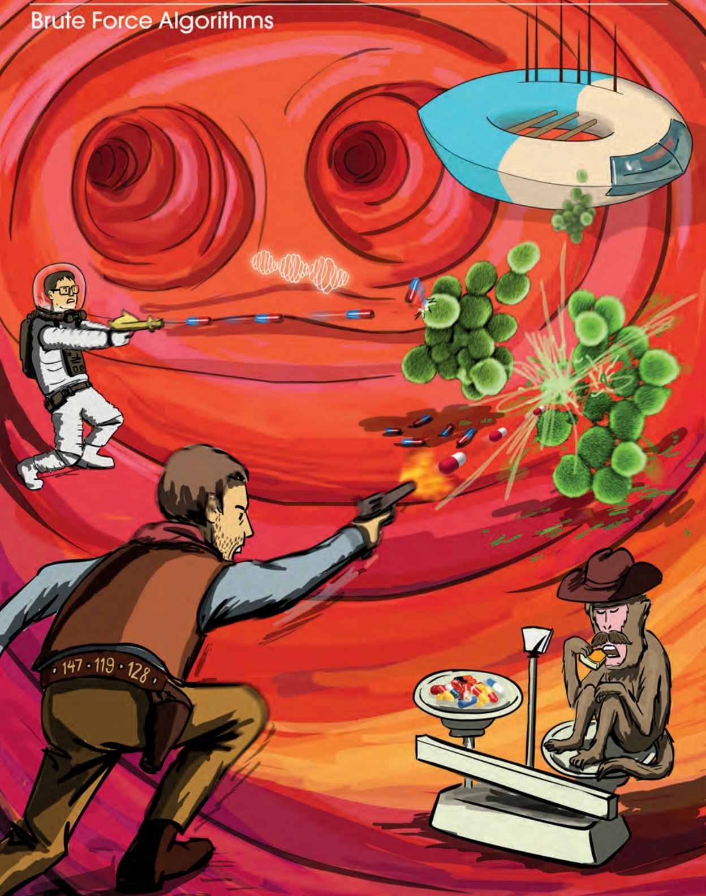

<details>
<summary>text_image</summary>

Brute Force Algorithms
147·119·128
</details>

TWO MEN AND ONE MONKEY ON THE MOST FANTASTIC JOURNEY OF THEIR LIVES...

---

H O W D O W E S E Q U E N C E A N T I B I O T I C S ?

## The Discovery of Antibiotics

In August 1928, before leaving for vacation, Scottish microbiologist Alexander Fleming stacked his cultures of infection-causing Staphylococcus bacteria on a laboratory bench. When he returned to work a few weeks later, Fleming noticed that one culture had been contaminated with Penicillium fungus, and that the colony of Staphylococcus surrounding it had been destroyed! Fleming named the bacteria-killing substance **penicillin**, and he suggested that it could be used to treat bacterial infections in humans.

When Fleming published his discovery in 1929, his article had little immediate impact. Subsequent experiments struggled to isolate the **antibiotic** agent (i.e., the compound that actually killed bacteria) from the fungus. As a result, Fleming eventually concluded that penicillin could not be practically applied to treat bacterial infections and abandoned his antibiotics research.

Searching for new drugs to treat wounded soldiers, the American and British governments intensified their search for antibiotics after the start of World War II; however, the challenge of mass-producing antibiotics remained. In March 1942, half of the total supply of penicillin owned by pharmaceutical giant Merck was used to treat a single infected patient.

Also in 1942, Russian biologists Georgy Gause and Maria Brazhnikova noticed that the Bacillus brevis bacterium killed the pathogenic bacterium Staphylococcus aureus. In contrast to Fleming’s efforts with penicillin, they successfully isolated the antibiotic compound from Bacillus brevis and named it Gramicidin Soviet. Within a year, this antibiotic was distributed to Soviet military hospitals.

Meanwhile, American scientists were scouring various food markets for rotten groceries and finally found a moldy cantaloupe in Illinois with a high concentration of penicillin. This mundane discovery allowed the United States to produce 2 million doses of penicillin in time for the Allied invasion of Normandy in 1944, thus saving thousands of wounded soldiers’ lives.

Gause continued his research into Gramicidin Soviet after World War II but failed to elucidate its chemical structure. Taking the torch from Gause, English biochemist Richard Synge studied Gramicidin Soviet and a wide array of other antibiotics produced by Bacillus brevis. A few years after World War II ended, he demonstrated that they represent short amino acid sequences (i.e., mini-proteins) called **peptides**. Gause received the Stalin Prize in 1946, and Synge won the Nobel Prize in 1952. The former award proved more valuable as it protected Gause from execution during the period of **Lysenkoism**, the Soviet campaign against “bourgeois” geneticists that intensified in the postwar era. See **DETOUR: Gause and Lysenkoism**.

PAGE 215

183

---

C H A P T E R 4

The mass-production of antibiotics initiated an arms race between pharmaceutical companies and pathogenic bacteria. The former worked to develop new antibiotic drugs, while the latter acquired resistance against these drugs. Although modern medicine won every battle for six decades, the last ten years have witnessed an alarming rise in antibiotic-resistant bacterial infections that cannot be treated even by the most powerful antibiotics. In particular, the Staphylococcus aureus bacterium that Gause had studied in 1942 mutated into a resistant strain known as **Methicillin-resistant Staphylococcus aureus** (**MRSA**). MRSA is now the leading cause of death from infections in hospitals; its death rate has even passed that of AIDS in the United States.

With the rise of MRSA at hand, developing new antibiotics represents a central challenge to modern medicine. A difficult problem in antibiotics research is that of **sequencing** newly discovered antibiotics, or determining the order of amino acids making up the antibiotic peptide.

## How Do Bacteria Make Antibiotics?

How peptides are encoded by the genome

Let’s begin by considering **Tyrocidine B1**, one of many antibiotics produced by Bacillus brevis. Tyrocidine B1 is defined by the 10 amino acid-long sequence shown below (using both the one-letter and three-letter notations for amino acids). Our goal in this section is to figure out how Bacillus brevis could have made this antibiotic.

| Three-letter notation | Val-Lys-Leu-Phe-Pro-Trp-Phe-Asn-Gln-Tyr |
| --- | --- |
| One-letter notation | V K L F P W F N Q Y |

The **Central Dogma of Molecular Biology** states that “DNA makes RNA makes protein.” According to the Central Dogma, a gene from a genome is first **transcribed** into a strand of RNA composed of four **ribonucleotides**: adenine, cytosine, guanine, and uracil. A strand of RNA can be represented as an **RNA string**, formed over the four-letter alphabet {A, C, G, U}. You can think of the genome as a large cookbook, in which case the gene and its RNA transcript form a recipe in this cookbook. Then, the RNA transcript is **translated** into an amino acid sequence of a protein.

Much like replication, the chemical machinery underlying transcription and translation is fascinating, but from a computational perspective, both processes are straightforward. Transcription simply transforms a DNA string into an RNA string by replacing

184

---

H O W D O W E S E Q U E N C E A N T I B I O T I C S ?

all occurrences of T with U. The resulting strand of RNA is translated into an amino acid sequence as follows. During translation, the RNA strand is partitioned into non-overlapping 3-mers called **codons**. Then, each codon is converted into one of 20 amino acids via the **genetic code**; the resulting sequence can be represented as an **amino acid string** over a 20-letter alphabet. As illustrated in Figure 4.1, each of the 64 RNA codons encodes its own amino acid (some codons encode the same amino acid), with the exception of three **stop codons** that do not translate into amino acids and serve to halt translation (see **DETOUR: Discovery of Codons**). For example, the DNA string **TATACGAAA** transcribes into the RNA string **UAUACGAAA**, which in turn translates into the amino acid string **YTK**.


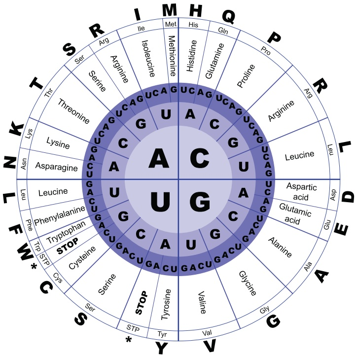

<details>
<summary>donut</summary>

| Nucleotide | Amino Acid |
| --- | --- |
| A | His |
| A | Glutamine |
| A | Proline |
| A | Arginine |
| A | Leucine |
| A | Aspartic acid |
| A | Glutamic acid |
| A | Alanine |
| A | Glycine |
| A | Valine |
| A | Tyr |
| A | Val |
| A | Met |
| A | Histidine |
| A | Gln |
| A | C |
| A | U |
| A | C |
| A | G |
| A | G |
| A | G |
| A | G |
| A | G |
| A | G |
| A | G |
| A | G |
| A | G |
| A | G |
| A | G |
| A | G |
| A | G |
| A | G |
| A | G |
| A | G |
| A | G |
| A | G |
| A | G |
| A | G |
| A | C |
| A | C |
| A | C |
| A | C |
| A | C |
| A | C |
| A | C |
| A | C |
| A | C |
| A | C |
| A | C |
| A | C |
| A | C |
| A | C |
| A | C |
| A | C |
| A | C |
| A | C |
| A | C |
| A | C |
| A | G |
| A | G |
| A | G |
| A | G |
| A | G |
| A | G |
| A | G |
| A | G |
| A | G |
| A | G |
| A | G |
| A | G |
| A | G |
| A | G |
| A | G |
| A | G |
| A | G |
| A | G |
| A | C |
| A | G |
| A | G |
| A | G |
| A | G |
| A | G |
| A | G |
| A | G |
| A | G |
| A | G |
| A | G |
| A | G |
| A | G |
| A | G |
| A | G |
| A | G |
| A | G |
| A | G |
| A | G |
| A | U |
| A | U |
| A | U |
| A | U |
| A | U |
| A | U |
| A | U |
| A | U |
| A | U |
| A | U |
| A | U |
| A | U |
| A | U |
| A | U |
| A | U |
| A | U |
| A | U |
| A | U |
| A | U |
| A | U |
| A | C |
| A | C |
| A | C |
| A | C |
| A | C |
| A | C |
| A | C |
| A | C |
| A | C |
| A | C |
| A | C |
| A | C |
| A | C |
| A | C |
| A | C |
| A | C |
| A | C |
| A | C |
| A | C |
| A | U |
| A | U |
| A | U |
| A | U |
| A | U |
| A | U |
| A | U |
| A | U |
| A | U |
| A | U |
| A | U |
| A | U |
| A | U |
| A | U |
| A | U |
| A | U |
| A | U |
| A | U |
| A | U |
</details>

FIGURE 4.1 The genetic code describes the translation of an RNA 3-mer (codon) into one of 20 amino acids. The first three circles, moving from the inside out, represent the first, second, and third nucleotides of a codon. The fourth, fifth, and sixth circles define the translated amino acid in three ways: the amino acid’s full name, its 3-letter abbreviation, and its single-letter abbreviation. Three of the 64 total RNA codons are stop codons, which halt translation.

185

---

C H A P T E R 4

We will represent the genetic code as an array GENETICCODE containing 64 ele ments, as shown in Figure 4.2. The following problem asks you to find the translation of an RNA string into an amino acid string.


## Protein Translation Problem:

Translate an RNA string into an amino acid string.

**Input**: An RNA string Pattern and the array GENETICCODE.

**Output**: The translation of Pattern into an amino acid string Peptide.


EXERCISE BREAK: How many DNA strings of length 30 transcribe and translate into Tyrocidine B1?

| 0 | AAA | K | 16 | CAA | Q | 32 | GAA | E | 48 | UAA | * |
| --- | --- | --- | --- | --- | --- | --- | --- | --- | --- | --- | --- |
| 1 | AAC | N | 17 | CAC | H | 33 | GAC | D | 49 | UAC | Y |
| 2 | AAG | K | 18 | CAG | Q | 34 | GAG | E | 50 | UAG | * |
| 3 | AAU | N | 19 | CAU | H | 35 | GAU | D | 51 | UAU | Y |
| 4 | ACA | T | 20 | CCA | P | 36 | GCA | A | 52 | UCA | S |
| 5 | ACC | T | 21 | CCC | P | 37 | GCC | A | 53 | UCC | S |
| 6 | ACG | T | 22 | CCG | P | 38 | GCG | A | 54 | UCG | S |
| 7 | ACU | T | 23 | CCU | P | 39 | GCU | A | 55 | UCU | S |
| 8 | AGA | R | 24 | CGA | R | 40 | GGA | G | 56 | UGA | * |
| 9 | AGC | S | 25 | CGC | R | 41 | GGC | G | 57 | UGC | C |
| 10 | AGG | R | 26 | CGG | R | 42 | GGG | G | 58 | UGG | W |
| 11 | AGU | S | 27 | CGU | R | 43 | GGU | G | 59 | UGU | C |
| 12 | AUA | I | 28 | CUA | L | 44 | GUA | V | 60 | UUA | L |
| 13 | AUC | I | 29 | CUC | L | 45 | GUC | V | 61 | UUC | F |
| 14 | AUG | M | 30 | CUG | L | 46 | GUG | V | 62 | UUG | L |
| 15 | AUU | I | 31 | CUU | L | 47 | GUU | V | 63 | UUU | F |

FIGURE 4.2 The array GENETICCODE contains 64 elements, each of which is an amino acid or a stop codon (represented by \*).

Where is Tyrocidine encoded in the Bacillus brevis genome?

Thousands of different DNA 30-mers could code for Tyrocidine B1, and we would like to know which one appears in the Bacillus brevis genome. There are three different ways to divide a DNA string into codons for translation, one starting at each of the first three

186

---

H O W D O W E S E Q U E N C E A N T I B I O T I C S ?

positions of the string. These different ways of dividing a DNA string into codons are called **reading frames**. Since DNA is double-stranded, a genome has six reading frames (three on each strand), as shown in Figure 4.3.

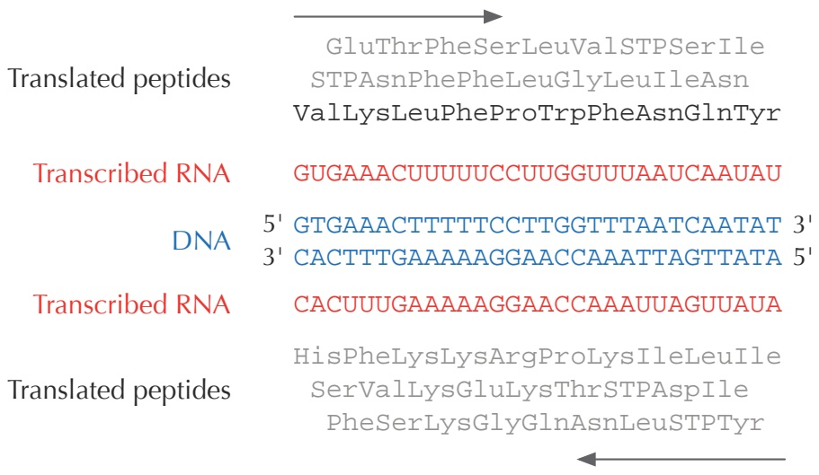

<details>
<summary>flowchart</summary>

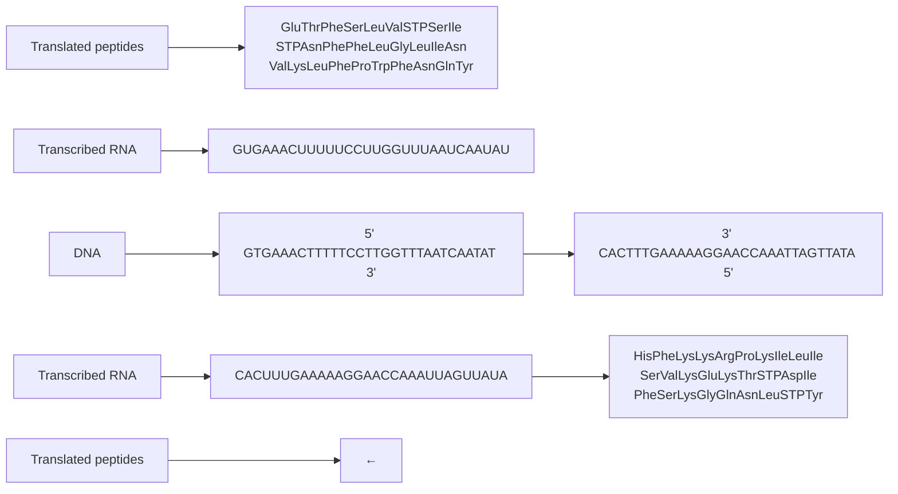
</details>

FIGURE 4.3 Six different reading frames give six different ways for the same fragment of DNA to be transcribed and translated (three from each strand). The top three amino acid strings are read from left to right, whereas the bottom three strings are read from right to left. The highlighted amino acid string spells out the sequence of Tyrocidine B1. Stop codons are represented by STP.

We say that a DNA string Pattern **encodes** an amino acid string Peptide if the RNA string transcribed from either Pattern or its reverse complement Pattern translates into Peptide. For example, the DNA string GAAACT is transcribed into GAAACU and translated into ET. The reverse complement of this DNA string, AGTTTC, is transcribed into AGUUUC and translated into SF. Thus, GAAACT encodes both ET and SF.

## Peptide Encoding Problem:

Find substrings of a genome encoding a given amino acid sequence.

**Input**: A DNA string Text and an amino acid string Peptide.

**Output**: All substrings of Text encoding Peptide (if any such substrings exist).


187

---

C H A P T E R 4

STOP

STOP

**STOP and Think:** Solve the Peptide Encoding Problem for Bacillus brevis and Tyrocidine B1. Which starting positions in Bacillus brevis encode this peptide?

By solving the Peptide Encoding Problem for Tyrocidine B1, we should find a 30-mer in the Bacillus brevis genome encoding Tyrocidine B1, and yet no such 30-mer exists!

**STOP and Think:** How could a bacterium produce a peptide that is not encoded by the bacterium’s genome?

From linear to cyclic peptides

Neither Gause nor Synge was aware of it, but tyrocidines and gramicidins are actually **cyclic peptides**. The cyclic representation for Tyrocidine B1 is shown in Figure 4.4 (left). Thus, Tyrocidine B1 has ten different linear representations, and we should run the Peptide Encoding Problem on every one of these sequences to find potential 30-mers coding for Tyrocidine B1. Yet when we solve the Peptide Encoding Problem for each of the ten strings in Figure 4.4 (right), we find no 30-mer in the Bacillus brevis genome encoding Tyrocidine B1!

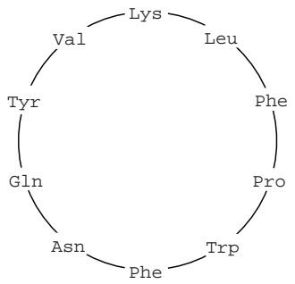

<details>
<summary>flowchart</summary>

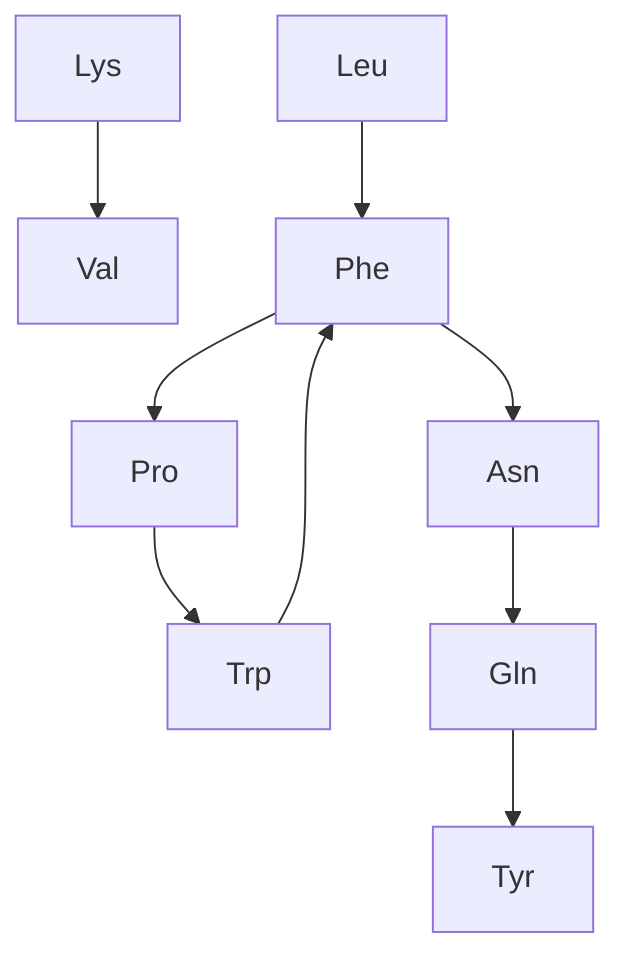
</details>

FIGURE 4.4 Tyrocidine B1 is a cyclic peptide (left), and so it has ten different linear representations (right).

## Dodging the Central Dogma of Molecular Biology

Hopefully, you are perplexed, because the Central Dogma of Molecular Biology implies that all peptides must be encoded by the genome. Nobel laureate Edward Tatum was

188

---

H O W D O W E S E Q U E N C E A N T I B I O T I C S ?

just as confused, and in 1963, he devised an ingenious experiment. Protein translation is carried out by a molecular machine called a **ribosome**, and so Tatum reasoned that if he inhibited the ribosome, all protein production in Bacillus brevis should grind to a halt. To his amazement, all proteins did indeed shut down — except for tyrocidines and gramicidins! His experiment led Tatum to hypothesize that some yet unknown non-ribosomal mechanism must assemble these peptides.

In 1969, Fritz Lipmann (another Nobel laureate) demonstrated that tyrocidines and gramicidins are **non-ribosomal peptides** (**NRPs**), synthesized not by the ribosome, but by a giant protein called **NRP synthetase**. This enzyme pieces together antibiotic peptides without any reliance on RNA or the genetic code! We now know that every NRP synthetase assembles peptides by growing them one amino acid at a time, as shown in Figure 4.5.

The reason why many NRPs have pharmaceutical applications is that they have been optimized by eons of evolution as “molecular bullets” that bacteria and fungi use to kill their enemies. If these enemies happen to be pathogens, researchers are eager to borrow these bullets as antibacterial drugs. However, NRPs are not limited to antibiotics: many of them represent anti-tumor agents and immunosuppressors, while others are used by bacteria to communicate with other cells (see **DETOUR: Quorum Sensing**).


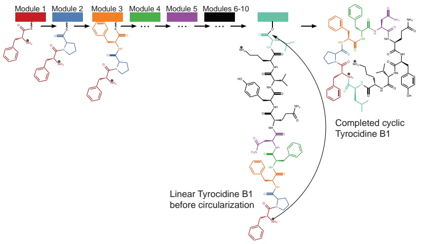

<details>
<summary>flowchart</summary>

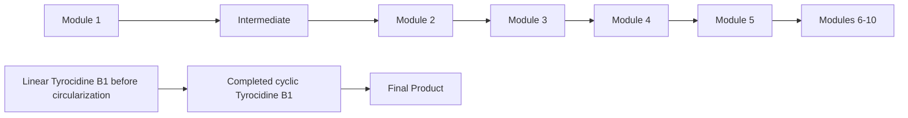
</details>

FIGURE 4.5 NRP synthetase is a giant multi-module protein that assembles a cyclic peptide one amino acid at a time. Each of ten different modules (shown by different colors) adds a single amino acid to the peptide, which in the figure is one of many tyrocidines produced by Bacillus brevis. In a final step, the peptide is circularized.

189

---

C H A P T E R 4

## Sequencing Antibiotics by Shattering Them into Pieces

Introduction to mass spectrometry

Since NRPs do not adhere to the Central Dogma, we cannot infer them from the genome, which brings us back to where we started. What makes sequencing these peptides even more difficult is that many NRPs (including tyrocidines and gramicidins) are cyclic. Thus, the standard tools for sequencing linear peptides, which we will describe later, are not applicable to NRP analysis.

The workhorse of peptide sequencing is the **mass spectrometer**, an expensive molecular scale that shatters molecules into pieces and then weighs the resulting fragments. The mass spectrometer measures the mass of a molecule in **daltons** (**Da**); 1 Da is approximately equal to the mass of a single nuclear particle (i.e., a proton or neutron).

We will approximate the mass of a molecule by simply adding the number of protons and neutrons found in the molecule’s constituent atoms, which yields the molecule’s **integer mass**. For example, the amino acid glycine, which has chemical formula $C_{2} H _{3} ON ,$ has an integer mass of 57, since $2 \cdot 12 + 3 \cdot 1 + 1 \cdot 16 + 1 \cdot 14 = 57$ . Yet 1 Da is not exactly equal to the mass of a proton/neutron, and we may need to account for different naturally occurring isotopes of each atom when weighing a molecule (see **DETOUR: Molecular Mass**). As a result, amino acids typically have non-integer masses (e.g., glycine has total integer mass equal to approximately 57.02 Da); for simplicity, however, we will work with the integer mass table given in Figure 4.6. Tyrocidine B1, which is represented by VKLFPWFNQY, has total mass 1322 Da (99 $+ 128 + 113 + 147 +$ $97+186+147+114+128+163=1322)$

$$
\begin{array}{ccccccccccccccccc}G & A & S & P & V & T & C & I & L & N & D & K & Q & E & M & H & F & R & Y & W \\ 57 & 71 & 87 & 97 & 99 & 101 & 103 & 113 & 113 & 114 & 115 & 128 & 128 & 129 & 131 & 137 & 147 & 156 & 163 & 186 \end{array}
$$

**FIGURE 4.6** Integer masses of amino acids. The integer mass of each amino acid is computed by adding the number of protons and neutrons in the amino acid molecule.

The mass spectrometer can break each molecule of Tyrocidine B1 into two linear fragments, and it analyzes samples that may contain billions of identical copies of the peptide, with each copy breaking in its own way. One copy may break into LFP and WFNQYVK (with respective masses 357 and 965), whereas another may break into PWFN and QYVKLF. Our goal is to use the masses of these and other fragments to sequence the peptide. The collection of all the fragment masses generated by the mass spectrometer is called an **experimental spectrum**.


190

---

H O W D O W E S E Q U E N C E A N T I B I O T I C S ?

**STOP and Think:** How can we use the experimental spectrum to sequence a peptide?

## The Cyclopeptide Sequencing Problem

For now, we will assume for simplicity that the mass spectrometer breaks the copies of a cyclic peptide at every possible two bonds, so that the resulting experimental spectrum contains the masses of all possible linear fragments of the peptide, which are called **subpeptides**. For example, the cyclic peptide NQEL has 12 subpeptides: N, Q, E, L, NQ, QE, EL, LN, NQE, QEL, ELN, and LNQ. We will also assume that subpeptides may occur more than once if an amino acid occurs multiple times in the peptide; for example, ELEL also has 12 subpeptides: E, L, E, L, EL, LE, EL, LE, ELE, LEL, ELE, and LEL.

**EXERCISE BREAK:** How many subpeptides does a cyclic peptide of length n have?

The **theoretical spectrum** of a cyclic peptide Peptide is the collection of all of the masses of its subpeptides, in addition to the mass 0 and the mass of the entire peptide, with masses ordered from smallest to largest. We will denote the theoretical spectrum of Peptide by CYCLOSPECTRUM(Peptide) and assume that this theoretical spectrum can contain duplicate elements, as is the case for NQEL (shown below), where **NQ** and **EL** have the same mass.

|  | L | N | Q | E | LN | NQ | EL | QE | LNQ | ELN | QEL | NQE | NQEL |
| --- | --- | --- | --- | --- | --- | --- | --- | --- | --- | --- | --- | --- | --- |
| 0 | 113 | 114 | 128 | 129 | 227 | 242 | 242 | 257 | 355 | 356 | 370 | 371 | 484 |

## Generating Theoretical Spectrum Problem:

Generate the theoretical spectrum of a cyclic peptide.

**Input**: An amino acid string Peptide.

**Output**: CYCLOSPECTRUM(Peptide).

## CHARGING STATION (Generating the Theoretical Spectrum of a Peptide):

One way to solve the Generating Theoretical Spectrum Problem is to construct a list containing all subpeptides of Peptide, then find the mass of each subpeptide by adding the integer masses of its constituent amino acids. This approach will work, but check out this Charging Station to see a more elegant algorithm.

STOP

[4C](http://rosalind.info/problems/4c)

PAGE 211

191

---

C H A P T E R 4


Generating the theoretical spectrum of a known peptide is easy, but our aim is to solve the reverse problem of reconstructing an unknown peptide from its experimental spectrum. We will start by assuming that a biologist is lucky enough to generate an **ideal spectrum**, which is one coinciding with the peptide’s theoretical spectrum.

STOP and Think: Consider the theoretical spectrum for Tyrocidine B1 shown in Figure 4.7. If an experiment produced this spectrum, how would you reconstruct the amino acid sequence of Tyrocidine B1?

| 0 | 97 | 99 | 113 | 114 | 128 | 128 | 147 | 147 | 163 | 186 | 227 |
| --- | --- | --- | --- | --- | --- | --- | --- | --- | --- | --- | --- |
| 241 | 242 | 244 | 260 | 261 | 262 | 283 | 291 | 333 | 340 | 357 | 388 |
| 389 | 390 | 390 | 405 | 430 | 430 | 447 | 485 | 487 | 503 | 504 | 518 |
| 543 | 544 | 552 | 575 | 577 | 584 | 631 | 632 | 650 | 651 | 671 | 672 |
| 690 | 691 | 738 | 745 | 747 | 770 | 778 | 779 | 804 | 818 | 819 | 835 |
| 837 | 875 | 892 | 892 | 917 | 932 | 932 | 933 | 934 | 965 | 982 | 989 |
| 1031 | 1039 | 1060 | 1061 | 1062 | 1078 | 1080 | 1081 | 1095 | 1136 | 1159 | 1175 |
| 1175 | 1194 | 1194 | 1208 | 1209 | 1223 | 1225 | 1322 |  |  |  |  |

FIGURE 4.7 The theoretical spectrum for Tyrocidine B1 (VKLFPWFNQY), whose integer representation is 99-128-113-147-97-186-147-114-128-163.

## Cyclopeptide Sequencing Problem:

Given an ideal spectrum, find a cyclic peptide whose theoretical spectrum matches the experimental spectrum.

**Input**: A collection of (possibly repeated) integers Spectrum corresponding to an ideal spectrum.

**Output**: An amino acid string Peptide such that CYCLOSPECTRUM(Peptide) = Spectrum (if such a string exists).

From now on, we will sometimes work directly with amino acid masses, taking the liberty to represent a peptide by a sequence of integers denoting the peptide’s constituent amino acid masses. For example, we represent NQEL as 114-128-129-113 and Tyrocidine B1 (VKLFPWFNQY) as 99-128-113-147-97-186-147-114-128-163. We have therefore replaced an alphabet of 20 amino acids with an alphabet of only 18 integers because, recalling Figure 4.6, two amino acid pairs (I/L and K/Q) have the same integer mass.

Note that in the general case that we are not restricted to the amino acid alphabet, the Cyclopeptide Sequencing Problem could have multiple solutions. For example, “pep-

192

---

H O W D O W E S E Q U E N C E A N T I B I O T I C S ?

tides” 1-1-3-3 and 1-2-1-4 have the same theoretical spectrum {1, 1, 2, 3, 3, 4, 4, 5, 5, 6, 7, 7}.

**STOP and Think:** Can you find two peptides (in the alphabet of 18 amino acid masses) with identical theoretical spectra?


## A Brute Force Algorithm for Cyclopeptide Sequencing

We first encountered brute force algorithms when looking for motifs in Chapter 2. In this chapter, we will discuss how to speed up brute force algorithms for peptide sequencing to make them practical.

Let’s design a straightforward brute force algorithm for the Cyclopeptide Sequencing Problem. We denote the total mass of an amino acid string Peptide as MASS(Peptide). In mass spectrometry experiments, whereas the peptide that generated Spectrum is unknown, the peptide’s mass is typically known and is denoted PARENTMASS(Spectrum).

For the sake of simplicity, we will also assume that for all experimental spectra, PARENTMASS(Spectrum) is equal to the largest mass in Spectrum. The following brute force cyclopeptide sequencing algorithm generates all possible peptides whose mass is equal to PARENTMASS(Spectrum) and then checks which of these peptides has theoretical spectra matching Spectrum.

```python
BFCYCLOPEPTIDESEQUENCING(Spectrum)
    for every Peptide with MASS(Peptide) equal to PARENTMASS(Spectrum)
        if Spectrum = CYCLOSPECTRUM(Peptide)
            output Peptide
```

There should be no question that **BFCYCLOPEPTIDESEQUENCING** will solve the Cyclopeptide Sequencing Problem. However, we should be concerned about its running time: how many peptides are there having mass equal to PARENTMASS(Spectrum)?

## Counting Peptides with Given Mass Problem:

Compute the number of peptides of given mass.

**Input**: An integer m.

**Output**: The number of linear peptides having integer mass m.


193

---

C H A P T E R 4

If you have difficulty solving this problem or getting the runtime down, please return to it after learning more about dynamic programming algorithms in Chapter 5. It turns out that there are trillions of peptides having the same integer mass (1322) as Tyrocidine B1 (Figure 4.8). Therefore, **BFCYCLOPEPTIDESEQUENCING** is completely impractical, and we will not even bother asking you to implement it.

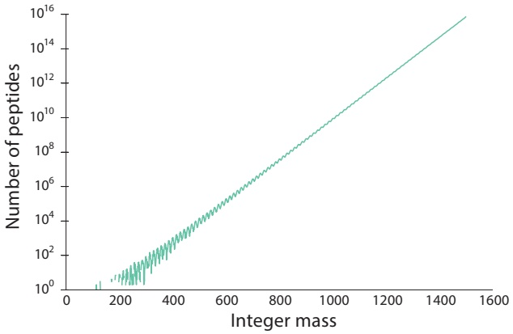

<details>
<summary>line</summary>

| Integer mass | Number of peptides |
| --- | --- |
| ~100 | 10^0 |
| ~200 | 10^1 |
| ~300 | 10^2 |
| ~400 | 10^3 |
| ~500 | 10^4 |
| ~600 | 10^5 |
| ~700 | 10^6 |
| ~800 | 10^7 |
| ~900 | 10^8 |
| ~1000 | 10^9 |
| ~1100 | 10^10 |
| ~1200 | 10^11 |
| ~1300 | 10^12 |
| ~1400 | 10^13 |
| ~1500 | 10^14 |
</details>

FIGURE 4.8 The number of peptides with given integer mass grows exponentially.


**STOP and Think:** Figure 4.8 suggests that for large m, the number of peptides with given integer mass m can be approximated as $k \cdot C ^ { m }$ where k and C are constants. Can you find these constants?

## A Branch-and-Bound Algorithm for Cyclopeptide Sequencing

Just because the algorithm from the previous section failed miserably does not mean that all brute force approaches are doomed. Can we design a faster brute force algorithm based on a different idea?

Instead of checking all cyclic peptides with a given mass, our new approach to solving the Cyclopeptide Sequencing Problem will “grow” candidate linear peptides whose theoretical spectra are “consistent” with the experimental spectrum.


**STOP and Think:** What should it mean for a linear peptide to be consistent with an experimental spectrum? Would you classify VKF as consistent with the spectrum shown in Figure 4.7? What about VKY?

194

---

H O W D O W E S E Q U E N C E A N T I B I O T I C S ?

Given an experimental spectrum Spectrum, we will form a collection Peptides of candidate linear peptides initially consisting of the **empty peptide**, which is just an empty string (denoted "") having mass 0. At the next step, we will expand Peptides to contain all linear peptides of length 1. We continue this process, creating 18 new peptides of length k + 1 for each amino acid string Peptide of length k in Peptides by appending every possible amino acid mass to the end of Peptide.

To prevent the number of candidate peptides from increasing exponentially, every time we expand Peptides, we trim it by keeping only those linear peptides that remain consistent with the experimental spectrum. We then check if any of these new linear peptides has mass equal to MASS(Spectrum). If so, we circularize this peptide and check whether it provides a solution to the Cyclopeptide Sequencing Problem.

More generally, brute force algorithms that enumerate all candidate solutions but discard large subsets of hopeless candidates by using various consistency conditions are known as **branch-and-bound algorithms**. Each such algorithm consists of a **branching step** to increase the number of candidate solutions, followed by a **bounding step** to remove hopeless candidates. In our branch-and-bound algorithm for the Cyclopeptide Sequencing Problem, the branching step will extend each candidate peptide of length k into 18 peptides of length k + 1, and the bounding step will remove inconsistent peptides from consideration.

Note that the spectrum of a linear peptide does not contain as many masses as the spectrum of a cyclic peptide with the same amino acid sequence. For instance, the theoretical spectrum of the cyclic peptide NQEL contains 14 masses (corresponding to "", N, Q, E, L, LN, NQ, QW, EL, ELN, LNQ, NQE, QEL, and NQEL). However, the theoretical spectrum of the linear peptide NQEL, shown in Figure 4.9, does not contain masses corresponding to LN, LNQ, or ELN, since these subpeptides “wrap around” the end of the linear peptide.

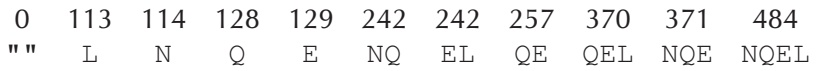

<details>
<summary>text_image</summary>

0 113 114 128 129 242 242 257 370 371 484
"" L N Q E NQ EL QE QEL NQE NQEL
</details>

FIGURE 4.9 The theoretical spectrum for the linear peptide NQEL.

**EXERCISE BREAK:** How many subpeptides does a linear peptide of length n have?

Given an experimental spectrum Spectrum of a cyclic peptide, a linear peptide is **consistent** with Spectrum if every mass in its theoretical spectrum is contained in Spectrum. If


195

---

C H A P T E R 4

a mass appears more than once in the theoretical spectrum of the linear peptide, then it must appear at least that many times in Spectrum in order for the linear peptide to be consistent with Spectrum. For example, a linear peptide can still be consistent with the theoretical spectrum of NQEL if the peptide’s spectrum contains 242 twice. But a peptide cannot be consistent with the theoretical spectrum of NQEL if its spectrum contains 113 twice.

The key to our new algorithm is that every linear subpeptide of a cyclic peptide Peptide is consistent with CYCLOSPECTRUM(Peptide). Thus, to solve the Cyclopep tide Sequencing Problem for Spectrum, we can safely ban all peptides that are inconsistent with Spectrum from the growing set Peptides, which powers the bounding step that we described above. For example, the linear peptide VKF (with spectrum {0, 99, 128, 147, 227, 275, 374}) will be banned because it is inconsistent with Tyrocidine B1’s spectrum in Figure 4.7. But the linear peptide VKY will not be banned because every mass in its theoretical spectrum ({0, 99, 128, 163, 227, 291, 390}) is present in Figure 4.7.

What about the branching step? Given the current collection of linear peptides Peptides, define EXPAND(Peptides) as a new collection containing all possible extensions of peptides in Peptides by a single amino acid mass. We can now provide the pseudocode for the branch-and-bound algorithm, called **CYCLOPEPTIDESEQUENCING**.


```python
CYCLOPEPTIDESEQUENCING(Spectrum)
    Peptides ← a set containing only the empty peptide
    while Peptides is nonempty
        Peptides ← EXPAND(Peptides)
        for each peptide Peptide in Peptides
            if MASS(Peptide) = PARENTMASS(Spectrum)
                if CYCLOSPECTRUM(Peptide) = Spectrum
                    output Peptide
                remove Peptide from Peptides
            else if Peptide is not consistent with Spectrum
                remove Peptide from Peptides
```


**CHARGING STATION (How Fast is CYCLOPEPTIDESEQUENCING?):** After the failure of **BFCYCLOPEPTIDESEQUENCING**, you may be hesitant to implement **CYCLOPEPTIDESEQUENCING**. The potential problem with this algorithm is that it may generate incorrect k-mers at intermediate stages (i.e., k-mers that are not subpeptides of a correct solution). In practice, however, this is not a concern. Check out this Charging Station to see an example.

196

---

H O W D O W E S E Q U E N C E A N T I B I O T I C S ?

It is hard to imagine a worst-case scenario in which **CYCLOPEPTIDESEQUENCING** takes a long time to run, but no one has been able to guarantee that this algorithm will not generate many incorrect k-mers at intermediate stages. **BFCYCLOPEPTIDESEQUENCING** is exponential, and although in practice, **CYCLOPEPTIDESEQUENCING** is much faster, this algorithm has not been proven to be polynomial. Thus, from the perspective of an introductory algorithms course focusing on theoretical computer science, the practical **CYCLOPEPTIDESEQUENCING** is just as inefficient as **BFCYCLOPEPTIDESEQUENCING**, since neither algorithm’s running time can be bounded by a polynomial. See the Open Problems section to learn more about the algorithmic challenges related to this problem.

## Mass Spectrometry Meets Golf

From theoretical to real spectra

Although **CYCLOPEPTIDESEQUENCING** successfully reconstructed Tyrocidine B1, this algorithm only works in the case of an ideal spectrum, i.e., when the experimental spectrum of a peptide coincides exactly with its theoretical spectrum. This inflexibility of **CYCLOPEPTIDESEQUENCING** presents a practical barrier, since mass spectrometers generate “noisy” spectra that are far from ideal — they are characterized by having both **false masses** and **missing masses**. A false mass is present in the experimental spectrum but absent from the theoretical spectrum; a missing mass is present in the theoretical spectrum but absent from the experimental spectrum (Figure 4.10).

**Theoretical**: 0 113 114 128 **129** 227 **242 242** 257 355 356 370 371 484

**Experimental**: 0 **99** 113 114 128 227 257 **299** 355 356 370 371 484

**FIGURE 4.10** Theoretical and simulated experimental spectra for NQEL. Masses that are missing from the experimental spectrum are shown in blue, and false masses in the experimental spectrum are shown in green.

What is particularly worrisome about the example in Figure 4.10 is that the mass of the amino acid E (**129**) is missing, and the mass of the amino acid V (**99**) is false; as a result, the first step of **CYCLOPEPTIDESEQUENCING** would establish {V, L, N, Q} as the amino acid composition of our candidate peptides, which is incorrect. In fact, any false or missing mass will cause **CYCLOPEPTIDESEQUENCING** to throw out the correct peptide, because its theoretical spectrum differs from the experimental spectrum.

197

---

C H A P T E R 4


**STOP and Think:** How would you reformulate the Cyclopeptide Sequencing Problem to handle experimental spectra with errors?

Adapting cyclopeptide sequencing for spectra with errors

To generalize the Cyclopeptide Sequencing Problem to handle noisy spectra, we need to relax the requirement that a candidate peptide’s theoretical spectrum must match the experimental spectrum exactly, and instead incorporate a **scoring function** that will select the peptide whose theoretical spectrum matches the given experimental spectrum the most closely. Given a cyclic peptide Peptide and a spectrum Spectrum, we define SCORE(Peptide, Spectrum) as the number of masses shared between CYCLOSPECTRUM(Peptide) and Spectrum. Recalling our example above, if

$$
\text {Spectrum} = \{0, 9 9, 1 1 3, 1 1 4, 1 2 8, 2 2 7, 2 5 7, 2 9 9, 3 5 5, 3 5 6, 3 7 0, 3 7 1, 4 8 4 \},
$$

then SCORE(NQEL, Spectrum) = 11.

The scoring function should take into account the **multiplicities** of shared masses, i.e., how many times they occur in each spectrum. For example, suppose that Spectrum is the theoretical spectrum of NQEL (Figure 4.7); for this spectrum, mass 242 has multiplicity 2. If 242 has multiplicity 1 in the theoretical spectrum of Peptide, then 242 contributes 1 to SCORE(Peptide, Spectrum). If 242 has larger multiplicity in the theoretical spectrum of Peptide, then 242 contributes 2 to SCORE(Peptide, Spectrum).


## Cyclopeptide Scoring Problem:

Compute the score of a cyclic peptide against a spectrum.

**Input**: An amino acid string Peptide and a collection of integers Spectrum.

**Output**: The score of Peptide against Spectrum, SCORE(Peptide, Spectrum).

We now can redefine the Cyclopeptide Sequencing Problem for noisy spectra.

## Cyclopeptide Sequencing Problem (for spectra with errors):

Find a cyclic peptide having maximum score against an experimental spectrum.

**Input**: A collection of integers Spectrum.

**Output**: A cyclic peptide Peptide maximizing SCORE(Peptide, Spectrum) over all peptides Peptide with mass equal to PARENTMASS(Spectrum).

198

---

H O W D O W E S E Q U E N C E A N T I B I O T I C S ?

Our goal is to adapt the **CYCLOPEPTIDESEQUENCING** algorithm to find a peptide with maximum score. Remember that this algorithm had a stringent bounding step in which all candidate linear peptides having inconsistent spectra were thrown out. For example, we saw that the linear peptide VKF is inconsistent with the theoretical spectrum in Figure 4.7. However, we perhaps should not ban VKF in the case of experimental spectra, since they can have missing masses. Thus, we need to revise the bounding step to include more candidate linear peptides, while still ensuring that the number of peptides that we consider does not grow out of control.

**STOP and Think:** How can we limit the growth of the list of candidate linear peptides in the case of experimental spectra?

To limit the number of candidate linear peptides under consideration, we will replace the list Peptides with the list Leaderboard, which holds the N highest scoring candidate peptides for further extension. At each step, we will expand all candidate peptides found in Leaderboard, then eliminate those peptides whose newly calculated scores are not high enough to keep them on the Leaderboard. This idea is similar to the notion of a “cut” in a golf tournament; after the cut, only the top N golfers are allowed to play in the next round, since they are the only players who have a reasonable chance of winning.

To be fair, a cut should include anyone who is tied with the Nth-place competitor. Thus, Leaderboard should be trimmed down to the “N highest-scoring linear peptides including ties”, which may include more than N peptides. Given a list of peptides Leaderboard, a spectrum Spectrum, and an integer N, define TRIM(Leaderboard, Spectrum, N) as the collection of the top N highest-scoring linear peptides in Leaderboard (including ties) with respect to Spectrum.

**STOP and Think:** Our peptide scoring function currently assumes that peptides are circular, but peptides should technically be scored as linear peptides until the final step. How would you score a linear peptide against a spectrum?

Note that SCORE(Peptide, Spectrum) currently only scores Peptide against Spectrum if Peptide is cyclic. However, to generalize this scoring function when Peptide is linear, we simply exclude those subpeptides of Peptide that wrap around the end of the string, resulting in a function LINEARSCORE(Peptide, Spectrum). For example, if Spectrum is the experimental spectrum of NQEL from Figure 4.10, then you can verify that LINEARSCORE(NQEL, Spectrum) = 8. This brings us to the pseudocode for **LEADERBOARDCYCLOPEPTIDESEQUENCING**.

STOP

STOP

199

---

C H A P T E R 4


```python
LEADERBOARDCYCLOPEPTIDESEQUENCING(Spectrum, N)
    Leaderboard ← set containing only the empty peptide
    LeaderPeptide ← empty peptide
    while Leaderboard is non-empty
        Leaderboard ← EXPAND(Leaderboard)
        for each Peptide in Leaderboard
            if MASS(Peptide) = PARENTMASS(Spectrum)
                if SCORE(Peptide, Spectrum) > SCORE(LeaderPeptide, Spectrum)
                    LeaderPeptide ← Peptide
            else if MASS(Peptide) > PARENTMASS(Spectrum)
                remove Peptide from Leaderboard
        Leaderboard ← TRIM(Leaderboard, Spectrum, N)
    output LeaderPeptide
```

**CHARGING STATION (Trimming the Peptide Leaderboard):** The tricky aspect of implementing **LEADERBOARDCYCLOPEPTIDESEQUENCING** is making sure that the TRIM function is implemented correctly. Check out this Charging Station for some help with trimming Leaderboard.

We point out that because a linear peptide giving rise to the highest-scoring cyclic peptide may be trimmed early on, **LEADERBOARDCYCLOPEPTIDESEQUENCING** is a heuristic, not guaranteed to correctly solve the Cyclopeptide Sequencing Problem. When we develop a heuristic, we must ask: how accurate is it? Consider the simulated spectrum $S p e c t r u m _ { 1 0 }$ of Tyrocidine B1 shown in Figure 4.11 (top), with approximately 10% **missing**/**false** masses. Applying **LEADERBOARDCYCLOPEPTIDESEQUENCING** to this spectrum (with $N = 1 0 0 0 )$ results in the correct cyclic peptide VKLFPWFNQY, which has a score of 86.

So far, **LEADERBOARDCYCLOPEPTIDESEQUENCING** has worked well, but as the number of errors increases, so does the likelihood that this algorithm will return an incorrect peptide. Let’s see how this algorithm performs on a noisier simulated spectrum; in Figure 4.11 (bottom), we show $S p e c t r u m _ { 2 5 }$ for Tyrocidine B1, which has 25% **missing**/**false** masses.

When run on $S p e c t r u m _ { 2 5 } ,$ , **LEADERBOARDCYCLOPEPTIDESEQUENCING** (with $N =$ 1000) identifies VKLFP**AD**FNQY (score: 83) as a highest-scoring cyclic peptide instead of the correct peptide VKLFPWFNQY (score: 82). These two peptides are similar, owing to the fact that the combined mass of A (71) and D (115) is equal to the mass of W (186).

200

---

H O W D O W E S E Q U E N C E A N T I B I O T I C S ?

| 0 | 97 | 99 | 113 | 114 | 128 | 128 | 147 | 147 | 163 | 186 | 227 |
| --- | --- | --- | --- | --- | --- | --- | --- | --- | --- | --- | --- |
| 241 | 242 | 244 | 260 | 261 | 262 | 283 | 291 | 333 | 340 | 357 | 385 |
| 388 | 389 | 390 | 390 | 405 | 430 | 430 | 447 | 485 | 487 | 503 | 504 |
| 518 | 543 | 544 | 552 | 575 | 577 | 584 | 631 | 632 | 650 | 651 | 671 |
| 672 | 690 | 691 | 738 | 745 | 747 | 770 | 778 | 779 | 804 | 818 | 819 |
| 820 | 835 | 837 | 875 | 892 | 892 | 917 | 932 | 932 | 933 | 934 | 965 |
| 982 | 989 | 1030 | 1031 | 1039 | 1060 | 1061 | 1062 | 1078 | 1080 | 1081 | 1095 |
| 1136 | 1159 | 1175 | 1175 | 1194 | 1194 | 1208 | 1209 | 1223 | 1225 | 1322 |  |
| 0 | 97 | 99 | 113 | 114 | 115 | 128 | 128 | 147 | 147 | 163 | 186 |
| 227 | 241 | 242 | 244 | 244 | 256 | 260 | 261 | 262 | 283 | 291 | 309 |
| 330 | 333 | 340 | 347 | 357 | 385 | 388 | 389 | 390 | 390 | 405 | 430 |
| 430 | 435 | 447 | 485 | 487 | 503 | 504 | 518 | 543 | 544 | 552 | 575 |
| 577 | 584 | 599 | 608 | 631 | 632 | 650 | 651 | 653 | 671 | 672 | 690 |
| 691 | 717 | 738 | 745 | 747 | 770 | 778 | 779 | 804 | 818 | 819 | 827 |
| 835 | 837 | 875 | 892 | 892 | 917 | 932 | 932 | 933 | 934 | 965 | 982 |
| 989 | 1031 | 1039 | 1060 | 1061 | 1062 | 1078 | 1080 | 1081 | 1095 | 1136 | 1159 |
| 1175 | 1175 | 1194 | 1194 | 1208 | 1209 | 1223 | 1225 | 1322 |  |  |  |

FIGURE 4.11 (Top) A simulated experimental spectrum $S p e c t r u m _ { 1 0 }$ of Tyrocidine B1. This spectrum has approximately 10% missing (blue) and false (green) masses. Note that the blue masses are not actually in the spectrum, but we show them so that it is clear which masses are missing. (Bottom) A simulated experimental spectrum $S p e c t r u m _ { 2 5 }$ of Tyrocidine B1, with approximately 25% missing and false masses.

**STOP and Think:** How could we have eliminated the incorrect peptide VKLFP**AD**FNQY from consideration for $S p e c t r u m _ { 2 5 } ?$

Notice that although the correct and incorrect peptides are similar, their amino acid compositions differ. If we could figure out the amino acid composition of Tyrocidine B1 from its spectrum alone and run **LEADERBOARDCYCLOPEPTIDESEQUENCING** on this smaller alphabet (rather than on the alphabet of all amino acids), then we could eliminate the incorrect peptide VKLFP**AD**FNQY from consideration.

## From 20 to More than 100 Amino Acids

Until now, we have assumed that just 20 amino acids form the building blocks of proteins; these building blocks are called **proteinogenic amino acids**. There are actually two additional proteinogenic amino acids, called **selenocysteine** and **pyrrolysine**,


201

---

C H A P T E R 4

PAGE 218

which are incorporated into proteins by special biosynthetic mechanisms (see **DETOUR: Selenocysteine and Pyrrolysine**). Yet in addition to the 22 proteinogenic amino acids, NRPs contain **non-proteinogenic amino acids**, which expand the number of possible building blocks for antibiotic peptides from 20 to over 100.

Enlarging the amino acid alphabet spells trouble for our current approach to cyclopeptide sequencing. Indeed, the correct peptide now must “compete” with many more incorrect ones for a place on the leaderboard, increasing the chance that the correct peptide will be cut along the way.

For example, although Tyrocidine B1 contains only proteinogenic amino acids, its close relative, Tyrocidine B (Val-**Orn**-Leu-Phe-Pro-Trp-Phe-Asn-Gln-Tyr), contains a non-proteinogenic amino acid called **ornithine** (**Orn**). Because so many non-proteinogenic amino acids exist, bioinformaticians often assume that any integer between 57 and 200 may represent the mass of an amino acid; the “lightest” amino acid, Gly, has mass 57 Da, and most amino acids have masses smaller than 200 Da.

STOP

**STOP and Think:** Apply **LEADERBOARDCYCLOPEPTIDESEQUENCING** on the extended amino acid alphabet (containing the 144 integers between 57 and 200) to $S p e c t r u m _ { 1 0 } ,$ and identify the highest-scoring peptides.

When we apply **LEADERBOARDCYCLOPEPTIDESEQUENCING** for the extended alphabet to $S p e c t r u m _ { 1 0 } ,$ one of the highest-scoring peptides is VKLFPWFNQ**XZ**, where X has mass 98 and Z has mass 65. Apparently, non-standard amino acids successfully competed with standard amino acids for the limited number of positions on the leaderboard, resulting in VKLFPWFNQ**XZ** winning over the correct peptide VKLFPWFNQY. Since **LEADERBOARDCYCLOPEPTIDESEQUENCING** fails to identify the correct peptide even with only 10% false and missing masses, our stated aim from the previous section is now even more important. We must determine the amino acid composition of a peptide from its spectrum so that we may run **LEADERBOARDCYCLOPEPTIDESEQUENCING** on this smaller alphabet of amino acids.

STOP

**STOP and Think:** How can we determine which amino acids are present in an unknown peptide using only an experimental spectrum?

202

---

H O W D O W E S E Q U E N C E A N T I B I O T I C S ?

## The Spectral Convolution Saves the Day

One way to determine the amino acid composition of a peptide from its experimental spectrum would be to take the smallest masses present in the spectrum (between 57 and 200 Da). However, even if only a single amino acid mass is missing, then this approach will fail to reconstruct the peptide’s amino acid composition.

Let’s take a different approach. Say that our experimental spectrum contains the masses of subpeptides NQE and NQ. If we subtract these two masses, then we will obtain the mass E for free, even if it was not present in the experimental spectrum! If the underlying peptide is NQEL, then we can also find the mass of E by subtracting the masses of QE and Q or NQEL and LNQ.

Following this example, we define the **convolution** of a spectrum by taking all positive differences of masses in the spectrum. Figure 4.12 shows the convolutions of the theoretical (top) and simulated (bottom) spectra of NQEL from Figure 4.10.

As predicted, some of the values in Figure 4.12 appear more frequently than others. For example, **113** (the mass of L) has multiplicity 8. Six of the eight occurrences of **113** correspond to subpeptide pairs differing in an L: L and ""; LN and N; EL and E; LNQ and NQ; QEL and QE; NQEL and NQE. Interestingly, **129** (the mass of E) pops up three times in the convolution of the simulated spectrum, even though **129** was missing from the spectrum itself.

We now should feel confident about using the most frequently appearing integers in the convolution as a guess for the amino acid composition of an unknown peptide. In our simulated spectrum for NQEL, the most frequent elements of the convolution in the range from 57 to 200 are (multiplicities in parentheses):

**113** (4), **114** (4), **128** (4), **99** (3), **129** (3) .

Note that these most frequent elements capture all four amino acids in NQEL.

## Spectral Convolution Problem:

Generate the convolution of a spectrum.

**Input**: A collection of integers Spectrum.

**Output**: The list of elements in the convolution of Spectrum in decreasing order of their multiplicities.


203

---

C H A P T E R 4

|  | ""0 | L113 | N114 | Q128 | E129 | LN227 | NQ242 | EL242 | QE257 | LNQ355 | ELN356 | QEL370 | NQE371 |
| --- | --- | --- | --- | --- | --- | --- | --- | --- | --- | --- | --- | --- | --- |
| 0 |  |  |  |  |  |  |  |  |  |  |  |  |  |
| 113 | 113 |  |  |  |  |  |  |  |  |  |  |  |  |
| 114 | 114 | 1 |  |  |  |  |  |  |  |  |  |  |  |
| 128 | 128 | 15 | 14 |  |  |  |  |  |  |  |  |  |  |
| 129 | 129 | 16 | 15 | 1 |  |  |  |  |  |  |  |  |  |
| 227 | 227 | 114 | 113 | 99 | 98 |  |  |  |  |  |  |  |  |
| 242 | 242 | 129 | 128 | 114 | 113 | 15 |  |  |  |  |  |  |  |
| 242 | 242 | 129 | 128 | 114 | 113 | 15 |  |  |  |  |  |  |  |
| 257 | 257 | 144 | 143 | 129 | 128 | 30 | 15 | 15 |  |  |  |  |  |
| 355 | 355 | 242 | 241 | 227 | 226 | 128 | 113 | 113 | 98 |  |  |  |  |
| 356 | 356 | 243 | 242 | 228 | 227 | 129 | 114 | 114 | 99 | 1 |  |  |  |
| 370 | 370 | 257 | 256 | 242 | 241 | 143 | 128 | 128 | 113 | 15 | 14 |  |  |
| 371 | 371 | 258 | 257 | 243 | 242 | 144 | 129 | 129 | 114 | 16 | 15 | 1 |  |
| 484 | 484 | 371 | 370 | 356 | 355 | 257 | 242 | 242 | 227 | 129 | 128 | 114 | 113 |

|  | " "0 | false99 | L113 | N114 | Q128 | LN227 | QE257 | false299 | LNQ355 | ELN356 | QEL370 | NQE371 |
| --- | --- | --- | --- | --- | --- | --- | --- | --- | --- | --- | --- | --- |
| 0 |  |  |  |  |  |  |  |  |  |  |  |  |
| 99 | 99 |  |  |  |  |  |  |  |  |  |  |  |
| 113 | 113 | 14 |  |  |  |  |  |  |  |  |  |  |
| 114 | 114 | 15 | 1 |  |  |  |  |  |  |  |  |  |
| 128 | 128 | 29 | 15 | 14 |  |  |  |  |  |  |  |  |
| 227 | 227 | 128 | 114 | 113 | 99 |  |  |  |  |  |  |  |
| 257 | 257 | 158 | 144 | 143 | 129 | 30 |  |  |  |  |  |  |
| 299 | 299 | 200 | 186 | 185 | 171 | 72 | 42 |  |  |  |  |  |
| 355 | 355 | 256 | 242 | 241 | 227 | 128 | 98 | 56 |  |  |  |  |
| 356 | 356 | 257 | 243 | 242 | 228 | 129 | 99 | 57 | 1 |  |  |  |
| 370 | 370 | 271 | 257 | 256 | 242 | 143 | 113 | 71 | 15 | 14 |  |  |
| 371 | 371 | 272 | 258 | 257 | 243 | 144 | 114 | 72 | 16 | 15 | 1 |  |
| 484 | 484 | 385 | 371 | 370 | 356 | 257 | 227 | 185 | 129 | 128 | 114 | 113 |

FIGURE 4.12 (Top) Spectral convolution for the theoretical spectrum of NQEL. The most frequent elements in the convolution between 57 and 200 are (multiplicities in parentheses): 113 (8), 114 (8), 128 (8), 129 (8). (Bottom) Spectral convolution for the simulated spectrum of NQEL. The most frequent elements in the convolution between 57 and 200 are (multiplicities in parentheses): 113 (4), 114 (4), 128 (4), 99 (3), 129 (3).

204

---

H O W D O W E S E Q U E N C E A N T I B I O T I C S ?

Recall that **LEADERBOARDCYCLOPEPTIDESEQUENCING** failed to reconstruct Tyrocidine B1 from $S p e c t r u m _ { 1 0 }$ when using the extended alphabet of amino acids. The ten most frequent elements of its spectral convolution in the range from 57 to 200 are (multiplicities in parentheses):

| 147 (35) | 128 (31) | 97 (28) | 113 (28) | 114 (26) |
| --- | --- | --- | --- | --- |
| 186 (23) | 57 (21) | 163 (21) | 99 (18) | 145 (18) |

Every mass in this list except for 57 and 145 captures an amino acid in Tyrocidine B1!

We now have the outline for a new cyclopeptide sequencing algorithm. Given an experimental spectrum, we first compute the convolution of an experimental spectrum. We then select the M most frequent elements between 57 and 200 in the convolution to form an extended alphabet of amino acid masses. In order to be fair, we should include the top M elements of the convolution “with ties”. Finally, we run **LEADERBOARDCYCLOPEPTIDESEQUENCING**, where amino acid masses are restricted to this alphabet. We call this algorithm **CONVOLUTIONCYCLOPEPTIDESEQUENCING**.

**STOP and Think:** Run **CONVOLUTIONCYCLOPEPTIDESEQUENCING** on the simulated spectra $S p e c t r u m _ { 1 0 }$ and $S p e c t r u m _ { 2 5 }$ with $N = 1 0 0 0$ and $M = 2 0$ Identify the highest scoring peptides.

CONVOLUTIONCYCLOPEPTIDESEQUENCING (with $N = 1 0 0 0$ and $M = 2 0 )$ now correctly reconstructs Tyrocidine B1 from $S p e c t r u m _ { 1 0 }$ . The true test of this algorithm is whether it will work on a noisier spectrum. Recall that our previous algorithm failed on $S p e c t r u m _ { 2 5 } ;$ in contrast, **CONVOLUTIONCYCLOPEPTIDESEQUENCING** (with $N = 1 0 0 0$ and $M = 2 0 )$ now correctly identifies Tyrocidine B1 from this spectrum!

## Epilogue: From Simulated to Real Spectra

In this chapter, we have sheltered you from the gruesome realities of mass spectrometry by providing simulated spectra that are relatively easy to sequence (even those with false and missing masses). We committed a sin of omission by loosely describing the mass spectrometer as a “scale” and assuming that this complex machine simply weighs tiny peptide fragments one at a time. In truth, the mass spectrometer first converts subpeptides into ions $( \mathrm { i . e . } ,$ charged particles). Ionization of particles helps the mass spectrometer sort the ions by using an electromagnetic field; ions are separated not by their mass, but rather according to their **mass/charge ratio**. If fragment ion NQY

[4I](http://rosalind.info/problems/4i)
STOP

205

---

C H A P T E R 4

PAGE 217

(integer mass: $1 1 4 + 1 2 8 + 1 6 3 = 4 0 5 )$ has charge +1, then it contains one additional proton, resulting in a total integer mass of 406 and a mass/charge ratio of $4 0 6 / 1 =$ 406. To be more precise, the monoisotopic mass of NQY is approximately $1 1 4 . 0 4 3 \pm$ $128.058 + 163.063 = 405.164;$ , and the mass of a proton is 1.007 Da, which makes the mass charge/ratio more closely equal to $\left( 4 0 5 . 1 6 4 + 1 . 0 0 7 \right) / 1 = 4 0 6 . 1 7 1$ (see **DETOUR: Molecular Mass**).

The mass spectrometer outputs a collection of **peaks**, which are shown in Figure 4.13 for a real Tyrocidine B1 spectrum. Each peak’s x-coordinate represents an ion’s mass/charge ratio, and its height represents the **intensity** (i.e., relative abundance) of ions having that mass/charge ratio. For example, in the experimental spectrum of Tyrocidine B1 shown in Figure 4.13, you will find a small (almost invisible) peak with a mass/charge ratio of 406.30, which corresponds to the fragment ion NQY having mass/charge ratio 406.171, with an error of approximately 0.13 Da.

As you can imagine, we must navigate a few practical barriers in order to analyze real spectra. First, the charge of each peak is unknown, often forcing researchers to try all possible charges from 1 to some parameter maxCharge, where the particular choice of maxCharge depends on the fragmentation technology used. This procedure generates maxCharge masses for each peak, so that the larger the value of maxCharge, the more false masses in the spectrum.

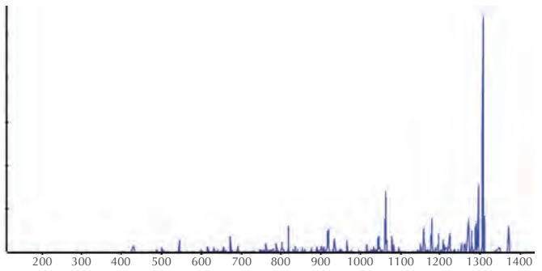

<details>
<summary>spectrogram</summary>

| X | Y |
| --- | --- |
| ~430 | ~0.1 |
| ~540 | ~0.2 |
| ~670 | ~0.3 |
| ~820 | ~0.4 |
| ~920 | ~0.3 |
| ~1060 | ~0.6 |
| ~1170 | ~0.4 |
| ~1280 | ~0.8 |
| ~1300 | ~1.0 |
| ~1370 | ~0.3 |
</details>

FIGURE 4.13 A real spectrum for Tyrocidine B1. A peak’s x-coordinate represents its mass/charge ratio, and its height represents the intensity of ions having that mass/charge ratio.

Second, the spectrum in Figure 4.13 has nearly 1,000 peaks, most of which are **false peaks**, meaning that their mass/charge ratio does not correspond to any subpeptide’s mass/charge ratio (for any charge value). Fortunately, false peaks typically have low

206

---

H O W D O W E S E Q U E N C E A N T I B I O T I C S ?

intensities, necessitating a pre-processing step that removes low-intensity peaks before applying an algorithm. Figure 4.14 shows the list of the 95 mass/charge ratios for peaks that survived this preprocessing step for the Tyrocidine B1 spectrum in Figure 4.13. Their intensities may nevertheless vary by 2-3 orders of magnitude; for example, the intensity of the peak having mass/charge ratio 372.2 is 300 times smaller than the intensity of the peak with mass/charge ratio 1306.5.

| 372.2 | 397.2 | 402.0 | 406.3 | 415.1 | 431.2 | 448.3 | 449.3 | 452.2 |
| --- | --- | --- | --- | --- | --- | --- | --- | --- |
| 471.3 | 486.3 | 488.2 | 500.5 | 505.3 | 516.1 | 536.1 | 544.2 | 545.3 |
| 562.5 | 571.3 | 599.2 | 614.4 | 615.4 | 616.4 | 618.2 | 632.0 | 655.5 |
| 656.3 | 672.5 | 673.3 | 677.3 | 691.4 | 692.4 | 712.1 | 722.3 | 746.5 |
| 760.4 | 761.6 | 762.5 | 771.6 | 788.4 | 802.3 | 803.3 | 818.5 | 819.4 |
| 831.4 | 836.3 | 853.3 | 875.5 | 876.5 | 901.5 | 915.9 | 916.5 | 917.8 |
| 918.4 | 933.4 | 934.7 | 935.5 | 949.4 | 966.2 | 995.4 | 1015.6 | 1027.5 |
| 1029.5 | 1031.5 | 1044.5 | 1046.5 | 1061.5 | 1063.4 | 1079.2 | 1083.7 |  |
| 1088.4 | 1093.5 | 1096.5 | 1098.4 | 1158.5 | 1159.5 | 1176.6 | 1177.7 |  |
| 1178.6 | 1192.7 | 1195.4 | 1207.5 | 1210.4 | 1224.6 | 1252.5 | 1270.5 |  |
| 1271.5 | 1278.6 | 1279.6 | 1295.6 | 1305.6 | 1306.5 | 1307.5 | 1309.6 |  |

FIGURE 4.14 The 95 mass/charge ratios having the highest intensity in Figure 4.13. The values shown in bold correspond to masses of subpeptides of Tyrocidine B1, if we allow a mass discrepancy of up to 0.3 Da (see Figure 4.15).

| Mass | Subpeptide | Mass | Subpeptide | Mass | Subpeptide |
| --- | --- | --- | --- | --- | --- |
| 406.2 | NQY | 431.2 | FPW | 448.2 | WFN |
| 486.2 | KLFP | 488.2 | VKLF | 505.2 | NQYV |
| 544.2 | LFPW | 545.2 | PWFN | 632.3 | QYVKL |
| 672.3 | KLFPW | 673.3 | PWFNQ | 691.3 | LFPWF |
| 692.3 | FPWFN | 746.3 | NQYVKL | 771.3 | VKLFPW |
| 819.4 | KLFPWF | 836.4 | PWFNQY | 876.4 | QYVKLFP |
| 918.4 | VKLFPWF | 933.4 | LFPWFNQ | 934.4 | YVKLFPW |
| 935.4 | PWFNQYV | 966.4 | WFNQYVK | 1061.5 | KLFPWFNQ |
| 1063.5 | PWFNQYVK | 1079.5 | WFNQYVKL | 1096.5 | LFPWFNQY |
| 1176.5 | NQYVKLFPW | 1195.6 | LFPWFNQYV | 1210.6 | FPWFNQYVK |
| 1224.6 | KLFPWFNQY |  |  |  |  |

FIGURE 4.15 Values from Figure 4.14 corresponding to masses of subpeptides of Tyrocidine B1, with maxCharge = 1 and an allowable discrepancy of up to 0.3 Da. These 31 masses represent less than a third of the 95 subpeptides in the theoretical spectrum of Tyrocidine B1.

207

---

C H A P T E R 4

Only 31 of these 95 mass/charge ratios (shown in bold in Figure 4.14) can be matched to subpeptides of Tyrocidine B1, as illustrated in Figure 4.15.

You can now see that sequencing Tyrocidine B1 from a real spectrum, for which twothirds of all masses are false, presents a much more difficult problem than sequencing this peptide from the simulated Spectrum<sub>25</sub>. In the following challenge problem, you will need to further develop the methods we studied in this chapter to analyze a real spectrum.

**CHALLENGE PROBLEM:** Tyrocidine B1 is just one of many known NRPs produced by Bacillus brevis. A single bacterial species may produce dozens of different antibiotics, and even after 70 years of research, there are likely undiscovered antibiotics produced by Bacillus brevis. Try to sequence the tyrocidine corresponding to the real experimental spectrum below. Since the fragmentation technology used for generating this spectrum tends to produce ions with charge +1, you can safely assume that all charges are +1.

| 371.5 | 375.4 | 390.4 | 392.2 | 409.0 | 420.2 | 427.2 | 443.3 | 446.4 | 461.3 |
| --- | --- | --- | --- | --- | --- | --- | --- | --- | --- |
| 471.4 | 477.4 | 491.3 | 505.3 | 506.4 | 519.2 | 536.1 | 546.5 | 553.3 | 562.3 |
| 588.2 | 600.3 | 616.2 | 617.4 | 618.3 | 633.4 | 634.4 | 636.2 | 651.5 | 652.4 |
| 702.5 | 703.4 | 712.5 | 718.3 | 721.0 | 730.3 | 749.4 | 762.6 | 763.4 | 764.4 |
| 779.6 | 780.4 | 781.4 | 782.4 | 797.3 | 862.4 | 876.4 | 877.4 | 878.6 | 879.4 |
| 893.4 | 894.4 | 895.4 | 896.5 | 927.4 | 944.4 | 975.5 | 976.5 | 977.4 | 979.4 |
| 1005.5 | 1007.5 | 1022.5 | 1023.7 | 1024.5 | 1039.5 | 1040.3 | 1042.5 | 1043.4 | 1057.5 |
| 1119.6 | 1120.6 | 1137.6 | 1138.6 | 1139.5 | 1156.5 | 1157.6 | 1168.6 | 1171.6 | 1185.4 |
| 1220.6 | 1222.5 | 1223.6 | 1239.6 | 1240.6 | 1250.5 | 1256.5 | 1266.5 | 1267.5 | 1268.6 |

**Hint**: since the peptide from which this spectrum was generated is in the tyrocidine family, this peptide should be similar to Tyrocidine B1.

## Open Problems

The Beltway and Turnpike Problems

In the case of the alphabet of arbitrary integers, the Cyclopeptide Sequencing Problem corresponds to a computer science problem known as the **Beltway Problem**. The Beltway Problem asks you to find a set of points on a circle such that the distances between all pairs of points (where distance is measured around the circle) match a given collection of integers.

208

---

H O W D O W E S E Q U E N C E A N T I B I O T I C S ?

The Beltway Problem’s analogue in the case when the points lie along a line segment instead of on a circle is called the **Turnpike Problem**. The terms “beltway” and “turnpike” arise from an analogy with exits on circular and linear roads, respectively. In the case of n points on a circle and line, the inputs for the Beltway and Turnpike Problems consist of $n ( n - 1 ) + 2$ and $\frac{n(n - 1)}{2} + 2$ distances, respectively (these formulas include the distance 0 as well as the length of the entire segment).

Various attempts to design polynomial algorithms for the Beltway and Turnpike Problems (or to prove that they are intractable) have failed. However, there is a **pseudo**polynomial algorithm for the Turnpike Problem (see **DETOUR: Pseudo-polynomial Algorithm for the Turnpike Problem**). In contrast to a truly polynomial algorithm, which can be bounded by a polynomial in the length of the input, a pseudo-polynomial algorithm for the Turnpike Problem is polynomial in the total length of the line segment. For example, if n points are separated by huge distances, say on the order of $2 ^ { 1 0 0 }$ , then a polynomial algorithm would still be fast, whereas a pseudo-polynomial algorithm would be prohibitively slow. Note that although the distances themselves will be huge, each distance can be stored using only about 100 bits, implying that the length of the input is small even for such large distances.

Pseudo-polynomial algorithms are useful in practice because practical instances of the problems typically do not include huge distances. Interestingly, although a pseudo-polynomial algorithm exists for the Turnpike Problem, such an algorithm for the seemingly similar Beltway Problem remains undiscovered. Can you develop such an algorithm?

## Sequencing cyclic peptides in primates

Bacteria and fungi do not have a monopoly on producing cyclic peptides; animals and plants make them too (albeit through a completely different mechanism). The first cyclic peptide found in animals (called ✓**-defensin**) was discovered in 1999 in macaques. ✓-defensin prevents viruses from entering cells and has strong anti-HIV activity. Yet the question of how primates make ✓-defensin remains a mystery.

Needless to say, there is no 54-mer in the macaque genome encoding the 18 amino acid-long ✓-defensin. Instead, this cyclic peptide is formed by concatenating two 9 amino acid-long peptides excised from two different proteins called RTD1a and RTD1b, as shown in Figure 4.16. It remains unclear which enzymes do this elaborate cutting and pasting.

Interestingly, macaques and baboons produce ✓-defensin, whereas humans and chimpanzees do not. This discrepancy makes us wonder whether a mutation occurred

PAGE 219

209

---

C H A P T E R 4

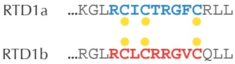

<details>
<summary>flowchart</summary>


</details>

-defensin

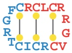

FIGURE 4.16 The 18 amino acid-long ✓-defensin peptide is formed by cutting two 9 amino acid-long peptides RCICTRGFC and RCLCRRGVC from the RTD1a and RTD1b proteins, concatenating them, and then circularizing the resulting peptide (along with introducing three disulfide bridges that form bonds across the peptide).

in the human-chimpanzee ancestor that resulted in the loss of this very useful peptide. Interestingly, genes very similar to RTD1a and RTD1b do exist in humans, but a codon in one of these genes mutated into a stop codon, thus shortening the encoded protein. Since this stop codon is located before the 9 amino acid-long peptide contributing to ✓-defensin, humans do not produce this peptide and thus cannot produce ✓-defensin.

In a remarkable experiment, Alexander Cole demonstrated that humans could get ✓- defensin back! Certain drugs can force the ribosome to ignore stop codons and continue translating RNA, even after encountering a stop codon. The researchers demonstrated that after treatment with such a drug, human cells began producing the human version of ✓-defensin. The surprising conclusion of this experiment is that although humans and chimpanzees lost ✓-defensin millions of years ago, we still possess the mysterious enzymes required to cut and paste its constituent peptides.

Some biologists believe that since the enzymes making ✓-defensin still work in humans, they must be needed for something else. If these enzymes did not provide some selective advantage, then over time, mutations would cause their genes to become **pseudogenes**, or non-functional remnants of previously working genes. The most natural explanation for why these enzymes are still functional is that humans produce still undiscovered cyclic peptides, and that the enzymes needed for ✓-defensin are also used to “cut-and-paste” other (still undiscovered) cyclic peptides. The hypothesis that we may possess undiscovered cyclic peptides is not as improbable as you might think because biologists still lack robust algorithms for cyclopeptide discovery from the billions of spectra generated in hundreds of labs analyzing the human proteome.

By default, researchers assume that all spectra ever acquired in human proteome studies originated from linear peptides. Could they be wrong? Can you devise a fast

210

---

H O W D O W E S E Q U E N C E A N T I B I O T I C S ?

cyclopeptide sequencing algorithm that can analyze all these spectra and hopefully discover human cyclopeptides?

## Charging Stations

Generating the theoretical spectrum of a peptide

Given an amino acid string Peptide, we will begin by assuming that it represents a linear peptide. Our approach to generating its theoretical spectrum is based on the assumption that the mass of any subpeptide is equal to the difference between the masses of two prefixes of Peptide. We can compute an array PREFIXMASS storing the masses of each prefix of Peptide in increasing order, e.g., for Peptide = NQEL, PREFIXMASS = (0, 114, 242, 371, 484). Then, the mass of the subpeptide of Peptide beginning at position i + 1 and ending at position j can be computed as PREFIXMASS(j)  PREFIXMASS(i). For example, when Peptide = NQEL,

$$
\mathrm{MASS} (\mathrm{QE}) = \mathrm{PREFIXMASS} (3) - \mathrm{PREFIXMASS} (1) = 3 7 1 - 1 1 4 = 2 5 7.
$$

The following pseudocode implements this idea. It also represents the alphabet of 20 amino acids and their integer masses as a pair of 20-element arrays AMINOACID and AMINOACIDMASS, corresponding to the top and bottom rows of Figure 4.6, respectively.

```python
LINEARSPECTRUM(Peptide, AMINOACID, AMINOACIDMASS)
    PREFIXMASS(0) ← 0
    for i ← 1 to |Peptide|
        for j ← 1 to 20
            if AMINOACID(j) = i-th amino acid in Peptide
                PREFIXMASS(i) ← PREFIXMASS(i - 1) + AMINOACIDMASS(j)
    LinearSpectrum ← a list consisting of the single integer 0
    for i ← 0 to |Peptide| - 1
        for j ← i + 1 to |Peptide|
            add PREFIXMASS(j) - PREFIXMASS(i) to LinearSpectrum
    return the sorted list LinearSpectrum
```

If the amino acid string Peptide represents a cyclic peptide instead, then the masses in its theoretical spectrum can be divided into those found by **LINEARSPECTRUM** and those


211

---

C H A P T E R 4

corresponding to subpeptides wrapping around the end of the linearized version of Peptide. Furthermore, each such subpeptide has mass equal to the difference between MASS(Peptide) and a subpeptide mass identified by **LINEARSPECTRUM**. For example, when Peptide = **NQEL**,

$$
\mathrm{MASS} (\mathbf {L N}) = \mathrm{MASS} (\mathbf {N Q E L}) - \mathrm{MASS} (\mathbf {Q E}) = 4 8 4 - 2 5 7 = 2 2 7.
$$

Thus, we can generate a cyclic spectrum by making only a small modification to the pseudocode of **LINEARSPECTRUM**.

```python
CYCLICSPECTRUM(Peptide, AMINOACID, AMINOACIDMASS)
    PREFIXMASS(0) ← 0
    for i ← 1 to Peptide
        for j ← 1 to 20
            if AMINOACID(j) = i-th amino acid in Peptide
                PREFIXMASS(i) ← PREFIXMASS(i - 1) + AMINOACIDMASS(j)
    peptideMass ← PREFIXMASS(|Peptide|)
    CyclicSpectrum ← a list consisting of the single integer 0
    for i ← 0 to |Peptide| - 1
        for j ← i + 1 to |Peptide|
            add PREFIXMASS(j) - PREFIXMASS(i) to CyclicSpectrum
            if i > 0 and j < |Peptide|
                add peptideMass - (PREFIXMASS(j) - PREFIXMASS(i)) to CyclicSpectrum
    return sorted list CyclicSpectrum
```

How fast is **CYCLOPEPTIDESEQUENCING**?

Let’s run **CYCLOPEPTIDESEQUENCING** on the following Spectrum:

| 0 | 97 | 97 | 99 | 101 | 103 | 196 | 198 | 198 | 200 | 202 |
| --- | --- | --- | --- | --- | --- | --- | --- | --- | --- | --- |
| 295 | 297 | 299 | 299 | 301 | 394 | 396 | 398 | 400 | 400 | 497 |

**CYCLOPEPTIDESEQUENCING** first expands the set Peptides into the set of all 1-mers consistent with Spectrum:

| 97 | 99 | 101 | 103 |
| --- | --- | --- | --- |
| P | V | T | C |

212

---

H O W D O W E S E Q U E N C E A N T I B I O T I C S ?

The algorithm next appends each of the 18 amino acid masses to each of the 1-mers above. The resulting set Peptides containing 4 · 18 = 72 peptides of length 2 is then trimmed to keep only the 10 peptides that are consistent with Spectrum:

| 97-99 | 97-101 | 97-103 | 99-97 | 99-101 |
| --- | --- | --- | --- | --- |
| PV | PT | PC | VP | VT |
| 99-103 | 101-97 | 101-99 | 103-97 | 103-99 |
| VC | TP | TV | CP | CV |

After expansion and trimming in the next iteration, the set Peptides contains 15 consistent 3-mers:

| 97-99-103 | 97-99-101 | 97-101-97 | 97-101-99 | 97-103-99 |
| --- | --- | --- | --- | --- |
| PVC | PVT | PTP | PTV | PCV |
| 99-97-103 | 99-97-101 | 99-101-97 | 99-103-97 | 101-97-99 |
| VPC | VPT | VTP | VCP | TPV |
| 101-97-103 | 101-99-97 | 103-97-101 | 103-97-99 | 103-99-97 |
| TPC | TVP | CPT | CPV | CVP |

With one more iteration, the set Peptides contains ten consistent 4-mers. Observe that the six 3-mers highlighted in red above failed to expand into any 4-mers below, and so we now know that **CYCLOPEPTIDESEQUENCING** may generate some incorrect k-mers at intermediate iterations.

| 97-99-103-97 | 97-101-97-99 | 97-101-97-103 | 97-103-99-97 |
| --- | --- | --- | --- |
| PVCP | PTPV | PTPC | PCVP |
| 99-97-101-97 | 99-103-97-101 | 101-97-99-103 | 101-97-103-99 |
| VPTP | VCPT | TPVC | TPCV |
|  | 103-97-101-97 | 103-99-97-101 |  |
|  | CPTP | CVPT |  |

In the final iteration, we generate ten consistent 5-mers:

213

---

C H A P T E R 4

| 97-99-103-97-101PVCPT | 97-101-97-99-103PTPVC | 97-101-97-103-99PTPCV |
| --- | --- | --- |
| 97-103-99-97-101PCVPT | 99-97-101-97-103VPTPC | 99-103-97-101-97VCPTP |
| 101-97-99-103-97TPVCP | 101-97-103-99-97TPCVP | 103-97-101-97-99CPTPV |
|  | 103-99-97-101-97CVPTP |  |

All these linear peptides correspond to the same cyclic peptide PVCPT, thus solving the Cyclopeptide Sequencing Problem. You can verify that **CYCLOPEPTIDESEQUENCING** also quickly reconstructs Tyrocidine B1 from the spectrum in Figure 4.7.

Trimming the peptide leaderboard

Note: This Charging Station uses some notation from CHARGING STATION: Gener**ating the Theoretical Spectrum of a Peptide**.

To implement the TRIM function in **LEADERBOARDCYCLOPEPTIDESEQUENCING**, we first will generate the theoretical spectra of all linear peptides from Leaderboard. Then, we will compute the scores of each theoretical spectrum against an experimental spectrum Spectrum. This requires implementing LINEARSCORE(Peptide, Spectrum).

Figure 4.17 shows a leaderboard of ten linear peptides represented as a list Leaderboard along with a ten-element array LINEARSCORES containing their scores.

| Leaderboard | PVT | PTP | PTV | PCP | VPC | VTP | VCP | TPV | TPC | TVP |
| --- | --- | --- | --- | --- | --- | --- | --- | --- | --- | --- |
| LINEARSCORES | 6 | 2 | 4 | 6 | 5 | 2 | 5 | 4 | 4 | 3 |

FIGURE 4.17 A collection of peptides Leaderboard (top) along with an array LINEARSCORES (bottom) holding the score of each peptide.

The **TRIM** algorithm, shown below, sorts all peptides in Leaderboard according to their scores, resulting in a sorted Leaderboard (Figure 4.18). **TRIM** then retains the top N scoring peptides including ties (e.g., for N = 5, the seven top-scoring peptides shown in blue will be retained), and removes all other peptides from Leaderboard.


214

---

H O W D O W E S E Q U E N C E A N T I B I O T I C S ?

<div class="docvortex-algorithm" style="white-space: pre-wrap; font-family:monospace;">
TRIM(Leaderboard, Spectrum, N, AMINOACID, AMINOACIDMASS)
    for $j \leftarrow 1$ to |Leaderboard|
        Peptide $\leftarrow j$-th peptide in Leaderboard
        LINEARSCORES($j$) $\leftarrow$ LINEARSCORE(Peptide, Spectrum)
    sort Leaderboard according to the decreasing order of scores in LINEARSCORES
    sort LINEARSCORES in decreasing order
    for $j \leftarrow N + 1$ to |Leaderboard|
        if LINEARSCORES($j$) &lt; LINEARSCORES(N)
            remove all peptides starting from the $j$-th peptide from Leaderboard
            return Leaderboard
    return Leaderboard
</div>

| Leaderboard | PVT | PCP | VPC | VCP | PTV | TPV | TPC | TVP | PTP | VTP |
| --- | --- | --- | --- | --- | --- | --- | --- | --- | --- | --- |
| LINEARSCORES | 6 | 6 | 5 | 5 | 4 | 4 | 4 | 3 | 2 | 2 |

FIGURE 4.18 Arrays Leaderboard and LINEARSCORES from Figure 4.17 sorted according to score. The seven highest-scoring peptides, which will be retained after applying TRIM with N = 5, are shown in blue; remaining peptides are shown in red and will be removed from the leaderboard.

## Detours

## Gause and Lysenkoism

The term **Lysenkoism** refers to the politicization of genetics in the Soviet Union that began in the late 1920s and lasted for three decades until the death of Stalin. Lysenkoism was built on theories of inheritance by acquired characteristics, which ran counter to Mendelian laws.

In 1928, Trofim Lysenko, the son of Ukrainian peasants, claimed to have found a way to vastly increase the crop yield of wheat. During Stalin’s rule, Soviet propaganda focused on inspirational stories of working class citizens, and it portrayed Lysenko as a genius, even though he had manufactured his experimental data. Empowered by his sudden hero status, Lysenko denounced genetics and started promoting his own “scientific” views. He called geneticists “fly lovers and people haters” and claimed that they were trying to undermine the onward march of Soviet agriculture.


215

---

C H A P T E R 4

Gause found himself among the few Soviet biologists who were not afraid of publicly denouncing Lysenko. By 1935, Lysenko announced that by opposing his theories, geneticists were directly opposing the teachings of Marxism. Stalin, who was in the audience, was the first to applaud, calling out, “Bravo, Comrade Lysenko!” This event gave Lysenko free reign to slander any geneticists who spoke out against him; many of Lysenkoism’s opponents were imprisoned or even executed.

After World War II, Lysenko did not forget Gause’s criticism: Lysenko’s supporters demanded that Gause be expelled from the Russian Academy of Sciences. Lysenkoists made various attempts to invite Gause to denounce genetics and accept their pseudoscience. Gause was probably the only Soviet biologist at that time who could simply ignore such “invitations”, the only other contemporary opponents of Lysenkoism being top Soviet nuclear physicists. However, Stalin left Gause and the physicists alone; in Stalin’s mind, the development of antibiotics and the atomic bomb were too important. In 1949, when the director of the Russian secret police (Lavrentiy Beria) told Stalin of the dissident scientists, Stalin responded, “Make sure that our scientists have everything needed to do their job”, adding, “there will always be time to execute them [later]”.

## Discovery of codons

In 1961, Sydney Brenner and Francis Crick established the rule of “one codon, one amino acid” during protein translation. They observed that deleting a single nucleotide or two consecutive nucleotides in a gene dramatically altered the protein product. Paradoxically, deleting three consecutive nucleotides resulted in only minor changes in the protein. For example, the phrase

turns into gibberish after deleting one letter:

or after deleting two letters:

but it makes sense after deleting three letters:

216

---

H O W D O W E S E Q U E N C E A N T I B I O T I C S ?

## THE · FOX · AND · THE · SHY · DOG

In 1964, Charles Yanofsky demonstrated that a gene and the protein that it produces are **collinear**, meaning that the first codon codes for the first amino acid in the protein, the second codon codes for the second amino acid, etc. For the next thirteen years, biologists believed that a protein was encoded by a long string of contiguous nucleotide triplets. However, the discovery of **split genes** in 1977 proved otherwise and necessitated the computational problem of predicting the locations of genes using only the genomic sequence (see **DETOUR: Split Genes**).


## Quorum sensing

The traditional view that bacteria act as loners and have few interactions with the rest of their colony has been challenged by the discovery of a communication method called **quorum sensing**. This finding has shown that bacteria are capable of coordinated activity when migrating to a better nutrient supply or adopting a **biofilm** formation for defense within hostile environments. The “language” used in quorum sensing is often based on the exchange of peptides (as well as other molecules) called **bacterial pheromones**. The nature of communications between bacteria can be amicable or adversarial.

When a single bacterium releases pheromones into its environment, their concentration is often too low to be detected; however, once the population density increases, pheromone concentrations reach a threshold level that allows the bacteria to activate certain genes in response.

For example, Burkholderia cepacia is a pathogen affecting individuals with **cystic fibrosis**. Most patients colonized with B. cepacia are coinfected with Pseudomonas aeruginosa. The correlation of the two strains in these patients led biologists to hypothesize that interspecies communication with P. aeruginosa may help B. cepacia enhance its own pathogenicity. Indeed, the addition of P. aeruginosa to clones of B. cepacia results in a significant increase in the synthesis of proteases (i.e., enzymes needed to break down proteins), suggesting the presence of quorum sensing — B. cepacia may profit from pheromones made by a different species in order to improve its own chances of survival.

## Molecular mass

The **dalton** (abbreviated **Da**) is the unit used for measuring atomic masses on a molecular scale. One dalton is equivalent to one twelfth of the mass of carbon-12 and has a

217

---

C H A P T E R 4

value of approximately $1 . 6 6 \cdot 1 0 ^ { - 2 7 }$ kg. The **monoisotopic mass** of a molecule is equal to the sum of the masses of the atoms in that molecule, using the mass of the most abundant **isotope** for each element. Figure 4.19 provides the elemental composition and monoisotopic masses of all 20 standard amino acids.

| Amino acid | 3-letter code | Chemical formula | Mass (Da) |
| --- | --- | --- | --- |
| Alanine | Ala | $C_3H_5NO$ | 71.03711 |
| Cysteine | Cys | $C_3H_5NOS$ | 103.00919 |
| Aspartic acid | Asp | $C_4H_5NO_3$ | 115.02694 |
| Glutamic acid | Glu | $C_5H_7NO_3$ | 129.04259 |
| Phenylalanine | Phe | $C_9H_9NO$ | 147.06841 |
| Glycine | Gly | $C_2H_3NO$ | 57.02146 |
| Histidine | His | $C_6H_7N_3O$ | 137.05891 |
| Isoleucine | Ile | $C_6H_{11}NO$ | 113.08406 |
| Lysine | Lys | $C_6H_{12}N_2O$ | 128.09496 |
| Leucine | Leu | $C_6H_{11}NO$ | 113.08406 |
| Methionine | Met | $C_5H_9NOS$ | 131.04049 |
| Asparagine | Asn | $C_4H_6N_2O_2$ | 114.04293 |
| Proline | Pro | $C_5H_7NO$ | 97.05276 |
| Glutamine | Gln | $C_5H_8N_2O_2$ | 128.05858 |
| Arginine | Arg | $C_6H_{12}N_4O$ | 156.10111 |
| Serine | Ser | $C_3H_5NO_2$ | 87.03203 |
| Threonine | Thr | $C_4H_7NO_2$ | 101.04768 |
| Valine | Val | $C_5H_9NO$ | 99.06841 |
| Tryptophan | Trp | $C_{11}H_{10}N_2O$ | 186.07931 |
| Tyrosine | Tyr | $C_9H_9NO_2$ | 163.06333 |

FIGURE 4.19 Elemental composition and monoisotopic masses of amino acids.

## Selenocysteine and pyrrolysine

**Selenocysteine** is a proteinogenic amino acid that exists in all kingdoms of life as a building block of a special class of proteins called selenoproteins. Unlike other amino acids, selenocysteine is not directly encoded in the genetic code. Instead, it is encoded in a special way by a UGA codon, which is normally a stop codon, through a mechanism known as **translational recoding**.

**Pyrrolysine** is a proteinogenic amino acid that exists in some archaea and methaneproducing bacteria. In organisms incorporating pyrrolysine, this amino acid is encoded by UAG, which also normally acts as a stop codon.

218

---

H O W D O W E S E Q U E N C E A N T I B I O T I C S ?

Pseudo-polynomial algorithm for the Turnpike Problem

If $A   =   \left( a _ { 1 }   =   0 , a _ { 2 } , \cdots , a _ { n } \right)$ is a set of n points on a line segment in increasing order $( a _ { 1 } < a _ { 2 } < \cdots < a _ { n } )$ , then $\Delta A$ denotes the collection of all pairwise differences between points in A. For example, if $\boldsymbol{A} = \begin{pmatrix} 0, 2, 4, 7 \end{pmatrix}$ , then

$$
\Delta A = \left(- 7, - 5, - 4, - 3, - 2, - 2, 0, 0, 0, 0, 2, 2, 3, 4, 5, 7\right).
$$

The turnpike problem asks us to reconstruct A from $\Delta A$

## Turnpike Problem:

Given all pairwise distances between points on a line segment, reconstruct the positions of those points.

**Input**: A collection of integers L.

**Output**: A set of integers A such that $\Delta A = L .$

We will now outline an approach to solving the Turnpike Problem that is polynomial in the length of the line segment. Given a collection of integers $A = \left( a_{1}, \cdots, a_{n} \right)$ , the **generating function** of A is the polynomial

$$
A (x) = \sum_ {i = 1} ^ {n} x ^ {a _ {i}}.
$$

For example, if $\boldsymbol{A} = \begin{pmatrix} 0, 2, 4, 7 \end{pmatrix}$ , then

$$
A (x) = x ^ {0} + x ^ {2} + x ^ {4} + x ^ {7}
$$

$$
\Delta A (x) = x ^ {- 7} + x ^ {- 5} + x ^ {- 4} + x ^ {- 3} + 2 x ^ {- 2} + 4 x ^ {0} + 2 x ^ {2} + x ^ {3} + x ^ {4} + x ^ {5} + x ^ {7}
$$

You can verify that the above generating function for $\Delta A ( x )$ is equal to $A ( x ) \cdot A ( x ^ { - 1 } )$ Thus, the Turnpike Problem reduces to a problem about polynomial factorization. Just as an integer can be broken down into its prime factors, a polynomial with integer coefficients can be factored into “prime” polynomials having integer coefficients. If we can factor $\Delta A ( x )$ and determine which prime factors contribute to $A ( x )$ and which prime factors contribute to $A ( x ^ { - 1 } )$ , then we will know $A ( x )$ and therefore A. In 1982, Rosenblatt and Seymour described such a method to represent $\Delta A ( x )$ as $A ( x ) \cdot A ( x ^ { - 1 } )$ Since a polynomial can be factored in time polynomial in its maximum exponent, $\Delta A ( x )$ can be factored in time polynomial in the total length of the line segment, which yields the desired pseudo-polynomial algorithm for the Turnpike Problem.


219

---

C H A P T E R 4


**STOP and Think:** Can the generating function approach be modified to address the case when there are errors in the pairwise differences?

## Split genes

In 1977, Phillip Sharp and Richard Roberts independently discovered **split genes**, which are genes formed by discontiguous intervals of DNA.

Sharp hybridized RNA encoding an adenovirus protein called hexon against a single-strand of adenovirus DNA. If the hexon gene were contiguous, then he expected to see a one-to-one hybridization of RNA bases with DNA bases.

Yet to Sharp’s surprise, when he viewed the RNA-DNA hybridization under an electron microscope, he saw three loop structures, rather than the continuous duplex segment suggested by the contiguous gene model (Figure 4.20). This observation implied that the hexon mRNA must be built from four non-contiguous fragments of the adenovirus genome. These four segments, called **exons**, are separated by three fragments (the loops in Figure 4.20) called **introns**, to form a split gene. Split genes are analogous to a magazine article printed on pages 12, 17, 40, and 95, with many pages of advertising appearing in-between.

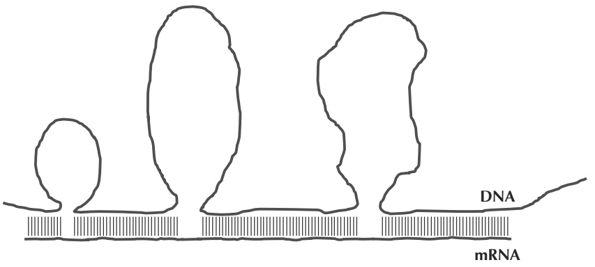

<details>
<summary>text_image</summary>

DNA
mRNA
</details>

FIGURE 4.20 A rendering of Sharp’s electron microscopy experiment that led to the discovery of split genes. When hexon RNA is hybridized against the DNA that generated it, three distinct loops are formed. Because the loops are present in the DNA and are not present in RNA, these loops (called introns) must be removed during the process of RNA formation.

The discovery of split genes caused an interesting quandary: What happens to the introns? In other words, the RNA that is transcribed from a split gene (called **precursor**

220

---

H O W D O W E S E Q U E N C E A N T I B I O T I C S ?

**mRNA** or **pre-mRNA**) should be longer than the RNA that is used as a template for protein synthesis (called **messenger RNA** or **mRNA**). Some biological process must remove the introns in pre-mRNA and concatenate the exons into a single mRNA string. This process of converting pre-mRNA into mRNA is known as **splicing**, and it is carried out by a molecular machine called the **spliceosome**.

The discovery of split genes led to many new avenues of research. Biologists still debate what purpose introns serve; some introns are viewed as “junk DNA”, while others contain important regulatory elements. Furthermore, the partition of a gene into exons often varies from species to species. For example, a gene in the chicken genome may have a different number of exons than the related gene in the human genome.

## Bibliography Notes

The pseudo-polynomial algorithm for the Turnpike Problem was proposed by Rosenblatt and Seymour, 1982. The first cyclopeptide sequencing algorithm was proposed by Ng et al., 2009. Tang et al., 1999 discovered ✓-defensin. Venkataraman et al., 2009 showed that humans cells can be tricked into producing ✓-defensin.


<details>
<summary>natural_image</summary>

Illustration of an ant with long antennae and a shadow (no text or symbols)
</details>

221
