# Chapter 5: How Do We Compare DNA Sequences?

原始 PDF 第 247–316 页。

## HOW DO We COMPARE DNA SEQUENCES?

## Dynamic Programming


<details>
<summary>text_image</summary>

VISIT
METROPOLIS
CASINO
FREE
</details>

---

H O W D O W E C O M PA R E D N A S E Q U E N C E S ?

## Cracking the Non-Ribosomal Code

The RNA Tie Club

Following Watson & Crick’s publication of DNA’s double helix structure in 1953, physicist George Gamow founded the “RNA Tie Club” for renowned scientists. A necktie embroidered with a double helix signified membership in this club, which was restricted to twenty regular members (one for each amino acid) as well as four honorary members (one for each nucleotide). Gamow wanted the RNA Tie Club to serve more than a social function; by convening top scientific minds, he hoped to decode the message hidden within DNA by determining how RNA is converted into amino acids. Indeed, Sydney Brenner and Francis Crick struck first one year later by discovering that amino acids are translated from codons (i.e., triplets of nucleotides).

The RNA Tie Club would eventually boast eight Nobel laureates, but scientists from outside of the club would decipher the genetic code. In 1961, Marshall Nirenberg synthesized RNA strands consisting only of uracil (UUUUUUUUUUUU. . . ), added ribosomes and amino acids, and produced a peptide consisting only of phenylalanine (PhePhePhePhe. . . ). Nirenberg thus concluded that the RNA codon UUU codes for the amino acid phenylalanine. Following Nirenberg’s success, Har Gobind Khorana synthesized the RNA strand **UCUCUCUCUCUC**. . . and demonstrated that it translates into **SerLeuSerLeu**. . . Following these insights, the rest of the ribosomal genetic code was rapidly elucidated.

Nearly four decades later, Mohamed Marahiel set out to solve the much more challenging puzzle of cracking the **non-ribosomal code**. You will recall from Chapter 4 that bacteria and fungi produce antibiotics and other non-ribosomal peptides (NRPs) without any reliance on the ribosome and the genetic code. Instead, these organisms manufacture NRPs by employing a giant protein called NRP synthetase:

$$
\mathrm{DNA} \longrightarrow \mathrm{RNA} \longrightarrow \mathrm{NRP synthetase} \longrightarrow \mathrm{NRP}
$$

The NRP synthetase that encodes the 10 amino acid-long antibiotic Tyrocidine B1 (which we worked with in Chapter 4) includes 10 segments called **adenylation domains (Adomains)**; each A-domain is about 500 amino acids long and is responsible for adding a single amino acid to Tyrocidine B1.

A generation earlier, the RNA Tie Club had asked, “How does RNA encode an amino acid?” Now Marahiel set out to answer the far more challenging question, “How does each A-domain encode an amino acid?”

223

---

C H A P T E R 5

From protein comparison to the non-ribosomal code

Fortunately, Marahiel already knew the amino acid sequences of some A-domains, along with the amino acids that they add to the growing peptide. Below are three of these A-domains (taken from three different bacteria), which code for aspartic acid (Asp), ornithine (Orn), and valine (Val), respectively. In the interest of space, we will show you only short fragments taken from the three A-domains.

YAFDLGYTCMFPVLLGGGELHIVQKETYTAPDEIAHYIKEHGITYIKLTPSLFHTIVNTASFAFDANFESLRLIVLGGEKIIPIDVIAFRKMYGHTEFINHYGPTEATIGA AFDVSAGDFARALLTGGQLIVCPNEVKMDPASLYAIIKKYDITIFEATPALVIPLMEYIYEQKLDISQLQILIVGSDSCSMEDFKTLVSRFGSTIRIVNSYGVTEACIDS IAFDASSWEIYAPLLNGGTVVCIDYYTTIDIKALEAVFKQHHIRGAMLPPALLKQCLVSAPTMISSLEILFAAGDRLSSQDAILARRAVGSGVYNAYGPTENTVLS


**STOP and Think:** You now have a portion of the data that Marahiel had in 1999 when he discovered the non-ribosomal code. What would you do to infer the non-ribosomal code?

Marahiel conjectured that since A-domains have similar function (i.e., adding an amino acid to the growing peptide), different A-domains should have similar parts. A-domains should also have differing parts to incorporate different amino acids. However, only three conserved columns (shown in red below) are common to the three sequences and have likely arisen by pure chance:

YAFDLGYTCMFPVLLGGGELHIVQKETYTAPDEIAHYIKEHGITYIKLTPSLFHTIVNTASFAFDANFESLRLIVLGGEKIIPIDVIAFRKMYGHTEFINHYGPTEATIGA AFDVSAGDFARALLTGGQLIVCPNEVKMDPASLYAIIKKYDITIFEATPALVIPLMEYIYEQKLDISQLQILIVGSDSCSMEDFKTLVSRFGSTIRIVNSYGVTEACIDS IAFDASSWEIYAPLLNGGTVVCIDYYTTIDIKALEAVFKQHHIRGAMLPPALLKQCLVSAPTMISSLEILFAAGDRLSSQDAILARRAVGSGVYNAYGPTENTVLS


**STOP and Think:** How else are the three sequences similar?

If we slide the second sequence only one amino acid to the right, adding a **space symbol** ("-") to the beginning of the sequence, then we find 11 conserved columns!

Y**AFD**LGYTCMFPV**LL**G**GG**ELHIVQKETYTAPDEIAHYIKEHGITYIKLTPSLFHTIVNTASFAFDANFESLRLIVLGGEKIIPIDVIAFRKMYGHTEFINHYGPTEATIGA -**AFD**VSAGDFARA**LL**T**GG**QLIVCPNEVKMDPASLYAIIKKYDITIFEATPALVIPLMEYIYEQKLDISQLQILIVGSDSCSMEDFKTLVSRFGSTIRIVNSYGVTEACIDS I**AFD**ASSWEIYAP**LL**N**GG**TVVCIDYYTTIDIKALEAVFKQHHIRGAMLPPALLKQCLVSAPTMISSLEILFAAGDRLSSQDAILARRAVGSGVYNAYGPTENTVLS

Adding a few more space symbols reveals 14 conserved columns:

Y**AFD**LGYTCMFPV**LL**G**GG**ELHIVQKETYTAPDEIAHYIKEHGITYIKLTPSLFHTIVNTASFAFDANFESLRLIVLGGEKIIPIDVIAFRKMYGHTEFINHYGPTEATIGA -**AFD**VSAGDFARA**LL**T**GG**QLIVCPNEVKMDPASLYAIIKKYDITIFEATPALVIPLMEYI-YEQKLDISQLQILIVGSDSCSMEDFKTLVSRFGSTIRIVNSYGVTEACIDS I**AFD**ASSWEIYAP**LL**N**GG**TVVCIDYYTTIDIKALEAVFKQHHIRGAMLPPALLKQCLVSA----PTMISSLEILFAAGDRLSSQDAILARRAVGSGVYNAYGPTENTVLS

and even more sliding reveals 19 conserved columns:

Y**AFD**LGYTCMFPV**LL**G**GG**ELHIVQKETYTAPDEIAHYIKEHGITYIKLTPSLFHTIVNTASFAFDANFESLRLIVLGGEKIIPIDVIAFRKMYGHTE-FINH**YG**P**TE**ATIGA -**AFD**VSAGDFARA**LL**T**GG**QLIVCPNEVKMDPASLYAIIKKYDITIFEATPALVIPLMEYI-YEQKLDISQLQILIVGSDSCSMEDFKTLVSRFGSTIRIVNS**YG**V**TE**ACIDS I**AFD**ASSWEIYAP**LL**N**GG**TVVCIDYYTTIDIKALEAVFKQHHIRGAMLPPALLKQCLVSA----PTMISSLEILFAAGDRLSSQDAILARRAVGSGV-Y-NA**YG**P**TE**NTVLS

224

---

H O W D O W E C O M PA R E D N A S E Q U E N C E S ?

It turns out that the red columns represent the **conserved core** shared by many A-domains. Now that Marahiel knew how to correctly align the A-domains, he hy pothesized that some of the remaining variable columns should code for Asp, Orn, and Val. He discovered that the non-ribosomal code is defined by 8 amino acid-long non-ribosomal **signatures**, which are shown as purple columns below.

```txt
YAPLDGYTCMPFVLLGGELHIVQKETYTAPDEIAHYIKEHGITYIKLTPSLFHTIVNTASFAFDANFESRLLVIGGEKIPIDVIAFRKMYGHTE-FINHYGPTEATIGA
AFDVSGADFARALLTGGQLIVCPNEVKMDPASLYAIKKYDITIFEATPALVIPLMEY-IEYQKLDISQLILIVGSDCSMEDFKTVLSRFGSTIRIVSYGVTEACIDS
IAFDASSWEIYAPLLNGGTVVCIDYYTTIDIKALEAVFKQHHRGAMLPLLALKCLVSA---PTMISSEILIFAAGDRLLSQDAILARRAVGSGV-Y-NAYGPTENTVLS
```

The purple columns define the signatures **LTKVLGHIG**, **VGEIVGSID**, and **AWMFAAAVL**, coding for Asp, Orn, and Val, respectively:

$$
\begin{array}{l} \text { LTKVGHIG } \rightarrow \text { Asp } \\ \text {VGEIGSID} \rightarrow \text {Orn} \\ \text {AWMFAAVL} \rightarrow \text {Val} \\ \end{array}
$$

It is important to note that without first constructing the conserved core, Marahiel would not have been able to infer the non-ribosomal code, since the 24 amino acids in the signatures above do not line up in the original alignment:

```txt
YAFDLGYTCMPFVLLGGGELHIVQKETYTAPDEIAHYIKEHGITYIKLTPSLFHTIVNTASFAFDANFESRLIVLGGEKIIPIDVIAFRKMYGHTEFINHYPGTEATIGA AFDVSAGDFARALLTGGQLIVCPNEVKMDPASLYAIKKYDITIFEATPALVIPLMEIYYEQKLDISQLIIVVGSDCSMEDFKTLVSRFGSTIRIVNSYGVTEACIDS IAFDASSWEIYAPALLNGGTVCCIDYYTTIDIKALEAVFKQHHIRGAMLPLLAPKQLCVSAPMISSISEILIFAAGDRLSSQDALARRAVGSGVYNAYGPENTVLS
```

Even after identifying the conserved core, you may be wondering whether Marahiel had a crystal ball; why did he choose these particular 8 purple columns? Why should signatures have 8 amino acids and not 5, or better yet 3? See **DETOUR: Fireflies and the Non-Ribosomal Code** for a better appreciation of the complexities underlying Marahiel’s work. Suffice it to say that fifteen years after Marahiel’s initial discovery, the non-ribosomal code is still not fully understood.

What do oncogenes and growth factors have in common?

Marahiel’s cracking of the non-ribosomal code is just one of many biological problems that have benefited from sequence comparison. Another striking example of the power of sequence comparison was established in 1983 when Russell Doolittle compared the newly sequenced **platelet derived growth factor (PDGF)** gene with all other genes known at the time. Doolittle stunned cancer biologists when he showed that PDGF was very similar to the sequence of a gene known as **v-sis**. The two genes’ similarity was puzzling because their functions differ greatly; the PDGF gene encodes a protein stimulating cell growth, whereas v-sis is an **oncogene**, or a gene in viruses that causes

PAGE 282

225

---

C H A P T E R 5

a cancer-like transformation of infected human cells. Following Doolittle’s discovery, scientists hypothesized that some forms of cancer might be caused by a good gene doing the right thing at the wrong time. The link between PDGF and v-sis established a new paradigm; searching all new sequences against sequence databases is now the first order of business in genomics.

However, the question remains: what is the best way to compare sequences algorithmically? Returning to the A-domain example, the insertion of spaces to reveal the conserved core probably looked like a magic trick to you. It is completely unclear what algorithm we have used to decide where to insert the space symbols, or how we should quantify the “best” alignment of the three sequences.

## Introduction to Sequence Alignment

Sequence alignment as a game

To simplify matters, we will compare only two sequences at a time, returning to multiple sequence comparison at the end of the chapter. The Hamming distance, which counts mismatches in two strings, rigidly assumes that we align the i-th symbol of one sequence against the i-th symbol of the other. However, since biological sequences are subject to insertions and deletions, it is often the case that the i-th symbol of one sequence corresponds to a symbol at a completely different position in the other sequence. The goal, then, is to find the most appropriate correspondence of symbols.

For example, ATGCATGC and TGCATGCA have no matching positions, and so their Hamming distance is equal to 8:

ATGCATGC

TGCATGCA

Yet these strings have six matching positions if we align them differently:

A**TGCATGC**-

-**TGCATGC**A

Strings ATGCTTA and TGCATTAA have more subtle similarities:

-**TGC**A**TTA**A

226

---

H O W D O W E C O M PA R E D N A S E Q U E N C E S ?

These examples lead us to postulate a notion of a good alignment as one that matches as many symbols as possible. You can think about maximizing the number of matched symbols in two strings as a single-person game (Figure 5.1). At each turn, you have two choices. You can remove the first symbol from each sequence, in which case you earn a point if the symbols match; alternatively, you can remove the first symbol from either of the two sequences, in which case you earn no points but may set yourself up to earn more points in later moves. Your goal is to maximize the number of points.

## Sequence alignment and the longest common subsequence

We now define an **alignment** of sequences v and w as a two-row matrix such that the first row contains the symbols of v (in order), the second row contains the symbols of w (in order), and space symbols may be interspersed throughout both strings, as long as two space symbols are not aligned against each other. Here is the alignment of ATGTTATA and ATCGTCC from Figure 5.1.

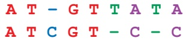

An alignment presents one possible scenario by which v could have evolved into w. Columns containing the same letter in both rows are called **matches** and represent conserved nucleotides, whereas columns containing different letters are called **mismatches** and represent single-nucleotide substitutions. Columns containing a space symbol are called **indels**: a column containing a space symbol in the top row of the alignment is called an **insertion**, as it implies the insertion of a symbol when transforming v into w; a column containing a space symbol in the bottom row of the alignment is called a **deletion**, as it indicates the deletion of a symbol when transforming v into w. The alignment above has four matches, two mismatches, one insertion, and two deletions.

The matches in an alignment of two strings define a **common subsequence** of the two strings, or a sequence of symbols appearing in the same order (although not necessarily consecutively) in both strings. For example, the alignment in Figure 5.1 indicates that **ATGT** is a common subsequence of **ATGT**TATA and **AT**C**GT**CC. An alignment of two strings maximizing the number of matches therefore corresponds to a **longest common subsequence** of these strings. Note that two strings may have more than one longest common subsequence.

227

---

C H A P T E R 5

<table><tr><td>Growing alignment</td><td>Remaining symbols</td><td>Score</td></tr><tr><td></td><td>A T G T T A T A</td><td></td></tr><tr><td></td><td>A T C G T C C</td><td></td></tr><tr><td>A</td><td>T G T T A T A</td><td rowspan="2">+1</td></tr><tr><td>A</td><td>T C G T C C</td></tr><tr><td>A T</td><td></td><td rowspan="4">+1</td></tr><tr><td>A T</td><td>G T T A T A</td></tr><tr><td></td><td>C G T C C</td></tr><tr><td>A T -</td><td></td></tr><tr><td>A T C</td><td></td><td>G T C C</td></tr><tr><td>A T - G</td><td></td><td>T T A T A</td></tr><tr><td>A T C G</td><td></td><td>T C C</td></tr><tr><td>A T - G T</td><td></td><td>T A T A</td></tr><tr><td>A T C G T</td><td></td><td>C C</td></tr><tr><td>A T - G T T</td><td></td><td>A T A</td></tr><tr><td>A T C G T -</td><td></td><td>C C</td></tr><tr><td>A T - G T T A</td><td></td><td>T A</td></tr><tr><td>A T C G T - C</td><td></td><td>C</td></tr><tr><td>A T - G T T A T</td><td></td><td>A</td></tr><tr><td>A T C G T - C -</td><td></td><td>C</td></tr><tr><td>A T - G T T A T A</td><td></td><td></td></tr><tr><td>A T C G T - C - C</td><td></td><td></td></tr></table>

FIGURE 5.1 One way of playing the alignment game for the strings ATGTTATA and ATCGTCC, with score 4. At each step, we choose to remove either one or both symbols from the left of the two sequences in the “remaining symbols” column. If we remove both symbols, then we align them in the “growing alignment”. If we remove only one symbol, then we align this symbol with a space symbol in the growing alignment. Matched symbols are shown in red (and receive score 1). Mismatched symbols are shown in purple; symbols aligned against space symbols are shown in blue or green depending on which sequence they were removed from.

228

---

H O W D O W E C O M PA R E D N A S E Q U E N C E S ?

## Longest Common Subsequence Problem:

Find a longest common subsequence of two strings.

**Input**: Two strings.

**Output**: A longest common subsequence of these strings.

If we limit our attention to the two A-domains coding for Asp and Orn from the introduction, then in addition to the 19 matches that we have already found, we can find 10 more matches (shown in blue below), yielding a common subsequence of length 29.

Y**AFD**LGYTCMFPV**LL**G**GG**ELHIVQKETYTAPDEIAHY**IK**EHG**IT**YIKL**TP**SLFHTIVNTASFAFDANFESLRLIVLGGEKIIPIDVIAFRKMYGHTE-FINH**YG**P**TEA**TIGA -**AFD**VSAGDFARA**LL**T**GG**QLIVCPNEVKMDPASLYAI**IK**KYD**IT**IFEA**TP**ALVIPLMEYI-YEQKLDISQLQILIVGSDSCSMEDFKTLVSRFGSTIRIVNS**YG**V**TEA**CIDS

**STOP and Think:** What is the longest common subsequence of these strings?

None of the algorithmic approaches we have studied thus far will help us solve the Longest Common Subsequence Problem, and so before asking you to solve this prob lem, we will change course to describe a different problem that may seem completely unrelated to sequence alignment.

## The Manhattan Tourist Problem

What is the best sightseeing strategy?

Imagine you are a tourist in Midtown Manhattan, and you want to see as many sights as possible on your way from the corner of 59th Street and 8th Avenue to the corner of 42nd Street and 3rd Avenue (Figure 5.2 (left)). However, you are short on time, and at each intersection, you can only move south (#) or east (!). You can choose from many different paths through the map, but no path will visit all the sights. The challenge of finding a legal path through the city that visits the most sights is called the **Manhattan Tourist Problem**.

We will represent the map of Manhattan as a directed graph ManhattanGraph in which we model each intersection as a node and each city block between two intersections as a directed edge indicating the legal direction of travel (# or !), as shown in Figure 5.2 (right). We then assign each directed edge a **weight** equal to the number of attractions along the corresponding block. The starting (blue) node is called the **source node**, and the ending (red) node is called the **sink node**. Adding the weights along


229

---

C H A P T E R 5

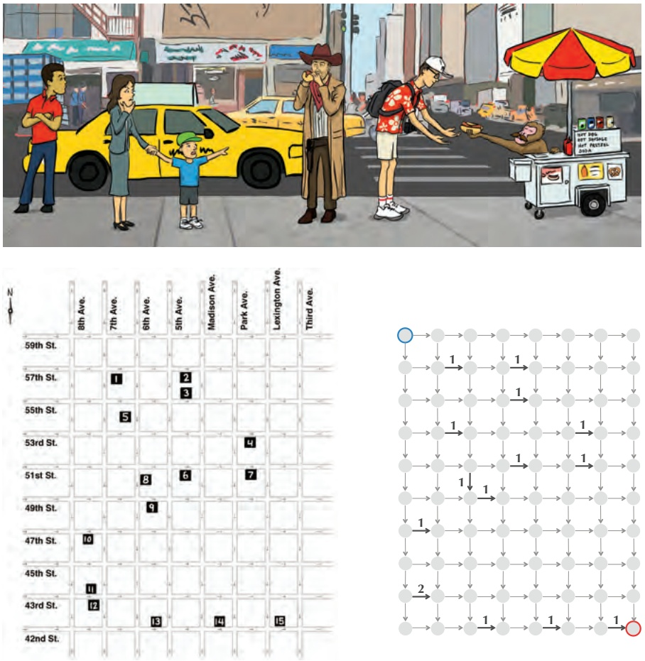

FIGURE 5.2 (Left) A simplification of Midtown Manhattan. You start at the intersection of 59th Street and 8th Avenue in the northwest corner and end at the intersection of 42nd Street and 3rd Avenue in the southeast corner, traveling only south (#) or east (!) between intersections. The attractions shown are: Carnegie Hall (1), Tiffany & Co. (2), the Sony Building (3), the Museum of Modern Art (4), the Four Seasons Hotel (5), St. Patrick’s Cathedral (6), the General Electric Building (7), Radio City Music Hall (8), Rockefeller Center (9), the Paramount Building (10), the New York Times Building (11), Times Square (12), the General Society of Mechanics and Tradesmen (13), Grand Central Terminal (14), and the Chrysler Building (15). (Right) The directed graph ManhattanGraph in which every edge is weighted by the number of attractions along that city block (edge weights equal to 0 are not shown).

230

---

H O W D O W E C O M PA R E D N A S E Q U E N C E S ?

a path from the source to the sink yields the number of attractions along that path. Therefore, to solve the Manhattan Tourist Problem, we need to find a **maximum-weight path** connecting the source to the sink (also called a **longest path**) in ManhattanGraph.

We can model any rectangular grid of streets using a similar directed graph; Figure 5.3 (left) shows the graph for a hypothetical city with even more attractions. In contrast to the Cartesian plane, we orient the axes of this grid down and to the right. Therefore, the blue source node is assigned the coordinates (0, 0), and the red sink node is assigned the coordinates $( n , m )$ . This implies the following generalization of our original problem.

## Manhattan Tourist Problem:

Find a longest path in a rectangular city.

**Input**: A weighted n ⇥ m rectangular grid with n + 1 rows and $m + 1$ columns.

**Output**: A longest path from source (0, 0) to sink (n, m) in the grid.

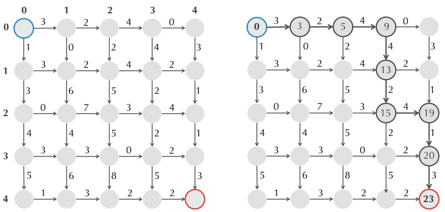

FIGURE 5.3 (Left) An $n \times m$ city grid represented as a graph with weighted edges for $n   =   m   =   4.$ . The bottom left node is indexed as (4, 0), and the upper right node is indexed as (0, 4). (Right) A path through the graph found by the greedy algorithm is not the longest path.

**EXERCISE BREAK:** How many different paths are there from source to sink in an n ⇥ m rectangular grid?


231

---

C H A P T E R 5


Applying a brute force approach to the Manhattan Tourist Problem is impractical because the number of paths is huge. A sensible greedy approach would choose between the two possible directions at each node (! or #) according to how many attractions you would see if you moved only one block south versus moving one block east. For example, in Figure 5.3 (right), we start off by moving east from (0, 0) rather than south because the horizontal edge has three attractions, while the vertical edge has only one. Unfortunately, this greedy strategy may miss the longest path in the long run. Figure 5.3 (right).

**STOP and Think:** Find a longer path than the one in Figure 5.3 (right).

Sightseeing in an arbitrary directed graph

In reality, the streets in Midtown Manhattan do not form a perfect rectangular grid because Broadway Avenue cuts diagonally across the grid, but the network of streets can still be represented by a directed graph. In fact, the Manhattan Tourist Problem is just a special case of the more general problem of finding the longest path in an arbitrary directed graph, such as the ones in Figure 5.4.

## Longest Path in a Directed Graph Problem:

Find a longest path between two nodes in an edge-weighted directed graph.

**Input**: An edge-weighted directed graph with source and sink nodes.

**Output**: A longest path from source to sink in the directed graph.


**STOP and Think:** What is the length of a longest path between the source and sink in the directed graph shown in Figure 5.4 (right)?

If a directed graph contained a directed cycle (e.g., the four central edges of weight 1 in Figure 5.4 (right)), then a tourist could traverse this cycle indefinitely, revisiting the same attractions over and over again and creating a path of huge length. For this reason, the graphs that we will consider in this chapter do not contain directed cycles; such graphs are called **directed acyclic graphs (DAGs)**.

232

---

H O W D O W E C O M PA R E D N A S E Q U E N C E S ?

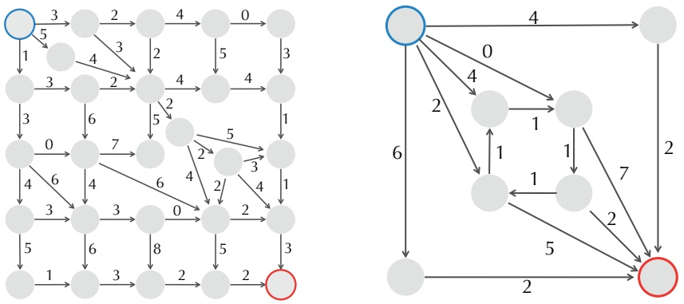

FIGURE 5.4 Directed graphs corresponding to hypothetical irregular city grids.

## Longest Path in a DAG Problem:

Find a longest path between two nodes in an edge-weighted DAG.

**Input**: An edge-weighted DAG with source and sink nodes.

**Output**: A longest path from source to sink in the DAG.

**STOP and Think:** Do you see any similarities between the Longest Path in a DAG Problem and the Longest Common Subsequence Problem?


## Sequence Alignment is the Manhattan Tourist Problem in Disguise

In Figure 5.5, we add two arrays of integers to an alignment of ATGTTATA and ATCGTCC. The array $[ 0   1   2   2   3   4   5   6   7   8 ]$ holds the number of symbols of ATGTTATA used up to a given column in the alignment. Similarly, the array [0 1 2 3 4 5 5 6 6 7] holds the number of symbols of ATCGTCC used up to a given column. In Figure 5.5, we have added a third array, $[ \searrow \searrow \to \searrow \searrow \downarrow \searrow \downarrow \searrow ]$ , recording whether each column represents a **match**/**mismatch** $( \searrow / \searrow )$ , an **insertion** (!), or a **deletion** (#).

This third array corresponds to a path from source to sink in an $8 \times 7$ rectangular grid, shown in Figure 5.6 (left). The i-th node of this path is made up of the i-th element of [0 1 2 2 3 4 5 6 7 8] and the i-th element of [0 1 2 3 4 5 5 6 6 7]:

$$
(0, 0) \searrow (1, 1) \searrow (2, 2) \rightarrow (2, 3) \searrow (3, 4) \searrow (4, 5) \downarrow (5, 5) \searrow (6, 6) \downarrow (7, 6) \searrow (8, 7)
$$

233

---

C H A P T E R 5

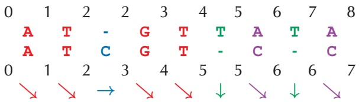

<details>
<summary>flowchart</summary>

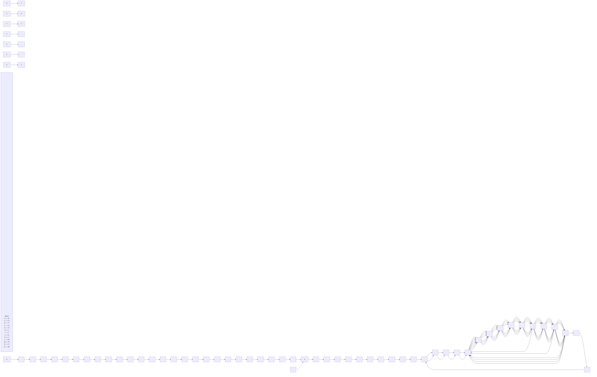
</details>

FIGURE 5.5 An alignment of ATGTTATA and ATCGTCC. The array in the first row counts the number of symbols of ATGTTATA used up to a given position. The array in the fourth row counts the number of symbols of ATCGTCC used up to a given position. And the array in the last row records whether each column of the alignment represents a match/mismatch $( \searrow / \searrow )$ , insertion (!), or deletion (#).

Note that in addition to horizontal and vertical edges, we have added diagonal edges connecting $( i , j )$ to $( i + 1 , j + 1 )$ in Figure 5.6.

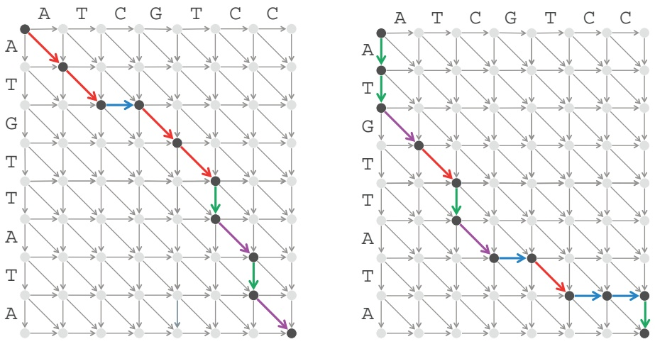

FIGURE 5.6 Every alignment corresponds to a path in the alignment graph from source to sink, and vice-versa. (Left) The path $( 0 ,   0 ) \searrow ( 1 ,   1 ) \searrow ( 2 ,   2 ) \rightarrow ( 2 ,   3 ) \searrow ( 3 ,$ 4) $\searrow (4,   5) \downarrow (5,   5) \searrow (6,   6) \downarrow (7,   6) \searrow (8,   1$ 7) is highlighted above and corresponds to the alignment of ATGTTATA and ATCGTCC in Figure 5.5. (Right) Another path in the alignment graph.

We call the DAG in Figure 5.6 the **alignment graph** of strings v and $w ,$ denoted ALIGNMENTGRAPH $( v , w )$ , and we call a path from source to sink in this DAG an align**ment path**. Every alignment of v and w can be viewed as a set of instructions to construct a unique alignment path in ALIGNMENTGRAPH $( v , w )$ , where each match/mismatch, **insertion**, and **deletion** corresponds to an edge $\searrow / \searrow , \rightarrow$ , and $\downarrow ,$ respectively. Fur-

234

---

H O W D O W E C O M PA R E D N A S E Q U E N C E S ?

thermore, this process is reversible, as we can convert each alignment path into a unique alignment.

**EXERCISE BREAK:** Construct the alignment of ATGTTATA and ATCGTCC corresponding to the alignment path in Figure 5.6 (right).

**STOP and Think:** Can you use the alignment graph to find a longest common subsequence of two strings?

Recall that finding a longest common subsequence of two strings is equivalent to finding an alignment of these strings maximizing the number of matches. In Figure 5.7, we high light all diagonal edges of ALIGNMENTGRAPH(ATGTTATA, ATCGTCC) corresponding to matches. If we assign a weight of 1 to all these edges and 0 to all other edges, then the Longest Common Subsequence Problem is equivalent to finding a longest path in this weighted DAG!

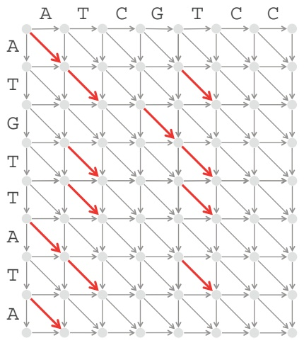

<details>
<summary>flowchart</summary>

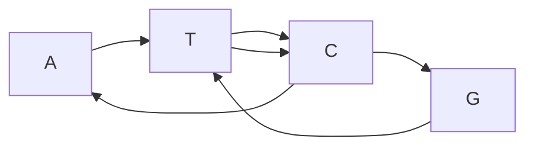
</details>

FIGURE 5.7 ALIGNMENTGRAPH(ATGTTATA, ATCGTCC) with all edges of weight 1 colored red (all other edges have weight 0). These edges correspond to potential matched symbols in an alignment of the two strings.

Thus, we need to design an algorithm for the Longest Path in a DAG Problem, but to do so, we need to know more about **dynamic programming**, a powerful algorithmic paradigm that is used for solving thousands of problems from various scientific fields.


235

---

C H A P T E R 5

If you are already familiar with dynamic programming, then you may want to skip the next section.

## An Introduction to Dynamic Programming: The Change Problem

## Changing money greedily

Imagine that you bought this textbook in a bookstore for \$69.24, which you paid for with \$70 in cash. You are due 76 cents in change, and the cashier now must make a decision whether to give you a fistful of 76 1-cent coins or just four coins $( 2 5 + 2 5 + 2 5 + 1 = 7 6 )$ Making change in this example is easy, but it casts light on a more general problem: how can a cashier make change using the fewest number of coins?

Different currencies have different possible coin values, or **denominations**. In the United States, the coin denominations are (100, 50, 25, 10, 5, 1); in the Roman Republic, they were (120, 40, 30, 24, 20, 10, 5, 4, 1). The heuristic used by cashiers all over the world to make change, which we call **GREEDYCHANGE**, iteratively selects the largest coin denomination possible.

```txt
GREEDYCHANGE(money)
    Change ← empty collection of coins
    while money > 0
        coin ← largest denomination that is less than or equal to money
        add a coin with denomination coin to the collection of coins Change
        money ← money – coin
    return Change
```


**STOP and Think:** Does **GREEDYCHANGE** always return the minimum possible number of coins?

Say we want to change 48 units of currency (denarii) in ancient Rome. **GREEDYCHANGE** returns five coins $( 4 8 = 4 0 + 5 + 1 + 1 + 1 )$ , and yet we can make change using only two coins (48 = 24 + 24). Thus, **GREEDYCHANGE** is suboptimal for some denominations!


**STOP and Think:** During the reign of Augustus, Roman coin denominations were changed to (1600, 800, 400, 200, 100, 50, 25, 2, 1). Why did these denominations make Roman cashiers’ lives easier? More generally, find a condition on coin denominations that dictates when **GREEDYCHANGE** will make change with the fewest number of coins.

236

---

H O W D O W E C O M PA R E D N A S E Q U E N C E S ?

Since **GREEDYCHANGE** is incorrect, we need to come up with a different approach. We can represent coins from d arbitrary denominations by an array of integers

$$
\mathrm{COINS} = \left(\text {coin} _ {1}, \dots , \text {coin} _ {d}\right),
$$

where the values $c o i n _ { i }$ are given in decreasing order. We say that an array of d positive integers $( c h a n g e _ { 1 } ,   \cdots ,   c h a n g e _ { d } )$ with the **number of coins** $change_{1} + \cdots + change_{d}$ **changes** an integer money (for the denominations COINS) if

$$
c o i n _ {1} \cdot c h a n g e _ {1} + \dots + c o i n _ {d} \cdot c h a n g e _ {d} = m o n e y.
$$

For example, for the Roman denominations $\mathrm{COINS} = \begin{pmatrix} 120,40,30,24,20,10,5,4,1 \end{pmatrix}$ , both $\left( 0 , 1 , 0 , 0 , 0 , 0 , 0 , 1 , 0 , 3 \right)$ and $\left( 0 , 0 , 0 , 2 , 0 , 0 , 0 , 0 , 0 \right)$ change money = 48.

We will consider the problem of finding the minimum number of coins needed to make change, instead of actually producing these coins. Let MINNUMCOINS(money) denote the minimum number of coins needed to change money for a given collection of denominations $( \mathbf { e . g . } ,$ for the Roman denominations, MINNUMCOINS(48) = 2).

## Change Problem:

Find the minimum number of coins needed to make change.

**Input**: An integer money and an array COINS of d positive integers.

**Output**: The minimum number of coins with denominations COINS that changes money.

## Changing money recursively

Since the greedy solution used by Roman cashiers to solve the Change Problem is incorrect, we will consider a different approach. Suppose you need to change 76 denarii, and you only have coins of the three smallest denominations: $\scriptstyle \mathrm { C O I N S }   =   { \big ( } 5 , 4 , 1 { \big ) }$ . A minimal collection of coins totaling 76 denarii must be one of the following:

• a minimal collection of coins totaling 75 denarii, plus a 1-denarius coin;
• a minimal collection of coins totaling 72 denarii, plus a 4-denarius coin;
• a minimal collection of coins totaling 71 denarii, plus a 5-denarius coin.

237

---

C H A P T E R 5

For the general denominations $\mathbb { C O I N S } = ( c o i n _ { 1 } , \cdots , c o i n _ { d } )$ , MINNUMCOINS(money) is equal to the minimum of d numbers:

$$
\text {MINNUMCOINS} (m o n e y) = \min \left\{ \begin{array}{c} \text {MINNUMCOINS} (m o n e y - c o i n _ {1}) + 1 \\ \vdots \\ \text {MINNUMCOINS} (m o n e y - c o i n _ {d}) + 1 \end{array} \right.
$$

We have just produced a **recurrence relation**, or an equation for MINNUMCOINS(money) in terms of MINNUMCOINS(m) for smaller values m. The above recurrence relation motivates the following recursive algorithm, which solves the Change Problem by computing MINNUMCOINS(m) for smaller and smaller values of m. In this algorithm, |COINS| refers to the number of denominations in COINS. See **DETOUR: The Towers of Hanoi** if you did not encounter recursive algorithms in Chapter 1.

```python
RECURSIVECHANGE(money, COINS)
    if money = 0
        return 0
    minNumCoins ← ∞
    for i ← 1 to |COINS|
        if money ≥ coin_i
            numCoins ← RECURSIVECHANGE(money - coin_i, COINS)
            if numCoins + 1 < minNumCoins
                minNumCoins ← numCoins + 1
    return minNumCoins
```


**STOP and Think:** Implement **RECURSIVECHANGE** and run it on money = 76 with $COINS = ( 5,4,1 )$ . What happens?

**RECURSIVECHANGE** may appear efficient, but it is completely impractical because it recalculates the optimal coin combination for a given value of money over and over again. For example, when money = 76 and $COINS = \begin{pmatrix} 5,4,1 \end{pmatrix}$ , MINNUMCOINS(70) gets computed six times, five of which are shown in Figure 5.8. This may not seem like a problem, but MINNUMCOINS(30) will be computed billions of times!


238

---

H O W D O W E C O M PA R E D N A S E Q U E N C E S ?

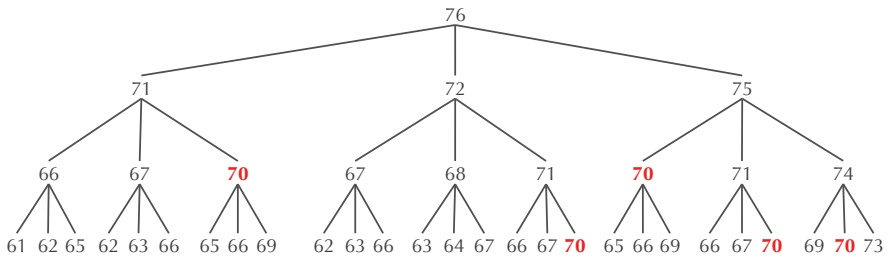

<details>
<summary>funnel</summary>

| Level | Value |
| --- | --- |
| Top | 76 |
| Second | 72 |
| Third | 75 |
| Fourth | 70 |
| Fifth | 70 |
| Sixth | 71 |
| Seventh | 73 |
| Bottom Left | 66 |
| Bottom Middle | 67 |
| Bottom Right | 68 |
| Bottom Far Right | 70 |
| Bottom Far Left | 69 |
| Bottom Far Left | 65 |
| Bottom Far Left | 66 |
| Bottom Far Left | 69 |
| Bottom Center | 62 |
| Bottom Center | 63 |
| Bottom Center | 66 |
| Bottom Center | 64 |
| Bottom Center | 67 |
| Bottom Center | 66 |
| Bottom Center | 67 |
| Bottom Center | 70 |
| Bottom Center | 65 |
| Bottom Center | 66 |
| Bottom Center | 69 |
| Bottom Center | 66 |
| Bottom Center | 67 |
| Bottom Center | 70 |
| Bottom Right | 74 |
| Bottom Right | 70 |
| Bottom Right | 73 |
</details>

FIGURE 5.8 A tree illustrating the computation of MINNUMCOINS(76) for the denominations $\mathsf { C O I N S } = ( 5 , 4 , 1 )$ . The edges of this tree represent recursive calls of RECURSIVECHANGE for different input values, with five of the six computations of MINNUMCOINS(70) highlighted in red. When MINNUMCOINS(70) is computed for the sixth time (corresponding to the path $7 6 \rightarrow 7 5 \rightarrow 7 4 \rightarrow 7 3 \rightarrow 7 2 \rightarrow 7 1 \rightarrow 7 0 )$ RECURSIVECHANGE has already been called hundreds of times.

## Changing money using dynamic programming

To avoid the many recursive calls needed to compute MINNUMCOINS(money), we will use a dynamic programming strategy. Wouldn’t it be nice to know all the values of MINNUMCOINS(money  coin<sub>i</sub>) by the time we compute MINNUMCOINS(money)? Instead of making time-consuming calls to **RECURSIVECHANGE**(money  coin<sub>i</sub>, COINS), we could simply look up the values of MINNUMCOINS(money  coin<sub>i</sub>) in an array and thus compute MINNUMCOINS(money) using just |COINS| comparisons.

The key to dynamic programming is to take a step that may seem counterintuitive. Instead of computing MINNUMCOINS(m) for every value of m from 76 downward toward $m   =   1$ via recursive calls, we will invert our thinking and compute MINNUMCOINS(m) from $m = 1$ upward toward $7 6 ,$ storing all these values in an array so that we only need to compute MINNUMCOINS(m) once for each value of m. MINNUMCOINS(m) is still computed via the same recurrence relation:

$$
\operatorname{MinNumCoins} (m) = \min \left\{ \begin{array}{l} \operatorname{MinNumCoins} (m - 5) + 1 \\ \operatorname{MinNumCoins} (m - 4) + 1 \\ \operatorname{MinNumCoins} (m - 1) + 1 \end{array} \right.
$$

For example, assuming that we have already computed MINNUMCOINS(m) for $m < 6 ,$

239

---

C H A P T E R 5

$$
\begin{array}{l} \text {MINNumCoins} (6) = \min \left\{ \begin{array}{l} \text {MINNumCoins} (1) + 1 = 2 \\ \text {MINNumCoins} (2) + 1 = 3 \\ \text {MINNumCoins} (5) + 1 = 2 \end{array} \right. \\ = 2. \\ \end{array}
$$

Following the same reasoning,

$$
\text {MINNUMCOINS} (7) = \min \left\{ \begin{array}{l} \text {MINNUMCOINS} (2) + 1 = 3 \\ \text {MINNUMCOINS} (3) + 1 = 4 \\ \text {MINNUMCOINS} (6) + 1 = 3 \end{array} \right.
$$

$$
= 3.
$$

Continuing these calculations results in Figure 5.9.

$$
\begin{array}{c c c c c c c c c c c c c c c} \boldsymbol {m} & 0 & 1 & 2 & 3 & 4 & 5 & 6 & 7 & 8 & 9 & 1 0 & 1 1 & 1 2 \\ \text {MINNumCoins} (\boldsymbol {m}) & 0 & 1 & 2 & 3 & 1 & 1 & 2 & 3 & 2 & 2 & 2 & 3 & 3 \end{array}
$$

FIGURE 5.9 MINNUMCOINS(m) for values of m between 1 and 12.


**EXERCISE BREAK:** Use dynamic programming to fill in the next ten values of MINNUMCOINS(m) in Figure 5.9.

Notice that MINNUMCOINS(2) is used in the computation of both MINNUMCOINS(6) and MINNUMCOINS(7), but instead of draining computational resources by having to compute this value both times, we simply consult the pre-computed value in the array. The following dynamic programming algorithm calculates MINNUMCOINS(money) with runtime O(money · |COINS|).


$$
\begin{array}{l} \text {DPCHANGE(money, COINS)} \\ \text {MINNUMCOINS(0)} \leftarrow 0 \\ \text {for m} \leftarrow 1 \text {to money} \\ \text {MINNUMCOINS(m)} \leftarrow \infty \\ \text {for i} \leftarrow 1 \text {to |COINS|} \\ \text {if m} \geq \text {coin}_ {i} \\ \text {if MINNUMCOINS(m - coin_ {i}) + 1 <   MINNUMCOINS(m)} \\ \text {MINNUMCOINS(m)} \leftarrow \text {MINNUMCOINS(m - coin_ {i}) + 1} \\ \text {return MINNUMCOINS(money)} \end{array}
$$

240

---

H O W D O W E C O M PA R E D N A S E Q U E N C E S ?

**STOP and Think:** If money = 10<sup>9</sup>, **DPCHANGE** requires a huge array of size $1 0 ^ { 9 }$ . Modify the **DPCHANGE** algorithm so that the array size required does not exceed the value of the largest coin denomination.

**STOP and Think:** Recall that our original goal was to make change, not just compute MINNUMCOINS(money). Modify **DPCHANGE** so that it not only computes the minimum number of coins but also returns these coins.

## The Manhattan Tourist Problem Revisited

You should now be ready to implement an algorithm solving the Manhattan Tourist Problem. The following pseudocode computes the length of the longest path to node $( i , j )$ in a rectangular grid and is based on the observation that the only way to reach node $( i , j )$ in the Manhattan Tourist Problem is either by moving south (#) from (i  1, j) or east (!) from (i, j  1).

```python
SOUTHOREAST(i, j)
    if i = 0 and j = 0
        return 0
    x ← -∞, y ← -∞
    if i > 0
        x ← SOUTHOREAST(i - 1, j) + weight of vertical edge into (i, j)
    if j > 0
        y ← SOUTHOREAST(i, j - 1) + weight of horizontal edge into (i, j)
    return max{x, y}
```

**STOP and Think:** How many times is **SOUTHOREAST**(3, 2) called in the computation of **SOUTHOREAST**(9, 7)?

Similarly to **RECURSIVECHANGE**, **SOUTHOREAST** suffers from a huge number of recursive calls, and we need to reframe this algorithm using dynamic programming. Remember how **DPCHANGE** worked from small instances upward? To find the length of a longest path from source $( 0 , 0 )$ to sink $( n , m )$ , we will first find the lengths of longest paths from the source to all nodes $( i , j )$ in the grid, expanding slowly outward from the source.

STOP
STOP

STOP

241

---

C H A P T E R 5

At first glance, you may think that we have created additional work for ourselves by solving $n \times m$ different problems instead of a single problem. Yet **SOUTHOREAST** also solves all these smaller problems, just as **RECURSIVECHANGE** and **DPCHANGE** both computed MINNUMCOINS(m) for all values of $m < m o n e y$ . The trick behind dynamic programming is to solve each of the smaller problems once rather than billions of times.

We will henceforth denote the length of a longest path from (0, 0) to $( i , j )$ as $s _ { i , j } .$ Computing $s _ { 0 , j }$ (for $0 \leq j \leq m )$ is easy, since we can only reach $( 0 , j )$ by moving right (!) and do not have any flexibility in our choice of path. Thus, $s _ { 0 , j }$ is the sum of the weights of the first j horizontal edges leading out from the source. Similarly, $s _ { i , 0 }$ is the sum of the weights of the first i vertical edges from the source (Figure 5.10).

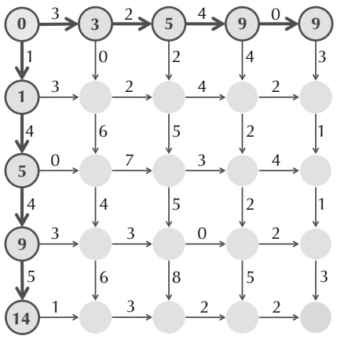

<details>
<summary>flowchart</summary>

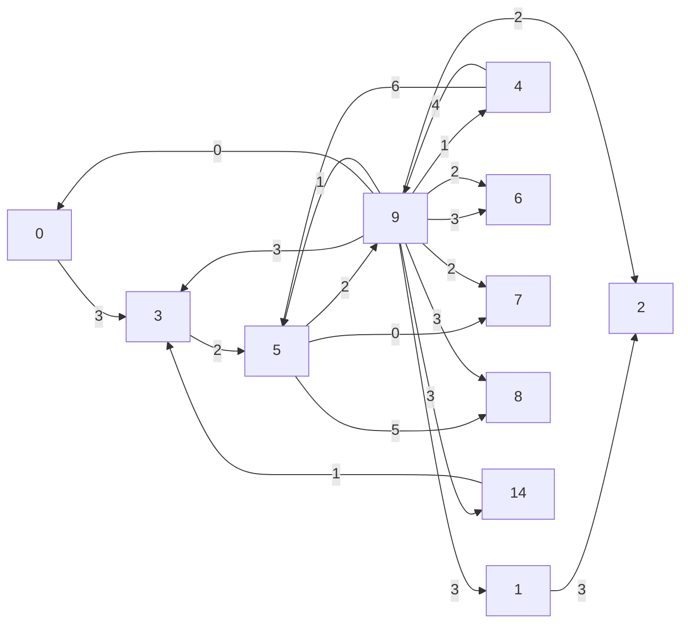
</details>

FIGURE 5.10 Computing $s _ { i ,   0 }$ and $s _ { 0 , j }$ is easy because there is only one path from the source to (i, 0) and only one path from the source to $( 0 , j )$

For $i > 0$ and $j > 0 ,$ , the only way to reach node $( i , j )$ is by moving down from node $( i - 1 , j )$ or by moving right from node $( i , j - 1 )$ . Thus, $s _ { i , j }$ can be computed as the maximum of two values:

$$
s _ {i, j} = \max \left\{ \begin{array}{l} s _ {i - 1, j} + \text {weight of vertical edge from} (i - 1, j) \text {to} (i, j) \\ s _ {i, j - 1} + \text {weight of horizontal edge from} (i, j - 1) \text {to} (i, j) \end{array} \right.
$$

Now that we have computed $s _ { 0 , 1 }$ and $s _ { 1 , 0 } ,$ , we can compute $s _ { 1 , 1 }$ . You can arrive at (1, 1) by traveling down from (0, 1) or right from $( 1 , 0 )$ . Therefore, $s _ { 1 , 1 }$ is the maximum of two values:

242

---

H O W D O W E C O M PA R E D N A S E Q U E N C E S ?

$$
s _ {1, 1} = \max \left\{ \begin{array}{l} s _ {0, 1} + \text {weight of vertical edge from (0, 1) to (1, 1)} = 3 + 0 = 3 \\ s _ {1, 0} + \text {weight of horizontal edge from (1, 0) to (1, 1)} = 1 + 3 = 4 \end{array} \right.
$$

Since our goal is to find the longest path from (0, 0) to (1, 1), we conclude that $s _ { 1 , 1 } = 4$ Because we chose the horizontal edge from (1, 0) to (1, 1), the longest path through $( 1 , 1 )$ must use this edge, which we highlight in Figure 5.11 (top left). Similar logic allows us to compute the rest of the values in column 1; for each $s _ { i , 1 } .$ , we highlight the edge that we chose leading into (i, 1), as shown in Figure 5.11 (top right).

Continuing column-by-column (Figure 5.11 (bottom left)), we can compute every score $s _ { i , j }$ in a single sweep of the graph, eventually calculating $s _ { 4 , 4 } = 3 4$

For each node $( i , j )$ , we will highlight the edge leading into $( i , j )$ that we used to compute $s _ { i , j }$ . However, note that we have a tie when we compute s<sub>3</sub>, 3 :

$$
s _ {3, 3} = \max \left\{ \begin{array}{l} s _ {2, 3} + \text {weight of vertical edge from (2, 3) to (3, 3)} = 2 0 + 2 = 2 2 \\ s _ {3, 2} + \text {weight of horizontal edge from (3, 2) to (3, 3)} = 2 2 + 0 = 2 2 \end{array} \right.
$$

To reach $( 3 , 3 )$ , we could have used either the horizontal or vertical incoming edge, and so we highlight both of these edges in the completed graph in Figure 5.11 (bottom left).

**STOP and Think:** Thus far, we have only discussed how to find the length of a longest path. How could you use the highlighted edges in Figure 5.11 (bottom left) to reconstruct a longest path?

We now have the outline of a dynamic programming algorithm for finding the length of a longest path in the Manhattan Tourist Problem, called **MANHATTANTOURIST**. In the pseudocode below, $d o w n _ { i , j }$ and $r i g h t _ { i , j }$ are the respective weights of the vertical and horizontal edges entering node $( i , j )$ . We denote the matrices holding $( d o w n _ { i , j } )$ and $( r i g h t _ { i ,   j } )$ as Down and Right, respectively.

**EXERCISE BREAK:** Modify **MANHATTANTOURIST** in order to find the length of the longest path from source to sink in the graph shown in Figure 5.11 (bottom right).

STOP

243

---

C H A P T E R 5

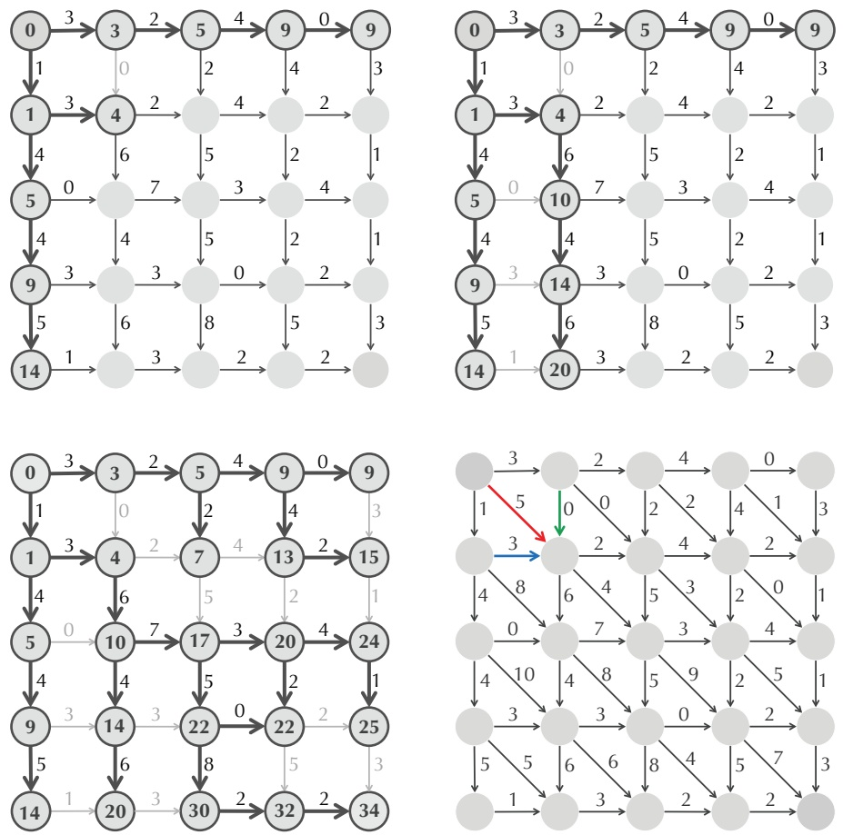

FIGURE 5.11 (Top left) Computing $s _ { 1 , 1 }$ uses the horizontal edge from (1, 0), which is highlighted. (Top right) Computing all values $s _ { i , \; 1 }$ in column 1. (Bottom left) The graph displaying all scores $s _ { i , j } .$ (Bottom right) A graph with diagonal edges constructed for an imaginary city. Node (1, 1) has three predecessors ((0, 0), (0, 1), and (1, 0)) that are used in the computation of $s _ { 1 , 1 }$

244

---

H O W D O W E C O M PA R E D N A S E Q U E N C E S ?

<div class="docvortex-algorithm" style="white-space: pre-wrap; font-family:monospace;">
MANHATTAN TOURIST(n, m, Down, Right)
    $s_{0,0} \leftarrow 0$
    for $i \leftarrow 1$ to $n$
        $s_{i,0} \leftarrow s_{i-1,0} + down_{i,0}$
    for $j \leftarrow 1$ to $m$
        $s_{0,j} \leftarrow s_{0,j-1} + right_{0,j}$
    for $i \leftarrow 1$ to $n$
        for $j \leftarrow 1$ to $m$
            $s_{i,j} \leftarrow \max\{s_{i-1,j} + down_{i,j}, s_{i,j-1} + right_{i,j}\}$
    return $s_{n,m}$
</div>

## From Manhattan to an Arbitrary Directed Acyclic Graph

Sequence alignment as building a Manhattan-like graph

After seeing how dynamic programming solved the Manhattan Tourist Problem, you should be prepared to adapt **MANHATTANTOURIST** for alignment graphs with diagonal edges. Recall Figure 5.7, in which we modeled the Longest Common Subsequence Problem as finding the longest path in an alignment graph “city” whose “attractions”’ (matches) all lie on diagonal edges with weight 1.

You can probably work out the recurrence relation for the alignment graph on your own, but imagine for a second that you have not already learned that an LCS can be represented by a longest path in the alignment graph. As **DETOUR: Finding a Longest Common Subsequence without Building a City** explains, we don’t need to build a Manhattan-like city to compute the length of an LCS. However, the arguments required to do so are tedious. More importantly, various alignment applications are much more complex than the Longest Common Subsequence Problem and require building a DAG with appropriately chosen edge weights in order to model the specifics of a biological problem. Rather than treating each subsequent alignment application as a frightening new challenge, we would like to equip you with a generic dynamic programming algorithm that will find a longest path in any DAG. Moreover, many bioinformatics problems have nothing to do with alignment, yet they can also be solved as applications of the Longest Path in a DAG Problem.


245

---

C H A P T E R 5

Dynamic programming in an arbitrary DAG

Given a node b in a $\mathrm { D A G } ,$ let $s _ { b }$ denote the length of a longest path from the source to b. We call node a a **predecessor** of node b if there is an edge connecting a to b in the $\mathrm { D A G } ;$ note that the indegree of a node is equal to the number of its predecessors. The **score** $s _ { b }$ of node b with indegree k is computed as a maximum of k terms:

$$
s _ {b} = \max _ {\text { all   predecessors   } a \text {   of   node   } b} \{s _ {a} + \text { weight   of   edge   from   } a \text {   to   } b \}.
$$

For example, in the graph shown in Figure 5.11 (bottom right), node (1, 1) has three predecessors. You can arrive at $( 1 , 1 )$ by traveling right from (1, 0), down from $( 0 , 1 )$ , or diagonally from $( 0 , 0 )$ , Assuming that we have already computed $s _ { 0 ,   0 } ,   s _ { 0 ,   1 } ,$ , and $s _ { 1 , 0 } ,$ we can therefore compute $s _ { 1 , 1 }$ as the maximum of three values:

$$
s _ {1, 1} = \max \left\{\begin{array}{l}s _ {0, 1} + \text {weight of edge} \quad \downarrow \quad \text {connecting (0,1) to (1,1) = 3 + 0 = 3}\\s _ {1, 0} + \text {weight of edge} \rightarrow \text {connecting (1,0) to (1,1) = 1 + 3 = 4}\\s _ {0, 0} + \text {weight of edge} \searrow \text {connecting (0,0) to (1,1) = 0 + 5 = 5}\end{array}\right.
$$

To compute scores for any node $( i , j )$ of this graph, we use the following recurrence:

$$
s _ {i, j} = \max \left\{\begin{array}{l}s _ {i - 1, j} \quad + \text {weight of edge} \quad \downarrow \text {between} (i - 1, j) \text {and} (i, j)\\s _ {i, j - 1} \quad + \text {weight of edge} \quad \rightarrow \text {between} (i, j - 1) \text {and} (i, j)\\s _ {i - 1, j - 1} + \text {weight of edge} \quad \searrow \text {between} (i - 1, j - 1) \text {and} (i, j)\end{array}\right.
$$

An analogous argument can be applied to the alignment graph to compute the length of an LCS between sequences v and $w .$ Since in this case all edges have weight 0 except for diagonal edges of weight 1 that represent matches $( v _ { i } = w _ { j } )$ , we obtain the following recurrence for computing the length of an LCS:

$$
s _ {i, j} = \max \left\{ \begin{array}{l l} s _ {i - 1, j} & + 0 \\ s _ {i, j - 1} & + 0 \\ s _ {i - 1, j - 1} + 1, & \text {if} v _ {i} = w _ {j} \end{array} \right.
$$


**STOP and Think:** The above recurrence does not incorporate mismatch edges. Why is this not a problem?

246

---

H O W D O W E C O M PA R E D N A S E Q U E N C E S ?

A similar approach can be developed to find the longest path in any $\mathrm { D A G } ,$ as suggested by the next exercise.

**EXERCISE BREAK:** What is the length of a longest path between the blue and red nodes in the DAG shown in Figure 5.12?


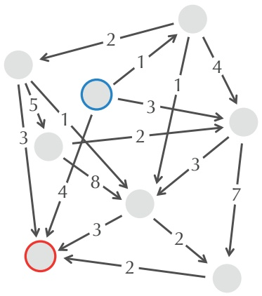

<details>
<summary>flowchart</summary>

```mermaid
graph TD
  A["Node 1"] -->|2| B["Node 2"]
  C["Node 3"] -->|5| A
  D["Node 4"] -->|1| B
  E["Node 5"] -->|3| A
  F["Node 6"] -->|1| B
  G["Node 7"] -->|3| B
  H["Node 8"] -->|2| B
  I["Node 9"] -->|3| B
  J["Node 10"] -->|2| B
  K["Node 11"] -->|2| B
  L["Node 12"] -->|2| B
  M["Node 13"] -->|2| B
  N["Node 14"] -->|2| B
  O["Node 15"] -->|2| B
  P["Node 16"] -->|2| B
  Q["Node 17"] -->|2| B
  R["Node 18"] -->|2| B
  S["Node 19"] -->|2| B
  T["Node 20"] -->|2| B
  U["Node 21"] -->|2| B
  V["Node 22"] -->|2| B
  W["Node 23"] -->|2| B
  X["Node 24"] -->|2| B
  Y["Node 25"] -->|2| B
  Z["Node 26"] -->|2| B
  AA["Node 27"] -->|2| B
  AB["Node 28"] -->|2| B
  AC["Node 29"] -->|2| B
  AD["Node 30"] -->|2| B
  AE["Node 31"] -->|2| B
  AF["Node 32"] -->|2| B
  AG["Node 33"] -->|2| B
  AH["Node 34"] -->|2| B
  AI["Node 35"] -->|2| B
  AJ["Node 36"] -->|2| B
  AK["Node 37"] -->|2| B
  AL["Node 38"] -->|2| B
  AM["Node 39"] -->|2| B
  AN["Node 40"] -->|2| B
  AO["Node 41"] -->|2| B
  AP["Node 42"] -->|2| B
  AQ["Node 43"] -->|2| B
  AR["Node 44"] -->|2| B
  AS["Node 45"] -->|2| B
  AT["Node 46"] -->|2| B
  AU["Node 47"] -->|2| B
  AV["Node 48"] -->|2| B
  AW["Node 49"] -->|2| B
  AX["Node 50"] -->|2| B
  A --> C
  A --> D
  A --> E
  A --> F
  A --> G
  A --> H
  A --> I
  A --> J
  A --> K
  A --> L
  A --> M
  A --> N
  A --> O
  A --> P
  A --> Q
  A --> R
  A --> S
  A --> T
  A --> U
  A --> V
  A --> W
  A --> X
  A --> Y
  A --> Z
```
</details>

FIGURE 5.12 A weighted DAG without the obvious order inherent in the graphs previously encountered in this chapter.

## Topological orderings

Do not worry if you struggled to solve the last exercise. The hitch to using dynamic programming in order to find the length of a longest path in a DAG is that we must decide on the order in which to visit nodes when computing the values $s _ { b }$ according to the recurrence

$$
s _ {b} = \max _ {\text { all   predecessors   } a \text {   of   node   } b} \{s _ {a} + \text { weight   of   edge   from   } a \text {   to   } b \}.
$$

This ordering of nodes is important, since by the time we reach node b, the values $s _ { a }$ for all its predecessors must have already been computed. We have managed to hide this issue for rectangular grids because the order in which we have computed the $s _ { i , j }$ ensured that we would never consider a node before visiting all of its predecessors.

To illustrate the importance of visiting nodes in the correct order, consider the DAG in Figure 5.13, which corresponds to a “Dressing Challenge Problem”. How would you order the nodes of this graph so that you don’t put on your boots before your tights?

247

---

C H A P T E R 5

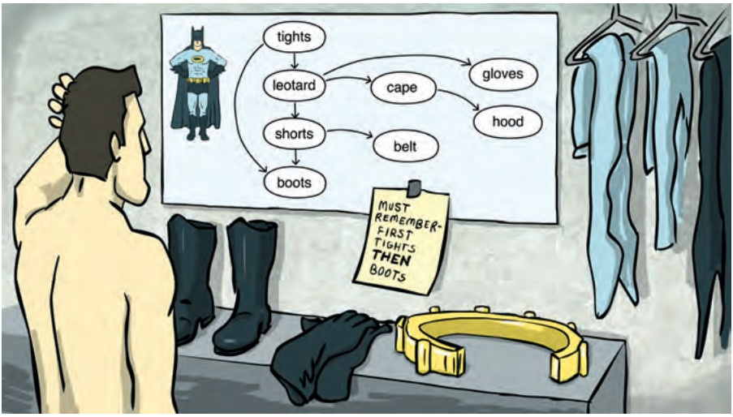

<details>
<summary>flowchart</summary>

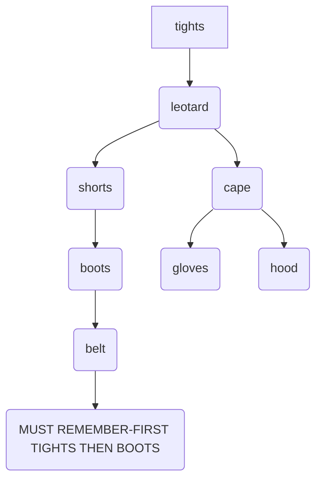
</details>

FIGURE 5.13 The DAG associated with the Dressing Challenge Problem. If a directed edge connects two items of clothing, then the first item must be put on before the second item.

To solve the Dressing Challenge Problem, we need to arrange the nodes in the DAG in Figure 5.13 along a line so that every directed edge connects a node to a node on its right (Figure 5.14). To get dressed without any mishaps, you can simply visit nodes from left to right.

To find a longest path in an arbitrary DAG, we first need to order the nodes of the DAG so that every node falls after all its predecessors. Formally, an ordering of nodes $\left( a _ { 1 } , \cdots , a _ { k } \right)$ in a DAG is called a **topological ordering** if every edge $\left( a _ { i } , a _ { j } \right)$ of the DAG connects a node with a smaller index to a node with a larger index, $\mathrm { i . e . } , i < j$

**EXERCISE BREAK:** Construct a topological ordering of the DAG in Figure 5.12.

**EXERCISE BREAK:** How many topological orderings does the Dressing Challenge DAG have?

The reason why **MANHATTANTOURIST** is able to find a longest path in a rectangular grid is that its pseudocode implicitly orders nodes according to the “column-by-column” topological ordering shown in Figure 5.15 (left). The “row-by-row” ordering (Figure 5.15 (right)) gives another topological ordering of a rectangular grid.


248

---

H O W D O W E C O M PA R E D N A S E Q U E N C E S ?

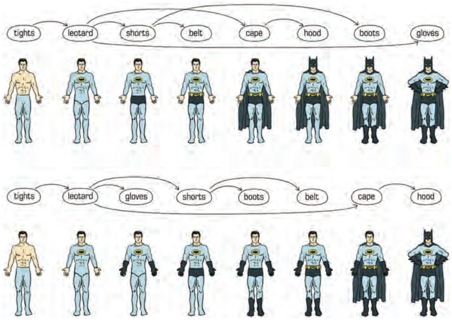

<details>
<summary>flowchart</summary>

This diagram illustrates the classification of various body parts (such as tights, leotard, boots, and gloves) into two distinct groups based on their relative positioning.
</details>

FIGURE 5.14 Two different topological orderings of the Dressing Challenge DAG from Figure 5.13.

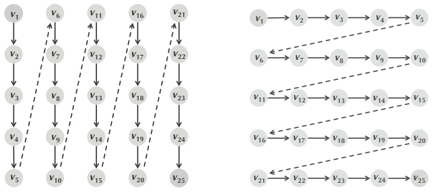

<details>
<summary>flowchart</summary>

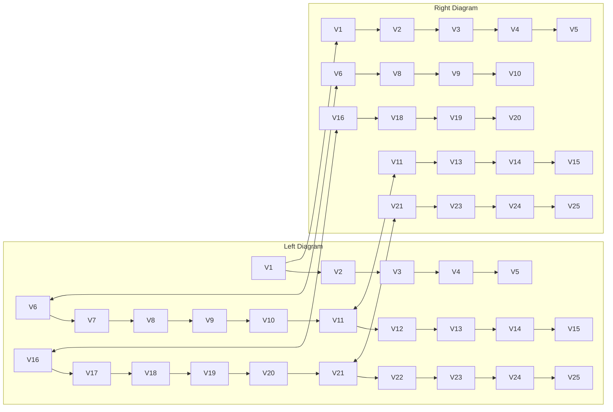
</details>

FIGURE 5.15 The column-by-column (left) and row-by-row (right) topological orderings of a rectangular grid.

**STOP and Think:** Rewrite the **MANHATTANTOURIST** pseudocode based on the topological ordering shown in Figure 5.16.


249

---

C H A P T E R 5

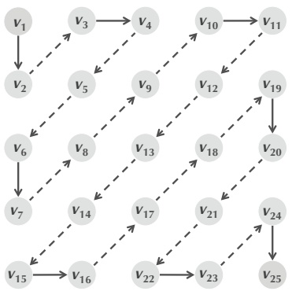

<details>
<summary>flowchart</summary>

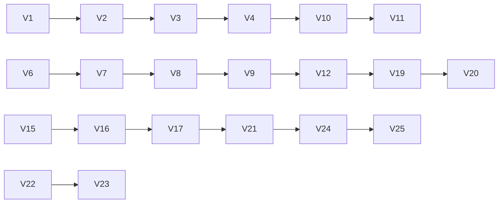
</details>

FIGURE 5.16 Another topological ordering of the rectangular grid from Figure 5.15.

It can be proven that any DAG has a topological ordering, and that this topological ordering can be constructed in time proportional to the number of edges in the graph (see **DETOUR: Constructing a Topological Ordering**). Once we have a topological ordering, we can compute the length of the longest path from source to sink by visiting the nodes of the DAG in the order dictated by the topological ordering, which is achieved by the following algorithm. For simplicity, we assume that the source node is the only node with indegree 0 in Graph.

<div class="docvortex-algorithm" style="white-space: pre-wrap; font-family:monospace;">
LONGESTPATH(Graph, source, sink)
    for each node b in Graph
        $s_b \leftarrow -\infty$
    $s_{source} \leftarrow 0$
    topologically order Graph
    for each node b in Graph (following the topological order)
        $s_b \leftarrow \max_{\text{all predecessors a of node } b} \{s_a + \text{weight of edge from } a \text{ to } b\}$
    return $s_{sink}$
</div>

Since every edge participates in only a single recurrence, the runtime of **LONGESTPATH** is proportional to the number of edges in the DAG Graph.

We can now efficiently compute the length of a longest path in an arbitrary DAG, but we do not yet know how to convert **LONGESTPATH** into an algorithm that will construct this longest path. In the next section, we will use the Longest Common Subsequence Problem to explain how to construct a longest path in a DAG.

PAGE 284

250

---

H O W D O W E C O M PA R E D N A S E Q U E N C E S ?

## Backtracking in the Alignment Graph

In Figure 5.11 (bottom left), we highlighted each edge selected by **MANHATTANTOURIST**. To form a longest path, we simply need to find a path from source to sink formed by highlighted edges (more than one such path may exist). However, if we were to walk from source to sink along the highlighted edges, we might reach a dead end, such as the node $( 1 , 2 )$ . In contrast, every path from the sink will bring us back to the source if we **backtrack** in the direction opposite to each highlighted edge (Figure 5.17).

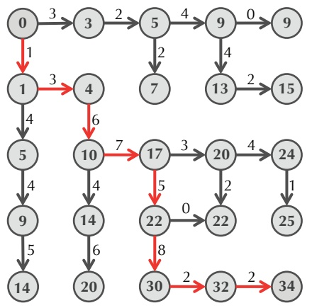

<details>
<summary>flowchart</summary>

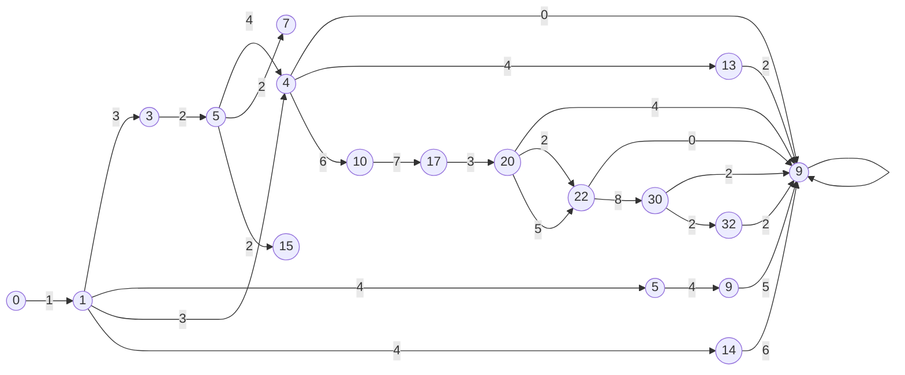
</details>

FIGURE 5.17 Following edges from the sink backwards to the source produces the red path in the DAG above, which highlights a longest path from the source to sink.

We can use this backtracking idea to construct an LCS of strings v and w. We know that if we assign a weight of 1 to the edges in ALIGNMENTGRAPH $( v , w )$ corresponding to matches and assign a weight of 0 to all other edges, then $s _ { | v | ,   | w | }$ gives the length of an LCS. The following algorithm maintains a record of which edge in ALIGNMENTGRAPH $( v , w )$ was used to compute each value $s _ { i , j }$ by utilizing backtrack**ing pointers**, which take one of the three values ${ \mathrm { ~  ~ { ~  ~ } ~ } } , { \mathrm { ~  ~ { ~  ~ } ~ } } , { \mathrm { ~ o r ~ \textquotedblleft ~ { ~  ~ } ~ } } \rangle$ . Backtracking pointers are stored in a matrix Backtrack.

**STOP and Think:** How does changing the order of the three $\text{" }  if  \text{" }$ statements in the **LCSBACKTRACK** pseudocode affect the computation of Backtrack?


251

---

C H A P T E R 5

<div class="docvortex-algorithm" style="white-space: pre-wrap; font-family:monospace;">
LCSBACKTRACK(v, w)
    for $i \leftarrow 0$ to $|v|$
        $s_{i,0} \leftarrow 0$
    for $j \leftarrow 0$ to $|w|$
        $s_{0,j} \leftarrow 0$
    for $i \leftarrow 1$ to $|v|$
        for $j \leftarrow 1$ to $|w|$

        $s_{i,j} \leftarrow \max \begin{cases} s_{i-1,j} \\ s_{i,j-1} \\ s_{i-1,j-1} + 1, \text{ if } v_i = w_j \end{cases}$

        if $s_{i,j} = s_{i-1,j}$
            $Backtrack_{i,j} \leftarrow '' \downarrow''$
    else if $s_{i,j} = s_{i,j-1}$
        $Backtrack_{i,j} \leftarrow '' \rightarrow''$
    else if $s_{i,j} = s_{i-1,j-1} + 1$ and $v_i = w_j$
        $Backtrack_{i,j} \leftarrow '' \searrow''$
return Backtrack
</div>

We now need to find a path from the source to the sink formed by the highlighted edges. The algorithm below solves the Longest Common Subsequence Problem by using the information in Backtrack. **OUTPUTLCS**(Backtrack, $v , i , j )$ outputs an LCS between the i-prefix of v and the j-prefix of w. The initial invocation that outputs an LCS of v and w is **OUTPUTLCS**(Backtrack, $v , | v | , | w | )$

```matlab
OUTPUTLCS(Backtrack, v, i, j)
    if i = 0 or j = 0
        return
    if Backtrack_{i,j} = ↓
        OUTPUTLCS(Backtrack, v, i - 1, j)
    else if Backtrack_{i,j} = →
        OUTPUTLCS(Backtrack, v, i, j - 1)
    else
        OUTPUTLCS(Backtrack, v, i - 1, j - 1)
        output v_i
```


252

---

H O W D O W E C O M PA R E D N A S E Q U E N C E S ?

**STOP and Think: OUTPUTLCS** is a recursive algorithm, but it is efficient. What makes it different from the inefficient recursive algorithms for making change and finding a longest path in a DAG?

The backtracking method can be generalized to construct a longest path in any DAG. Whenever we compute $s _ { b }$ as

$$
s _ {b} = \max _ {\text { all   predecessors   } a \text {   of   node   } b} \{s _ {a} + \text { weight   of   edge   from   } a \text {   to   } b \},
$$

we simply need to store a predecessor of b that was used in the computation of $s _ { b }$ so that we can backtrack later on. You are now ready to use backtracking to find the longest path in an arbitrary DAG.

**EXERCISE BREAK:** Currently, **OUTPUTLCS** finds a single LCS of two strings. Modify **OUTPUTLCS** (and **LCSBACKTRACK**) to find every LCS of two strings.

## Scoring Alignments

What is wrong with the LCS scoring model?

Recall Marahiel’s alignment of the A-domains coding for Asp and Orn, which had **19** + **10** matches:

Y**AFD**LGYTCMFPV**LL**G**GG**ELHIVQKETYTAPDEIAHY**IK**EHG**IT**YIKL**TP**SLFHTIVNTASFAFDANFESLRLIVLGGEKIIPIDVIAFRKMYGHTE-FINH**YG**P**TEA**TIGA -**AFD**VSAGDFARA**LL**T**GG**QLIVCPNEVKMDPASLYAI**IK**KYD**IT**IFEA**TP**ALVIPLMEYI-YEQKLDISQLQILIVGSDSCSMEDFKTLVSRFGSTIRIVNS**YG**V**TEA**CIDS

It is not difficult to construct an alignment having even more matches at the expense of introducing more indels. Yet the more indels we add, the less biologically relevant the alignment becomes, as it diverges further and further from the biologically correct alignment found by Marahiel. Below is the alignment with the maximum number of matches, representing an LCS of length $19+8+19=46.$ . This alignment is so long that we cannot fit it on a single line.

Y**AFD**L--G-YTCMFP--V**LL**-**GG**GELH**IV**---Q-K-E--T-YTAPDEIAHY**IK**--EHG**IT**YI---KL**TP**SL-FHT -**AFD**VSAGD----FARA-**LL**T**GG**-QL-**IV**CPNEVKMDPASLY-A---I---**IK**KYD--**IT**-IFEA--**TP**ALV--- IVNTASFAFDANFE-----S-LR-**LIV**LGG-----EKIIPIDVIAFRK-M---YGHTEFI---NH**YG**P**TEA**TIGA IPLMEYIY-----EQKLDISQLQI**LIV**-GSDSCSME-----D---F-KTLVSRFGST--IRIVNS**YG**V**TEA**CIDS

STOP

[5D](http://rosalind.info/problems/5d)

253

---

C H A P T E R 5


**STOP and Think:** If Marahiel had constructed this alignment, would he have been able to infer the eight amino acid-long signatures of the non-ribosomal code?

Below, we highlight the purple amino acids representing the non-ribosomal signatures. Although these signatures are grouped in eight conserved columns in Marahiel’s alignment from the beginning of the chapter, only five of these columns have “survived” in the LCS alignment above, making it impossible to infer the non-ribosomal signatures:

```css
YAFDL--G-YTCMFP--VLL-GGGELHIV---Q-K-E--T-YTAPDEIAHYIK--EHGITYI---KLTPSL-FHT-AFDVSAGD----FARA-LLTGG-QL-IVCPNEVKMDPASLY-A---I----IKKYD--IT-IFEA--TPALV---
```

```txt
IVNTASFAFDANFE-----S-LR-LIVLGG-----EKIIPIDVIAFRK-M---YGHTEFI---NHYGPTEATIGA
IPLMEYIY-----EQKLDISQLQILIV-GSDSCSME-----D---F-KTLVSRFGST--IRIVNSYGVTEACIDS
```

The frivolous matches hiding the real evolutionary scenario have appeared because nothing stopped us from introducing an excessive number of indels when building an LCS. Recalling our original alignment game in which we rewarded matched symbols, we need some way of penalizing indels and mismatches. First, let’s handle indels. Say that in addition to assigning matches a premium of +1, we assess each indel a penalty of - 4. The top-scoring alignment of the A-domains gets closer to the biologically correct alignment, with six of the columns corresponding to correctly aligned signatures.

```powershell
YAFDLGYTCMFP-VLL-GGGELHIV-QKETYTAPDEI-AHYIKEHGITYI-KLTPSLFHTIVNTASFAFDANFE-AFDVS-AGDFARALLTGG-QL-IVCPNEVKMDPASLYA-IIKKYDIT-IFEATPAL--VIPLME-YIYEQKLD
```

```txt
-S-LR-LIVLGGEKIIPIDVIAFRKM---YGHTE-FINHYGPTEATIGA
ISQLQILIV-GSDSC-SME--DFKTLVSRFGSTIRIVNSYGVTEACIDS
```

## Scoring matrices

To generalize the alignment scoring model, we still award +1 for matches, but we also penalize mismatches by some positive constant µ (the **mismatch penalty**) and indels by some positive constant s (the **indel penalty**). As a result, the **score** of an alignment is equal to

$$
\# \text {matches} - \mu \cdot \# \text {mismatches} - \sigma \cdot \# \text {indels}.
$$

For example, with the parameters $\mu   =   1$ and $\sigma   =   2 ,$ , the alignment below will be assigned a score of -4:

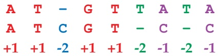

<details>
<summary>text_image</summary>

A T - G T T A T A
A T C G T - C - C
+1 +1 -2 +1 +1 -2 -1 -2 -1
</details>

254

---

H O W D O W E C O M PA R E D N A S E Q U E N C E S ?

Biologists have further refined this cost function to allow for the fact that some mutations may be more likely than others, which calls for mismatches and indel penalties that differ depending on the specific symbols involved. We will extend the k-letter alphabet to include the space symbol and then construct a $( k + 1 ) \times ( k + 1 )$ **scoring matrix** Score holding the score of aligning every pair of symbols. The scoring matrix for comparing DNA sequences $( k = 4 )$ when all mismatches are penalized by $\mu$ and all indels are penalized by $\sigma$ is shown below.

|  | A | C | G | T | - |
| --- | --- | --- | --- | --- | --- |
| A | +1 | -μ | -μ | -μ | -σ |
| C | -μ | +1 | -μ | -μ | -σ |
| G | -μ | -μ | +1 | -μ | -σ |
| T | -μ | -μ | -μ | +1 | -σ |
| - | -σ | -σ | -σ | -σ |  |

Although scoring matrices for DNA sequence comparison are usually defined only by the parameters $\mu$ and $\sigma ,$ scoring matrices for protein sequence comparison weight different mutations differently and become quite involved (see DETOUR: PAM Scor**ing Matrices**).


## From Global to Local Alignment

Global alignment

You should now be ready to modify the alignment graph to solve a generalized form of the alignment problem that takes a scoring matrix as input.

## Global Alignment Problem:

Find a highest-scoring alignment of two strings as defined by a scoring matrix.

**Input**: Two strings and a scoring matrix Score.

**Output**: An alignment of the strings whose alignment score (as defined by Score) is maximized among all possible alignments of the strings.


To solve the Global Alignment Problem, we still must find a longest path in the alignment graph after updating the edge weights to reflect the values in the scoring matrix

255

---

C H A P T E R 5

(Figure 5.18). Recalling that deletions correspond to vertical edges (#), insertions correspond to horizontal edges (!), and matches/mismatches correspond to diagonal edges $( \searrow / \searrow )$ , we obtain the following recurrence for $s _ { i , j } ,$ the length of a longest path from (0, 0) to $( i , j )$ :

$$
s _ {i, j} = \max \left\{ \begin{array}{l l} s _ {i - 1, j} & + S c o r e (v _ {i}, -) \\ s _ {i, j - 1} & + S c o r e (-, w _ {j}) \\ s _ {i - 1, j - 1} & + S c o r e (v _ {i}, w _ {j}). \end{array} \right.
$$

When the match reward is $+ 1 ,$ , the mismatch penalty is $\mu ,$ and the indel penalty is $\sigma ,$ the alignment recurrence can be written as follows:

$$
s _ {i, j} = \max \left\{ \begin{array}{l l} s _ {i - 1, j} & - \sigma \\ s _ {i, j - 1} & - \sigma \\ s _ {i - 1, j - 1} + 1, & \text {if} v _ {i} = w _ {j} \\ s _ {i - 1, j - 1} - \mu , & \text {if} v _ {i} \neq w _ {j}. \end{array} \right.
$$

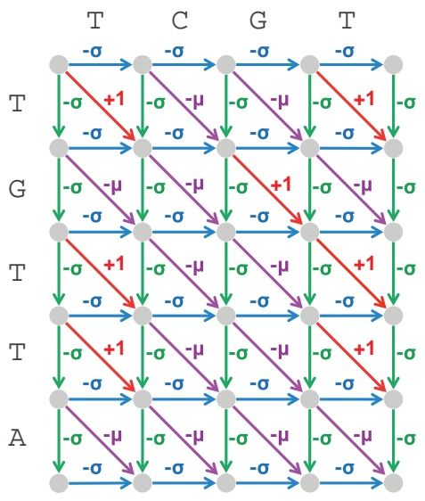

<details>
<summary>flowchart</summary>

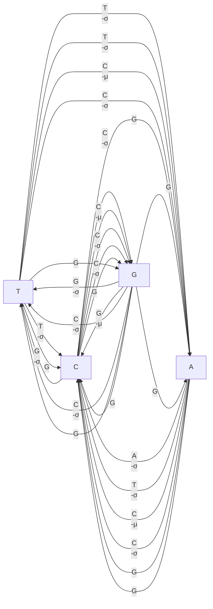
</details>

FIGURE 5.18 ALIGNMENTGRAPH(TGTTA, TCGT), with each edge colored according to whether it represents a match, mismatch, insertion, or deletion.

256

---

H O W D O W E C O M PA R E D N A S E Q U E N C E S ?

## Limitations of global alignment

Analysis of **homeobox genes** offers an example of a problem for which global alignment may fail to reveal biologically relevant similarities. These genes regulate embryonic development and are present in a large variety of species, from flies to humans. Homeobox genes are long, and they differ greatly between species, but an approximately 60 amino acid-long region in each gene, called the **homeodomain**, is highly conserved. For instance, consider the mouse and human homeodomains below.

## Mouse

...**AR**RSRTHFTKFQTDILIE**AFE**KNR**FP**GIV**TR**E**KLA**Q**QTG**IP**ESRI**HI**WFQ**NRRARHPDPG...
...**AR**QKQTFITWTQKNRLVQ**AFE**RNP**FP**DTA**TR**K**KLA**E**QTG**LQ**ESRI**QM**WFQ**KQRSLYLKKS...

## Human

The immediate question is how to find this conserved segment within the much longer genes and ignore the flanking areas, which exhibit little similarity. Global alignment seeks similarities between two strings across their entire length; however, when searching for homeodomains, we are looking for smaller, local regions of similarity and do not need to align the entire strings. For example, the global alignment below has 22 matches, 18 indels, and 2 mismatches, resulting in the score 22  18  2 = 2 (if s = µ = 1):

$$
\begin{array}{l} \text {GCC - C - AGTC - TATGT - CAGGGGGCACG--A - GCATGCACA-} \\ \text {GCCGCC - GTCGT - T - TTCAG----CA - GTTATGT - T - CAGAT} \end{array}
$$

However, these sequences can be aligned differently (with 17 matches and 32 indels) based on a highly conserved interval represented by the substrings CAGTCTATGTCAG and CAGTTATGTTCAG:

$$
\begin{array}{l} \text {---G---C---C--CAGTCTATG-TCAGGGGGCACGAGCATGCACA} \\ \text {GCCGCCGTCGTTTTCAGCAGT-TATGTTCAG----A----T----} \end{array}
$$

This alignment has fewer matches and a lower score of 17  32 = 15, even though the conserved region of the alignment contributes a score of 12  2 = 10, which is hardly an accident.

Figure 5.19 shows the two alignment paths corresponding to these two different alignments. The upper path, corresponding to the second alignment above, loses out because it contains many heavily penalized indels on either side of the diagonal corresponding to the conserved interval. As a result, global alignment outputs the biologically irrelevant lower path.

257

---

C H A P T E R 5

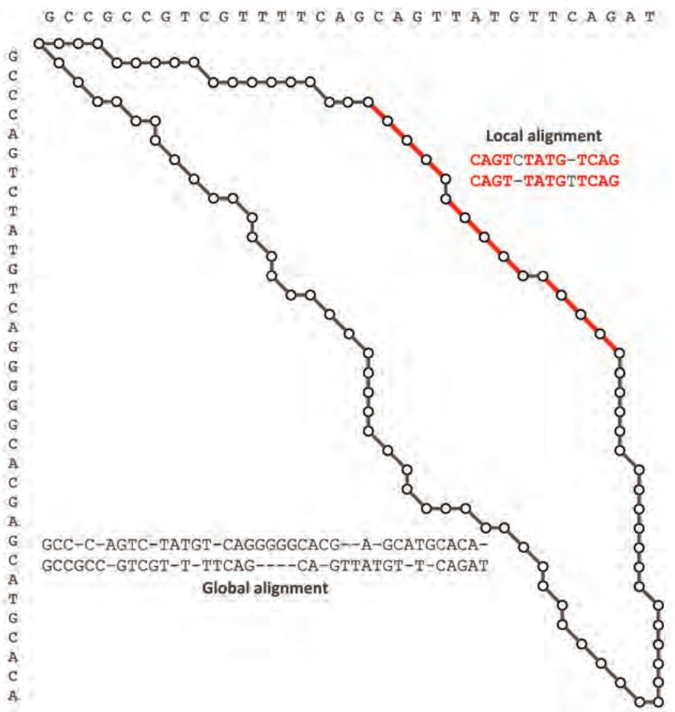

<details>
<summary>line</summary>

| Nucleotide Position | Alignment Type |
| --- | --- |
| G | Local |
| C | Local |
| C | Local |
| C | Local |
| C | Local |
| C | Local |
| C | Local |
| C | Local |
| C | Local |
| C | Local |
| C | Local |
| C | Local |
| C | Local |
| C | Local |
| C | Local |
| C | Local |
| C | Local |
| C | Local |
| C | Local |
| C | Local |
| C | Local |
| T | Local |
| T | Local |
| T | Local |
| T | Local |
| T | Local |
| T | Local |
| T | Local |
| T | Local |
| T | Local |
| T | Local |
| T | Local |
| T | Local |
| T | Local |
| T | Local |
| T | Local |
| T | Local |
| T | Local |
| T | Local |
| T | Local |
| T | Local |
| A | Global |
| A | Global |
| A | Global |
| A | Global |
| A | Global |
| A | Global |
| A | Global |
| A | Global |
| A | Global |
| A | Global |
| A | Global |
| A | Global |
| A | Global |
| A | Global |
| A | Global |
| A | Global |
| A | Global |
| A | Global |
| A | Global |
| A | Global |
</details>

FIGURE 5.19 Global and local alignments of two DNA strings that share a highly conserved interval. The relevant alignment that captures this interval (upper path) loses to an irrelevant alignment (lower path), since the former incurs heavy indel penalties.

When biologically significant similarities are present in some parts of sequences v and w and absent from others, biologists attempt to ignore global alignment and instead align substrings of v and w, which yields a **local alignment** of the two strings. The problem of finding substrings that maximize the global alignment score over all substrings of v and w is called the **Local Alignment Problem**.

258

---

H O W D O W E C O M PA R E D N A S E Q U E N C E S ?

## Local Alignment Problem:

Find the highest-scoring local alignment between two strings.

**Input**: Strings v and w as well as a scoring matrix Score.

**Output**: Substrings of v and w whose global alignment score (as defined by Score) is maximized among all substrings of v and w.

The straightforward way to solve the Local Alignment Problem is to find the longest path connecting every pair of nodes in the alignment graph (rather than just those connecting the source and sink, as in the Global Alignment Problem), and then to select the path having maximum weight over all these longest paths.

**STOP and Think:** What is the runtime of this approach?

Free taxi rides in the alignment graph

For a faster local alignment approach, imagine a “free taxi ride” from the source (0, 0) to the node representing the start node of the conserved (red) interval in Figure 5.19. Imagine also a free taxi ride from the end node of the conserved interval to the sink. If such rides were available (Figure 5.20), then you could reach the starting node of the conserved interval for free, instead of incurring heavy penalties as in global alignment. Then, you could travel along the conserved interval to its end node, accumulating positive match scores. Finally, you could take another free ride from the end node of the conserved interval to the sink. The resulting score of this ride is equal to the alignment score of only the conserved intervals, as desired.

Connecting the source (0, 0) to every other node by adding a zero-weight edge and connecting every node to the sink $( n , m )$ by a zero-weight edge will result in a DAG perfectly suited for solving the Local Alignment Problem (Figure 5.21). Because of free taxi rides, we no longer need to construct a longest path between every pair of nodes in the graph — the longest path from source to sink yields an optimal local alignment!

The total number of edges in the graph in Figure 5.21 is $\mathcal { O } ( | v | \cdot | w | )$ , which is still small. Since the runtime of finding a longest path in a DAG is defined by the number of edges in the graph, the resulting local alignment algorithm will be fast. As for computing the values $s _ { i , j } ,$ adding zero-weight edges from (0, 0) to every node has made the source node $( 0 , 0 )$ a predecessor of every node $( i , j )$ . Therefore, there are now four


259

---

C H A P T E R 5

edges entering $( i , j )$ , which adds only one new term to the longest path recurrence relation:


$$
s _ {i, j} = \max \left\{ \begin{array}{l l} 0 \\ s _ {i - 1, j} & + S c o r e (v _ {i}, -) \\ s _ {i, j - 1} & + S c o r e (-, w _ {j}) \\ s _ {i - 1, j - 1} & + S c o r e (v _ {i}, w _ {j}) \end{array} \right.
$$

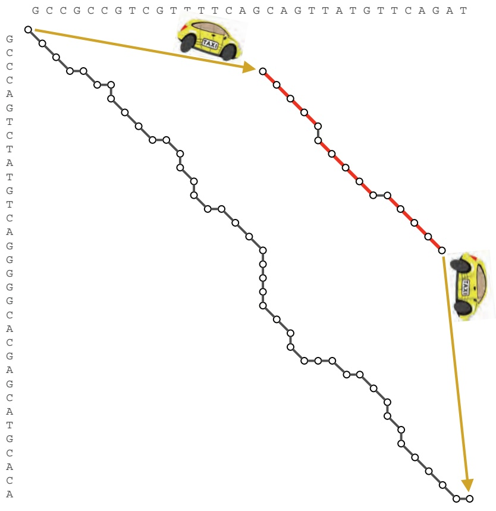

<details>
<summary>line</summary>

| Position | Sequence |
| --- | --- |
| 1 | G |
| 2 | C |
| 3 | C |
| 4 | C |
| 5 | C |
| 6 | A |
| 7 | G |
| 8 | T |
| 9 | C |
| 10 | T |
| 11 | A |
| 12 | T |
| 13 | G |
| 14 | T |
| 15 | C |
| 16 | A |
| 17 | G |
| 18 | G |
| 19 | G |
| 20 | G |
| 21 | G |
| 22 | C |
| 23 | A |
| 24 | C |
| 25 | G |
| 26 | A |
| 27 | G |
| 28 | A |
| 29 | G |
| 30 | C |
| 31 | A |
| 32 | T |
| 33 | G |
| 34 | C |
| 35 | A |
| 36 | C |
| 37 | A |
| 38 | C |
| 39 | A |
</details>

FIGURE 5.20 Modifying Figure 5.19 by adding “free taxi ride” edges (having weight 0) connecting the source to the start node of the conserved interval and connecting the end node of the conserved interval to the sink. These new edges allow us to score only the local alignment containing the conserved interval.

260

---

H O W D O W E C O M PA R E D N A S E Q U E N C E S ?

Also, because node $( n , m )$ now has every other node as a predecessor, $s _ { n , m }$ will be equal to the largest value of $s _ { i , j }$ over the entire alignment graph.

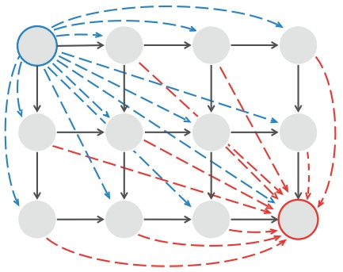

<details>
<summary>flowchart</summary>

This diagram illustrates a network flow or data processing workflow, showing multiple input nodes connected by directional arrows to produce output nodes via directional arrows.
</details>

FIGURE 5.21 The local alignment algorithm introduces zero-weight edges (shown by blue dashed lines) connecting the source (0, 0) to every other node in the alignment graph, as well as zero-weight edges (shown by red dashed lines) connecting every node to the sink node.

You might still be wondering why we are allowed to free taxi rides through the alignment graph. The point is that you are in charge of designing whatever Manhattanlike DAG you like, as long as it adequately models the specific alignment problem at hand. Transformations like free taxi rides will become a common theme in this chapter. Various alignment problems can be solved by constructing an appropriate DAG with as few edges as possible (to minimize runtime), assigning edge weights to model the requirements of the problem, and then finding a longest path in this DAG.

## The Changing Faces of Sequence Alignment

In this section, we will describe three sequence comparison problems and let you apply what you have already learned to solve them. Hint: the idea is to frame each problem as an instance of the Longest Path in a DAG Problem.

## Edit distance

In 1966, Vladimir Levenshtein introduced the notion of the **edit distance** between two strings as the minimum number of **edit operations** needed to transform one string into another. Here, an edit operation is the insertion, deletion, or substitution of a

261

---

C H A P T E R 5

single symbol. For example, TGCATAT can be transformed into ATCCGAT with five edit operations, implying that the edit distance between these strings is at most 5.

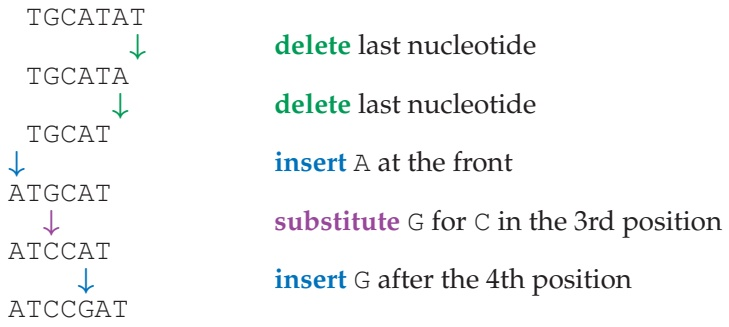

<details>
<summary>flowchart</summary>

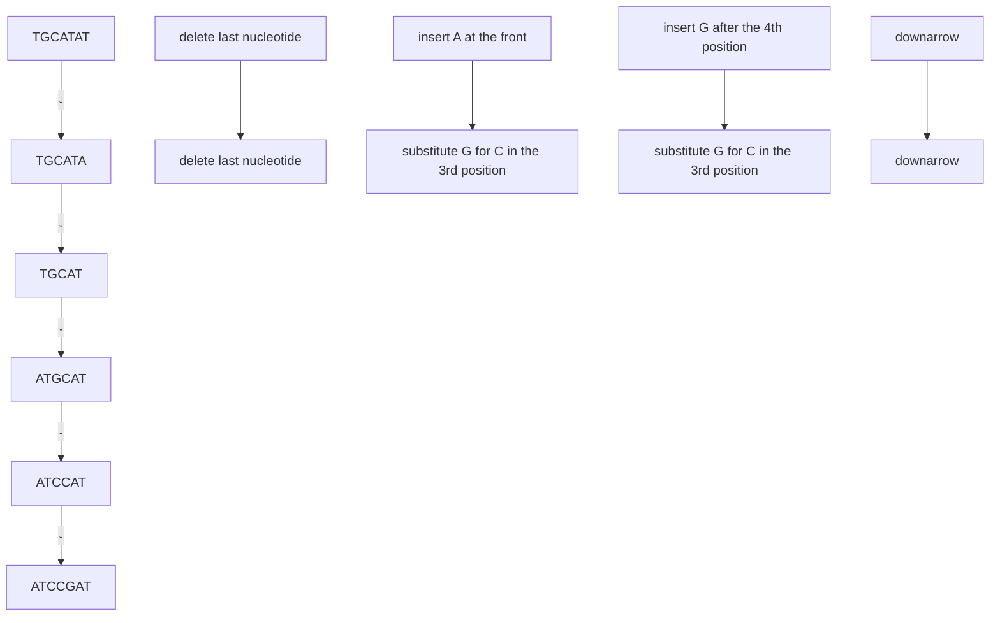
</details>


**STOP and Think:** Can you transform TGCATAT into ATCCGAT using a smaller number of operations?

In fact, the edit distance between TGCATAT and ATCCGAT is 4:

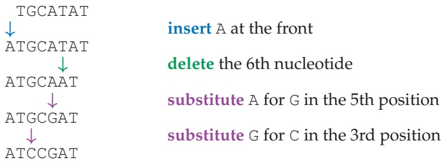

<details>
<summary>flowchart</summary>

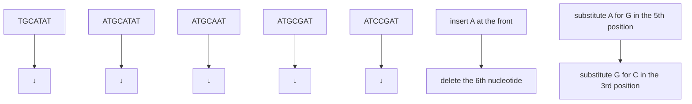
</details>

Levenshtein introduced edit distance but did not describe an algorithm for computing it, which we leave to you.


## Edit Distance Problem:

Find the edit distance between two strings.

**Input**: Two strings.

**Output**: The edit distance between these strings.

262

---

H O W D O W E C O M PA R E D N A S E Q U E N C E S ?

## Fitting alignment

Say that we wish to compare the approximately 20,000 amino acid-long NRP synthetase from Bacillus brevis with the approximately 600 amino acid-long A-domain from Strepto myces roseosporus, the bacterium that produces the powerful antibiotic Daptomycin. We hope to find a region within the longer protein sequence v that has high similarity with all of the shorter sequence w. Global alignment will not work because it tries to align all of v to all of w; local alignment will not work because it tries to align substrings of both v and w. Thus, we have a distinct alignment application called the **Fitting Alignment Problem**.

“Fitting” w to v requires finding a substring v<sup>0</sup> of v that maximizes the global alignment score between $v ^ { \prime }$ and w among all substrings of v. For example, the best global, local, and fitting alignments of v = GTAGGCTTAAGGTTA and w = TAGATA are shown below (with mismatch and indel penalties equal to 1).

| Global | Local | Fitting |
| --- | --- | --- |
| GTAGGCTTAAGGTTA | GTAGGCTTAAGGTTA | GTAGGCTTAAGGTTA |
| -TAG----A---T-A | TAGATA | TAGA--TA |

Note that the optimal local alignment (with score 3) is not a valid fitting alignment. On the other hand, the score of the optimal global alignment (6  9 = 3) is smaller than that of the best fitting alignment (5  1  2 = +2).

## Fitting Alignment Problem:

Construct a highest-scoring fitting alignment between two strings.

**Input**: Strings v and w as well as a scoring matrix Score.

**Output**: A highest-scoring fitting alignment of v and w as defined by Score.

## Overlap alignment

In Chapter 3, we discussed how to use overlapping reads to assemble a genome, a problem that was complicated by errors in reads. Aligning the ends of the hypothetical reads shown below offers a way to find overlaps between error-prone reads.

T-CC-GAAAC


263

---

C H A P T E R 5


An **overlap alignment** of strings $v = v _ { 1 } \dots v _ { n }$ and $w = w _ { 1 } \cdots w _ { m }$ is a global alignment of a suffix of v with a prefix of w. An optimal overlap alignment of strings v and w maximizes the global alignment score between an i-suffix of v and a j-prefix of w (i.e., between $v _ { i } \ldots v _ { n }$ and $w _ { 1 } \dots w _ { j } )$ among all possible i and j.

## Overlap Alignment Problem:

Construct a highest-scoring overlap alignment between two strings.

**Input**: Two strings and a scoring matrix Score.

**Output**: A highest-scoring overlap alignment between the two strings as defined by Score.

## Penalizing Insertions and Deletions in Sequence Alignment

Affine gap penalties

We have seen that introducing mismatch and indel penalties can produce more biologically adequate global alignments. However, even with this more robust scoring model, the A-domain alignment that we previously constructed (with indel penalty $\sigma = 4 )$ still reveals only six of the eight conserved purple columns corresponding to the non-ribosomal signatures:

```powershell
YAFDLGYTCMFP-VLL-GGGELHIV-QKETYTAPDEI-AHYIKEHGITYI-KLTPSLFHTIVNTASFAFDANFE-AFDVS-AGDFARALLTGG-QL-IVCPNEVKMDPASLYA-IIKKYDIT-IFEATPAL--VIPLME-YIYEQKLD
```

```txt
-S-LR-LIVLGGEKIIPIDVIAFRKM---YGHTE-FINHYGPTEATIGA
ISQLQILIV-GSDSC-SME--DFKTLVSRFGSTIRIVNSYGVTEACIDS
```


**STOP and Think:** Would increasing the indel penalty from $\sigma = 4$ to $\sigma = 1 0$ reveal the biologically correct alignment?

In our previously defined **linear scoring model**, if $\sigma$ is the penalty for the insertion or deletion of a single symbol, then $\sigma$ · k is the penalty for the insertion or deletion of an interval of k symbols. This cost model unfortunately results in inadequate scoring for biological sequences. Mutations are often caused by errors in DNA replication that insert or delete an entire interval of k nucleotides as a single event instead of as k independent insertions or deletions. Thus, penalizing such an indel by $\sigma \cdot k$ represents

264

---

H O W D O W E C O M PA R E D N A S E Q U E N C E S ?

an excessive penalty. For example, the alignment on the right is more adequate than the alignment on the left, but they would currently receive the same score.

| GATCCAG | GATCCAG |
| --- | --- |
| GA-C-AG | GA--CAG |

A **gap** is a contiguous sequence of space symbols in a row of an alignment. One way to score gaps more appropriately is to define an **affine penalty** for a gap of length k as $\sigma + \epsilon \cdot ( k - 1 )$ , where $\sigma$ is the **gap opening penalty**, assessed to the first symbol in the gap, and e is the **gap extension penalty**, assessed to each additional symbol in the gap. We typically select e to be smaller than s so that the affine penalty for a gap of length k is smaller than the penalty for k independent single-nucleotide indels $( \sigma \cdot k )$ . For example, if s = 5 and e = 1, then the alignment on the left above is penalized by $2 \sigma   =   1 0 ,$ , whereas the alignment on the right above is only penalized by $\sigma + \epsilon = 6$

## Alignment with Affine Gap Penalties Problem:

Construct a highest-scoring global alignment of two strings (with affine gap penalties).

**Input**: Two strings, a scoring matrix Score, and numbers s and e.

**Output**: A highest scoring global alignment between these strings, as defined by Score and by the gap opening and extension penalties $\sigma$ and e.

**STOP and Think:** How would you modify the alignment graph to solve this problem?

Figure 5.22 illustrates how affine gap penalties can be modeled in the alignment graph by introducing a new “long” edge for each gap. Since we do not know in advance where gaps should be located, we need to add edges accounting for every possible gap. Thus, affine gap penalties can be accommodated by adding all possible vertical and horizontal edges in the alignment graph to represent all possible gaps. Specifically, we add edges connecting $( i , j )$ to both $( i + k , j )$ and $\left( i , j + k \right)$ with weights $\sigma + \epsilon \cdot ( k - 1 )$ for all possible gap sizes k, as illustrated in Figure 5.23. For two sequences of length $n ,$ the number of edges in the resulting alignment graph modeling affine gap penalties increases from $\mathcal { O } \big ( n ^ { 2 } \big )$ to $\mathcal { O } \big ( n ^ { 3 } \big )$

**STOP and Think:** Can you design a DAG with just $\mathcal { O } \big ( n ^ { 2 } \big )$ edges to solve the Alignment with Affine Gap Penalties Problem?

STOP

STOP

265

---

C H A P T E R 5

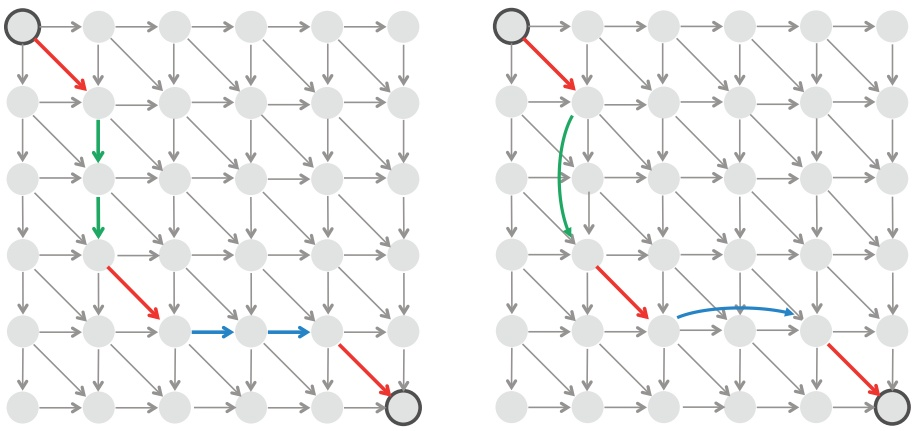

FIGURE 5.22 Representing gaps in the alignment graph on the left as “long” insertion and deletion edges in the alignment graph on the right. For a gap of length $k ,$ the weight of the corresponding long edge is equal to $\scriptstyle \sigma + \varepsilon \cdot ( k \; - \; 1 )$ .

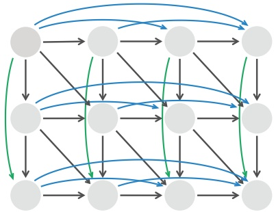

<details>
<summary>flowchart</summary>


</details>

FIGURE 5.23 Adding edges corresponding to indels for all possible gap sizes adds a large number of edges to the alignment graph.

## Building Manhattan on three levels

The trick to decreasing the number of edges in the DAG for the Alignment with Affine Gap Penalties Problem is to increase the number of nodes. To this end, we will build an alignment graph on three levels; for each node $( i , j )$ , we will construct three different nodes: ${ \left( i , j \right) } _ { \mathrm { l o w e r } } , { \left( i , j \right) } _ { \mathrm { m i d d l e } } ,$ and $( i , j ) _ { \mathtt { u p p e r } }$ . The middle level will contain diagonal edges of weight $S c o r e ( v _ { i } , w _ { j } )$ representing matches and mismatches. The lower level will have only vertical edges with weight $- \epsilon$ to represent gap extensions in $v ,$ and the upper

266

---

H O W D O W E C O M PA R E D N A S E Q U E N C E S ?

level will have only horizontal edges with weights e to represent gap extensions in w (Figure 5.24).

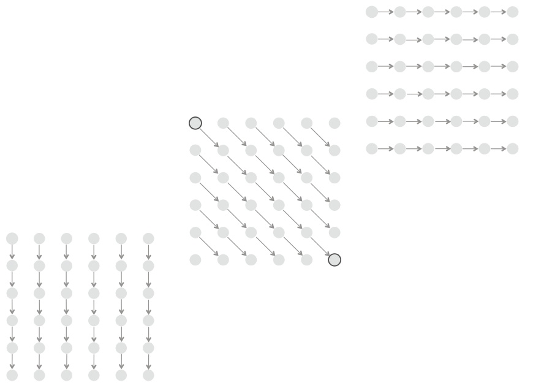

<details>
<summary>flowchart</summary>

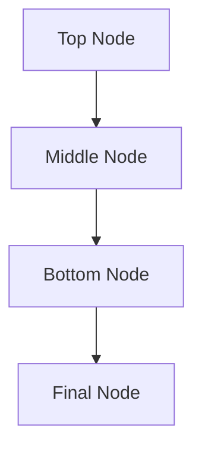
</details>

FIGURE 5.24 Building a three-level graph for alignment with affine gap penalties. The lower level corresponds to gap extensions in $V ,$ the middle level corresponds to matches and mismatches, and the upper level corresponds to gap extensions in w.

Life in such a three-level city would be difficult because there is currently no way to move between different levels. To address this issue, we add edges responsible for opening and closing a gap. To model gap opening, we connect each node $(  i, j ) _{ middle }$ to both $( i + 1 , j ) _ { \mathrm { l o w e r } }$ and $( i , j + 1 ) _ { \mathrm { u p p e r } }   ;$ we then weight these edges with $- \sigma ,$ Closing gaps does not carry a penalty, and so we introduce zero-weight edges connecting nodes $( i , j ) _ { \mathrm { l o w e r } }$ and $( i , j ) _ { \mathrm { u p p e r } }$ with the corresponding node ${ \left( i , j \right) } _ { \mathrm { m i d d l e } } .$ . As a result, a gap of length k starts and ends at the middle level and is charged $- \sigma$ for the first symbol, $- \epsilon$ for each subsequent symbol, and 0 to close the gap, producing a total penalty of $\sigma + \epsilon \cdot ( k - 1 )$ , as desired. Figure 5.25 illustrates how the path in Figure 5.22 traverses the three-level alignment graph.

The DAG in Figure 5.25 may be complicated, but it uses only $\mathcal { O } ( n \cdot m )$ edges for sequences of length n and $m ,$ and a longest path in this graph still constructs an optimal alignment with affine gap penalties. The three-level alignment graph translates into the

---

C H A P T E R 5

system of three recurrence relations shown below. Here, lowe $( i , j )$ $m i d d l e _ { i , \; j } ,$ and $u p p e r _ { i , j }$ are the lengths of the longest paths from the source node to $\begin{array} { r } { \big ( i , j \big ) _ { \mathrm { l o w e r } } ,   \big ( i , j \big ) _ { \mathrm { m i d d l e } } , } \end{array}$ and $( i , j ) _ { \mathtt { u p p e r } } ,$ respectively.


$$
\begin{array}{l} l o w e r _ {i, j} = \max \left\{ \begin{array}{l} l o w e r _ {i - 1, j} - \epsilon \\ m i d d l e _ {i - 1, j} - \sigma \end{array} \right. \\ m i d d l e _ {i, j} = \max \left\{ \begin{array}{l} \text {lower} _ {i, j} \\ \text {middle} _ {i - 1, j - 1} + \text {Score} (v _ {i}, w _ {j}) \\ \text {upper} _ {i, j} \end{array} \right. \\ u p p e r _ {i, j} = \max \left\{ \begin{array}{l} u p p e r _ {i, j - 1} - \epsilon \\ m i d d l e _ {i, j - 1} - \sigma \end{array} \right. \\ \end{array}
$$

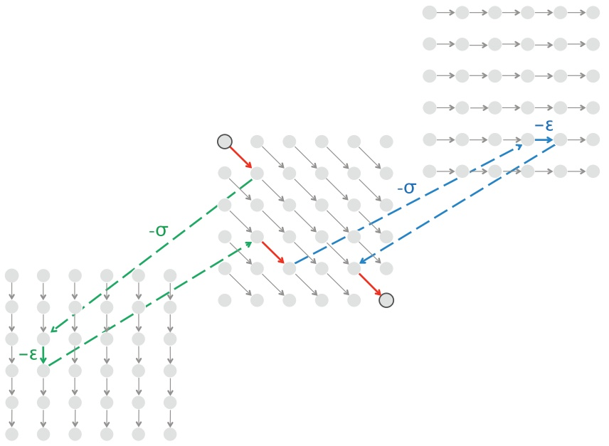

<details>
<summary>flowchart</summary>

```mermaid
graph LR
  Input1["Input Node"] --> Output1["Output Node"]
  Input2["Input Node"] --> Output2["Output Node"]
  Input3["Input Node"] --> Output3["Output Node"]
  Input4["Input Node"] --> Output4["Output Node"]
  Input5["Input Node"] --> Output5["Output Node"]
  Input6["Input Node"] --> Output6["Output Node"]
  Input7["Input Node"] --> Output7["Output Node"]
  Input8["Input Node"] --> Output8["Output Node"]
  Input9["Input Node"] --> Output9["Output Node"]
  Input10["Input Node"] --> Output10["Output Node"]
  Input11["Input Node"] --> Output11["Output Node"]
  Input12["Input Node"] --> Output12["Output Node"]
  Input13["Input Node"] --> Output13["Output Node"]
  Input14["Input Node"] --> Output14["Output Node"]
  Input15["Input Node"] --> Output15["Output Node"]
  Input16["Input Node"] --> Output16["Output Node"]
  Input17["Input Node"] --> Output17["Output Node"]
  Input18["Input Node"] --> Output18["Output Node"]
  Input19["Input Node"] --> Output19["Output Node"]
  Input20["Input Node"] --> Output20["Output Node"]
  Input21["Input Node"] --> Output21["Output Node"]
  Input22["Input Node"] --> Output22["Output Node"]
  Input23["Input Node"] --> Output23["Output Node"]
  Input24["Input Node"] --> Output24["Output Node"]
  Input25["Input Node"] --> Output25["Output Node"]
  Input26["Input Node"] --> Output26["Output Node"]
  Input27["Input Node"] --> Output27["Output Node"]
  Input28["Input Node"] --> Output28["Output Node"]
  Input29["Input Node"] --> Output29["Output Node"]
  Input30["Input Node"] --> Output30["Output Node"]
  Input31["Input Node"] --> Output31["Output Node"]
  Input32["Input Node"] --> Output32["Output Node"]
  Input33["Input Node"] --> Output33["Output Node"]
  Input34["Input Node"] --> Output34["Output Node"]
  Input35["Input Node"] --> Output35["Output Node"]
  Input36["Input Node"] --> Output36["Output Node"]
  Input37["Input Node"] --> Output37["Output Node"]
  Input38["Input Node"] --> Output38["Output Node"]
  Input39["Input Node"] --> Output39["Output Node"]
  Input40["Input Node"] --> Output40["Output Node"]
  Input41["Input Node"] --> Output41["Output Node"]
  Input42["Input Node"] --> Output42["Output Node"]
  Input43["Input Node"] --> Output43["Output Node"]
  Input44["Input Node"] --> Output44["Output Node"]
  Input45["Input Node"] --> Output45["Output Node"]
  Input46["Input Node"] --> Output46["Output Node"]
  Input47["Input Node"] --> Output47["Output Node"]
  Input48["Input Node"] --> Output48["Output Node"]
  Input49["Input Node"] --> Output49["Output Node"]
  Input50["Input Node"] --> Output50["Output Node"]
  Input51["Input Node"] --> Output51["Output Node"]
  Input52["Input Node"] --> Output52["Output Node"]
  Input53["Input Node"] --> Output53["Output Node"]
  Input54["Input Node"] --> Output54["Output Node"]
  Input55["Input Node"] --> Output55["Output Node"]
  Input56["Input Node"] --> Output56["Output Node"]
  Input57["Input Node"] --> Output57["Output Node"]
  Input58["Input Node"] --> Output58["Output Node"]
  Input59["Input Node"] --> Output59["Output Node"]
  Input60["Input Node"] --> Output60["Output Node"]
  Input61["Input Node"] --> Output61["Output Node"]
  Input62["Input Node"] --> Output62["Output Node"]
  Input63["Input Node"] --> Output63["Output Node"]
  Input64["Input Node"] --> Output64["Output Node"]
  Input65["Input Node"] --> Output65["Output Node"]
  Input66["Input Node"] --> Output66["Output Node"]
  Input67["Input Node"] --> Output67["Output Node"]
  Input68["Input Node"] --> Output68["Output Node"]
  Input69["Input Node"] --> Output69["Output Node"]
  Input70["Input Node"] --> Output70["Output Node"]
  Input71["Input Node"] --> Output71["Output Node"]
  Input72["Input Node"] --> Output72["Output Node"]
  Input73["Input Node"] --> Output73["Output Node"]
  Input74["Input Node"] --> Output74["Output Node"]
  Input75["Input Node"] --> Output75["Output Node"]
  Input76["Input Node"] --> Output76["Output Node"]
  Input77["Input Node"] --> Output77["Output Node"]
  Input78["Input Node"] --> Output78["Output Node"]
  Input79["Input Node"] --> Output79["Output Node"]
  Input80["Input Node"] --> Output80["Output Node"]
  Input81["Input Node"] --> Output81["Output Node"]
  Input82["Input Node"] --> Output82["Output Node"]
  Input83["Input Node"] --> Output83["Output Node"]
  Input84["Input Node"] --> Output84["Output Node"]
  Input85["Input Node"] --> Output85{"-ε"}
  Input86{"-ε"}
  Input87{"-ε"}
  Input88{"-ε"}
  Input89{"-ε"}
  Input90{"-ε"}
  Input91{"-ε"}
  Input92{"-ε"}
  Input93{"-ε"}
  Input94{"-ε"}
  Input95{"-ε"}
  Input96{"-ε"}
  Input97{"-ε"}
  Input98{"-ε"}
  Input99{"-ε"}
  Input100{"-ε"}
  
    %% Green Arrow
    %% Red Arrow
    %% Blue Arrow
    %% Green Arrow
    %% Red Arrow
    %% Blue Arrow
    %% Green Arrow
    %% Red Arrow
    %% Blue Arrow
    %% Green Arrow
    %% Red Arrow
    %% Blue Arrow
    %% Green Arrow
    %% Red Arrow
    %% Blue Arrow
    %% Green Arrow
    %% Red Arrow
    %% Blue Arrow
    %% Green Arrow
    %% Red Arrow
    %% Blue Arrow
    %% Green Arrow
    %% Red Arrow
```
</details>

FIGURE 5.25 Every path from source to sink in the standard alignment graph shown in Figure 5.22 corresponds to a path from source to sink in the three-level graph of the same length (and vice-versa). Every node in the middle level has one outgoing (blue) edge to the upper level and one outgoing (green) edge to the lower level, both represented by dashed edges and having weight equal to the gap opening penalty. Every node in the middle level also has one incoming blue edge from the upper level and one incoming green edge from the lower level, both represented by dashed edges and having zero weight (these edges close a gap).

268

---

H O W D O W E C O M PA R E D N A S E Q U E N C E S ?

The variable $l o w e r _ { i , j }$ computes the score of an optimal alignment between the i-prefix of v and the j-prefix of w ending with a deletion (i.e., a gap in w), whereas the variable $u p p e r _ { i , j }$ computes the score of an optimal alignment of these prefixes ending with an insertion (i.e., a gap in v), and the variable $m i d d l e _ { i , j }$ computes the score of an optimal alignment ending with a match or mismatch. The first term in the recurrences for $l o w e r _ { i , j }$ and $u p p e r _ { i , j }$ corresponds to extending the gap, whereas the second term corresponds to initiating the gap.

**STOP and Think:** Compute an optimal alignment with affine gap penalties for the A-domains considered in the beginning of this section. How does varying the gap opening and extension penalties affect the quality of the alignment?


## Space-Efficient Sequence Alignment

Computing alignment score using linear memory

To introduce fitting alignments, we used the example of aligning a 20,000 amino acidlong NRP synthetase from Bacillus brevis against a 600 amino acid-long A-domain from Streptomyces roseosporus. However, you may not be able to construct this alignment on your computer because the memory required to store the dynamic programming matrix is substantial.

The runtime of the dynamic programming algorithm for aligning two strings of lengths n and m is proportional to the number of edges in their alignment graph, which is $\mathcal { O } \big ( n \cdot m \big )$ . The memory required by this algorithm is also $\mathcal { O } \big ( n \cdot m \big )$ , since we need to store the backtracking references. We will now demonstrate how to construct an alignment in just $\mathcal { O } ( n )$ space at the expense of doubling the runtime, meaning that the runtime is still $\mathcal { O } \big ( n \cdot m \big )$

A **divide-and-conquer algorithm** often works when a solution to a large problem can be constructed from solutions of smaller problem instances. Such a strategy proceeds in two phases. The **divide** phase splits a problem instance into smaller instances and solves them; the **conquer** phase stitches the smaller solutions into a solution to the original problem (see **DETOUR: Divide-and-Conquer Algorithms**).

Before we proceed with the divide-and-conquer algorithm for linear-space alignment, note that if we only wish to compute the score of an alignment rather than the alignment itself, then the space required can easily be reduced to just twice the number of nodes in a single column of the alignment graph, or $\mathcal { O } ( n )$ . This reduction derives

PAGE 287

269

---

C H A P T E R 5


from the observation that the only values needed to compute the alignment scores in column $j$ are the alignment scores in column $j - 1$ . Therefore, the alignment scores in the columns before column $j - 1$ can be discarded when computing the alignment scores for column $j ,$ as illustrated in Figure 5.26. Unfortunately, finding the longest path requires us to store an entire matrix of backtracking pointers, which causes the quadratic space requirement. The idea of the space reduction technique is that we don’t need to store any backtracking pointers if we are willing to spend a little more time.

**STOP and Think:** How could we construct an alignment without storing any backtracking pointers?

## The Middle Node Problem

Given strings $v   =   v _ { 1 } \cdots v _ { n }$ and $w   =   w _ { 1 } \cdots w _ { m _ { i } }$ , define $m i d d l e = \lfloor m / 2 \rfloor$ . The **middle column** of ALIGNMENTGRAPH $( v , w )$ is the column containing all nodes $\left( i , m i d d l e \right)$ for $0 \leq i \leq n$ . A longest path from source to sink in the alignment graph must cross the middle column somewhere, and our first task is to figure out where using only $\mathcal { O } ( n )$ memory. We refer to a node on this longest path belonging to the middle column as a **middle node**. (Note that different longest paths may have different middle nodes, and a given longest path may have more than one middle node.) In Figure 5.27 (top left), middle = 3, and the alignment path crosses the middle column at the (unique) middle node (4, 3).

The key observation is that we can find a longest path’s middle node without having to construct this path in the alignment graph. We will classify a path from the source to the sink as an **i-path** if it passes through the middle column at row i. For example, the highlighted path in Figure 5.27 is a 4-path. For each i between 0 and n, we would like to find the length of a longest i-path (denoted LENGTH(i)) because the largest value of LENGTH(i) over all i will reveal a middle node.

Let FROMSOURCE(i) denote the length of the longest path from the source ending at (i, middle) and TOSINK(i) denote the length of the longest path from (i, middle) to the sink. Certainly,

$$
\operatorname{LENGTH} (i) = \operatorname{FROMSOURCE} (i) + \operatorname{TOSINK} (i),
$$

and so we need to compute FROMSOURCE(i) and TOSINK(i) for each i.


**STOP and Think:** Can you compute FROMSOURCE(i) and TOSINK(i) in linear space? How much time would it take?

270

---

H O W D O W E C O M PA R E D N A S E Q U E N C E S ?

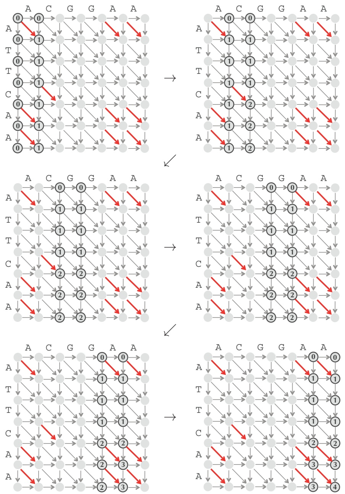

FIGURE 5.26 Computing an LCS alignment score by storing scores in just two columns of the alignment graph.

271

---

C H A P T E R 5

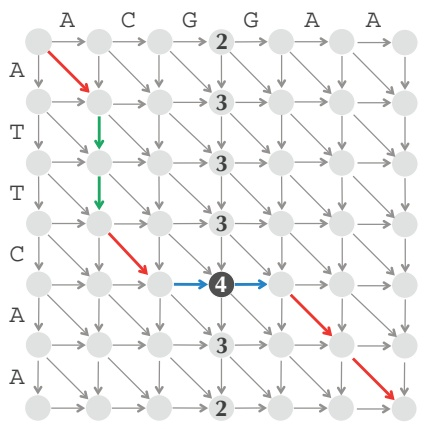

<details>
<summary>flowchart</summary>

```mermaid
graph LR
  A["Node 1"] -->|"A"| C["Node 2"]
  C -->|"C"| G["Node 3"]
  G -->|"G"| A["Node 4"]
  A -->|"A"| C
  C -->|"T"| T["Node 1"]
  T -->|"T"| C
  C -->|"C"| A["Node 5"]
  A -->|"A"| C
  C -->|"A"| G
  G -->|"G"| A["Node 6"]
  A -->|"A"| C
  C -->|"A"| G
  G -->|"A"| A
  A -->|"A"| C
  C -->|"A"| G
  G -->|"A"| A
  A -->|"A"| C
  C -->|"A"| G
  G -->|"A"| A
  A -->|"A"| C
  C -->|"A"| G
  G -->|"A"| A
  A -->|"A"| C
  C -->|"A"| G
  G -->|"A"| A
  A --> "Node 4" (Blue Arrow)
  G --> "Node 4" (Blue Arrow)
  A --> "Node 4" (Blue Arrow)
  G --> "Node 4" (Blue Arrow)
  A --> "Node 4" (Blue Arrow)
  G --> "Node 4" (Blue Arrow)
```
</details>

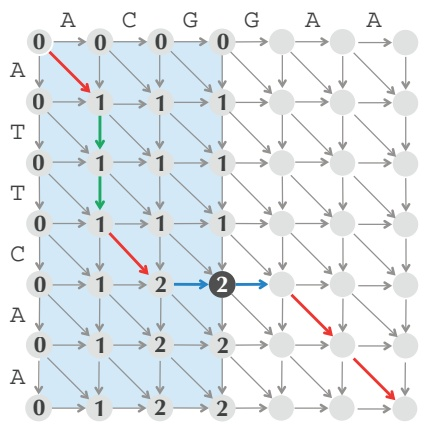

<details>
<summary>flowchart</summary>

This diagram illustrates a state transition or decision process between states A, C, G, and G through various directional transitions labeled with binary codes (0, 1, 2).
</details>

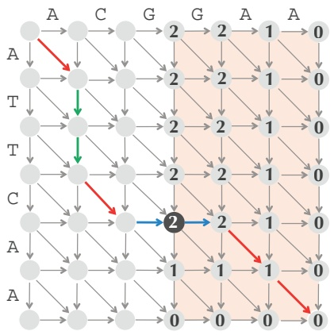

<details>
<summary>flowchart</summary>

This diagram illustrates a state transition or data flow model with multiple states (A, C, G) and transitions between them, highlighting specific states with directional arrows.
</details>

FIGURE 5.27 (Top left) The alignment graph of ATTCAA and ACGGAA, with the optimal LCS alignment path highlighted. The number inside each node (i, middle) in the middle column is equal to LENGTH(i). The node maximizing LENGTH(i) is a middle node (multiple middle nodes may exist); the middle node in this graph is colored black. (Top right) Computing FROMSOURCE(i) for all i can be done in $\mathcal { O } ( n )$ space and $\mathcal { O } \big ( n \cdot m / 2 \big )$ time. (Bottom) Computing TOSINK(i) for all i can also be done in $\mathcal { O } ( n )$ space and $\mathcal { O } \big ( n \cdot m / 2 \big )$ time; this requires reversing the direction of all edges and treating the sink as the source.

272

---

H O W D O W E C O M PA R E D N A S E Q U E N C E S ?

The value of FROMSOURCE(i) is simply $s _ { i ,   m i d d l e } .$ , which we already know can be computed in linear space. Thus, the values of FROMSOURCE(i) for all i are stored as $s _ { i ,   m i d d l e }$ in the middle column of the alignment graph, and computing them requires sweeping through half of the alignment graph from column 0 to the middle column. Since we need to explore roughly half the edges of the alignment graph to compute FROMSOURCE(i), we say that the runtime needed for computing all values FROMSOURCE(i) is proportional to half of the “area” of the alignment graph, or $n \cdot m / 2$ (Figure 5.27 (top right)).

Computing TOSINK(i) is equivalent to finding the longest path from the sink to $\left( i , m i d d l e \right)$ if all the edge directions are reversed. Instead of reversing the edges, we can reverse the strings $v   =   v _ { 1 } \cdots v _ { n }$ and $w   =   w _ { 1 } \cdots w _ { m }$ and find $s _ { n - i ,   m - m i d d l e }$ in the alignment graph for $v _ { n } \dots v _ { 1 }$ and $w _ { m } \ldots w _ { 1 }$ . Computing $\operatorname { T o S I N K } ( i )$ is therefore similar to computing FROMSOURCE(i) and can also be done in $\mathcal { O } ( n )$ space and runtime proportional to $n \cdot m / 2 ,$ or half of the area of the alignment graph (Figure 5.27 (bottom)). In total, we can compute all values LENGTH $( i ) = \operatorname { F R O M S O U R C E } ( i ) + \operatorname { T O S I N K } ( i )$ in linear space with runtime proportional to $n \cdot m / 2 + n \cdot m / 2 = n \cdot m ,$ , which is the total area of the alignment graph.

It looks like we have wasted a lot of time just to find a single node on the alignment path! You may think that this approach is doomed to fail because we have already spent $\mathcal { O } \big ( n \cdot m \big )$ time (the entire area of the alignment graph) to gain very little information.

## A surprisingly fast and memory-efficient alignment algorithm

Once we have found a middle node, we automatically know two rectangles through which a longest path must travel on either side of this node. As shown in Figure 5.28, one of these rectangles consists of all nodes above and to the left of the middle node, whereas the other rectangle consists of all nodes below and to the right of the middle node. Thus, the area of the two highlighted rectangles is half the total area of the alignment graph.

We can now divide the problem of finding the longest path from $( 0 , 0 )$ to $( n , m )$ into two subproblems: finding a longest path from $( 0 { , } 0 )$ to the middle node; and finding a longest path from the middle node to $( n , m )$ . The conquer step finds the two middle nodes within the smaller rectangles, which can be done in time proportional to the sum of the areas of these rectangles, or $n \cdot m / 2$ (Figure 5.28 (right)). Note that we have now reconstructed three nodes of an optimal path. In the next iteration, we will divide and conquer to find four middle nodes in time equal to the sum of the areas of the even smaller blue rectangles, which have total area $n \cdot m / 4$ (Figure 5.29). We have now reconstructed nearly all nodes of an optimal alignment path!

273

---

C H A P T E R 5

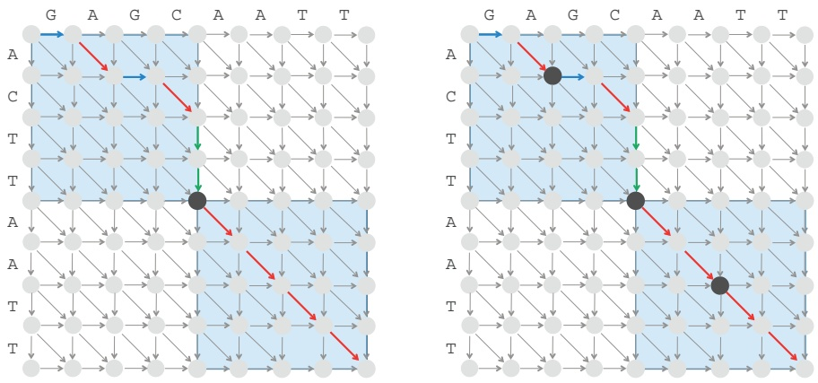

FIGURE 5.28 (Left) A middle node (shown in black) defines two highlighted rectangles and illustrates that an optimal path passing through this middle node must travel within these rectangles. We can therefore eliminate the remaining parts of the alignment graph from consideration for an optimal alignment path. (Right) Finding middle nodes (shown as two more black circles) within previously identified rectangles.

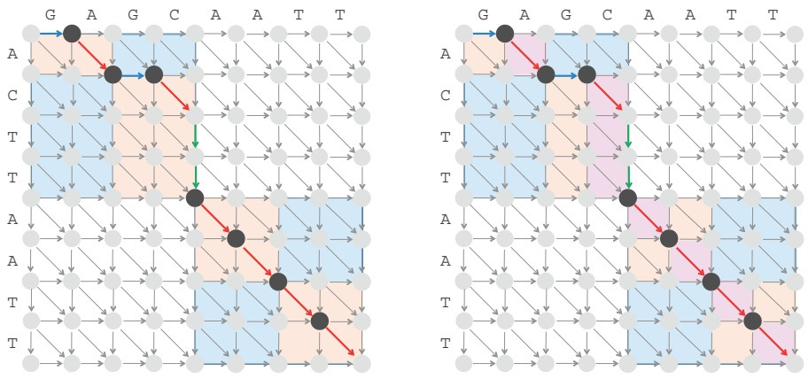

FIGURE 5.29 Finding middle nodes (highlighted as black circles) within previously identified blue rectangles.


**STOP and Think:** How much time would it take to find all nodes on an optimal alignment path?

In general, at each new step before the final step, we double the number of middle nodes found while halving the runtime required to find middle nodes. Proceeding

274

---

H O W D O W E C O M PA R E D N A S E Q U E N C E S ?

in this way, we will find middle nodes of all rectangles (and thus construct the entire alignment!) in time equal to

$$
n \cdot m + \frac {n \cdot m}{2} + \frac {n \cdot m}{4} + \dots <   2 \cdot n \cdot m = \mathcal {O} (n \cdot m).
$$

Thus, we have arrived at a linear-time alignment algorithm that requires only linear space.

## The Middle Edge Problem

Instead of asking you to implement a divide-and conquer algorithm based on finding a middle node, we will use a more elegant approach based on finding a **middle edge**, or an edge in an optimal alignment path starting at the middle node (more than one middle edge may exist for a given middle node). Once we find the middle edge, we again know two rectangles through which the longest path must travel on either side of the middle edge. But now these two rectangles take up even less than half of the area of the alignment graph (Figure 5.30), which is an advantage of selecting the middle edge instead of the middle node.

## Middle Edge in Linear Space Problem:

Find a middle edge in the alignment graph in linear space.

**Input**: Two strings and a scoring matrix Score.

**Output**: A middle edge in the alignment graph of these strings (where the edge lengths are defined by Score).

The pseudocode below for **LINEARSPACEALIGNMENT** describes how to recursively find a longest path in the alignment graph constructed for a substring $v _ { t o p + 1 } \cdots v _ { b o t t o m }$ of v and a substring $w _ { l e f t + 1 } \cdots w _ { r i g h t }$ of w. **LINEARSPACEALIGNMENT** calls the function MIDDLENODE(top, bottom, left, right), which returns the coordinate i of the middle node $( i , j )$ defined by the substrings $v _ { t o p + 1 } \cdots v _ { b o t t o m }$ and $w _ { l e f t + 1 } \cdots w _ { r i g h t }$ . The algorithm also calls MIDDLEEDGE(top, bottom, left, right), which returns $\rightarrow  , \downarrow$ , or $\searrow$ depending on whether the middle edge is horizontal, vertical, or diagonal. The linear-space alignment of strings v and w is constructed by calling **LINEARSPACEALIGNMENT** $\left( 0 , n , 0 , m \right)$ The case left = right describes the alignment of an empty string against the string $v _ { t o p + 1 } \cdots v _ { b o t t o m }$ , which is trivially computed as the score of a gap formed by bottom  top vertical edges.


275

---

C H A P T E R 5


<div class="docvortex-algorithm" style="white-space: pre-wrap; font-family:monospace;">
LINEARSPACEALIGNMENT(top, bottom, left, right)
    if left = right
        return alignment formed by bottom - top vertical edges
    if top = bottom
        return alignment formed by right - left horizontal edges
    middle ← ⌊(left + right) / 2⌋
    midNode ← MIDDLENODE(top, bottom, left, right)
    midEdge ← MIDDLEEDGE(top, bottom, left, right)
    LINEARSPACEALIGNMENT(top, midNode, left, middle)
    output midEdge
    if midEdge = "→" or midEdge = "\""
        middle ← middle + 1
    if midEdge = "↓" or midEdge = "\""
        midNode ← midNode + 1
    LINEARSPACEALIGNMENT(midNode, bottom, middle, right)
</div>

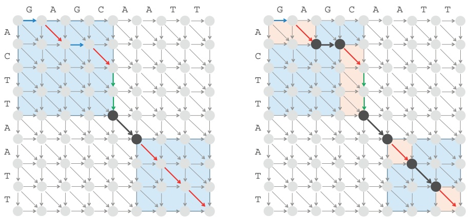

FIGURE 5.30 (Left) A middle edge (shown in bold) starts at the middle node (shown as a black circle). The optimal path travels inside the first highlighted rectangle, passes the middle edge, and travels inside the second highlighted rectangle afterwards. We can eliminate the remaining parts of the alignment graph, which takes up over half of the area formed by the graph, from further consideration. (Right) Finding middle edges (shown in bold) within previously identified rectangles.

276

---

H O W D O W E C O M PA R E D N A S E Q U E N C E S ?

## Epilogue: Multiple Sequence Alignment

Building a three-dimensional Manhattan

Amino acid sequences of proteins performing the same function are likely to be somewhat similar, but these similarities may be elusive in the case of distant species. You now possess an arsenal of algorithms for aligning pairs of sequences, but if sequence similarity is weak, pairwise alignment may not identify biologically related sequences. However, simultaneous comparison of many sequences often allows us to find similarities that pairwise sequence comparison fails to reveal. Bioinformaticians sometimes say that while pairwise alignment whispers, multiple alignment shouts.

We are now ready to use pairwise sequence analysis to build up our intuition for comparison of multiple sequences. In our three-way alignment of A-domains from the introduction, we found 19 conserved columns:

```txt
YAFDLGYTCMFPVLLGGGELHIVQKETYTAPDEIAHYIKEHGITYIKLTPSLFHTIVNTA
-AFDVSAGDFARALLTGGQLIVCPNEVKMDPASLYAIKKYDITIFEATPALVIPLMEYI
IAFDASSWEIYAPLLNGGTVVCCIDYYTTIDIKALEAVFKQHHIRGAMLPPALLKQCLVSA
SFAFDANFESLRLIVLGGEKIIPIDVIAFRKMYGHTE-FINHYGPTEATIGA
-YEQKLDISQLQILIVGSDSCSMEDFKTLVSRFGSTIRIVNSYGVTEACIDS
----PTMISSLEILFAAGDRLSSQDAILARRAVGSGV-Y-NAYGPENTVLS
```

However, similarities between A-domains are not limited to these 19 columns, as we can find **10** + 9 + **12** = 31 semi-conservative columns, each of which has two matching amino acids:

```powershell
YAFDLGYTCMFPVLLGGGELHIVQKETYTAPDEIAHYIKEHGITYIKLTPSLFHTIVNTA
-AFDVSAGDFARALLTGGQLIVCPNEVKMDPASLYAIKKYDITIFEATPALVIPLMEYI
IAFDASSWEIYAPLLNGGTVVCIDYYTTIDIKALEAVFKQHHIRGAMLPPALLKQCLVSA
```

```txt
SFAFDANFESLRLIVLGGEKIIIPIDVIAFRKMYGHTE-FINHYGPTEATIGA-YEQKLDISQLQILIVGSDSCSMEDFKTLVSRFGSTIRIVNSYGVTEACIDS----PTMISSLEILFAAGDRLSSQDAILARRAVGSGV-Y-NAYGPTENTVLS
```

A multiple alignment of t strings $v ^ { 1 } , \ldots , v ^ { t } ,$ , also called a **t-way alignment**, is specified by a matrix having t rows, where the i-th row contains the symbols of $v ^ { i }$ in order, interspersed with space symbols. We also assume that no column in a multiple alignment contains only space symbols. In the 3-way alignment below, we have highlighted the most popular symbol in each column using upper case letters:

277

---

C H A P T E R 5

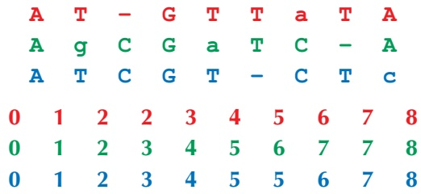

<details>
<summary>text_image</summary>

A T - G T T a T A
A g C G a T C - A
A T C G T - C T c
0 1 2 2 3 4 5 6 7 8
0 1 2 3 4 5 6 7 8
0 1 2 3 4 5 5 6 7 8
</details>

The multiple alignment matrix is a generalization of the pairwise alignment matrix to more than two sequences. The three arrays shown below this alignment record the respective number of symbols in **ATGTTATA**, **AGCGATCA**, and **ATCGTCTC** encountered up to a given position. Together, these three arrays correspond to a path in a threedimensional grid:

$$
\begin{array}{l} (\mathbf {0}, \mathbf {0}, \mathbf {0}) \rightarrow (\mathbf {1}, \mathbf {1}, \mathbf {1}) \rightarrow (\mathbf {2}, \mathbf {2}, \mathbf {2}) \rightarrow (\mathbf {2}, \mathbf {3}, \mathbf {3}) \rightarrow (\mathbf {3}, \mathbf {4}, \mathbf {4}) \rightarrow (\mathbf {4}, \mathbf {5}, \mathbf {5}) \rightarrow (\mathbf {5}, \mathbf {6}, \mathbf {5}) \rightarrow \\ (\mathbf {6}, \mathbf {7}, \mathbf {6}) \rightarrow (\mathbf {7}, \mathbf {7}, \mathbf {7}) \rightarrow (\mathbf {8}, \mathbf {8}, \mathbf {8}) \\ \end{array}
$$

As the alignment graph for two sequences is a grid of squares, the alignment graph for three sequences is a grid of cubes. Every node in the 3-way alignment graph has up to seven incoming edges, as shown in Figure 5.31.

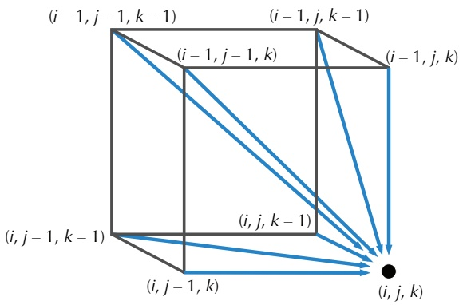

<details>
<summary>flowchart</summary>

```mermaid
graph LR
  (i, j, k) --> (i, j, k-1)
  (i, j, k-1) --> (i, j, k-1)
  (i, j-1, k-1) --> (i, j-1, k)
  (i, j-1, k-1) --> (i, j-1, k)
  (i-1, j, k) --> (i-1, j, k)
  (i-1, j, k-1) --> (i-1, j, k-1)
  (i-1, j, k-1) --> (i-1, j, k-1)
```
</details>

FIGURE 5.31 One cube making up the alignment graph for three sequences. Each node in the alignment graph for three sequences has up to seven incoming edges.

The score of a multiple alignment is defined as the sum of scores of the alignment columns (or, equivalently, weights of edges in the alignment path), with an optimal alignment being one that maximizes this score. In the case of an amino acid alphabet,

278

---

H O W D O W E C O M PA R E D N A S E Q U E N C E S ?

we can use a very general scoring method that is defined by a t-dimensional matrix containing $2 1 ^ { t }$ entries that describes the scores of all possible combinations of t symbols (representing 20 amino acids and the space symbol). See **DETOUR: Scoring Multiple Alignments**. Intuitively, we should reward more conserved columns with higher scores. For example, in the Multiple Longest Common Subsequence Problem, the score of a column is equal to 1 if all of the column’s symbols are identical, and 0 if even one symbol disagrees.

## Multiple Alignment Problem:

Find the highest-scoring alignment between multiple strings under a given scoring matrix.

**Input**: A collection of t strings and a t-dimensional matrix Score.

**Output**: A multiple alignment of these strings whose score (as defined by the matrix Score) is maximized among all possible alignments of these strings.

A straightforward dynamic programming algorithm applied to the t-dimensional alignment graph solves the Multiple Alignment Problem for t strings. For three sequences $v ,   w ,$ and u, we define $s _ { i , j , k }$ as the length of the longest path from the source $( 0 , 0 , 0 )$ to node $( i , j , k )$ in the alignment graph. The recurrence for $s _ { i , j , k }$ in the three-dimensional case is similar to the recurrence for pairwise alignment:

$$
s _ {i, j, k} = \max \left\{ \begin{array}{l l} s _ {i - 1, j, k} & + S c o r e (v _ {i}, -, -) \\ s _ {i, j - 1, k} & + S c o r e (-, w _ {j}, -) \\ s _ {i, j, k - 1} & + S c o r e (-, -, u _ {k}) \\ s _ {i - 1, j - 1, k} & + S c o r e (v _ {i}, w _ {j}, -) \\ s _ {i - 1, j, k - 1} & + S c o r e (v _ {i}, -, u _ {k}) \\ s _ {i, j - 1, k - 1} & + S c o r e (-, w _ {j}, u _ {k}) \\ s _ {i - 1, j - 1, k - 1} & + S c o r e (v _ {i}, w _ {j}, u _ {k}) \end{array} \right.
$$

In the case of t sequences of length n, the alignment graph consists of approximately $n ^ { t }$ nodes, and each node has up to $2 ^ { t } - 1$ incoming edges, yielding a total runtime of $\mathcal { O } \left( n ^ { t } \cdot 2 ^ { t } \right)$ . As t grows, the dynamic programming algorithm becomes impractical. Many heuristics for suboptimal multiple alignments have been proposed to address this runtime bottleneck.

PAGE 289

[5M](http://rosalind.info/problems/5m)

279

---

C H A P T E R 5

A greedy multiple alignment algorithm

Note that the multiple alignment

**AT-GTTaTA**

**AgCGaTC-A**

**ATCGT-CTc**

induces three pairwise alignments:

**AT-GTTaTA**

**AgCGaTC-A**

**AT-GTTaTA**

**ATCGT-CTc**

**C-AAgCGaT**

**ATCGT-CTc**

But can we work in the opposite direction, combining optimal pairwise alignments into a multiple alignment?

## STOP and Think:

1. Does an optimal multiple alignment induce optimal pairwise alignments?
2. Try combining the pairwise alignments below into a multiple alignment of the strings **CCCCTTTT**, **TTTTGGGG**, and **GGGGCCCC**.

**CCCCTTTT**-

----**TTTTGGGG**

----**CCCCTTTT**

**GGGGCCCC**- ---

**TTTTGGGG**

----**GGGGCCCC**

Unfortunately, we cannot always combine optimal pairwise alignments into a multiple alignment because some pairwise alignments may be incompatible. Indeed, the first pairwise alignment in the above question implies that **CCCC** occurs before **TTTT** in the multiple alignment constructed from these three pairwise alignments. The third pairwise alignment implies that **TTTT** occurs before **GGGG** in the multiple alignment. But the second pairwise alignment implies that **GGGG** occurs before **CCCC** in the multiple alignment. Thus, **CCCC** must occur before **TTTT**, which must occur before **GGGG**, which must occur before **CCCC**, a contradiction.

To avoid incompatibility, some multiple alignment algorithms attempt to greedily construct a multiple alignment from pairwise alignments that are not necessarily optimal. The greedy heuristic starts by selecting the two strings having the highest scoring pairwise alignment (among all possible pairs of strings) and then uses this pairwise alignment as a building block for iteratively adding one string at a time to the growing multiple alignment. We align the two closest strings at the first step because they often


280

---

H O W D O W E C O M PA R E D N A S E Q U E N C E S ?

provide the best chance of building a reliable multiple alignment. For the same reason, we then select the string having maximum score against the current alignment at each stage. But what does it mean to align a string against an alignment of other strings?

An alignment of nucleotide sequences with k columns can be represented as a $4 \times k$ profile matrix like the one in Figure 5.32, which holds the nucleotide frequencies from each column (amino acid alignments are represented by $2 0 \times k$ profile matrices). The greedy multiple alignment heuristic adds a string to the current alignment by constructing a pairwise alignment between the string and the profile of the current alignment. As a result, the problem of constructing a multiple alignment of t sequences is reduced to constructing t  1 pairwise alignments.

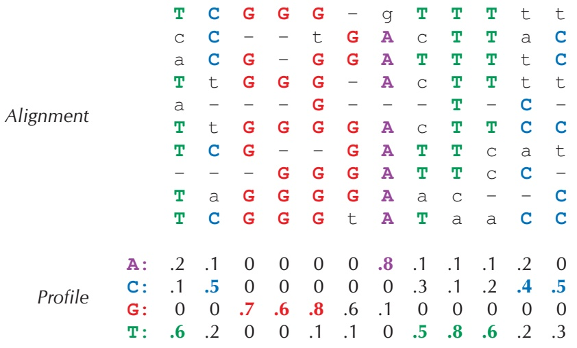

<details>
<summary>text_image</summary>

Alignment
Profile
A: .2 .1 0 0 0 0 .8 .1 .1 .1 .2 0
C: .1 .5 0 0 0 0 0 .3 .1 .2 .4 .5
G: 0 0 .7 .6 .8 .6 .1 0 0 0 0 0
T: .6 .2 0 0 .1 .1 0 .5 .8 .6 .2 .3
</details>

FIGURE 5.32 A profile matrix for a multiple alignment of ten sequences. Each column of the profile matrix sums to 1 minus the frequency of the space symbol. The most popular nucleotides in each column are shown as uppercase colored letters.

**STOP and Think:** Design an algorithm for aligning a string against a profile matrix. How would you score the columns in such an alignment?

Although greedy multiple alignment algorithms work well for similar sequences, their performance deteriorates for dissimilar sequences because greedy methods may be misled by a spurious pairwise alignment. If the first two sequences picked for building a multiple alignment are aligned in a way that is incompatible with the optimal multiple


281

---

C H A P T E R 5

alignment, then the error in this initial pairwise alignment will propagate all the way through to the final multiple alignment.

After learning how to align multiple sequences, you are now ready to solve a challenge problem that is comparable to the task that Marahiel and his collaborators faced in 1999.

**CHALLENGE PROBLEM:** In 1999, Marahiel derived the non-ribosomal code for only 14 of the 20 proteinogenic amino acids (Ala, Asn, Asp, Cys, Gln, Glu, Ile, Leu, Phe, Pro, Ser, Thr, Tyr, Val) because he lacked A-domain sequences for the remaining 6 amino acids. With the availability of many more A-domains, you now have the chance to fill in the gaps in Marahiel’s original paper. Construct the multiple alignment of 397 A-domains, reveal the conservative columns in this alignment, and make your best guess about the signatures encoding all 20 proteinogenic amino acids based on Marahiel’s alignment.

## Detours

Fireflies and the non-ribosomal code

When Marahiel started his groundbreaking work on decoding the non-ribosomal code in the late 1990s, 160 A-domains had already been sequenced, and the amino acids that they encode had been experimentally identified. However, it was still not clear exactly how each A-domain encoded a specific amino acid.

We showed an alignment of three A-domain intervals in the main chapter, but Marahiel actually aligned all of the 160 identified A-domains in order to reveal the conservative core. Yet it still remained unclear which columns in this alignment defined the non-ribosomal signatures.

Help came from an unusual ally: Photinus pyralis, the most common species of firefly. Fireflies produce an enzyme called **luciferase** that helps them emit light to attract mates at night. Different species have different glow patterns, and females respond to males from the same species by identifying the color, duration, and intensity of their flash.

What do fireflies have to do with the non-ribosomal code? Firefly luciferase belongs to a class of enzymes called **adenylate-forming enzymes**, which share similarities with adenylation domains. For this reason, when Peter Brick published the three-dimensional structure of firefly luciferase in 1996, Marahiel was quick to take notice. In 1997, he and Brick joined forces and used firefly luciferase as a scaffold to reconstruct the first

282

---

H O W D O W E C O M PA R E D N A S E Q U E N C E S ?

three-dimensional structure of an A-domain, which coded for phenylalanine (Phe); it is worth noting that this A-domain belonged to an NRP synthetase encoding Gramicidin Soviet, the first mass-produced antibiotic.

Marahiel and Brick actually constructed the three-dimensional structure of a larger complex containing both the A-domain and Phe. This three-dimensional structure provided information about amino acid residues in the A-domain located close to Phe, a hypothetical **active pocket** of the A-domain. Marahiel further demonstrated experimentally and computationally that amino acids in this active pocket define the non-ribosomal code, thus producing the 8 purple columns in the 3-way alignment that we showed at the beginning of the chapter.

Figure 5.33 shows the partial non-ribosomal code deduced by Marahiel. Although he was able to deduce some signatures, the non-ribosomal code is very **redundant**, meaning that multiple mutated variants of a signature all code for the same amino acid. For some amino acids, this redundancy is pronounced, e.g., Marahiel identified three very different signatures AWMFAAVL, AFWIGGTF, and FESTAAVY coding for Val.

| Amino acid | Signature | Amino acid | Signature |
| --- | --- | --- | --- |
| Ala | LLFGIAVL | Leu | AFMLGMVF |
| Asn | LTKLGEVG | Orn | MENLGLIN |
| Asp | LTKVGHIG | Orn | VGEIGSID |
| Cys | HESDVGIT | Phe | AWTIAAVC |
| Cys | LYNLSLIW | Pro | VQLIAHVV |
| Gln | AQDLGVVD | Ser | VWHLSLID |
| Glu | AWHFGGVD | Thr | FWNIGMVH |
| Glu | AKDLGVVD | Tyr | GTITAEVA |
| Ile | GFFLGVVY | Tyr | ALVTGAVV |
| Ile | AFFYGITF | Tyr | ASTVAAVC |
| Leu | AWFLGNVV | Val | AFWIGGTF |
| Leu | AWLYGAVM | Val | FESTAAVY |
| Leu | GAYTGEVV | Val | AWMFAAVL |

FIGURE 5.33 Marahiel’s partial non-ribosomal code. Some proteinogenic amino acids are missing from this table because they were not present in Marahiel’s dataset.

Finding a longest common subsequence without building a city

Define the **i-prefix** of a string as the substring formed by its first i letters and the **j-prefix** of a string as the substring formed by its final j letters. Also, given strings v and w, let $L C S _ { i , j }$ denote an LCS between the i-prefix of v and the j-prefix of $w ,$ and let $s _ { i , j }$ be

---

C H A P T E R 5

the length of $L C S _ { i , j }$ . By definition, $s _ { i ,   0 } = s _ { 0 ,   j } = 0$ for all values of i and j. Next, $L C S _ { i , j }$ could contain both $v _ { i }$ and $w _ { j } ,$ in which case these symbols match, and $L C S _ { i , j }$ extends an LCS of the shorter prefixes $v _ { 1 } \dots v _ { i - 1 }$ and $w _ { 1 } \dots w _ { j - 1 }$ . Otherwise, either $v _ { i }$ or $w _ { j }$ is not present in $L C S _ { i , j }$ . If $v _ { i }$ is not present in $L C S _ { i , j } ,$ then this LCS is therefore also an LCS of $v _ { 1 } \dots v _ { i - 1 }$ and $w _ { 1 } \ldots w _ { j }$ . A similar argument applies to the case when $w _ { j }$ is not present in $L C S _ { i , j } .$ Therefore, $s _ { i , j }$ satisfies the following recurrence, the same one we derived in the main text using a Manhattan-like grid:

$$
s _ {i, j} = \max \left\{ \begin{array}{l l} s _ {i - 1, j} \\ s _ {i, j - 1} \\ s _ {i - 1, j - 1} + 1, \text {if} v _ {i} = w _ {j} \end{array} \right.
$$

Constructing a topological ordering

The first applications of topological ordering resulted from large management projects in an attempt to schedule a sequence of tasks based on their dependencies (such as the Dressing Challenge). In these projects, tasks are represented by nodes, and an edge connects node a to node b if task a must be completed before task b can be started.


**STOP and Think:** Prove that every DAG has a node with no incoming edges and a node with no outgoing edges.

The following algorithm for constructing a topological ordering is based on the observation that every DAG has at least one node with no incoming edges. We will label one of these nodes as $v _ { 1 }$ and then remove this node from the graph along with all its outgoing edges. The resulting graph is also a DAG, which in turn must have a node with no incoming edges; we label this node $v _ { 2 } ,$ , and again remove it from the graph along with its outgoing edges. The resulting algorithm proceeds until all nodes have been removed, producing a topological order $v _ { 1 } , \ldots , v _ { n }$ . This algorithm runs in time proportional to the number of edges in the input DAG.

284

---

H O W D O W E C O M PA R E D N A S E Q U E N C E S ?

TOPOLOGICALORDERING(Graph)

<div class="docvortex-algorithm" style="white-space: pre-wrap; font-family:monospace;">
List ← empty list
Candidates ← set of all nodes in Graph with no incoming edges
while Candidates is non-empty
    select an arbitrary node a from Candidates
    add a to the end of List and remove it from Candidates
    for each outgoing edge from a to another node b
        remove edge (a, b) from Graph
        if b has no incoming edges
            add b to Candidates
if Graph has edges that have not been removed
    return "the input graph is not a DAG"
else
    return List
</div>

## PAM scoring matrices

Mutations of a gene’s nucleotide sequence often change the amino acid sequence of the translated protein. Some of these mutations impair the protein’s ability to function, making them rare events in molecular evolution. Asn, Asp, Glu, and Ser are the most “mutable” amino acids, whereas Cys and Trp are the least mutable. Knowledge of the likelihood of each possible mutation allows biologists to construct amino acid scoring matrices for biologically sound sequence alignments in which different substitutions are penalized differently. The (i, j)-th entry of the amino acid scoring matrix Score usually reflects how often the i-th amino acid substitutes the j-th amino acid in alignments of related protein sequences. As a result, optimal alignments of amino acid sequences may have very few matches but still represent biologically adequate alignments.

How do biologists know which mutations are more likely than others? If we know a large set of pairwise alignments of related sequences (e.g., sharing at least 90% of amino acids), then computing Score(i, j) is based on counting how many times the corresponding amino acids are aligned. However, we need to know the scoring matrix in advance in order to build this set of starter alignments — a catch-22!

Fortunately, the correct alignment of very similar sequences is so obvious that it can be constructed even with a primitive scoring scheme that does not account for varying mutation propensities (such as +1 for matches and -1 for mismatches and indels), thus resolving the conundrum. After constructing these obvious alignments, we can use


---

C H A P T E R 5

them to compute a new scoring matrix that we can use iteratively to form less and less obvious alignments.

This simplified description hides some details. For example, the probability of Ser mutating into Phe in species that diverged 1 million years ago is smaller than the probability of the same mutation in species that diverged 100 million years ago. This observation implies that scoring matrices for protein comparison should depend on the similarity of the organisms and the speed of evolution of the proteins of interest. In practice, the proteins that biologists use to create an initial alignment are extremely similar, having 99% of their amino acids conserved (e.g., most proteins shared by humans and chimpanzees). Sequences that are 99% similar are said to be 1 **PAM unit** diverged $\left( \mathrm{PAM}^{\prime \prime} \right.$ stands for “point accepted mutation”). You can think of a PAM unit as the amount of time in which an “average” protein mutates 1% of its amino acids.

The $\mathbf { P A M _ { 1 } }$ **scoring matrix** is defined as follows from many pairwise alignments of $9 9 \%$ similar proteins. Given a set of pairwise alignments, let $M ( i , j )$ be the number of times that the i-th and $j \mathrm { - t h }$ amino acids appear in the same column, divided by the total number of times that the i-th amino acid appears in all sequences. Let $f ( j )$ be the frequency of the j-th amino acid in the sequences, or the number of times it appears across all sequences divided by the combined lengths of the two sequences. The $( i , j )$ -th entry of the $\mathrm { P A M _ { 1 } }$ matrix is defined as

$$
\log \left(\frac {M (i , j)}{f (j)}\right).
$$

For a larger number of PAM units $n ,$ the $\mathrm { P A M } _ { n }$ matrix is computed based on the observation that the matrix $M ^ { n }$ (the result of multiplying M by itself n times) holds the empirical probabilities that one amino acid mutates to another during n PAM units. The $( i , j )$ -th entry of the $\mathrm { P A M } _ { n }$ scoring matrix is thus given by

$$
\log \left(\frac {M ^ {n} (i , j)}{f (j)}\right).
$$

The $\mathrm { P A M } _ { 2 5 0 }$ scoring matrix is shown in Figure 5.34.

This approach assumes that the frequencies of the amino acids $f ( j )$ remain constant over time, and that the mutational processes in an interval of 1 PAM unit operate consistently over long periods. For large $n ,$ the resulting PAM matrices often allow us to find related proteins, even when the alignment has few matches.

286

---

H O W D O W E C O M PA R E D N A S E Q U E N C E S ?

|  | A | C | D | E | F | G | H | I | K | L | M | N | P | Q | R | S | T | V | W | Y | - |
| --- | --- | --- | --- | --- | --- | --- | --- | --- | --- | --- | --- | --- | --- | --- | --- | --- | --- | --- | --- | --- | --- |
| A | 2 | -2 | 0 | 0 | -3 | 1 | -1 | -1 | -1 | -2 | -1 | 0 | 1 | 0 | -2 | 1 | 1 | 0 | -6 | -3 | -8 |
| C | -2 | 12 | -5 | -5 | -4 | -3 | -3 | -2 | -5 | -6 | -5 | -4 | -3 | -5 | -4 | 0 | -2 | -2 | -8 | 0 | -8 |
| D | 0 | -5 | 4 | 3 | -6 | 1 | 1 | -2 | 0 | -4 | -3 | 2 | -1 | 2 | -1 | 0 | 0 | -2 | -7 | -4 | -8 |
| E | 0 | -5 | 3 | 4 | -5 | 0 | 1 | -2 | 0 | -3 | -2 | 1 | -1 | 2 | -1 | 0 | 0 | -2 | -7 | -4 | -8 |
| F | -3 | -4 | -6 | -5 | 9 | -5 | -2 | 1 | -5 | 2 | 0 | -3 | -5 | -5 | -4 | -3 | -3 | -1 | 0 | 7 | -8 |
| G | 1 | -3 | 1 | 0 | -5 | 5 | -2 | -3 | -2 | -4 | -3 | 0 | 0 | -1 | -3 | 1 | 0 | -1 | -7 | -5 | -8 |
| H | -1 | -3 | 1 | 1 | -2 | -2 | 6 | -2 | 0 | -2 | -2 | 2 | 0 | 3 | 2 | -1 | -1 | -2 | -3 | 0 | -8 |
| I | -1 | -2 | -2 | -2 | 1 | -3 | -2 | 5 | -2 | 2 | 2 | -2 | -2 | -2 | -2 | -1 | 0 | 4 | -5 | -1 | -8 |
| K | -1 | -5 | 0 | 0 | -5 | -2 | 0 | -2 | 5 | -3 | 0 | 1 | -1 | 1 | 3 | 0 | 0 | -2 | -3 | -4 | -8 |
| L M N P Q R S T V W Y - A B C D E F G H I J K L M N O P Q R S T U V W X Y Z A B C D E F G H I J K L M N O P Q R S T U V W X Y Z A B C D E F G H I J K L M N O P Q R S T U V W X |  |  |  |  |  |  |  |  |  |  |  |  |  |  |  |  |  |  |  |  |  |

FIGURE 5.34 The $\mathsf { P A M } _ { 2 5 0 }$ scoring matrix for protein alignment with indel penalty 8.

## Divide-and-conquer algorithms

We will use the problem of sorting a list of integers as an example of a divide-and-conquer algorithm. We begin from the problem of **merging**, in which we want to combine two sorted lists $L i s t _ { 1 }$ and $L i s t _ { 2 }$ into a single sorted list (Figure 5.35). The **MERGE** algorithm combines two sorted lists into a single sorted list in $\mathcal { O } \big ( \big | L i s t _ { 1 } \big | + \big | L i s t _ { 2 } \big | \big )$ time by iteratively choosing the smallest remaining element in $L i s t _ { 1 }$ and $L i s t _ { 2 }$ and moving it to the growing sorted list.

287

---

C H A P T E R 5

| $List_1$ | 2 5 7 8 | 2 5 7 8 | 2 5 7 8 | 2 5 7 8 | 2 5 7 8 | 2 5 7 8 |
| --- | --- | --- | --- | --- | --- | --- |
| $List_2$ | 3 4 6 | 3 4 6 | 3 4 6 | 3 4 6 | 3 4 6 | 3 4 6 |
| SortedList | 2 | 3 | 4 | 5 | 6 | 7 8 |

FIGURE 5.35 Merging the sorted lists (2, 5, 7, 8) and (3, 4, 6) results in the sorted list (2, 3, 4, 5, 6, 7, 8).

<div class="docvortex-algorithm" style="white-space: pre-wrap; font-family:monospace;">
MERGE($List_1$, $List_2$)
    $SortedList \leftarrow$ empty list
    while both $List_1$ and $List_2$ are non-empty
        if the smallest element in $List_1$ is smaller than the smallest element in $List_2$
            move the smallest element from $List_1$ to the end of $SortedList$
        else
            move the smallest element from $List_2$ to the end of $SortedList$
        move any remaining elements from either $List_1$ or $List_2$ to the end of $SortedList$
    return $SortedList$
</div>

**MERGE** would be useful for sorting an arbitrary list if we knew how to divide an arbitrary (unsorted) list into two already sorted half-sized lists. However, it may seem that we are back to where we started, except now we have to sort two smaller lists instead of one big one. Yet sorting two smaller lists is a preferable computational problem. To see why, let’s consider the **MERGESORT** algorithm, which **divides** an unsorted list into two parts and then recursively **conquers** each smaller sorting problem before merging the sorted lists.

```python
MERGESORT(List)
    if List consists of a single element
        return List
    FirstHalf ← first half of List
    SecondHalf ← second half of List
    SortedFirstHalf ← MERGESORT(FirstHalf)
    SortedSecondHalf ← MERGESORT(SecondHalf)
    SortedList ← MERGE(SortedFirstHalf, SortedSecondHalf)
    return SortedList
```

**STOP and Think:** What is the runtime of **MERGESORT**?

STOP

288

---

H O W D O W E C O M PA R E D N A S E Q U E N C E S ?

Figure 5.36 shows the **recursion tree** of **MERGESORT**, consisting of $\mathrm { l o g } _ { 2 }$ n levels, where n is the size of the original unsorted list. At the bottom level, we must merge two sorted lists of approximately $n / 2$ elements each, requiring $\mathcal { O } ( n / 2 + n / 2 ) = \mathcal { O } ( n )$ time. At the next highest level, we must merge four lists of $n / 4$ elements, requiring $\mathcal { O } \big ( n / 4 + n / 4 + n / 4 + n / 4 \big ) = \mathcal { O } \big ( n \big )$ time. This pattern can be generalized: the i-th level contains $2 ^ { i }$ lists, each having approximately $n / 2 ^ { i }$ elements, and requires $\mathcal { O } ( n )$ time to merge. Since there are $\mathrm { l o g } _ { 2 }$ n levels in the recursion tree, MERGESORT therefore requires $\mathcal { O } \big ( n \cdot \log _ { 2 } n \big )$ runtime overall, which offers a speedup over naive $\mathcal { O } \big ( n ^ { 2 } \big )$ sorting algorithms.


<details>
<summary>flowchart</summary>


</details>

FIGURE 5.36 The recursion tree for sorting an 8-element list with MERGESORT. The divide (upper) steps consist of $\log _ { 2 } 8 = 3$ levels, where the input list is split into smaller and smaller sublists. The conquer (lower) steps consist of the same number of levels, as the sorted sublists are merged back together.

## Scoring multiple alignments

The choice of scoring function can drastically affect the quality of a multiple alignment. In the main chapter, we described a way to score t-way alignments by using a tdimensional scoring matrix. Below, we describe more practical approaches to scoring alignments.

---

C H A P T E R 5

The columns of a t-way alignment describe a path in a t-dimensional alignment graph whose edge weights are defined by the scoring function. Using the statistically motivated entropy score, the score of a multiple alignment is defined as the sum of the entropies of its columns. Recall from Chapter 2 that the entropy of a column is equal to $\begin{array} { r } { - \sum p _ { x } \cdot \log _ { 2 } p _ { x } } \end{array}$ , where the sum is taken over all symbols x present in the column, and $p _ { x }$ is the frequency of symbol x in the column.

In Chapter 2, we saw that more highly conserved columns will have lower entropy scores. Because we wish to maximize the alignment score, we use the negative of entropy in order to ensure that more highly conserved columns receive higher scores. Finding a longest path in the t-dimensional alignment graph therefore corresponds to finding a multiple alignment with minimal entropy.

Another popular scoring approach is the **Sum-of-Pairs score** (**SP-score**). A multiple alignment Alignment of t sequences induces a pairwise alignment between the i-th and j-th sequences, having score $s ( A l i g n m e n t , i , j )$ . The SP-score for a multiple alignment simply adds the scores of each induced pairwise alignment:

$$
\text {SP - SCORE} (\text {Alignment}) = \sum_ {1 \leq i <   j \leq t} s (\text {Alignment}, i, j).
$$


**EXERCISE BREAK:** Compute the entropy score and SP-score of Marahiel’s 3-way alignment, reproduced below.

```powershell
YAFDLGYTCMFPVLLGGGELHIVQKETYTAPDEIAHYIKEHGITYIKLTPSLFHTIVNTA
-AFDVSAGDFARALLTGGQLIVCPNEVKMDPASLYAIKKYDITIFEATPALVIPLMEYI
IAFDASSWEIYAPLLNGGTVVCIDYYTTIDIKALEAVFKQHHIRGAMLPPALLKQCLVSA
```

```txt
SFAFDANFESLRLIVLGGEKIIIPIDVIAFRKMYGHTE-FINHYGPTEATIGA-YEQKLDISQLQILIVGSDSCSMEDFKTLVSRFGSTIRIVNSYGVTEACIDS----PTMISSLEILFAAGDRLSSQDAILARRAVGSGV-Y-NAYGPTENTVLS
```

290

---

H O W D O W E C O M PA R E D N A S E Q U E N C E S ?

## Bibliography Notes

Edit distance was introduced by Levenshtein, 1966. The local alignment algorithm described in the text was proposed by Smith and Waterman, 1981. When Doolittle et al., 1983 revealed the similarities between oncogenes and PDGF, they did not know about the Smith-Waterman algorithm. The 3-D structures of firefly luciferase and the A-domain from Bacilus brevis were published by Conti, Franks, and Brick, 1996 as well as Conti et al., 1997. The non-ribosomal code was first presented by Stachelhaus, Mootz, and Marahiel, 1999.


291
