# Chapter 6: Are There Fragile Regions in the Human Genome?

原始 PDF 第 317–380 页。

ARE THERE FRA<ILE RECIONS IN THE HUMAN GENOME?

Combinatorial Algorithms

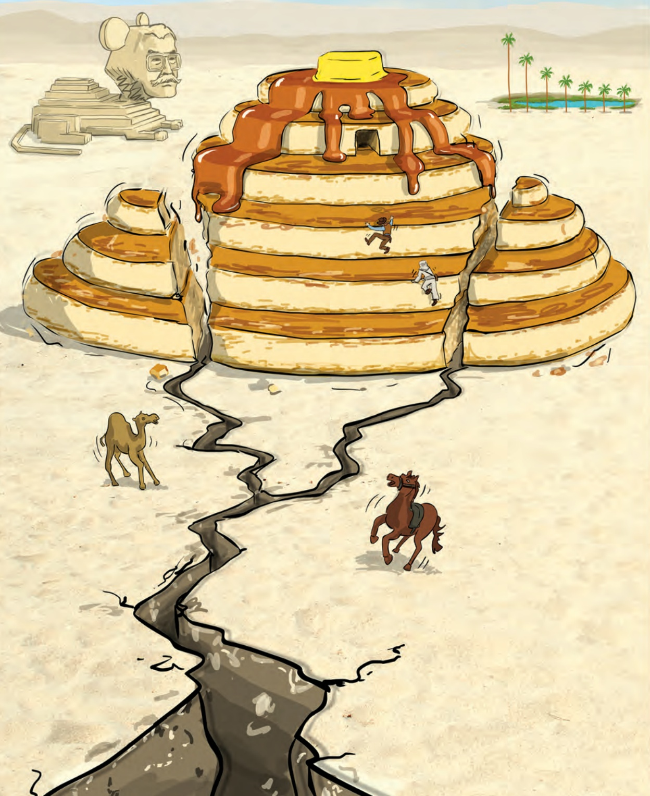

<details>
<summary>natural_image</summary>

Illustration of a giant pyramid with molasses and a camel running on a cracked ground, surrounded by ancient pyramids and palm trees (no text or symbols)
</details>

---

A R E T H E R E F R A G I L E R E G I O N S I N T H E H U M A N G E N O M E ?

## Of Mice and Men

“I have further been told,” said the cat, “that you can also transform yourself into the smallest of animals, for example, a rat or a mouse. But I can scarcely believe that. I must admit to you that I think it would be quite impossible.”

“Impossible!” cried the ogre. “You shall see!”

He immediately changed himself into a mouse and began to run about the floor. As soon as the cat saw this, he fell upon him and ate him up.

How different are the human and mouse genomes?

When Charles Perrault described the transformation of an ogre into a mouse in “Puss in Boots”, he could hardly have anticipated that three centuries later, research would show that the human and mouse genomes are surprisingly similar. Nearly every human gene has a mouse counterpart, although mice greatly outperform us when it comes to the olfactory genes responsible for smell. We are essentially mice without tails — we even have the genes needed to make a tail, but these genes have been “silenced” during our evolution.

We started with a fairy tale question: “How can an ogre transform into a mouse?” Since we share most of the same genes with mice, we now ask a question about mammalian evolution: “What evolutionary forces have transformed the genome of the human-mouse ancestor into the present-day human and mouse genomes?”

If a precocious child had grown out of reading fairy tales and wanted to learn about how the human and mouse genomes differ, then here is what we would tell her. You can cut the 23 human chromosomes into 280 pieces, shuffle these DNA fragments, and then glue the pieces together in a new order to form the 20 mouse chromosomes. The truth, however, is that evolution has not employed a single dramatic cut-and-paste operation; instead, it applies smaller changes known as **genome rearrangements**, which will be our focus in this chapter.

Unfortunately, our bioinformatics time machine won’t take us more than a few centuries into the past. If it did, we could travel 75 million years back in time, watching humans slowly change into a small, furry animal that lived with dinosaurs. Then, we could travel back to the present, watching how this animal evolved into the mouse. In this chapter, we hope to understand the genome rearrangements that have separated the human and mouse genomes without having to revamp our time machine.

293

---

C H A P T E R 6

PAGE 340

## Synteny blocks

To simplify genome comparison, we will first focus on the X chromosome, which is one of the two sex-determining chromosomes in mammals and has retained nearly all its genes throughout mammalian evolution (see **DETOUR: Why is the Gene Content of Mammalian X Chromosomes So Conserved?**). We can therefore view the X chromosome as a “mini-genome” when comparing mice to humans, since this chromosome’s genes have not jumped around onto different chromosomes (and vice-versa).

It turns out not only that most human genes have mouse counterparts, but also that hundreds of similar genes often line up one after another in the same order in the two species genomes. Each of the eleven colored segments in Figure 6.1 represents such a procession of similar genes and is called a **synteny block**. Later, we will explain how to construct synteny blocks and what the left and right **directions** of the blocks signify.

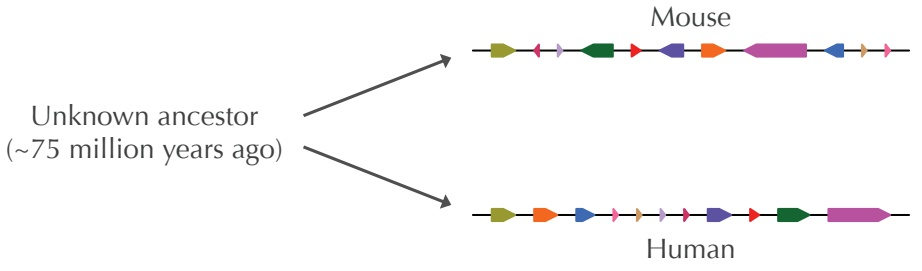

<details>
<summary>flowchart</summary>

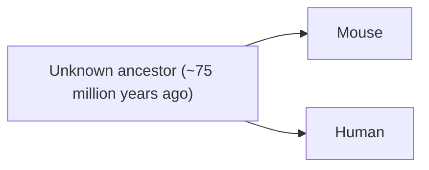
</details>

FIGURE 6.1 Mouse and human X chromosomes represented as eleven colored, directed segments (synteny blocks).

Synteny blocks simplify the comparison of the mouse and human X chromosomes from about 150 million base pairs to only eleven units. This simplification is analogous to comparing two similar photographs. If we compare the images one pixel at a time, we may be overwhelmed by the scale of the problem; instead, we need to zoom out in order to notice higher-level patterns. It is no accident that biologists use the term “resolution” to discuss the level at which genomes are analyzed.

## Reversals

You have probably been wondering how the genome changes when it undergoes a genome rearrangement. Genome rearrangements were discovered 90 years ago when Alfred Sturtevant was studying fruit fly mutants with scarlet- and peach-colored eyes as well as abnormally shaped deltoid wings. Sturtevant analyzed the genes coding

294

---

A R E T H E R E F R A G I L E R E G I O N S I N T H E H U M A N G E N O M E ?

for these traits, called **scarlet**, **peach**, and **delta**, and he was amazed to find that the arrangement of these genes in Drosophila melanogaster (**scarlet**, **peach**, **delta**) differed from their arrangement in Drosophila simulans (**scarlet**, **delta**, **peach**). He immediately conjectured that the chromosomal segment containing **peach** and **delta** must have been flipped around (see **DETOUR: Discovery of Genome Rearrangements**). Sturtevant had witnessed the most common form of genome rearrangement, called a **reversal**, which flips around an interval of a chromosome and inverts the directions of any synteny blocks within the interval.

Figure 6.2 shows a series of seven reversals transforming the mouse X chromosome into the human X chromosome. If this scenario is correct, then the X chromosome of the human-mouse ancestor must be represented by one of the intermediate synteny block orderings. Unfortunately, this series of seven reversals offers only one of 1,070 different seven-step scenarios transforming the mouse X chromosome into the human X chromosome. We have no clue which scenario is correct, or even whether the correct scenario had exactly seven reversals.

**STOP and Think:** Can you convert the mouse X chromosome into the human X chromosome using only six reversals?

Regardless of how many reversals separate the human and mouse X chromosomes, reversals must be rare genomic events. Indeed, genome rearrangements typically cause the death or sterility of the mutated organism, thus preventing it from passing the rearrangement on to the next generation. However, a tiny fraction of genome rearrangements may have a positive effect on survival and propagate through a species as the result of natural selection. When a population becomes isolated from the rest of its species for long enough, rearrangements can even create a new species.

## Rearrangement hotspots

Geology provides a thought-provoking analogy for thinking about genome evolution. You might like to think of genome rearrangements as “genomic earthquakes” that dramatically change the chromosomal architecture of an organism. Genome rearrangements contrast with much more frequent point mutations, which work slowly and are analogous to “genomic erosion”.

You can visualize a reversal as breaking the genome on both sides of a chromosomal interval, flipping the interval, and then gluing the resulting segments in a new order. Keeping in mind that earthquakes occur more frequently along fault lines, we wonder

PAGE 340

STOP

295

---

C H A P T E R 6


<details>
<summary>violin</summary>

| Category | Value |
| --- | --- |
| Mouse::+1 | N/A |
| Mouse::-7 | N/A |
| Mouse::+6 | N/A |
| Mouse::-10 | N/A |
| Mouse::+9 | N/A |
| Mouse::-8 | N/A |
| Mouse::+2 | N/A |
| Mouse::-11 | N/A |
| Mouse::-3 | N/A |
| Mouse::+5 | N/A |
| Mouse::+4 | N/A |
| Human::+1 | N/A |
| Human::+2 | N/A |
| Human::+3 | N/A |
| Human::+4 | N/A |
| Human::+5 | N/A |
| Human::+6 | N/A |
| Human::+7 | N/A |
| Human::+8 | N/A |
| Human::+9 | N/A |
| Human::+10 | N/A |
| Human::+11 | N/A |
</details>

FIGURE 6.2 Transforming the mouse X chromosome into the human X chromosome with seven reversals. Each synteny block is uniquely colored and labeled with an integer between 1 and 11; the positive or negative sign of each integer indicates the synteny block’s direction (pointing right or left, respectively). Two short vertical segments delineate the endpoints of the inverted interval in each reversal. Suppose that this evolutionary scenario is correct and that, say, the fifth synteny block arrangement from the top presents the true ancestral arrangement. Then the first four reversals happened on the evolutionary path from mice to the human-mouse common ancestor (traveling backward in time), and the final three reversals happened on the evolutionary path from the common ancestor to humans (traveling forward in time). In this chapter, we are not trying to reconstruct the ancestral genome and thus are not concerned with whether a certain reversal travels backward or forward in time.

if a similar principle holds for reversals — are they occurring over and over again in the same genomic regions? A fundamental question in chromosome evolution studies is whether the **breakage points** of reversals (i.e., the ends of the inverted intervals) occur along “fault lines” called **rearrangement hotspots**. If such hotspots exist in the human genome, we want to locate them and determine how they might relate to genetic disorders, which are often attributable to rearrangements.

296

---

A R E T H E R E F R A G I L E R E G I O N S I N T H E H U M A N G E N O M E ?

Of course, we should rigorously define what we mean by a “rearrangement hotspot”. Re-examining the seven-reversal scenario changing the mouse X chromosome into the human X chromosome in Figure 6.2, we record the endpoints of each reversal using vertical segments. Regions affected by multiple reversals are indicated by multiple vertical segments in the human X chromosome. For example, the region adjacent to the pointed side of block 3 in Figure 6.2 is used as an endpoint of both the fourth and fifth reversals. As a result, we have placed two vertical lines between blocks 3 and 4 in the human X chromosome. However, just because we showed two breakage points in this region does not imply that this region is a rearrangement hotspot, since the reversals in Figure 6.2 represent just one possible evolutionary scenario. Because the true rearrangement scenario is unknown, it is not immediately clear how we could determine whether rearrangement hotspots exist.

## The Random Breakage Model of Chromosome Evolution

In 1973, Susumu Ohno proposed the **Random Breakage Model** of chromosome evolution. This hypothesis states that the breakage points of rearrangements are selected randomly, implying that rearrangement hotspots in mammalian genomes do not exist. Yet Ohno’s model lacked supporting evidence when it was introduced. After all, how could we possibly determine whether rearrangement hotspots exist without knowing the exact sequence of rearrangements separating two species?

## STOP and Think: Consider the following questions.

1. Say that a series of random reversals result in one huge synteny block covering 90% of the genome in addition to 99 tiny synteny blocks covering the remaining 10% of the genome. Should we be surprised?
2. What if random reversals result in 100 synteny blocks of roughly the same length? Should we be surprised?

The idea that we wish to impress on you in the preceding questions is that we can test the Random Breakage Model by analyzing the distribution of synteny block lengths. For example, the lengths of the human-mouse synteny blocks on the X chromosome vary widely, with the largest block (block 11 in Figure 6.2) taking up nearly 25% of the entire length of the X chromosome. Is this variation in synteny block length consistent with the Random Breakage Model?


297

---

C H A P T E R 6


FIGURE 6.3 (Top) A histogram showing the number of blocks of each size for a simulated genome with 25,000 genes (an approximation for the number of genes in a mammalian genome) after 320 randomly chosen reversals. Blocks having more than 100 genes are not shown. (Bottom) A histogram of synteny block lengths averaged over 100 simulations, fitted by the exponential distribution.

In 1984, Joseph Nadeau and Benjamin Taylor asked what the expected lengths of synteny blocks should be after N reversals occurring at random locations in the genome. If we rule out the unlikely event that two random reversals cut the chromosome in exactly the same position, then N random reversals cut the chromosome in 2N locations and produce 2N + 1 synteny blocks. Figure 6.3 (top) depicts the result of a computational experiment in which 320 random reversals are applied to a simulated chromosome consisting of 25,000 genes, producing 2 · 320 + 1 = 641 synteny blocks. The average synteny block size is $^ { 2 5 , 0 0 0 / 6 4 1 } \approx 3 4$ genes, but this does not mean that

298

---

A R E T H E R E F R A G I L E R E G I O N S I N T H E H U M A N G E N O M E ?

all synteny blocks should have approximately 34 genes. If we select random locations for breakage points, then some blocks may have only a few genes, whereas other blocks may contain over a hundred. Figure 6.3 (bottom) averages the results of 100 such simulations and illustrates that the distribution of synteny block lengths can be approximated by a curve corresponding to an exponential distribution (see **DETOUR: The Exponential Distribution**). The exponential distribution predicts that there will be about seven blocks having 34 genes and one or two much larger blocks having 100 genes.

What happens when we look at the histogram for the real human and mouse synteny blocks? When Nadeau and Taylor constructed this histogram for the limited genetic data available in 1984, they observed that the lengths of blocks fit the exponential distribution well. In the 1990s, more accurate synteny block data fit the exponential distribution even better (Figure 6.4). Case closed — even though we don’t know the exact rearrangements causing our genome to evolve over the last 75 million years, these rearrangements must have followed the Random Breakage Model!


<details>
<summary>bar</summary>

| Block Size (Mb) | Number of Blocks |
| --- | --- |
| 0~2 | ~70 |
| 2~4 | ~69 |
| 4~6 | ~34 |
| 6~8 | ~21 |
| 8~10 | ~19 |
| 10~12 | ~12 |
| 12~14 | ~7 |
| 14~16 | ~13 |
| 16~18 | ~4 |
| 18~20 | ~8 |
| 20~22 | ~6 |
| 22~24 | ~3 |
| 24~26 | ~2 |
| 26~28 | ~3 |
| 28~30 | ~1 |
| 30~32 | ~1 |
| 32~34 | ~1 |
| 34~36 | ~1 |
| 36~38 | ~1 |
| 38~40 | ~3 |
| 40~42 | ~1 |
| 42~44 | ~1 |
| 44~46 | ~2 |
| 46~48 | ~2 |
| 48~50 | ~2 |
| 50~52 | ~1 |
| 52~54 | ~1 |
| 54~56 | ~1 |
| 56~58 | ~1 |
| 58~60 | ~1 |
| 60~62 | ~1 |
| 62~64 | ~1 |
| 64~66 | ~1 |
| 66~68 | ~1 |
| 68~70 | ~1 |
| 70~72 | ~1 |
| 72~74 | ~1 |
| 74~76 | ~1 |
| 76~78 | ~1 |
| 78~80 | ~1 |
</details>

FIGURE 6.4 Histogram of human-mouse synteny block lengths (only synteny blocks longer than 1 million nucleotides are shown). The histogram is fitted by an exponential distribution.

**STOP and Think:** Do you agree with the logic behind this argument?

## Sorting by Reversals

We now have evidence in favor of the Random Breakage Model, but this evidence is far from conclusive. To test this model, let’s start building a mathematical model for

PAGE 341

STOP

299

---

C H A P T E R 6


rearrangement analysis. We will therefore return to a problem that we hinted at in the introduction, which is finding the minimum number of reversals that could transform the mouse X chromosome into the human X chromosome.

**STOP and Think:** From a biological perspective, why do you think we want to find the minimum possible number of reversals?

We ask for the minimum number of reversals in accordance with a principle called **Occam’s razor**. When presented with some quandary, we should explain it using the simplest hypothesis that is consistent with what we already know. In this case, it seems most reasonable that evolution would take the “shortest path” between two species, i.e., the most **parsimonious** evolutionary scenario. Evolution may not always take the shortest path, but even when it does not, the number of steps in the true evolutionary scenario often comes close to the number of steps in the most parsimonious scenario. How, then, can we find the length of this shortest path?

Genome rearrangement studies typically ignore the lengths of synteny blocks and represent chromosomes by **signed permutations**. Each block is labeled by a number, which is assigned a positive/negative sign depending on the block’s direction. The number of elements in a signed permutation is its **length**. As you can see from Figure 6.2, the human and mouse X chromosomes can be represented by the following signed permutations of length 11:

In the rest of the chapter, we will refer to signed permutations as **permutations** for short. Because we assume that each synteny block is unique, we do not allow repeated numbers in permutations (e.g., (+1 2 +3 +2) is not a permutation).


**EXERCISE BREAK:** How many permutations of length n are there?

We can model reversals by inverting the elements within an interval of a permutation, then switching the signs of any elements within the inverted interval. For example, the cartoon in Figure 6.5 illustrates how a reversal changes the permutation $\scriptstyle { \left( + 1 \; + 2 \; + 3 \; + 4 \right. }$ $+ 5 + 6 + 7 + 8 + 9 + 1 0 )$ into $( + 1 + 2 + 3 - 8 - 7 - 6 - 5 - 4 + 9 + 10 )$ . This reversal can be viewed as first breaking the permutation between +3 and +4 as well as between +8 and +9,

300

---

A R E T H E R E F R A G I L E R E G I O N S I N T H E H U M A N G E N O M E ?

$$
\left(+ 1 + 2 + 3 \mid + 4 + 5 + 6 + 7 + 8 \mid + 9 + 1 0\right).
$$

It then inverts the middle segment,

$$
\left(+ 1 + 2 + 3 \mid - 8 - 7 - 6 - 5 - 4 \mid + 9 + 1 0\right),
$$

and finally glues the three segments back together to form a new permutation,

$$
\left(+ 1 + 2 + 3 - 8 - 7 - 6 - 5 - 4 + 9 + 1 0\right).
$$


FIGURE 6.5 A cartoon illustrating how a reversal breaks a chromosome in two places and inverts the segment between the two breakage points. Note that the reversal changes the sign of each element within the permutation’s inverted segment.

**EXERCISE BREAK:** How many different reversals can be applied to a permutation of length n?


We define the **reversal distance** between permutations P and Q, denoted $d _ { \mathrm { r e v } } \big ( P , Q \big )$ , as the minimum number of reversals required to transform P into Q.

## Reversal Distance Problem:

Calculate the reversal distance between two permutations.

**Input**: Two permutations of equal length.

**Output**: The reversal distance between these permutations.

We represented the human X chromosome by $( + 1 \; { + } 2 \; { + } 3 \; { + } 4 \; { + } 5 \; { + } 6 \; { + } 7 \; { + } 8 \; { + } 9 \; { + } 1 0$ +11); such a permutation, in which blocks are ordered from smallest to largest with positive directions, is called the **identity permutation**. The reason why we used the

301

---

C H A P T E R 6

identity permutation of length 11 to represent the human X chromosome is that when comparing two genomes, we can label the synteny blocks in one of the genomes however we like. The block labeling for which the human X chromosome is the identity permutation automatically induces the representation of the mouse chromosome as

$$
\left(+ 1 - 7 + 6 - 1 0 + 9 - 8 + 2 - 1 1 - 3 + 5 + 4\right).
$$

Of course, as shown in Figure 6.6, we could have instead encoded the mouse X chromosome as the identity permutation, which would have induced the encoding of the human X chromosome as

$$
(+ 1 + 7 - 9 + 1 1 + 1 0 + 3 - 2 - 6 + 5 - 4 - 8).
$$


<details>
<summary>state_timeline</summary>

| Time Point | State 1 | State 2 | State 3 | State 4 | State 5 | State 6 | State 7 | State 8 | State 9 | State 10 | State 11 |
| --- | --- | --- | --- | --- | --- | --- | --- | --- | --- | --- | --- |
| +1 | Present | Present | Present | Present | Present | Present | Present | Present | Present | Present | Present |
| +2 | Present | Present | Present | Present | Present | Present | Present | Present | Present | Present | Present |
| +3 | Present | Present | Present | Present | Present | Present | Present | Present | Present | Present | Present |
| +4 | Present | Present | Present | Present | Present | Present | Present | Present | Present | Present | Present |
| +5 | Present | Present | Present | Present | Present | Present | Present | Present | Present | Present | Present |
| +6 | Present | Present | Present | Present | Present | Present | Present | Present | Present | Present | Present |
| +7 | Present | Present | Present | Present | Present | Present | Present | Present | Present | Present | Present |
| +8 | — | — | — | — | — | — | — | — | — | — | — |
| +9 | — | — | — | — | — | — | — | — | — | — | — |
| +10 | — | — | — | — | — | — | — | — | — | — | — |
| +11 | — | — | — | — | — | — | — | — | — | — | — |
| +12 (Orange) | Present | Present | Present | Present | Present | Present | Present | Present | Present | Present | Present |
| +13 (Green) | Present | Present | Present | Present | Present | Present | Present | Present | Present | Present | Present |
| +14 (Red) | Present | Present | Present | Present | Present | Present | Present | Present | Present | Present | Present |
| +15 (Blue) | Present | Present | Present | Present | Present | Present | Present | Present | Present | Present | Present |
</details>

FIGURE 6.6 Encoding the mouse X chromosome as the identity permutation implies encoding the human X chromosome as $( + 1 + 7 - 9 + 11 + 10 + 3 - 2 - 6 + 5 - 4 - 8 )$

Because we have the freedom to label synteny blocks however we like, we will consider an equivalent version of the Reversal Distance Problem in which permutation Q is the

302

---

A R E T H E R E F R A G I L E R E G I O N S I N T H E H U M A N G E N O M E ?

identity permutation $\left( + 1 + 2 \ldots + n \right)$ . This computational problem is called **sorting by reversals**, and we denote the minimum number of reversals required to sort P into the identity permutation as $d _ { \mathrm { r e v } } ( P )$ . The history of sorting by reversals is founded in a culinary application and involves two celebrities (see **DETOUR: Bill Gates and David X. Cohen Flip Pancakes**).


## Sorting by Reversals Problem:

Compute the reversal distance between a permutation and the identity permutation.

**Input**: A permutation P.

**Output**: The reversal distance $d _ { \mathrm { r e v } } ( P )$

Here is a sorting of $( + 2 - 4 - 3 + 5 - 8 - 7 - 6 + 1 )$ using five reversals, with the inverted interval at each step shown in red:

$$
\begin{array}{l} (+ 2 - 4 - 3 + 5 - 8 - 7 - 6 + 1) \\ (+ 2 + 3 + 4 + 5 - 8 - 7 - 6 + 1) \\ (+ 2 + 3 + 4 + 5 + 6 + 7 + 8 + 1) \\ (+ 2 + 3 + 4 + 5 + 6 + 7 + 8 - 1) \\ \left(- 8 - 7 - 6 - 5 - 4 - 3 - 2 - 1\right) \\ (+ 1 + 2 + 3 + 4 + 5 + 6 + 7 + 8) \\ \end{array}
$$

**STOP and Think:** Can you sort this permutation using fewer reversals?

Here is a faster sorting:

$$
\begin{array}{l} (+ 2 - 4 - 3 + 5 - 8 - 7 - 6 + 1) \\ (+ 2 + 3 + 4 + 5 - 8 - 7 - 6 + 1) \\ \left(- 5 - 4 - 3 - 2 - 8 - 7 - 6 + 1\right) \\ \left(- 5 - 4 - 3 - 2 - 1 + 6 + 7 + 8\right) \\ (+ 1 + 2 + 3 + 4 + 5 + 6 + 7 + 8) \\ \end{array}
$$

**STOP and Think:** Consider the following questions.

1. Is it possible to sort this permutation even faster?
2. During sorting by reversals, the intermediate permutations in the example above are getting more and more “ordered”. Can you come up with a quantitative measure of how ordered a permutation is?


303

---

C H A P T E R 6

## A Greedy Heuristic for Sorting by Reversals

Let’s see if we can design a greedy heuristic to approximate $d _ { \mathrm { r e v } } ( P )$ . The simplest idea is to perform reversals that fix +1 in the first position, followed by reversals that fix +2 in the second position, and so on. For example, element 1 is already in the correct position and has the correct sign (+) in the mouse X chromosome, but element 2 is not in the correct position. We can keep element 1 fixed and move element 2 to the correct position by applying a single reversal.

$$
\begin{array}{l} (+ 1 - 7 + 6 - 1 0 + 9 - 8 + 2 - 1 1 - 3 + 5 + 4) \\ \left(+ 1 \quad - 2 \quad + 8 \quad - 9 \quad + 1 0 \quad - 6 \quad + 7 \quad - 1 1 \quad - 3 \quad + 5 \quad + 4\right) \\ \end{array}
$$

One more reversal flips element 2 around so that it has the correct sign:

$$
\begin{array}{l} (+ 1 - 2 + 8 - 9 + 1 0 - 6 + 7 - 1 1 - 3 + 5 + 4) \\ (+ 1 + 2 + 8 - 9 + 1 0 - 6 + 7 - 1 1 - 3 + 5 + 4) \\ \end{array}
$$

By iterating, we can successively move larger and larger elements to their correct positions in the identity permutation by following the reversals below. The inverted interval of each reversal is still shown in red, and elements that have been placed in the correct position are shown in blue.

$$
\begin{array}{l} (+ 1 - 7 + 6 - 1 0 + 9 - 8 + 2 - 1 1 - 3 + 5 + 4) \\ (+ 1 - 2 + 8 - 9 + 1 0 - 6 + 7 - 1 1 - 3 + 5 + 4) \\ (+ 1 + 2 + 8 - 9 + 1 0 - 6 + 7 - 1 1 - 3 + 5 + 4) \\ (+ 1 + 2 + 3 + 1 1 - 7 + 6 - 1 0 + 9 - 8 + 5 + 4) \\ (+ 1 + 2 + 3 - 4 - 5 + 8 - 9 + 1 0 - 6 + 7 - 1 1) \\ (+ 1 + 2 + 3 + 4 - 5 + 8 - 9 + 1 0 - 6 + 7 - 1 1) \\ (+ 1 + 2 + 3 + 4 + 5 + 8 - 9 + 1 0 - 6 + 7 - 1 1) \\ (+ 1 + 2 + 3 + 4 + 5 + 6 - 1 0 + 9 - 8 + 7 - 1 1) \\ (+ 1 + 2 + 3 + 4 + 5 + 6 - 7 + 8 - 9 + 1 0 - 1 1) \\ (+ 1 + 2 + 3 + 4 + 5 + 6 + 7 + 8 - 9 + 1 0 - 1 1) \\ (+ 1 + 2 + 3 + 4 + 5 + 6 + 7 + 8 + 9 + 1 0 - 1 1) \\ (+ 1 + 2 + 3 + 4 + 5 + 6 + 7 + 8 + 9 + 1 0 + 1 1) \\ \end{array}
$$

This example motivates a greedy heuristic called **GREEDYSORTING**. We say that element k in permutation $P = \left( p _ { 1 } \cdots p _ { n } \right)$ is **sorted** if $p _ { k } = + k$ and **unsorted** otherwise. We call P **k-sorted** if its first k  1 elements are sorted, but if element k is unsorted. For every (k  1)-sorted permutation $P ,$ there exists a single reversal, called the **k-sorting reversal**, that fixes the first k  1 elements of P and moves element k to the k-th position.

304

---

A R E T H E R E F R A G I L E R E G I O N S I N T H E H U M A N G E N O M E ?

In the case when k is already in the k-th position of P, the k-sorting reversal merely flips k around.

For example, in the sorting of the mouse X chromosome shown above, the 2-sorting reversal transforms $( + 1 \; - 7 \; + 6 \; - 1 0 \; + 9 \; - 8 \; + 2 \; - 1 1 \; - 3 \; + 5 \; + 4 )$ into $(+1~-2~+8$ $- 9 \: { + } 1 0 \: { - } 6 \: { + } 7 \: { - } 1 1 \: { - } 3 \: { + } 5 \: { + } 4 )$ . In this case, an additional 2-sorting reversal flipping 2 was needed to make element 2 sorted. The idea of **GREEDYSORTING**, then, is to apply k-sorting reversals for increasing values of k. Here, |P| refers to the length of permutation P.

```txt
GREEDYSORTING(P)
    approxReversalDistance ← 0
    for k ← 1 to |P|
        if element k is not sorted
            apply the k-sorting reversal to P
            approxReversalDistance ← approxReversalDistance + 1
            if the k-th element of P is -k
                apply the k-sorting reversal to P
                approxReversalDistance ← approxReversalDistance + 1
    return approxReversalDistance
```

In the case of the mouse X chromosome, **GREEDYSORTING** requires eleven reversals, but we already know that this permutation can be sorted with seven reversals, which causes us to wonder: how good of a heuristic is **GREEDYSORTING**?

**EXERCISE BREAK:** What is the largest number of reversals **GREEDYSORTING** could ever require to sort a permutation of length n?

Consider the permutation $( - 6   + 1   + 2   + 3   + 4   + 5 )$ . You can verify that the greedy heuristic requires ten steps to sort this permutation, and yet it can be sorted using just two reversals!

$$
\begin{array}{l} (- 6 + 1 + 2 + 3 + 4 + 5) \\ (- 5 - 4 - 3 - 2 - 1 + 6) \\ (+ 1 + 2 + 3 + 4 + 5 + 6) \\ \end{array}
$$

This example demonstrates that **GREEDYSORTING** provides a poor approximation for the reversal distance.


305

---

C H A P T E R 6


**STOP and Think:** Can you find a lower bound on $d _ { \mathrm { r e v } } ( P ) ?$ For example, can you show that the mouse permutation $\left( + 1 \; - 7 \; + 6 \; - 1 0 \; + 9 \; - 8 \; + 2 \; - 1 1 \; - 3 \; + 5 \; + 4 \right)$ cannot be sorted with fewer than seven reversals?

## Breakpoints

What are breakpoints?

Consider the sorting by reversals shown in Figure 6.7. We would like to quantify how each subsequent permutation is moving closer to the identity as we apply subsequent reversals. For the first reversal, at the right endpoint of the inverted interval, it changes the consecutive elements (11 +13) into the much more desirable (+12 +13). Less obvious is the work of the fourth reversal, which places 11 immediately left of 10 so that at the next step, the consecutive elements (11 10) can be part of an inverted interval, creating the desirable consecutive elements (+10 +11).

<table><tr><td colspan="12"></td><td>BREAKPOINTS(P)</td></tr><tr><td colspan="12"> $|+3 +4 +5 | -12 | -8 -7 -6 | +1 +2 | +10 | +9 | -11 | +13$ </td><td>8</td></tr><tr><td colspan="12"> $|+3 +4 +5 | +11 | -9 | -10 | -2 -1 | +6 +7 +8 | +12 +13$ </td><td>7</td></tr><tr><td colspan="12"> $+1 +2 | +10 | +9 | -11 | -5 -4 -3 | +6 +7 +8 | +12 +13$ </td><td>6</td></tr><tr><td colspan="12"> $+1 +2 +3 +4 +5 | +11 | -9 | -10 | +6 +7 +8 | +12 +13$ </td><td>5</td></tr><tr><td colspan="12"> $+1 +2 +3 +4 +5 | +9 | -11 -10 | +6 +7 +8 | +12 +13$ </td><td>4</td></tr><tr><td colspan="12"> $+1 +2 +3 +4 +5 | +9 | -8 -7 -6 | +10 +11 +12 +13$ </td><td>3</td></tr><tr><td colspan="12"> $+1 +2 +3 +4 +5 +6 +7 +8 | -9 | +10 +11 +12 +13$ </td><td>2</td></tr><tr><td colspan="12"> $+1 +2 +3 +4 +5 +6 +7 +8 +9 +10 +11 +12 +13$ </td><td>0</td></tr></table>

FIGURE 6.7 A sorting by reversals. The inverted interval of each reversal is shown in red, while breakpoints in each permutation are marked by vertical blue segments.

The intuition that we are trying to build is that consecutive elements like (+12 +13) are desirable because they appear in the same order as in the identity permutation. However, consecutive elements like (11 10) are also desirable, since these elements can be later inverted into the correct order, $( + 1 0 + 1 1 )$ . The pairs (+12 +13) and (11 10) have something in common; the second element is equal to the first element plus 1. We therefore say that consecutive elements $( p _ { i } \: p _ { i + 1 } )$ in permutation $P = \left( p _ { 1 } \cdots p _ { n } \right)$ form an **adjacency** if $p _ { i + 1 } - p _ { i }$ is equal to 1. By definition, for any positive integer $k < n ,$ both $( k k + 1 )$ and $( - ( k + 1 ) - k )$ are adjacencies. If $p _ { i + 1 } - p _ { i }$ is not equal to 1, then we say that $\left( p _ { i } \; p _ { i + 1 } \right)$ is a **breakpoint**.

306

---

A R E T H E R E F R A G I L E R E G I O N S I N T H E H U M A N G E N O M E ?

We can think about a breakpoint intuitively as a pair of consecutive elements that are “out of order” compared to the identity permutation $\left( + 1 + 2 \ldots + n \right)$ . For example, the pair (+5 12) is a breakpoint because +5 and -12 are not neighbors in the identity permutation. Similarly, $( - 1 2 \; { - } 8 ) , ( - 6 \; { + } 1 ) , ( + 2 \; { + } 1 0 ) , ( + 9 \; { - } 1 1 )$ , and $( - 1 1 + 1 3 )$ are clearly out of order. But $( + 1 0 + 9 )$ is also a breakpoint (even though it is formed by consecutive integers) because its signs are out of order compared to the identity permutation.

**STOP and Think:** The permutation $( - 5 - 4 - 3 - 2 - 1 )$ is clearly not the identity permutation, but where are its breakpoints?

We will further represent the beginning and end of permutation P by adding 0 to the left of the first element and $n + 1$ to the right of the last element,

$$
(\mathbf {0} p _ {1} \dots p _ {n} (n + 1)).
$$

As a result, there are $n + 1$ pairs of consecutive elements:

$$
(\mathbf {0} p _ {1}), (p _ {1} p _ {2}), (p _ {2} p _ {3}), \dots , (p _ {n - 1} p _ {n}), (p _ {n} (\boldsymbol {n} + \mathbf {1})).
$$

We use ADJACENCIES(P) and BREAKPOINTS(P) to denote the number of adjacencies and breakpoints of permutation P, respectively. Figure 6.7 illustrates how the number of breakpoints changes during sorting by reversals (note that 0 and $n + 1$ are placeholders and cannot be affected by a reversal).

Counting breakpoints

Because any pair of consecutive elements of a permutation form either a breakpoint or adjacency, we have the following identity for any permutation P of length n:

$$
\text { Adjacencies } (P) + \text { Breakpoints } (P) = n + 1.
$$

**STOP and Think:** A permutation on n elements may have at most $n + 1$ adjacencies. How many permutations on n elements have exactly $n + 1$ adjacencies?

You can verify that the identity permutation $\left( + 1 + 2 \ldots + n \right)$ is the only permutation for which all consecutive elements are adjacencies, meaning that it has no breakpoints.

STOP

STOP

307

---

C H A P T E R 6

Note also that the permutation $\left( - n \mathrm { ~ - } { \bigl ( } n - 1 { \bigr ) } \ldots - 2 - 1 \right)$ has adjacencies for every consecutive pair of elements except for the two breakpoints $( { \tt 0 } - n )$ and $( - 1 \; ( { \pmb n } + { \pmb 1 } ) )$ .


**EXERCISE BREAK:** How many permutations of length n have exactly $n - 1$ adjacencies?


## Number of Breakpoints Problem:

Find the number of breakpoints in a permutation.

**Input**: A permutation.

**Output**: The number of breakpoints in this permutation.


**STOP and Think:** We defined a breakpoint between an arbitrary permutation and the identity permutation. Generalize the notion of a breakpoint between two arbitrary permutations, and design a linear-time algorithm for computing this number.

Sorting by reversals as breakpoint elimination

The reversals in Figure 6.7 reduce the number of breakpoints from 8 to 0. Note that the permutation becomes more and more “ordered” after every reversal as the number of breakpoints reduces at each step. You can therefore think of sorting by reversals as the process of breakpoint elimination — reducing the number of breakpoints in a permutation P from BREAKPOINTS(P) to 0.


**STOP and Think:** What is the maximum number of breakpoints that can be eliminated by a single reversal?

Consider the first reversal in Figure 6.7, which reduces the number of breakpoints from 8 to 7. On either side of the inverted interval, breakpoints and adjacencies certainly do not change; for example, the breakpoint $( 0 + 3 )$ and the adjacency $(+13+14)$ remain the same. Also note that every breakpoint within the inverted interval of a reversal remains a breakpoint after the reversal. In other words, if $( p _ { i } \: p _ { i + 1 } )$ formed a breakpoint within the span of a reversal, i.e.,

$$
p _ {i + 1} - p _ {i} \neq 1,
$$

308

---

A R E T H E R E F R A G I L E R E G I O N S I N T H E H U M A N G E N O M E ?

then these consecutive elements will remain a breakpoint after the reversal changes them into $\left( - p _ { i + 1 } - p _ { i } \right)$ :

$$
- p _ {i} - (- p _ {i + 1}) = p _ {i + 1} - p _ {i} \neq 1.
$$

For example, there are five breakpoints within the span of the following reversal on the permutation $( 0 + 3 + 4 + 5 - 1 2 - 8 - 7 - 6 + 1 + 2 + 1 0 + 9 - 1 1 + 1 3 + 1 4 1 5 ) ;$

$$
(- 1 2 - 8)
$$

$$
(- 6 + 1)
$$

$$
(+ 2 + 1 0)
$$

$$
(+ 1 0 + 9)
$$

$$
(+ 9 - 1 1)
$$

After the reversal, these breakpoints become the following five breakpoints:

$$
(+ 1 1 - 9)
$$

$$
(- 9 - 1 0)
$$

$$
(- 1 0 - 2)
$$

$$
(- 1 + 6)
$$

$$
(+ 8 + 1 2)
$$

Since all breakpoints inside and outside the span of a reversal remain breakpoints after a reversal, the only breakpoints that could be eliminated by a reversal are the two breakpoints located on the boundaries of the inverted interval. The breakpoints on the boundaries of the first reversal in Figure 6.7 are (+5 12) and (11 +13); the reversal converts them into a breakpoint (+5 +11) and an adjacency (+12 +13), thus reducing the number of breakpoints by 1.

**STOP and Think:** Can the permutation (+3 +4 +5 12 8 7 6 +1 +2 +10 +9 11 +13 +14), which has 8 breakpoints, be sorted with three reversals?

A reversal can eliminate at most two breakpoints, so two reversals can eliminate at most four breakpoints, three reversals can eliminate at most six breakpoints, and so on. This reasoning establishes the following theorem.

**Breakpoint Theorem:** $d _ { \mathrm { r e v } } ( P )$ is greater than or equal to BREAKPOINTS $( P ) / 2 .$

It would be nice if we could always find a reversal that eliminates two breakpoints from a permutation, as this would imply a simple greedy algorithm for optimal sorting by reversals. Unfortunately, this is not the case. You can verify that there is no reversal that reduces the number of breakpoints in the permutation P =(+2 +1), which has three breakpoints.

**EXERCISE BREAK:** How many permutations of length n have the property that no reversal applied to P decreases BREAKPOINTS(P)?


309

---

C H A P T E R 6

It turns out that every permutation of length n can be sorted using at most n + 1 reversals and that the permutation $( + n + ( n - 1 ) \ldots + 1 )$ requires n + 1 reversals to sort. Since this permutation has n + 1 breakpoints, there is a large gap between the lower bound of (n + 1)/2 provided by the Breakpoint Theorem and the reversal distance.


**EXERCISE BREAK:** Prove that there exists a shortest sequence of reversals sorting a permutation that never breaks a permutation at an adjacency.

You will soon see that the idea of breakpoints will help us return to our original aim of testing the Random Breakage Model. For now, we would like to move from permutations, which can only model single chromosomes, to a more general multichromosomal model. You may be surprised that we are moving to a seemingly more difficult model before resolving the unichromosomal case, which is already difficult. However, it turns out that our new multichromosomal model will be easier to analyze!

## Rearrangements in Tumor Genomes

As we move toward a more robust model for genome comparison, we need to incorporate rearrangements that move genes from one chromosome to another. Indeed, with the notable exception of the X chromosome, the genes from a single human chromosome usually have their counterparts distributed over many mouse chromosomes (and vice-versa). We hope that there is a nagging voice in your head, wondering: How can a genome rearrangement affect multiple chromosomes?

Although multichromosomal rearrangements have occurred during species evolution over millions of years, we can witness them during a much narrower time frame in cancer cells, which exhibit many chromosomal aberrations. Some of these mutations have no direct effect on tumor development, but many types of tumors display recurrent rearrangements that trigger tumor growth by disrupting genes or altering gene regulation. By studying these rearrangements, we can identify genes that are important for tumor growth, leading to improved cancer diagnostics and therapeutics.

Figure 6.8 presents a rearrangement involving human chromosomes 9 and 22 in a rare form of cancer called **chronic myeloid leukemia (CML)**. In this type of rearrangement, called a **translocation**, two intervals of DNA are excised from the end of chromosomes 9 and 22 and then reattached on opposite chromosomes. One of the rearranged chromosomes is called the **Philadelphia chromosome**. This chromosome fuses together two genes called ABL and BCR that normally have nothing to do with

310

---

A R E T H E R E F R A G I L E R E G I O N S I N T H E H U M A N G E N O M E ?

each other. However, when joined on the Philadelphia chromosome, these two genes create a single **chimeric gene** coding for the **ABL-BCR fusion protein**, which has been implicated in the development of CML.


<details>
<summary>flowchart</summary>

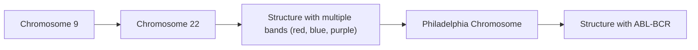
</details>

FIGURE 6.8 The Philadelphia chromosome is formed by a translocation affecting chromosomes 9 and 22. It fuses together the ABL and BCR genes, forming a chimeric gene that can trigger CML.

Once scientists understood the root cause of CML, they started searching for a compound inhibiting ABL-BCR, which resulted in the introduction of a drug called **Gleevec** in 2001. Gleevec is a **targeted therapy** against CML that inhibits cancer cells but does not affect normal cells and has shown great clinical results. However, since it targets only the ABL-BCR fusion protein, Gleevec does not treat most other cancers. Nevertheless, the introduction of Gleevec has bolstered researchers’ hopes that the search for specific rearrangements in other forms of cancer may produce additional targeted cancer therapies.

## From Unichromosomal to Multichromosomal Genomes

Translocations, fusions, and fissions

To model translocations, we represent a multichromosomal genome with k chromosomes as a permutation that has been partitioned into $k$ pieces. For example, the genome $( + 1   + 2   + 3   + 4   + 5   + 6 ) ( + 7   + 8   + 9   + 1 0   + 1 1 )$ is made up of the two chromosomes (+1 $\scriptstyle + 2   + 3   + 4   + 5   + 6 )$ and $( + 7 + 8 + 9 + 1 0 + 1 1 )$ . A translocation exchanges segments of different chromosomes, e.g., a translocation of the two chromosomes

$$
(+ 1 + 2 + 3 + 4 + 5 + 6) (+ 7 + 8 + 9 + 1 0 + 1 1)
$$

311

---

C H A P T E R 6

may result in the two chromosomes

$$
\left(+ 1 + 2 + 3 + 4 + 9 + 1 0 + 1 1\right) \left(+ 7 + 8 + 5 + 6\right).
$$

You can think about a translocation as first breaking each of the two chromosomes

$$
(+ 1 + 2 + 3 + 4 + 5 + 6) \quad (+ 7 + 8 + 9 + 1 0 + 1 1)
$$

into two parts,

$$
(+ 1 + 2 + 3 + 4) \quad (+ 5 + 6) \quad \quad (+ 7 + 8) \quad (+ 9 + 1 0 + 1 1),
$$

and then gluing the resulting segments into two new chromosomes,

$$
(+ 1 + 2 + 3 + 4 + 9 + 1 0 + 1 1) \quad (+ 7 + 8 + 5 + 6).
$$

Rearrangements in multichromosomal genomes are not limited to reversals and translocations. They also include chromosome **fusions**, which merge two chromosomes into a single chromosome, as well as **fissions**, which break a single chromosome into two chromosomes. For example, the two chromosomes

$$
(+ 1 + 2 + 3 + 4 + 5 + 6) \quad (+ 7 + 8 + 9 + 1 0 + 1 1)
$$

can be fused into the single chromosome

$$
(+ 1 + 2 + 3 + 4 + 5 + 6 + 7 + 8 + 9 + 1 0 + 1 1).
$$

A subsequent fission of this chromosome could result in the two chromosomes

$$
\left(+ 1 + 2 + 3 + 4\right) \quad \left(+ 5 + 6 + 7 + 8 + 9 + 1 0 + 1 1\right).
$$

Five million years ago, shortly after the human and chimpanzee lineages split, a fusion of two chromosomes (called 2A and 2B) in one of our ancestors created human chromosome 2 and reduced our chromosome count from 24 to 23.

**STOP and Think:** A priori, it could just as easily be the case that the humanchimpanzee ancestor had an intact chromosome 2, and that a fission split these two chromosomes into chimpanzee chromosomes 2A and 2B. How would you choose between the two scenarios? Hint: gorillas and orangutans, like chimpanzees, also have 24 chromosomes.


312

---

A R E T H E R E F R A G I L E R E G I O N S I N T H E H U M A N G E N O M E ?

## From a genome to a graph

We will henceforth assume that all chromosomes in a genome are circular. This assumption represents a slight distortion of biological reality, as mammalian chromosomes are linear. However, circularizing a linear chromosome by joining its endpoints will simplify the subsequent analysis without affecting our conclusions.

We now have a multichromosomal genomic model, along with four types of re arrangements (reversals, translocations, fusions, and fissions) that can transform one genome into another. To model genomes with circular chromosomes, we will use a **genome graph**. First represent each synteny block by a directed black edge indicating its direction, and then link black edges corresponding to adjacent synteny blocks with a colored undirected edge. Figure 6.9 shows each circular chromosome as an **alternating cycle** of red and black edges. In this model, the human genome can be represented using 280 human-mouse synteny blocks spread over 23 alternating cycles.

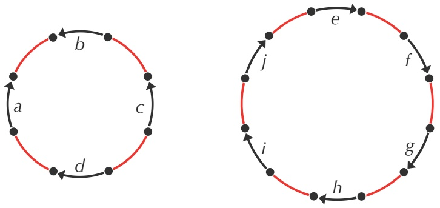

FIGURE 6.9 A genome with two circular chromosomes, $(+a $-b $-c $+d)$ and $( + \mathsf { e } + \mathsf { f }$ $+ g + h + i + j )$ . Black directed edges represent synteny blocks, and red undirected edges connect adjacent synteny blocks. A circular chromosome with n elements can be written in 2n different ways; the chromosome on the left can be written as $( + a - b$ $- c + d )$ $( - b \; { - c \; { + d \; { + a } } } )$ $( - c + d + a - b )$ $( + d + a - b - c )$ $( - a - d + c + \dot { b } )$ (d $\scriptstyle { \left( { + c + b - a } \right) }$ $( + c + b - a - d )$ , and $(+$b \mathrm { ~ - } a \mathrm { ~ - } d \mathrm { ~ + } c \mathrm { ) }$$

**STOP and Think:** Let P and Q be genomes consisting of linear chromosomes, and let $P ^ { * }$ and $Q ^ { * }$ be the circularized versions of these genomes. Can you convert a given series of reversals/translocations/fusions/fissions transforming P into Q into a series of rearrangements transforming $P ^ { * }$ into $Q ^ { * } ?$ What about the reverse operation — can you convert a series of rearrangements transforming $P ^ { * }$ into $Q ^ { * }$ into a series of rearrangements transforming P into $Q ?$


313

---

C H A P T E R 6

## 2-breaks

We now focus on one of the chromosomes in a multi-chromosomal genome and consider a reversal transforming the circular chromosome $P = \left( + a - b - c + d \right)$ into $Q = ( + a - b$ $- d + c )$ . We can draw Q in a variety of ways, depending on how we choose to arrange its black edges. Figure 6.10 shows two such equivalent representations.

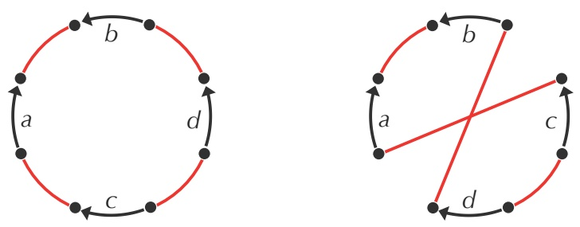

FIGURE 6.10 Two equivalent drawings of the circular chromosome $Q = ( + a - b - d$ +c).

Although the first drawing of Q in Figure 6.10 is its most natural representation, we will use the second representation because its black edges are arranged around the circle in exactly the same order as they appear in the natural representation of $P = ( + a$ $- b - c + d )$ . As illustrated in Figure 6.11, keeping the black edges fixed allows us to visualize the effect of the reversal. As you can see, the reversal deletes $( \mathrm { { \textmu } b r e a k s { \textmu } } )$ two red edges in P (connecting b to c and d to a) and replaces them with two new red edges (connecting b to d and c to a).

Figure 6.12 illustrates a fission of $P = \left( + a - b - c + d \right)$ into $Q = { \bigl ( } { + } a { \mathrm { ~ - } } b { \bigr ) } { \bigl ( } { - } c { \mathrm { ~ + } } d { \bigr ) } ;$ reversing this operation corresponds to a fusion of the two chromosomes of Q to yield P. Both the fusion and the fission operations, like the reversal, correspond to deleting two edges in one genome and replacing them with two new edges in the other genome.

A translocation involving two linear chromosomes can also be mimicked by circularizing these chromosomes and then replacing two red edges with two different red edges, as shown in Figure 6.13. We have therefore found a common theme uniting the four different types of rearrangements. They all can be viewed as breaking two red edges of the genome graph and replacing them with two new red edges on the same four nodes. For this reason, we define the general operation on the genome graph in which two red edges are replaced with two new red edges on the same four nodes as a **2-break**.

314

---

A R E T H E R E F R A G I L E R E G I O N S I N T H E H U M A N G E N O M E ?

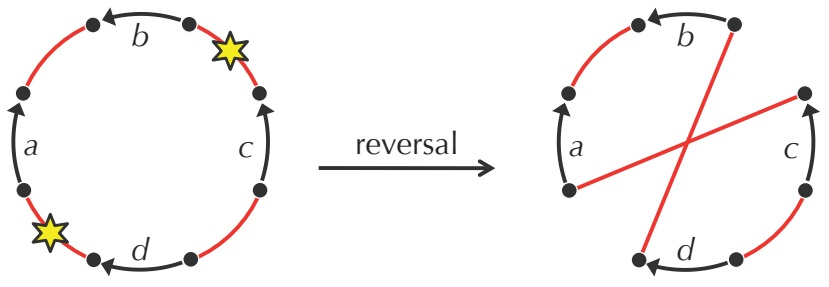

<details>
<summary>flowchart</summary>


</details>

FIGURE 6.11 A reversal transforms $P = \left( + a - b - c + d \right)$ into $Q = \left( + a - b - d + c \right)$ We have arranged the black edges of Q so that they have the same orientation and position as the black edges in the natural representation of $P .$ The reversal can be viewed as deleting the two red edges labeled by stars and replacing them with two new red edges on the same four nodes.

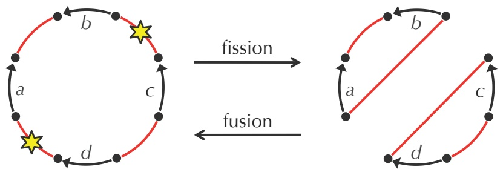

<details>
<summary>flowchart</summary>

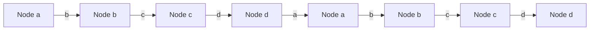
</details>

FIGURE 6.12 A fission of the single chromosome $P \; = \; \left( + a \; - b \; - c \; + d \right)$ into the genome $Q = { \bigl ( } + a - b { \bigr ) } { \bigl ( } - c + d { \bigr ) }$ . The inverse operation is a fusion, transforming the two chromosomes of Q into a single chromosome by deleting two red edges of Q and replacing them with two other edges.

We would like to find a shortest sequence of 2-breaks transforming genome P into genome $Q ,$ and we refer to the number of operations in a shortest sequence of 2-breaks transforming $P$ into $Q$ as the **2-break distance** between $P$ and $Q ,$ denoted $d ( P , Q )$

## 2-Break Distance Problem:

Find the 2-break distance between two genomes.

**Input**: Two genomes with circular chromosomes on the same synteny blocks.

**Output**: The 2-break distance between these genomes.

315

---

C H A P T E R 6

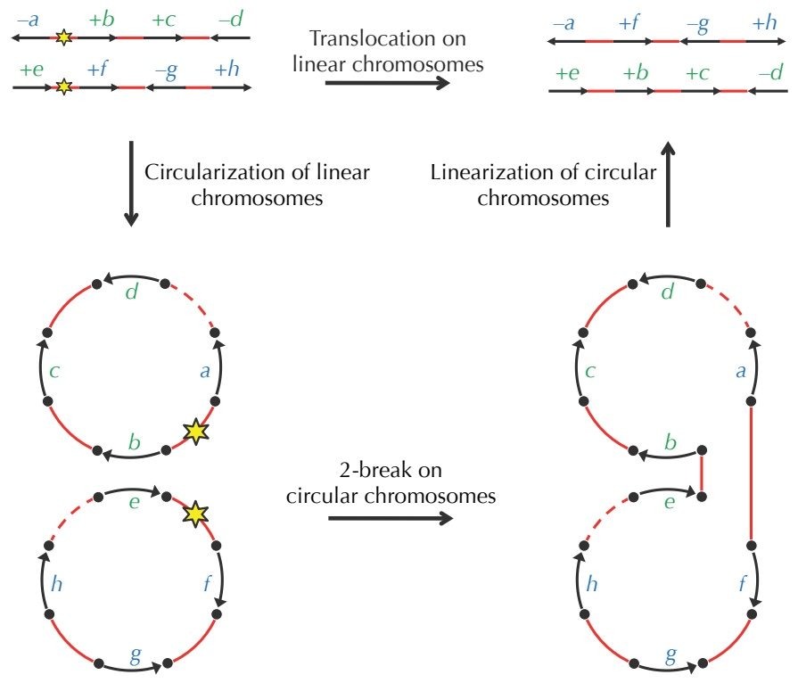

<details>
<summary>flowchart</summary>

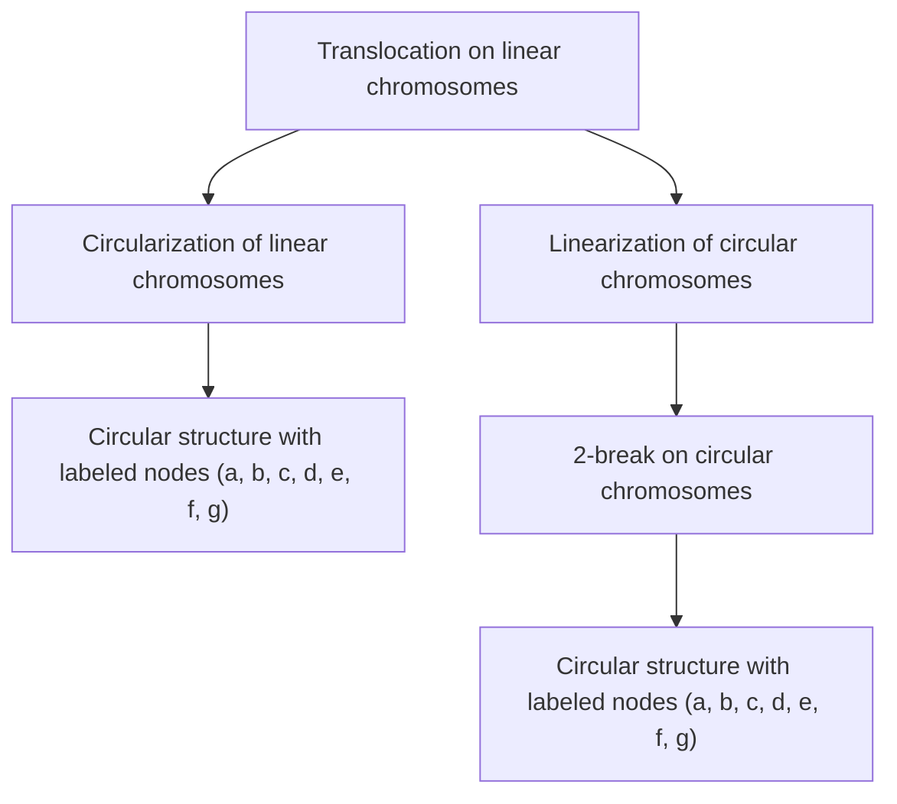
</details>

FIGURE 6.13 A translocation of linear chromosomes $( - a + b + c - d )$ and $( + \mathrm { e } + \bar { f }$ $- g + h )$ transforms them into linear chromosomes $( - a + f - g + h )$ and $( + \mathrm { e } + b$ $\pm c - d )$ This translocation can also be accomplished by first circularizing the chromosomes $( \mathrm { i . e . }$ , connecting the ends of each chromosome with a dashed red edge), then applying a 2-break to the new chromosomes, and finally converting the resulting circular chromosome into two linear chromosomes by removing the dashed red edges.

## Breakpoint Graphs

To compute the 2-break distance, we will return to the notion of breakpoints to construct a graph for comparing two genomes. Consider the genomes $P = \left( + a - b - c + d \right)$ and $\mathcal { Q } = \left( + a   +   c   +   b   -   d \right)$ . Note that we have used red for the colored edges of P and blue for the colored edges of $Q .$ As before, we rearrange the black edges of $Q$ so that they are arranged exactly as in P (Figure 6.14, middle). If we superimpose the genome graphs of $P$ and $Q ,$ then we obtain the tri-colored **breakpoint graph** BREAKPOINTGRAPH $( P , Q )$ shown in Figure 6.14.

316

---

A R E T H E R E F R A G I L E R E G I O N S I N T H E H U M A N G E N O M E ?

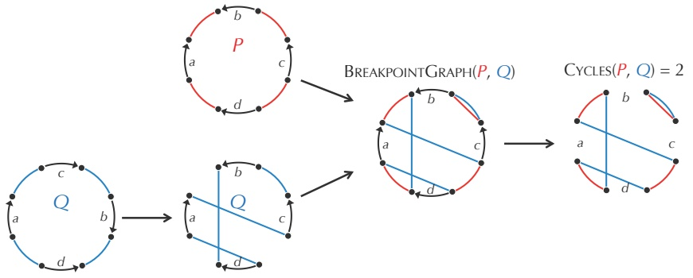

<details>
<summary>flowchart</summary>


</details>

FIGURE 6.14 Constructing the breakpoint graph for the unichromosomal genomes $P =$ $( + a - b - c + d )$ and $\mathbb { Q } = ( + a + c + b - d )$ . After rearranging the black edges of Q so that they are arranged the same as in P, the breakpoint graph BREAKPOINTGRAPH $( P , Q )$ is formed by superimposing the graphs of P and Q. As shown on the right, there are two alternating red-blue cycles in this breakpoint graph.

Note that the red and black edges in the breakpoint graph form P, and the blue and black edges form Q. Moreover, the red and blue edges in the breakpoint graph form a collection of red-blue alternating cycles.

**STOP and Think:** Prove that the red and blue edges in any breakpoint graph form alternating cycles. Hint: How many red and blue edges meet at each node of the breakpoint graph?

We denote the number of red-blue alternating cycles in BREAKPOINTGRAPH $( P , Q )$ as CYCLES $( P , Q )$ . For $P = \left( + a - b - c + d \right)$ and $\mathcal { Q } = \left( + a   +   c   +   b   -   d \right)$ , CYCLES $( P , Q ) = 2 ,$ as shown on the right in Figure 6.16. In what follows, we will be focusing on the red-blue alternating cycles in breakpoint graphs and often omit the black edges.

Although Figure 6.14 illustrates the construction of the breakpoint graph for singlechromosomal genomes, the breakpoint graph can be constructed for genomes with multiple chromosomes in exactly the same way (Figure 6.15).

**STOP and Think:** Given genome P, which genome Q maximizes CYCLES $( P , \mathcal { Q } ) ?$

In the case that P and Q have the same number of synteny blocks, we denote the number of their synteny blocks as BLOCKS $( P , Q )$ . As shown in Figure 6.16, when P and Q are identical, their breakpoint graph consists of BLOCKS $( P , Q )$ cycles of length

STOP

STOP

317

---

C H A P T E R 6

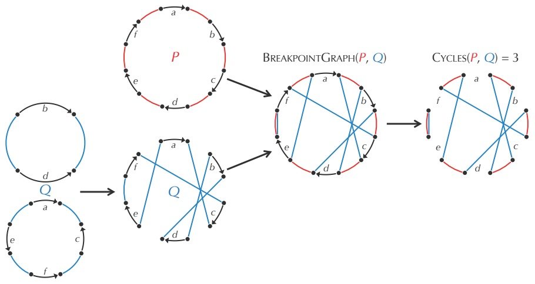

<details>
<summary>flowchart</summary>

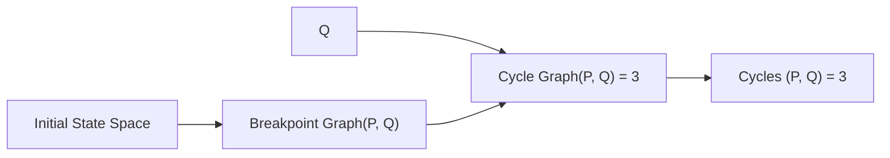
</details>

FIGURE 6.15 The construction of BREAKPOINTGRAPH $( P , Q )$ for the unichromosomal genome $P = ( + a + b + c + d + e + f )$ and the two-chromosome genome $Q = ( + a - c$ $- f   - \mathrm { e } ) ( + b - d )$ . At the bottom, to illustrate the construction of the breakpoint graph, we first rearrange the black edges of $Q \; { \mathrm { s o } }$ that they are drawn the same as in P.

2, each containing one red and one blue edge. We refer to cycles of length 2 as **trivial cycles** and the breakpoint graph formed by identical genomes as the **trivial breakpoint graph**.

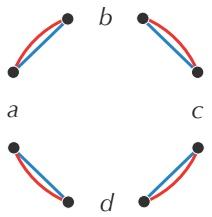

<details>
<summary>flowchart</summary>


</details>

FIGURE 6.16 The trivial breakpoint graph BREAKPOINTGR ${ \mathsf { A P H } } ( P , P )$ , formed by two copies of the genome $P = \left( + a - b - c + d \right)$ . The breakpoint graph of any genome with itself consists only of length 2 alternating cycles.


**EXERCISE BREAK:** Prove that CYCLES $( P , Q )$ is smaller than BLOCKS $( P , Q )$ unless P is equal to $Q .$

318

---

A R E T H E R E F R A G I L E R E G I O N S I N T H E H U M A N G E N O M E ?

You are likely wondering how the breakpoint graph is useful. We can view a 2- break transforming $P$ into $P ^ { \prime }$ as an operation on BREAKPOINTGR $\mathrm { A P H } \big ( P , Q \big )$ that yields BREAKPOINTGRAPH $\left( P ^ { \prime } ,   \mathcal { Q } \right)$ (Figure 6.17).

By extension, we can view a series of 2-breaks transforming P into $Q$ as a series of 2-breaks transforming BREAKPOINTGRAPH $( P , Q )$ into BREAKPOINTGRAPH $( Q , Q )$ , the trivial breakpoint graph. Figure 6.18 illustrates a transformation of a breakpoint graph with CYCLES $( P , Q ) = 2$ into a trivial breakpoint graph with CYCLES $\left( Q , Q \right) = 4$ using two 2-breaks.

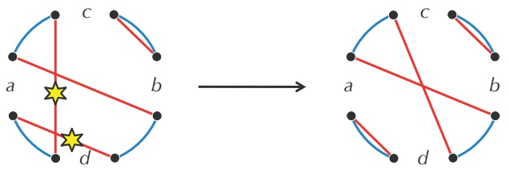

<details>
<summary>flowchart</summary>

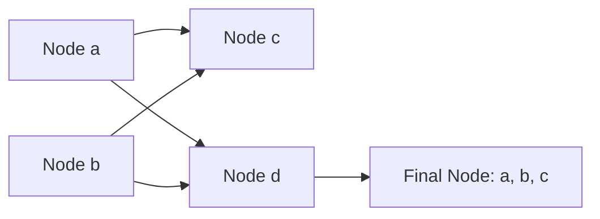
</details>

FIGURE 6.17 A 2-break (indicated by stars) transforming genome $P$ into $P ^ { \prime }$ also transforms BREAKPOINTGRAPH $( P , Q )$ into BREAKPOINTGRAPH $( P ^ { \prime } , Q )$ for any genome $\overline { { Q } } .$ In this example, $P = \left( + a - b - c + d \right), P^{\prime} = \left( + a - b - c - d \right)$ , and $\mathbb { Q } = \left( + a   + c   + b   - d \right)$

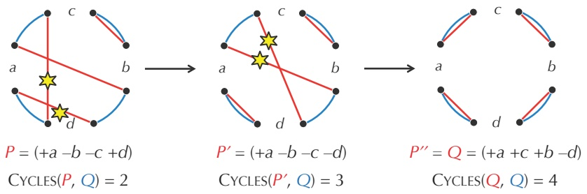

<details>
<summary>flowchart</summary>

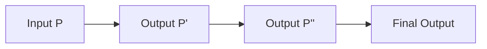
</details>

FIGURE 6.18 Every 2-break transformation of genome P into $Q$ corresponds to a transformation of BREAKPOINTGRAPH $( P , Q )$ into BREAKPOINTGRAPH(Q, Q). In the example shown, the number of red-blue cycles in the graph increases from CYCLES $( P , Q ) = 2$ to $\mathsf { C Y C L E S } ( \overline { { Q } } , \overline { { Q } } ) = \mathsf { B L O C K S } ( \overline { { Q } } , \overline { { Q } } ) = 4$

Since every transformation of P into $Q$ transforms BREAKPOINTGRAPH $( P , Q )$ into the trivial breakpoint graph BREAKPOINTGRAPH $( Q , Q )$ , any sorting by 2-breaks increases the number of red-blue cycles by

$$
\text {CYCLES} (Q, Q) - \text {CYCLES} (P, Q).
$$

319

---

C H A P T E R 6


**STOP and Think:** How much can each 2-break contribute to this increase? In other words, if $P ^ { \prime }$ is obtained from P by a 2-break, how much bigger can CYCLES $\left( P ^ { \prime } , \mathcal { Q } \right)$ be than CYCLES $( P , \mathcal { Q } ) ?$

## Computing the 2-Break Distance

The Breakpoint Theorem stated that a reversal applied to a linear chromosome P can reduce BREAKPOINTS(P) by at most 2. We now prove that a 2-break applied to a multichromosomal genome P can increase CYCLES $( P , Q )$ by at most 1, i.e., for any 2-break transforming P into $P ^ { \prime } ,$ and for any genome Q, CYCLES $\left( P ^ { \prime } , Q \right)$ cannot exceed CYCLES $\left( P , Q \right) + 1$

**Cycle Theorem:** For genomes P and Q, any 2-break applied to P can increase CYCLES $( P , Q )$ by at most 1.

Proof. Figure 6.19 presents three cases that illustrate how a 2-break applied to P can affect the breakpoint graph. Each 2-break affects two red edges that either belong to the same cycle or to two different cycles in BREAKPOINTGRAPH(P, Q). In the former case, the 2-break either does not change CYCLES $( P , Q )$ , or it increases it by 1. In the latter case, it decreases CYCLES $( P , Q )$ by 1. □

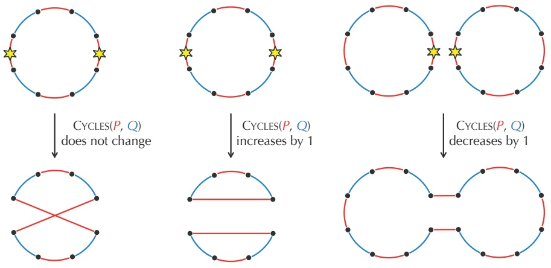

<details>
<summary>flowchart</summary>

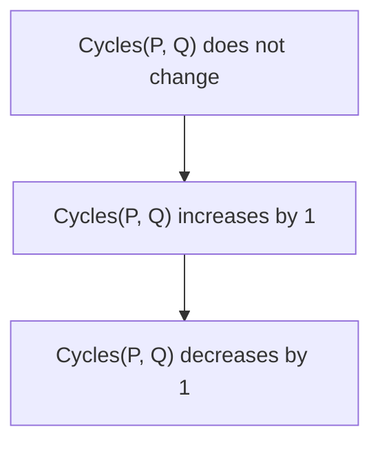
</details>

FIGURE 6.19 Three cases illustrating how a 2-break can affect the breakpoint graph.

320

---

A R E T H E R E F R A G I L E R E G I O N S I N T H E H U M A N G E N O M E ?

Although the preceding proof is short and intuitive, it is not a formal proof, but rather an invitation to examine Figure 6.19. If you are interested in a more rigorous mathematical argument, please read the next proof.

Proof. A 2-break adds two new red edges and thus forms at most 2 new cycles (containing two new red edges) in BREAKPOINTGRAPH $( P , Q )$ . At the same time, it deletes two red edges and thus deletes at least 1 old cycle (containing two old edges) from $\mathrm { B R E A K P O I N T G R A P H } \big ( P , Q \big )$ . Thus, the number of red-blue cycles in the breakpoint graph increases by at most $\mathbf { 2 - 1 } = 1$ , implying that $\operatorname { C Y C L E S } ( P , Q )$ increases by at most 1. □

Recall that there are permutations for which no reversal reduces the number of breakpoints, a fact that defeated our hopes for a greedy algorithm for sorting by reversals that reduces the number of breakpoints at each step. In the case of 2-breaks (on genomes with circular chromosomes), we now know that each 2-break can increase CYCLES $( P , Q )$ by at most 1. But is it always possible to find a 2-break that increases CYCLES $( P , Q )$ by 1? As the following theorem illustrates, the answer is yes.

**2-Break Distance Theorem:** The 2-break distance between genomes P and Q is equal to BLOCKS $\left( P , Q \right) - \mathsf { C Y C L E S } \left( P , Q \right)$

Proof. Recall that every sorting by 2-breaks must increase the number of alternating cycles by CYCLES $\left( Q , Q \right) - \operatorname { C Y C L E S } \left( P , Q \right)$ , which equals BLOCKS $\left( P , Q \right) - \operatorname { C Y C L E S } \left( P , Q \right)$ because BLOCKS $\left( P , Q \right) = \operatorname { C Y C L E S } \left( Q , Q \right)$ . The Cycle Theorem implies that each 2-break increases the number of cycles in the breakpoint graph by at most 1. This immediately implies in turn that $d ( P , Q )$ is at least BLOCKS $\left( P , Q \right) - \mathbb { C } \mathtt { Y } \mathtt { C } \mathtt { L E S } \big ( P , Q \big )$ . If P is not equal to Q, then there must be a **non-trivial cycle** in BREAKPOINTGRAPH $( P , Q )$ , i.e., a cycle with more than two edges. As shown in Figure 6.19 (middle), any non-trivial cycle in the breakpoint graph can be split into two cycles by a 2-break, implying that we can always find a 2-break increasing the number of red-blue cycles by 1. Therefore, $d ( P , Q )$ is equal to BL $\operatorname { L O C K S } \bigl ( P , Q \bigr ) - \operatorname { C Y C L E S } \bigl ( P , Q \bigr )$ □

Armed with this theorem, you should be ready to design an algorithm solving the 2-Break Distance Problem.

**CHARGING STATION (From Genomes to the Breakpoint Graph):** You may be wondering how the graph representation that we have been using for breakpoint graphs could be transformed into an adjacency list. After all, we haven’t even labeled the nodes of this graph! Check out this Charging Station to see how to implement the genome graph.


321

---

C H A P T E R 6


We now know how to compute the 2-break distance, but we would also like to reconstruct a collection of 2-breaks making up a shortest path between two genomes. This problem is called **2-break sorting**, which we leave to you as an exercise.

## 2-Break Sorting Problem:

Find a shortest transformation of one genome into another by 2-breaks.

**Input**: Two genomes with circular chromosomes on the same synteny blocks. **Output**: The sequence of genomes resulting from applying a shortest sequence of 2-breaks transforming one genome into the other.


**CHARGING STATION (Solving the 2-Break Sorting Problem):** The Breakpoint Theorem guarantees that there is always a 2-break reducing the number of red-blue cycles in the breakpoint graph by 1. However, it does not tell us how to find such a 2-break. Check out this Charging Station to see how this can be done.

Having proved the formula $d(P,Q)=\mathrm{BLOCKS}(P,Q)-\mathrm{CYCLES}(P,Q)$ for the 2-break distance between genomes with multiple circular chromosomes, we wonder whether we can find an analogous formula for the reversal distance between single linear chromosomes.


**EXERCISE BREAK:** Compute the 2-break distance between the circularized human and mouse X chromosomes. Can you transform a series of 2-breaks for these chromosomes into a series of reversals sorting the linear X chromosomes?


It turns out that a polynomial algorithm for sorting permutations by reversals does exist, yielding an exact formula for the reversal distance! Although this algorithm also relies on the notion of the breakpoint graph, it is unfortunately too complicated to present here (see **DETOUR: Sorting Linear Permutations by Reversals**).

The breakpoint graph constructed on the 280 human-mouse synteny blocks contains 35 alternating cycles, so that the 2-break distance between these genomes is $280-35=245.$ Again, we don’t know exactly how many 2-breaks happened in the last 75 million years, but we are certain that there were at least 245 steps. Remember this fact, since it will prove important in the next section.

322

---

A R E T H E R E F R A G I L E R E G I O N S I N T H E H U M A N G E N O M E ?

## Rearrangement Hotspots in the Human Genome

The Random Breakage Model meets the 2-Break Distance Theorem

You have probably anticipated from the beginning of the chapter that we would eventually argue against the Random Breakage Model. But it may still be unclear to you how the 2-break distance could possibly be used to do so.

**Rearrangement Hotspots Theorem:** There are rearrangement hotspots in the human genome.

Proof. Recall that if the Random Breakage Model is correct, then N reversals applied to a linear chromosome will produce approximately 2N + 1 synteny blocks, since the probability is very low that two nearby locations in the genome will be used as the breakage point of more than one reversal. Similarly, N random 2-breaks applied to circular chromosomes will produce 2N synteny blocks. Since there are 280 humanmouse synteny blocks, there must have been approximately 280/2 = 140 2-breaks on the evolutionary path between humans and mice. However, the 2-Break Distance Theorem tells us that there were at least 245 2-breaks on this evolutionary path.

**STOP and Think:** Is 245 ⇡ 140?

Since 245 is much larger than 140, we have arrived at a contradiction, implying that one of our assumptions is incorrect! But the only assumption we made in this proof was “If the Random Breakage Model is correct. . . ” Thus, this assumption must have been wrong. □

This argument, which is not a mathematical proof, is nevertheless logically solid. It offers an example of a **proof by contradiction**, in which we begin by assuming the statement that we intend to disprove and then demonstrate how this assumption cannot be true. As a result of the Rearrangement Hotspots Theorem, we conclude that there was breakpoint reuse on the human-mouse evolutionary path. This breakpoint reuse was extensive, as quantified by the large ratio between the actual 2-break distance and what the 2-break distance would have been under the Random Breakage Model ( 245/140 = 1.75 ).

Of course, our arguments need to be made statistically sound in order to ensure that the discrepancy between the Random Breakage Model’s prediction and the 2-break distance is significant. After all, even though genomes are large, there is still a small chance that randomly chosen 2-breaks might occasionally break a genome more than


323

---

C H A P T E R 6

STOP

STOP

once in a small interval. The necessary statistical analysis is beyond the scope of this book.

## The Fragile Breakage Model

But wait — what about Nadeau and Taylor’s argument in favor of the Random Breakage Model? We certainly cannot ignore that the lengths of the human-mouse synteny blocks resemble an exponential distribution.

**STOP and Think:** Can you find anything wrong with Nadeau and Taylor’s logic?

The Nadeau and Taylor argument in favor of the Random Breakage Model exemplifies a classic logic fallacy. It is true that if breakage is random, then the histogram of synteny block lengths should follow the exponential distribution. But it is a completely different statement to conclude that just because synteny block lengths follow the exponential distribution, breakage must have been random. The distribution of synteny block lengths certainly provides support for the Random Breakage Model, but it does not prove that it is correct.

Nevertheless, any alternative hypothesis we put forth for the Random Breakage Model must account for the observation that the distribution of synteny block lengths for the human and mouse genomes is approximately exponential.

**STOP and Think:** Can you propose a different model of chromosome evolution that explains rearrangement hotspots and is consistent with the exponential distribution of synteny block lengths?

The contradiction of the Random Breakage Model led to an alternative **Fragile Breakage Model** of chromosome evolution, which was proposed in 2003. This model states that every mammalian genome is a mosaic of long solid regions, which are rarely affected by rearrangements, as well as short **fragile regions** that serve as rearrangement hotspots and that account only for a small fraction of the genome. For humans and mice, these fragile regions make up approximately 3% of the genome.

If we once again follow Occam’s razor, then the most reasonable way to allow for exponentially distributed synteny block lengths is if the fragile regions themselves are distributed randomly in the genome. Indeed, randomly selecting breakpoints within randomly distributed fragile regions is not unlike randomly selecting the endpoints of a rearrangement throughout the entire genome. Yet although we now have a model that

324

---

A R E T H E R E F R A G I L E R E G I O N S I N T H E H U M A N G E N O M E ?

fits our observations, many questions remain. For example, it is unclear where fragile regions are located, or what causes genomic fragility in the first place.

**STOP and Think:** Consider the following statement: “The exponential distribution of synteny block lengths and extensive breakpoint re-use imply that the Fragile Breakage Model must be true.” Is this argument logically sound?

The point we are attempting to make by asking the preceding question is that we will never be able to prove a scientific theory like the Fragile Breakage Model in the same way that we have proved one of the mathematical theorems in this chapter. In fact, many biological theories are based on arguments that a mathematician would view as fallacious; the logical framework used in biology is quite different from that used in mathematics. To take an historical example, neither Darwin nor anyone else has ever proved that evolution by natural selection is the only — or even the most likely explanation for how life on Earth evolved!

We have already given many reasons to biology professors to send us to Biology 101 boot camp, but now we will probably be rounded up and thrown into the Gulag alongside Intelligent Design proponents. However, the fact remains that not even Darwinism is unassailable; in the 20th Century, this theory was revised into Neo-Darwinism, and there is little doubt that it will continue to evolve.

## Epilogue: Synteny Block Construction

Throughout our discussion of genome rearrangements, we assumed that we were given synteny blocks in advance. In this section, we will describe one way of constructing synteny blocks from genomic sequences.

## Genomic dot-plots

Biologists sometimes visualize repeated k-mers within a string as a collection of points in the plane; a point with coordinates $( x , y )$ represents identical k-mers occurring at positions x and y in the string. The top panels in Figure 6.20 present two of these **genomic dot plots**. Of course, since DNA is double-stranded, we should expand the notion of repeated k-mers to account for repeats occurring on the complementary strand. In the bottom left panel of Figure 6.20, blue points $( x , y )$ indicate that the k-mers starting at positions x and y of the string are reverse complementary.


325

---

C H A P T E R 6

## Finding shared k-mers

Recalling that a synteny block is defined by many similar genes occurring in the same order in two genomes, let’s first find the positions of all k-mers that are shared by the human and mouse X chromosomes. If we choose k to be sufficiently large (e.g., k = 30), then it is rather unlikely that shared k-mers represent spurious similarities. A more likely explanation is that they come from related genes (or shared repeats) in the human and mouse genomes.

Formally, we say that a k-mer is **shared** by two genomes if either the k-mer or its reverse complement appears in each genome. Below are four pairs of 3-mers (shown in bold) that are shared by AAACTCATC and TTTCAAATC; note that the second pair of 3-mers are reverse complements of each other.

| 0 | 0 | 4 | 6 |
| --- | --- | --- | --- |
| AAACTCATC | AAACTCATC | AAACTCATC | AAACTCATC |
| TTTCAAATC | TTTCAAATC | TTTCAAATC | TTTCAAATC |
| 4 | 0 | 2 | 6 |

We can further generalize the genomic dot plot to analyze the shared k-mer content of two genomes. We color the point (x, y) red if the two genomes share a k-mer starting at respective positions x and y; we color (x, y) blue if the two genomes have reverse complementary k-mers at these starting positions. See Figure 6.20 (bottom right).

**EXERCISE BREAK:** Find all shared 2-mers of AAACTCATC and TTTCAAATC.


## Shared k-mers Problem:

Given two strings, find all their shared k-mers.

**Input**: An integer k and two strings.

**Output**: All k-mers shared by these strings, in the form of ordered pairs (x, y) corresponding to starting positions of these k-mers in the respective strings.

**EXERCISE BREAK:** Answer the following questions regarding counting shared k-mers.

1. Compute the expected number of 30-mers shared by two random strings, each a billion nucleotides long.
2. How many shared 30-mers do the E. coli and S. enterica genomes share?

326

---

A R E T H E R E F R A G I L E R E G I O N S I N T H E H U M A N G E N O M E ?

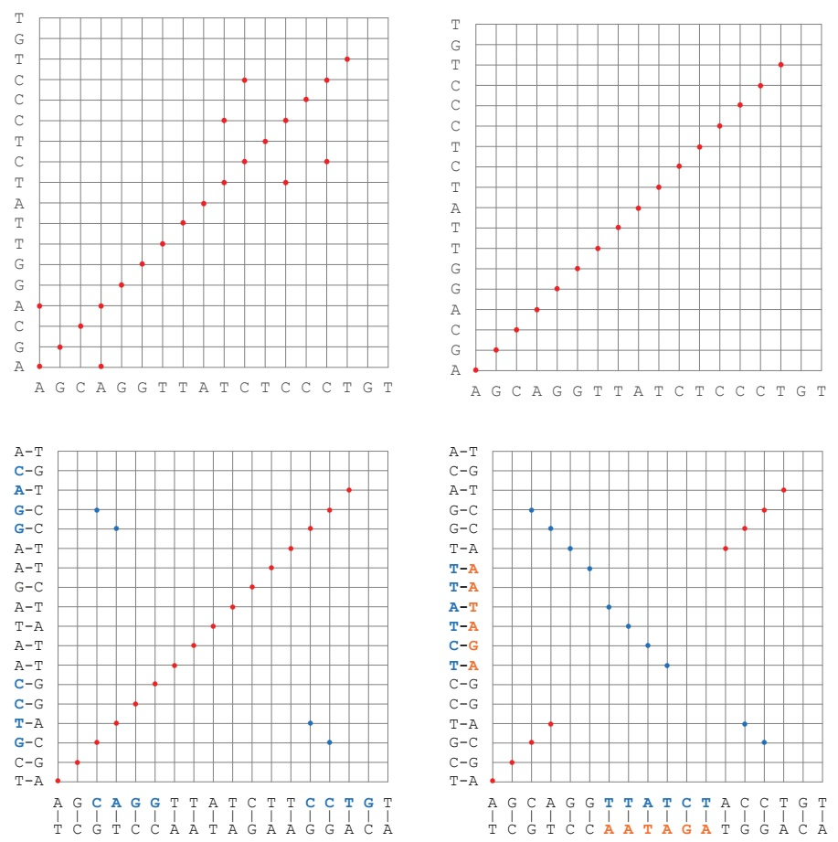

FIGURE 6.20 A visualization of repeated k-mers within the string AGCAGGTTATCTCCCTGT for k = 2 (top left) and k = 3 (top right). (Bottom left) We add blue points to the plot shown in the upper left corner to indicate reverse complementary k-mers. For example, CCT and AGG are reverse complementary 3-mers in AGCAGGTTATCTTCCTGT. (Bottom right): Genomic dot-plot showing shared 3-mers between AGCAGGTTATCTACCTGT and AGCAGGAGATAAACCTGT. The latter sequence resulted from the former sequence by a reversal of the segment TTATCT. Each point (x, y) corresponds to a k-mer shared by the two genomes. Red points indicate identical shared k-mers, whereas blue points indicate reverse complementary k-mers. Note that the dot-plot has six “noisy” blue points in the diagram: four in the upper left corner, and two in the bottom right corner. You will also notice that red dots can be connected into line segments with slope 1 and blue dots can be connected into line segments with slope 1. The resulting three synteny blocks (AGCAGG, TTATCT, and CCCTGT) correspond to three diagonals (each formed by four points) in the dot-plot.

327

---

C H A P T E R 6

The E. coli and S. enterica genomes are both about five million nucleotides long. It can be shown that the expected number of shared 30-mers between two random 5 million nucleotide-long sequences is approximately $2 \cdot { \left( 5 \cdot 1 0 ^ { 6 } \right) } ^ { 2 } { \big / } 4 ^ { 3 0 } \approx 1 / 2 0 , 0 0 0 .$

Yet solving the Shared k-mers Problem for E. coli and S. enterica yields over 200,000 pairs $( x , y )$ corresponding to shared 30-mers. The surprisingly large number of shared 30-mers indicates that E. coli and S. enterica are close relatives that have retained many similar genes inherited from their common ancestor. However, these genes may be arranged in a different order in the two species: how can we infer synteny blocks from these genomes’ shared k-mers? The genomic dot-plot plot for E. coli and S. enterica is shown in Figure 6.21.

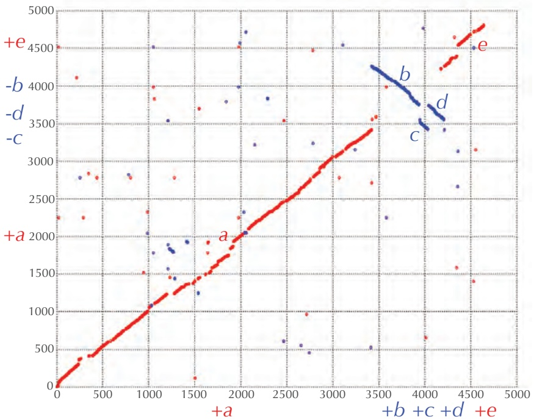

<details>
<summary>scatter</summary>

| Series | X (range) | Y (range) |
| --- | --- | --- |
| Red (+a) | 0~4600 | 100~4800 |
| Blue (-b) | 200~4500 | 500~4700 |
| Red (-c) | 200~4500 | 1500~4500 |
</details>

FIGURE 6.21 Genomic dot-plot of E. coli (horizontal axis) and S. enterica (vertical axis) for $k   =   3 0$ . Each point $( x , y )$ corresponds to a k-mer shared by the two genomes. Red points indicate identical shared k-mers, whereas blue points indicate reverse complementary k-mers. Each axis is measured in kilobases (thousands of base pairs).


STOP and Think: Can you see the synteny blocks in the genomic dot-plot in Figure 6.21?

328

---

A R E T H E R E F R A G I L E R E G I O N S I N T H E H U M A N G E N O M E ?

## Constructing synteny blocks from shared k-mers

The genomic dot-plot in Figure 6.21 indicates five regions of similarity in the form of points that clump together into approximately diagonal segments. These segments are labeled by $a ,   b ,   c ,   d ,$ and e according to the order in which they appear in the E. coli genome. We ignore smaller diagonals such as the short blue diagonal starting around position 1.3 million in E. coli and around position 1.9 million in S. enterica. For example, while a corresponds to a long diagonal segment of slope 1 that covers approximately the first 3.5 million positions in both genomes, b corresponds to a shorter diagonal segment of slope 1 that starts shortly before position 3.5 million in $E .$ coli and shortly after position 4 million in S. enterica. Although b appears small in Figure 6.21, don’t be fooled by the scale of the figure; b is over 100,000 nucleotides long and contains nearly 100 genes.

The segments $a , b , c , d ,$ and e give us the synteny blocks that we have been looking for. If we project these blocks onto the x- and y-axes, then the ordering of blocks on each axis corresponds to the ordering of synteny blocks in the respective bacterium. The ordering of synteny blocks in E. coli (plotted on the x-axis) is $( + a + b + c + d + e )$ and the ordering in S. enterica (y-axis) is $( + a - c - d - b + e )$ . Note that the blue letters in S. enterica are assigned a negative sign because these blocks were constructed from reverse complementary k-mers. Figure 6.21 also illustrates what the directions of blocks are — they respectively correspond to diagonals in the dot-plot with slope 1 (blocks with $a $ '' + '' $$ sign) and slope 1 (blocks with a “” sign).

We have therefore represented the relationship between two bacterial genomes using just five synteny blocks. Of course, this simplification required us to throw out some points in the dot plot, corresponding to tiny regions of similarity that did not surpass a threshold length in order to be considered synteny blocks.

We are now ready to construct the eleven human-mouse synteny blocks originally presented in Figure 6.1 (page 294), but since the human and mouse X chromosomes are rather long, we will instead provide you with all positions $( x , y )$ where they share significant similarities. Figure 6.22 (top left) presents the resulting genomic dot-plot for the human and mouse X chromosomes, where each point represents a long similar region rather than a shared k-mer. Our eyes immediately find eleven diagonals in this plot corresponding to the human-mouse X chromosome synteny blocks — problem solved! We state this problem as the Synteny Blocks Problem.

329

---

C H A P T E R 6

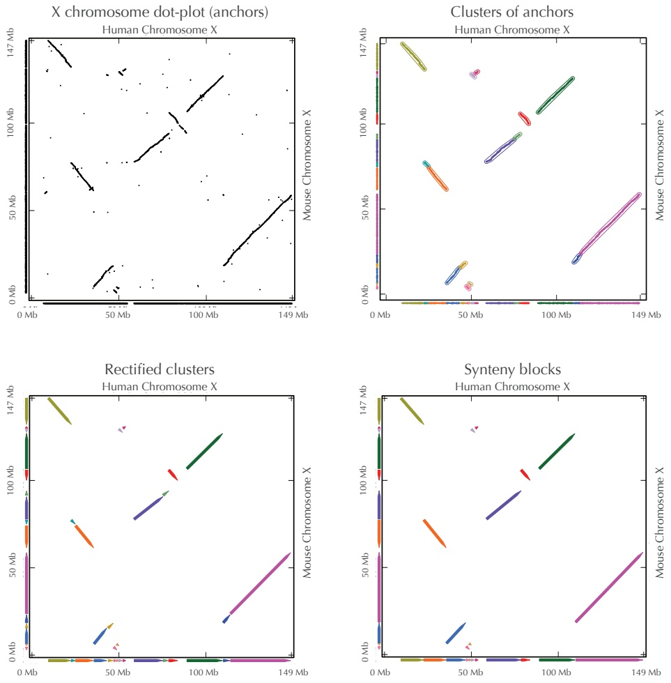

FIGURE 6.22 From local similarities to synteny blocks. (Top left) The genomic dot-plot for the human and mouse X chromosomes, representing all positions $( x , y )$ where they share significant similarities. In contrast with Figure 6.21, we do not distinguish between red and blue dots. (Top right) Clusters (connected components) of points in the genomic dot-plot are formed by constructing the synteny graph. (Bottom left) Rectified clusters from the synteny graph transform each cluster into an exact diagonal of slope $\pm 1$ . (Bottom right) Aggregated synteny blocks. Projection of the synteny blocks to the x-and y-axes results in the arrangements of synteny blocks in the respective human and mouse genomes $\left( + 1 + 2 + 3 + 4 + 5 + 6 + 7 + 8 + 9 + 10 + 11 \right)$ and $+ 1 - 7 + 6 - 10$ $+ 9 - 8 + 2 - 11 - 3 + 5 + 4$

330

---

A R E T H E R E F R A G I L E R E G I O N S I N T H E H U M A N G E N O M E ?

## Synteny Blocks Problem:

Find diagonals in the genomic dot-plot.

**Input**: A set of points DotPlot in the plane.

**Output**: A set of diagonals in DotPlot representing synteny blocks.

Unfortunately, it remains unclear how to write a program to do what our eyes found to be so easy; we hope you have already noticed that the Synteny Blocks Problem is not a well-formulated computational problem. As we have mentioned, the diagonals in Figure 6.22 (top left) are not perfect. Moreover, there are many gaps within diagonals that cannot be seen by the human eye but will become apparent if we zoom into the genome plot. It is therefore unclear what method the human brain is using to transform the dots into the eleven diagonals in the genomic dot-plot.

**STOP and Think:** How can we translate the brain’s ability to construct the diagonals that you see in Figure 6.22 (top left) into an algorithm that a computer can understand?

## Synteny blocks as connected components in graphs

The reason why you can easily see the synteny blocks in a genomic dot-plot is that your brain is good at clustering nearby points in an image. To mimic this process with a computer, we therefore need a precise notion of clustering. Given a set of points DotPlot in the plane as well as a parameter maxDistance, we will construct the (undirected) **synteny graph** SYNTENYGRAPH(DotPlot, maxDistance) by connecting two points in DotPlot with an edge if the distance between them does not exceed maxDistance.

Every graph can be divided into disjoint connected subgraphs called **connected components**. The connected components in SYNTENYGRAPH(DotPlot, maxDistance) represent candidate synteny blocks between the two genomes (Figure 6.23). When we construct the synteny graph for the human and mouse X chromosomes, we find a huge number of small connected components (the exact number depends on our choice of the maxDistance parameter). However, we will ignore these small connected components, since they may represent spurious similarities. We thus introduce the parameter minSize representing the minimum number of points in a connected component that we will consider as forming a synteny block. Our goal is to return all connected components having at least minSize nodes.


331

---

C H A P T E R 6

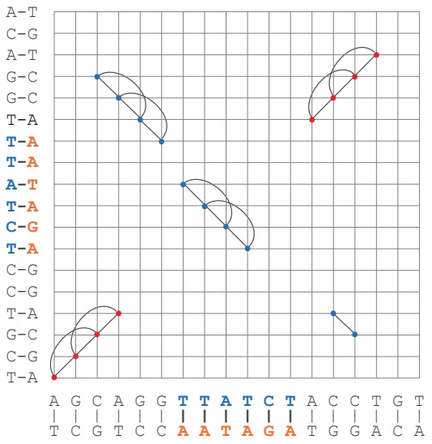

<details>
<summary>scatter</summary>

| Position | Nucleotide |
| --- | --- |
| 1 | A-T |
| 2 | G-C |
| 3 | G-C |
| 4 | T-A |
| 5 | T-A |
| 6 | A-T |
| 7 | T-A |
| 8 | C-G |
| 9 | T-A |
| 10 | G-C |
| 11 | C-G |
| 12 | T-A |
| 13 | G-C |
| 14 | G-C |
| 15 | G-C |
| 16 | G-C |
| 17 | G-C |
| 18 | G-C |
| 19 | T-A |
| 20 | T-A |
| 21 | T-A |
| 22 | T-A |
| 23 | T-A |
| 24 | T-A |
| 25 | T-A |
| 26 | T-A |
| 27 | T-A |
| 28 | T-A |
| 29 | T-A |
| 30 | T-A |
| 31 | T-A |
| 32 | T-A |
| 33 | T-A |
| 34 | T-A |
| 35 | T-A |
| 36 | T-A |
| 37 | T-A |
| 38 | T-A |
| 39 | T-A |
| 40 | T-A |
| 41 | T-A |
| 42 | T-A |
| 43 | T-A |
| 44 | T-A |
| 45 | T-A |
| 46 | T-A |
| 47 | T-A |
| 48 | T-A |
| 49 | T-A |
| 50 | T-A |
| 51 | T-A |
| 52 | T-A |
| 53 | T-A |
| 54 | T-A |
| 55 | T-A |
| 56 | T-A |
| 57 | T-A |
| 58 | T-A |
| 59 | T-A |
| 60 | T-A |
| 61 | T-A |
| 62 | T-A |
| 63 | T-A |
| 64 | T-A |
| 65 | T-A |
| 66 | T-A |
| 67 | T-A |
| 68 | T-A |
| 69 | T-A |
| 70 | T-A |
| 71 | T-A |
| 72 | T-A |
| 73 | T-A |
| 74 | T-A |
| 75 | T-A |
| 76 | T-A |
| 77 | T-A |
| 78 | T-A |
| 79 | T-A |
| 80 | T-A |
| 81 | T-A |
| 82 | T-A |
| 83 | T-A |
| 84 | T-A |
| 85 | T-A |
| 86 | T-A |
| 87 | T-A |
| 88 | T-A |
| 89 | T-A |
| 90 | T-A |
| 91 | T-A |
| 92 | T-A |
| 93 | T-A |
| 94 | T-A |
| 95 | T-A |
| 96 | T-A |
| 97 | T-A |
| 98 | T-A |
| 99 | T-A |
| 100 | T-A |
</details>

FIGURE 6.23 The graph SYNTENYGRAPH(DotPlot, 4) constructed from the genomic dot-plot of AGCAGGTTATCTCCCTGT and AGCAGGAGATAACCCTGT for k = 3. Note that the three synteny blocks (all of which have four nodes) correspond to diagonals in the genomic dot-plot. We ignore the two smaller, noisy synteny blocks.

```txt
SYNTENYBLOCKS(DotPlot, maxDistance, minSize)
    construct SYNTENYGRAPH(DotPlot, maxDistance)
    find the connected components in SYNTENYGRAPH(DotPlot, maxDistance)
    output connected components containing at least minSize nodes as candidate
    synteny blocks
```

As Figure 6.22 (top right) illustrates, **SYNTENYBLOCKS** has the tendency to partition a single diagonal (as perceived by the human eye) into multiple diagonals due to gaps that exceed the parameter maxDistance. However, this partitioning is not a problem, since the broken diagonals can be combined later into a single (aggregated) synteny block.


**STOP and Think:** We have defined synteny blocks as large connected components in SYNTENYGRAPH(DotPlot, maxDistance) but have not described how to determine where these synteny blocks are located in the original genomes. Using Figure 6.22 as a hint, design an algorithm for finding this information.

332

---

A R E T H E R E F R A G I L E R E G I O N S I N T H E H U M A N G E N O M E ?

You should now be ready to solve the challenge problem and discover that the choice of parameters is one of the dark secrets of bioinformatics research.

**CHALLENGE PROBLEM:** Construct the synteny blocks for the human and mouse X chromosomes and compute the 2-break distance between the circularized human and mouse X chromosomes using the synteny blocks that you constructed. How does this distance change depending on the parameters maxDistance and minSize?

## Open Problem: Can Rearrangements Shed Light on Bacterial Evolution?

Although there exist efficient algorithms for analyzing pairwise genome rearrangements, constructing rearrangement scenarios for multiple genomes remains an open problem. For example, we now know how to find a most parsimonious rearrangement scenario transforming the mouse X chromosome into the human X chromosome. However, the problem of finding a most parsimonious rearrangement scenario for the human, mouse, and rat X chromosomes — let alone for their entire genomes — is a more difficult problem. The difficulties further amplify when we attempt to reconstruct a rearrangement history for dozens of mammalian genomes. To address this challenge, we start from the simpler (but still unsolved) case of bacterial genomes.

Let Tree be a tree (i.e., a connected acyclic undirected graph) with nodes labeled by some genomes. In the case of bacterial genomes, we assume that every node (genome) is labeled by a circular permutation on n elements. Given an edge e connecting nodes v and w in Tree, we define DISTANCE(v, w) as the 2-break distance between genomes v and w. The **tree distance** DISTANCE(Tree) is the sum

$$
\sum_ {\text {all edges} (v, w) \text {in Tree}} \text {DISTANCE} (v, w).
$$

Given a set of genomes $P_{1}, \cdots, P_{n}$ and an evolutionary tree Tree with n leaves labeled by $P _ { 1 } , \cdots , P _ { n } ,$ the Ancestral Genome Reconstruction Problem attempts to reconstruct genomes at the internal nodes of the tree such that DISTANCE(Tree) is minimized across all possible reconstructions of genomes at internal nodes.

333

---

C H A P T E R 6

## Ancestral Genome Reconstruction Problem:

Given a tree with leaves labeled by genomes, reconstruct ancestral genomes that minimize the tree distance.

**Input**: A tree Tree with each leaf labeled by a genome.

**Output**: Genomes AncestralGenomes assigned to the internal nodes of Tree such that DISTANCE(Tree) is minimized across all possible choices of AncestralGenomes.

In the case when Tree is not given, we need to infer it from the genomes.

## Multiple Genome Rearrangement Problem:

Given a set of genomes, reconstruct a tree with leaves labeled by these genomes and minimum tree distance.

**Input**: A set of genomes.

**Output**: A tree Tree with leaves labeled by these genomes and internal nodes labeled by (unknown) genomes AncestralGenomes such that DISTANCE(Tree) is minimal among all possible choices of Tree and AncestralGenomes.

Although many heuristics have been proposed for the Multiple Genome Rearrangement Problem, they have mainly been applied to analyze mammalian evolution. However, there have been hardly any applications of the Multiple Genome Rearrangement Problem for analyzing bacterial evolution. The fact that bacterial genomes are approximately 1,000 times smaller than mammalian genomes does not make this problem 1,000 times easier. In fact, there are unique challenges and opportunities in bacterial evolutionary research.

Consider 100 genomes from three closely related bacterial genera, Salmonella, Shigella, and Escherichia, whose various species are responsible for dysentery, typhoid fever, and a variety of foodborne illnesses. After you construct synteny blocks shared by all these genomes, you will see that there are relatively few (usually fewer than 10) rearrangements between every pair of genomes. However, solving the Multiple Genome Rearrangement Problem even in the case of closely related genomes presents a formidable challenge, and nobody has been able to construct a rearrangement scenario for more than a couple dozen — let alone 100! — species yet.

334

---

A R E T H E R E F R A G I L E R E G I O N S I N T H E H U M A N G E N O M E ?

After you solve this puzzle, you will be able to address the question of whether there are fragile regions in bacterial genomes. Answering this question for a pair of bacterial genomes, like we did for the human and mouse genomes, may not be possible because there are typically fewer than 10 rearrangements between them. But answering this question for 100 bacterial genomes may be possible if we witness the same breakage occurring independently on many branches of the evolutionary tree. However, you will need to develop algorithms to analyze fragile regions in multiple (rather than pairwise) genomes.

After you construct the evolutionary tree, you will also be in a position to analyze the question of what triggers rearrangements. While many authors have discussed the causes of fragility, this question remains open, with no shortage of hypotheses. Many rearrangements are flanked by **matching duplications**, a pair of long similar regions located within a pair of breakpoint regions corresponding to a rearrangement event. However, it remains unclear what triggers rearrangements in bacteria; can you answer this question?

## Charging Stations

From genomes to the breakpoint graph

Our goal is to count the number of cycles in the breakpoint graph and therefore solve the 2-Break Distance Problem. First, however, we will need to obtain a convenient graph representation of genomes. In the main text, we represented a circular chromosome by converting each synteny block into a directed edge, and then connected adjacent synteny blocks in the chromosome with red edges. Although this provided us with a way of visualizing genomes, it is not immediately clear how to represent this graph with an adjacency list.

Given a genome $P ,$ we will represent its synteny blocks not as letters but as integers from 1 to $n = | P |$ . For example, $( + a - b - c + d )$ will be represented as $(+1 - 2 - 3 + 4)$ (Figure 6.24 (left)). Then, we will convert the directed black edges of $P$ into undirected edges as follows. Given a directed edge labeled by integer $x ,$ we assign the node at the “head” of this edge as $x _ { h }$ and the node at the “tail” of this edge as $x _ { t }$ . For example, we replace the directed edge labeled $\text{" }2 "$ in Figure 6.24 (left) with an undirected edge connecting nodes $2 _ { t }$ and $2 _ { h }$ (Figure 6.24 (middle)). This results in the cyclic sequence of nodes $\left( 1 _ { t } , 1 _ { h } , 2 _ { h } , 2 _ { t } , 3 _ { h } , 3 _ { t } , 4 _ { t } , 4 _ { h } \right)$ . Finally, to simplify analysis of this graph even further, instead of using $x _ { h }$ and $x _ { t }$ to denote the head and tail of synteny block $x ,$ we will

335

---

C H A P T E R 6

use the integers 2x and 2x  1, respectively (Figure 6.24 (right)). With this encoding, the original genome $(+1 - 2 - 3 + 4)$ is transformed into the cyclic sequence of nodes (1, 2, 4, 3, 6, 5, 7, 8).

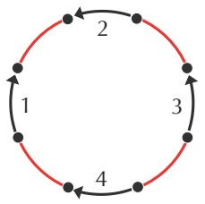

<details>
<summary>flowchart</summary>

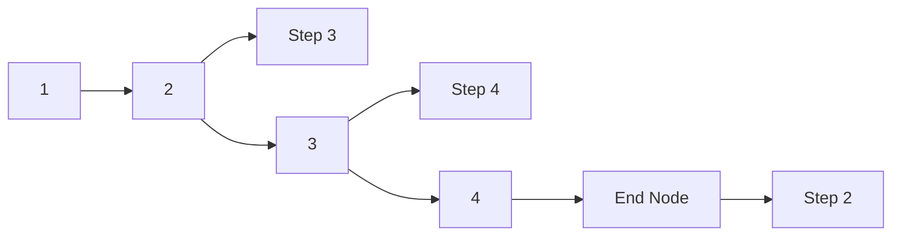
</details>

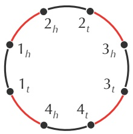

<details>
<summary>flowchart</summary>

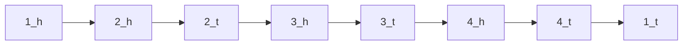
</details>

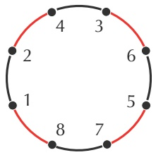

<details>
<summary>flowchart</summary>

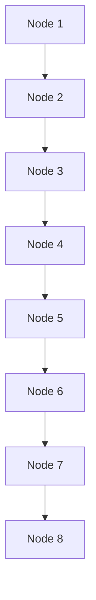
</details>

FIGURE 6.24 (Left) The circular chromosome $(+a $-b $-c $+d)$ can be represented as $(+1 $- 2$ $- 3$ +4)$ using integers. (Middle) Representing this chromosome by replacing the black directed edges with undirected edges connecting “heads” and “tails” of each synteny block. (Right) Encoding head and tail nodes as integers. $1 _ { t }$ and $1 _ { h }$ are converted into 1 and $2 ;   2 _ { t }$ and $2 _ { h }$ are converted into 3 and $4 ;$ and so on. The original chromosome has been converted into the alternating cycle (1, 2, 4, 3, 6, 5, 7, 8).


**STOP and Think:** Is the transformation illustrated in Figure 6.24 invertible? In other words, if we were to give you a cyclic sequence of nodes labeled from 1 to $2 n ,$ could you reconstruct the chromosome with n synteny blocks from which it derives?

The following pseudocode bypasses the intermediate step in Figure 6.24 (middle) of assigning “head” and “tail” nodes in order to transform a single circular chromosome Chromosome = (Chromosome<sub>1</sub>, . . . , Chromosome<sub>n</sub>) into a cycle represented as a sequence of integers $\mathit { N o d e s } = \left( \mathit { N o d e s } _ { 1 } , \cdots , \mathit { N o d e s } _ { 2 n } \right)$

CHROMOSOMETOCYCLE(Chromosome)

<div class="docvortex-algorithm" style="white-space: pre-wrap; font-family:monospace;">
for $j \leftarrow 1$ to $|Chromosome|$
    $i \leftarrow Chromosome_j$
    if $i &gt; 0$
        $Node_{2j-1} \leftarrow 2i - 1$
        $Node_{2j} \leftarrow 2i$
    else
        $Node_{2j-1} \leftarrow -2i$
        $Node_{2j} \leftarrow -2i - 1$
return Nodes
</div>


336

---

A R E T H E R E F R A G I L E R E G I O N S I N T H E H U M A N G E N O M E ?

This process is in fact invertible, as described by the following pseudocode.

<div class="docvortex-algorithm" style="white-space: pre-wrap; font-family:monospace;">
CYCLETOCHROMOSOME(Nodes)
    for $j \leftarrow 1$ to $|Nodes|/2$
        if $Node_{2j-1} &lt; Node_{2j}$
            $Chromosome_j \leftarrow Node_{2j}/2$
        else
            $Chromosome_j \leftarrow -Node_{2j-1}/2$
    return Chromosome
</div>

**CHROMOSOMETOCYCLE** generates the sequence of nodes of a chromosome, but it does not explicitly add the edges. Any genome P with n synteny blocks will have the black undirected edges BLACKEDGES $\left( P \right) = { \big ( } 1 , 2 { \big ) } , { \big ( } 3 , 4 { \big ) } , { \cdots } , { \big ( } 2 n - 1 , 2 n { \big ) }$

We now define COLOREDEDGES(P) as the set of colored edges in the graph of P. For the example in Figure 6.24, the set COLOREDEDGES(P) contains the edges (2, 4), (3, 6), (5, 7), and (8, 1).

The following algorithm constructs COLOREDEDGES(P) for a genome P. In this pseudocode, we will assume that an n-element array $\left( a _ { 1 } , \cdots , a _ { n } \right)$ has an invisible (n + 1)- th element that is equal to its first element, i.e., $a _ { n + 1 } = a _ { 1 }$

<div class="docvortex-algorithm" style="white-space: pre-wrap; font-family:monospace;">
COLOREDEDGES(P)
    Edges ← an empty set
    for each chromosome Chromosome in P
        Nodes ← CHROMOSOMETOCYCLE(Chromosome)
        for j ← 1 to |Chromosome|
            add the edge (Nodes2j, Nodes2j+1) to Edges
    return Edges
</div>

The colored edges in the breakpoint graph of P and Q are given by COLOREDEDGES(P) together with COLOREDEDGES(Q). Note that some edges in these two sets may connect the same two nodes, which results in trivial cycles.

Although we are now ready to solve the 2-Break Distance Problem, we will later find it helpful to implement a function converting a genome graph back into a genome.


[6H](http://rosalind.info/problems/6h)

337

---

C H A P T E R 6


```txt
GRAPHTOGENOME(GenomeGraph)
    P ← an empty set of chromosomes
    for each cycle Nodes in GenomeGraph
        Chromosome ← CYCLETOCHROMOSOME(Nodes)
        add Chromosome to P
    return P
```

Solving the 2-Break Sorting Problem

**Note:** This Charging Station uses some notation from **CHARGING STATION: From Genomes to the Breakpoint Graph**.

Figure 6.25 (top) illustrates how a 2-break replaces colored edges (1, 6) and (3, 8) in a genome graph with two new colored edges (1, 3) and (6, 8). We will denote this operation as $2 -BREAK(1,6,3,8)$ . Note that the order of the nodes in this function matter, since the operation 2-BREAK(1, 6, 8, 3) would represent a different 2-break that replaces (1, 6) and (3, 8) with (1, 8) and (6, 3) (Figure 6.25 (bottom)).

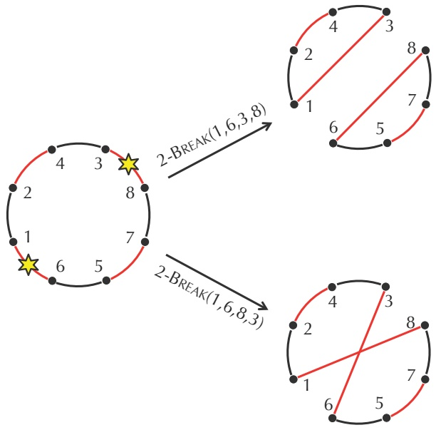

<details>
<summary>flowchart</summary>

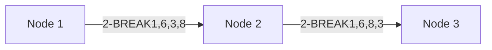
</details>

FIGURE 6.25 Operations 2-BREAK(1, 6, 3, 8) (top) and 2-BREAK(1, 6, 8, 3) (bottom) on the genome (+1 2 3 +4) from Figure 6.24.

338

---

A R E T H E R E F R A G I L E R E G I O N S I N T H E H U M A N G E N O M E ?

The following pseudocode describes how $2 -BREAK(i,i',j,j')$ transforms a genome graph.

```txt
2-BREAKONGENOMEGRAPH(GenomeGraph, i, i', j, j')
remove colored edges (i, i') and (j, j') from GenomeGraph
add colored edges (i, j) and (i', j') to GenomeGraph
return GenomeGraph
```

We can extend this pseudocode to a 2-break defined on genome P.

```txt
2-BREAKONGENOME(P, i, i', j, j')
    GenomeGraph ← BLACKEDGES(P) and COLOREDEDGES(P)
    GenomeGraph ← 2-BREAKONGENOMEGRAPH(GenomeGraph, i, i', j, j')
    P ← GRAPHTOGENOME(GenomeGraph)
    return P
```

We are now ready to find a series of intermediate genomes in a shortest transformation of P into Q by 2-breaks. The idea of our algorithm is to find a 2-break that will increase the number of red-blue cycles in the breakpoint graph by 1. To do so, as illustrated in Figure 6.26, we select an arbitrary blue edge in a non-trivial alternating red-blue cycle and perform the 2-break on the two red edges flanking this blue edge in order to split the red-blue cycle into two cycles (at least one of which is trivial).

```txt
SHORTESTREARRANGEMENTSCENARIO(P, Q)
output P
RedEdges ← COLOREDEDGES(P)
BlueEdges ← COLOREDEDGES(Q)
BreakpointGraph ← the graph formed by RedEdges and BlueEdges
while BreakpointGraph has a non-trivial cycle Cycle
    (j, i') ← an arbitrary edge from BlueEdges in a nontrivial red-blue cycle
    (i, j) ← an edge from RedEdges originating at node j
    (i', j') ← an edge from RedEdges originating at node i'
    RedEdges ← RedEdges with edges (i, j) and (i', j') removed
    RedEdges ← RedEdges with edges (j, i') and (j', i) added
    BreakpointGraph ← the graph formed by RedEdges and BlueEdges
    P ← 2-BREAKONGENOME(P, i, i', j, j')
output P
```

[6J](http://rosalind.info/problems/6j)

[6K](http://rosalind.info/problems/6k)

339

---

C H A P T E R 6

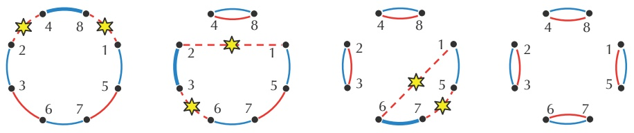

FIGURE 6.26 A shortest 2-break transformation (from left to right) of the breakpoint graph of $P = \left( + a   - b   - c   + d \right)$ and $Q = ( + a + b - d - c )$ . The arbitrary blue edge selected by SHORTESTREARRANGEMENTSCENARIO at each step is shown in bold, and the red edges on either side of it are dashed (with stars indicating 2-breaks).

## Detours

Why is the gene content of mammalian X chromosomes so conserved?

While mammalian X chromosomes are enriched in genes related to sexual reproduction, most of the approximately 1,000 genes on the X chromosome have nothing to do with gender. Ideally, they should be expressed (i.e., transcribed and eventually translated) in roughly the same quantities in females and males. But since females have two X chromosomes and males have only one, it would seem that all the genes on the X chromosome should have twice the expression level in females. This imbalance would lead to a problem in the complex cellular system of checks and balances underlying gene expression.

The need to balance gene expression in males and females led to the evolution of **dosage compensation**, or the inactivation of one X chromosome in females to equalize gene expression between the sexes. Because of dosage compensation, the gene content of the X chromosome is highly conserved between mammalian species because if a gene jumps off the X chromosome, then its expression may double, thus creating a genetic imbalance.

## Discovery of genome rearrangements

After Sturtevant discovered genome rearrangements in Drosophila in 1921, another breakthrough occurred with the discovery that the salivary glands of Drosophila contain **polytene cells**. In normal cellular division, each daughter cell receives one copy of the genome. However, in the nuclei of polytene cells, DNA replication occurs repeatedly in the absence of cell division. The resulting chromosomes then knit themselves together into much larger “superchromosomes” called **polytene chromosomes**.

340

---

A R E T H E R E F R A G I L E R E G I O N S I N T H E H U M A N G E N O M E ?

Polytene chromosomes serve a practical purpose for the fruit fly, which uses the extra DNA to boost the production of gene transcripts, producing lots of sticky saliva. But the human value of polytene chromosomes is perhaps greater. When Sturtevant and his collaborator, Theodosius Dobzhansky, looked at polytene chromosomes under a microscope, they were able to witness the work of rearrangements firsthand in tangled mutant chromosomes. In 1938, Sturtevant and Dobzhansky published a milestone paper with an evolutionary tree presenting a rearrangement scenario with seventeen reversals for various species of Drosophila, the first evolutionary tree in history to be constructed based on molecular data.

## The exponential distribution

A **Bernoulli trial** is a random experiment with two possible outcomes, “success” (having probability $p )$ and “failure” (having probability $1 - p )$ . The **geometric distribution** is the probability distribution underlying the random variable X representing the number of Bernoulli trials needed to obtain the first success:

$$
\Pr (X = k) = (1 - p) ^ {k - 1} p.
$$

A **Poisson process** is a continuous-time probabilistic process counting the number of events in a given time interval, if we assume that the events occur independently and at a constant rate. For example, the Poisson process offers a good model of time points for passengers arriving to a large train station. If we assume that the number of passengers arriving during a very small time interval e is $\lambda \cdot \epsilon$ (where l is a constant), then we are interested in the probability $F ( X )$ that nobody will arrive to the station during a time interval X. The **exponential distribution** describes the time between events in a Poisson process.

**STOP and Think:** Do you see any similarities between the Poisson process and the Bernoulli trials or between the exponential and geometric distributions?

The exponential distribution is merely the continuous analogue of the geometric distribution. More precisely, the Poisson process is characterized by a **rate parameter** $\lambda ,$ such that the number of events k in the time interval of duration e follows the **Poisson probability distribution**:

$$
e ^ {- \lambda \cdot \epsilon} (\lambda \cdot \epsilon) ^ {k} \Big / k!
$$


341

---

C H A P T E R 6

The probability density function of the exponential distribution is $\lambda e ^ { - \lambda \cdot X }$ (compare with the geometric distribution shown in Figure 6.27).

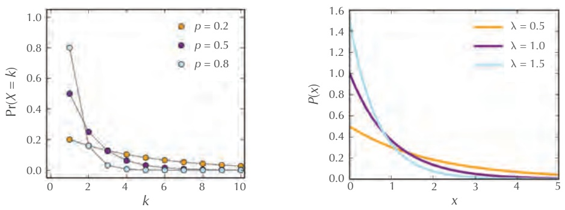

FIGURE 6.27 The probability density functions of the geometric (left) and exponential (right) distributions, each provided for three different parameter values.

Bill Gates and David X. Cohen flip pancakes

Before biologists faced genome rearrangement problems, mathematicians posed the **Pancake Flipping Problem**, arising from the following hypothetical waiter’s conundrum.

The chef in our place is sloppy, and when he prepares a stack of pancakes they come out all different sizes. Therefore, when I deliver them to a customer, on the way to a table I rearrange them (so that the smallest winds up on top, and so on, down to the largest at the bottom) by grabbing several from the top and flipping them over, repeating this (varying the number I flip) as many times as necessary. If there are n pancakes, what is the maximum number of flips that I will ever have to use to rearrange them?

Formally, a **prefix reversal** is a reversal that flips a prefix, or initial interval, of a permutation. The **Pancake Flipping Problem** corresponds to sorting unsigned permutations by prefix reversals. For example, the series of prefix reversals shown below ignores signs and represents the sorting of the **unsigned permutation**, (1 7 6 10 9 8 2 11 3 5 4), into the **identity unsigned permutation**, (1 2 3 4 5 6 7 8 9 10 11). The inverted interval is shown in red, and sorted intervals at the end of the permutation are shown in blue.

342

---

A R E T H E R E F R A G I L E R E G I O N S I N T H E H U M A N G E N O M E ?

| (1 | 7 | 6 | 10 | 9 | 8 | 2 | 11 | 3 | 5 | 4) |
| --- | --- | --- | --- | --- | --- | --- | --- | --- | --- | --- |
| (11 | 2 | 8 | 9 | 10 | 6 | 7 | 1 | 3 | 5 | 4) |
| (4 | 5 | 3 | 1 | 7 | 6 | 10 | 9 | 8 | 2 | 11) |
| (10 | 6 | 7 | 1 | 3 | 5 | 4 | 9 | 8 | 2 | 11) |
| (2 | 8 | 9 | 4 | 5 | 3 | 1 | 7 | 6 | 10 | 11) |
| (9 | 8 | 2 | 4 | 5 | 3 | 1 | 7 | 6 | 10 | 11) |
| (6 | 7 | 1 | 3 | 5 | 4 | 2 | 8 | 9 | 10 | 11) |
| (7 | 6 | 1 | 3 | 5 | 4 | 2 | 8 | 9 | 10 | 11) |
| (2 | 4 | 5 | 3 | 1 | 6 | 7 | 8 | 9 | 10 | 11) |
| (5 | 4 | 2 | 3 | 1 | 6 | 7 | 8 | 9 | 10 | 11) |
| (1 | 3 | 2 | 4 | 5 | 6 | 7 | 8 | 9 | 10 | 11) |
| (3 | 1 | 2 | 4 | 5 | 6 | 7 | 8 | 9 | 10 | 11) |
| (2 | 1 | 3 | 4 | 5 | 6 | 7 | 8 | 9 | 10 | 11) |
| (1 | 2 | 3 | 4 | 5 | 6 | 7 | 8 | 9 | 10 | 11) |

When we search for a shortest series of prefix reversals sorting a signed permutation, the problem is called the **Burnt Pancake Flipping Problem** (each pancake is “burnt” on one side, giving it two possible orientations).

**STOP and Think:** Prove that every unsigned permutation of length n can be sorted using at most 2 · (n  1) prefix reversals. Prove that every signed permutation of length n can be sorted using at most 3 · (n  1) + 1 prefix reversals.

In the mid-1970s, Bill Gates, an undergraduate student at Harvard, and Christos Papadimitriou, Gates’s professor, made the first attempt to solve the Pancake Flipping Problem and proved that any permutation of length n can be sorted with at most 5/3 · (n + 1) prefix reversals, a result that would not be improved for three decades. David X. Cohen worked on the Burnt Pancake Flipping Problem at Berkeley before he left computer science to become a writer for The Simpsons and eventually producer of Futurama. Along with Manuel Blum, he demonstrated that the Burnt Pancake Flipping Problem can be solved with at most 2 · (n  1) prefix reversals.

## Sorting linear permutations by reversals

In the main text, we defined the breakpoint graph for circular chromosomes, but this structure can easily be extended to linear chromosomes. Figure 6.28 depicts the human and the mouse X chromosomes as alternating red-black and blue-black paths (first and second panels). These two paths are superimposed in the third panel to form the


343

---

C H A P T E R 6


breakpoint graph, which has five alternating red-blue cycles.

**STOP and Think:** Prove the following analogue of the Cycle Theorem for permutations: Given permutations P and $Q ,$ any reversal applied to P can increase CYCLES $( P , Q )$ by at most 1.


<details>
<summary>flowchart</summary>


</details>

FIGURE 6.28 (1st panel) An alternating red-black path representing the human X chromosome $( + 1 + 2 + 3 + 4 + 5 + 6 + 7 + 8 + 9 + 1 0 + 1 1 )$ . (2nd panel) An alternating blue-black path representing the mouse X chromosome $(+1 -7 +6 -10 +9 -8 +2$ $-11 - 3 + 5 + 4 )$ (3rd panel) The breakpoint graph of the mouse and human X chromosomes is obtained by superimposing red-black and blue-black paths from the first two panels. (4th panel) To highlight the five alternating red-blue cycles in the breakpoint graph, black edges are removed.

Whereas the number of trivial cycles is equal to $\scriptstyle \mathrm { B L O C K S } \left( Q , Q \right)$ in the trivial breakpoint graph of a circular permutation, the trivial breakpoint graph of a linear permutation has $\mathrm { B L O C K S } \big ( Q , Q \big ) + 1$ trivial cycles. Since the Cycle Theorem holds for linear permutations, perhaps the reversal distance $d _ { \mathrm { r e v } } \big ( P , Q \big )$ is equal to BLOCKS $\left( P , Q \right) + 1 -$ CYCLES $( P , Q )$ for linear chromosomes? After all, for the human and mouse X chromosomes, BLOCKS $( P , Q ) + 1 - \mathsf { C Y C L E S } \big ( P , Q \big )$ is equal to $1 1 + 1 - 5 = 7 ,$ , which we already know to be the reversal distance between the human and mouse X chromosomes.

344

---

A R E T H E R E F R A G I L E R E G I O N S I N T H E H U M A N G E N O M E ?

**STOP and Think:** Can you modify the proof of the 2-Break Distance Theorem to prove that $d_{\mathrm{rev}}(P, Q) = \mathrm{BLOCKS}(P, Q) + 1 - \mathrm{CYCLES}(P, Q)$ for linear permutations P and Q?


You can verify that if $P = ( + 2   +   1 )$ and $Q = ( + 1   +   2 )$ , then $d _ { \mathrm { r e v } } \big ( P , Q \big ) \neq \mathrm { B L O C K S } \big ( P , Q \big ) +$ $1 - \operatorname { C Y C L E S } ( P , Q )$ . This makes it unlikely that we will be able to develop a simple algorithm for the computation of reversal distance.

However, the lower bound $d_{\mathrm{rev}}(P, Q) \geq \mathrm{BLOCKS}(P, Q) + 1 - \mathrm{CYCLES}(P, Q)$ approximates the reversal distance between linear permutations extremely well. This intriguing performance raised the question of whether this bound is close to an exact formula. In 1999, Hannenhalli and Pevzner found this formula by defining two special types of breakpoint graph structures called “hurdles” and “fortresses”. Denoting the number of hurdles and fortresses in BREAKPOINTGRAPH $( P , Q )$ by HURDLES $( P , Q )$ and FORTRESSES $( P , Q )$ , respectively, they proved that the reversal distance $d _ { \mathrm { r e v } } \big ( P , Q \big )$ is given by

$$
\text {BLOCKS} (P, Q) + 1 - \text {CYCLES} (P, Q) + \text {HURDLES} (P, Q) + \text {FORTRESSES} (P, Q).
$$

Using this formula, they developed a polynomial algorithm for computing $d _ { \mathrm { r e v } } \big ( P , Q \big )$

345

---

C H A P T E R 6

## Bibliography Notes

Alfred Sturtevant was the first to discover rearrangements while comparing gene orders in fruit flies (Sturtevant, 1921). Together with Theodosius Dobzhansky, Sturtevant pioneered the analysis of genome rearrangements, publishing a milestone paper that presented a rearrangement scenario for many fruit fly species (Sturtevant and Dobzhansky, 1936). The Random Breakage Model was proposed by Ohno, 1973, further developed by Nadeau and Taylor, 1984, and refuted by Pevzner and Tesler, 2003b.

The notion of the breakpoint graph was proposed by Bafna and Pevzner, 1996. The polynomial algorithm for sorting by reversals was developed by Hannenhalli and Pevzner, 1999. The synteny block construction algorithm presented in this chapter was described by Pevzner and Tesler, 2003a. The 2-break operation was introduced in Yancopoulos, Attie, and Friedberg, 2005 under the name of “double cut and join”

The first algorithmic analysis of the Pancake Flipping problem was described by Gates and Papadimitriou, 1979. The first algorithmic analysis of the Burnt Pancake Flipping problem was described by Cohen and Blum, 1995.

The Multiple Genome Rearrangement problem was addressed by Ma et al., 2008 and Alekseyev and Pevzner, 2009. Zhao and Bourque, 2009 observed that matching duplications may trigger genome rearrangements.

---

A R E T H E R E F R A G I L E R E G I O N S I N T H E H U M A N G E N O M E ?


347

---


---

## Bibliography

- Alekseyev, M. A. and P. A. Pevzner (2009). “Breakpoint graphs and ancestral genome reconstructions”. Genome Research Vol. 19: 943–957.
- Bafna, V. and P. A. Pevzner (1996). “Genome Rearrangements and Sorting by Reversals”. SIAM Journal on Computing Vol. 25: 272–289.
- Butler, J., I MacCallum, M. Kleber, I. A. Shlyakhter, M. Belmonte, E. S. Lander, C. Nusbaum, and D. B. Jaffe (2008). “ALLPATHS: de novo assembly of whole-genome shotgun microreads.” Genome Research Vol. 18: 810–820.
- Cohen, D. S. and M. Blum (1995). “On the Problem of Sorting Burnt Pancakes”. Discrete Applied Mathematics Vol. 61: 105–120.
- Conti, E., T. Stachelhaus, M. A. Marahiel, and P. Brick (1997). “Structural basis for the activation of phenylalanine in the non-ribosomal biosynthesis of gramicidin S”. The EMBO Journal Vol. 16: 4174–4183.
- Conti, E., N. P. Franks, and P. Brick (1996). “Crystal structure of firefly luciferase throws light on a superfamily of adenylate-forming enzymes”. Structure Vol. 4: 287–298.
- Cristianini, N. and M. W. Hahn (2006). Introduction to Computational Genomics: A Case Studies Approach. Cambridge University Press.
- de Bruijn, N. (1946). “A Combinatorial Problem”. In: Proceedings of the Section of Sciences, Koninklijke Akademie van Wetenschappen te Amsterdam. Vol. 49: 758–764.
- Doolittle, R. F., M. W. Hunkapiller, L. E. Hood, S. G. Devare, K. C. Robbins, S. A. Aaronson, and H. N. Antoniades (1983). “Simian sarcoma virus onc gene, v-sis, is derived from the gene (or genes) encoding a platelet-derived growth factor”. Science Vol. 221: 275–277.

349

---

- Drmanac, R., I. Labat, I. Brukner, and R. Crkvenjakov (1989). “Sequencing of megabase plus DNA by hybridization: Theory of the method”. Genomics Vol. 4: 114–128.
- Euler, L. (1758). “Solutio Problematis ad Geometriam Situs Pertinentis”. Novi Commentarii Academiae Scientarium Imperialis Petropolitanque, 9–28.
- Gao, F. and C.-T. Zhang (2008). “Ori-Finder: A web-based system for finding oriCs in unannotated bacterial genomes”. BMC Bioinformatics Vol. 9: 79.
- Gardner, M. (1974). “Mathematical Games”. Scientific American Vol. 230: 120–125.
- Gates, W. H. and C. H. Papadimitriou (1979). “Bounds for sorting by prefix reversal”. Discrete Mathematics Vol. 27: 47–57.
- Geman, S. and D. Geman (1984). “Stochastic Relaxation, Gibbs Distributions, and the Bayesian Restoration of Images”. IEEE Transactions on Pattern Analysis and Machine Intelligence Vol. PAMI-6: 721–741.
- Good, I. J. (1946). “Normal Recurring Decimals”. Journal of the London Mathematical Society Vol. 21: 167–169.
- Grigoriev, A. (1998). “Analyzing genomes with cumulative skew diagrams”. Nucleic Acids Research Vol. 26: 2286–2290.
- Grigoriev, A. (2011). “How do replication and transcription change genomes?” In: Bioinformatics for Biologists. Ed. by P. A. Pevzner and R. Shamir. Cambridge University Press, 111–125.
- Guibas, L. and A. Odlyzko (1981). “String overlaps, pattern matching, and nontransitive games”. Journal of Combinatorial Theory, Series A Vol. 30: 183 –208.
- Hannenhalli, S. and P. A. Pevzner (1999). “Transforming Cabbage into Turnip: Polynomial Algorithm for Sorting Signed Permutations by Reversals”. Journal of the ACM Vol. 46: 1–27.
- Harmer, S. L., J. B. Hogenesch, M. Straume, H. S. Chang, B. Han, T. Zhu, X. Wang, J. A. Kreps, and S. A. Kay (2000). “Orchestrated transcription of key pathways in Arabidopsis by the circadian clock”. Science Vol. 290: 2110–2113.
- Hertz, G. Z. and G. D. Stormo (1999). “Identifying DNA and protein patterns with statistically significant alignments of multiple sequences.” Bioinformatics Vol. 15: 563–577.

350

---

- Idury, R. M. and M. S. Waterman (1995). “A New Algorithm for DNA Sequence Assembly.” Journal of Computational Biology Vol. 2: 291–306.
- Ivics, Z., P. Hackett, R. Plasterk, and Z. Izsvák (1997). “Molecular reconstruction of Sleeping Beauty, a Tc1-like transposon from fish, and its transposition in human cells”. Cell Vol. 91: 501–510.
- Konopka, R. J. and S. Benzer (1971). “Clock mutants of Drosophila melanogaster”. Proceedings of the National Academy of Sciences of the United States of America Vol. 68: 2112–2116.
- Lawrence, C. E., S. F. Altschul, M. S. Boguski, J. S. Liu, A. F. Neuwald, and J. C. Wootton (1993). “Detecting subtle sequence signals: a Gibbs sampling strategy for multiple alignment”. Science Vol. 262: 208–214.
- Levenshtein, V. I. (1966). “Binary codes capable of correcting deletions, insertions, and reversals”. Soviet Physics Doklady Vol. 10: 707–710.
- Liachko, I., R. A. Youngblood, U. Keich, and M. J. Dunham (2013). “High-resolution mapping, characterization, and optimization of autonomously replicating sequences in yeast”. Genome Research Vol. 23: 698–704.
- Lobry, J. R. (1996). “Asymmetric substitution patterns in the two DNA strands of bacteria”. Molecular Biology and Evolution Vol. 13: 660–665.
- Lundgren, M., A. Andersson, L. Chen, P. Nilsson, and R. Bernander (2004). “Three replication origins in Sulfolobus species: Synchronous initiation of chromosome replication and asynchronous termination”. Proceedings of the National Academy of Sciences of the United States of America Vol. 101: 7046–7051.
- Lysov, Y., V. Florent’ev, A. Khorlin, K. Khrapko, V. Shik, and A. Mirzabekov (1988). “DNA sequencing by hybridization with oligonucleotides”. Doklady Academy Nauk USSR Vol. 303: 1508–1511.
- Ma, J., A. Ratan, B. J. Raney, B. B. Suh, W. Miller, and D. Haussler (2008). “The infinite sites model of genome evolution”. Proceedings of the National Academy of Sciences of the United States of America Vol. 105: 14254–14261.
- Maxam, A. M. and W. Gilbert (1977). “A new method for sequencing DNA.” Proceedings of the National Academy of Sciences of the United States of America Vol. 74: 560–564.

351

---

- Medvedev, P., S. K. Pham, M. Chaisson, G. Tesler, and P. A. Pevzner (2011). “Paired de Bruijn Graphs: A Novel Approach for Incorporating Mate Pair Information into Genome Assemblers.” Journal of Computational Biology Vol. 18: 1625–1634.
- Nadeau, J. H. and B. A. Taylor (1984). “Lengths of chromosomal segments conserved since divergence of man and mouse”. Proceedings of the National Academy of Sciences of the United States of America Vol. 81: 814–818.
- Ng, J., N. Bandeira, W.-T. Liu, M. Ghassemian, T. L. Simmons, W. H. Gerwick, R. Linington, P. Dorrestein, and P. A. Pevzner (2009). “Dereplication and de novo sequencing of nonribosomal peptides”. Nature Methods Vol. 6: 596–599.
- Ohno, S. (1973). “Ancient linkage groups and frozen accidents”. Nature Vol. 244: 259–262.
- Park, H. D., K. M. Guinn, M. I. Harrell, R. Liao, M. I. Voskuil, M. Tompa, G. K. Schoolnik, and D. R. Sherman (2003). “Rv3133c/dosR is a transcription factor that mediates the hypoxic response of Mycobacterium tuberculosis”. Molecular Microbiology Vol. 48: 833–843.
- Pevzner, P. and G. Tesler (2003a). “Genome rearrangements in mammalian evolution: lessons from human and mouse genomes”. Genome Research Vol. 13: 37–45.
- Pevzner, P. and G. Tesler (2003b). “Human and mouse genomic sequences reveal extensive breakpoint reuse in mammalian evolution”. Proceedings of the National Academy of Sciences of the United States of America Vol. 100: 7672–7677.
- Pevzner, P. A. (1989). “1-Tuple DNA sequencing: computer analysis”. Journal of Biomolecular Structure and Dynamics Vol. 7: 63–73.
- Pevzner, P. A., H Tang, and M. S. Waterman (2001). “An Eulerian path approach to DNA fragment assembly”. Proceedings of the National Academy of Sciences of the United States of America Vol. 98: 9748–53.
- Rosenblatt, J. and P. Seymour (1982). “The Structure of Homometric Sets”. SIAM Journal on Algebraic Discrete Methods Vol. 3: 343–350.
- Sanger, F, S Nicklen, and A. Coulson (1977). “DNA sequencing with chain-terminating inhibitors”. Proceedings of The National Academy of Sciences of The United States Of America Vol. 74: 5463–5467.
- Sedgewick, R. and P. Flajolet (2013). An Introduction to the Analysis of Algorithms. Addison-Wesley.

352

---

- Sernova, N. V. and M. S. Gelfand (2008). “Identification of replication origins in prokaryotic genomes”. Briefings in Bioinformatics Vol. 9: 376–391.
- Smith, T. F. and M. S. Waterman (1981). “Identification of common molecular subsequences.” Journal of Molecular Biology Vol. 147: 195–197.
- Solov’ev, A. (1966). “A combinatorial identity and its application to the problem about the first occurence of a rare event”. Theory of Probability and its Applications Vol. 11: 276–282.
- Southern, E. (1988). “Analysing Polynucleotide Sequences”. Patent (United Kingdom).
- Stachelhaus, T., H. D. Mootz, and M. A. Marahiel (1999). “The specificity-conferring code of adenylation domains in nonribosomal peptide synthetases.” Chemistry & Biology Vol. 6: 493–505.
- Sturtevant, A. H. (1921). “A Case of Rearrangement of Genes in Drosophila”. Proceedings of the National Academy of Sciences of the United States of America Vol. 7: 235–237.
- Sturtevant, A. H. and T. Dobzhansky (1936). “Inversions in the Third Chromosome of Wild Races of Drosophila Pseudoobscura, and Their Use in the Study of the History of the Species”. Proceedings of the National Academy of Sciences of the United States of America Vol. 22: 448–450.
- Tang, Y. Q., J. Yuan, G. Osapay, K. Osapay, D. Tran, C. J. Miller, A. J. Ouellette, and M. E. Selsted (1999). “A cyclic antimicrobial peptide produced in primate leukocytes by the ligation of two truncated alpha-defensins”. Science Vol. 286: 498–502.
- Venkataraman, N., A. L. Cole, P. Ruchala, A. J. Waring, R. I. Lehrer, O. Stuchlik, J. Pohl, and A. M. Cole (2009). “Reawakening retrocyclins: ancestral human defensins active against HIV-1”. PLoS Biology Vol. 7: e95.
- Wang, X., C. Lesterlin, R. Reyes-Lamothe, G. Ball, and D. J. Sherratt (2011). “Replication and segregation of an Escherichia coli chromosome with two replication origins”. Proceedings of the National Academy of Sciences Vol. 108: E243–E250.
- Xia, X. (2012). “DNA replication and strand asymmetry in prokaryotic and mitochondrial genomes”. Current Genomics Vol. 13: 16–27.
- Yancopoulos, S., O. Attie, and R. Friedberg (2005). “Efficient sorting of genomic permutations by translocation, inversion and block interchange”. Bioinformatics Vol. 21: 3340–3346.

353

---

- Zerbino, D. R. and E. Birney (2008). “Velvet: Algorithms for de novo short read assembly using de Bruijn graphs”. Genome Research Vol. 18: 821–829.
- Zhao, H. and G. Bourque (2009). “Recovering genome rearrangements in the mammalian phylogeny”. Genome Research Vol. 19: 934–942.

354

---

## Image Courtesies

**Figure 1.26:** Ævar Arnfjörð Bjarmason
**Figure 3.5:** Dan Gilbert
**Figure 3.45 (left):** Royal Irish Academy
**Figure 4.1:** Open Clip Art
**Figure 6.27:** Wikimedia Commons user Skbkekas
**Figure 6.1:** Glenn Tesler
**Figure 6.2:** Glenn Tesler
**Figure 6.3:** Max Alekseyev
**Figure 6.4:** Max Alekseyev
**Figure 6.5:** Glenn Tesler
**Figure 6.6:** Glenn Tesler
**Figure 6.22:** Glenn Tesler

355
