# BIOINFORMATICS ALGORITHMS

# An Active Learning Approach

2nd Edition, Vol. I

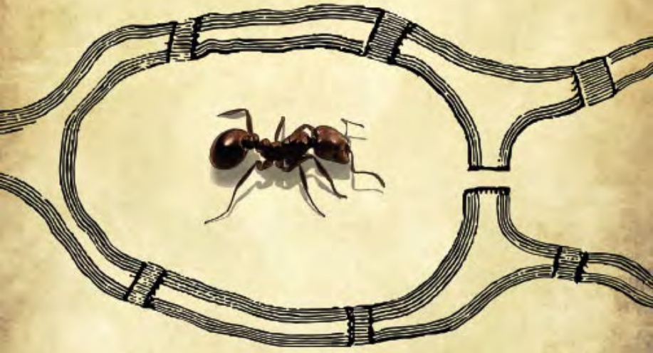

natural_image

Illustration of an ant inside a segmented cable or rope structure (no text or symbols)

# Welcome!

Thank you for joining us! As you explore this book, you will find a number of active learning components that help you learn the material at your own pace.

1. **CODE CHALLENGES** ask you to implement the algorithms that you will encounter (in any programming language you like). These code challenges are hosted in the “Bioinformatics Textbook Track” location on Rosalind ([http://rosalind.info](http://rosalind.info)), a website that will automatically test your implementations.
2. **CHARGING STATIONS** provide additional insights on implementing the algorithms you encounter. However, we suggest trying to solve a Code Challenge before you visit a Charging Station.
3. **EXERCISE BREAKS** offer “just in time” assessments testing your understanding of a topic before moving to the next one.
4. **STOP and Think** questions invite you to slow down and contemplate the current material before continuing to the next topic.
5. **DETOURS** provide extra content that didn’t quite fit in the main text.
6. **FINAL CHALLENGES** ask you to apply what you have learned to real experimental datasets.

This textbook powers our popular online courses on Coursera. We encourage you to sign up for a session and learn this material while interacting with thousands of other talented students from around the world. You can also find lecture videos and PowerPoint slides at the textbook website, [http://bioinformaticsalgorithms.org](http://bioinformaticsalgorithms.org).

## Bioinformatics Algorithms: An Active Learning Approach 2nd Edition, Vol. I

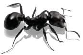

Phillip Compeau & Pavel Pevzner

http://bioinformaticsalgorithms.org

Copyright © 2015 by Phillip Compeau and Pavel Pevzner. All rights reserved.

This book or any portion thereof may not be reproduced or used in any manner whatsoever without the express written permission of the publisher except for the use of brief quotations in a book review.

Printed in the United States of America

First Printing, 2015

ISBN: 978-0-9903746-1-9

Library of Congress Control Number: 2015945208

Active Learning Publishers, LLC

9768 Claiborne Square

La Jolla, CA 92037

To my family. — P. C.

To my parents. — P. P.

## Volume I Overview

CHAPTER 1 — p. 2

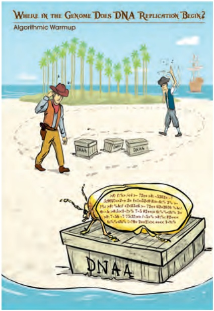

text_image

WHERE IN THE GENOME DOES DNA REPLICATION BEGIN?
Algorithmic Warmup
DNA AA
DNA AA

CHAPTER 2 — p. 66

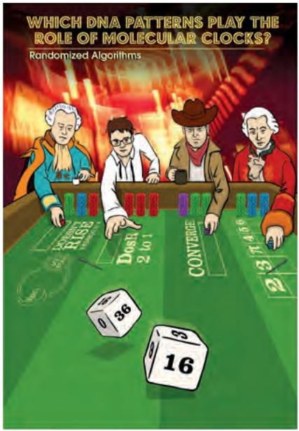

text_image

WHICH DNA PATTERNS PLAY THE
ROLE OF MOLECULAR CLOCKS?
Randomized Algorithms
Dose
2.0/1
Counterboard
3.4/56
16
0 36
0 16

CHAPTER 3 — p. 115

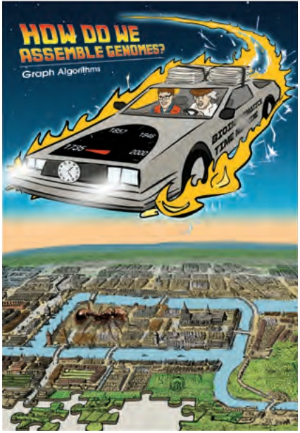

text_image

HOW DO WE
ASSEMBLE GENOMES?
Graph Algorithms

CHAPTER 4 — p. 182

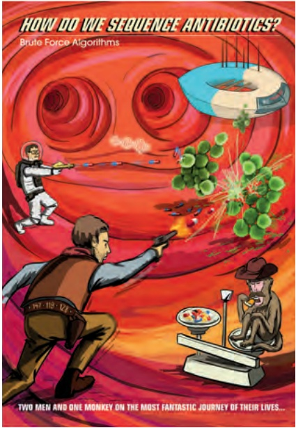

text_image

HOW DO WE SEQUENCE ANTIBIOTICS?
Brute Force Algorithms
TWO MEN AND ONE MONKEY ON THE MOST FARTASTIC JOURNEY OF THEIR LIVES...

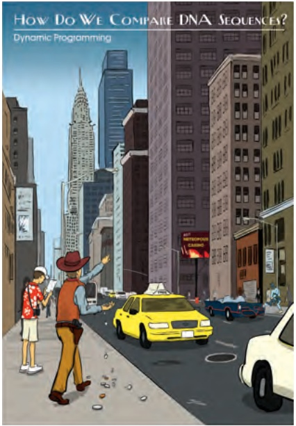

text_image

HOW DO WE COMPAIRE DNA SEQUENCES?
Dynamic Programming

CHAPTER 5 — p. 222

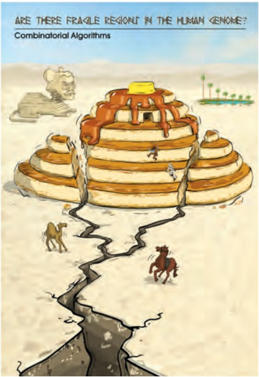

text_image

ARE THERE FRAIGLE REGIONS IN THE HUMAN GENOME?
Combinatorial Algorithms

CHAPTER 6 — p. 292

## What To Expect in Volume II. . .

CHAPTER 7

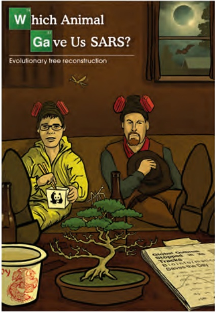

text_image

Which Animal
Gave Us SARS?
Evolutionary tree reconstruction
Global Customer
Surprise on the
Trucks
Biological Materials
Secrets the Day!

CHAPTER 8

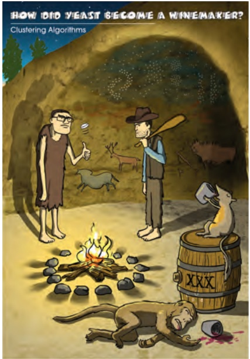

text_image

HOW DID YEAST BECOME A WINEMAKER?
Clustering Algorithms

CHAPTER 9

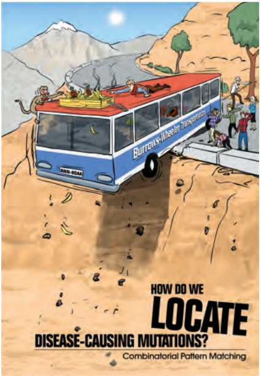

text_image

BURRONS-HAUSER TRANSPORTATION
HOW DO WE
LOCATE
DISEASE-CAUSING MUTATIONS?
Combinatorial Pattern Matching

CHAPTER 10

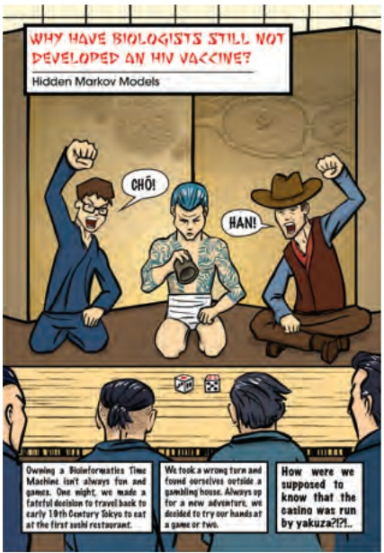

text_image

WHY HAVE BIOLOGISTS STILL NOT DEVELOPED AN HIV VACCINE?
Hidden Markov Models
CHÓ!
HAN!
Owning a Bioinformatics Time Machine isn't always fun and games. One night, we made a tasteful decision to travel back to early 19th Century Tokyo to eat at the first ashi restaurant.
We took a wrong turn and found ourselves outside a gambling house. Always up for a new adventurer, we decided to try our hands at a game or two.
How were we supposed to know that the casino was run by yakuza??!

text_image

WAI T. REX JUST A BIG CHICKEN?
Computational Proteomics

CHAPTER 11

## Contents

## List of Code Challenges xviii

## About the Textbook xxi

Meet the Authors . . . xxi

Meet the Development Team . xxii

Acknowledgments . . xxiii

## 1 Where in the Genome Does DNA Replication Begin? 2

A Journey of a Thousand Miles. . . 3

Hidden Messages in the Replication Origin . 5

DnaA boxes 5

Hidden messages in “The Gold-Bug” . 6

Counting words . . 7

The Frequent Words Problem 8

Frequent words in Vibrio cholerae 10

Some Hidden Messages are More Surprising than Others . . . . . . . 11

An Explosion of Hidden Messages 13

Looking for hidden messages in multiple genomes . . . 13

The Clump Finding Problem 14

The Simplest Way to Replicate DNA 16

Asymmetry of Replication 18

Peculiar Statistics of the Forward and Reverse Half-Strands . . . . . . . . . . . 22

Deamination . . . . . 22

The skew diagram 23

Some Hidden Messages are More Elusive than Others . . . 26

A Final Attempt at Finding DnaA Boxes in E. coli . 29

Epilogue: Complications in oriC Predictions . 31

Open Problems . . 33

Multiple replication origins in a bacterial genome 33

Finding replication origins in archaea 35

Finding replication origins in yeast . 36

Computing probabilities of patterns in a string . . 37

Charging Stations . 39

The frequency array . . . 39

Converting patterns to numbers and vice-versa . 41

Finding frequent words by sorting . 43

Solving the Clump Finding Problem 44

Solving the Frequent Words with Mismatches Problem . . . 47

Generating the neighborhood of a string . 49

Finding frequent words with mismatches by sorting . . . . . . . . 51

Detours . . . . . 52

Big-O notation . . .

Probabilities of patterns in a string 52

The most beautiful experiment in biology 57

Directionality of DNA strands . . 59

The Towers of Hanoi 60

The overlapping words paradox 62

Bibliography Notes . 64

**2 Which DNA Patterns Play the Role of Molecular Clocks? 66**

Do We Have a “Clock” Gene? . 67

Motif Finding Is More Difficult Than You Think 68

Identifying the evening element . 68

Hide and seek with motifs . 69

A brute force algorithm for motif finding 7 1

Scoring Motifs . . 72

From motifs to profile matrices and consensus strings . . . . . . . . . . . 72

Towards a more adequate motif scoring function . . . . 75

Entropy and the motif logo 76

From Motif Finding to Finding a Median String . . 77

The Motif Finding Problem 77

Reformulating the Motif Finding Problem . 77

The Median String Problem 80

Why have we reformulated the Motif Finding Problem? . . . . . . . . . . 82

Greedy Motif Search 83

Using the profile matrix to roll dice . 83

Analyzing greedy motif finding . 85

Motif Finding Meets Oliver Cromwell 86

What is the probability that the sun will not rise tomorrow? . . . . . . . 86

Laplace’s Rule of Succession . 87

An improved greedy motif search 88

Randomized Motif Search . 91

Rolling dice to find motifs 91

Why randomized motif search works 93

How Can a Randomized Algorithm Perform So Well? 96

Gibbs Sampling . 98

Gibbs Sampling in Action . 100

Epilogue: How Does Tuberculosis Hibernate to Hide from Antibiotics? . . . . 104

Charging Stations . . . . 107

Solving the Median String Problem . . 107

Detours . . . . . . . . 108

Gene expression . . . . 108

DNA arrays . . . . . 108

Buffon’s needle . . 109

Complications in motif finding . . 112

Relative entropy . . . . . 112

Bibliography Notes . . . 115

**3 How Do We Assemble Genomes? 115**

Exploding Newspapers . . . . 117

The String Reconstruction Problem . . . 120

Genome assembly is more difficult than you think . . . . . . . . . . 120

Reconstructing strings from k-mers . . . 120

Repeats complicate genome assembly . . . . 123

String Reconstruction as a Walk in the Overlap Graph . . . . . . . . 124

From a string to a graph . . . . 124

The genome vanishes . . . . 127

Two graph representations . . . . 129

Hamiltonian paths and universal strings . . . 130

Another Graph for String Reconstruction . . 131

Gluing nodes and de Bruijn graphs . . . 131

Walking in the de Bruijn Graph . . . 134

Eulerian paths . . . . 134

Another way to construct de Bruijn graphs . . . 135

Constructing de Bruijn graphs from k-mer composition . . . . . . . . . . 137

De Bruijn graphs versus overlap graphs . . . . 138

The Seven Bridges of Königsberg . . 139

Euler’s Theorem . . . . . . . 142

From Euler’s Theorem to an Algorithm for Finding Eulerian Cycles . . . . . . 146

Constructing Eulerian cycles . . . 146

From Eulerian cycles to Eulerian paths . . . 146

Constructing universal strings . . . 147

Assembling Genomes from Read-Pairs . . 150

From reads to read-pairs . . . 150

Transforming read-pairs into long virtual reads . . . . . 151

From composition to paired composition . . 153

Paired de Bruijn graphs . 154

A pitfall of paired de Bruijn graphs . . 155

Epilogue: Genome Assembly Faces Real Sequencing Data . . . . . . . . . . . . 158

Breaking reads into k-mers . . 158

Splitting the genome into contigs . . 159

Assembling error-prone reads . . . . 161

Inferring multiplicities of edges in de Bruijn graphs . . . . . . . 162

Charging Stations . . . 164

The effect of gluing on the adjacency matrix . . . . 164

Generating all Eulerian cycles . . . 165

Reconstructing a string spelled by a path in the paired de Bruijn graph . 166

Maximal non-branching paths in a graph . . . 169

Detours . . . . . . . 170

A short history of DNA sequencing technologies . . . . . 170

Repeats in the human genome . . . 172

Graphs . . . . . . . . 173

The icosian game . . . . 175

Tractable and intractable problems . 176

From Euler to Hamilton to de Bruijn . . 177

The seven bridges of Kaliningrad . . . 178

The BEST Theorem . . . . 179

Bibliography Notes . . . 180

## 4 How Do We Sequence Antibiotics? 182

The Discovery of Antibiotics . . . . 183

How Do Bacteria Make Antibiotics? . . 184

How peptides are encoded by the genome . . . 184

Where is Tyrocidine encoded in the Bacillus brevis genome? . . . . . . . . 186

From linear to cyclic peptides . 188

Dodging the Central Dogma of Molecular Biology . . . . 188

Sequencing Antibiotics by Shattering Them into Pieces . . . 190

Introduction to mass spectrometry . . 190

The Cyclopeptide Sequencing Problem . . . . 191

A Brute Force Algorithm for Cyclopeptide Sequencing . . 193

A Branch-and-Bound Algorithm for Cyclopeptide Sequencing . . . . . . . . . 194

Mass Spectrometry Meets Golf . . 197

From theoretical to real spectra . 197

Adapting cyclopeptide sequencing for spectra with errors . . . . . . . . 198

From 20 to More than 100 Amino Acids . . 201

The Spectral Convolution Saves the Day . . . 203

Epilogue: From Simulated to Real Spectra . . . 205

Open Problems . . 208

The Beltway and Turnpike Problems . . . 208

Sequencing cyclic peptides in primates . . . 209

Charging Stations . . . 211

Generating the theoretical spectrum of a peptide . . . . . 211

How fast is **CYCLOPEPTIDESEQUENCING**? . . . . 212

Trimming the peptide leaderboard . . . . 214

Detours . . . . . . . 215

Gause and Lysenkoism . . 215

Discovery of codons . . 216

Quorum sensing . . . . . 217

Molecular mass . . 217

Selenocysteine and pyrrolysine . 218

Pseudo-polynomial algorithm for the Turnpike Problem . . . . . . . . . 219

Split genes . . . 220

Bibliography Notes . . . 221

## 5 How Do We Compare Biological Sequences? 222

Cracking the Non-Ribosomal Code . . . 223

The RNA Tie Club . . . . . 223

From protein comparison to the non-ribosomal code . . . . . . . . . . . . 224

What do oncogenes and growth factors have in common? . . . . . . . . 225

Introduction to Sequence Alignment . . . 226

Sequence alignment as a game . 226

Sequence alignment and the longest common subsequence . . . . . . . . 227

The Manhattan Tourist Problem . . . . 229

What is the best sightseeing strategy? . 229

Sightseeing in an arbitrary directed graph . . . . 232

Sequence Alignment is the Manhattan Tourist Problem in Disguise . . . . . . 233

An Introduction to Dynamic Programming: The Change Problem . . . . . . . 236

Changing money greedily . . . 236

Changing money recursively . . 237

Changing money using dynamic programming . . . . . . . 239

The Manhattan Tourist Problem Revisited . . . 241

From Manhattan to an Arbitrary Directed Acyclic Graph . . . . . . . . . . . . 245

Sequence alignment as building a Manhattan-like graph . . . . . . . . . 245

Dynamic programming in an arbitrary DAG . . . . 246

Topological orderings . . . . 247

Backtracking in the Alignment Graph . 251

Scoring Alignments . . . . 253

What is wrong with the LCS scoring model? . . 253

Scoring matrices . . . . 254

From Global to Local Alignment . 255

Global alignment . . 255

Limitations of global alignment . . 257

Free taxi rides in the alignment graph . . 259

The Changing Faces of Sequence Alignment . . . . . 261

Edit distance . . . . . . 261

Fitting alignment . . 263

Overlap alignment . 263

Penalizing Insertions and Deletions in Sequence Alignment . . . . . . . . . . . 264

Affine gap penalties . . . 264

Building Manhattan on three levels . . . 266

Space-Efficient Sequence Alignment . 269

Computing alignment score using linear memory . . . . . 269

The Middle Node Problem . . . . 270