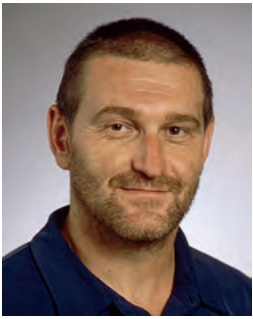
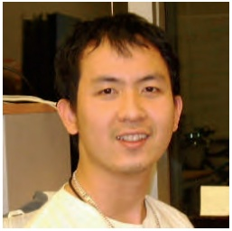

A surprisingly fast and memory-efficient alignment algorithm . . . . . . 273

The Middle Edge Problem . . . 275

Epilogue: Multiple Sequence Alignment . . . . 277

Building a three-dimensional Manhattan . . 277

A greedy multiple alignment algorithm . . . 280

Detours . . . . . . . . . . . 282

Fireflies and the non-ribosomal code . . 282

Finding a longest common subsequence without building a city . . . . . 283

Constructing a topological ordering . . 284

PAM scoring matrices . . 285

Divide-and-conquer algorithms . . . 287

Scoring multiple alignments . . 289

Bibliography Notes . . . 291

**6 Are There Fragile Regions in the Human Genome? 292**

Of Mice and Men . . . . . 293

How different are the human and mouse genomes? . . . . . . . . . 293

Synteny blocks . . . . 294

Reversals . . . . . . . 294

Rearrangement hotspots . . . 295

The Random Breakage Model of Chromosome Evolution . . . . . . . . . . . . 297

Sorting by Reversals . . 299

A Greedy Heuristic for Sorting by Reversals . . . . . 304

Breakpoints . . . 306

What are breakpoints? . . . 306

Counting breakpoints . . . . 307

Sorting by reversals as breakpoint elimination . . 308

Rearrangements in Tumor Genomes . . 310

From Unichromosomal to Multichromosomal Genomes . . . . . . . . . . 311

Translocations, fusions, and fissions . 311

From a genome to a graph . . . . 313

2-breaks . . . 314

Breakpoint Graphs . . 316

Computing the 2-Break Distance . . 320

Rearrangement Hotspots in the Human Genome . . . 323

The Random Breakage Model meets the 2-Break Distance Theorem . . . 323

The Fragile Breakage Model . . . 324

Epilogue: Synteny Block Construction . . . 325

Genomic dot-plots . . 325

Finding shared k-mers . . . 326

Constructing synteny blocks from shared k-mers . . . 329

Synteny blocks as connected components in graphs . . . . . . . . . . . . 331

Open Problem: Can Rearrangements Shed Light on Bacterial Evolution? . . . 333

Charging Stations . . . . 335

From genomes to the breakpoint graph . 335

Solving the 2-Break Sorting Problem . . . 338

Detours . . . . . . . . 340

Why is the gene content of mammalian X chromosomes so conserved? . 340

Discovery of genome rearrangements . . 340

The exponential distribution . . . 341

Bill Gates and David X. Cohen flip pancakes . . 342

Sorting linear permutations by reversals . . . . 343

Bibliography Notes . . . 346

**Bibliography 349**

**Image Courtesies 355**

## List of Code Challenges

## Chapter 1 2

(1A) Compute the Number of Times a Pattern Appears in a Text . . . . . . . . 8
(1B) Find the Most Frequent Words in a String . 8
(1C) Find the Reverse Complement of a DNA String . . 12
(1D) Find All Occurrences of a Pattern in a String 13
(1E) Find Patterns Forming Clumps in a String . . 15
(1F) Find a Position in a Genome Minimizing the Skew . . . 25
(1G) Compute the Hamming Distance Between Two Strings . . . . . . . . . . 27
(1H) Find All Approximate Occurrences of a Pattern in a String . . . . . . . . 27
(1I) Find the Most Frequent Words with Mismatches in a String . . . . . . . . 28
(1J) Find Frequent Words with Mismatches and Reverse Complements . . . 29
(1K) Generate the Frequency Array of a String . 40
(1L) Implement **PATTERNTONUMBER** 42
(1M) Implement **NUMBERTOPATTERN** . 43
(1N) Generate the d-Neighborhood of a String 50

## Chapter 2 66

(2A) Implement **MOTIFENUMERATION** . 71
(2B) Find a Median String . 81
(2C) Find a Profile-most Probable k-mer in a String . 85
(2D) Implement **GREEDYMOTIFSEARCH** 85
(2E) Implement **GREEDYMOTIFSEARCH** with Pseudocounts . . . . . . . . . 91
(2F) Implement **RANDOMIZEDMOTIFSEARCH** 93
(2G) Implement **GIBBSSAMPLER** . . 100
(2H) Implement **DISTANCEBETWEENPATTERNANDSTRINGS** . . . . . . . . . 107

## Chapter 3 115

(3A) Generate the k-mer Composition of a String . . . . 120
(3B) Reconstruct a String from its Genome Path . . . 125
(3C) Construct the Overlap Graph of a Collection of k-mers . . . . . . . . . . 128
(3D) Construct the de Bruijn Graph of a String . . . 132
(3E) Construct the de Bruijn Graph of a Collection of k-mers . . . . . . . . . . 137
(3F) Find an Eulerian Cycle in a Graph . . . 146
(3G) Find an Eulerian Path in a Graph . . . 147
(3H) Reconstruct a String from its k-mer Composition . . . . . 147
(3I) Find a k-Universal Circular String . . 148
(3J) Reconstruct a String from its Paired Composition . . . 157
(3K) Generate the Contigs from a Collection of Reads . . . . . 160
(3L) Construct a String Spelled by a Gapped Genome Path . . . . . . . . . . . 169
(3M) Generate All Maximal Non-Branching Paths in a Graph . . . . . . . . . . 169

## Chapter 4 182

(4A) Translate an RNA String into an Amino Acid String . . . . . . . . . . . . 186
(4B) Find Substrings of a Genome Encoding a Given Amino Acid String . . . 187
(4C) Generate the Theoretical Spectrum of a Cyclic Peptide . . . . . . . . . . . 191
(4D) Compute the Number of Peptides of Given Total Mass . . . . . . . . . . 193
(4E) Find a Cyclic Peptide with Theoretical Spectrum Matching an Ideal Spectrum . 196
(4F) Compute the Score of a Cyclic Peptide Against a Spectrum . . . . . . . . 198
(4G) Implement **LEADERBOARDCYCLOPEPTIDESEQUENCING** . . . . . . . . 200
(4H) Generate the Convolution of a Spectrum . . . 203
(4I) Implement **CONVOLUTIONCYCLOPEPTIDESEQUENCING** . . . . . . . . 205
(4J) Generate the Theoretical Spectrum of a Linear Peptide . . . . . . . . . . 211
(4K) Compute the Score of a Linear Peptide . . . . 214
(4L) Implement **TRIM** to Trim a Peptide Leaderboard . . . . . . 215
(4M) Solve the Turnpike Problem . . 219

## Chapter 5 222

(5A) Find the Minimum Number of Coins Needed to Make Change . . . . . . 240
(5B) Find the Length of a Longest Path in a Manhattan-like Grid . . . . . . . 245
(5C) Find a Longest Common Subsequence of Two Strings . . . . . . . . . . . 252
(5D) Find the Longest Path in a DAG . . 253
(5E) Find a Highest-Scoring Alignment of Two Strings . . . . 255

(5F) Find a Highest-Scoring Local Alignment of Two Strings . . . . . . . . . . 260
(5G) Compute the Edit Distance Between Two Strings . . . . . 262
(5H) Find a Highest-Scoring Fitting Alignment of Two Strings . . . . . . . . . 263
(5I) Find a Highest-Scoring Overlap Alignment of Two Strings . . . . . . . . 264
(5J) Align Two Strings Using Affine Gap Penalties . . 268
(5K) Find a Middle Edge in an Alignment Graph in Linear Space . . . . . . . 275
(5L) Align Two Strings Using Linear Space . . . 276
(5M) Construct a Highest-Scoring Multiple Alignment . . . . . . . 279
(5N) Find a Topological Ordering of a DAG . . 285

## Chapter 6 292

(6A) Implement **GREEDYSORTING** to Sort a Permutation by Reversals . . . . 305
(6B) Compute the Number of Breakpoints in a Permutation . . . . . . . . . . 308
(6C) Compute the 2-Break Distance Between a Pair of Genomes . . . . . . . . 321
(6D) Find a Shortest Transformation of a Genome into Another by 2-Breaks . 322
(6E) Find All Shared k-mers of a Pair of Strings . . . 326
(6F) Implement **CHROMOSOMETOCYCLE** . . 336
(6G) Implement **CYCLETOCHROMOSOME** . . 337
(6H) Implement **COLOREDEDGES** . . 337
(6I) Implement **GRAPHTOGENOME** . 338
(6J) Implement **2-BREAKONGENOMEGRAPH** . . . 339
(6K) Implement **2-BREAKONGENOME** . . 339

# About the Textbook

## Meet the Authors


<details>
<summary>natural_image</summary>

Portrait of a man wearing glasses and a suit, standing in front of green foliage (no text or symbols visible)
</details>

[**PHILLIP COMPEAU**](http://www.math.ucsd.edu/~pcompeau/) is an Assistant Teaching Professor in the Computational Biology Department at Carnegie Mellon University. He is a former postdoctoral researcher in the Department of Computer Science & Engineering at the University of California, San Diego, where he received a Ph. D. in mathematics. He is passionate about the future of both offline and online education, having cofounded [Rosalind](http://www.rosalind.info) with Nikolay Vyahhi in 2012. A retired tennis player, he dreams of one day going pro in golf.



<details>
<summary>natural_image</summary>

Portrait of a man with short hair and beard, wearing a blue shirt (no text or symbols visible)
</details>

[**PAVEL PEVZNER**](http://cseweb.ucsd.edu/~ppevzner/) is Ronald R. Taylor Professor of Computer Science at the University of California, San Diego. He holds a Ph. D. from Moscow Institute of Physics and Technology, Russia and an Honorary Degree from Simon Fraser University. He is a Howard Hughes Medical Institute Professor (2006), an Association for Computing Machinery Fellow (2010), and an International Society for Computational Biology Fellow (2012). He has authored the textbooks Computational Molecular Biology: An Algorithmic Approach (2000) and An Introduction to Bioinformatics Algorithms (2004) (jointly with Neil Jones).

## Meet the Development Team


<details>
<summary>natural_image</summary>

Portrait of a smiling woman with blonde hair, wearing a white shirt, against a colorful abstract background (no text or symbols visible)
</details>

[**OLGA BOTVINNIK**](http://www.olgabotvinnik.com) is a Ph.D. candidate in Bioinformatics and Systems Biology at the University of California, San Diego. She holds an M.S. in Bioinformatics from University of California, Santa Cruz and B.S. degrees in Mathematics and Biological Engineering from the Massachusetts Institute of Technology. Her research interests are data visualization and single-cell transcriptomics. She enjoys yoga, photography, and playing cello.



<details>
<summary>natural_image</summary>

Portrait of a smiling man in a white shirt (no visible text or symbols)
</details>

[**SON PHAM**](http://cseweb.ucsd.edu/~kspham/) is a postdoctoral researcher at Salk Institute in La Jolla, California. He holds a Ph. D. in Computer Science and Engineering from the University of California, San Diego and an M.S. in Applied Mathematics from St. Petersburg State University, Russia. His research interests include graph theory, genome assembly, comparative genomics, and neuroscience. Besides research, he enjoys walking meditation, gardening, and trying to catch the big one.


<details>
<summary>natural_image</summary>

Portrait of a young man with light brown hair wearing a checkered shirt, standing in front of a brick wall (no visible text or symbols)
</details>

[**NIKOLAY VYAHHI**](http://spbsu.ru/vyahhi/) coordinates the M.S. Program in Bioinformatics in the Academic University of St. Petersburg, Russian Academy of Sciences. In 2012, he cofounded the Rosalind online bioinformatics education project. He recently founded the Bioinformatics Institute in St. Petersburg as well as [Stepic](http://stepic.org), a company focusing on content delivery for online education.


<details>
<summary>natural_image</summary>

Portrait of a young man outdoors with greenery and trees in the background (no visible text or symbols)
</details>

[**KAI ZHANG**](http://kzhang.org) is a Ph. D. candidate in Bioinformatics and Systems Biology at the University of California, San Diego. He holds an M.S. in Molecular Biology from Xiamen University, China. His research interests include epigenetics, gene regulatory networks, and machine learning algorithms. Besides research, Kai likes basketball and music.

## Acknowledgments

This textbook was greatly improved by the efforts of a large number of individuals, to whom we owe a debt of gratitude.

The development team (Olga Botvinnik, Son Pham, Nikolay Vyahhi, and Kai Zhang), as well as Laurence Bernstein and Ksenia Krasheninnikova, implemented coding challenges and exercises, rendered figures, helped typeset the text, and offered insightful feedback on the manuscript.

Glenn Tesler provided thorough chapter reviews and even implemented some software to catch errors in the early version of the manuscript!

Robin Betz, Petar Ivanov, James Jensen, and Yu Lin provided insightful comments on the manuscript in its early stages. David Robinson was kind enough to copy edit a few chapters and palliate our punctuation maladies.

Randall Christopher brought to life our ideas for illustrations in addition to the textbook cover.

Andrey Grigoriev and Max Alekseyev gave advice on the content of Chapter 1 and Chapter 6, respectively. Martin Tompa helped us develop the narrative in Chapter 2 by suggesting that we analyze latent tuberculosis infection.

Nikolay Vyahhi led a team composed of Andrey Balandin, Artem Suschev, Aleksey Kladov, and Kirill Shikhanov, who worked hard to support an online, interactive version of this textbook used in our online course on Coursera.

Our students on Coursera, especially Mark Mammel and Dmitry Kuzminov, found hundreds of typos in our preliminary manuscript.

Mikhail Gelfand, Uri Keich, Hosein Mohimani, Son Pham, and Glenn Tesler advised us on some of the book’s “Open Problems” and led Massive Open Online Research projects (MOORs) in the first session of our online course.

Howard Hughes Medical Institute and the Russian Ministry of Education and Science generously gave their support for the development of the online courses based on this textbook. The Bioinformatics and Systems Biology Program and the Computer Science & Engineering Department at the University of California, San Diego provided additional support.

Finally, our families gracefully endured the many long days and nights that we spent poring over manuscripts, and they helped us preserve our sanity along the way.

P. C. and P. P.

San Diego

July 2015


## WHERE IN THE GENOme DOeS DNA REPLICATIOn BEGIN?

## Algorithmic Warmup


## A Journey of a Thousand Miles. . .

**Genome replication** is one of the most important tasks carried out in the cell. Before a cell can divide, it must first replicate its genome so that each of the two daughter cells inherits its own copy. In 1953, James Watson and Francis Crick completed their [landmark paper](http://www.nature.com/nature/dna50/watsoncrick.pdf) on the DNA double helix with a now-famous phrase:

It has not escaped our notice that the specific pairing we have postulated immediately suggests a possible copying mechanism for the genetic material.

They conjectured that the two strands of the parent DNA molecule unwind during replication, and then each parent strand acts as a template for the synthesis of a new strand. As a result, the replication process begins with a pair of complementary strands of DNA and ends with two pairs of complementary strands, as shown in Figure 1.1.


<details>
<summary>text_image</summary>

A > T
G C
C G
T < A
A > T
G C
C G
T < A
A > T
G C
C G
T < A
A > T
G C
C G
T < A
T C G A
</details>

FIGURE 1.1 A naive view of DNA replication. Nucleotides adenine (A) and thymine (T) are complements of each other, as are cytosine (C) and guanine (G). Complementary nucleotides bind to each other in DNA.

Although Figure 1.1 models DNA replication on a simple level, the details of replication turned out to be much more intricate than Watson and Crick imagined; as we will see, an astounding amount of molecular logistics is required to ensure DNA replication.

At first glance, a computer scientist might not imagine that these details have any computational relevance. To mimic the process in Figure 1.1 algorithmically, we only need to take a string representing the genome and return a copy of it! Yet if we take the time to review the underlying biological process, we will be rewarded with new algorithmic insights into analyzing replication.

Replication begins in a genomic region called the **replication origin** (denoted oriC) and is performed by molecular copy machines called **DNA polymerases**. Locating oriC presents an important task not only for understanding how cells replicate but also for various biomedical problems. For example, some gene therapy methods use genetically engineered mini-genomes, which are called **viral vectors** because they are able to penetrate cell walls (just like real viruses). Viral vectors carrying artificial genes have been used in agriculture to engineer frost-resistant tomatoes and pesticide-resistant corn. In 1990, gene therapy was first successfully performed on humans when it saved the life of a four-year-old girl suffering from Severe Combined Immunodeficiency Disorder; the girl had been so vulnerable to infections that she was forced to live in a sterile environment.

The idea of gene therapy is to intentionally infect a patient who lacks a crucial gene with a viral vector containing an artificial gene that encodes a therapeutic protein. Once inside the cell, the vector replicates and eventually produces many copies of the therapeutic protein, which in turn treats the patient’s disease. To ensure that the vector actually replicates inside the cell, biologists must know where oriC is in the vector’s genome and ensure that the genetic manipulations that they perform do not affect it.

In the following problem, we assume that a genome has a single oriC and is represented as a **DNA string**, or a string of nucleotides from the four-letter alphabet $\left\{ \mathbb { A } , \mathbb { C } , \mathbb { G } , \mathbb { T } \right\}$

## Finding Origin of Replication Problem:

**Input**: A DNA string Genome.

**Output**: The location of oriC in Genome.


**STOP and Think:** Does this biological problem represent a clearly stated computational problem?

Although the Finding Origin of Replication Problem asks a legitimate biological ques tion, it does not present a well-defined computational problem. Indeed, biologists would immediately plan an experiment to locate oriC: for example, they might delete various short segments from the genome in an effort to find a segment whose deletion stops replication. Computer scientists, on the other hand, would shake their heads and demand more information before they can even start thinking about the problem.

Why should biologists care what computer scientists think? Computational methods are now the only realistic way to answer many questions in modern biology. First, these methods are much faster than experimental approaches; second, the results of many experiments cannot be interpreted without computational analysis. In particular, existing experimental approaches to oriC prediction are rather time consuming. As a result, oriC has only been experimentally located in a handful of species. Thus, we would like to design a computational approach to find oriC so that biologists are free to spend their time and money on other tasks.

## Hidden Messages in the Replication Origin

## DnaA boxes

In the rest of this chapter, we will focus on the relatively easy case of finding oriC in bacterial genomes, most of which consist of a single circular chromosome. Research has shown that the region of the bacterial genome encoding oriC is typically a few hundred nucleotides long. Our plan is to begin with a bacterium in which oriC is known, and then determine what makes this genomic region special in order to design a computational approach for finding oriC in other bacteria. Our example is Vibrio cholerae, the bacterium that causes cholera; here is the nucleotide sequence appearing in its oriC:

atcaatgatcaacgtaagcttctaagcatgatcaaggtgctcacacagtttatccacaac ctgagtggatgacatcaagataggtcgttgtatctccttcctctcgtactctcatgacca cggaaagatgatcaagagaggatgatttcttggccatatcgcaatgaatacttgtgactt gtgcttccaattgacatcttcagcgccatattgcgctggccaaggtgacggagcgggatt acgaaagcatgatcatggctgttgttctgtttatcttgttttgactgagacttgttagga tagacggtttttcatcactgactagccaaagccttactctgcctgacatcgaccgtaaat tgataatgaatttacatgcttccgcgacgatttacctcttgatcatcgatccgattgaag atcttcaattgttaattctcttgcctcgactcatagccatgatgagctcttgatcatgtt tccttaaccctctattttttacggaagaatgatcaagctgctgctcttgatcatcgtttc

How does the bacterial cell know to begin replication exactly in this short region within the much larger Vibrio cholerae chromosome, which consists of 1,108,250 nucleotides? There must be some “hidden message” in the oriC region ordering the cell to begin replication here. Indeed, we know that the initiation of replication is mediated by **DnaA**, a protein that binds to a short segment within the oriC known as a **DnaA box**. You can think of the DnaA box as a message within the DNA sequence telling the

DnaA protein: “bind here!” The question is how to find this hidden message without knowing what it looks like in advance — can you find it? In other words, can you find something that stands out in oriC? This discussion motivates the following problem.

## Hidden Message Problem:

Find a “hidden message” in the replication origin.

**Input**: A string Text (representing the replication origin of a genome).

**Output**: A hidden message in Text.


**STOP and Think:** Does this problem represent a clearly stated computational problem?

Hidden messages in “The Gold-Bug”

Although the Hidden Message Problem poses a legitimate intuitive question, it again makes absolutely no sense to a computer scientist because the notion of a “hidden message” is not precisely defined. The oriC region of Vibrio cholerae is currently just as puzzling as the parchment discovered by William Legrand in Edgar Allan Poe’s story “The Gold-Bug”. Written on the parchment was the following:

```csv
53++!305))6*;4826)4+. )4+);806*;48!8'60))85;1+(; :+*8
!83(88)5*!;46(;88*96*?;8)*+(;485);5*!2:*+(;4956*2(5
*-4)8'8*;4069285);)6!8)4++;1(+9;48081;8:8+1;48!85:4
)485!528806*81(+9;48;(88;4(+?34;48)4+;161;:188;+?;
```

Upon seeing the parchment, the narrator remarks, “Were all the jewels of Golconda awaiting me upon my solution of this enigma, I am quite sure that I should be unable to earn them”. Legrand retorts, “It may well be doubted whether human ingenuity can construct an enigma of the kind which human ingenuity may not, by proper application, resolve”. He reasons that the three consecutive symbols "**;48**" appear with surprising frequency on the parchment:

```csv
53++!305))6*;4826)4+. )4+);806*;48!8'60))85;1+(; :+*8
!83(88)5*!;46(;88*96*?;8)*+(;485);5*!2:*+(;4956*2(5
*-4)8'8*;4069285);)6!8)4++;1(+9;48081;8:8+1;48!85;4
)485!528806*81(+9;48;(88;4(+?34;48)4+;161;;188;+?;
```

Legrand had already deduced that the pirates spoke English; he therefore assumed that the high frequency of ";48" implied that it encodes the most frequent English word, "THE". Substituting each symbol, Legrand had a slightly easier text to decipher, which would eventually lead him to the buried treasure. Can you decode this message too?

$$
\begin{array}{l} (5 3 + +! 3 0 5)) 6 * \text {THE} 2 6) \mathrm{H} +.) \mathrm{H} +) \text {TE} 0 6 * \text {THE}! \mathrm{E} ^ {\prime} 6 0)) \mathrm{E} 5 \mathrm{T} 1 + (\mathrm{T}: + * \mathrm{E} \\ \text {!E3(EE)5*!TH6(TEE*96*?TE)* + (THE5)T5*!2:* + (TH956*2(5} \\ * - \mathrm{H}) \mathrm{E} ^ {\prime} \mathrm{E} * \text {TH0692E5)T)6!E}) \mathrm{H} + + \mathrm{T1} (+ 9 \text {THE0E1TE:E} + 1 \text {THE!E5TH} \\ \text {)HE5!52EE06*E1(+9THET(EETH(+?3HTHE)H + T161T:1EET + ?T} \\ \end{array}
$$

## Counting words

Operating under the assumption that DNA is a language of its own, let’s borrow Legrand’s method and see if we can find any surprisingly frequent “words” within the oriC of Vibrio cholerae. We have added reason to look for frequent words in the oriC because for various biological processes, certain nucleotide strings often appear surprisingly often in small regions of the genome. For example, **ACTAT** is a surprisingly frequent substring of

## ACAACTATGCATACTATCGGGAACTATCCT.

We use the term **k-mer** to refer to a string of length k and define COUNT(Text, Pattern) as the number of times that a k-mer Pattern appears as a substring of Text. Following the above example,

$$
\text {COUNT} (\text {ACAACTATGCATACTATCGGGAACTATCCT, ACTAT}) = 3.
$$

Note that COUNT(CG**ATATA**TCC**ATA**G, **ATA**) is equal to 3 (not 2) since we should account for overlapping occurrences of Pattern in Text.

To compute COUNT(Text, Pattern), our plan is to “slide a window” down Text, checking whether each k-mer substring of Text matches Pattern. We will therefore refer to the k-mer starting at position i of Text as Text(i, k). Throughout this book, we will often use **0-based indexing**, meaning that we count starting at 0 instead of 1. In this case, Text begins at position 0 and ends at position |Text|  1 (|Text| denotes the number of symbols in Text). For example, if Text = GACCATACTG, then Text(4, 3) = ATA. Note that the last k-mer of Text begins at position |Text|  k, e.g., the last 3-mer of GACCATACTG starts at position 10  3 = 7. This discussion results in the following pseudocode for computing COUNT(Text, Pattern).