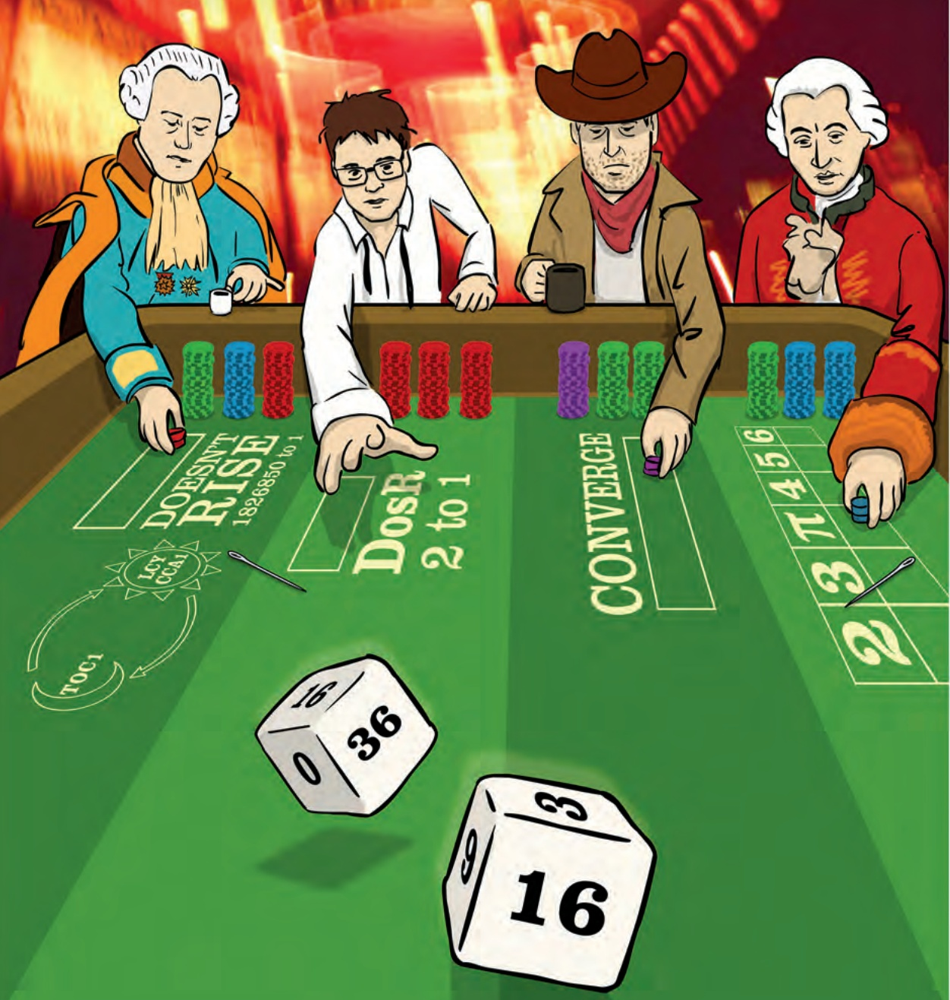
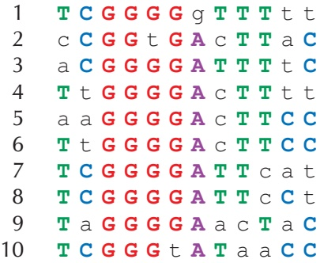

We should not be surprised that the probability of finding ACTAT in a random DNA string of length 30 is so low. However, remember that our original goal was to approximate the probability that there exists some 5-mer appearing three or more times. In general, the probability that some k-mer appears t or more times in a random string of length N formed over an A-letter alphabet is written $\operatorname* { P r } \bigl ( N , A , k , t \bigr )$

We approximated $\operatorname* { P r } \bigl ( N , A , P a t t e r n , t \bigr )$ as

$$
p = \frac {\binom {N - t \cdot (k - 1)} {t}}{A ^ {t \cdot k}}.
$$

Notice that the approximate probability that Pattern does not appear t or more times is therefore $1 - p$ . Thus, the probability that all $A ^ { k }$ patterns appear fewer than t times in a random string of length N can be approximated as

$$
(1 - p) ^ {A ^ {k}}.
$$

Moreover, the probability that there exists a k-mer appearing t or more times should be 1 minus this value, which gives us the following approximation:

$$
\operatorname * {P r} (N, A, k, t) \approx 1 - (1 - p) ^ {A ^ {k}}.
$$

Your calculator may have difficulty with this formula, which requires raising a number close to 1 to a very large power and can cause round-off errors. To avoid this, if we assume that $p$ is about the same for any Pattern, then we can approximate $\operatorname* { P r } \bigl ( N , A , k , t \bigr )$ by multiplying $p$ by the total number of k-mers $A ^ { k }$

$$
\Pr (N, A, k, t) \approx p \cdot A ^ {k} = \frac {\binom {N - t \cdot (k - 1)} {t}}{A ^ {t \cdot k}} \cdot A ^ {k} = \frac {\binom {N - t \cdot (k - 1)} {t}}{A ^ {(t - 1) \cdot k}}.
$$

We acknowledge again that this approximation is a gross over-simplification, since the probability $\operatorname* { P r } \bigl ( N , A , P a t t e r n , t \bigr )$ varies across different choices of k-mers and because it assumes that occurrences of different k-mers are independent events. For example, in the main text, we wish to approximate $\mathrm { P r } \big ( 5 0 0 , 4 , 9 , 3 \big )$ , and the above formula results in the approximation

$$
\Pr (5 0 0, 4, 9, 3) \approx \frac {\binom {5 0 0 - 3 \cdot 8} {3}}{4 ^ {(3 - 1) \cdot 9}} = \frac {1 7 8 6 1 9 0 0}{6 8 7 1 9 4 7 6 7 3 6} \approx \frac {1}{3 8 4 7}.
$$

Because of overlapping strings, this approximation deviates from the true value of $\mathrm { P r } \big ( 5 0 0 , 4 , 9 , 3 \big )$ , which is closer to 1/1300.

## The most beautiful experiment in biology

The Meselson-Stahl experiment, conducted in 1958 by Matthew Meselson and Franklin Stahl, is sometimes called “the most beautiful experiment in biology”. In the late 1950s, biologists debated three conflicting models of DNA replication, illustrated in Figure 1.24. The **semiconservative hypothesis** (recall Figure 1.1 from page 3), suggested that each parent strand acts as a template for the synthesis of a daughter strand. As a result, each of the two daughter molecules contains one parent strand and one newly synthesized strand. The **conservative hypothesis** proposed that the entire double-stranded parent DNA molecule serves as a template for the synthesis of a new daughter molecule, resulting in one molecule with two parent strands and another with two newly synthesized strands. The **dispersive hypothesis** proposed that some mechanism breaks the DNA backbone into pieces and splices intervals of synthesized DNA, so that each of the daughter molecules is a patchwork of old and new double-stranded DNA.


<details>
<summary>text_image</summary>

Semiconservative
Conservative
Dispersive
Parental
DNA
After 1 round
of replication
After 2 rounds
of replication
</details>

FIGURE 1.24 Semiconservative, conservative, and dispersive models of DNA replication make different predictions about the distribution of DNA strands after replication. Yellow strands indicate $^ { 1 5 } \mathrm { N }$ (heavy) segments of DNA, and black strands indicate $^ { 1 4 } \mathbb { N }$ (light) segments. The Meselson-Stahl experiment began with DNA consisting of 100% $\left[ 1 { \widetilde { 5 } } _ { \mathrm { N } } \right]$

Meselson and Stahl’s insight was that one isotope of nitrogen, **Nitrogen-14** $( ^ { 1 4 } \mathrm { N } )$ is lighter and more abundant than Nitrogen-15 $( ^ { 1 5 } \mathrm { N } )$ . Knowing that DNA naturally contains $^ { 1 4 } \mathrm { N }$ , Meselson and Stahl grew E. coli for many rounds of replication in a $^ { 1 5 } \mathrm { N }$ medium, which caused the bacteria to gain weight as they absorbed the heavier isotope into their DNA. When they were confident that the bacterial DNA was saturated with $^ { 1 5 } \mathrm { N } ,$ they transferred the heavy E. coli cells to a less dense $^ { 1 4 } \mathrm { N }$ medium.

**STOP and Think:** What do you think happened when the “heavy” E. coli replicated in the “light” 14<sub>N</sub> medium?

The brilliance of the Meselson-Stahl experiment is that all newly synthesized DNA would contain exclusively $^ { 1 4 } \mathrm { N } ,$ and the three existing hypotheses for DNA replication predicted different outcomes for how this $^ { 1 4 } \mathrm { N }$ isotope would be incorporated into DNA. Specifically, after one round of replication, the conservative model predicted that half the E. coli DNA would still have only $^ { 1 5 } \mathrm { N }$ and therefore be heavier whereas the other half would have only $^ { 1 4 } \mathrm { N }$ and be lighter. Yet when they attempted to separate the E. coli DNA according to weight by using a centrifuge after one round of replication, all of the DNA had the same density! Just like that, they had refuted the conservative hypothesis once and for all.

Unfortunately, this experiment was not able to eliminate either of the other two models, as both the dispersive and semiconservative hypotheses predicted that all of the DNA after one round of replication would have the same density.

**STOP and Think:** What would the dispersive and semiconservative models predict about the density of E. coli DNA after two rounds of replication?

Let’s first consider the dispersive model, which says that each daughter strand of DNA is formed by half mashed up pieces of the parent strand, and half new DNA. If this hypothesis were true, then after two replication cycles, any daughter strand of DNA should contain about 25% $^ { 1 5 } \mathrm { N }$ and about $75\%\;^{14} N$ . In other words, all the DNA should still have the same density. And yet when Meselson and Stahl spun the centrifuge after two rounds of E. coli replication, this is not what they observed!

Instead, they found that the DNA divided into two different densities. This is exactly what the semiconservative model predicted: after one cycle, every cell should possess one $^ { 1 4 } \mathrm { N }$ strand and one $^ { 1 5 } \mathrm { N }$ strand; after two cycles, half of the DNA molecules should have one $^ { 1 4 } \mathrm { N }$ strand and one $^ { 1 5 } \mathrm { N }$ strand, while the other half should have two $^ { 1 4 } \mathrm { N }$ strands, producing the two different densities they noticed.

**STOP and Think:** What does the semi-conservative model predict about the density of E. coli DNA after three rounds of replication?

Meselson and Stahl had rejected the conservative and dispersive hypotheses of repli cation, and yet they wanted to make sure that the semiconservative hypothesis was confirmed by further E. coli replication. This model predicted that after three rounds of replication, one-quarter of the DNA molecules should still have a $^ { 1 5 } \mathrm { N }$ strand, causing 25% of the DNA to have an intermediate density, whereas the remaining 75% should be lighter, having only $^ { 1 4 } \mathrm { N }$ . This is indeed what Meselson and Stahl witnessed in the lab, and the semiconservative hypothesis has stood strong to this day.

## Directionality of DNA strands

The sugar component of a nucleotide has a ring of five carbon atoms, which are labeled as $1 ^ { \prime } ,   2 ^ { \prime } ,   3 ^ { \prime } ,   4 ^ { \prime } ,$ and $5 ^ { \prime }$ in Figure 1.25 (left). The $5 ^ { \prime }$ atom is joined onto the phosphate group in the nucleotide and eventually to the $3 ^ { \prime }$ end of the neighboring nucleotide. The $3 ^ { \prime }$ atom is joined onto another neighboring nucleotide in the nucleic acid chain. As a result, we call the two ends of the nucleotide the $5 ^ { \prime } \cdot$ **end** and the **3’-end** (pronounced “five prime end” and "three prime end”, respectively).


FIGURE 1.25 A nucleotide with sugar ring carbon atoms labeled $1 ^ { \prime } ,   2 ^ { \prime } ,   3 ^ { \prime } ,   4 ^ { \prime } ,$ and $5 ^ { \prime } .$

When we zoom out to the level of the double helix, we can see in Figure 1.25 (right) that any DNA fragment is oriented with a $3 ^ { \prime }$ atom on one end and a $5 ^ { \prime }$ atom on the other end. As a standard, a DNA strand is always read in the $5 ^ { \prime } \rightarrow 3 ^ { \prime }$ direction. Note that the orientations run opposite to each other in complementary strands.

## The Towers of Hanoi

The **Towers of Hanoi** puzzle consists of three vertical pegs and a number of disks of different sizes, each with a hole in its center so that it fits on the pegs. The disks are initially stacked on the left peg (peg 1) so that disks increase in size from the top down (Figure 1.26). The puzzle is played by moving one disk at a time between pegs, with the goal of moving all disks from the left peg (peg 1) to the right peg (peg 3). However, you are not allowed to place a disk on top of a smaller disk.


<details>
<summary>natural_image</summary>

Wooden model of a spiral pyramid on a base, with two vertical rods placed beside it (no text or symbols visible)
</details>

FIGURE 1.26 The Towers of Hanoi puzzle.

## Towers of Hanoi Problem:

Solve the Towers of Hanoi puzzle.

**Input**: An integer n.

**Output**: A sequence of moves that will solve the Towers of Hanoi puzzle with n disks.


**STOP and Think:** What is the minimum number of steps needed to solve the Towers of Hanoi Problem for three disks?

Let’s see how many steps are required to solve the Towers of Hanoi Problem for four disks. The first important observation is that sooner or later you will have to move the largest disk to the right peg. However, in order to move the largest disk, we first have to move all three smallest disks off the first peg. Furthermore, these three smallest disks must all be on the same peg because the largest disk cannot be placed on top of another disk. Thus, we first have to move the top three disks to the middle peg (7 moves), then move the largest disk to the right peg (1 move), then again move the three smallest disks from the middle peg to the top of the largest disk on the right peg (another 7 moves), for a total of 15 moves.

More generally, let T(n) denote the minimum number of steps required to solve the Towers of Hanoi puzzle with n disks. To move n disks from the left peg to the right peg, you first need to move the n  1 smallest disks from the left peg to the middle peg (T(n  1) steps), then move the largest disk to the right peg (1 step), and finally move the n  1 smallest disks from the middle peg to the right peg (T(n  1) steps). This yields the recurrence relation

$$
T (n) = 2 T (n - 1) + 1.
$$

**STOP and Think:** Using the above recurrence relation, can you find a formula for T(n) that does not require recursion?

We now have a recursive algorithm to move n disks from the left peg to the right peg. We will use three variables (each taking a different value from 1, 2, and 3) to denote the three pegs: startPeg, destinationPeg, and transitPeg. These three variables always represent different pegs, and so startPeg + destinationPeg + transitPeg is always equal to 1 + 2 + 3 = 6. **HANOITOWERS**(n, startPeg, destinationPeg) moves n disks from startPeg to destinationPeg (using transitPeg as a temporary destination).

```python
HANOITOWERS(n, startPeg, destinationPeg)
    if n = 1
        Move top disk from startPeg to destinationPeg
        return
    transitPeg = 6 - startPeg - destinationPeg
    HANOITOWERS(n - 1, startPeg, transitPeg)
    Move top disk from startPeg to destinationPeg
    HANOITOWERS(n - 1, transitPeg, destinationPeg)
    return
```

Even though this algorithm may seem straightforward, moving a 100-disk tower would require more steps than the number of atoms in the universe! The fast growth of the number of moves required by **HANOITOWERS** is explained by the fact that every time


**HANOITOWERS** is called for n disks, it calls itself twice for $n - 1$ , which in turn triggers four calls for $n - 2 ,$ and so on. For example, a call to HANOITOWERS $( 4 , 1 , 3 )$ results in calls HANOITOWERS $( 3 , 1 , 2 )$ and **HANOITOWERS**(3, 2, 3); these calls, in turn, call **HANOITOWERS**(2, 1, 3), **HANOITOWERS**(2, 3, 2), **HANOITOWERS**(2, 2, 1), and **HANOITOWERS**(2, 1, 3).

## The overlapping words paradox

We illustrate the overlapping words paradox with a two-player game called “Best Bet for Simpletons”. Player 1 selects a binary k-mer A, and Player 2, knowing what A is, selects a different binary k-mer B. The two players then flip a coin multiple times, with coin flips represented by strings of $`` \mathbf { 1 }  ''$ (“heads”) and "0" (“tails”); the game ends when A or B appears as a block of k consecutive coin flips.


**STOP and Think:** Do the two players always have the same chance of winning?

At first glance, you might guess that every k-mer has an equal chance of winning. Yet suppose that Player 1 chooses "00" and Player 2 chooses "10". After two flips, either Player 1 wins $( 0 0 ^ { \mathfrak { n } } )$ , Player 2 wins $( 1 0 )$ , or the game continues ("01" or "11"). If the game continues, then Player 1 should surrender, since Player 2 will win as soon as “tails” $( `` 0 '' )$ is next flipped. Player 2 is therefore three times more likely to win!

It may seem that Player 1 should have the advantage by simply selecting the “strongest” k-mer. However, an intriguing feature of Best Bet for Simpletons is that if $k > 2 ,$ then Player 2 can always choose a k-mer B that beats A, regardless of Player 1’s choice of A. Another surprise is that Best Bet for Simpletons is a **non-transitive game**: if A defeats $B ,$ and B defeats $C ,$ then we cannot automatically conclude that A defeats C (c.f. [rock-paper-scissors](http://en.wikipedia.org/wiki/Rock-paper-scissors)).

The analysis of Best Bet for Simpletons is based on the notion of a **correlation polynomial**. We say that B **i-overlaps** with A if the last i digits of A coincide with the first i digits of B. For example, $``110110$ 1-overlaps, 2-overlaps, and 5-overlaps with "011011", as shown in Figure 1.27.

Given two k-mers A and $B ,$ the correlation of A and B, denoted CORR $\left( A , B \right) \; =$ $\left( c _ { 0 } , \cdots , c _ { k - 1 } \right)$ , is a k-letter binary word such that $c _ { i } = 1$ if B (k  i)-overlaps with A, and 0 otherwise. The correlation polynomial of A and B is defined as

$$
K _ {A, B} (t) = c _ {0} + c _ {1} \cdot t + c _ {2} \cdot t ^ {2} + \dots + c _ {k - 1} \cdot t ^ {k - 1}.
$$

<div class="docvortex-algorithm" style="white-space: pre-wrap; font-family:monospace;">
CORR(A, B)
B = 110110
B = 110110
B = 110110
B = 110110
B = 110110
B = 110110
A = 011011
</div>

FIGURE 1.27 The correlation of k-mers $A   =   011011$ and $B   =   110110$ is the string "010011".

For the strings A and B in Figure 1.27, their correlation is "010011" and their correlation polynomial is $K _ { A , B } \big ( t \big ) = t + t ^ { 4 } + t ^ { 5 }$

Next, we write $K _ { A , B }$ as shorthand for $K _ { A , B } \big ( 1 / 2 \big )$ . For the example in Figure 1.27, $K _ { A , B } = { \textstyle { \frac { 1 } { 2 } } } + { \textstyle { \frac { 1 } { 1 6 } } } + { \textstyle { \frac { 1 } { 3 2 } } } = { \textstyle { \frac { 1 9 } { 3 2 } } }$ . John Conway suggested the following deceivingly simple formula to compute the odds that B will defeat A:

$$
\frac {K _ {A , A} - K _ {A , B}}{K _ {B , B} - K _ {B , A}}
$$

Conway never published a proof of this formula, and Martin Gardner, a leading popular mathematics writer, said the following about the formula:

I have no idea why it works. It just cranks out the answer as $i f$ by magic, like so many of Conway’s other algorithms.

## Bibliography Notes

Using the skew to find replication origins was first proposed by Lobry, 1996 and also described in Grigoriev, 1998. Grigoriev, 2011 provides an excellent introduction to the skew approach, and Sernova and Gelfand, 2008 gave a review of algorithms and software tools for finding replication origins in bacteria. Lundgren et al., 2004 demonstrated that archaea may have multiple oriCs. Wang et al., 2011 inserted an artificial oriC into the E. coli genome and showed that it triggers replication. Xia, 2012 was the first to conjecture that bacteria may have multiple replication origins. Gao and Zhang, 2008 developed the Ori-Finder software program for finding bacterial replication origins.

Liachko et al., 2013 provided the most comprehensive description of the replication origins of yeast. Solov’ev, 1966 was the first to derive accurate formulas for approximating the probabilities of patterns in a string. Gardner, 1974 wrote an excellent introductory article about the Best Bet for Simpletons paradox. Guibas and Odlyzko, 1981 provided an excellent coverage of the overlapping words paradox that illustrates the complexity of computing the probabilities of patterns in a random text. They also derived a rather complicated proof of Conway’s formula for Best Bet for Simpletons. Sedgewick and Flajolet, 2013 gave an overview of various approaches for computing the probabilities of patterns in a string.


## WHICH DNA PATTERNS PLAY THE ROLE OF MOLECULAR CLOCKS?

Randomized Algorithms



## Do We Have a “Clock” Gene?

The daily schedules of animals, plants, and even bacteria are controlled by an internal timekeeper called the **circadian clock**. Anyone who has experienced the misery of jet lag knows that this clock never stops ticking. Rats and research volunteers alike, when placed in a bunker, naturally maintain a roughly 24-hour cycle of activity and rest in total darkness. And, like any timepiece, the circadian clock can malfunction, resulting in a genetic disease known as **delayed sleep-phase syndrome** (**DSPS**).

The circadian clock must have some basis on the molecular level, which presents many questions. How do individual cells in animals and plants (let alone bacteria) know when they should slow down or increase the production of certain proteins? Is there a “clock gene”? Can we explain why heart attacks occur more often in the morning, while asthma attacks are more common at night? And can we identify genes that are responsible for “breaking” the circadian clock to cause DSPS?

In the early 1970s, Ron Konopka and Seymour Benzer identified mutant flies with abnormal circadian patterns and traced the flies’ mutations to a single gene. Biologists needed two more decades to discover a similar clock gene in mammals, which was just the first piece of the puzzle. Today, many more circadian genes have been discovered; these genes, having names like timeless, clock, and cycle, orchestrate the behavior of hundreds of other genes and display a high degree of evolutionary conservation across species.

We will first focus on plants, since maintaining the circadian clock in plants is a matter of life and death. Consider how many plant genes should pay attention to the time when the sun rises and sets; indeed, biologists estimate that over a thousand plant genes are circadian, including the genes related to photosynthesis, photo reception, and flowering. These genes must somehow know what time it is in order to change their gene transcript production, or **gene expression**, throughout the day (see **DETOUR: Gene Expression**).

It turns out that every plant cell keeps track of day and night independently of other cells, and that just three plant genes, called LCY, CCA1, and TOC1, are the clock’s master timekeepers. Such regulatory genes, and the **regulatory proteins** that they encode, are often controlled by external factors (e.g., nutrient availability or sunlight) in order to allow organisms to adjust their gene expression.

For example, regulatory proteins controlling the circadian clock in plants coordinate circadian activity as follows. TOC1 promotes the expression of LCY and CCA1, whereas LCY and CCA1 repress the expression of TOC1, resulting in a **negative feedback loop**. In the morning, sunlight activates the transcription of LCY and CCA1, triggering the repression of TOC1 transcription. As light diminishes, so does the production of LCY and CCA1, which in turn do not repress TOC1 any more. Transcription of TOC1 peaks at night and starts promoting the transcription of LCY and CCA1, which in turn repress the transcription of TOC1, and the cycle begins again.

LCY, CCA1, and TOC1 are able to control the transcription of other genes because the regulatory proteins that they encode are **transcription factors**, or master regulatory proteins that turn other genes on and off. A transcription factor regulates a gene by binding to a specific short DNA interval called a **regulatory motif**, or **transcription factor binding site**, in the gene’s **upstream region**, a 600-1000 nucleotide-long region preceding the start of the gene. For example, CCA1 binds to AAAAAATCT in the upstream region of many genes regulated by CCA1.

The life of a bioinformatician would be easy if regulatory motifs were completely conserved, but the reality is more complex, as regulatory motifs may vary at some positions, e.g., CCA1 may instead bind to AAGAACTCT. But how can we locate these regulatory motifs without knowing what they look like in advance? We need to develop algorithms for **motif finding**, the problem of discovering a “hidden message” shared by a collection of strings.

## Motif Finding Is More Difficult Than You Think

Identifying the evening element

<strong><u>PAGE 10</u></strong>**8**

In 2000, Steve Kay used **DNA arrays** (see **DETOUR: DNA Arrays**) to determine which genes in the plant Arabidopsis thaliana are activated at different times of the day. He then extracted the upstream regions of nearly 500 genes that exhibited circadian behavior and looked for frequently appearing patterns in their upstream regions. If you concatenated these upstream regions into a single string, you would find that AAAATATCT is a surprisingly frequent word, appearing 46 times.


**EXERCISE BREAK:** What is the expected number of occurrences of a 9-mer in 500 random DNA strings, each of length 1000?

Kay named AAAATATCT the **evening element** and performed a simple experiment to prove that it is indeed the regulatory motif responsible for circadian gene expression in Arabidopsis thaliana. After he mutated the evening element in the upstream region of one gene, the gene no longer exhibited circadian behavior.

Whereas the evening element in plants is very conserved, and thus easy to find, motifs having many mutations are more elusive. For example, if you infect a fly with a bacterium, the fly will switch on its **immunity genes** to fight the infection. Thus, some of the genes with elevated expression levels after the infection are likely to be immunity genes. Indeed, some of these genes have 12-mers similar to **TCGGGGATTTCC** in their upstream regions, the binding site of a transcription factor called **NF-**kB that activates various immunity genes in flies. However, NF-kB binding sites are nowhere near as conserved as the evening element. Figure 2.1 shows ten NF-kB binding sites from the Drosophila melanogaster genome; the most popular nucleotides in every column are shown by upper case colored letters.



<details>
<summary>text_image</summary>

1 T C G G G G g T T T t t
2 c C G G t G A c T T a C
3 a C G G G G A T T T t C
4 T t G G G G A c T T t t
5 a a G G G G A c T T C C
6 T t G G G G A c T T C C
7 T C G G G G A T T c a t
8 T C G G G G A T T c C t
9 T a G G G G A a c T a C
10 T C G G G t A T a a C C
</details>

FIGURE 2.1 The ten candidate NF-kB binding sites appearing in the Drosophila melanogaster genome. The upper case colored letters indicate the most frequent nucleotide in each column.

## Hide and seek with motifs

Our aim is to turn the biological challenge of finding regulatory motifs into a computational problem. Below, we have implanted a 15-mer hidden message at a randomly selected position in each of ten randomly generated DNA strings. This example mimics a transcription factor binding site hiding in the upstream regions of ten genes.

1 atgaccgggatactgataaaaaaaagggggggggcgtacacattagataaacgtatgaagtacgttagactcggcgccgccg
2 acccctattttttgagcagatttagtgacctggaaaaaaaatttgagtacaaaacttttccgaataaaaaaaaaggggggga
3 tgagtatccctgggatgacttaaaaaaaagggggggtgctctcccgatttttgaatatgtaggatcattcgccagggtccga
4 gctgagaattggatgaaaaaaaagggggggtccacgcaatcgcgaaccaacgcggacccaaaggcaagaccgataaaggaga
tcccttttgcggtaatgtgccgggaggctggttacgtagggaagccctaacggacttaataaaaaaaagggggggcttatag
6 gtcaatcatgttcttgtgaatggatttaaaaaaaaggggggggaccgcttggcgcacccaaattcagtgtgggcgagcgcaa
7 cggttttggcccttgttagaggcccccgtaaaaaaaagggggggcaattatgagagagctaatctatcgcgtgcgtgttcat
8 aacttgagttaaaaaaaagggggggctggggcacatacaagaggagtcttccttatcagttaatgctgtatgacactatgta
9 ttggcccattggctaaaagcccaacttgacaaatggaagatagaatccttgcataaaaaaaagggggggaccgaaagggaag
10 ctggtgagcaacgacagattcttacgtgcattagctcgcttccggggatctaatagcacgaagcttaaaaaaaaggggggga


## STOP and Think: Can you find the implanted hidden message?

This is a simple problem: applying an algorithm for the Frequent Words Problem to the concatenation of these strings will immediately reveal the most frequent 15-mer shown below as the implanted pattern. Since these short strings were randomly generated, it is unlikely that they contain other frequent 15-mers.

1 atgaccgggatactgat**AAAAAAAAGGGGGGG**ggcgtacacattagataaacgtatgaagtacgttagactcggcgccgccg
2 acccctattttttgagcagatttagtgacctggaaaaaaaatttgagtacaaaacttttccgaata**AAAAAAAAGGGGGGG**a
3 tgagtatccctgggatgactt**AAAAAAAAGGGGGGG**tgctctcccgatttttgaatatgtaggatcattcgccagggtccga
4 gctgagaattggatg**AAAAAAAAGGGGGGG**tccacgcaatcgcgaaccaacgcggacccaaaggcaagaccgataaaggaga
5 tcccttttgcggtaatgtgccgggaggctggttacgtagggaagccctaacggacttaat**AAAAAAAAGGGGGGG**cttatag
6 gtcaatcatgttcttgtgaatggattt**AAAAAAAAGGGGGGG**gaccgcttggcgcacccaaattcagtgtgggcgagcgcaa
7 cggttttggcccttgttagaggcccccgt**AAAAAAAAGGGGGGG**caattatgagagagctaatctatcgcgtgcgtgttcat
8 aacttgagtt**AAAAAAAAGGGGGGG**ctggggcacatacaagaggagtcttccttatcagttaatgctgtatgacactatgta
9 ttggcccattggctaaaagcccaacttgacaaatggaagatagaatccttgcat**AAAAAAAAGGGGGGG**accgaaagggaag
10 ctggtgagcaacgacagattcttacgtgcattagctcgcttccggggatctaatagcacgaagctt**AAAAAAAAGGGGGGG**a

Now imagine that instead of implanting exactly the same pattern into all sequences, we mutate the pattern before inserting it into each sequence by randomly changing the nucleotides at four randomly selected positions within each implanted 15-mer, as shown below.

1 atgaccgggatactgat**AgAAgAAAGGttGGG**ggcgtacacattagataaacgtatgaagtacgttagactcggcgccgccg
2 acccctattttttgagcagatttagtgacctggaaaaaaaatttgagtacaaaacttttccgaata**cAAtAAAAcGGcGGG**a
3 tgagtatccctgggatgactt**AAAAtAAtGGaGtGG**tgctctcccgatttttgaatatgtaggatcattcgccagggtccga
4 gctgagaattggatg**cAAAAAAAGGGattG**tccacgcaatcgcgaaccaacgcggacccaaaggcaagaccgataaaggaga
5 tcccttttgcggtaatgtgccgggaggctggttacgtagggaagccctaacggacttaat**AtAAtAAAGGaaGGG**cttatag
6 gtcaatcatgttcttgtgaatggattt**AAcAAtAAGGGctGG**gaccgcttggcgcacccaaattcagtgtgggcgagcgcaa
7 cggttttggcccttgttagaggcccccgt**AtAAAcAAGGaGGGc**caattatgagagagctaatctatcgcgtgcgtgttcat
8 aacttgagtt**AAAAAAtAGGGaGcc**ctggggcacatacaagaggagtcttccttatcagttaatgctgtatgacactatgta
9 ttggcccattggctaaaagcccaacttgacaaatggaagatagaatccttgcat**ActAAAAAGGaGcGG**accgaaagggaag
10 ctggtgagcaacgacagattcttacgtgcattagctcgcttccggggatctaatagcacgaagctt**ActAAAAAGGaGcGG**a

The Frequent Words Problem is not going to help us, since **AAAAAAAAGGGGGGG** does not even appear in the sequences above. Perhaps, then, we could apply our solution to the Frequent Words with Mismatches Problem. However, in Chapter 1, we implemented an algorithm for the Frequent Words with Mismatches Problem aimed at finding hidden messages with a small number of mismatches and a small k-mer size (e.g., one or two mismatches for DnaA boxes of length 9). This algorithm will become too slow when searching for the implanted motif above, which is longer and has more mutations.

Furthermore, concatenating all the sequences into a single string is inadequate because it does not correctly model the biological problem of motif finding. A DnaA box is a pattern that clumps, or appears frequently, within a relatively short interval of the genome. In contrast, a regulatory motif is a pattern that appears at least once (perhaps with variation) in each of many different regions that are scattered throughout the genome.

## A brute force algorithm for motif finding

Given a collection of strings Dna and an integer d, a k-mer is a **(k, d)-motif** if it appears in every string from Dna with at most d mismatches. For example, the implanted 15-mer in the strings above represents a (15, 4)-motif.

## Implanted Motif Problem:

Find all (k, d)-motifs in a collection of strings.

**Input**: A collection of strings Dna, and integers k and d.

**Output**: All (k, d)-motifs in Dna.

**Brute force search** (also known as **exhaustive search**) is a general problem-solving tech nique that explores all possible candidate solutions and checks whether each candidate solves the problem. Such algorithms require little effort to design and are guaranteed to produce a correct solution, but they may take an enormous amount of time, and the number of candidates may be too large to check.

A brute force approach for solving the Implanted Motif Problem is based on the observation that any (k, d)-motif must be at most d mismatches apart from some k-mer appearing in one of the strings of Dna. Therefore, we can generate all such k-mers and then check which of them are (k, d)-motifs. If you have forgotten how to generate these k-mers, recall **CHARGING STATION: Generating the Neighborhood of a String**.

<div class="docvortex-algorithm" style="white-space: pre-wrap; font-family:monospace;">
MOTIFENUMERATION(Dna, k, d)
    Patterns ← an empty set
    for each k-mer Pattern in Dna
        for each k-mer Pattern' differing from Pattern by at most d mismatches
            if Pattern' appears in each string from Dna with at most d mismatches
                add Pattern' to Patterns
    remove duplicates from Patterns
    return Patterns
</div>

**MOTIFENUMERATION** is unfortunately rather slow for large values of k and $d ,$ and so we will try a different approach instead. Maybe we can detect an implanted pattern simply by identifying the two most similar k-mers between each pair of strings in Dna? However, consider the implanted 15-mers **AgAAgAAAGGttGGG** and **cAAtAAAAcGGGGcG**, each of which differs from **AAAAAAAAGGGGGGG** by four mismatches. Although these