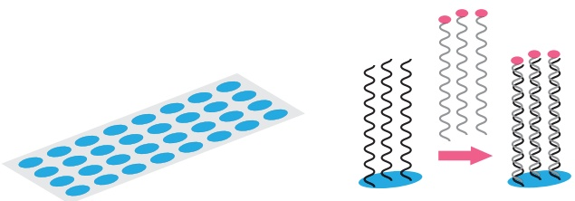
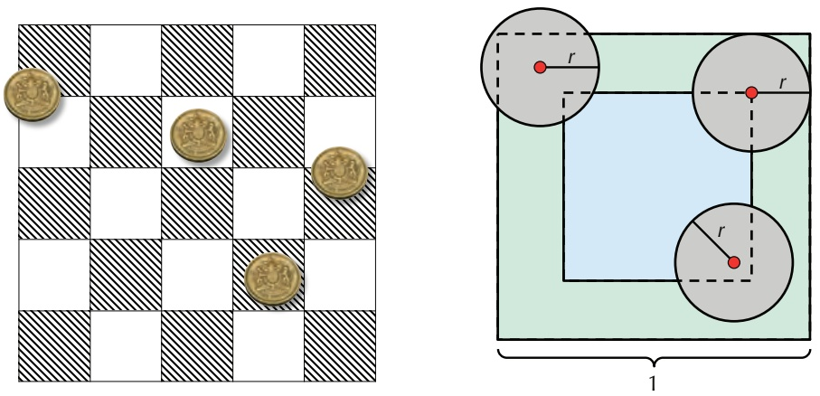
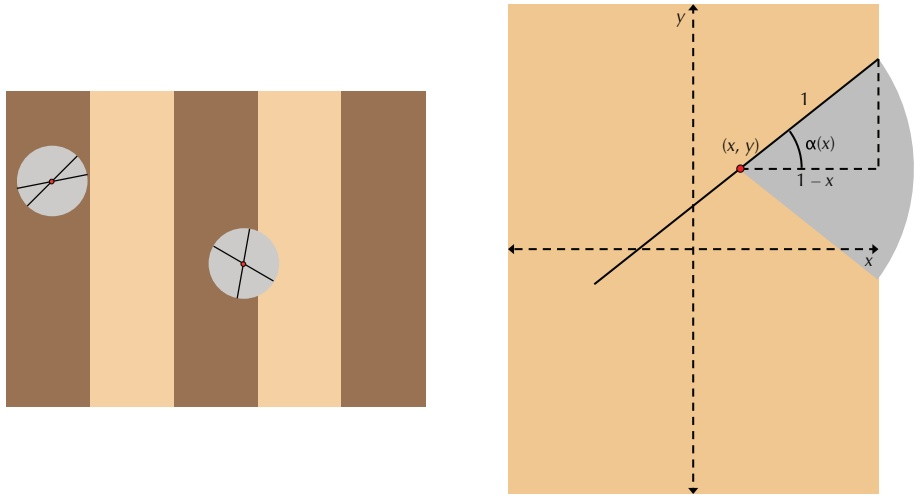
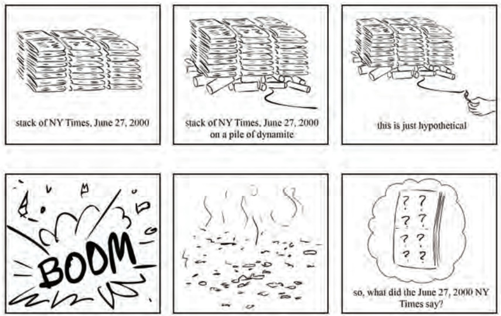
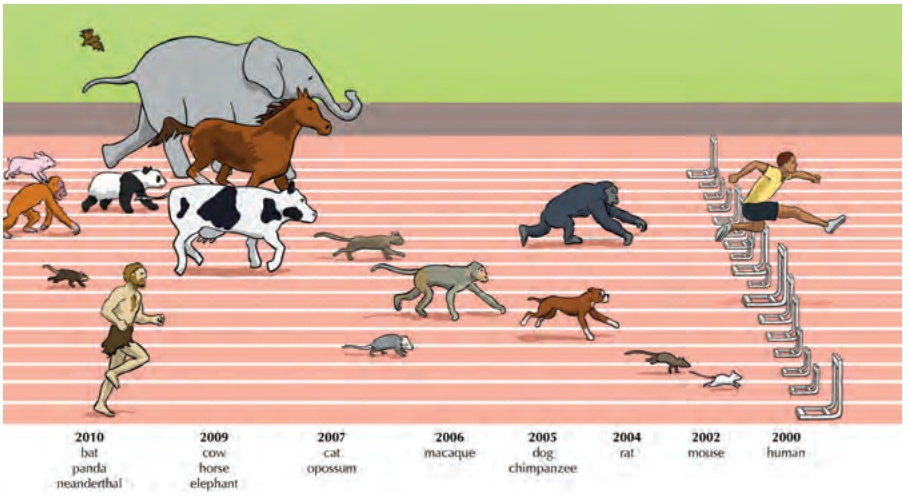
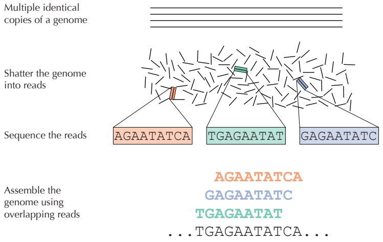
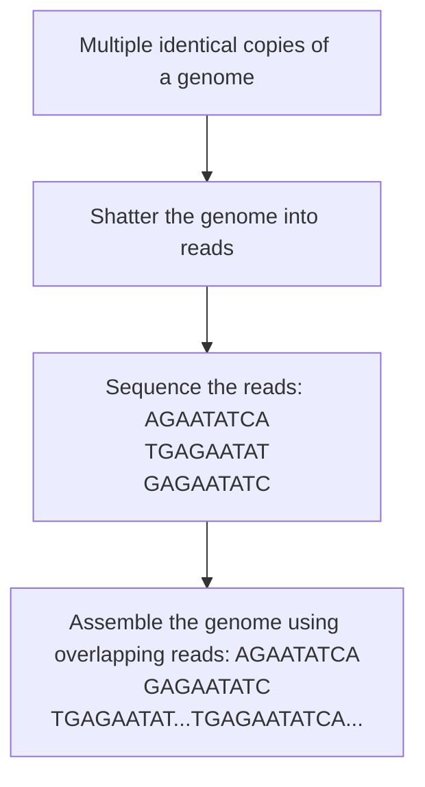

motifs. Yet convergence to a local optimum is just one of many issues we must consider in motif finding; see **DETOUR: Complications in Motif Finding** for some other challenges.

When we run **GIBBSSAMPLER** 2,000 times on the Subtle Motif Problem with implanted 15-mer **AAAAAAAAGGGGGGG** (each time with new randomly selected k-mers for N = 200 iterations), it returns a collection Motifs with consensus **AAAAAAgAGGGGGGt** and SCORE(Motifs) equal to 38. This score is even lower than the score of 40 expected from the implanted motifs!

## Epilogue: How Does Tuberculosis Hibernate to Hide from Antibiotics?

**Tuberculosis (TB)** is an infectious disease that is caused by the Mycobacterium tuberculo sis bacterium (MTB) and is responsible for over a million deaths each year. Although the spread of TB has been greatly reduced due to antibiotics, strains that resist all available treatments are now emerging. MTB is successful as a pathogen because it can persist in humans for decades without causing disease; in fact, one-third of the world population has **latent MTB infections**, in which MTB lies dormant within the host’s body and may or may not reactivate at a later time. The widespread prevalence of latent infections makes it difficult to control TB epidemics. Biologists are therefore interested in finding out what makes the disease latent and how MTB activates itself within a host.

It remains unclear why MTB can stay latent for so long and how it survives during latency. The resistance of latent TB to antibiotics implies that MTB may have an ability to shut down expression of most genes and stay dormant, not unlike bears hibernating in the winter. Hibernation in bacteria is called **sporulation** because many bacteria form protective and metabolically dormant **spores** that can survive in tough conditions, allowing the bacteria to persist in the environment until conditions improve.

**Hypoxia**, or oxygen shortage, is often associated with latent forms of TB. Biologists have found that MTB becomes dormant in low-oxygen environments, presumably with the idea that the host’s lungs will recover enough to potentially spread the disease in the future. Since MTB shows a remarkable ability to survive for years without oxygen, it is important to identify MTB genes responsible for the development of the latent state under hypoxic conditions. Biologists are interested in finding a **transcription factor** that “senses” the shortage of oxygen and starts a genetic program that affects the expression of many genes, allowing MTB to adapt to hypoxia.

In 2003, biologists found the **dormancy survival regulator** (**DosR**), a transcription factor that regulates many genes whose expression dramatically changes under hypoxic conditions. However, it remained unclear how DosR regulates these genes, and its transcription factor binding site remained unknown. In an attempt to resolve this puzzle, biologists performed a DNA array experiment and found 25 genes whose expression levels significantly changed in hypoxic conditions. Given the upstream regions of these genes, each of which is 250 nucleotides long, we would like to discover the “hidden message” that DosR uses to control the expression of these genes.

To simplify the problem a bit, we have selected just 10 of the 25 genes, resulting in the **DosR dataset**. We will try to identify motifs in this dataset using the arsenal of motif finding tools that we have developed. However, we will not give you a hint about the DosR motif.

What k-mer size should we choose in order to analyze the DosR dataset using **MEDIANSTRING** and **RANDOMIZEDMOTIFSEARCH**? Taking a wild guess and running these algorithms for k from 8 to 12 returns the consensus strings shown below.

<table><tr><td colspan="3">MEDIANSTRING</td><td colspan="3">RANDOMIZEDMOTIFSEARCH</td></tr><tr><td>k</td><td>Consensus</td><td>Score</td><td>k</td><td>Consensus</td><td>Score</td></tr><tr><td>8</td><td>CATCGGCC</td><td>11</td><td>8</td><td>CCGACGGG</td><td>13</td></tr><tr><td>9</td><td>GGCGGGGAC</td><td>16</td><td>9</td><td>CCATCGGCC</td><td>16</td></tr><tr><td>10</td><td>GGTGGCCACC</td><td>19</td><td>10</td><td>CCATCGGCCC</td><td>21</td></tr><tr><td>11</td><td>GGACTTCCGGC</td><td>20</td><td>11</td><td>ACCTTCGGCCC</td><td>25</td></tr><tr><td>12</td><td>GGACTTCCGGCC</td><td>23</td><td>12</td><td>GGACCAACGGCC</td><td>28</td></tr></table>

**STOP and Think:** Can you infer the DosR binding site from these median strings?

What do you think is the length of the binding site?

Note that although the consensus strings returned by **RANDOMIZEDMOTIFSEARCH** generally deviate from the median strings, the consensus 12-mer (**GGACCAACGGCC**, with score 28) is very similar to the median string (**GGACTTCCGGCC**, with score 23).

While the motifs returned by **RANDOMIZEDMOTIFSEARCH** are slightly less conserved than the motifs returned by **MEDIANSTRING**, the former algorithm has the advantage of being able to find longer motifs (since **MEDIANSTRING** becomes too slow for longer motifs). The motif of length 20 returned by **RANDOMIZEDMOTIFSEARCH** is **CGGGACCTACGTCCCTAGCC** (with score 57). As shown below, the consensus strings of length 12 found by **RANDOMIZEDMOTIFSEARCH** and **MEDIANSTRING** are “embedded” with small variations in the longer motif of length 20:


# GGACCAACGGCC CGGGACCTACGTCCCTAGCC GGACTTCCGGCC

Finally, in 2,000 runs with N = 200, **GIBBSSAMPLER** returned the same consensus string of length 20 for the DosR dataset as **RANDOMIZEDMOTIFSEARCH** but generated a different collection of motifs with a smaller score of 55.

As you have seen in this chapter, different motif finding algorithms generate somewhat different results, and it remains unclear how to identify the DosR motif in MTB. Try to answer this question and find all putative DosR motifs in MTB as well as all genes that they regulate. We will provide the upstream regions of all 25 genes identified in the DosR study to help you address the following problem.

**CHALLENGE PROBLEM:** Infer the profile of the DosR motif and find all its putative occurrences in Mycobacterium tuberculosis.

## Charging Stations

Solving the Median String Problem

The first potential issue with implementing **MEDIANSTRING** is writing a function to compute $\begin{array} { r } { d \big ( P a t t e r n , D n a \big ) = \sum _ { i = 1 } ^ { t } d \big ( P a t t e r n , D n a _ { i } \big ) } \end{array}$ , the sum of distances between Pattern and each string in $Dna = \left\{ Dna_{1}, \cdots , Dna_{t} \right\}$ . This task is achieved by the following pseudocode.

```python
DISTANCE BETWEENPATTERNANDSTRINGS(Pattern, Dna)
    k ← |Pattern|
    distance ← 0
    for each string Text in Dna
        HammingDistance ← ∞
        for each k-mer Pattern' in Text
            if HammingDistance > HAMMINGDISTANCE(Pattern, Pattern')
                HammingDistance ← HAMMINGDISTANCE(Pattern, Pattern')
        distance ← distance + HammingDistance
    return distance
```

To solve the Median String Problem, we need to iterate through all possible $4 ^ { k } ~ k -$ mers Pattern before computing $d { \big ( } P a t t e r n , D n a { \big ) }$ The pseudocode below is a modification of **MEDIANSTRING** using the function NUMBERTOPATTERN (implemented in **CHARGING STATION: Converting Patterns Into Numbers and Vice-Versa**), which is applied to convert all integers from 0 to $4 ^ { k } - 1$ into all possible k-mers.

```python
MEDIANSTRING(Dna, k)
    distance ← ∞
    for i ← 0 to 4^k - 1
        Pattern ← NUMBERTOPATTERN(i, k)
        if distance > DISTANCEBETWEENPATTERNANDSTRINGS(Pattern, Dna)
            distance ← DISTANCEBETWEENPATTERNANDSTRINGS(Pattern, Dna)
            Median ← Pattern
    return Median
```


## Detours

## Gene expression

Genes encode proteins, and proteins dictate cell function. To respond to changes in their environment, cells must therefore control their protein levels. The flow of information from DNA to RNA to protein means that the cell can adjust the amount of proteins that it produces during both transcription (DNA to RNA) and translation (RNA to protein).

Transcription begins when an RNA polymerase binds to a **promoter sequence** on the DNA molecule, which is often located just upstream from the starting point for transcription. The initiation of transcription is a convenient control point for the cell to regulate gene expression since it is at the very beginning of the protein production process. The genes transcribed in a cell are controlled by various transcription regulators that may increase or suppress transcription.

## DNA arrays

A **DNA array** is a collection of DNA molecules attached to a solid surface. Each spot on the array is assigned a unique DNA sequence called a **probe** that measures the expression level of a specific gene, known as a **target**. In most arrays, probes are synthesized and then attached to a glass or silicon chip (Figure 2.8).



<details>
<summary>text_image</summary>

Diagram illustrating molecular rearrangement or transformation process with wavy lines and colored dots indicating states or components.
</details>

FIGURE 2.8 Fluorescently labeled DNA binds to a complementary probe on a DNA array.

Fluorescently labeled targets then bind to their corresponding probe (e.g., when their sequences are complementary), generating a fluorescent signal. The strength of this signal depends upon the amount of target sample that binds to the probe at a given spot. Thus, the higher the expression level of a gene, the higher the intensity of its fluorescent signal on the array. Since an array may contain millions of probes, biologists can measure the expression of many genes in a single array experiment. The DNA array experiment that identified the evening element in Arabidopsis thaliana measured the expression of 8,000 genes.

## Buffon’s needle

Comte de Buffon was a prolific 18th Century naturalist whose writings on natural history were popular at the time. However, his first paper was in mathematics; in 1733, he wrote an essay on a Medieval French game called “Le jeu de franc carreau”. In this game, a single player flips a coin into the air, and the coin lands on a checkerboard. The player wins if the coin lands completely within one of the squares on the board, and loses otherwise (Figure 2.9 (left)). Buffon asked a natural question: what is the probability that the player wins?



FIGURE 2.9 (Left) A game of “franc carreau” with four coins. Two of the coins have landed within one of the squares of the checkerboard and are considered winners, whereas the other two have landed on a boundary and are considered losers. (Right) Three coins shown on a single square of the checkerboard (the green outside square); one coin is a loser, another is a winner, and the third corresponds to a boundary case. You can see that if the coin has radius $r ,$ then the probability of winning the game corresponds to the probability that the center of the coin (shown as a red dot) lands within the blue square, which has side length 1  2r. This probability is the ratio of the squares’ areas, which is $( 1 - 2 r ) ^ { 2 }$

Let’s assume that the checkerboard consists of just a single square with side length 1, that the coin has radius $r < 1 / 2 ,$ and that the center of the coin always lands within the square. Then the player can only win if the center of the circle falls within an imaginary central square of side length $1 - 2 r$ (Figure 2.9 (right)). Assuming that the coin lands anywhere on the larger square with uniform probability, then the probability that the coin falls completely within the smaller square is given by the ratio of the areas of the two squares, or $( 1 - 2 r ) ^ { 2 }$

Four decades later, Buffon published a paper describing a similar game in which the player uniformly drops a needle onto a floor covered by long wooden panels of equal width. In this game, which has become known as **Buffon’s needle**, the player wins if the needle falls entirely within one of the panels. Note that computing the probability of a win is now complicated by the fact that the needle is described by an orientation in addition to its position. Nevertheless, the first game gives us an idea for how to solve this problem: once we fix a position for the center of the needle, its collection of different possible orientations sweep out a circle (Figure 2.10 (left)).



FIGURE 2.10 (Left) Once we fix a point for the center of the needle (shown as a red dot), its collection of possible orientations sweep out a circle. In the circle on the left, the needle will always lie within the dark brown panel, regardless of its orientation. In the circle on the $\operatorname { r i g h t } ,$ one of the two needles lies within the dark brown panel, whereas another is shown crossing over into the adjacent panel. (Right) Once we fix a point $( x , y )$ for the center of the needle, there is a critical angle $\alpha ( x )$ such that all angles between $- \alpha ( x )$ and $\alpha ( x )$ will cause the needle to cross over into the next panel. In this figure, the length of the needle is equal to the width of the panel.

The probability that the player wins depends on the length of the needle with respect to the distance between wooden panels. We will assume that both of these lengths are equal to 2, and we will find the probability of a loss instead of a win. To this end, we first ask a simpler question: if the center of the needle were to land in the same place every time, then what is the likelihood that the needle crosses a panel?

To address this question, let’s map the panel into which the needle falls onto a coordinate plane, with the y-axis dividing the panel into two smaller panels of width 1 (Figure 2.10 (right)). If the center of the needle lands at position $( x , y )$ with $x > 0 ,$ then its orientation can be described by an angle $\theta ,$ where $\theta$ ranges from $- \pi / 2$ to $\pi / 2$ radians. If $\theta = 0 ,$ , then the needle will cross the line $y = 1 ; { \mathrm { i f } }   \theta = \pi / 2 ,$ , then the needle will not cross the line $y = 1$ . Yet more importantly, since the needle’s center position is fixed, there must be some critical angle $\alpha ( x )$ such that the needle always touches this line if $- \alpha ( x ) \leq \theta \leq \alpha ( x )$ . If the needle is dropped randomly, then any value of q is equally likely, and so we obtain that the probability of a loss given this position of the needle is equal to $2 \cdot \alpha ( x ) / \pi$

Following the same reasoning, the needle can take any position x with equal probability. To find the probability of a loss, Pr(loss), we must therefore compute an “average” of the values $2 \cdot \alpha ( x ) / \pi$ as x continuously ranges from 1 to 1. This average can be represented using an integral,

$$
\Pr (\text {loss}) = \frac {\int_ {- 1} ^ {1} \frac {2 \cdot \alpha (x)}{\pi} \mathrm{d} x}{1 - (- 1)} = \int_ {- 1} ^ {1} \frac {\alpha (x)}{\pi} \mathrm{d} x = 2 \int_ {0} ^ {1} \frac {\alpha (x)}{\pi} \mathrm{d} x.
$$

Revisiting Figure 2.10 (right), applying some basic trigonometry tells us that cos $\alpha ( x )$ is equal to $1 - x ,$ so that $\alpha ( x ) = \operatorname { a r c c o s } ( 1 - x )$ . After making this substitution into the above equation — and consulting our dusty calculus textbook — $\operatorname* { P r } ( \mathrm { l o s s } )$ must be equal to $2 / \pi$ . It is not difficult to see that this probability will be the same when the needle is dropped onto any number of wooden panels.

But what does Buffon’s needle have to do with randomized algorithms? In 1812, none other than Laplace pointed out that Buffon’s needle could be used to approximate $\pi ,$ and the world’s first Monte Carlo algorithm was born. Specifically, we can approximate the probability $P _ { e }$ of a loss empirically by dully flipping a needle into the air thousands of times (or asking a computer to do it for us). Once we have computed this empirical probability, we can conclude that $P _ { e }$ is approximately equal to $2 / \pi ,$ and thus

$$
\pi \approx \frac {2}{P _ {e}}.
$$


**STOP and Think:** How does this approximation change in the following cases?

1. The needle is shorter than the width between panels.
2. The needle is longer than the width between panels.

## Complications in motif finding

Motif finding becomes difficult if the **background nucleotide distribution** in the sample is skewed. In this case, searching for k-mers with the minimum score or entropy may lead to a biologically irrelevant motif composed from the most frequent nucleotides in the sample. For example, if A has frequency 85% and T, G, and C have frequencies of $5 \% ,$ then k-mer AA...AA may represent a motif with minimum score, thus disguising biologically relevant motifs. For example, the relevant motif GCCG with score 5 in the example below loses out to the motif **aaaa** with score 1.

```txt
taaaaGTCGa
acGCTGaaaa
Dna aaaaGCCTat
aCCCGaataa
agaaaaGGCG
```

<strong><u>PAGE 11</u></strong>**2**

To find biologically relevant motifs in samples with biased nucleotide frequencies, you may therefore want to use a generalization of entropy called “relative entropy” (see **DETOUR: Relative Entropy**).

Another complication in motif finding is that many motifs are best represented in a different alphabet than the alphabet of 4 nucleotides. Let W denote either A or T, S denote either G or C, K denote either G or T, and Y denote either C or T. Now, consider the motif CSKWYWWATKWATYYK, which represents the CSRE motif in yeast (recall Figure 2.3 from page 75). This strong motif in a hybrid alphabet corresponds to $2 ^ { 1 1 }$ different motifs in the standard 4-letter alphabet of nucleotides. However, each of these $2 ^ { 1 1 }$ motifs is too weak to be found by the algorithms we have considered in this chapter.

## Relative entropy

Given a collection of strings Dna, the **relative entropy** of a $4 \times k$ profile matrix $P = \left( p _ { r , j } \right)$ is defined as

$$
\sum_ {j = 1} ^ {k} \sum_ {r \in \{\mathrm{A}, \mathrm{C}, \mathrm{G}, \mathrm{T} \}} p _ {r, j} \cdot \log_ {2} (p _ {r, j} / b _ {r}) =
$$

$$
\sum_ {j = 1} ^ {k} \sum_ {r \in \{\mathrm{A}, \mathrm{C}, \mathrm{G}, \mathrm{T} \}} p _ {r, j} \cdot \log_ {2} (p _ {r, j}) - \sum_ {j = 1} ^ {k} \sum_ {r \in \{\mathrm{A}, \mathrm{C}, \mathrm{G}, \mathrm{T} \}} p _ {r, j} \cdot \log_ {2} (b _ {r}),
$$

where $b _ { r }$ is the frequency of nucleotide r in Dna. Note that the sum in the expression for entropy is preceded by a negative sign $\begin{array} { r } { \bigl ( - \sum _ { j = 1 } ^ { k } \sum _ { r \in \bigl \{ \mathbb { A } , \mathbb { C } , \mathbb { G } , \mathbb { T } \bigr \} } p _ { r , j } \cdot \log _ { 2 } \bigl ( p _ { r , j } \bigr ) \bigr ) } \end{array}$ , whereas the sum on the left side of the relative entropy equation does not have this negative sign. Therefore, although we minimized the entropy of a motif matrix, we will now attempt to maximize the relative entropy.

The term $\begin{array} { r } { - \sum _ { j = 1 } ^ { k } \sum _ { r \in \big \{ \mathbb { A } , \mathbb { C } , \mathbb { G } , \mathbb { T } \big \} } p _ { r , j } \cdot \log _ { 2 }   \left( b _ { r } \right) } \end{array}$ is called the **cross-entropy** of the profile matrix $P ;$ note that the relative entropy of a profile matrix is simply the difference between the profile’s cross-entropy and its entropy. For example, the relative entropy for the motif GCCG in the example from **DETOUR: Complications in Motif Finding** is equal to $9.85 - 3.53 = 6.32$ , as shown below. In this example, $b _ { \mathbb { A } } = 0 . 5 ,   b _ { \mathbb { C } } = 0 . 1 8 ,$ $b _ { \mathbb { G } } = 0 . 2 ,$ , and $b _ { \mathrm { T } } = 0 . 1 2$

<table><tr><td rowspan="2"></td><td>G</td><td>T</td><td>C</td><td>G</td></tr><tr><td>G</td><td>C</td><td>T</td><td>G</td></tr><tr><td rowspan="3">Motifs</td><td>G</td><td>C</td><td>C</td><td>T</td></tr><tr><td>C</td><td>C</td><td>C</td><td>G</td></tr><tr><td>G</td><td>G</td><td>C</td><td>G</td></tr><tr><td rowspan="4">PROFILE(Motifs)</td><td>A: 0.0</td><td>0.0</td><td>0.0</td><td>0.0</td></tr><tr><td>C: 0.2</td><td>0.6</td><td>0.8</td><td>0.0</td></tr><tr><td>G: 0.8</td><td>0.2</td><td>0.0</td><td>0.8</td></tr><tr><td>T: 0.0</td><td>0.2</td><td>0.2</td><td>0.2</td></tr><tr><td>Entropy</td><td colspan="4"> $0.72 + 1.37 + 0.72 + 0.72 = 3.53$ </td></tr><tr><td>Cross-entropy</td><td colspan="4"> $2.35 + 2.56 + 2.47 + 2.47 = 9.85$ </td></tr></table>

For the more conserved but irrelevant motif aaaa, the relative entropy is equal to $4.18 - 0.72 = 3.46,$ , as shown below. Thus, GCCG loses to aaaa with respect to entropy but wins with respect to relative entropy.

<table><tr><td rowspan="5">Motifs</td><td></td><td>a</td><td>a</td><td>a</td><td>a</td></tr><tr><td></td><td>a</td><td>a</td><td>a</td><td>a</td></tr><tr><td></td><td>a</td><td>a</td><td>a</td><td>a</td></tr><tr><td></td><td>a</td><td>t</td><td>a</td><td>a</td></tr><tr><td></td><td>a</td><td>a</td><td>a</td><td>a</td></tr><tr><td rowspan="4">PROFILE(Motifs)</td><td>A:</td><td>1.0</td><td>0.8</td><td>1.0</td><td>1.0</td></tr><tr><td>C:</td><td>0.0</td><td>0.0</td><td>0.0</td><td>0.0</td></tr><tr><td>G:</td><td>0.0</td><td>0.0</td><td>0.0</td><td>0.0</td></tr><tr><td>T:</td><td>0.0</td><td>0.2</td><td>0.0</td><td>0.0</td></tr><tr><td colspan="2">Entropy</td><td colspan="4"> $0.0 + 0.72 + 0.0 + 0.0 = 0.72$ </td></tr><tr><td colspan="2">Cross-entropy</td><td colspan="4"> $0.94 + 1.36 + 0.94 + 0.94 = 4.18$ </td></tr></table>

## Bibliography Notes

Konopka and Benzer, 1971 bred flies with abnormally short (19 hours) and long (28 hours) circadian rhythms and then traced these abnormalities to a single gene. Harmer et al., 2000 discovered the evening transcription factor binding site that orchestrates the circadian clock in plants. Excellent coverage of this discovery is given by Cristianini and Hahn, 2006. Park et al., 2003 found a transcription factor that mediates the hypoxic response of Mycobacterium tuberculosis.

Hertz and Stormo, 1999 described the first greedy algorithm for motif finding. The general framework for Gibbs sampling was described by Geman and Geman, 1984 and was named Gibbs sampling in reference to its similarities with some approaches in statistical mechanics (Josiah Willard Gibbs was one of the founders of statistical mechanics). Lawrence et al., 1993 adapted Gibbs sampling for motif finding.


## HOW DD WE ASSEMBLE GENOMES?


## Exploding Newspapers

Imagine that we stack a hundred copies of the June 27, 2000 edition of the New York Times on a pile of dynamite, and then we light the fuse. We ask you to further suspend your disbelief and assume that the newspapers are not all incinerated but instead explode cartoonishly into smoldering pieces of confetti. How could we use the tiny snippets of newspaper to figure out what the news was on June 27, 2000? We will call this crazy conundrum the **Newspaper Problem** (see Figure 3.1).



FIGURE 3.1 Don’t try this at home! Crazy as it may seem, the Newspaper Problem serves as an analogy for the computational framework of genome assembly.

The Newspaper Problem is even more difficult than it may seem. Because we had multiple copies of the same edition of the newspaper, and because we undoubtedly lost some information in the blast, we cannot simply glue together one of the newspaper copies in the same way that we would assemble a jigsaw puzzle. Instead, we need to use overlapping fragments from different copies of the newspaper to reconstruct the day’s news, as shown in Figure 3.2.

Fine, you ask, but what do exploding newspapers have to do with biology? Determining the order of nucleotides in a genome, or **genome sequencing**, presents a fundamental task in bioinformatics. Genomes vary in length; your own genome is roughly 3 billion

atshirt, appı e have not yet named mation is welc

shirt, appruximately $6 ^ { \prime } 2 ^ { n }$ 17 yet named any suspects is welcomed. 'ease cai

FIGURE 3.2 In the Newspaper Problem, we need to use overlapping shreds of paper to figure out the news.

nucleotides long, whereas the genome of Amoeba dubia, an amorphous unicellular organism, is approximately 200 times longer! This unicellular organism competes with the rare Japanese flower Paris japonica for the title of species with the longest genome.

The first sequenced genome, belonging to a fX174 bacterial phage (i.e., a virus that preys on bacteria), had only 5,386 nucleotides and was completed in 1977 by Frederick Sanger. Four decades after this Nobel Prize-winning discovery, genome sequencing has raced to the forefront of bioinformatics research, as the cost of genome sequencing plummeted. Because of the decreasing cost of sequencing, we now have thousands of sequenced genomes, including those of many mammals (Figure 3.3).

To sequence a genome, we must clear some practical hurdles. The largest obstacle is the fact that biologists still lack the technology to read the nucleotides of a genome from beginning to end in the same way that you would read a book. The best they can do is sequence much shorter DNA fragments called **reads**. The reasons why researchers can sequence small pieces of DNA but not long genomes warrant their own discussion in **DETOUR: A Short History of DNA Sequencing Technologies**. In this chapter, our aim is to turn an apparent handicap into a useful tool for assembling the genome back together.

The traditional method for sequencing genomes is described as follows. Researchers take a small tissue or blood sample containing millions of cells with identical DNA, use biochemical methods to break the DNA into fragments, and then sequence these fragments to produce reads (Figure 3.4). The difficulty is that researchers do not know where in the genome these reads came from, and so they must use overlapping reads to reconstruct the genome. Thus, putting a genome back together from its reads, or **genome assembly**, is just like the Newspaper Problem.

Even though researchers have sequenced many genomes, a giant genome like that of Amoeba dubia still remains beyond the reach of modern sequencing technologies. You might guess that the barrier to sequence such a genome would be experimental, but that is not true; biologists can easily generate enough reads to analyze a large genome, but assembling these reads still presents a major computational challenge.




<details>
<summary>text_image</summary>

2010
bat
panda
neanderthal
2009
cow
horse
elephant
2007
cat
opossum
2006
macaque
2005
dog
chimpanzee
2004
rat
2002
mouse
2000
human
</details>

FIGURE 3.3 The first mammals with sequenced genomes.



<details>
<summary>flowchart</summary>


</details>

FIGURE 3.4 In DNA sequencing, many identical copies of a genome are broken in random locations to generate short reads, which are then sequenced and assembled into the nucleotide sequence of the genome.