For example, consider the de Bruijn graph in Figure 3.31, which is generated from all reads present in the read-pairs in Figure 3.30. There is a unique string spelled by paths of length $k + d + 1 = 5$ between edges labeled **AAT** and **CCA** within a read-pair represented by the gapped read **AAT**-**CCA**. Thus, from two short reads of length k, we have generated a long virtual read of length $2 \cdot k + d ,$ achieving computationally what researchers still cannot achieve experimentally! After preprocessing the de Bruijn graph to produce long virtual reads, we can simply construct the de Bruijn graph from these long reads and use it for genome assembly.

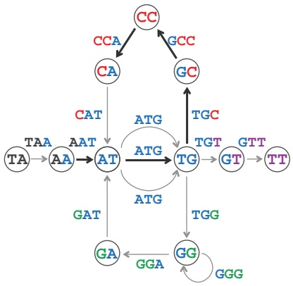

flowchart

This diagram illustrates a genetic or structural model showing the relationships between various codon sequences (TA, AA, AT, TG, TT) and their associated amino acids (CCA, GCC, CAT, ATG, GAT, GGA, TGC, GT, GTT, TT).

FIGURE 3.31 The highlighted path of length $k + d + 1 = 3 + 1 + 1 = 5$ between the edges labeled AAT and CCA spells out AATGCCA. (There are three such paths because there are three possible choices of edges labeled ATG.) Thus, the gapped read AAT-CCA can be transformed into a long virtual read AATGCCA.

Although the idea of transforming read-pairs into long virtual reads is used in many assembly programs, we have made an optimistic assumption: “If there is only one path of length $k + d + 1$ connecting these nodes, or if all such paths spell out the same string $\cdots . ^ { \prime \prime } .$ In practice, this assumption limits the application of the long virtual read approach to assembling read-pairs because highly repetitive genomic regions often contain multiple paths of the same length between two edges, and these paths often spell different strings (Figure 3.32). If this is the case, then we cannot reliably transform a read-pair into a long read. Instead, we will describe an alternative approach to analyzing read-pairs.

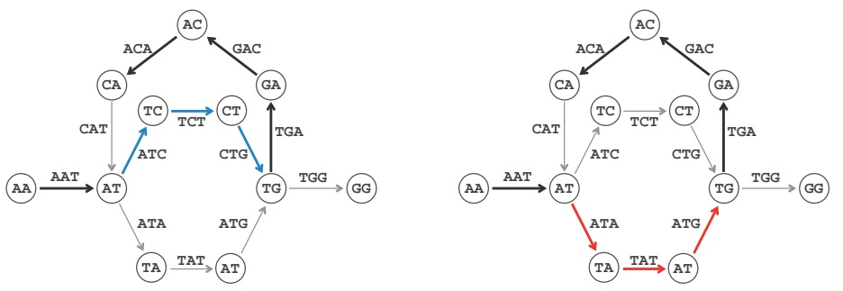

FIGURE 3.32 (Left) The highlighted path in DEBRUIJN3(AATCTGACATATGG) spells out the long virtual read AATCTGACA, which is a substring of AATCTGACATATGG. (Right) The highlighted path in the same graph spells out the long virtual read AATATGACA, which does not occur in AATCTGACATATGG.

## From composition to paired composition

Given a string Text, $\textsf { a } \big ( k , d \big )$ -mer is a pair of k-mers in Text separated by distance d. We use the notation $\left( P a t t e r n _ { 1 } \: \middle | \: P a t t e r n _ { 2 } \right)$ to refer to a $( k , d )$ -mer whose k-mers are $P a t t e r n _ { 1 }$ and $P a t t e r n _ { 2 }$ . For example, (**ATG** | **GGG**) is a $( 3 , 4 )$ -mer in **TAATGCCATGGGATGTT**. The $( k , d )$ -mer composition of Text, denoted PAIREDCOMPOSITION $\mathbb { I } _ { k ,   d } \big ( T _ { } { e x t } \big )$ , is the collection of all $( k , d )$ -mers in Text (including repeated $( k , d ) \text {-} \operatorname { m e r s } )$ . For example, here is PAIREDCOMPOSITION3,1(**TAATGCCATGGGATGTT**):

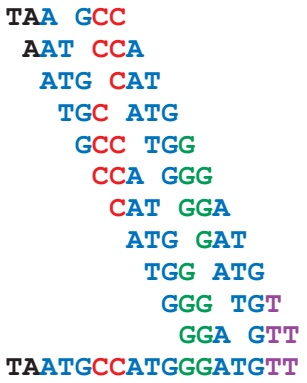

text_image

TAA GCC
AAT CCA
ATG CAT
TGC ATG
GCC TGG
CCA GGG
CAT GGA
ATG GAT
TGG ATG
GGG TGT
GGA GTT
TAATGCCATGGGATGTT

**EXERCISE BREAK:** Generate the (3, 2)-mer composition of the string **TAATGCCATGGGATGTT**.

Since the order of $( 3 , 1 )$ -mers in PAIREDCOMPOSITION(TAATGCCATGGGATGTT) is unknown, we list them according to the lexicographic order of the 6-mers formed by their concatenated 3-mers:

$$
(\mathbf {A A T} \mid \mathbf {C C A}) (\mathbf {A T G} \mid \mathbf {C A T}) (\mathbf {A T G} \mid \mathbf {G A T}) (\mathbf {C A T} \mid \mathbf {G G A}) (\mathbf {C C A} \mid \mathbf {G G G}) (\mathbf {G C C} \mid \mathbf {T G G})
$$

$$
\left(\mathbf {G G A} \mid \mathbf {G T T}\right) \left(\mathbf {G G G} \mid \mathbf {T G T}\right) \left(\mathbf {T A A} \mid \mathbf {G C C}\right) \left(\mathbf {T G C} \mid \mathbf {A T G}\right) \left(\mathbf {T G G} \mid \mathbf {A T G}\right)
$$

Note that whereas there are repeated 3-mers in the 3-mer composition of this string, there are no repeated (3, 1)-mers in its paired composition. Furthermore, although TAATGCCATGGGATGTT and TAAATGCCATGGGATGTT have the same 3-mer composition, they have different (3, 1)-mer compositions. Thus, if we can generate the (3, 1)-mer composition of these strings, then we will be able to distinguish between them. But how can we reconstruct a string from its $( k , d )$ -mer composition? And can we adapt the de Bruijn graph approach for this purpose?

## String Reconstruction from Read-Pairs Problem:

Reconstruct a string from its paired composition.

**Input**: A collection of paired k-mers PairedReads and an integer d.

**Output**: A string Text with $( k , d )$ -mer composition equal to PairedReads (if such a string exists).

## Paired de Bruijn graphs

Given a $(k,d) - \mathrm{mer} \left( a_{1} \cdots a_{k} \mid b_{1}, \cdots b_{k} \right)$ , we define its **prefix** and **suffix** as the following $\left( k - 1 , d + 1 \right)$ -mers:

$$
\text {PREFIX} ((a _ {1} \dots a _ {k} \mid b _ {1}, \dots b _ {k})) = (a _ {1} \dots a _ {k - 1} \mid b _ {1} \dots b _ {k - 1})
$$

$$
\text {SUFFIX} ((a _ {1} \dots a _ {k} \mid b _ {1}, \dots b _ {k})) = (a _ {2} \dots a _ {k} \mid b _ {2} \dots b _ {k})
$$

For example, ${ \tt P R E F I X } ( ( { \tt G A C } \: | \: { \tt T C A } ) ) = ( { \tt G A } \: | \: { \tt T C } ) \; { \tt a n d } \; { \tt S U F F I X } ( ( { \tt G A C } \: | \: { \tt T C A } ) ) = ( { \tt A C } \: | \: { \tt C A } )$

Note that for consecutive $( k , d )$ -mers appearing in Text, the suffix of the first $( k , d ) -$ mer is equal to the prefix of the second $( k , d ) - \mathrm { m e r } .$ For example, for the consecutive $( k , d ) \mathrm { - m e r s } ( \mathtt { T A A }   |   \mathtt { G C C } )$ and $\left( \begin{matrix} { \mathbb { A } \mathbb { A } \mathbb { T } \; \big | \; \mathbb { C } \mathbb { C } \mathbb { A } } \\ \end{matrix} \right)$ in **TAATGCCATGGGATGTT**,

$$
\text {SUFFIX} \left(\left(\mathbf {T A A} \mid \mathbf {G C C}\right)\right) = \text {PREFIX} \left(\left(\mathbf {A A T} \mid \mathbf {C C A}\right)\right) = \left(\mathbf {A A} \mid \mathbf {C C}\right).
$$

Given a string Text, we construct a graph $\mathrm { P A T H G R A P H } _ { k ,   d }   \left( T e x t \right)$ that represents a path formed by $| T _ { } { e x t } | - ( k + d + k ) + 1$ edges corresponding to all $( k , d )$ -mers in Text. We label edges in this path by $( k,d )-mers$ and label the starting and ending nodes of an edge by its prefix and suffix, respectively (Figure 3.33).

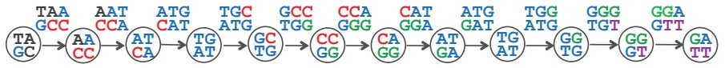

flowchart

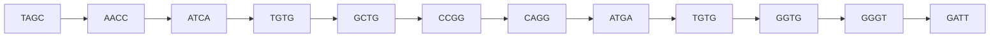

FIGURE 3.33 $\mathsf { P A T H G R A P H } _ { 3 , } .$ 1(TAATGCCATGGGATGTT). Each (3, 1)-mer has been displayed as a two-line expression to save space.

The paired de Bruijn graph, denoted $\mathrm { D E B R U I J N } _ { k , d } \big ( T e x t \big )$ , is formed by gluing identically labeled nodes in $\mathrm { P A T H G R A P H } _ { k ,   d }   \left( T e x t \right)$ (Figure 3.34). Note that the paired de Bruijn graph is less tangled than the de Bruijn graph constructed from individual reads.

**STOP and Think:** It is easy to construct a paired de Bruijn graph from a string Text. But how can we construct the paired de Bruijn graph from the $( k , d )$ -mer composition of Text?

We define $\mathsf { C O M P O S I T I O N G R A P H } _ { k ,   d } \big ( \mathit { T e x t } \big )$ as the graph consisting of $\big | T _ { } { e x t } \big | - \big ( k + d +$ $k ) + 1$ isolated edges that are labeled by the $( k,d )-mers$ in Text, and whose nodes are labeled by the prefixes and suffixes of these labels (see Figure 3.35). As you may have guessed, gluing identically labeled nodes in PAIREDCOMPOSITI $\mathrm { O N G R A P H } _ { k ,   d }   \left( T e x t \right)$ results in exactly the same de Bruijn graph as gluing identically labeled nodes in $\mathrm { P A T H G R A P H } _ { k ,   d }   \left( T e x t \right)$ . Of course, in practice, we will not know Text; however, we can form $\mathsf { C O M P O S I T I O N G R A P H } _ { k , d } \big ( \mathit { T e x t } \big )$ directly from the $( k ,   d )$ -mer composition of Text, and the gluing step will result in the paired de Bruijn graph of this composition. The genome can be reconstructed by following an Eulerian path in this de Bruijn graph.

## A pitfall of paired de Bruijn graphs

We saw earlier that every solution of the String Reconstruction Problem corresponds to an Eulerian path in the de Bruijn graph constructed from a k-mer composition. Likewise, every solution of the String Reconstruction from Read-Pairs Problem corresponds to an Eulerian path in the Paired de Bruijn graph constructed from a $( k , d )$ -mer composition.

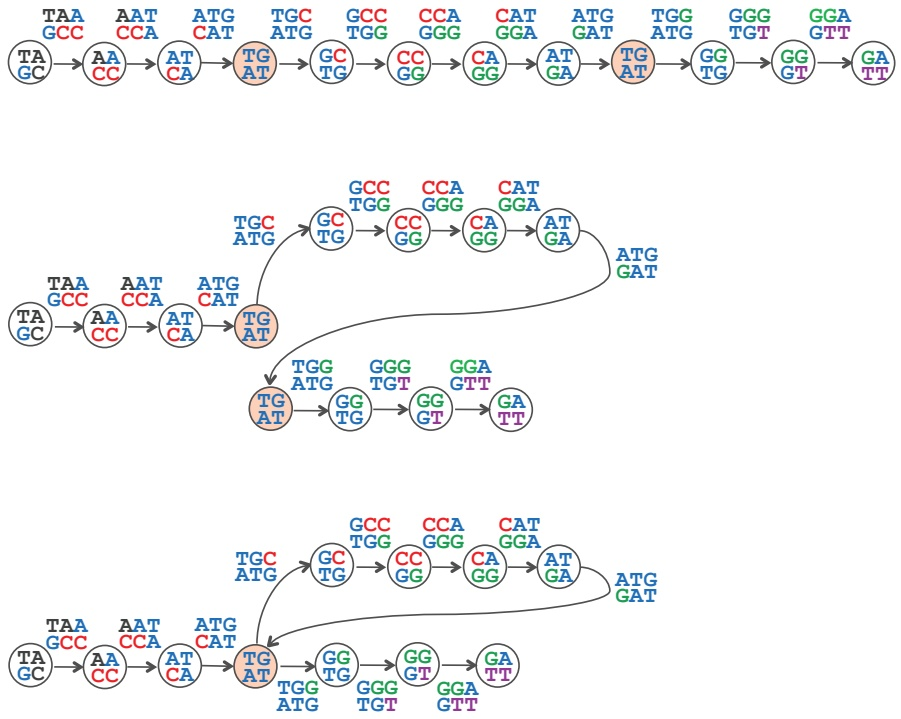

FIGURE 3.34 (Top) $\mathsf { P A T H G R A P H } _ { 3 , 1 }$ (TAATGCCATGGGATGTT) is formed by eleven edges and twelve nodes. Only two of these nodes have the same label, (TG | AT). (Middle) Bringing the two identically labeled nodes closer to each other in preparation for gluing. (Bottom) The paired de Bruijn graph $\mathsf { D E B R U I I N } _ { 3 , 1 }$ (TAATGCCATGGGATGTT) is obtained from $\mathsf { P A T H G R A P H } _ { 3 , 1 }$ (TAATGCCATGGGATGTT) by gluing the nodes sharing the label (TG | AT). This paired de Bruijn graph has a unique Eulerian path, which spells out TAATGCCATGGGATGTT.

**EXERCISE BREAK:** In the paired de Bruijn graph shown in Figure 3.36, reconstruct the genome spelled by the following Eulerian path of (2, 1)-mers:

$$
(\mathrm{AG} \mid \mathrm{AG}) \rightarrow (\mathrm{GC} \mid \mathrm{GC}) \rightarrow (\mathrm{CA} \mid \mathrm{CT}) \rightarrow (\mathrm{AG} \mid \mathrm{TG}) \rightarrow (\mathrm{GC} \mid \mathrm{GC}) \rightarrow (\mathrm{CT} \mid \mathrm{CT}) \rightarrow
$$

$$
(\mathrm{T} \mathrm{G} \mid \mathrm{T} \mathrm{G}) \rightarrow (\mathrm{GC} \mid \mathrm{GC}) \rightarrow (\mathrm{CT} \mid \mathrm{CA}).
$$

We also saw that every Eulerian path in the de Bruijn graph constructed from a k-mer composition spells out a solution of the String Reconstruction Problem. But is this the case for the paired de Bruijn graph?

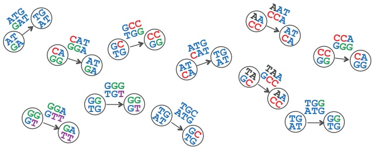

flowchart

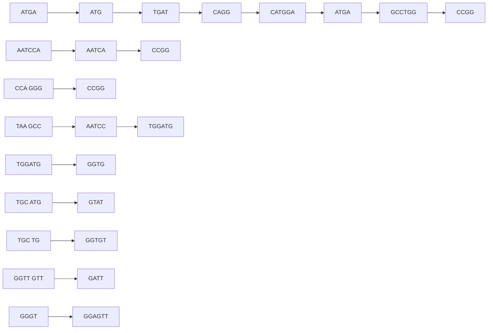

FIGURE 3.35 The graph COMPOSITIONGR $\mathsf { A P H } _ { 3 , 1 }$ (TAATGCCATGGGATGTT) is a collection of isolated edges. Each edge is labeled by a (3, 1)-mer in TAATGCCATGGGATGTT; the starting node of an edge is labeled by the prefix of the edge’s (3, 1)-mer, and the ending node of an edge is labeled by the suffix of this $( 3 , 1 )$ -mer. Gluing identically labeled nodes yields the paired de Bruijn graph shown in Figure 3.34 (bottom).

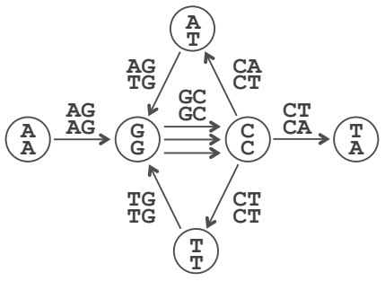

flowchart

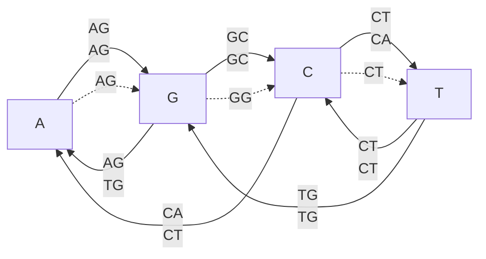

FIGURE 3.36 A paired de Bruijn graph constructed from a collection of nine (2, 1)-mers.

**STOP and Think:** The graph shown in Figure 3.36 has another Eulerian path:

$$
\begin{array}{l}\left(\mathrm{AG} \mid \mathrm{AG}\right)\rightarrow \left(\mathrm{GC} \mid \mathrm{GC}\right)\rightarrow \left(\mathrm{CT} \mid \mathrm{CT}\right)\rightarrow \left(\mathrm{TG} \mid \mathrm{TG}\right)\rightarrow \left(\mathrm{GC} \mid \mathrm{GC}\right)\rightarrow \left(\mathrm{CA} \mid \mathrm{CT}\right)\rightarrow\\\left(\mathrm{AG} \mid \mathrm{TG}\right)\rightarrow \left(\mathrm{GC} \mid \mathrm{GC}\right)\rightarrow \left(\mathrm{CT} \mid \mathrm{CA}\right). \text {Can you reconstruct a genome spelled by}\\\text {this path?}\end{array}
$$

If you attempted the preceding question, then you know that not every Eulerian path in the paired de Bruijn graph constructed from a $( k , d )$ -mer composition spells out a solution of the String Reconstruction from Read-Pairs Problem. You are now ready to solve this problem and become a genome assembly expert.

**CHARGING STATION (Generating All Eulerian Cycles):** You know how to construct a single Eulerian cycle in a graph, but it remains unclear how to find all possible Eulerian cycles, which will be helpful when solving the String Reconstruction from Read-Pairs Problem. Check out this Charging Station to see how to generate all Eulerian cycles in a graph.

**CHARGING STATION (Reconstructing a String Spelled by a Path in the Paired de Bruijn Graph):** To solve the String Reconstruction from Read-Pairs Problem, you will need to reconstruct a string from its path in the paired de Bruijn graph. Check out this Charging Station to see an example of how this can be done.

## Epilogue: Genome Assembly Faces Real Sequencing Data

Our discussion of genome assembly has thus far relied upon various assumptions. Accordingly, applying de Bruijn graphs to real sequencing data is not a straightforward procedure. Below, we describe practical challenges introduced by quirks in modern sequencing technologies and some computational techniques that have been devised to address these challenges. In this discussion, we will first assume that reads are generated as k-mers instead of read-pairs for the sake of simplicity.

## Breaking reads into k-mers

Given a k-mer substring of a genome, we define its **coverage** as the number of reads to which this k-mer belongs. We have taken for granted that a sequencing machine can generate all k-mers present in the genome, but this assumption of “perfect k-mer coverage” does not hold in practice. For example, the popular Illumina sequencing technology generates reads that are approximately 300 nucleotides long, but this technology still misses many 300-mers present in the genome (even if the average coverage is very high), and nearly all the reads that it does generate have sequencing errors.

**STOP and Think:** Given a set of reads having imperfect k-mer coverage, can you find a parameter l < k so that the same reads have perfect l-mer coverage? What is the maximum value of this parameter?

Figure 3.37 (left) shows four 10-mer reads that capture some but not all of the 10-mers in an example genome. However, if we take the counterintuitive step of breaking these reads into shorter 5-mers (Figure 3.37, right), then these 5-mers exhibit perfect coverage. This **read breaking** approach, in which we break reads into shorter k-mers, is used by many modern assemblers.

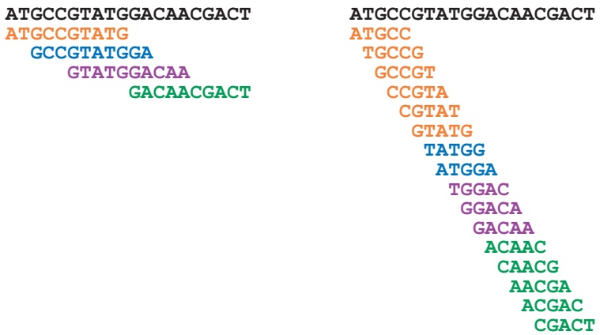

flowchart

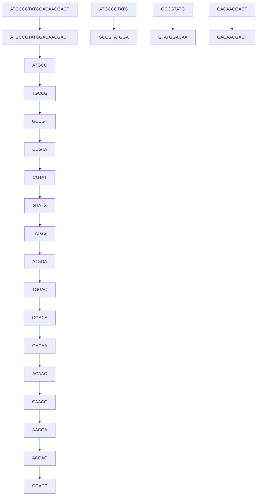

FIGURE 3.37 Breaking 10-mer reads (left) into 5-mers results in perfect coverage of a genome by 5-mers (right).

Read breaking must deal with a practical trade-off. On the one hand, the smaller the value of k, the larger the chance that the k-mer coverage is perfect. On the other hand, smaller values of k result in a more tangled de Bruijn graph, making it difficult to infer the genome from this graph.

## Splitting the genome into contigs

Even after read breaking, most assemblies still have gaps in k-mer coverage, causing the de Bruijn graph to have missing edges, and so the search for an Eulerian path fails. In this case, biologists often settle on assembling **contigs** (long, contiguous segments of the genome) rather than entire chromosomes. For example, a typical bacterial sequencing project may result in about a hundred contigs, ranging in length from a few thousand to a few hundred thousand nucleotides. For most genomes, the order of these contigs along the genome remains unknown. Needless to say, biologists would prefer to have the entire genomic sequence, but the cost of ordering the contigs into a final assembly and closing the gaps using more expensive experimental methods is often prohibitive.

Fortunately, we can derive contigs from the de Bruijn graph. A path in a graph is called **non-branching** if $\mathrm { I N } ( v ) = \mathrm { O U T } ( v ) = 1$ for each intermediate node v of this path, i.e., for each node except possibly the starting and ending node of a path. A **maximal non-branching path** is a non-branching path that cannot be extended into a longer non-branching path. We are interested in these paths because the strings of nucleotides that they spell out must be present in any assembly with a given k-mer composition. For this reason, contigs correspond to strings spelled by maximal non-branching paths in the de Bruijn graph. For example, the de Bruijn graph in Figure 3.38, constructed for the 3-mer composition of **TAATGCCATGGGATGTT**, has nine maximal non-branching paths that spell out the contigs **TAAT**, **TGTT**, **TGCCAT**, **ATG**, **ATG**, **ATG**, **TGG**, **GGG**, and **GGAT**. In practice, biologists have no choice but to break genomes into contigs, even in the case of perfect coverage (like in Figure 3.38), since repeats prevent them from being able to infer a unique Eulerian path.

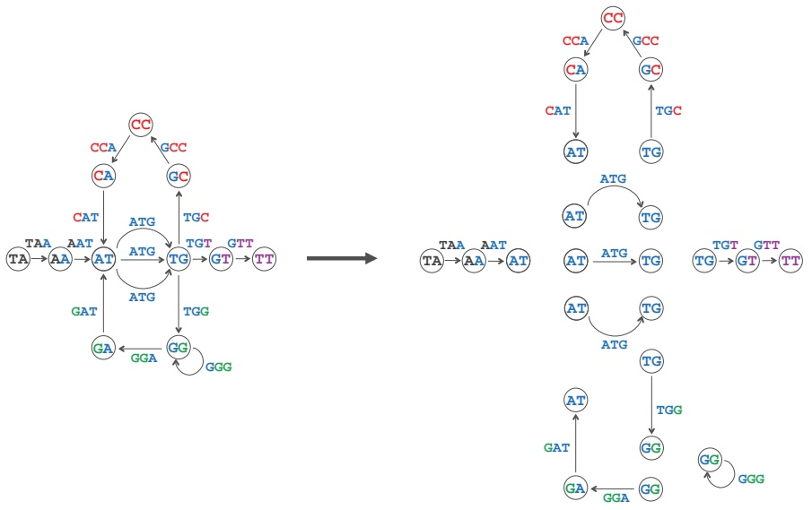

flowchart

This diagram illustrates a genetic sequence or gene structure transformation, showing how various codons (TA, AA, AT, ATG, GG, TT) are converted into transgenic (TG), heterozygous (TGT), and homozygous (GG) variants.

FIGURE 3.38 Breaking the graph DEBRUIJN3(TAATGCCATGGGATGTT) into nine maximal non-branching paths representing contigs TAAT, TGTT, TGCCAT, ATG, ATG, ATG, TGG, GGG, and GGAT.

## Contig Generation Problem:

Generate the contigs from a collection of reads (with imperfect coverage).

**Input**: A collection of k-mers Patterns.

**Output**: All contigs in DEBRUIJN(Patterns).

**CHARGING STATION (Maximal Non-Branching Paths in a Graph):** If you have difficulties finding maximal non-branching paths in a graph, check out this Charging Station.

## Assembling error-prone reads

Error-prone reads represent yet another barrier to real sequencing projects. Adding the single erroneous read CGTACGGACA (with a single error that misreads T as C) to the set of reads in Figure 3.37 results in erroneous 5-mers CGTAC, GTACG, TACGG, ACGGA, and CGGAC after read breaking. These 5-mers result in an erroneous path from node CGTA to node GGAC in the de Bruijn graph (Figure 3.39 (top)), meaning that if the correct read CGTATGGACA is generated as well, then we will have two paths connecting CGTA to GGAC in the de Bruijn graph. This structure is called a **bubble**, which we define as two short disjoint paths (e.g., shorter than some threshold length) connecting the same pair of nodes in the de Bruijn graph.

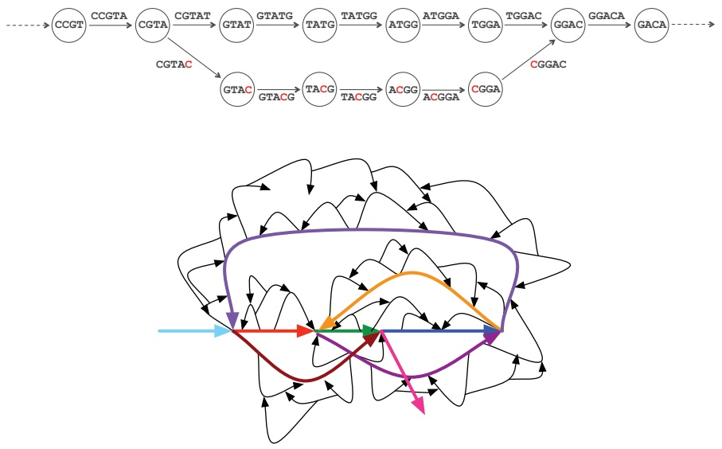

flowchart

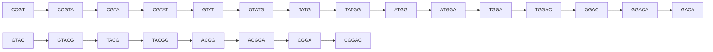

FIGURE 3.39 (Top) A correct path CGTA ! GTAT ! TATG ! ATGG ! TGGA ! GGAC along with an incorrect path CGTA ! GTAC ! TACG ! ACGG ! CGGA ! GGAC form a bubble in a de Bruijn graph, making it difficult to identify which path is correct. (Bottom) An illustration of a de Bruijn graph with many bubbles. Bubble removal should leave only the colored paths remaining.

**STOP and Think:** Design an algorithm for detecting bubbles in de Bruijn graphs. After a bubble is detected, you must decide which of two paths in the bubble to remove. How should you make this decision?

Existing assemblers remove bubbles from de Bruijn graphs. The practical challenge is that, since nearly all reads have errors, de Bruijn graphs have millions of bubbles (Figure 3.39 (bottom)). Bubble removal occasionally removes the correct path, thus introducing errors rather than fixing them. To make matters worse, in a genome having **inexact repeats**, where the repeated regions differ by a single nucleotide or some other small variation, reads from the two repeat copies will also generate bubbles in the de Bruijn graph because one of the copies may appear to be an erroneous version of the other. Applying bubble removal to these regions introduces assembly errors by making repeats appear more similar than they are. Thus, modern genome assemblers attempt to distinguish bubbles caused by sequencing errors (which should be removed) from bubbles caused by variations (which should be retained).

## Inferring multiplicities of edges in de Bruijn graphs

Although the de Bruijn graph framework requires that we know the **multiplicity** of each k-mer in the genome (i.e., the number of times the k-mer appears), this information is not readily available from reads. However, the multiplicity of a k-mer in a genome can often be estimated using its coverage. Indeed, k-mers that appear t times in a genome are expected to have approximately t times higher coverage than k-mers that appear just once. Needless to say, coverage varies across the genome, and this condition is often violated. As a result, existing assemblers often assemble repetitive regions in genomes without knowing the exact number of times each k-mer from this region occurs in the genome.

You should now have a handle on the practical considerations involved in genome sequencing, but we will give you a challenge problem that does not encounter these issues. Why? Developing assembly algorithms for large genomes is a formidable challenge because even the seemingly simple problem of constructing the de Bruijn graph from a collection of all k-mers present in millions of reads is nontrivial. To make your life easier, we will give you a small bacterial genome for your first assembly dataset.

**CHALLENGE PROBLEM:** Carsonella ruddii is a bacterium that lives symbiotically inside some insects. Its sheltered life has allowed it to reduce its genome to only about 160,000 base pairs. With only about 200 genes, it lacks some genes necessary for survival, but these genes are supplied by its insect host. In fact, Carsonella has such a small genome that biologists have conjectured that it is losing its “bacterial” identity and turning into an **organelle**, which is part of the host’s genome. This transition from bacterium to organelle has happened many times during evolutionary history; in fact, the mitochondrion responsible for energy production in human cells was once a free-roaming bacterium that we assimilated in the distant past.

Given a collection of simulated error-free read-pairs, use the paired de Bruijn graph to reconstruct the Carsonella ruddii genome. Compare this assembly to the assembly obtained from the classic de Bruijn graph (i.e., when all we know is the reads themselves and do not know the distance between paired reads) in order to better appreciate the benefits of read-pairs. For each k, what is the minimum value of d needed to enable reconstruction of the entire Carsonella ruddii genome from its (k, d)-mer composition?

**EXERCISE BREAK:** By the way, one more thing . . . what was the headline of the June 27, 2000 edition of the New York Times?

## Charging Stations

The effect of gluing on the adjacency matrix

Figure 3.40 uses Text = **TAATGCCATGGGATGTT** to illustrate how gluing converts the adjacency matrix of PATHGRAPH3(Text) into the adjacency matrix of DEBRUIJN3(Text).

|  | TA | AA | $AT_1$ | $TG_1$ | GC | CC | CA | $AT_2$ | $TG_2$ | $GG_1$ | $GG_2$ | GA | $AT_3$ | $TG_3$ | GT | TT |
| --- | --- | --- | --- | --- | --- | --- | --- | --- | --- | --- | --- | --- | --- | --- | --- | --- |
| TA | 0 | 1 | 0 | 0 | 0 | 0 | 0 | 0 | 0 | 0 | 0 | 0 | 0 | 0 | 0 | 0 |
| AA | 0 | 0 | 1 | 0 | 0 | 0 | 0 | 0 | 0 | 0 | 0 | 0 | 0 | 0 | 0 | 0 |
| $AT_1$ | 0 | 0 | 0 | 1 | 0 | 0 | 0 | 0 | 0 | 0 | 0 | 0 | 0 | 0 | 0 | 0 |
| $TG_1$ | 0 | 0 | 0 | 0 | 1 | 0 | 0 | 0 | 0 | 0 | 0 | 0 | 0 | 0 | 0 | 0 |
| GC | 0 | 0 | 0 | 0 | 0 | 1 | 0 | 0 | 0 | 0 | 0 | 0 | 0 | 0 | 0 | 0 |
| CC | 0 | 0 | 0 | 0 | 0 | 0 | 1 | 0 | 0 | 0 | 0 | 0 | 0 | 0 | 0 | 0 |
| CA | 0 | 0 | 0 | 0 | 0 | 0 | 0 | 1 | 0 | 0 | 0 | 0 | 0 | 0 | 0 | 0 |
| $AT_2$ | 0 | 0 | 0 | 0 | 0 | 0 | 0 | 0 | 1 | 0 | 0 | 0 | 0 | 0 | 0 | 0 |
| $TG_2$ | 0 | 0 | 0 | 0 | 0 | 0 | 0 | 0 | 0 | 1 | 0 | 0 | 0 | 0 | 0 | 0 |
| $GG_1$ | 0 | 0 | 0 | 0 | 0 | 0 | 0 | 0 | 0 | 0 | 1 | 0 | 0 | 0 | 0 | 0 |
| $GG_2$ | 0 | 0 | 0 | 0 | 0 | 0 | 0 | 0 | 0 | 0 | 0 | 1 | 0 | 0 | 0 | 0 |
| GA | 0 | 0 | 0 | 0 | 0 | 0 | 0 | 0 | 0 | 0 | 0 | 0 | 1 | 0 | 0 | 0 |
| $AT_3$ | 0 | 0 | 0 | 0 | 0 | 0 | 0 | 0 | 0 | 0 | 0 | 0 | 0 | 1 | 0 | 0 |
| $TG_3$ | 0 | 0 | 0 | 0 | 0 | 0 | 0 | 0 | 0 | 0 | 0 | 0 | 0 | 0 | 1 | 0 |
| GT | 0 | 0 | 0 | 0 | 0 | 0 | 0 | 0 | 0 | 0 | 0 | 0 | 0 | 0 | 0 | 1 |
| TT | 0 | 0 | 0 | 0 | 0 | 0 | 0 | 0 | 0 | 0 | 0 | 0 | 0 | 0 | 0 | 0 |

|  | TA | AA | AT | TG | GC | CC | CA | GG | GA | GT | TT |
| --- | --- | --- | --- | --- | --- | --- | --- | --- | --- | --- | --- |
| TA | 0 | 1 | 0 | 0 | 0 | 0 | 0 | 0 | 0 | 0 | 0 |
| AA | 0 | 0 | 1 | 0 | 0 | 0 | 0 | 0 | 0 | 0 | 0 |
| AT | 0 | 0 | 0 | 3 | 0 | 0 | 0 | 0 | 0 | 0 | 0 |
| TG | 0 | 0 | 0 | 0 | 1 | 0 | 0 | 1 | 0 | 1 | 0 |
| GC | 0 | 0 | 0 | 0 | 0 | 1 | 0 | 0 | 0 | 0 | 0 |
| CC | 0 | 0 | 0 | 0 | 0 | 0 | 1 | 0 | 0 | 0 | 0 |
| CA | 0 | 0 | 1 | 0 | 0 | 0 | 0 | 0 | 0 | 0 | 0 |
| GG | 0 | 0 | 0 | 0 | 0 | 0 | 0 | 1 | 1 | 0 | 0 |
| GA | 0 | 0 | 1 | 0 | 0 | 0 | 0 | 0 | 0 | 0 | 0 |
| GT | 0 | 0 | 0 | 0 | 0 | 0 | 0 | 0 | 0 | 0 | 1 |
| TT | 0 | 0 | 0 | 0 | 0 | 0 | 0 | 0 | 0 | 0 | 0 |

**FIGURE 3.40** Adjacency matrices. (Top) The $1 6   \times   1 6$ adjacency matrix of $\mathsf { P A T H G R A P H } _ { 3 }$ (**TAATGCCATGGGATGTT**). Note that we have used indexing to differentiate multiple occurrences of AT, TG, and GG in $\mathsf { P A T H G R A P H } _ { 3 }$ (TAATGCCATGGGATGTT). (Bottom) The $1 1 \times 1 1$ adjacency matrix of $\mathsf { D E B R U U N } _ { 3 }$ (TAATGCCATGGGATGTT), produced after gluing nodes labeled by identical 2-mers. Note that if there are m edges connecting nodes i and $j ,$ the (i, j)-th element of the adjacency matrix is m.

## Generating all Eulerian cycles

The inherent difficulty in generating all Eulerian cycles in a graph is keeping track of potentially many different alternatives at any given node. On the opposite end of the spectrum, a **simple directed graph**, a connected graph in which each node has indegree and outdegree equal to 1, offers a trivial case, since there is only one Eulerian cycle.

Our idea, then, is to transform a single labeled directed graph Graph containing $n \geq 1$ Eulerian cycles to n different simple directed graphs, each containing a single Eulerian cycle. This transformation has the property that it is easily invertible, i.e., that given the unique Eulerian cycle in one of the simple directed graphs, we can easily reconstruct the original Eulerian cycle in Graph.

Given a node v in Graph (of indegree greater than 1) with incoming edge $( u , v )$ and outgoing edge $( v , w )$ , we will construct a “simpler” $( u , v , w )$ **-bypass graph** in which we remove the edges $( u , v )$ and $( v , w )$ from Graph, and add a new node x along with the edges $( u , x )$ and $( v , x )$ (Figure 3.41 (top)). The new edges $( u , x )$ and $( v , x )$ in the bypass graph inherit the labels of the removed edges $( u , v )$ and $( v , w )$ , respectively. The critical property of this graph is revealed by the following exercise.

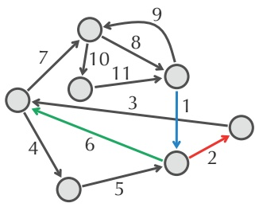

flowchart

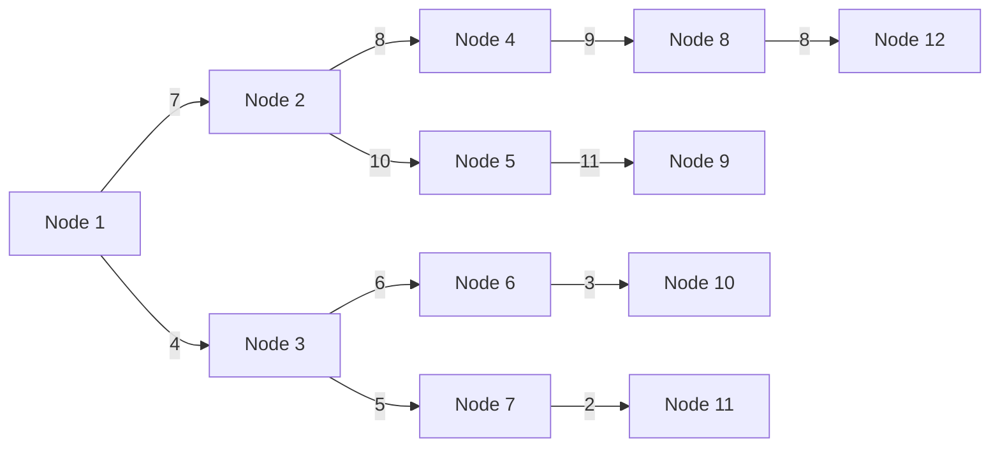

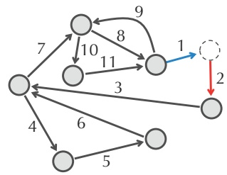

flowchart

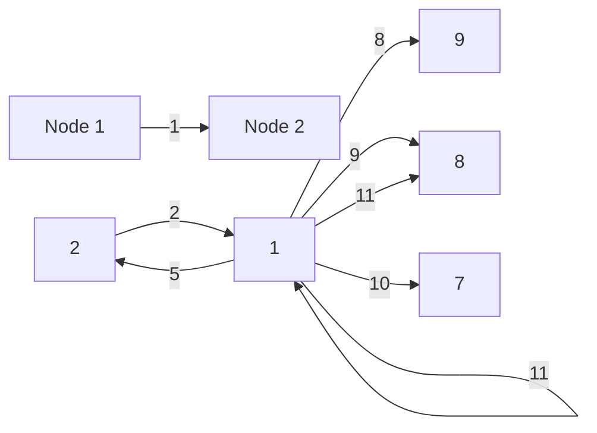

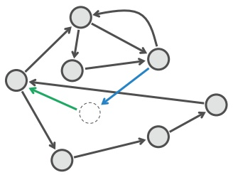

flowchart

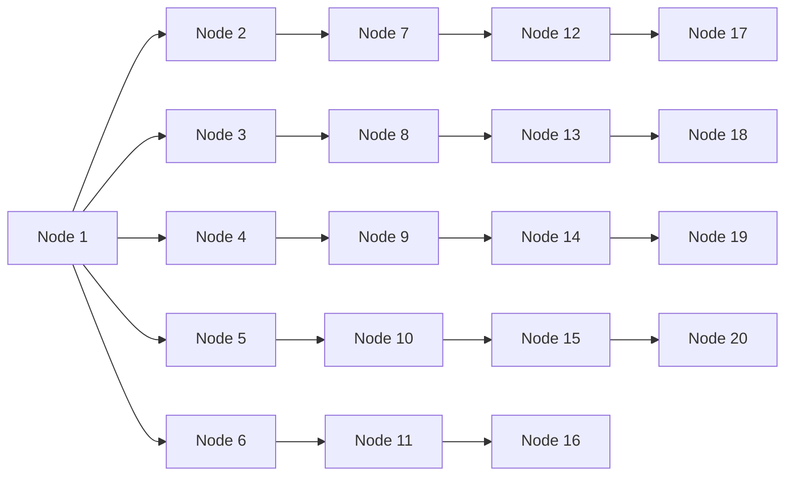

FIGURE 3.41 (Top) An Eulerian graph Graph (left) along with its $\left( u , v , w \right)$ -bypass graph (right) constructed for the blue and red edges. (Bottom) The other bypass graph constructed for the blue and green edges.

**EXERCISE BREAK:** Show that any Eulerian cycle in Graph passing through (u, v) and then (v, w) corresponds to an Eulerian cycle (with the same edge labels) in the (u, v, w)-bypass graph passing through (u, x) and then $( x , w )$

In general, given an incoming edge (u, v) into v along with k outgoing edges $( v , w _ { 1 } )$ $\cdots , ( v , w _ { k } )$ from v, we can construct k different bypass graphs (Figure 3.41 (bottom)). Note that no two bypass graphs have the same Eulerian cycle.

Our idea, roughly stated, is to iteratively construct every possible bypass graph for Graph until we obtain a large family of simple directed graphs; each one of these graphs will correspond to a distinct Eulerian cycle in Graph. This idea is implemented by the pseudocode below.

ALLEULERIANCYCLES(Graph)
    AllGraphs ← the set consisting of a single graph Graph
    while there is a non-simple graph G in AllGraphs
        v ← a node with indegree larger than 1 in G
        for each incoming edge (u, v) into v
            for each outgoing edge (v, w) from v
                NewGraph ← (u, v, w)-bypass graph of G
                if NewGraph is connected
                    add NewGraph to AllGraphs
            remove G from AllGraphs
        for each graph G in AllGraphs
            output the (single) Eulerian cycle in G

There exists a more elegant approach to constructing all Eulerian cycles in an Eulerian graph that is based on a theorem that de Bruijn had a hand in proving. To learn about this theorem, see **DETOUR: The BEST Theorem**.

Reconstructing a string spelled by a path in the paired de Bruijn graph

Consider the following Eulerian path formed by nine edges in the paired de Bruijn graph from Figure 3.36.

$$
\begin{array}{c}\text {AG - AG} \rightarrow \text {GC - GC} \rightarrow \text {CA - CT} \rightarrow \text {AG - TG} \rightarrow\\\text {GC - GC} \rightarrow \text {CT - CT} \rightarrow \text {TG - TG} \rightarrow \text {GC - GC} \rightarrow \text {CT - CA}\end{array}
$$

We can arrange the (2, 1)-mers in this path into the nine rows shown below, revealing the string **AGCAGCTGCTGCA** spelled by this path:

AG-AG
  GC-GC
    CA-CT
      AG-TG
        GC-GC
          CT-CT
            TG-TG
              GC-GC
                CT-CA
AGCAGCTGCTGCA

Now, consider another Eulerian path in the paired de Bruijn graph from Figure 3.36:

$\mathrm{AG - AG}\rightarrow \mathrm{GC - GC}\rightarrow \mathrm{CT - CT}\rightarrow \mathrm{TG - TG}\rightarrow$ $\mathrm{GC - GC}\rightarrow \mathrm{CA - CT}\rightarrow \mathrm{AG - TG}\rightarrow \mathrm{GC - GC}\rightarrow \mathrm{CT - CA}$

An attempt to assemble these (2, 1)-mers reveals that not every column has the same nucleotide (see the two columns shown in red below). This example illustrates that not all Eulerian paths in the paired de Bruijn graph spell solutions of the String Reconstruction from Read-Pairs Problem.

AG-AG
GC-GC
CT-CT
TG-TG
GC-GC
CA-CT
AG-TG
GC-GC
CT-CA
AGC?GC?GCTGCA

