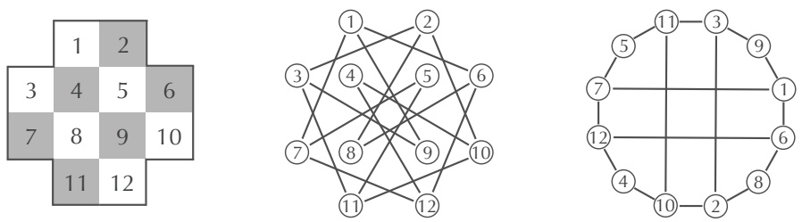
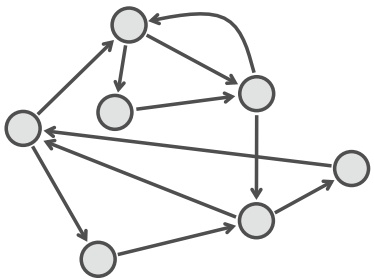
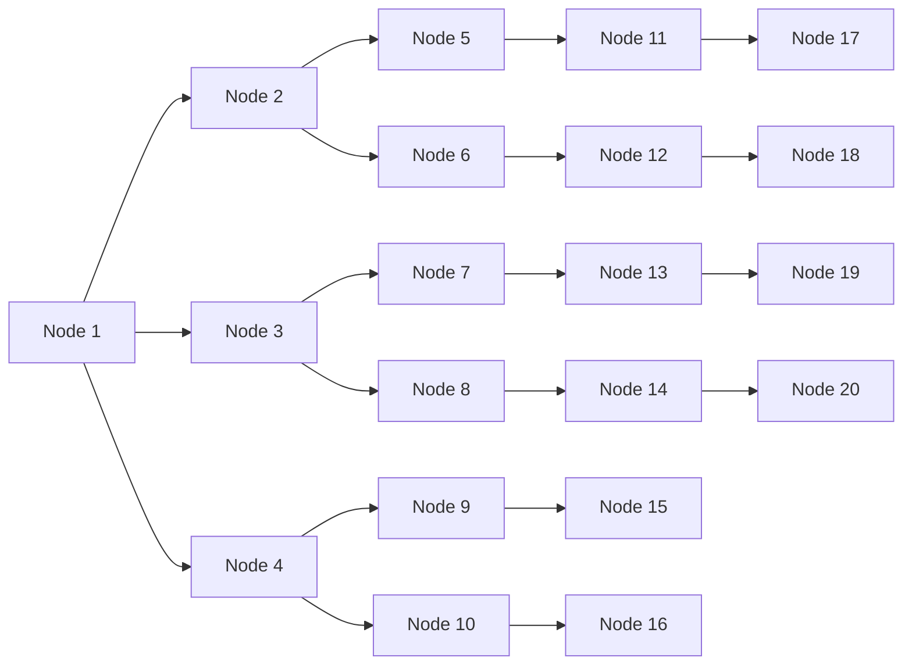
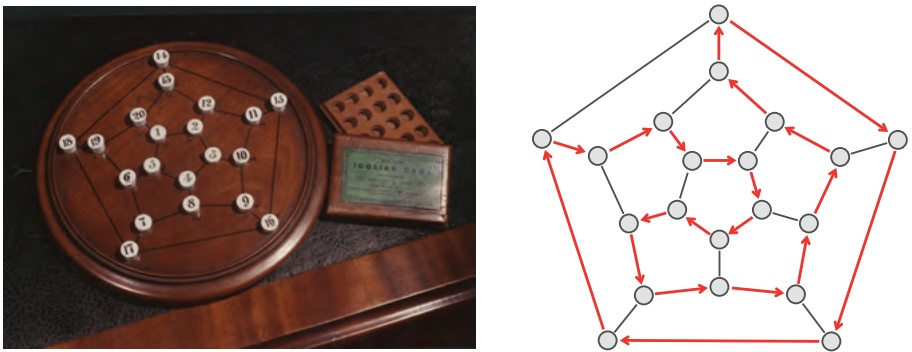
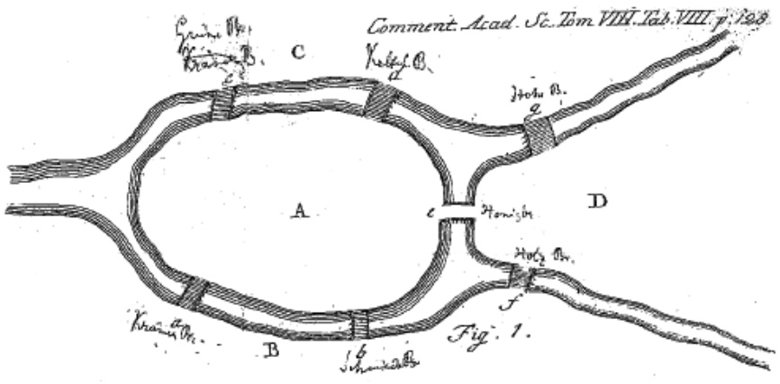
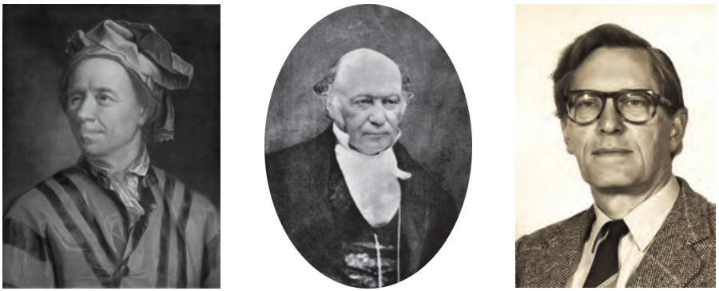
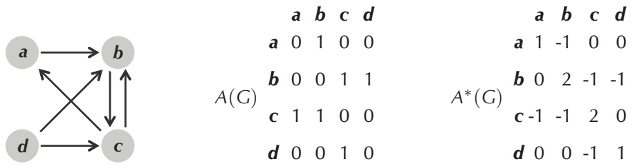
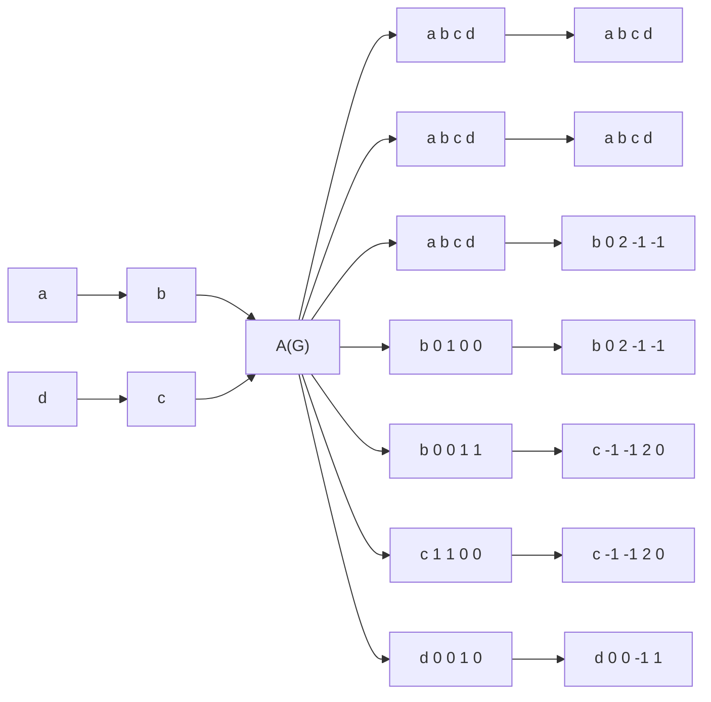

## String Spelled by a Gapped Genome Path Problem:

Reconstruct a sequence of $( k , d )$ -mers corresponding to a path in a paired de Bruijn graph.

**Input**: A sequence of $( k , d )$ -mers ${ \left( a _ { 1 } \middle | b _ { 1 } \right) } , \cdots , { \left( a _ { n } \middle | b _ { n } \right) }$ such that SUFFIX $( ( a _ { i } | b _ { i } ) ) = \mathrm { P R E F I X } ( ( a _ { i + 1 } | b _ { i + 1 } ) )$ for $1 \leq i \leq n - 1$

**Output**: A string Text of length $k + d + k + n - 1$ such that the i-th $( k , d )$ -mer of Text is equal to $\left( a _ { i } \middle | b _ { i } \right)$ for $1 \leq i \leq n$ (if such a string exists).

Our approach to solving this problem will split the given $( k , d )$ -mers ${ \left( a _ { 1 } \middle | b _ { 1 } \right) } , \cdots , { \left( a _ { n } \middle | b _ { n } \right) }$ into their initial k-mers, First $P a t t e r n s = \left( a _ { 1 } , \cdots , a _ { n } \right)$ , and their terminal k-mers, Second-$P a t t e r n s = \left( b _ { 1 } , \cdots , b _ { n } \right)$ . Assuming that we have implemented an algorithm solving the String Spelled by a Genome Path Problem (denoted **STRINGSPELLEDBYPATTERNS**), we can assemble FirstPatterns and SecondPatterns into strings PrefixString and SuffixString, respectively.

For the first example above, we have that PrefixString = AGCAGCTGCT and SuffixString = AGCTGCTGCA. These strings perfectly overlap starting at the fourth nucleotide of PrefixString:

$$
\begin{array}{l} \text {PrefixString} = \text {AGCAGCTGCT} \\ \text {SuffixString} = \quad \text {AGCTGCTGCA} \\ G e n o m e \quad = \quad A G C A G C T G C T G C A \\ \end{array}
$$

However, for the second example above, there is no perfect overlap:

$$
\begin{array}{l} \text {PrefixString} = \mathrm{AGCTGCAGCT} \\ \text {SuffixString} = \mathbf {A G C T G C T G C A} \\ \text {Genome} = \mathrm{AGC?GC?GCTGCA} \\ \end{array}
$$

The following algorithm, **STRINGSPELLEDBYGAPPEDPATTERNS**, generalizes this approach to an arbitrary sequence GappedPatterns of $( k , d )$ -mers. It constructs strings PrefixString and SuffixString as described above, and checks whether they have perfect overlap (i.e., form the prefix and suffix of a reconstructed string). It also assumes that the number of $( k , d )$ -mers in GappedPatterns is at least $d ;$ otherwise, it is impossible to reconstruct a contiguous string.

STRINGSPELLEDBYGAPPEDPATTERNS(GappedPatterns, k, d)
    FirstPatterns ← the sequence of initial k-mers from GappedPatterns
    SecondPatterns ← the sequence of terminal k-mers from GappedPatterns
    PrefixString ← STRINGSPELLEDBYPATTERNS(FirstPatterns, k)
    SuffixString ← STRINGSPELLEDBYPATTERNS(SecondPatterns, k)
    for i = k + d + 1 to |PrefixString|
        if the i-th symbol in PrefixString ≠ the (i - k - d)-th symbol in SuffixString
            return "there is no string spelled by the gapped patterns"
    return PrefixString concatenated with the last k + d symbols of SuffixString

## Maximal non-branching paths in a graph

A node v in a directed graph Graph is called a **1-in-1-out node** if its indegree and outdegree are both equal to 1. We can rephrase the definition of a “maximal non-branching path” from the main text as a path whose internal nodes are 1-in-1-out nodes and whose initial and final nodes are not 1-in-1-out nodes. Also, note that the definition from the main text does not handle the case when Graph has a connected component that is an **isolated cycle**, in which all nodes are 1-in-1-out nodes (recall Figure 3.38).

**MAXIMALNONBRANCHINGPATHS**, shown below, iterates through all nodes of the graph that are not 1-in-1-out nodes and generates all non-branching paths starting at each such node. In a final step, it finds all isolated cycles in the graph.

MAXIMALNONBRANCHINGPATHS(Graph)
    Paths ← empty list
    for each node v in Graph
        if v is not a 1-in-1-out node
            if OUT(v) &gt; 0
                for each outgoing edge (v, w) from v
                    NonBranchingPath ← the path consisting of the single edge (v, w)
                    while w is a 1-in-1-out node
                        extend NonBranchingPath by the outgoing edge (w, u) from w
                        w ← u
                    add NonBranchingPath to the set Paths
    for each isolated cycle Cycle in Graph
        add Cycle to Paths
    return Paths

## Detours

A short history of DNA sequencing technologies

In 1988, Radoje Drmanac, Andrey Mirzabekov, and Edwin Southern simultaneously and independently proposed the futuristic and at the time completely implausible method of **DNA arrays** for DNA sequencing. None of these three biologists knew of the work of Euler, Hamilton, and de Bruijn; none could have possibly imagined that the implications of his own experimental research would eventually bring him face-to-face with these mathematical giants.

A decade earlier, Frederick Sanger had sequenced the tiny 5,386 nucleotide-long genome of the fX174 virus. By the late 1980s, biologists were routinely sequencing viruses containing hundreds of thousands of nucleotides, but the idea of sequencing bacterial (let alone human) genomes remained preposterous, both experimentally and computationally. Indeed, generating a single read in the late 1980s cost more than a dollar, pricing mammalian genome sequences in the billions. DNA arrays were therefore invented with the goal of cheaply generating a genome’s k-mer composition, albeit with a smaller read length k than the original DNA sequencing technology. For example, whereas Sanger’s expensive sequencing technique generated 500 nucleotide-long reads in 1988, the DNA array inventors initially aimed at producing reads of length only 10.

DNA arrays work as follows. We first synthesize all 4k possible DNA k-mers and attach them to a DNA array, which is a grid on which each k-mer is assigned a unique location. Next, we fluorescently label a single-stranded DNA fragment (with unknown sequence) and apply a solution containing this labeled DNA to the DNA array. The k-mers in a DNA fragment will hybridize (bind) to their reverse complementary k-mers on the array. All we need to do is use spectroscopy to analyze which sites on the array emit the fluorescence; the reverse complements of k-mers corresponding to these sites must therefore belong to the (unknown) DNA fragment. Thus, the set of fluorescent k-mers on the array reveals the composition of a DNA fragment (Figure 3.42).

At first, few believed that DNA arrays would work, because both the biochemical problem of synthesizing millions of short DNA fragments and the algorithmic problem of sequence reconstruction appeared too complicated. In 1988, Science magazine wrote that given the amount of work required to synthesize a DNA array, “using DNA arrays for sequencing would simply be substituting one horrendous task for another”. It turned out that Science was only half right. In the mid-1990s, a number of companies perfected technologies for designing large DNA arrays, but DNA arrays ultimately failed to realize the dream that motivated their inventors because the fidelity of DNA hybridization with the array was too low and because the value of k was too small.

| AAA | AGA | CAA | CGA | GAA | GGA | TAA | TGA |
| --- | --- | --- | --- | --- | --- | --- | --- |
| AAC | AGC | CAC | CGC | GAC | GGC | TAC | TGC |
| AAG | AGG | CAG | CGG | GAG | GGG | TAG | TGG |
| AAT | AGT | CAT | CGT | GAT | GGT | TAT | TGT |
| ACA | ATA | CCA | CTA | GCA | GTA | TCA | TTA |
| ACC | ATC | CCC | CTC | GCC | GTC | TCC | TTC |
| ACG | ATG | CCG | CTG | GCG | GTG | TCG | TTG |
| ACT | ATT | CCT | CTT | GCT | GTT | TCT | TTT |

FIGURE 3.42 A toy DNA array containing all possible 3-mers. Taking the reverse complements of the fluorescently labeled 3-mers yields the collection {ACC, ACG, CAC, CCG, CGC, CGT, GCA, GTT, TAC, TTA}, which is the 3-mer composition of the twelve nucleotide-long string CGCACGTTACCG. Note that this DNA array provides no information regarding 3-mer multiplicities.

Yet the failure of DNA arrays was a spectacular one; while the original goal (DNA sequencing) dangled out of reach, two new unexpected applications of DNA arrays emerged. Today, arrays are used to measure gene expression as well as to analyze genetic variations. These unexpected applications transformed DNA arrays into a multi-billion dollar industry that included Hyseq, founded by Radoje Drmanac, one of the original inventors of DNA arrays.

After founding Hyseq, Drmanac did not abandon his dream of inventing an alternative DNA sequencing technology. In 2005, he founded Complete Genomics, one of the first Next Generation Sequencing (NGS) companies. Complete Genomics, Illumina, Life Technologies, and other NGS companies subsequently developed the technology to cheaply generate almost all k-mers from a genome, thus at last enabling the method of Eulerian assembly. While these technologies are quite different from the DNA array technology proposed in 1988, one can still recognize the intellectual legacy of DNA arrays in NGS approaches, a testament to the fact that good ideas never die, even if they fail at first.

Similarly to DNA arrays, NGS technologies initially generated millions of rather short error-prone reads (of length about 20 nucleotides) when the NGS revolution began in 2005. However, within a span of just a few years, NGS companies were able to increase read length and improve accuracy by an order of magnitude. Moreover, Pacific

Biosciences and Oxford Nanopore Technologies already generate error-ridden reads containing thousands of nucleotides. Perhaps your own start-up will find a way to generate a single read spanning the entire genome, thus making this chapter a footnote in the history of genome sequencing. Whatever the future brings, recent developments in NGS have already revolutionized genomics, and biologists are preparing to assemble the genomes of all mammalian species on Earth . . . all while relying on a simple idea that Leonhard Euler conceived in 1735.

## Repeats in the human genome

A **transposon** is a DNA fragment that can change its position within the genome, often resulting in a duplication (repeat). A transposon that inserts itself into a gene will most likely disable that gene. Diseases that are caused by transposons include hemophilia, porphyria, Duchenne muscular dystrophy, and many others. Transposons make up a large fraction of the human genome and are divided into two classes according to their mechanism of transposition, which can be described as either **retrotransposons** or **DNA transposons**.

Retrotransposons are copied in two stages: first they are transcribed from DNA to RNA, and the RNA produced is then **reverse transcribed** to DNA by a **reverse transcriptase**. This copied DNA fragment is then inserted at a new position into the genome. DNA transposons do not involve an RNA intermediate but instead are catalyzed by **transposases**. The transposase cuts out the DNA transposon, which is then inserted into a new site in the genome, resulting in a repeat.

The first transposons were discovered in maize by Barbara McClintock, for which she was awarded a Nobel Prize in 1983. About 85% of the maize genome and 50% of the human genome consist of transposons. The most common transposon in humans is the Alu sequence, which is approximately 300 bases long and accounts for approximately a million repeats (with mutations) in the human genome. The **Mariner sequence** is another transposon in the human genome that has about 14,000 repeats, making up 2.6 million base pairs. Mariner-like transposons exist in many species and can even be transmitted from one species to another. The Mariner transposon was used to develop the **Sleeping Beauty transposon system**, a synthetic DNA transposon constructed for the purposes of introducing new traits in animals and for gene therapy.

## Graphs

The use of the word “graph” in this book is different from its use in high school mathematics; we do not mean a chart of data. You can think of a graph as a diagram showing cities connected by roads.

The first panel in Figure 3.43 shows a 4 ⇥ 4 chessboard with the four corner squares removed. A knight can move two steps in any of four directions (left, right, up, and down) followed by one step in a perpendicular direction. For example, a knight at square 1 can move to square 7 (two down and one left), square 9 (two down and one right), or square 6 (two right and one down).

FIGURE 3.43 (Left) A hypothetical chessboard. (Middle) The Knight Graph represents each square by a node and connects two nodes with an edge if a knight can travel between the respective squares in a single move. (Right) An equivalent representation of the Knight Graph.

**STOP and Think:** Can a knight travel around this board, pass through each square exactly once, and return to the same square it started on?

The second panel in Figure 3.43 represents each of the chessboard’s twelve squares as a node. Two nodes are connected by an edge if a knight can move between them in a single step. For example, node 1 is connected to nodes 6, 7, and 9. Connecting nodes in this manner produces a “Knight Graph” consisting of twelve nodes and sixteen edges.

We can describe a graph by its set of nodes and edges, where every edge is written as the pair of nodes that it connects. The graph in the second panel of Figure 3.43 is described by the node set

$$
1, 2, 3, 4, 5, 6, 7, 8, 9, 1 0, 1 1, 1 2,
$$

and the following edge set:

| 1—6 | 1—7 | 1—9 | 2—3 | 2—8 | 2—10 | 3—9 | 3—11 |
| --- | --- | --- | --- | --- | --- | --- | --- |
| 4—10 | 4—12 | 5—7 | 5—11 | 6—8 | 6—12 | 7—12 | 10—11 |

A **path** in a graph is a sequence of edges, where each successive edge begins at the node where the previous edge ends. For example, the path $8 \rightarrow 6 \rightarrow 1 \rightarrow 9$ in Figure 3.43 starts at node 8, ends at node 9, and consists of 3 edges. Paths that start and end at the same node are referred to as **cycles**. The cycle $3 \rightarrow 2 \rightarrow 1 0 \rightarrow 1 1 \rightarrow 3$ starts and ends at node 3 and consists of 4 edges.

The way a graph is drawn is irrelevant; two graphs with the same node and edge sets are equivalent, even if the particular pictures that represent the graph are different. The only thing that is important is which nodes are connected and which are not. Therefore, the graph in the second panel of Figure 3.43 is identical to the graph in the third panel. This graph reveals a cycle that visits every node in the Knight Graph once and describes a sequence of knight moves that visit every square exactly once.

**EXERCISE BREAK:** How many knight’s tours exist for the chessboard in Figure 3.43?

The number of edges incident to a given node v is called the **degree** of v. For example, node 1 in the Knight Graph has degree 3, while node 5 has degree 2. The sum of degrees of all twelve nodes is, in this case, 32 (eight nodes have degree 3 and four nodes have degree 2), which is twice the number of edges in the graph.

**STOP and Think:** Can you connect seven phones in such a way that each is connected to exactly three others?

Many bioinformatics problems analyze **directed graphs**, in which every edge is directed from one node to another, as shown by the arrows in Figure 3.44. You can think of a directed graph as a diagram showing cities connected by one-way roads. Every node in a directed graph is characterized by indegree (the number of incoming edges) and outdegree (the number of outgoing edges).

**STOP and Think:** Prove that for every directed graph, the sum of indegrees of all nodes is equal to the sum of outdegrees of all nodes.

An undirected graph is **connected** if every two nodes have a path connecting them. Disconnected graphs can be partitioned into disjoint connected components.

flowchart

FIGURE 3.44 A directed graph.

## The icosian game

We make an historical detour to Dublin, with the creation in 1857 of the **icosian game** by the Irish mathematician William Hamilton. This “game”, which was a commercial flop, consisted of a wooden board with twenty pegholes and some lines connecting the holes, as well as twenty numbered pegs (Figure 3.45 (left)). The objective was to place the numbered pegs in the holes in such a way that peg 1 would be connected by a line on the board to peg 2, which would in turn be connected by a line to peg 3, and so on, until finally peg 20 would be connected by a line back to peg 1. In other words, if we follow the lines on the board from peg to peg in ascending order, we reach every peg exactly once and then arrive back at our starting peg.

FIGURE 3.45 (Left) Hamilton’s icosian game, with a winning placement of the pegs shown. (Right) The winning placement of the pegs can be represented as a Hamiltonian cycle in a graph. Each node in this graph represents a peghole on the board, and an edge connects two pegholes that are connected by a line segment on the board.

We can model the icosian game using a graph if we represent each peghole by a node and then transform lines that connect pegholes into edges that connect the corresponding nodes. This graph does have a Hamiltonian cycle solving the icosian game; one of them is shown in Figure 3.45 (right). Although a brute force approach to the Hamiltonian Cycle Problem works for these small graphs, it quickly becomes infeasible for large graphs.

## Tractable and intractable problems

Inspired by Euler’s Theorem, you probably are wondering whether there exists such a simple result leading to a fast algorithm for the Hamiltonian Cycle Problem. The key challenge is that while we are guided by Euler’s Theorem in solving the Eulerian Cycle Problem, an analogous simple condition for the Hamiltonian Cycle Problem remains unknown. Of course, you could always explore all walks through the graph and report back if you find a Hamiltonian cycle. The problem with this brute force method is that for a graph on just a thousand nodes, there may be more walks through the graph than there are atoms in the universe!

For years, the Hamiltonian Cycle Problem eluded all attempts to solve it by some of the world’s most brilliant researchers. After years of fruitless effort, computer scientists began to wonder whether this problem is **intractable**, i.e., that their failure to find a polynomial-time algorithm was not attributable to a lack of insight, but rather because such an algorithm for solving the Hamiltonian Cycle Problem simply does not exist. In the 1970s, computer scientists discovered thousands more algorithmic problems with the same fate as the Hamiltonian Cycle Problem. While these problems may appear to be simple, no one has been able to find fast algorithms for solving them. A large subset of these problems, including the Hamiltonian Cycle Problem, are now collectively known as **NP-complete**. A formal definition of NP-completeness is beyond the scope of this text.

All the NP-complete problems are equivalent to each other: an instance of any NP-complete problem can be transformed into an instance of any other NP-complete problem in polynomial time. Thus, if you find a fast algorithm for one NP-complete problem, you will automatically be able to use this algorithm to design a fast algorithm for any other NP-complete problem! The problem of efficiently solving NP-complete problems, or finally proving that they are intractable, is so fundamental that it was named one of seven “Millennium Problems” by the Clay Mathematics Institute in 2000. Find an efficient algorithm for any NP-complete problem, or show that one of these problems is intractable, and the Clay Institute will award you a prize of one million dollars.

Think twice before you embark on solving an NP-complete problem. So far, only one of the seven Millennium Problems has been solved; in 2003, Grigori Perelman proved the Poincaré Conjecture. A true mathematician, Perelman would later turn down the million-dollar prize, believing that the purity and beauty of mathematics is above all worldly compensation.

NP-complete problems fall within a larger class of difficult computational problems. A problem A is **NP-hard** if there is some NP-complete problem that can be reduced to A in polynomial time. Because NP-complete problems can be reduced to each other in polynomial time, all NP-complete problems are NP-hard. However, not every NP-hard problem is NP-complete (meaning that the former are “at least as difficult” to solve as the latter). One example of an NP-hard problem that is not NP-complete is the **Traveling Salesman Problem**, in which we are given a graph with weighted edges and we must produce a Hamiltonian cycle of minimum total weight.

## From Euler to Hamilton to de Bruijn

Euler’s presented his solution of the Bridges of Königsberg Problem to the Imperial Russian Academy of Sciences in St. Petersburg in 1735. Figure 3.46 shows Euler’s drawing of the Seven Bridges of Königsberg.

text_image

Comment Acad. Sc.Tom VIII Tab.VIII p.198
A
C
D
Fig. 1.

FIGURE 3.46 Euler’s illustration of Königsberg, showing each of the four parts of the city labeled A, B, C, and D, along with the seven bridges crossing the different arms of the Pregel river.

Euler was the most prolific mathematician of all time; besides graph theory, he first introduced the notation f(x) to represent a function, i for the square root of -1, and p for the circular constant. Working very hard throughout his entire life, he became blind in his right eye in 1735. He kept working. In 1766, he lost the use of his left eye and commented: “Now I will have fewer distractions.” He kept working. Even after going completely blind, he published hundreds of papers.

In this chapter, we have met three mathematicians of three different centuries, Euler, Hamilton, and de Bruijn, spread out across Europe (Figure 3.47). We might be inclined to feel a sense of adventure at their work and how it converged to this singular point in modern biology. Yet the first biologists who worked on DNA sequencing had no idea of how graph theory could be applied to this subject. What’s more, the first paper applying the three mathematicians’ ideas to genome assembly was published lifetimes after the deaths of Euler and Hamilton, when de Bruijn was in his seventies. So perhaps we might think of these three men not as adventurers, but instead as lonely wanderers. As is so often the mathematician’s curse, each of the three passionately pursued abstract questions while having no idea where the answers might one day lead without him.

FIGURE 3.47 Leonhard Euler (left), William Hamilton (center), and Nicolaas de Bruijn (right).

## The seven bridges of Kaliningrad

Königsberg was largely destroyed during World War II; its ruins were captured by the Soviet army. The city was renamed Kaliningrad in 1946 in honor of Soviet revolutionary Mikhail Kalinin.

Since the 18th Century, much has changed in the layout of Königsberg, and it just so happens that the bridge graph drawn today for the city of Kaliningrad still does not contain an Eulerian cycle. However, this graph does contain an Eulerian path, which means that Kaliningrad residents can walk crossing every bridge exactly once, but cannot do so and return to where they started. Thus, the citizens of Kaliningrad finally achieved at least a small part of the goal set by the citizens of Königsberg (although they have to take a taxi home). Yet strolling around Kaliningrad is not as pleasant as it would have been in 1735, since the beautiful old Königsberg was ravaged by the combination of Allied bombing in 1944 and dreadful Soviet architecture in the years following World War II.

## The BEST Theorem

Given an adjacency matrix $A ( G )$ of a directed Eulerian graph $G _ { r }$ we define the matrix $A ^ { * } ( G )$ by replacing the i-th diagonal entry of $- A ( G )$ by INDEGREE(i) for each node i in G (Figure 3.48).

flowchart

FIGURE 3.48 (Left) A graph G with two Eulerian cycles. (Middle) The adjacency matrix A(G) of G. (Right) The matrix $A ^ { * } ( C )$ . Each i-cofactor of $A ^ { * }$ is equal to 2. Thus, the BEST theorem computes the number of Eulerian cycles as $2 \cdot 0! \cdot 1! \cdot 1! \cdot 1! = 2$

The **i-cofactor** of a matrix M is the determinant of the matrix obtained from M by deleting its i-th row and i-th column. It can be shown that for a given Eulerian graph $G ,$ all i-cofactors of $A ^ { * } ( G )$ have the same value, which we denote as $c ( G )$

The following theorem provides a formula computing the number of Eulerian cycles in a graph. Its name is an acronym of its discoverers: de Bruijn, van Aardenne-Ehrenfest, Smith, and Tutte.

**BEST Theorem:** The number of Eulerian cycles in an Eulerian graph is equal to

$$
c (G) \cdot \prod_ {\text {all nodes $v$ in graph $G$}} (\text {INDEGREE} (v) - 1)!
$$

The proof of the BEST Theorem, which is beyond the scope of this text, provides us with an alternative way to construct all Eulerian cycles in an Eulerian directed graph.

## Bibliography Notes

After Euler’s work on the Königsberg Bridge Problem (Euler, 1758), graph theory was forgotten for over a hundred years but was revived in the second half of the 19th Century. Graph theory flourished in the 20th Century, when it became an important area of mathematics with many practical applications. The de Bruijn graph was introduced independently by Nicolaas de Bruijn (de Bruijn, 1946) and I. J. Good (Good, 1946).

DNA sequencing methods were invented independently and simultaneously in 1977 by groups led by Frederick Sanger (Sanger, Nicklen, and Coulson, 1977) and Walter Gilbert (Maxam and Gilbert, 1977). DNA arrays were proposed simultaneously and independently in 1988 by Radoje Drmanac (Drmanac et al., 1989), Andrey Mirzabekov (Lysov et al., 1988) and Edwin Southern (Southern, 1988). The Eulerian approach to DNA arrays was described in 1989 (Pevzner, 1989).

The Eulerian approach to DNA sequencing was described by Idury and Waterman, 1995 and further developed by Pevzner, Tang, and Waterman, 2001. To address the challenge of assembly from short reads produced by next generation sequencing technologies, a number of assembly tools that are based on de Bruijn graphs have been developed (Zerbino and Birney, 2008, Butler et al., 2008). Paired de Bruijn graphs were introduced by Medvedev et al., 2011.

The Sleeping Beauty transposon system was developed by Ivics et al., 1997.

## HOWDO WE SEQUENCEANTIBIOTICS?

Brute Force Algorithms

text_image

Brute Force Algorithms
147·119·128

TWO MEN AND ONE MONKEY ON THE MOST FANTASTIC JOURNEY OF THEIR LIVES...

## The Discovery of Antibiotics

In August 1928, before leaving for vacation, Scottish microbiologist Alexander Fleming stacked his cultures of infection-causing Staphylococcus bacteria on a laboratory bench. When he returned to work a few weeks later, Fleming noticed that one culture had been contaminated with Penicillium fungus, and that the colony of Staphylococcus surrounding it had been destroyed! Fleming named the bacteria-killing substance **penicillin**, and he suggested that it could be used to treat bacterial infections in humans.

When Fleming published his discovery in 1929, his article had little immediate impact. Subsequent experiments struggled to isolate the **antibiotic** agent (i.e., the compound that actually killed bacteria) from the fungus. As a result, Fleming eventually concluded that penicillin could not be practically applied to treat bacterial infections and abandoned his antibiotics research.

Searching for new drugs to treat wounded soldiers, the American and British governments intensified their search for antibiotics after the start of World War II; however, the challenge of mass-producing antibiotics remained. In March 1942, half of the total supply of penicillin owned by pharmaceutical giant Merck was used to treat a single infected patient.

Also in 1942, Russian biologists Georgy Gause and Maria Brazhnikova noticed that the Bacillus brevis bacterium killed the pathogenic bacterium Staphylococcus aureus. In contrast to Fleming’s efforts with penicillin, they successfully isolated the antibiotic compound from Bacillus brevis and named it Gramicidin Soviet. Within a year, this antibiotic was distributed to Soviet military hospitals.

Meanwhile, American scientists were scouring various food markets for rotten groceries and finally found a moldy cantaloupe in Illinois with a high concentration of penicillin. This mundane discovery allowed the United States to produce 2 million doses of penicillin in time for the Allied invasion of Normandy in 1944, thus saving thousands of wounded soldiers’ lives.

Gause continued his research into Gramicidin Soviet after World War II but failed to elucidate its chemical structure. Taking the torch from Gause, English biochemist Richard Synge studied Gramicidin Soviet and a wide array of other antibiotics produced by Bacillus brevis. A few years after World War II ended, he demonstrated that they represent short amino acid sequences (i.e., mini-proteins) called **peptides**. Gause received the Stalin Prize in 1946, and Synge won the Nobel Prize in 1952. The former award proved more valuable as it protected Gause from execution during the period of **Lysenkoism**, the Soviet campaign against “bourgeois” geneticists that intensified in the postwar era. See **DETOUR: Gause and Lysenkoism**.