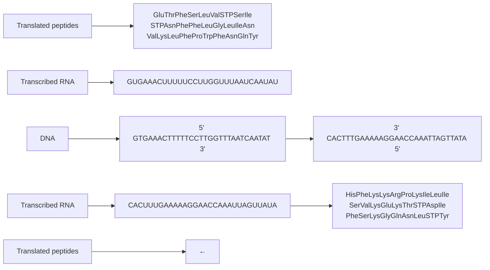
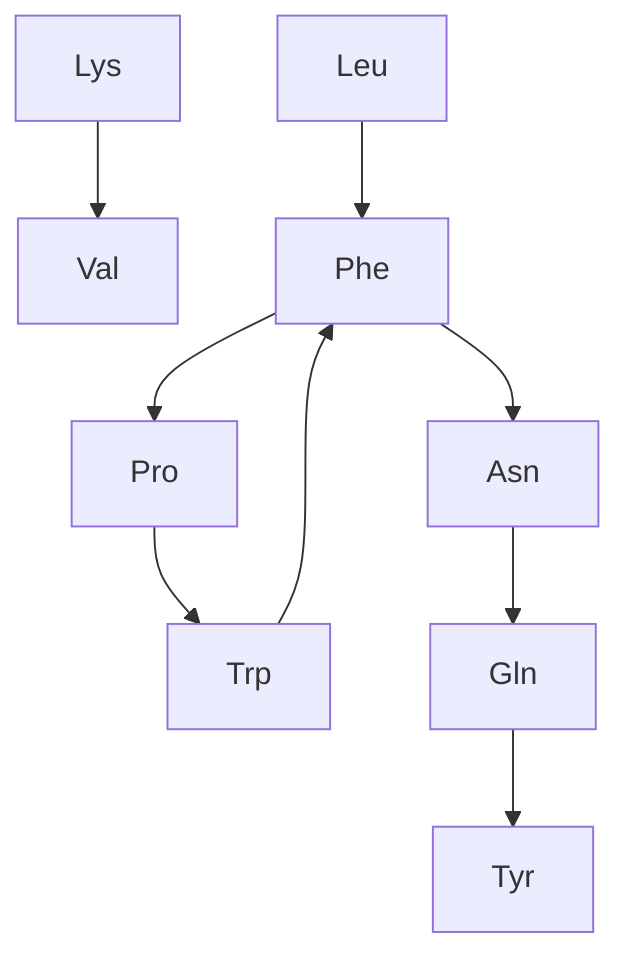
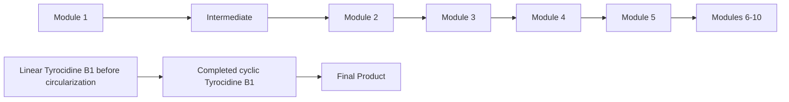

The mass-production of antibiotics initiated an arms race between pharmaceutical companies and pathogenic bacteria. The former worked to develop new antibiotic drugs, while the latter acquired resistance against these drugs. Although modern medicine won every battle for six decades, the last ten years have witnessed an alarming rise in antibiotic-resistant bacterial infections that cannot be treated even by the most powerful antibiotics. In particular, the Staphylococcus aureus bacterium that Gause had studied in 1942 mutated into a resistant strain known as **Methicillin-resistant Staphylococcus aureus** (**MRSA**). MRSA is now the leading cause of death from infections in hospitals; its death rate has even passed that of AIDS in the United States.

With the rise of MRSA at hand, developing new antibiotics represents a central challenge to modern medicine. A difficult problem in antibiotics research is that of **sequencing** newly discovered antibiotics, or determining the order of amino acids making up the antibiotic peptide.

## How Do Bacteria Make Antibiotics?

How peptides are encoded by the genome

Let’s begin by considering **Tyrocidine B1**, one of many antibiotics produced by Bacillus brevis. Tyrocidine B1 is defined by the 10 amino acid-long sequence shown below (using both the one-letter and three-letter notations for amino acids). Our goal in this section is to figure out how Bacillus brevis could have made this antibiotic.

| Three-letter notation | Val-Lys-Leu-Phe-Pro-Trp-Phe-Asn-Gln-Tyr |
| --- | --- |
| One-letter notation | V K L F P W F N Q Y |

The **Central Dogma of Molecular Biology** states that “DNA makes RNA makes protein.” According to the Central Dogma, a gene from a genome is first **transcribed** into a strand of RNA composed of four **ribonucleotides**: adenine, cytosine, guanine, and uracil. A strand of RNA can be represented as an **RNA string**, formed over the four-letter alphabet {A, C, G, U}. You can think of the genome as a large cookbook, in which case the gene and its RNA transcript form a recipe in this cookbook. Then, the RNA transcript is **translated** into an amino acid sequence of a protein.

Much like replication, the chemical machinery underlying transcription and translation is fascinating, but from a computational perspective, both processes are straightforward. Transcription simply transforms a DNA string into an RNA string by replacing all occurrences of T with U. The resulting strand of RNA is translated into an amino acid sequence as follows. During translation, the RNA strand is partitioned into non-overlapping 3-mers called **codons**. Then, each codon is converted into one of 20 amino acids via the **genetic code**; the resulting sequence can be represented as an **amino acid string** over a 20-letter alphabet. As illustrated in Figure 4.1, each of the 64 RNA codons encodes its own amino acid (some codons encode the same amino acid), with the exception of three **stop codons** that do not translate into amino acids and serve to halt translation (see **DETOUR: Discovery of Codons**). For example, the DNA string **TATACGAAA** transcribes into the RNA string **UAUACGAAA**, which in turn translates into the amino acid string **YTK**.


<details>
<summary>donut</summary>

| Nucleotide | Amino Acid |
| --- | --- |
| A | His |
| A | Glutamine |
| A | Proline |
| A | Arginine |
| A | Leucine |
| A | Aspartic acid |
| A | Glutamic acid |
| A | Alanine |
| A | Glycine |
| A | Valine |
| A | Tyr |
| A | Val |
| A | Met |
| A | Histidine |
| A | Gln |
| A | C |
| A | U |
| A | C |
| A | G |
| A | G |
| A | G |
| A | G |
| A | G |
| A | G |
| A | G |
| A | G |
| A | G |
| A | G |
| A | G |
| A | G |
| A | G |
| A | G |
| A | G |
| A | G |
| A | G |
| A | G |
| A | G |
| A | G |
| A | C |
| A | C |
| A | C |
| A | C |
| A | C |
| A | C |
| A | C |
| A | C |
| A | C |
| A | C |
| A | C |
| A | C |
| A | C |
| A | C |
| A | C |
| A | C |
| A | C |
| A | C |
| A | C |
| A | C |
| A | G |
| A | G |
| A | G |
| A | G |
| A | G |
| A | G |
| A | G |
| A | G |
| A | G |
| A | G |
| A | G |
| A | G |
| A | G |
| A | G |
| A | G |
| A | G |
| A | G |
| A | G |
| A | C |
| A | G |
| A | G |
| A | G |
| A | G |
| A | G |
| A | G |
| A | G |
| A | G |
| A | G |
| A | G |
| A | G |
| A | G |
| A | G |
| A | G |
| A | G |
| A | G |
| A | G |
| A | G |
| A | U |
| A | U |
| A | U |
| A | U |
| A | U |
| A | U |
| A | U |
| A | U |
| A | U |
| A | U |
| A | U |
| A | U |
| A | U |
| A | U |
| A | U |
| A | U |
| A | U |
| A | U |
| A | U |
| A | U |
| A | C |
| A | C |
| A | C |
| A | C |
| A | C |
| A | C |
| A | C |
| A | C |
| A | C |
| A | C |
| A | C |
| A | C |
| A | C |
| A | C |
| A | C |
| A | C |
| A | C |
| A | C |
| A | C |
| A | U |
| A | U |
| A | U |
| A | U |
| A | U |
| A | U |
| A | U |
| A | U |
| A | U |
| A | U |
| A | U |
| A | U |
| A | U |
| A | U |
| A | U |
| A | U |
| A | U |
| A | U |
| A | U |
</details>

FIGURE 4.1 The genetic code describes the translation of an RNA 3-mer (codon) into one of 20 amino acids. The first three circles, moving from the inside out, represent the first, second, and third nucleotides of a codon. The fourth, fifth, and sixth circles define the translated amino acid in three ways: the amino acid’s full name, its 3-letter abbreviation, and its single-letter abbreviation. Three of the 64 total RNA codons are stop codons, which halt translation.

We will represent the genetic code as an array GENETICCODE containing 64 ele ments, as shown in Figure 4.2. The following problem asks you to find the translation of an RNA string into an amino acid string.


## Protein Translation Problem:

Translate an RNA string into an amino acid string.

**Input**: An RNA string Pattern and the array GENETICCODE.

**Output**: The translation of Pattern into an amino acid string Peptide.


EXERCISE BREAK: How many DNA strings of length 30 transcribe and translate into Tyrocidine B1?

| 0 | AAA | K | 16 | CAA | Q | 32 | GAA | E | 48 | UAA | * |
| --- | --- | --- | --- | --- | --- | --- | --- | --- | --- | --- | --- |
| 1 | AAC | N | 17 | CAC | H | 33 | GAC | D | 49 | UAC | Y |
| 2 | AAG | K | 18 | CAG | Q | 34 | GAG | E | 50 | UAG | * |
| 3 | AAU | N | 19 | CAU | H | 35 | GAU | D | 51 | UAU | Y |
| 4 | ACA | T | 20 | CCA | P | 36 | GCA | A | 52 | UCA | S |
| 5 | ACC | T | 21 | CCC | P | 37 | GCC | A | 53 | UCC | S |
| 6 | ACG | T | 22 | CCG | P | 38 | GCG | A | 54 | UCG | S |
| 7 | ACU | T | 23 | CCU | P | 39 | GCU | A | 55 | UCU | S |
| 8 | AGA | R | 24 | CGA | R | 40 | GGA | G | 56 | UGA | * |
| 9 | AGC | S | 25 | CGC | R | 41 | GGC | G | 57 | UGC | C |
| 10 | AGG | R | 26 | CGG | R | 42 | GGG | G | 58 | UGG | W |
| 11 | AGU | S | 27 | CGU | R | 43 | GGU | G | 59 | UGU | C |
| 12 | AUA | I | 28 | CUA | L | 44 | GUA | V | 60 | UUA | L |
| 13 | AUC | I | 29 | CUC | L | 45 | GUC | V | 61 | UUC | F |
| 14 | AUG | M | 30 | CUG | L | 46 | GUG | V | 62 | UUG | L |
| 15 | AUU | I | 31 | CUU | L | 47 | GUU | V | 63 | UUU | F |

FIGURE 4.2 The array GENETICCODE contains 64 elements, each of which is an amino acid or a stop codon (represented by \*).

Where is Tyrocidine encoded in the Bacillus brevis genome?

Thousands of different DNA 30-mers could code for Tyrocidine B1, and we would like to know which one appears in the Bacillus brevis genome. There are three different ways to divide a DNA string into codons for translation, one starting at each of the first three positions of the string. These different ways of dividing a DNA string into codons are called **reading frames**. Since DNA is double-stranded, a genome has six reading frames (three on each strand), as shown in Figure 4.3.


<details>
<summary>flowchart</summary>


</details>

FIGURE 4.3 Six different reading frames give six different ways for the same fragment of DNA to be transcribed and translated (three from each strand). The top three amino acid strings are read from left to right, whereas the bottom three strings are read from right to left. The highlighted amino acid string spells out the sequence of Tyrocidine B1. Stop codons are represented by STP.

We say that a DNA string Pattern **encodes** an amino acid string Peptide if the RNA string transcribed from either Pattern or its reverse complement Pattern translates into Peptide. For example, the DNA string GAAACT is transcribed into GAAACU and translated into ET. The reverse complement of this DNA string, AGTTTC, is transcribed into AGUUUC and translated into SF. Thus, GAAACT encodes both ET and SF.

## Peptide Encoding Problem:

Find substrings of a genome encoding a given amino acid sequence.

**Input**: A DNA string Text and an amino acid string Peptide.

**Output**: All substrings of Text encoding Peptide (if any such substrings exist).


**STOP and Think:** Solve the Peptide Encoding Problem for Bacillus brevis and Tyrocidine B1. Which starting positions in Bacillus brevis encode this peptide?

By solving the Peptide Encoding Problem for Tyrocidine B1, we should find a 30-mer in the Bacillus brevis genome encoding Tyrocidine B1, and yet no such 30-mer exists!

**STOP and Think:** How could a bacterium produce a peptide that is not encoded by the bacterium’s genome?

From linear to cyclic peptides

Neither Gause nor Synge was aware of it, but tyrocidines and gramicidins are actually **cyclic peptides**. The cyclic representation for Tyrocidine B1 is shown in Figure 4.4 (left). Thus, Tyrocidine B1 has ten different linear representations, and we should run the Peptide Encoding Problem on every one of these sequences to find potential 30-mers coding for Tyrocidine B1. Yet when we solve the Peptide Encoding Problem for each of the ten strings in Figure 4.4 (right), we find no 30-mer in the Bacillus brevis genome encoding Tyrocidine B1!


<details>
<summary>flowchart</summary>


</details>

FIGURE 4.4 Tyrocidine B1 is a cyclic peptide (left), and so it has ten different linear representations (right).

## Dodging the Central Dogma of Molecular Biology

Hopefully, you are perplexed, because the Central Dogma of Molecular Biology implies that all peptides must be encoded by the genome. Nobel laureate Edward Tatum was just as confused, and in 1963, he devised an ingenious experiment. Protein translation is carried out by a molecular machine called a **ribosome**, and so Tatum reasoned that if he inhibited the ribosome, all protein production in Bacillus brevis should grind to a halt. To his amazement, all proteins did indeed shut down — except for tyrocidines and gramicidins! His experiment led Tatum to hypothesize that some yet unknown non-ribosomal mechanism must assemble these peptides.

In 1969, Fritz Lipmann (another Nobel laureate) demonstrated that tyrocidines and gramicidins are **non-ribosomal peptides** (**NRPs**), synthesized not by the ribosome, but by a giant protein called **NRP synthetase**. This enzyme pieces together antibiotic peptides without any reliance on RNA or the genetic code! We now know that every NRP synthetase assembles peptides by growing them one amino acid at a time, as shown in Figure 4.5.

The reason why many NRPs have pharmaceutical applications is that they have been optimized by eons of evolution as “molecular bullets” that bacteria and fungi use to kill their enemies. If these enemies happen to be pathogens, researchers are eager to borrow these bullets as antibacterial drugs. However, NRPs are not limited to antibiotics: many of them represent anti-tumor agents and immunosuppressors, while others are used by bacteria to communicate with other cells (see **DETOUR: Quorum Sensing**).


<details>
<summary>flowchart</summary>


</details>

FIGURE 4.5 NRP synthetase is a giant multi-module protein that assembles a cyclic peptide one amino acid at a time. Each of ten different modules (shown by different colors) adds a single amino acid to the peptide, which in the figure is one of many tyrocidines produced by Bacillus brevis. In a final step, the peptide is circularized.

## Sequencing Antibiotics by Shattering Them into Pieces

Introduction to mass spectrometry

Since NRPs do not adhere to the Central Dogma, we cannot infer them from the genome, which brings us back to where we started. What makes sequencing these peptides even more difficult is that many NRPs (including tyrocidines and gramicidins) are cyclic. Thus, the standard tools for sequencing linear peptides, which we will describe later, are not applicable to NRP analysis.

The workhorse of peptide sequencing is the **mass spectrometer**, an expensive molecular scale that shatters molecules into pieces and then weighs the resulting fragments. The mass spectrometer measures the mass of a molecule in **daltons** (**Da**); 1 Da is approximately equal to the mass of a single nuclear particle (i.e., a proton or neutron).

We will approximate the mass of a molecule by simply adding the number of protons and neutrons found in the molecule’s constituent atoms, which yields the molecule’s **integer mass**. For example, the amino acid glycine, which has chemical formula $C_{2} H _{3} ON ,$ has an integer mass of 57, since $2 \cdot 12 + 3 \cdot 1 + 1 \cdot 16 + 1 \cdot 14 = 57$ . Yet 1 Da is not exactly equal to the mass of a proton/neutron, and we may need to account for different naturally occurring isotopes of each atom when weighing a molecule (see **DETOUR: Molecular Mass**). As a result, amino acids typically have non-integer masses (e.g., glycine has total integer mass equal to approximately 57.02 Da); for simplicity, however, we will work with the integer mass table given in Figure 4.6. Tyrocidine B1, which is represented by VKLFPWFNQY, has total mass 1322 Da (99 $+ 128 + 113 + 147 +$ $97+186+147+114+128+163=1322)$

$$
\begin{array}{ccccccccccccccccc}G & A & S & P & V & T & C & I & L & N & D & K & Q & E & M & H & F & R & Y & W \\ 57 & 71 & 87 & 97 & 99 & 101 & 103 & 113 & 113 & 114 & 115 & 128 & 128 & 129 & 131 & 137 & 147 & 156 & 163 & 186 \end{array}
$$

**FIGURE 4.6** Integer masses of amino acids. The integer mass of each amino acid is computed by adding the number of protons and neutrons in the amino acid molecule.

The mass spectrometer can break each molecule of Tyrocidine B1 into two linear fragments, and it analyzes samples that may contain billions of identical copies of the peptide, with each copy breaking in its own way. One copy may break into LFP and WFNQYVK (with respective masses 357 and 965), whereas another may break into PWFN and QYVKLF. Our goal is to use the masses of these and other fragments to sequence the peptide. The collection of all the fragment masses generated by the mass spectrometer is called an **experimental spectrum**.


**STOP and Think:** How can we use the experimental spectrum to sequence a peptide?

## The Cyclopeptide Sequencing Problem

For now, we will assume for simplicity that the mass spectrometer breaks the copies of a cyclic peptide at every possible two bonds, so that the resulting experimental spectrum contains the masses of all possible linear fragments of the peptide, which are called **subpeptides**. For example, the cyclic peptide NQEL has 12 subpeptides: N, Q, E, L, NQ, QE, EL, LN, NQE, QEL, ELN, and LNQ. We will also assume that subpeptides may occur more than once if an amino acid occurs multiple times in the peptide; for example, ELEL also has 12 subpeptides: E, L, E, L, EL, LE, EL, LE, ELE, LEL, ELE, and LEL.

**EXERCISE BREAK:** How many subpeptides does a cyclic peptide of length n have?

The **theoretical spectrum** of a cyclic peptide Peptide is the collection of all of the masses of its subpeptides, in addition to the mass 0 and the mass of the entire peptide, with masses ordered from smallest to largest. We will denote the theoretical spectrum of Peptide by CYCLOSPECTRUM(Peptide) and assume that this theoretical spectrum can contain duplicate elements, as is the case for NQEL (shown below), where **NQ** and **EL** have the same mass.

|  | L | N | Q | E | LN | NQ | EL | QE | LNQ | ELN | QEL | NQE | NQEL |
| --- | --- | --- | --- | --- | --- | --- | --- | --- | --- | --- | --- | --- | --- |
| 0 | 113 | 114 | 128 | 129 | 227 | 242 | 242 | 257 | 355 | 356 | 370 | 371 | 484 |

## Generating Theoretical Spectrum Problem:

Generate the theoretical spectrum of a cyclic peptide.

**Input**: An amino acid string Peptide.

**Output**: CYCLOSPECTRUM(Peptide).

## CHARGING STATION (Generating the Theoretical Spectrum of a Peptide):

One way to solve the Generating Theoretical Spectrum Problem is to construct a list containing all subpeptides of Peptide, then find the mass of each subpeptide by adding the integer masses of its constituent amino acids. This approach will work, but check out this Charging Station to see a more elegant algorithm.


Generating the theoretical spectrum of a known peptide is easy, but our aim is to solve the reverse problem of reconstructing an unknown peptide from its experimental spectrum. We will start by assuming that a biologist is lucky enough to generate an **ideal spectrum**, which is one coinciding with the peptide’s theoretical spectrum.

STOP and Think: Consider the theoretical spectrum for Tyrocidine B1 shown in Figure 4.7. If an experiment produced this spectrum, how would you reconstruct the amino acid sequence of Tyrocidine B1?

| 0 | 97 | 99 | 113 | 114 | 128 | 128 | 147 | 147 | 163 | 186 | 227 |
| --- | --- | --- | --- | --- | --- | --- | --- | --- | --- | --- | --- |
| 241 | 242 | 244 | 260 | 261 | 262 | 283 | 291 | 333 | 340 | 357 | 388 |
| 389 | 390 | 390 | 405 | 430 | 430 | 447 | 485 | 487 | 503 | 504 | 518 |
| 543 | 544 | 552 | 575 | 577 | 584 | 631 | 632 | 650 | 651 | 671 | 672 |
| 690 | 691 | 738 | 745 | 747 | 770 | 778 | 779 | 804 | 818 | 819 | 835 |
| 837 | 875 | 892 | 892 | 917 | 932 | 932 | 933 | 934 | 965 | 982 | 989 |
| 1031 | 1039 | 1060 | 1061 | 1062 | 1078 | 1080 | 1081 | 1095 | 1136 | 1159 | 1175 |
| 1175 | 1194 | 1194 | 1208 | 1209 | 1223 | 1225 | 1322 |  |  |  |  |

FIGURE 4.7 The theoretical spectrum for Tyrocidine B1 (VKLFPWFNQY), whose integer representation is 99-128-113-147-97-186-147-114-128-163.

## Cyclopeptide Sequencing Problem:

Given an ideal spectrum, find a cyclic peptide whose theoretical spectrum matches the experimental spectrum.

**Input**: A collection of (possibly repeated) integers Spectrum corresponding to an ideal spectrum.

**Output**: An amino acid string Peptide such that CYCLOSPECTRUM(Peptide) = Spectrum (if such a string exists).

From now on, we will sometimes work directly with amino acid masses, taking the liberty to represent a peptide by a sequence of integers denoting the peptide’s constituent amino acid masses. For example, we represent NQEL as 114-128-129-113 and Tyrocidine B1 (VKLFPWFNQY) as 99-128-113-147-97-186-147-114-128-163. We have therefore replaced an alphabet of 20 amino acids with an alphabet of only 18 integers because, recalling Figure 4.6, two amino acid pairs (I/L and K/Q) have the same integer mass.

Note that in the general case that we are not restricted to the amino acid alphabet, the Cyclopeptide Sequencing Problem could have multiple solutions. For example, “peptides” 1-1-3-3 and 1-2-1-4 have the same theoretical spectrum {1, 1, 2, 3, 3, 4, 4, 5, 5, 6, 7, 7}.

**STOP and Think:** Can you find two peptides (in the alphabet of 18 amino acid masses) with identical theoretical spectra?


## A Brute Force Algorithm for Cyclopeptide Sequencing

We first encountered brute force algorithms when looking for motifs in Chapter 2. In this chapter, we will discuss how to speed up brute force algorithms for peptide sequencing to make them practical.

Let’s design a straightforward brute force algorithm for the Cyclopeptide Sequencing Problem. We denote the total mass of an amino acid string Peptide as MASS(Peptide). In mass spectrometry experiments, whereas the peptide that generated Spectrum is unknown, the peptide’s mass is typically known and is denoted PARENTMASS(Spectrum).

For the sake of simplicity, we will also assume that for all experimental spectra, PARENTMASS(Spectrum) is equal to the largest mass in Spectrum. The following brute force cyclopeptide sequencing algorithm generates all possible peptides whose mass is equal to PARENTMASS(Spectrum) and then checks which of these peptides has theoretical spectra matching Spectrum.

```python
BFCYCLOPEPTIDESEQUENCING(Spectrum)
    for every Peptide with MASS(Peptide) equal to PARENTMASS(Spectrum)
        if Spectrum = CYCLOSPECTRUM(Peptide)
            output Peptide
```

There should be no question that **BFCYCLOPEPTIDESEQUENCING** will solve the Cyclopeptide Sequencing Problem. However, we should be concerned about its running time: how many peptides are there having mass equal to PARENTMASS(Spectrum)?

## Counting Peptides with Given Mass Problem:

Compute the number of peptides of given mass.

**Input**: An integer m.

**Output**: The number of linear peptides having integer mass m.


If you have difficulty solving this problem or getting the runtime down, please return to it after learning more about dynamic programming algorithms in Chapter 5. It turns out that there are trillions of peptides having the same integer mass (1322) as Tyrocidine B1 (Figure 4.8). Therefore, **BFCYCLOPEPTIDESEQUENCING** is completely impractical, and we will not even bother asking you to implement it.


<details>
<summary>line</summary>

| Integer mass | Number of peptides |
| --- | --- |
| ~100 | 10^0 |
| ~200 | 10^1 |
| ~300 | 10^2 |
| ~400 | 10^3 |
| ~500 | 10^4 |
| ~600 | 10^5 |
| ~700 | 10^6 |
| ~800 | 10^7 |
| ~900 | 10^8 |
| ~1000 | 10^9 |
| ~1100 | 10^10 |
| ~1200 | 10^11 |
| ~1300 | 10^12 |
| ~1400 | 10^13 |
| ~1500 | 10^14 |
</details>

FIGURE 4.8 The number of peptides with given integer mass grows exponentially.


**STOP and Think:** Figure 4.8 suggests that for large m, the number of peptides with given integer mass m can be approximated as $k \cdot C ^ { m }$ where k and C are constants. Can you find these constants?

## A Branch-and-Bound Algorithm for Cyclopeptide Sequencing

Just because the algorithm from the previous section failed miserably does not mean that all brute force approaches are doomed. Can we design a faster brute force algorithm based on a different idea?

Instead of checking all cyclic peptides with a given mass, our new approach to solving the Cyclopeptide Sequencing Problem will “grow” candidate linear peptides whose theoretical spectra are “consistent” with the experimental spectrum.


**STOP and Think:** What should it mean for a linear peptide to be consistent with an experimental spectrum? Would you classify VKF as consistent with the spectrum shown in Figure 4.7? What about VKY?

Given an experimental spectrum Spectrum, we will form a collection Peptides of candidate linear peptides initially consisting of the **empty peptide**, which is just an empty string (denoted "") having mass 0. At the next step, we will expand Peptides to contain all linear peptides of length 1. We continue this process, creating 18 new peptides of length k + 1 for each amino acid string Peptide of length k in Peptides by appending every possible amino acid mass to the end of Peptide.

To prevent the number of candidate peptides from increasing exponentially, every time we expand Peptides, we trim it by keeping only those linear peptides that remain consistent with the experimental spectrum. We then check if any of these new linear peptides has mass equal to MASS(Spectrum). If so, we circularize this peptide and check whether it provides a solution to the Cyclopeptide Sequencing Problem.

More generally, brute force algorithms that enumerate all candidate solutions but discard large subsets of hopeless candidates by using various consistency conditions are known as **branch-and-bound algorithms**. Each such algorithm consists of a **branching step** to increase the number of candidate solutions, followed by a **bounding step** to remove hopeless candidates. In our branch-and-bound algorithm for the Cyclopeptide Sequencing Problem, the branching step will extend each candidate peptide of length k into 18 peptides of length k + 1, and the bounding step will remove inconsistent peptides from consideration.

Note that the spectrum of a linear peptide does not contain as many masses as the spectrum of a cyclic peptide with the same amino acid sequence. For instance, the theoretical spectrum of the cyclic peptide NQEL contains 14 masses (corresponding to "", N, Q, E, L, LN, NQ, QW, EL, ELN, LNQ, NQE, QEL, and NQEL). However, the theoretical spectrum of the linear peptide NQEL, shown in Figure 4.9, does not contain masses corresponding to LN, LNQ, or ELN, since these subpeptides “wrap around” the end of the linear peptide.


<details>
<summary>text_image</summary>

0 113 114 128 129 242 242 257 370 371 484
"" L N Q E NQ EL QE QEL NQE NQEL
</details>

FIGURE 4.9 The theoretical spectrum for the linear peptide NQEL.

**EXERCISE BREAK:** How many subpeptides does a linear peptide of length n have?

Given an experimental spectrum Spectrum of a cyclic peptide, a linear peptide is **consistent** with Spectrum if every mass in its theoretical spectrum is contained in Spectrum. If a mass appears more than once in the theoretical spectrum of the linear peptide, then it must appear at least that many times in Spectrum in order for the linear peptide to be consistent with Spectrum. For example, a linear peptide can still be consistent with the theoretical spectrum of NQEL if the peptide’s spectrum contains 242 twice. But a peptide cannot be consistent with the theoretical spectrum of NQEL if its spectrum contains 113 twice.


The key to our new algorithm is that every linear subpeptide of a cyclic peptide Peptide is consistent with CYCLOSPECTRUM(Peptide). Thus, to solve the Cyclopep tide Sequencing Problem for Spectrum, we can safely ban all peptides that are inconsistent with Spectrum from the growing set Peptides, which powers the bounding step that we described above. For example, the linear peptide VKF (with spectrum {0, 99, 128, 147, 227, 275, 374}) will be banned because it is inconsistent with Tyrocidine B1’s spectrum in Figure 4.7. But the linear peptide VKY will not be banned because every mass in its theoretical spectrum ({0, 99, 128, 163, 227, 291, 390}) is present in Figure 4.7.

What about the branching step? Given the current collection of linear peptides Peptides, define EXPAND(Peptides) as a new collection containing all possible extensions of peptides in Peptides by a single amino acid mass. We can now provide the pseudocode for the branch-and-bound algorithm, called **CYCLOPEPTIDESEQUENCING**.


```python
CYCLOPEPTIDESEQUENCING(Spectrum)
    Peptides ← a set containing only the empty peptide
    while Peptides is nonempty
        Peptides ← EXPAND(Peptides)
        for each peptide Peptide in Peptides
            if MASS(Peptide) = PARENTMASS(Spectrum)
                if CYCLOSPECTRUM(Peptide) = Spectrum
                    output Peptide
                remove Peptide from Peptides
            else if Peptide is not consistent with Spectrum
                remove Peptide from Peptides
```


**CHARGING STATION (How Fast is CYCLOPEPTIDESEQUENCING?):** After the failure of **BFCYCLOPEPTIDESEQUENCING**, you may be hesitant to implement **CYCLOPEPTIDESEQUENCING**. The potential problem with this algorithm is that it may generate incorrect k-mers at intermediate stages (i.e., k-mers that are not subpeptides of a correct solution). In practice, however, this is not a concern. Check out this Charging Station to see an example.

It is hard to imagine a worst-case scenario in which **CYCLOPEPTIDESEQUENCING** takes a long time to run, but no one has been able to guarantee that this algorithm will not generate many incorrect k-mers at intermediate stages. **BFCYCLOPEPTIDESEQUENCING** is exponential, and although in practice, **CYCLOPEPTIDESEQUENCING** is much faster, this algorithm has not been proven to be polynomial. Thus, from the perspective of an introductory algorithms course focusing on theoretical computer science, the practical **CYCLOPEPTIDESEQUENCING** is just as inefficient as **BFCYCLOPEPTIDESEQUENCING**, since neither algorithm’s running time can be bounded by a polynomial. See the Open Problems section to learn more about the algorithmic challenges related to this problem.

## Mass Spectrometry Meets Golf

From theoretical to real spectra

Although **CYCLOPEPTIDESEQUENCING** successfully reconstructed Tyrocidine B1, this algorithm only works in the case of an ideal spectrum, i.e., when the experimental spectrum of a peptide coincides exactly with its theoretical spectrum. This inflexibility of **CYCLOPEPTIDESEQUENCING** presents a practical barrier, since mass spectrometers generate “noisy” spectra that are far from ideal — they are characterized by having both **false masses** and **missing masses**. A false mass is present in the experimental spectrum but absent from the theoretical spectrum; a missing mass is present in the theoretical spectrum but absent from the experimental spectrum (Figure 4.10).

**Theoretical**: 0 113 114 128 **129** 227 **242 242** 257 355 356 370 371 484

**Experimental**: 0 **99** 113 114 128 227 257 **299** 355 356 370 371 484

**FIGURE 4.10** Theoretical and simulated experimental spectra for NQEL. Masses that are missing from the experimental spectrum are shown in blue, and false masses in the experimental spectrum are shown in green.

What is particularly worrisome about the example in Figure 4.10 is that the mass of the amino acid E (**129**) is missing, and the mass of the amino acid V (**99**) is false; as a result, the first step of **CYCLOPEPTIDESEQUENCING** would establish {V, L, N, Q} as the amino acid composition of our candidate peptides, which is incorrect. In fact, any false or missing mass will cause **CYCLOPEPTIDESEQUENCING** to throw out the correct peptide, because its theoretical spectrum differs from the experimental spectrum.


**STOP and Think:** How would you reformulate the Cyclopeptide Sequencing Problem to handle experimental spectra with errors?

Adapting cyclopeptide sequencing for spectra with errors

To generalize the Cyclopeptide Sequencing Problem to handle noisy spectra, we need to relax the requirement that a candidate peptide’s theoretical spectrum must match the experimental spectrum exactly, and instead incorporate a **scoring function** that will select the peptide whose theoretical spectrum matches the given experimental spectrum the most closely. Given a cyclic peptide Peptide and a spectrum Spectrum, we define SCORE(Peptide, Spectrum) as the number of masses shared between CYCLOSPECTRUM(Peptide) and Spectrum. Recalling our example above, if

$$
\text {Spectrum} = \{0, 9 9, 1 1 3, 1 1 4, 1 2 8, 2 2 7, 2 5 7, 2 9 9, 3 5 5, 3 5 6, 3 7 0, 3 7 1, 4 8 4 \},
$$

then SCORE(NQEL, Spectrum) = 11.

The scoring function should take into account the **multiplicities** of shared masses, i.e., how many times they occur in each spectrum. For example, suppose that Spectrum is the theoretical spectrum of NQEL (Figure 4.7); for this spectrum, mass 242 has multiplicity 2. If 242 has multiplicity 1 in the theoretical spectrum of Peptide, then 242 contributes 1 to SCORE(Peptide, Spectrum). If 242 has larger multiplicity in the theoretical spectrum of Peptide, then 242 contributes 2 to SCORE(Peptide, Spectrum).


## Cyclopeptide Scoring Problem:

Compute the score of a cyclic peptide against a spectrum.

**Input**: An amino acid string Peptide and a collection of integers Spectrum.

**Output**: The score of Peptide against Spectrum, SCORE(Peptide, Spectrum).

We now can redefine the Cyclopeptide Sequencing Problem for noisy spectra.

## Cyclopeptide Sequencing Problem (for spectra with errors):

Find a cyclic peptide having maximum score against an experimental spectrum.

**Input**: A collection of integers Spectrum.

**Output**: A cyclic peptide Peptide maximizing SCORE(Peptide, Spectrum) over all peptides Peptide with mass equal to PARENTMASS(Spectrum).

Our goal is to adapt the **CYCLOPEPTIDESEQUENCING** algorithm to find a peptide with maximum score. Remember that this algorithm had a stringent bounding step in which all candidate linear peptides having inconsistent spectra were thrown out. For example, we saw that the linear peptide VKF is inconsistent with the theoretical spectrum in Figure 4.7. However, we perhaps should not ban VKF in the case of experimental spectra, since they can have missing masses. Thus, we need to revise the bounding step to include more candidate linear peptides, while still ensuring that the number of peptides that we consider does not grow out of control.

**STOP and Think:** How can we limit the growth of the list of candidate linear peptides in the case of experimental spectra?

To limit the number of candidate linear peptides under consideration, we will replace the list Peptides with the list Leaderboard, which holds the N highest scoring candidate peptides for further extension. At each step, we will expand all candidate peptides found in Leaderboard, then eliminate those peptides whose newly calculated scores are not high enough to keep them on the Leaderboard. This idea is similar to the notion of a “cut” in a golf tournament; after the cut, only the top N golfers are allowed to play in the next round, since they are the only players who have a reasonable chance of winning.

To be fair, a cut should include anyone who is tied with the Nth-place competitor. Thus, Leaderboard should be trimmed down to the “N highest-scoring linear peptides including ties”, which may include more than N peptides. Given a list of peptides Leaderboard, a spectrum Spectrum, and an integer N, define TRIM(Leaderboard, Spectrum, N) as the collection of the top N highest-scoring linear peptides in Leaderboard (including ties) with respect to Spectrum.

**STOP and Think:** Our peptide scoring function currently assumes that peptides are circular, but peptides should technically be scored as linear peptides until the final step. How would you score a linear peptide against a spectrum?

Note that SCORE(Peptide, Spectrum) currently only scores Peptide against Spectrum if Peptide is cyclic. However, to generalize this scoring function when Peptide is linear, we simply exclude those subpeptides of Peptide that wrap around the end of the string, resulting in a function LINEARSCORE(Peptide, Spectrum). For example, if Spectrum is the experimental spectrum of NQEL from Figure 4.10, then you can verify that LINEARSCORE(NQEL, Spectrum) = 8. This brings us to the pseudocode for **LEADERBOARDCYCLOPEPTIDESEQUENCING**.