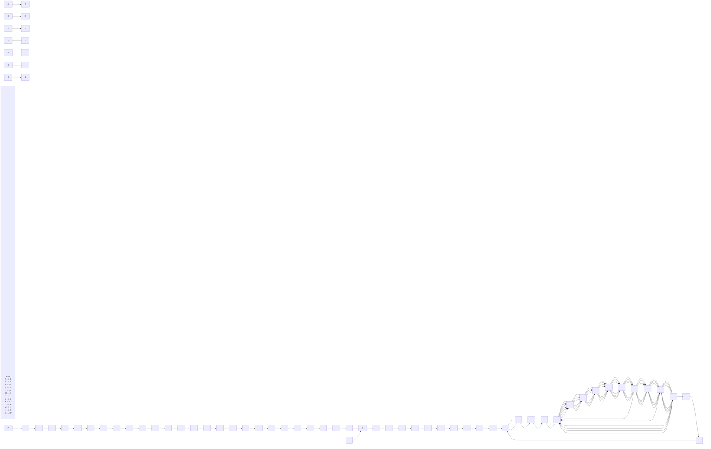
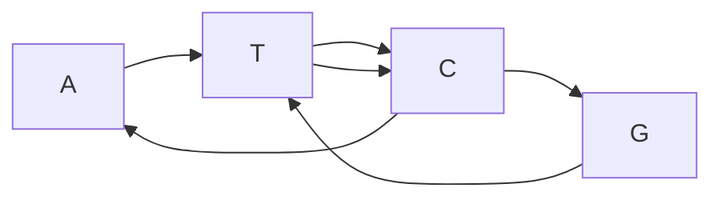
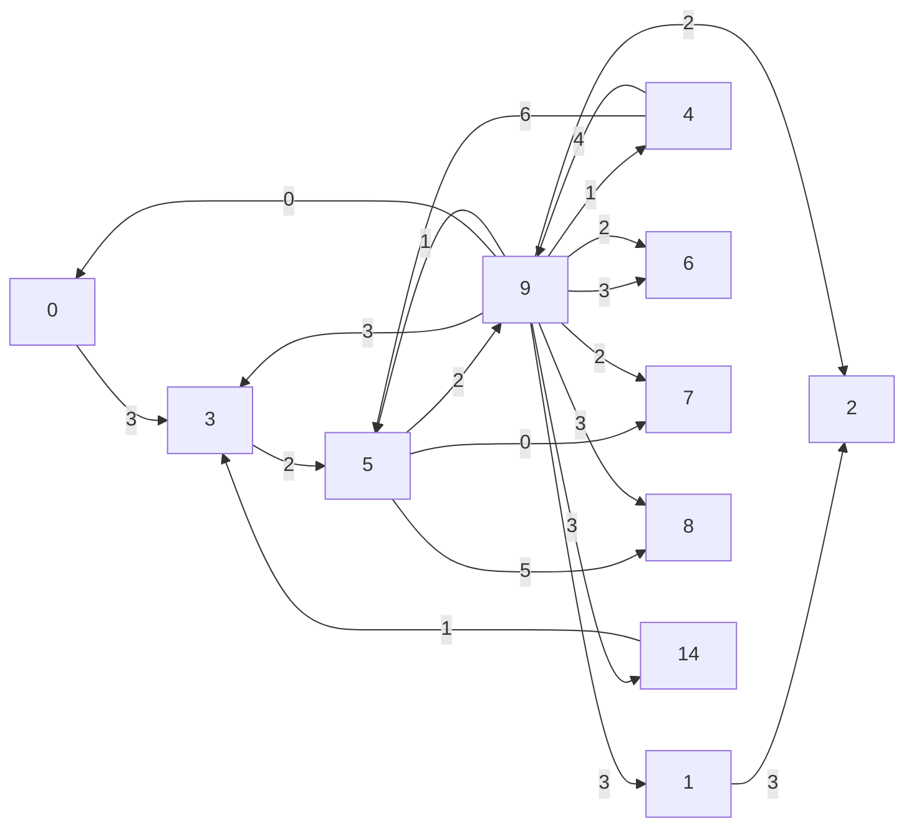

Applying a brute force approach to the Manhattan Tourist Problem is impractical because the number of paths is huge. A sensible greedy approach would choose between the two possible directions at each node (! or #) according to how many attractions you would see if you moved only one block south versus moving one block east. For example, in Figure 5.3 (right), we start off by moving east from (0, 0) rather than south because the horizontal edge has three attractions, while the vertical edge has only one. Unfortunately, this greedy strategy may miss the longest path in the long run. Figure 5.3 (right).

**STOP and Think:** Find a longer path than the one in Figure 5.3 (right).

Sightseeing in an arbitrary directed graph

In reality, the streets in Midtown Manhattan do not form a perfect rectangular grid because Broadway Avenue cuts diagonally across the grid, but the network of streets can still be represented by a directed graph. In fact, the Manhattan Tourist Problem is just a special case of the more general problem of finding the longest path in an arbitrary directed graph, such as the ones in Figure 5.4.

## Longest Path in a Directed Graph Problem:

Find a longest path between two nodes in an edge-weighted directed graph.

**Input**: An edge-weighted directed graph with source and sink nodes.

**Output**: A longest path from source to sink in the directed graph.


**STOP and Think:** What is the length of a longest path between the source and sink in the directed graph shown in Figure 5.4 (right)?

If a directed graph contained a directed cycle (e.g., the four central edges of weight 1 in Figure 5.4 (right)), then a tourist could traverse this cycle indefinitely, revisiting the same attractions over and over again and creating a path of huge length. For this reason, the graphs that we will consider in this chapter do not contain directed cycles; such graphs are called **directed acyclic graphs (DAGs)**.


FIGURE 5.4 Directed graphs corresponding to hypothetical irregular city grids.

## Longest Path in a DAG Problem:

Find a longest path between two nodes in an edge-weighted DAG.

**Input**: An edge-weighted DAG with source and sink nodes.

**Output**: A longest path from source to sink in the DAG.

**STOP and Think:** Do you see any similarities between the Longest Path in a DAG Problem and the Longest Common Subsequence Problem?


## Sequence Alignment is the Manhattan Tourist Problem in Disguise

In Figure 5.5, we add two arrays of integers to an alignment of ATGTTATA and ATCGTCC. The array $[ 0   1   2   2   3   4   5   6   7   8 ]$ holds the number of symbols of ATGTTATA used up to a given column in the alignment. Similarly, the array [0 1 2 3 4 5 5 6 6 7] holds the number of symbols of ATCGTCC used up to a given column. In Figure 5.5, we have added a third array, $[ \searrow \searrow \to \searrow \searrow \downarrow \searrow \downarrow \searrow ]$ , recording whether each column represents a **match**/**mismatch** $( \searrow / \searrow )$ , an **insertion** (!), or a **deletion** (#).

This third array corresponds to a path from source to sink in an $8 \times 7$ rectangular grid, shown in Figure 5.6 (left). The i-th node of this path is made up of the i-th element of [0 1 2 2 3 4 5 6 7 8] and the i-th element of [0 1 2 3 4 5 5 6 6 7]:

$$
(0, 0) \searrow (1, 1) \searrow (2, 2) \rightarrow (2, 3) \searrow (3, 4) \searrow (4, 5) \downarrow (5, 5) \searrow (6, 6) \downarrow (7, 6) \searrow (8, 7)
$$


<details>
<summary>flowchart</summary>


</details>

FIGURE 5.5 An alignment of ATGTTATA and ATCGTCC. The array in the first row counts the number of symbols of ATGTTATA used up to a given position. The array in the fourth row counts the number of symbols of ATCGTCC used up to a given position. And the array in the last row records whether each column of the alignment represents a match/mismatch $( \searrow / \searrow )$ , insertion (!), or deletion (#).

Note that in addition to horizontal and vertical edges, we have added diagonal edges connecting $( i , j )$ to $( i + 1 , j + 1 )$ in Figure 5.6.


FIGURE 5.6 Every alignment corresponds to a path in the alignment graph from source to sink, and vice-versa. (Left) The path $( 0 ,   0 ) \searrow ( 1 ,   1 ) \searrow ( 2 ,   2 ) \rightarrow ( 2 ,   3 ) \searrow ( 3 ,$ 4) $\searrow (4,   5) \downarrow (5,   5) \searrow (6,   6) \downarrow (7,   6) \searrow (8,   1$ 7) is highlighted above and corresponds to the alignment of ATGTTATA and ATCGTCC in Figure 5.5. (Right) Another path in the alignment graph.

We call the DAG in Figure 5.6 the **alignment graph** of strings v and $w ,$ denoted ALIGNMENTGRAPH $( v , w )$ , and we call a path from source to sink in this DAG an align**ment path**. Every alignment of v and w can be viewed as a set of instructions to construct a unique alignment path in ALIGNMENTGRAPH $( v , w )$ , where each match/mismatch, **insertion**, and **deletion** corresponds to an edge $\searrow / \searrow , \rightarrow$ , and $\downarrow ,$ respectively. Furthermore, this process is reversible, as we can convert each alignment path into a unique alignment.

**EXERCISE BREAK:** Construct the alignment of ATGTTATA and ATCGTCC corresponding to the alignment path in Figure 5.6 (right).

**STOP and Think:** Can you use the alignment graph to find a longest common subsequence of two strings?

Recall that finding a longest common subsequence of two strings is equivalent to finding an alignment of these strings maximizing the number of matches. In Figure 5.7, we high light all diagonal edges of ALIGNMENTGRAPH(ATGTTATA, ATCGTCC) corresponding to matches. If we assign a weight of 1 to all these edges and 0 to all other edges, then the Longest Common Subsequence Problem is equivalent to finding a longest path in this weighted DAG!


<details>
<summary>flowchart</summary>


</details>

FIGURE 5.7 ALIGNMENTGRAPH(ATGTTATA, ATCGTCC) with all edges of weight 1 colored red (all other edges have weight 0). These edges correspond to potential matched symbols in an alignment of the two strings.

Thus, we need to design an algorithm for the Longest Path in a DAG Problem, but to do so, we need to know more about **dynamic programming**, a powerful algorithmic paradigm that is used for solving thousands of problems from various scientific fields.


If you are already familiar with dynamic programming, then you may want to skip the next section.

## An Introduction to Dynamic Programming: The Change Problem

## Changing money greedily

Imagine that you bought this textbook in a bookstore for \$69.24, which you paid for with \$70 in cash. You are due 76 cents in change, and the cashier now must make a decision whether to give you a fistful of 76 1-cent coins or just four coins $( 2 5 + 2 5 + 2 5 + 1 = 7 6 )$ Making change in this example is easy, but it casts light on a more general problem: how can a cashier make change using the fewest number of coins?

Different currencies have different possible coin values, or **denominations**. In the United States, the coin denominations are (100, 50, 25, 10, 5, 1); in the Roman Republic, they were (120, 40, 30, 24, 20, 10, 5, 4, 1). The heuristic used by cashiers all over the world to make change, which we call **GREEDYCHANGE**, iteratively selects the largest coin denomination possible.

```txt
GREEDYCHANGE(money)
    Change ← empty collection of coins
    while money > 0
        coin ← largest denomination that is less than or equal to money
        add a coin with denomination coin to the collection of coins Change
        money ← money – coin
    return Change
```


**STOP and Think:** Does **GREEDYCHANGE** always return the minimum possible number of coins?

Say we want to change 48 units of currency (denarii) in ancient Rome. **GREEDYCHANGE** returns five coins $( 4 8 = 4 0 + 5 + 1 + 1 + 1 )$ , and yet we can make change using only two coins (48 = 24 + 24). Thus, **GREEDYCHANGE** is suboptimal for some denominations!


**STOP and Think:** During the reign of Augustus, Roman coin denominations were changed to (1600, 800, 400, 200, 100, 50, 25, 2, 1). Why did these denominations make Roman cashiers’ lives easier? More generally, find a condition on coin denominations that dictates when **GREEDYCHANGE** will make change with the fewest number of coins.

Since **GREEDYCHANGE** is incorrect, we need to come up with a different approach. We can represent coins from d arbitrary denominations by an array of integers

$$
\mathrm{COINS} = \left(\text {coin} _ {1}, \dots , \text {coin} _ {d}\right),
$$

where the values $c o i n _ { i }$ are given in decreasing order. We say that an array of d positive integers $( c h a n g e _ { 1 } ,   \cdots ,   c h a n g e _ { d } )$ with the **number of coins** $change_{1} + \cdots + change_{d}$ **changes** an integer money (for the denominations COINS) if

$$
c o i n _ {1} \cdot c h a n g e _ {1} + \dots + c o i n _ {d} \cdot c h a n g e _ {d} = m o n e y.
$$

For example, for the Roman denominations $\mathrm{COINS} = \begin{pmatrix} 120,40,30,24,20,10,5,4,1 \end{pmatrix}$ , both $\left( 0 , 1 , 0 , 0 , 0 , 0 , 0 , 1 , 0 , 3 \right)$ and $\left( 0 , 0 , 0 , 2 , 0 , 0 , 0 , 0 , 0 \right)$ change money = 48.

We will consider the problem of finding the minimum number of coins needed to make change, instead of actually producing these coins. Let MINNUMCOINS(money) denote the minimum number of coins needed to change money for a given collection of denominations $( \mathbf { e . g . } ,$ for the Roman denominations, MINNUMCOINS(48) = 2).

## Change Problem:

Find the minimum number of coins needed to make change.

**Input**: An integer money and an array COINS of d positive integers.

**Output**: The minimum number of coins with denominations COINS that changes money.

## Changing money recursively

Since the greedy solution used by Roman cashiers to solve the Change Problem is incorrect, we will consider a different approach. Suppose you need to change 76 denarii, and you only have coins of the three smallest denominations: $\scriptstyle \mathrm { C O I N S }   =   { \big ( } 5 , 4 , 1 { \big ) }$ . A minimal collection of coins totaling 76 denarii must be one of the following:

• a minimal collection of coins totaling 75 denarii, plus a 1-denarius coin;
• a minimal collection of coins totaling 72 denarii, plus a 4-denarius coin;
• a minimal collection of coins totaling 71 denarii, plus a 5-denarius coin.

For the general denominations $\mathbb { C O I N S } = ( c o i n _ { 1 } , \cdots , c o i n _ { d } )$ , MINNUMCOINS(money) is equal to the minimum of d numbers:

$$
\text {MINNUMCOINS} (m o n e y) = \min \left\{ \begin{array}{c} \text {MINNUMCOINS} (m o n e y - c o i n _ {1}) + 1 \\ \vdots \\ \text {MINNUMCOINS} (m o n e y - c o i n _ {d}) + 1 \end{array} \right.
$$

We have just produced a **recurrence relation**, or an equation for MINNUMCOINS(money) in terms of MINNUMCOINS(m) for smaller values m. The above recurrence relation motivates the following recursive algorithm, which solves the Change Problem by computing MINNUMCOINS(m) for smaller and smaller values of m. In this algorithm, |COINS| refers to the number of denominations in COINS. See **DETOUR: The Towers of Hanoi** if you did not encounter recursive algorithms in Chapter 1.

```python
RECURSIVECHANGE(money, COINS)
    if money = 0
        return 0
    minNumCoins ← ∞
    for i ← 1 to |COINS|
        if money ≥ coin_i
            numCoins ← RECURSIVECHANGE(money - coin_i, COINS)
            if numCoins + 1 < minNumCoins
                minNumCoins ← numCoins + 1
    return minNumCoins
```


**STOP and Think:** Implement **RECURSIVECHANGE** and run it on money = 76 with $COINS = ( 5,4,1 )$ . What happens?

**RECURSIVECHANGE** may appear efficient, but it is completely impractical because it recalculates the optimal coin combination for a given value of money over and over again. For example, when money = 76 and $COINS = \begin{pmatrix} 5,4,1 \end{pmatrix}$ , MINNUMCOINS(70) gets computed six times, five of which are shown in Figure 5.8. This may not seem like a problem, but MINNUMCOINS(30) will be computed billions of times!


<details>
<summary>funnel</summary>

| Level | Value |
| --- | --- |
| Top | 76 |
| Second | 72 |
| Third | 75 |
| Fourth | 70 |
| Fifth | 70 |
| Sixth | 71 |
| Seventh | 73 |
| Bottom Left | 66 |
| Bottom Middle | 67 |
| Bottom Right | 68 |
| Bottom Far Right | 70 |
| Bottom Far Left | 69 |
| Bottom Far Left | 65 |
| Bottom Far Left | 66 |
| Bottom Far Left | 69 |
| Bottom Center | 62 |
| Bottom Center | 63 |
| Bottom Center | 66 |
| Bottom Center | 64 |
| Bottom Center | 67 |
| Bottom Center | 66 |
| Bottom Center | 67 |
| Bottom Center | 70 |
| Bottom Center | 65 |
| Bottom Center | 66 |
| Bottom Center | 69 |
| Bottom Center | 66 |
| Bottom Center | 67 |
| Bottom Center | 70 |
| Bottom Right | 74 |
| Bottom Right | 70 |
| Bottom Right | 73 |
</details>

FIGURE 5.8 A tree illustrating the computation of MINNUMCOINS(76) for the denominations $\mathsf { C O I N S } = ( 5 , 4 , 1 )$ . The edges of this tree represent recursive calls of RECURSIVECHANGE for different input values, with five of the six computations of MINNUMCOINS(70) highlighted in red. When MINNUMCOINS(70) is computed for the sixth time (corresponding to the path $7 6 \rightarrow 7 5 \rightarrow 7 4 \rightarrow 7 3 \rightarrow 7 2 \rightarrow 7 1 \rightarrow 7 0 )$ RECURSIVECHANGE has already been called hundreds of times.

## Changing money using dynamic programming

To avoid the many recursive calls needed to compute MINNUMCOINS(money), we will use a dynamic programming strategy. Wouldn’t it be nice to know all the values of MINNUMCOINS(money  coin<sub>i</sub>) by the time we compute MINNUMCOINS(money)? Instead of making time-consuming calls to **RECURSIVECHANGE**(money  coin<sub>i</sub>, COINS), we could simply look up the values of MINNUMCOINS(money  coin<sub>i</sub>) in an array and thus compute MINNUMCOINS(money) using just |COINS| comparisons.

The key to dynamic programming is to take a step that may seem counterintuitive. Instead of computing MINNUMCOINS(m) for every value of m from 76 downward toward $m   =   1$ via recursive calls, we will invert our thinking and compute MINNUMCOINS(m) from $m = 1$ upward toward $7 6 ,$ storing all these values in an array so that we only need to compute MINNUMCOINS(m) once for each value of m. MINNUMCOINS(m) is still computed via the same recurrence relation:

$$
\operatorname{MinNumCoins} (m) = \min \left\{ \begin{array}{l} \operatorname{MinNumCoins} (m - 5) + 1 \\ \operatorname{MinNumCoins} (m - 4) + 1 \\ \operatorname{MinNumCoins} (m - 1) + 1 \end{array} \right.
$$

For example, assuming that we have already computed MINNUMCOINS(m) for $m < 6 ,$

$$
\begin{array}{l} \text {MINNumCoins} (6) = \min \left\{ \begin{array}{l} \text {MINNumCoins} (1) + 1 = 2 \\ \text {MINNumCoins} (2) + 1 = 3 \\ \text {MINNumCoins} (5) + 1 = 2 \end{array} \right. \\ = 2. \\ \end{array}
$$

Following the same reasoning,

$$
\text {MINNUMCOINS} (7) = \min \left\{ \begin{array}{l} \text {MINNUMCOINS} (2) + 1 = 3 \\ \text {MINNUMCOINS} (3) + 1 = 4 \\ \text {MINNUMCOINS} (6) + 1 = 3 \end{array} \right.
$$

$$
= 3.
$$

Continuing these calculations results in Figure 5.9.

$$
\begin{array}{c c c c c c c c c c c c c c c} \boldsymbol {m} & 0 & 1 & 2 & 3 & 4 & 5 & 6 & 7 & 8 & 9 & 1 0 & 1 1 & 1 2 \\ \text {MINNumCoins} (\boldsymbol {m}) & 0 & 1 & 2 & 3 & 1 & 1 & 2 & 3 & 2 & 2 & 2 & 3 & 3 \end{array}
$$

FIGURE 5.9 MINNUMCOINS(m) for values of m between 1 and 12.


**EXERCISE BREAK:** Use dynamic programming to fill in the next ten values of MINNUMCOINS(m) in Figure 5.9.

Notice that MINNUMCOINS(2) is used in the computation of both MINNUMCOINS(6) and MINNUMCOINS(7), but instead of draining computational resources by having to compute this value both times, we simply consult the pre-computed value in the array. The following dynamic programming algorithm calculates MINNUMCOINS(money) with runtime O(money · |COINS|).


$$
\begin{array}{l} \text {DPCHANGE(money, COINS)} \\ \text {MINNUMCOINS(0)} \leftarrow 0 \\ \text {for m} \leftarrow 1 \text {to money} \\ \text {MINNUMCOINS(m)} \leftarrow \infty \\ \text {for i} \leftarrow 1 \text {to |COINS|} \\ \text {if m} \geq \text {coin}_ {i} \\ \text {if MINNUMCOINS(m - coin_ {i}) + 1 <   MINNUMCOINS(m)} \\ \text {MINNUMCOINS(m)} \leftarrow \text {MINNUMCOINS(m - coin_ {i}) + 1} \\ \text {return MINNUMCOINS(money)} \end{array}
$$

**STOP and Think:** If money = 10<sup>9</sup>, **DPCHANGE** requires a huge array of size $1 0 ^ { 9 }$ . Modify the **DPCHANGE** algorithm so that the array size required does not exceed the value of the largest coin denomination.

**STOP and Think:** Recall that our original goal was to make change, not just compute MINNUMCOINS(money). Modify **DPCHANGE** so that it not only computes the minimum number of coins but also returns these coins.

## The Manhattan Tourist Problem Revisited

You should now be ready to implement an algorithm solving the Manhattan Tourist Problem. The following pseudocode computes the length of the longest path to node $( i , j )$ in a rectangular grid and is based on the observation that the only way to reach node $( i , j )$ in the Manhattan Tourist Problem is either by moving south (#) from (i  1, j) or east (!) from (i, j  1).

```python
SOUTHOREAST(i, j)
    if i = 0 and j = 0
        return 0
    x ← -∞, y ← -∞
    if i > 0
        x ← SOUTHOREAST(i - 1, j) + weight of vertical edge into (i, j)
    if j > 0
        y ← SOUTHOREAST(i, j - 1) + weight of horizontal edge into (i, j)
    return max{x, y}
```

**STOP and Think:** How many times is **SOUTHOREAST**(3, 2) called in the computation of **SOUTHOREAST**(9, 7)?

Similarly to **RECURSIVECHANGE**, **SOUTHOREAST** suffers from a huge number of recursive calls, and we need to reframe this algorithm using dynamic programming. Remember how **DPCHANGE** worked from small instances upward? To find the length of a longest path from source $( 0 , 0 )$ to sink $( n , m )$ , we will first find the lengths of longest paths from the source to all nodes $( i , j )$ in the grid, expanding slowly outward from the source.

At first glance, you may think that we have created additional work for ourselves by solving $n \times m$ different problems instead of a single problem. Yet **SOUTHOREAST** also solves all these smaller problems, just as **RECURSIVECHANGE** and **DPCHANGE** both computed MINNUMCOINS(m) for all values of $m < m o n e y$ . The trick behind dynamic programming is to solve each of the smaller problems once rather than billions of times.

We will henceforth denote the length of a longest path from (0, 0) to $( i , j )$ as $s _ { i , j } .$ Computing $s _ { 0 , j }$ (for $0 \leq j \leq m )$ is easy, since we can only reach $( 0 , j )$ by moving right (!) and do not have any flexibility in our choice of path. Thus, $s _ { 0 , j }$ is the sum of the weights of the first j horizontal edges leading out from the source. Similarly, $s _ { i , 0 }$ is the sum of the weights of the first i vertical edges from the source (Figure 5.10).


<details>
<summary>flowchart</summary>


</details>

FIGURE 5.10 Computing $s _ { i ,   0 }$ and $s _ { 0 , j }$ is easy because there is only one path from the source to (i, 0) and only one path from the source to $( 0 , j )$

For $i > 0$ and $j > 0 ,$ , the only way to reach node $( i , j )$ is by moving down from node $( i - 1 , j )$ or by moving right from node $( i , j - 1 )$ . Thus, $s _ { i , j }$ can be computed as the maximum of two values:

$$
s _ {i, j} = \max \left\{ \begin{array}{l} s _ {i - 1, j} + \text {weight of vertical edge from} (i - 1, j) \text {to} (i, j) \\ s _ {i, j - 1} + \text {weight of horizontal edge from} (i, j - 1) \text {to} (i, j) \end{array} \right.
$$

Now that we have computed $s _ { 0 , 1 }$ and $s _ { 1 , 0 } ,$ , we can compute $s _ { 1 , 1 }$ . You can arrive at (1, 1) by traveling down from (0, 1) or right from $( 1 , 0 )$ . Therefore, $s _ { 1 , 1 }$ is the maximum of two values:

$$
s _ {1, 1} = \max \left\{ \begin{array}{l} s _ {0, 1} + \text {weight of vertical edge from (0, 1) to (1, 1)} = 3 + 0 = 3 \\ s _ {1, 0} + \text {weight of horizontal edge from (1, 0) to (1, 1)} = 1 + 3 = 4 \end{array} \right.
$$

Since our goal is to find the longest path from (0, 0) to (1, 1), we conclude that $s _ { 1 , 1 } = 4$ Because we chose the horizontal edge from (1, 0) to (1, 1), the longest path through $( 1 , 1 )$ must use this edge, which we highlight in Figure 5.11 (top left). Similar logic allows us to compute the rest of the values in column 1; for each $s _ { i , 1 } .$ , we highlight the edge that we chose leading into (i, 1), as shown in Figure 5.11 (top right).

Continuing column-by-column (Figure 5.11 (bottom left)), we can compute every score $s _ { i , j }$ in a single sweep of the graph, eventually calculating $s _ { 4 , 4 } = 3 4$

For each node $( i , j )$ , we will highlight the edge leading into $( i , j )$ that we used to compute $s _ { i , j }$ . However, note that we have a tie when we compute s<sub>3</sub>, 3 :

$$
s _ {3, 3} = \max \left\{ \begin{array}{l} s _ {2, 3} + \text {weight of vertical edge from (2, 3) to (3, 3)} = 2 0 + 2 = 2 2 \\ s _ {3, 2} + \text {weight of horizontal edge from (3, 2) to (3, 3)} = 2 2 + 0 = 2 2 \end{array} \right.
$$

To reach $( 3 , 3 )$ , we could have used either the horizontal or vertical incoming edge, and so we highlight both of these edges in the completed graph in Figure 5.11 (bottom left).

**STOP and Think:** Thus far, we have only discussed how to find the length of a longest path. How could you use the highlighted edges in Figure 5.11 (bottom left) to reconstruct a longest path?

We now have the outline of a dynamic programming algorithm for finding the length of a longest path in the Manhattan Tourist Problem, called **MANHATTANTOURIST**. In the pseudocode below, $d o w n _ { i , j }$ and $r i g h t _ { i , j }$ are the respective weights of the vertical and horizontal edges entering node $( i , j )$ . We denote the matrices holding $( d o w n _ { i , j } )$ and $( r i g h t _ { i ,   j } )$ as Down and Right, respectively.

**EXERCISE BREAK:** Modify **MANHATTANTOURIST** in order to find the length of the longest path from source to sink in the graph shown in Figure 5.11 (bottom right).


FIGURE 5.11 (Top left) Computing $s _ { 1 , 1 }$ uses the horizontal edge from (1, 0), which is highlighted. (Top right) Computing all values $s _ { i , \; 1 }$ in column 1. (Bottom left) The graph displaying all scores $s _ { i , j } .$ (Bottom right) A graph with diagonal edges constructed for an imaginary city. Node (1, 1) has three predecessors ((0, 0), (0, 1), and (1, 0)) that are used in the computation of $s _ { 1 , 1 }$

<div class="docvortex-algorithm" style="white-space: pre-wrap; font-family:monospace;">
MANHATTAN TOURIST(n, m, Down, Right)
    $s_{0,0} \leftarrow 0$
    for $i \leftarrow 1$ to $n$
        $s_{i,0} \leftarrow s_{i-1,0} + down_{i,0}$
    for $j \leftarrow 1$ to $m$
        $s_{0,j} \leftarrow s_{0,j-1} + right_{0,j}$
    for $i \leftarrow 1$ to $n$
        for $j \leftarrow 1$ to $m$
            $s_{i,j} \leftarrow \max\{s_{i-1,j} + down_{i,j}, s_{i,j-1} + right_{i,j}\}$
    return $s_{n,m}$
</div>

## From Manhattan to an Arbitrary Directed Acyclic Graph

Sequence alignment as building a Manhattan-like graph

After seeing how dynamic programming solved the Manhattan Tourist Problem, you should be prepared to adapt **MANHATTANTOURIST** for alignment graphs with diagonal edges. Recall Figure 5.7, in which we modeled the Longest Common Subsequence Problem as finding the longest path in an alignment graph “city” whose “attractions”’ (matches) all lie on diagonal edges with weight 1.

You can probably work out the recurrence relation for the alignment graph on your own, but imagine for a second that you have not already learned that an LCS can be represented by a longest path in the alignment graph. As **DETOUR: Finding a Longest Common Subsequence without Building a City** explains, we don’t need to build a Manhattan-like city to compute the length of an LCS. However, the arguments required to do so are tedious. More importantly, various alignment applications are much more complex than the Longest Common Subsequence Problem and require building a DAG with appropriately chosen edge weights in order to model the specifics of a biological problem. Rather than treating each subsequent alignment application as a frightening new challenge, we would like to equip you with a generic dynamic programming algorithm that will find a longest path in any DAG. Moreover, many bioinformatics problems have nothing to do with alignment, yet they can also be solved as applications of the Longest Path in a DAG Problem.


Dynamic programming in an arbitrary DAG

Given a node b in a $\mathrm { D A G } ,$ let $s _ { b }$ denote the length of a longest path from the source to b. We call node a a **predecessor** of node b if there is an edge connecting a to b in the $\mathrm { D A G } ;$ note that the indegree of a node is equal to the number of its predecessors. The **score** $s _ { b }$ of node b with indegree k is computed as a maximum of k terms:

$$
s _ {b} = \max _ {\text { all   predecessors   } a \text {   of   node   } b} \{s _ {a} + \text { weight   of   edge   from   } a \text {   to   } b \}.
$$

For example, in the graph shown in Figure 5.11 (bottom right), node (1, 1) has three predecessors. You can arrive at $( 1 , 1 )$ by traveling right from (1, 0), down from $( 0 , 1 )$ , or diagonally from $( 0 , 0 )$ , Assuming that we have already computed $s _ { 0 ,   0 } ,   s _ { 0 ,   1 } ,$ , and $s _ { 1 , 0 } ,$ we can therefore compute $s _ { 1 , 1 }$ as the maximum of three values:

$$
s _ {1, 1} = \max \left\{\begin{array}{l}s _ {0, 1} + \text {weight of edge} \quad \downarrow \quad \text {connecting (0,1) to (1,1) = 3 + 0 = 3}\\s _ {1, 0} + \text {weight of edge} \rightarrow \text {connecting (1,0) to (1,1) = 1 + 3 = 4}\\s _ {0, 0} + \text {weight of edge} \searrow \text {connecting (0,0) to (1,1) = 0 + 5 = 5}\end{array}\right.
$$

To compute scores for any node $( i , j )$ of this graph, we use the following recurrence:

$$
s _ {i, j} = \max \left\{\begin{array}{l}s _ {i - 1, j} \quad + \text {weight of edge} \quad \downarrow \text {between} (i - 1, j) \text {and} (i, j)\\s _ {i, j - 1} \quad + \text {weight of edge} \quad \rightarrow \text {between} (i, j - 1) \text {and} (i, j)\\s _ {i - 1, j - 1} + \text {weight of edge} \quad \searrow \text {between} (i - 1, j - 1) \text {and} (i, j)\end{array}\right.
$$

An analogous argument can be applied to the alignment graph to compute the length of an LCS between sequences v and $w .$ Since in this case all edges have weight 0 except for diagonal edges of weight 1 that represent matches $( v _ { i } = w _ { j } )$ , we obtain the following recurrence for computing the length of an LCS:

$$
s _ {i, j} = \max \left\{ \begin{array}{l l} s _ {i - 1, j} & + 0 \\ s _ {i, j - 1} & + 0 \\ s _ {i - 1, j - 1} + 1, & \text {if} v _ {i} = w _ {j} \end{array} \right.
$$


**STOP and Think:** The above recurrence does not incorporate mismatch edges. Why is this not a problem?

A similar approach can be developed to find the longest path in any $\mathrm { D A G } ,$ as suggested by the next exercise.

**EXERCISE BREAK:** What is the length of a longest path between the blue and red nodes in the DAG shown in Figure 5.12?

```mermaid
graph TD
  A["Node 1"] -->|2| B["Node 2"]
  C["Node 3"] -->|5| A
  D["Node 4"] -->|1| B
  E["Node 5"] -->|3| A
  F["Node 6"] -->|1| B
  G["Node 7"] -->|3| B
  H["Node 8"] -->|2| B
  I["Node 9"] -->|3| B
  J["Node 10"] -->|2| B
  K["Node 11"] -->|2| B
  L["Node 12"] -->|2| B
  M["Node 13"] -->|2| B
  N["Node 14"] -->|2| B
  O["Node 15"] -->|2| B
  P["Node 16"] -->|2| B
  Q["Node 17"] -->|2| B
  R["Node 18"] -->|2| B
  S["Node 19"] -->|2| B
  T["Node 20"] -->|2| B
  U["Node 21"] -->|2| B
  V["Node 22"] -->|2| B
  W["Node 23"] -->|2| B
  X["Node 24"] -->|2| B
  Y["Node 25"] -->|2| B
  Z["Node 26"] -->|2| B
  AA["Node 27"] -->|2| B
  AB["Node 28"] -->|2| B
  AC["Node 29"] -->|2| B
  AD["Node 30"] -->|2| B
  AE["Node 31"] -->|2| B
  AF["Node 32"] -->|2| B
  AG["Node 33"] -->|2| B
  AH["Node 34"] -->|2| B
  AI["Node 35"] -->|2| B
  AJ["Node 36"] -->|2| B
  AK["Node 37"] -->|2| B
  AL["Node 38"] -->|2| B
  AM["Node 39"] -->|2| B
  AN["Node 40"] -->|2| B
  AO["Node 41"] -->|2| B
  AP["Node 42"] -->|2| B
  AQ["Node 43"] -->|2| B
  AR["Node 44"] -->|2| B
  AS["Node 45"] -->|2| B
  AT["Node 46"] -->|2| B
  AU["Node 47"] -->|2| B
  AV["Node 48"] -->|2| B
  AW["Node 49"] -->|2| B
  AX["Node 50"] -->|2| B
  A --> C
  A --> D
  A --> E
  A --> F
  A --> G
  A --> H
  A --> I
  A --> J
  A --> K
  A --> L
  A --> M
  A --> N
  A --> O
  A --> P
  A --> Q
  A --> R
  A --> S
  A --> T
  A --> U
  A --> V
  A --> W
  A --> X
  A --> Y
  A --> Z
```


<details>
<summary>flowchart</summary>


</details>

FIGURE 5.12 A weighted DAG without the obvious order inherent in the graphs previously encountered in this chapter.

## Topological orderings

Do not worry if you struggled to solve the last exercise. The hitch to using dynamic programming in order to find the length of a longest path in a DAG is that we must decide on the order in which to visit nodes when computing the values $s _ { b }$ according to the recurrence

$$
s _ {b} = \max _ {\text { all   predecessors   } a \text {   of   node   } b} \{s _ {a} + \text { weight   of   edge   from   } a \text {   to   } b \}.
$$

This ordering of nodes is important, since by the time we reach node b, the values $s _ { a }$ for all its predecessors must have already been computed. We have managed to hide this issue for rectangular grids because the order in which we have computed the $s _ { i , j }$ ensured that we would never consider a node before visiting all of its predecessors.

To illustrate the importance of visiting nodes in the correct order, consider the DAG in Figure 5.13, which corresponds to a “Dressing Challenge Problem”. How would you order the nodes of this graph so that you don’t put on your boots before your tights?