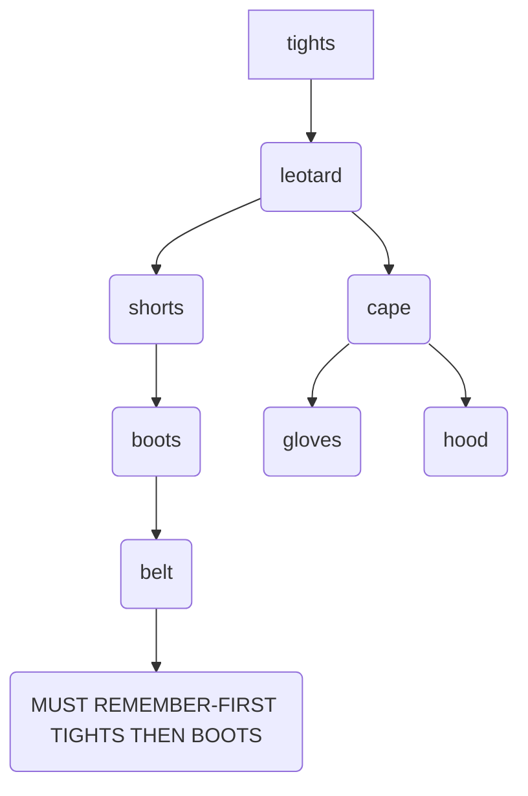
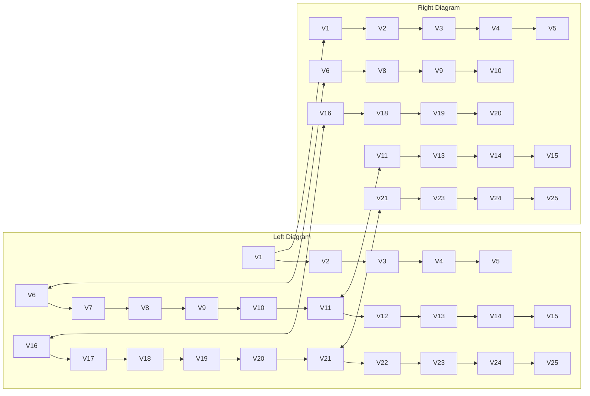
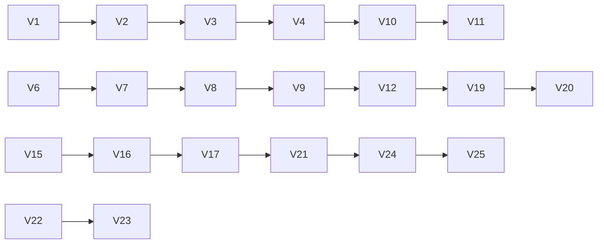
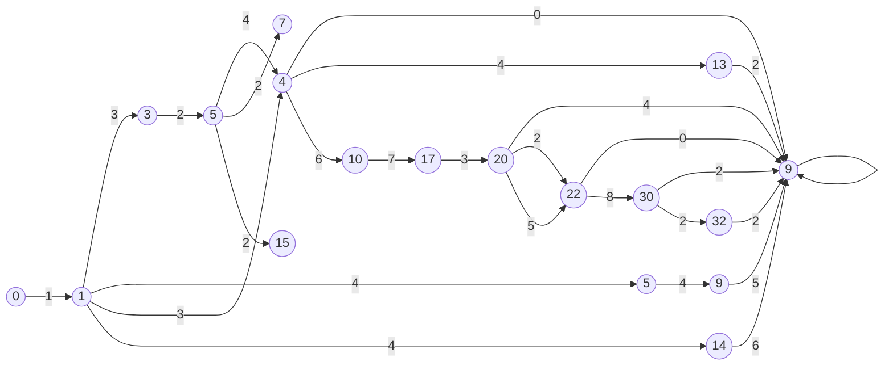
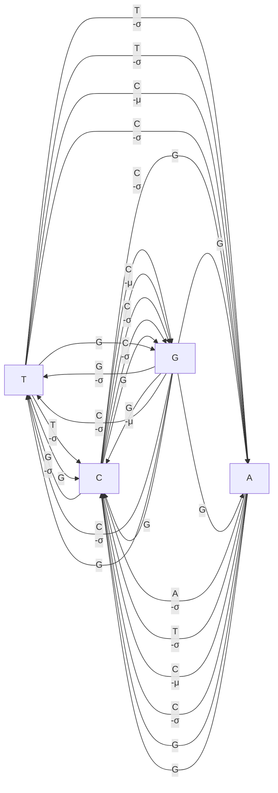
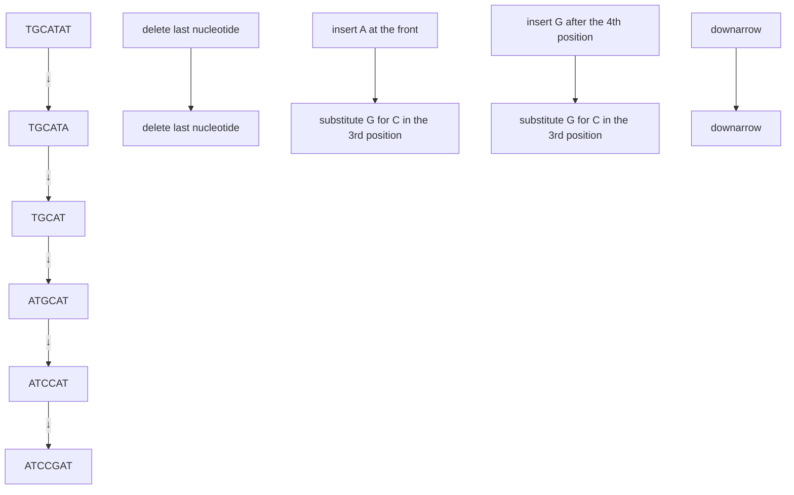
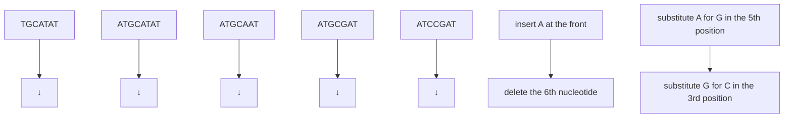

<details>
<summary>flowchart</summary>


</details>

FIGURE 5.13 The DAG associated with the Dressing Challenge Problem. If a directed edge connects two items of clothing, then the first item must be put on before the second item.

To solve the Dressing Challenge Problem, we need to arrange the nodes in the DAG in Figure 5.13 along a line so that every directed edge connects a node to a node on its right (Figure 5.14). To get dressed without any mishaps, you can simply visit nodes from left to right.

To find a longest path in an arbitrary DAG, we first need to order the nodes of the DAG so that every node falls after all its predecessors. Formally, an ordering of nodes $\left( a _ { 1 } , \cdots , a _ { k } \right)$ in a DAG is called a **topological ordering** if every edge $\left( a _ { i } , a _ { j } \right)$ of the DAG connects a node with a smaller index to a node with a larger index, $\mathrm { i . e . } , i < j$

**EXERCISE BREAK:** Construct a topological ordering of the DAG in Figure 5.12.

**EXERCISE BREAK:** How many topological orderings does the Dressing Challenge DAG have?

The reason why **MANHATTANTOURIST** is able to find a longest path in a rectangular grid is that its pseudocode implicitly orders nodes according to the “column-by-column” topological ordering shown in Figure 5.15 (left). The “row-by-row” ordering (Figure 5.15 (right)) gives another topological ordering of a rectangular grid.


<details>
<summary>flowchart</summary>

This diagram illustrates the classification of various body parts (such as tights, leotard, boots, and gloves) into two distinct groups based on their relative positioning.
</details>

FIGURE 5.14 Two different topological orderings of the Dressing Challenge DAG from Figure 5.13.


<details>
<summary>flowchart</summary>


</details>

FIGURE 5.15 The column-by-column (left) and row-by-row (right) topological orderings of a rectangular grid.

**STOP and Think:** Rewrite the **MANHATTANTOURIST** pseudocode based on the topological ordering shown in Figure 5.16.


<details>
<summary>flowchart</summary>


</details>

FIGURE 5.16 Another topological ordering of the rectangular grid from Figure 5.15.

It can be proven that any DAG has a topological ordering, and that this topological ordering can be constructed in time proportional to the number of edges in the graph (see **DETOUR: Constructing a Topological Ordering**). Once we have a topological ordering, we can compute the length of the longest path from source to sink by visiting the nodes of the DAG in the order dictated by the topological ordering, which is achieved by the following algorithm. For simplicity, we assume that the source node is the only node with indegree 0 in Graph.

<div class="docvortex-algorithm" style="white-space: pre-wrap; font-family:monospace;">
LONGESTPATH(Graph, source, sink)
    for each node b in Graph
        $s_b \leftarrow -\infty$
    $s_{source} \leftarrow 0$
    topologically order Graph
    for each node b in Graph (following the topological order)
        $s_b \leftarrow \max_{\text{all predecessors a of node } b} \{s_a + \text{weight of edge from } a \text{ to } b\}$
    return $s_{sink}$
</div>

Since every edge participates in only a single recurrence, the runtime of **LONGESTPATH** is proportional to the number of edges in the DAG Graph.

We can now efficiently compute the length of a longest path in an arbitrary DAG, but we do not yet know how to convert **LONGESTPATH** into an algorithm that will construct this longest path. In the next section, we will use the Longest Common Subsequence Problem to explain how to construct a longest path in a DAG.

## Backtracking in the Alignment Graph

In Figure 5.11 (bottom left), we highlighted each edge selected by **MANHATTANTOURIST**. To form a longest path, we simply need to find a path from source to sink formed by highlighted edges (more than one such path may exist). However, if we were to walk from source to sink along the highlighted edges, we might reach a dead end, such as the node $( 1 , 2 )$ . In contrast, every path from the sink will bring us back to the source if we **backtrack** in the direction opposite to each highlighted edge (Figure 5.17).


<details>
<summary>flowchart</summary>


</details>

FIGURE 5.17 Following edges from the sink backwards to the source produces the red path in the DAG above, which highlights a longest path from the source to sink.

We can use this backtracking idea to construct an LCS of strings v and w. We know that if we assign a weight of 1 to the edges in ALIGNMENTGRAPH $( v , w )$ corresponding to matches and assign a weight of 0 to all other edges, then $s _ { | v | ,   | w | }$ gives the length of an LCS. The following algorithm maintains a record of which edge in ALIGNMENTGRAPH $( v , w )$ was used to compute each value $s _ { i , j }$ by utilizing backtrack**ing pointers**, which take one of the three values ${ \mathrm { ~  ~ { ~  ~ } ~ } } , { \mathrm { ~  ~ { ~  ~ } ~ } } , { \mathrm { ~ o r ~ \textquotedblleft ~ { ~  ~ } ~ } } \rangle$ . Backtracking pointers are stored in a matrix Backtrack.

**STOP and Think:** How does changing the order of the three $\text{" }  if  \text{" }$ statements in the **LCSBACKTRACK** pseudocode affect the computation of Backtrack?


<div class="docvortex-algorithm" style="white-space: pre-wrap; font-family:monospace;">
LCSBACKTRACK(v, w)
    for $i \leftarrow 0$ to $|v|$
        $s_{i,0} \leftarrow 0$
    for $j \leftarrow 0$ to $|w|$
        $s_{0,j} \leftarrow 0$
    for $i \leftarrow 1$ to $|v|$
        for $j \leftarrow 1$ to $|w|$

        $s_{i,j} \leftarrow \max \begin{cases} s_{i-1,j} \\ s_{i,j-1} \\ s_{i-1,j-1} + 1, \text{ if } v_i = w_j \end{cases}$

        if $s_{i,j} = s_{i-1,j}$
            $Backtrack_{i,j} \leftarrow '' \downarrow''$
    else if $s_{i,j} = s_{i,j-1}$
        $Backtrack_{i,j} \leftarrow '' \rightarrow''$
    else if $s_{i,j} = s_{i-1,j-1} + 1$ and $v_i = w_j$
        $Backtrack_{i,j} \leftarrow '' \searrow''$
return Backtrack
</div>

We now need to find a path from the source to the sink formed by the highlighted edges. The algorithm below solves the Longest Common Subsequence Problem by using the information in Backtrack. **OUTPUTLCS**(Backtrack, $v , i , j )$ outputs an LCS between the i-prefix of v and the j-prefix of w. The initial invocation that outputs an LCS of v and w is **OUTPUTLCS**(Backtrack, $v , | v | , | w | )$

```matlab
OUTPUTLCS(Backtrack, v, i, j)
    if i = 0 or j = 0
        return
    if Backtrack_{i,j} = ↓
        OUTPUTLCS(Backtrack, v, i - 1, j)
    else if Backtrack_{i,j} = →
        OUTPUTLCS(Backtrack, v, i, j - 1)
    else
        OUTPUTLCS(Backtrack, v, i - 1, j - 1)
        output v_i
```


**STOP and Think: OUTPUTLCS** is a recursive algorithm, but it is efficient. What makes it different from the inefficient recursive algorithms for making change and finding a longest path in a DAG?

The backtracking method can be generalized to construct a longest path in any DAG. Whenever we compute $s _ { b }$ as

$$
s _ {b} = \max _ {\text { all   predecessors   } a \text {   of   node   } b} \{s _ {a} + \text { weight   of   edge   from   } a \text {   to   } b \},
$$

we simply need to store a predecessor of b that was used in the computation of $s _ { b }$ so that we can backtrack later on. You are now ready to use backtracking to find the longest path in an arbitrary DAG.

**EXERCISE BREAK:** Currently, **OUTPUTLCS** finds a single LCS of two strings. Modify **OUTPUTLCS** (and **LCSBACKTRACK**) to find every LCS of two strings.

## Scoring Alignments

What is wrong with the LCS scoring model?

Recall Marahiel’s alignment of the A-domains coding for Asp and Orn, which had **19** + **10** matches:

Y**AFD**LGYTCMFPV**LL**G**GG**ELHIVQKETYTAPDEIAHY**IK**EHG**IT**YIKL**TP**SLFHTIVNTASFAFDANFESLRLIVLGGEKIIPIDVIAFRKMYGHTE-FINH**YG**P**TEA**TIGA -**AFD**VSAGDFARA**LL**T**GG**QLIVCPNEVKMDPASLYAI**IK**KYD**IT**IFEA**TP**ALVIPLMEYI-YEQKLDISQLQILIVGSDSCSMEDFKTLVSRFGSTIRIVNS**YG**V**TEA**CIDS

It is not difficult to construct an alignment having even more matches at the expense of introducing more indels. Yet the more indels we add, the less biologically relevant the alignment becomes, as it diverges further and further from the biologically correct alignment found by Marahiel. Below is the alignment with the maximum number of matches, representing an LCS of length $19+8+19=46.$ . This alignment is so long that we cannot fit it on a single line.

Y**AFD**L--G-YTCMFP--V**LL**-**GG**GELH**IV**---Q-K-E--T-YTAPDEIAHY**IK**--EHG**IT**YI---KL**TP**SL-FHT -**AFD**VSAGD----FARA-**LL**T**GG**-QL-**IV**CPNEVKMDPASLY-A---I---**IK**KYD--**IT**-IFEA--**TP**ALV--- IVNTASFAFDANFE-----S-LR-**LIV**LGG-----EKIIPIDVIAFRK-M---YGHTEFI---NH**YG**P**TEA**TIGA IPLMEYIY-----EQKLDISQLQI**LIV**-GSDSCSME-----D---F-KTLVSRFGST--IRIVNS**YG**V**TEA**CIDS


**STOP and Think:** If Marahiel had constructed this alignment, would he have been able to infer the eight amino acid-long signatures of the non-ribosomal code?

Below, we highlight the purple amino acids representing the non-ribosomal signatures. Although these signatures are grouped in eight conserved columns in Marahiel’s alignment from the beginning of the chapter, only five of these columns have “survived” in the LCS alignment above, making it impossible to infer the non-ribosomal signatures:

```css
YAFDL--G-YTCMFP--VLL-GGGELHIV---Q-K-E--T-YTAPDEIAHYIK--EHGITYI---KLTPSL-FHT-AFDVSAGD----FARA-LLTGG-QL-IVCPNEVKMDPASLY-A---I----IKKYD--IT-IFEA--TPALV---
```

```txt
IVNTASFAFDANFE-----S-LR-LIVLGG-----EKIIPIDVIAFRK-M---YGHTEFI---NHYGPTEATIGA
IPLMEYIY-----EQKLDISQLQILIV-GSDSCSME-----D---F-KTLVSRFGST--IRIVNSYGVTEACIDS
```

The frivolous matches hiding the real evolutionary scenario have appeared because nothing stopped us from introducing an excessive number of indels when building an LCS. Recalling our original alignment game in which we rewarded matched symbols, we need some way of penalizing indels and mismatches. First, let’s handle indels. Say that in addition to assigning matches a premium of +1, we assess each indel a penalty of - 4. The top-scoring alignment of the A-domains gets closer to the biologically correct alignment, with six of the columns corresponding to correctly aligned signatures.

```powershell
YAFDLGYTCMFP-VLL-GGGELHIV-QKETYTAPDEI-AHYIKEHGITYI-KLTPSLFHTIVNTASFAFDANFE-AFDVS-AGDFARALLTGG-QL-IVCPNEVKMDPASLYA-IIKKYDIT-IFEATPAL--VIPLME-YIYEQKLD
```

```txt
-S-LR-LIVLGGEKIIPIDVIAFRKM---YGHTE-FINHYGPTEATIGA
ISQLQILIV-GSDSC-SME--DFKTLVSRFGSTIRIVNSYGVTEACIDS
```

## Scoring matrices

To generalize the alignment scoring model, we still award +1 for matches, but we also penalize mismatches by some positive constant µ (the **mismatch penalty**) and indels by some positive constant s (the **indel penalty**). As a result, the **score** of an alignment is equal to

$$
\# \text {matches} - \mu \cdot \# \text {mismatches} - \sigma \cdot \# \text {indels}.
$$

For example, with the parameters $\mu   =   1$ and $\sigma   =   2 ,$ , the alignment below will be assigned a score of -4:


<details>
<summary>text_image</summary>

A T - G T T A T A
A T C G T - C - C
+1 +1 -2 +1 +1 -2 -1 -2 -1
</details>

Biologists have further refined this cost function to allow for the fact that some mutations may be more likely than others, which calls for mismatches and indel penalties that differ depending on the specific symbols involved. We will extend the k-letter alphabet to include the space symbol and then construct a $( k + 1 ) \times ( k + 1 )$ **scoring matrix** Score holding the score of aligning every pair of symbols. The scoring matrix for comparing DNA sequences $( k = 4 )$ when all mismatches are penalized by $\mu$ and all indels are penalized by $\sigma$ is shown below.

|  | A | C | G | T | - |
| --- | --- | --- | --- | --- | --- |
| A | +1 | -μ | -μ | -μ | -σ |
| C | -μ | +1 | -μ | -μ | -σ |
| G | -μ | -μ | +1 | -μ | -σ |
| T | -μ | -μ | -μ | +1 | -σ |
| - | -σ | -σ | -σ | -σ |  |

Although scoring matrices for DNA sequence comparison are usually defined only by the parameters $\mu$ and $\sigma ,$ scoring matrices for protein sequence comparison weight different mutations differently and become quite involved (see DETOUR: PAM Scor**ing Matrices**).


## From Global to Local Alignment

Global alignment

You should now be ready to modify the alignment graph to solve a generalized form of the alignment problem that takes a scoring matrix as input.

## Global Alignment Problem:

Find a highest-scoring alignment of two strings as defined by a scoring matrix.

**Input**: Two strings and a scoring matrix Score.

**Output**: An alignment of the strings whose alignment score (as defined by Score) is maximized among all possible alignments of the strings.


To solve the Global Alignment Problem, we still must find a longest path in the alignment graph after updating the edge weights to reflect the values in the scoring matrix (Figure 5.18). Recalling that deletions correspond to vertical edges (#), insertions correspond to horizontal edges (!), and matches/mismatches correspond to diagonal edges $( \searrow / \searrow )$ , we obtain the following recurrence for $s _ { i , j } ,$ the length of a longest path from (0, 0) to $( i , j )$ :

$$
s _ {i, j} = \max \left\{ \begin{array}{l l} s _ {i - 1, j} & + S c o r e (v _ {i}, -) \\ s _ {i, j - 1} & + S c o r e (-, w _ {j}) \\ s _ {i - 1, j - 1} & + S c o r e (v _ {i}, w _ {j}). \end{array} \right.
$$

When the match reward is $+ 1 ,$ , the mismatch penalty is $\mu ,$ and the indel penalty is $\sigma ,$ the alignment recurrence can be written as follows:

$$
s _ {i, j} = \max \left\{ \begin{array}{l l} s _ {i - 1, j} & - \sigma \\ s _ {i, j - 1} & - \sigma \\ s _ {i - 1, j - 1} + 1, & \text {if} v _ {i} = w _ {j} \\ s _ {i - 1, j - 1} - \mu , & \text {if} v _ {i} \neq w _ {j}. \end{array} \right.
$$


<details>
<summary>flowchart</summary>


</details>

FIGURE 5.18 ALIGNMENTGRAPH(TGTTA, TCGT), with each edge colored according to whether it represents a match, mismatch, insertion, or deletion.

## Limitations of global alignment

Analysis of **homeobox genes** offers an example of a problem for which global alignment may fail to reveal biologically relevant similarities. These genes regulate embryonic development and are present in a large variety of species, from flies to humans. Homeobox genes are long, and they differ greatly between species, but an approximately 60 amino acid-long region in each gene, called the **homeodomain**, is highly conserved. For instance, consider the mouse and human homeodomains below.

## Mouse

...**AR**RSRTHFTKFQTDILIE**AFE**KNR**FP**GIV**TR**E**KLA**Q**QTG**IP**ESRI**HI**WFQ**NRRARHPDPG...
...**AR**QKQTFITWTQKNRLVQ**AFE**RNP**FP**DTA**TR**K**KLA**E**QTG**LQ**ESRI**QM**WFQ**KQRSLYLKKS...

## Human

The immediate question is how to find this conserved segment within the much longer genes and ignore the flanking areas, which exhibit little similarity. Global alignment seeks similarities between two strings across their entire length; however, when searching for homeodomains, we are looking for smaller, local regions of similarity and do not need to align the entire strings. For example, the global alignment below has 22 matches, 18 indels, and 2 mismatches, resulting in the score 22  18  2 = 2 (if s = µ = 1):

$$
\begin{array}{l} \text {GCC - C - AGTC - TATGT - CAGGGGGCACG--A - GCATGCACA-} \\ \text {GCCGCC - GTCGT - T - TTCAG----CA - GTTATGT - T - CAGAT} \end{array}
$$

However, these sequences can be aligned differently (with 17 matches and 32 indels) based on a highly conserved interval represented by the substrings CAGTCTATGTCAG and CAGTTATGTTCAG:

$$
\begin{array}{l} \text {---G---C---C--CAGTCTATG-TCAGGGGGCACGAGCATGCACA} \\ \text {GCCGCCGTCGTTTTCAGCAGT-TATGTTCAG----A----T----} \end{array}
$$

This alignment has fewer matches and a lower score of 17  32 = 15, even though the conserved region of the alignment contributes a score of 12  2 = 10, which is hardly an accident.

Figure 5.19 shows the two alignment paths corresponding to these two different alignments. The upper path, corresponding to the second alignment above, loses out because it contains many heavily penalized indels on either side of the diagonal corresponding to the conserved interval. As a result, global alignment outputs the biologically irrelevant lower path.


<details>
<summary>line</summary>

| Nucleotide Position | Alignment Type |
| --- | --- |
| G | Local |
| C | Local |
| C | Local |
| C | Local |
| C | Local |
| C | Local |
| C | Local |
| C | Local |
| C | Local |
| C | Local |
| C | Local |
| C | Local |
| C | Local |
| C | Local |
| C | Local |
| C | Local |
| C | Local |
| C | Local |
| C | Local |
| C | Local |
| C | Local |
| T | Local |
| T | Local |
| T | Local |
| T | Local |
| T | Local |
| T | Local |
| T | Local |
| T | Local |
| T | Local |
| T | Local |
| T | Local |
| T | Local |
| T | Local |
| T | Local |
| T | Local |
| T | Local |
| T | Local |
| T | Local |
| T | Local |
| T | Local |
| A | Global |
| A | Global |
| A | Global |
| A | Global |
| A | Global |
| A | Global |
| A | Global |
| A | Global |
| A | Global |
| A | Global |
| A | Global |
| A | Global |
| A | Global |
| A | Global |
| A | Global |
| A | Global |
| A | Global |
| A | Global |
| A | Global |
| A | Global |
</details>

FIGURE 5.19 Global and local alignments of two DNA strings that share a highly conserved interval. The relevant alignment that captures this interval (upper path) loses to an irrelevant alignment (lower path), since the former incurs heavy indel penalties.

When biologically significant similarities are present in some parts of sequences v and w and absent from others, biologists attempt to ignore global alignment and instead align substrings of v and w, which yields a **local alignment** of the two strings. The problem of finding substrings that maximize the global alignment score over all substrings of v and w is called the **Local Alignment Problem**.

## Local Alignment Problem:

Find the highest-scoring local alignment between two strings.

**Input**: Strings v and w as well as a scoring matrix Score.

**Output**: Substrings of v and w whose global alignment score (as defined by Score) is maximized among all substrings of v and w.

The straightforward way to solve the Local Alignment Problem is to find the longest path connecting every pair of nodes in the alignment graph (rather than just those connecting the source and sink, as in the Global Alignment Problem), and then to select the path having maximum weight over all these longest paths.

**STOP and Think:** What is the runtime of this approach?

Free taxi rides in the alignment graph

For a faster local alignment approach, imagine a “free taxi ride” from the source (0, 0) to the node representing the start node of the conserved (red) interval in Figure 5.19. Imagine also a free taxi ride from the end node of the conserved interval to the sink. If such rides were available (Figure 5.20), then you could reach the starting node of the conserved interval for free, instead of incurring heavy penalties as in global alignment. Then, you could travel along the conserved interval to its end node, accumulating positive match scores. Finally, you could take another free ride from the end node of the conserved interval to the sink. The resulting score of this ride is equal to the alignment score of only the conserved intervals, as desired.

Connecting the source (0, 0) to every other node by adding a zero-weight edge and connecting every node to the sink $( n , m )$ by a zero-weight edge will result in a DAG perfectly suited for solving the Local Alignment Problem (Figure 5.21). Because of free taxi rides, we no longer need to construct a longest path between every pair of nodes in the graph — the longest path from source to sink yields an optimal local alignment!

The total number of edges in the graph in Figure 5.21 is $\mathcal { O } ( | v | \cdot | w | )$ , which is still small. Since the runtime of finding a longest path in a DAG is defined by the number of edges in the graph, the resulting local alignment algorithm will be fast. As for computing the values $s _ { i , j } ,$ adding zero-weight edges from (0, 0) to every node has made the source node $( 0 , 0 )$ a predecessor of every node $( i , j )$ . Therefore, there are now four edges entering $( i , j )$ , which adds only one new term to the longest path recurrence relation:


$$
s _ {i, j} = \max \left\{ \begin{array}{l l} 0 \\ s _ {i - 1, j} & + S c o r e (v _ {i}, -) \\ s _ {i, j - 1} & + S c o r e (-, w _ {j}) \\ s _ {i - 1, j - 1} & + S c o r e (v _ {i}, w _ {j}) \end{array} \right.
$$


<details>
<summary>line</summary>

| Position | Sequence |
| --- | --- |
| 1 | G |
| 2 | C |
| 3 | C |
| 4 | C |
| 5 | C |
| 6 | A |
| 7 | G |
| 8 | T |
| 9 | C |
| 10 | T |
| 11 | A |
| 12 | T |
| 13 | G |
| 14 | T |
| 15 | C |
| 16 | A |
| 17 | G |
| 18 | G |
| 19 | G |
| 20 | G |
| 21 | G |
| 22 | C |
| 23 | A |
| 24 | C |
| 25 | G |
| 26 | A |
| 27 | G |
| 28 | A |
| 29 | G |
| 30 | C |
| 31 | A |
| 32 | T |
| 33 | G |
| 34 | C |
| 35 | A |
| 36 | C |
| 37 | A |
| 38 | C |
| 39 | A |
</details>

FIGURE 5.20 Modifying Figure 5.19 by adding “free taxi ride” edges (having weight 0) connecting the source to the start node of the conserved interval and connecting the end node of the conserved interval to the sink. These new edges allow us to score only the local alignment containing the conserved interval.

Also, because node $( n , m )$ now has every other node as a predecessor, $s _ { n , m }$ will be equal to the largest value of $s _ { i , j }$ over the entire alignment graph.


<details>
<summary>flowchart</summary>

This diagram illustrates a network flow or data processing workflow, showing multiple input nodes connected by directional arrows to produce output nodes via directional arrows.
</details>

FIGURE 5.21 The local alignment algorithm introduces zero-weight edges (shown by blue dashed lines) connecting the source (0, 0) to every other node in the alignment graph, as well as zero-weight edges (shown by red dashed lines) connecting every node to the sink node.

You might still be wondering why we are allowed to free taxi rides through the alignment graph. The point is that you are in charge of designing whatever Manhattanlike DAG you like, as long as it adequately models the specific alignment problem at hand. Transformations like free taxi rides will become a common theme in this chapter. Various alignment problems can be solved by constructing an appropriate DAG with as few edges as possible (to minimize runtime), assigning edge weights to model the requirements of the problem, and then finding a longest path in this DAG.

## The Changing Faces of Sequence Alignment

In this section, we will describe three sequence comparison problems and let you apply what you have already learned to solve them. Hint: the idea is to frame each problem as an instance of the Longest Path in a DAG Problem.

## Edit distance

In 1966, Vladimir Levenshtein introduced the notion of the **edit distance** between two strings as the minimum number of **edit operations** needed to transform one string into another. Here, an edit operation is the insertion, deletion, or substitution of a single symbol. For example, TGCATAT can be transformed into ATCCGAT with five edit operations, implying that the edit distance between these strings is at most 5.


<details>
<summary>flowchart</summary>


</details>


**STOP and Think:** Can you transform TGCATAT into ATCCGAT using a smaller number of operations?

In fact, the edit distance between TGCATAT and ATCCGAT is 4:


<details>
<summary>flowchart</summary>


</details>

Levenshtein introduced edit distance but did not describe an algorithm for computing it, which we leave to you.


## Edit Distance Problem:

Find the edit distance between two strings.

**Input**: Two strings.

**Output**: The edit distance between these strings.

## Fitting alignment

Say that we wish to compare the approximately 20,000 amino acid-long NRP synthetase from Bacillus brevis with the approximately 600 amino acid-long A-domain from Strepto myces roseosporus, the bacterium that produces the powerful antibiotic Daptomycin. We hope to find a region within the longer protein sequence v that has high similarity with all of the shorter sequence w. Global alignment will not work because it tries to align all of v to all of w; local alignment will not work because it tries to align substrings of both v and w. Thus, we have a distinct alignment application called the **Fitting Alignment Problem**.

“Fitting” w to v requires finding a substring v<sup>0</sup> of v that maximizes the global alignment score between $v ^ { \prime }$ and w among all substrings of v. For example, the best global, local, and fitting alignments of v = GTAGGCTTAAGGTTA and w = TAGATA are shown below (with mismatch and indel penalties equal to 1).

| Global | Local | Fitting |
| --- | --- | --- |
| GTAGGCTTAAGGTTA | GTAGGCTTAAGGTTA | GTAGGCTTAAGGTTA |
| -TAG----A---T-A | TAGATA | TAGA--TA |

Note that the optimal local alignment (with score 3) is not a valid fitting alignment. On the other hand, the score of the optimal global alignment (6  9 = 3) is smaller than that of the best fitting alignment (5  1  2 = +2).

## Fitting Alignment Problem:

Construct a highest-scoring fitting alignment between two strings.

**Input**: Strings v and w as well as a scoring matrix Score.

**Output**: A highest-scoring fitting alignment of v and w as defined by Score.

## Overlap alignment

In Chapter 3, we discussed how to use overlapping reads to assemble a genome, a problem that was complicated by errors in reads. Aligning the ends of the hypothetical reads shown below offers a way to find overlaps between error-prone reads.

