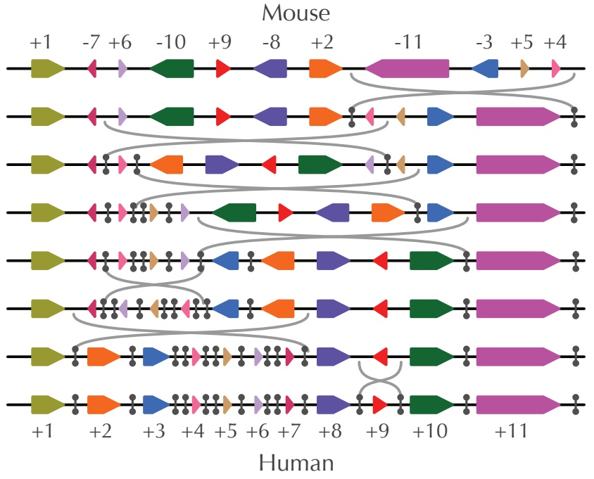
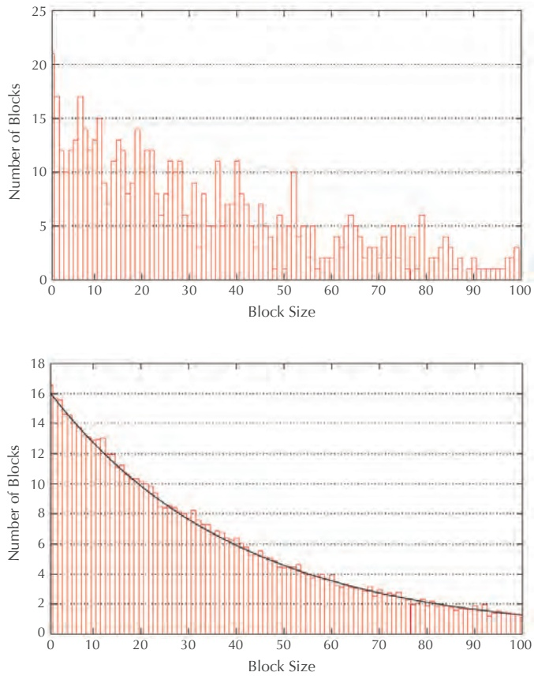
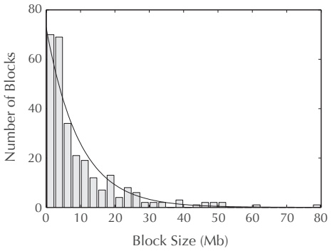
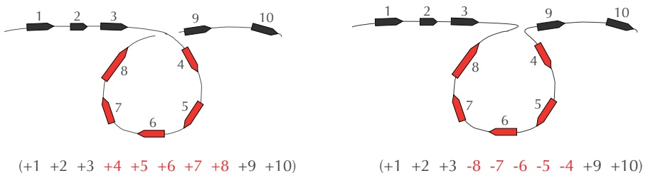
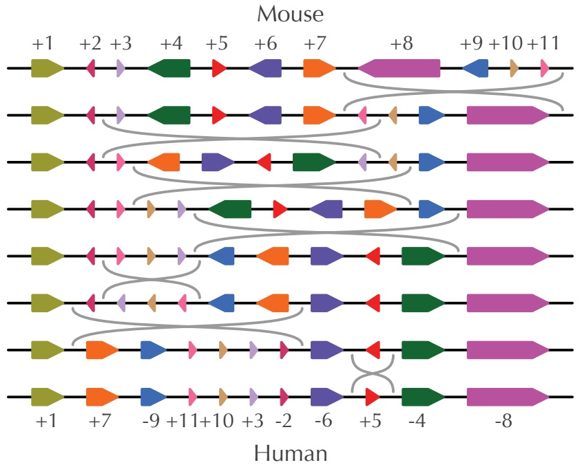
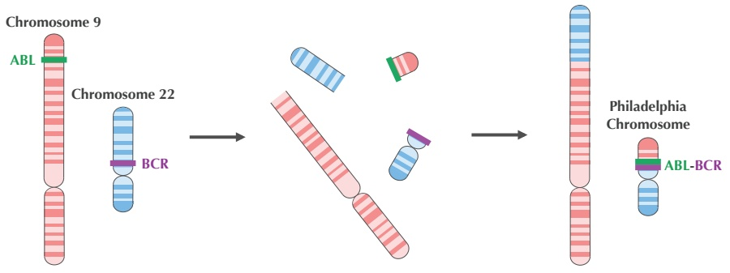
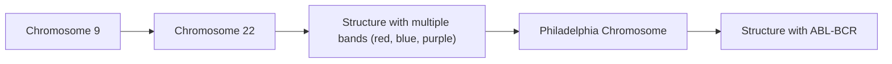

<details>
<summary>violin</summary>

| Category | Value |
| --- | --- |
| Mouse::+1 | N/A |
| Mouse::-7 | N/A |
| Mouse::+6 | N/A |
| Mouse::-10 | N/A |
| Mouse::+9 | N/A |
| Mouse::-8 | N/A |
| Mouse::+2 | N/A |
| Mouse::-11 | N/A |
| Mouse::-3 | N/A |
| Mouse::+5 | N/A |
| Mouse::+4 | N/A |
| Human::+1 | N/A |
| Human::+2 | N/A |
| Human::+3 | N/A |
| Human::+4 | N/A |
| Human::+5 | N/A |
| Human::+6 | N/A |
| Human::+7 | N/A |
| Human::+8 | N/A |
| Human::+9 | N/A |
| Human::+10 | N/A |
| Human::+11 | N/A |
</details>

FIGURE 6.2 Transforming the mouse X chromosome into the human X chromosome with seven reversals. Each synteny block is uniquely colored and labeled with an integer between 1 and 11; the positive or negative sign of each integer indicates the synteny block’s direction (pointing right or left, respectively). Two short vertical segments delineate the endpoints of the inverted interval in each reversal. Suppose that this evolutionary scenario is correct and that, say, the fifth synteny block arrangement from the top presents the true ancestral arrangement. Then the first four reversals happened on the evolutionary path from mice to the human-mouse common ancestor (traveling backward in time), and the final three reversals happened on the evolutionary path from the common ancestor to humans (traveling forward in time). In this chapter, we are not trying to reconstruct the ancestral genome and thus are not concerned with whether a certain reversal travels backward or forward in time.

if a similar principle holds for reversals — are they occurring over and over again in the same genomic regions? A fundamental question in chromosome evolution studies is whether the **breakage points** of reversals (i.e., the ends of the inverted intervals) occur along “fault lines” called **rearrangement hotspots**. If such hotspots exist in the human genome, we want to locate them and determine how they might relate to genetic disorders, which are often attributable to rearrangements.

Of course, we should rigorously define what we mean by a “rearrangement hotspot”. Re-examining the seven-reversal scenario changing the mouse X chromosome into the human X chromosome in Figure 6.2, we record the endpoints of each reversal using vertical segments. Regions affected by multiple reversals are indicated by multiple vertical segments in the human X chromosome. For example, the region adjacent to the pointed side of block 3 in Figure 6.2 is used as an endpoint of both the fourth and fifth reversals. As a result, we have placed two vertical lines between blocks 3 and 4 in the human X chromosome. However, just because we showed two breakage points in this region does not imply that this region is a rearrangement hotspot, since the reversals in Figure 6.2 represent just one possible evolutionary scenario. Because the true rearrangement scenario is unknown, it is not immediately clear how we could determine whether rearrangement hotspots exist.

## The Random Breakage Model of Chromosome Evolution

In 1973, Susumu Ohno proposed the **Random Breakage Model** of chromosome evolution. This hypothesis states that the breakage points of rearrangements are selected randomly, implying that rearrangement hotspots in mammalian genomes do not exist. Yet Ohno’s model lacked supporting evidence when it was introduced. After all, how could we possibly determine whether rearrangement hotspots exist without knowing the exact sequence of rearrangements separating two species?

## STOP and Think: Consider the following questions.

1. Say that a series of random reversals result in one huge synteny block covering 90% of the genome in addition to 99 tiny synteny blocks covering the remaining 10% of the genome. Should we be surprised?
2. What if random reversals result in 100 synteny blocks of roughly the same length? Should we be surprised?

The idea that we wish to impress on you in the preceding questions is that we can test the Random Breakage Model by analyzing the distribution of synteny block lengths. For example, the lengths of the human-mouse synteny blocks on the X chromosome vary widely, with the largest block (block 11 in Figure 6.2) taking up nearly 25% of the entire length of the X chromosome. Is this variation in synteny block length consistent with the Random Breakage Model?




FIGURE 6.3 (Top) A histogram showing the number of blocks of each size for a simulated genome with 25,000 genes (an approximation for the number of genes in a mammalian genome) after 320 randomly chosen reversals. Blocks having more than 100 genes are not shown. (Bottom) A histogram of synteny block lengths averaged over 100 simulations, fitted by the exponential distribution.

In 1984, Joseph Nadeau and Benjamin Taylor asked what the expected lengths of synteny blocks should be after N reversals occurring at random locations in the genome. If we rule out the unlikely event that two random reversals cut the chromosome in exactly the same position, then N random reversals cut the chromosome in 2N locations and produce 2N + 1 synteny blocks. Figure 6.3 (top) depicts the result of a computational experiment in which 320 random reversals are applied to a simulated chromosome consisting of 25,000 genes, producing 2 · 320 + 1 = 641 synteny blocks. The average synteny block size is $^ { 2 5 , 0 0 0 / 6 4 1 } \approx 3 4$ genes, but this does not mean that all synteny blocks should have approximately 34 genes. If we select random locations for breakage points, then some blocks may have only a few genes, whereas other blocks may contain over a hundred. Figure 6.3 (bottom) averages the results of 100 such simulations and illustrates that the distribution of synteny block lengths can be approximated by a curve corresponding to an exponential distribution (see **DETOUR: The Exponential Distribution**). The exponential distribution predicts that there will be about seven blocks having 34 genes and one or two much larger blocks having 100 genes.

What happens when we look at the histogram for the real human and mouse synteny blocks? When Nadeau and Taylor constructed this histogram for the limited genetic data available in 1984, they observed that the lengths of blocks fit the exponential distribution well. In the 1990s, more accurate synteny block data fit the exponential distribution even better (Figure 6.4). Case closed — even though we don’t know the exact rearrangements causing our genome to evolve over the last 75 million years, these rearrangements must have followed the Random Breakage Model!



<details>
<summary>bar</summary>

| Block Size (Mb) | Number of Blocks |
| --- | --- |
| 0~2 | ~70 |
| 2~4 | ~69 |
| 4~6 | ~34 |
| 6~8 | ~21 |
| 8~10 | ~19 |
| 10~12 | ~12 |
| 12~14 | ~7 |
| 14~16 | ~13 |
| 16~18 | ~4 |
| 18~20 | ~8 |
| 20~22 | ~6 |
| 22~24 | ~3 |
| 24~26 | ~2 |
| 26~28 | ~3 |
| 28~30 | ~1 |
| 30~32 | ~1 |
| 32~34 | ~1 |
| 34~36 | ~1 |
| 36~38 | ~1 |
| 38~40 | ~3 |
| 40~42 | ~1 |
| 42~44 | ~1 |
| 44~46 | ~2 |
| 46~48 | ~2 |
| 48~50 | ~2 |
| 50~52 | ~1 |
| 52~54 | ~1 |
| 54~56 | ~1 |
| 56~58 | ~1 |
| 58~60 | ~1 |
| 60~62 | ~1 |
| 62~64 | ~1 |
| 64~66 | ~1 |
| 66~68 | ~1 |
| 68~70 | ~1 |
| 70~72 | ~1 |
| 72~74 | ~1 |
| 74~76 | ~1 |
| 76~78 | ~1 |
| 78~80 | ~1 |
</details>

FIGURE 6.4 Histogram of human-mouse synteny block lengths (only synteny blocks longer than 1 million nucleotides are shown). The histogram is fitted by an exponential distribution.

**STOP and Think:** Do you agree with the logic behind this argument?

## Sorting by Reversals

We now have evidence in favor of the Random Breakage Model, but this evidence is far from conclusive. To test this model, let’s start building a mathematical model for rearrangement analysis. We will therefore return to a problem that we hinted at in the introduction, which is finding the minimum number of reversals that could transform the mouse X chromosome into the human X chromosome.


**STOP and Think:** From a biological perspective, why do you think we want to find the minimum possible number of reversals?

We ask for the minimum number of reversals in accordance with a principle called **Occam’s razor**. When presented with some quandary, we should explain it using the simplest hypothesis that is consistent with what we already know. In this case, it seems most reasonable that evolution would take the “shortest path” between two species, i.e., the most **parsimonious** evolutionary scenario. Evolution may not always take the shortest path, but even when it does not, the number of steps in the true evolutionary scenario often comes close to the number of steps in the most parsimonious scenario. How, then, can we find the length of this shortest path?

Genome rearrangement studies typically ignore the lengths of synteny blocks and represent chromosomes by **signed permutations**. Each block is labeled by a number, which is assigned a positive/negative sign depending on the block’s direction. The number of elements in a signed permutation is its **length**. As you can see from Figure 6.2, the human and mouse X chromosomes can be represented by the following signed permutations of length 11:

In the rest of the chapter, we will refer to signed permutations as **permutations** for short. Because we assume that each synteny block is unique, we do not allow repeated numbers in permutations (e.g., (+1 2 +3 +2) is not a permutation).


**EXERCISE BREAK:** How many permutations of length n are there?

We can model reversals by inverting the elements within an interval of a permutation, then switching the signs of any elements within the inverted interval. For example, the cartoon in Figure 6.5 illustrates how a reversal changes the permutation $\scriptstyle { \left( + 1 \; + 2 \; + 3 \; + 4 \right. }$ $+ 5 + 6 + 7 + 8 + 9 + 1 0 )$ into $( + 1 + 2 + 3 - 8 - 7 - 6 - 5 - 4 + 9 + 10 )$ . This reversal can be viewed as first breaking the permutation between +3 and +4 as well as between +8 and +9,

$$
\left(+ 1 + 2 + 3 \mid + 4 + 5 + 6 + 7 + 8 \mid + 9 + 1 0\right).
$$

It then inverts the middle segment,

$$
\left(+ 1 + 2 + 3 \mid - 8 - 7 - 6 - 5 - 4 \mid + 9 + 1 0\right),
$$

and finally glues the three segments back together to form a new permutation,

$$
\left(+ 1 + 2 + 3 - 8 - 7 - 6 - 5 - 4 + 9 + 1 0\right).
$$



FIGURE 6.5 A cartoon illustrating how a reversal breaks a chromosome in two places and inverts the segment between the two breakage points. Note that the reversal changes the sign of each element within the permutation’s inverted segment.

**EXERCISE BREAK:** How many different reversals can be applied to a permutation of length n?


We define the **reversal distance** between permutations P and Q, denoted $d _ { \mathrm { r e v } } \big ( P , Q \big )$ , as the minimum number of reversals required to transform P into Q.

## Reversal Distance Problem:

Calculate the reversal distance between two permutations.

**Input**: Two permutations of equal length.

**Output**: The reversal distance between these permutations.

We represented the human X chromosome by $( + 1 \; { + } 2 \; { + } 3 \; { + } 4 \; { + } 5 \; { + } 6 \; { + } 7 \; { + } 8 \; { + } 9 \; { + } 1 0$ +11); such a permutation, in which blocks are ordered from smallest to largest with positive directions, is called the **identity permutation**. The reason why we used the identity permutation of length 11 to represent the human X chromosome is that when comparing two genomes, we can label the synteny blocks in one of the genomes however we like. The block labeling for which the human X chromosome is the identity permutation automatically induces the representation of the mouse chromosome as

$$
\left(+ 1 - 7 + 6 - 1 0 + 9 - 8 + 2 - 1 1 - 3 + 5 + 4\right).
$$

Of course, as shown in Figure 6.6, we could have instead encoded the mouse X chromosome as the identity permutation, which would have induced the encoding of the human X chromosome as

$$
(+ 1 + 7 - 9 + 1 1 + 1 0 + 3 - 2 - 6 + 5 - 4 - 8).
$$



<details>
<summary>state_timeline</summary>

| Time Point | State 1 | State 2 | State 3 | State 4 | State 5 | State 6 | State 7 | State 8 | State 9 | State 10 | State 11 |
| --- | --- | --- | --- | --- | --- | --- | --- | --- | --- | --- | --- |
| +1 | Present | Present | Present | Present | Present | Present | Present | Present | Present | Present | Present |
| +2 | Present | Present | Present | Present | Present | Present | Present | Present | Present | Present | Present |
| +3 | Present | Present | Present | Present | Present | Present | Present | Present | Present | Present | Present |
| +4 | Present | Present | Present | Present | Present | Present | Present | Present | Present | Present | Present |
| +5 | Present | Present | Present | Present | Present | Present | Present | Present | Present | Present | Present |
| +6 | Present | Present | Present | Present | Present | Present | Present | Present | Present | Present | Present |
| +7 | Present | Present | Present | Present | Present | Present | Present | Present | Present | Present | Present |
| +8 | — | — | — | — | — | — | — | — | — | — | — |
| +9 | — | — | — | — | — | — | — | — | — | — | — |
| +10 | — | — | — | — | — | — | — | — | — | — | — |
| +11 | — | — | — | — | — | — | — | — | — | — | — |
| +12 (Orange) | Present | Present | Present | Present | Present | Present | Present | Present | Present | Present | Present |
| +13 (Green) | Present | Present | Present | Present | Present | Present | Present | Present | Present | Present | Present |
| +14 (Red) | Present | Present | Present | Present | Present | Present | Present | Present | Present | Present | Present |
| +15 (Blue) | Present | Present | Present | Present | Present | Present | Present | Present | Present | Present | Present |
</details>

FIGURE 6.6 Encoding the mouse X chromosome as the identity permutation implies encoding the human X chromosome as $( + 1 + 7 - 9 + 11 + 10 + 3 - 2 - 6 + 5 - 4 - 8 )$

Because we have the freedom to label synteny blocks however we like, we will consider an equivalent version of the Reversal Distance Problem in which permutation Q is the identity permutation $\left( + 1 + 2 \ldots + n \right)$ . This computational problem is called **sorting by reversals**, and we denote the minimum number of reversals required to sort P into the identity permutation as $d _ { \mathrm { r e v } } ( P )$ . The history of sorting by reversals is founded in a culinary application and involves two celebrities (see **DETOUR: Bill Gates and David X. Cohen Flip Pancakes**).


## Sorting by Reversals Problem:

Compute the reversal distance between a permutation and the identity permutation.

**Input**: A permutation P.

**Output**: The reversal distance $d _ { \mathrm { r e v } } ( P )$

Here is a sorting of $( + 2 - 4 - 3 + 5 - 8 - 7 - 6 + 1 )$ using five reversals, with the inverted interval at each step shown in red:

$$
\begin{array}{l} (+ 2 - 4 - 3 + 5 - 8 - 7 - 6 + 1) \\ (+ 2 + 3 + 4 + 5 - 8 - 7 - 6 + 1) \\ (+ 2 + 3 + 4 + 5 + 6 + 7 + 8 + 1) \\ (+ 2 + 3 + 4 + 5 + 6 + 7 + 8 - 1) \\ \left(- 8 - 7 - 6 - 5 - 4 - 3 - 2 - 1\right) \\ (+ 1 + 2 + 3 + 4 + 5 + 6 + 7 + 8) \\ \end{array}
$$

**STOP and Think:** Can you sort this permutation using fewer reversals?

Here is a faster sorting:

$$
\begin{array}{l} (+ 2 - 4 - 3 + 5 - 8 - 7 - 6 + 1) \\ (+ 2 + 3 + 4 + 5 - 8 - 7 - 6 + 1) \\ \left(- 5 - 4 - 3 - 2 - 8 - 7 - 6 + 1\right) \\ \left(- 5 - 4 - 3 - 2 - 1 + 6 + 7 + 8\right) \\ (+ 1 + 2 + 3 + 4 + 5 + 6 + 7 + 8) \\ \end{array}
$$

**STOP and Think:** Consider the following questions.

1. Is it possible to sort this permutation even faster?
2. During sorting by reversals, the intermediate permutations in the example above are getting more and more “ordered”. Can you come up with a quantitative measure of how ordered a permutation is?


## A Greedy Heuristic for Sorting by Reversals

Let’s see if we can design a greedy heuristic to approximate $d _ { \mathrm { r e v } } ( P )$ . The simplest idea is to perform reversals that fix +1 in the first position, followed by reversals that fix +2 in the second position, and so on. For example, element 1 is already in the correct position and has the correct sign (+) in the mouse X chromosome, but element 2 is not in the correct position. We can keep element 1 fixed and move element 2 to the correct position by applying a single reversal.

$$
\begin{array}{l} (+ 1 - 7 + 6 - 1 0 + 9 - 8 + 2 - 1 1 - 3 + 5 + 4) \\ \left(+ 1 \quad - 2 \quad + 8 \quad - 9 \quad + 1 0 \quad - 6 \quad + 7 \quad - 1 1 \quad - 3 \quad + 5 \quad + 4\right) \\ \end{array}
$$

One more reversal flips element 2 around so that it has the correct sign:

$$
\begin{array}{l} (+ 1 - 2 + 8 - 9 + 1 0 - 6 + 7 - 1 1 - 3 + 5 + 4) \\ (+ 1 + 2 + 8 - 9 + 1 0 - 6 + 7 - 1 1 - 3 + 5 + 4) \\ \end{array}
$$

By iterating, we can successively move larger and larger elements to their correct positions in the identity permutation by following the reversals below. The inverted interval of each reversal is still shown in red, and elements that have been placed in the correct position are shown in blue.

$$
\begin{array}{l} (+ 1 - 7 + 6 - 1 0 + 9 - 8 + 2 - 1 1 - 3 + 5 + 4) \\ (+ 1 - 2 + 8 - 9 + 1 0 - 6 + 7 - 1 1 - 3 + 5 + 4) \\ (+ 1 + 2 + 8 - 9 + 1 0 - 6 + 7 - 1 1 - 3 + 5 + 4) \\ (+ 1 + 2 + 3 + 1 1 - 7 + 6 - 1 0 + 9 - 8 + 5 + 4) \\ (+ 1 + 2 + 3 - 4 - 5 + 8 - 9 + 1 0 - 6 + 7 - 1 1) \\ (+ 1 + 2 + 3 + 4 - 5 + 8 - 9 + 1 0 - 6 + 7 - 1 1) \\ (+ 1 + 2 + 3 + 4 + 5 + 8 - 9 + 1 0 - 6 + 7 - 1 1) \\ (+ 1 + 2 + 3 + 4 + 5 + 6 - 1 0 + 9 - 8 + 7 - 1 1) \\ (+ 1 + 2 + 3 + 4 + 5 + 6 - 7 + 8 - 9 + 1 0 - 1 1) \\ (+ 1 + 2 + 3 + 4 + 5 + 6 + 7 + 8 - 9 + 1 0 - 1 1) \\ (+ 1 + 2 + 3 + 4 + 5 + 6 + 7 + 8 + 9 + 1 0 - 1 1) \\ (+ 1 + 2 + 3 + 4 + 5 + 6 + 7 + 8 + 9 + 1 0 + 1 1) \\ \end{array}
$$

This example motivates a greedy heuristic called **GREEDYSORTING**. We say that element k in permutation $P = \left( p _ { 1 } \cdots p _ { n } \right)$ is **sorted** if $p _ { k } = + k$ and **unsorted** otherwise. We call P **k-sorted** if its first k  1 elements are sorted, but if element k is unsorted. For every (k  1)-sorted permutation $P ,$ there exists a single reversal, called the **k-sorting reversal**, that fixes the first k  1 elements of P and moves element k to the k-th position.

In the case when k is already in the k-th position of P, the k-sorting reversal merely flips k around.

For example, in the sorting of the mouse X chromosome shown above, the 2-sorting reversal transforms $( + 1 \; - 7 \; + 6 \; - 1 0 \; + 9 \; - 8 \; + 2 \; - 1 1 \; - 3 \; + 5 \; + 4 )$ into $(+1~-2~+8$ $- 9 \: { + } 1 0 \: { - } 6 \: { + } 7 \: { - } 1 1 \: { - } 3 \: { + } 5 \: { + } 4 )$ . In this case, an additional 2-sorting reversal flipping 2 was needed to make element 2 sorted. The idea of **GREEDYSORTING**, then, is to apply k-sorting reversals for increasing values of k. Here, |P| refers to the length of permutation P.

```txt
GREEDYSORTING(P)
    approxReversalDistance ← 0
    for k ← 1 to |P|
        if element k is not sorted
            apply the k-sorting reversal to P
            approxReversalDistance ← approxReversalDistance + 1
            if the k-th element of P is -k
                apply the k-sorting reversal to P
                approxReversalDistance ← approxReversalDistance + 1
    return approxReversalDistance
```

In the case of the mouse X chromosome, **GREEDYSORTING** requires eleven reversals, but we already know that this permutation can be sorted with seven reversals, which causes us to wonder: how good of a heuristic is **GREEDYSORTING**?

**EXERCISE BREAK:** What is the largest number of reversals **GREEDYSORTING** could ever require to sort a permutation of length n?

Consider the permutation $( - 6   + 1   + 2   + 3   + 4   + 5 )$ . You can verify that the greedy heuristic requires ten steps to sort this permutation, and yet it can be sorted using just two reversals!

$$
\begin{array}{l} (- 6 + 1 + 2 + 3 + 4 + 5) \\ (- 5 - 4 - 3 - 2 - 1 + 6) \\ (+ 1 + 2 + 3 + 4 + 5 + 6) \\ \end{array}
$$

This example demonstrates that **GREEDYSORTING** provides a poor approximation for the reversal distance.


**STOP and Think:** Can you find a lower bound on $d _ { \mathrm { r e v } } ( P ) ?$ For example, can you show that the mouse permutation $\left( + 1 \; - 7 \; + 6 \; - 1 0 \; + 9 \; - 8 \; + 2 \; - 1 1 \; - 3 \; + 5 \; + 4 \right)$ cannot be sorted with fewer than seven reversals?

## Breakpoints

What are breakpoints?

Consider the sorting by reversals shown in Figure 6.7. We would like to quantify how each subsequent permutation is moving closer to the identity as we apply subsequent reversals. For the first reversal, at the right endpoint of the inverted interval, it changes the consecutive elements (11 +13) into the much more desirable (+12 +13). Less obvious is the work of the fourth reversal, which places 11 immediately left of 10 so that at the next step, the consecutive elements (11 10) can be part of an inverted interval, creating the desirable consecutive elements (+10 +11).

<table><tr><td colspan="12"></td><td>BREAKPOINTS(P)</td></tr><tr><td colspan="12"> $|+3 +4 +5 | -12 | -8 -7 -6 | +1 +2 | +10 | +9 | -11 | +13$ </td><td>8</td></tr><tr><td colspan="12"> $|+3 +4 +5 | +11 | -9 | -10 | -2 -1 | +6 +7 +8 | +12 +13$ </td><td>7</td></tr><tr><td colspan="12"> $+1 +2 | +10 | +9 | -11 | -5 -4 -3 | +6 +7 +8 | +12 +13$ </td><td>6</td></tr><tr><td colspan="12"> $+1 +2 +3 +4 +5 | +11 | -9 | -10 | +6 +7 +8 | +12 +13$ </td><td>5</td></tr><tr><td colspan="12"> $+1 +2 +3 +4 +5 | +9 | -11 -10 | +6 +7 +8 | +12 +13$ </td><td>4</td></tr><tr><td colspan="12"> $+1 +2 +3 +4 +5 | +9 | -8 -7 -6 | +10 +11 +12 +13$ </td><td>3</td></tr><tr><td colspan="12"> $+1 +2 +3 +4 +5 +6 +7 +8 | -9 | +10 +11 +12 +13$ </td><td>2</td></tr><tr><td colspan="12"> $+1 +2 +3 +4 +5 +6 +7 +8 +9 +10 +11 +12 +13$ </td><td>0</td></tr></table>

FIGURE 6.7 A sorting by reversals. The inverted interval of each reversal is shown in red, while breakpoints in each permutation are marked by vertical blue segments.

The intuition that we are trying to build is that consecutive elements like (+12 +13) are desirable because they appear in the same order as in the identity permutation. However, consecutive elements like (11 10) are also desirable, since these elements can be later inverted into the correct order, $( + 1 0 + 1 1 )$ . The pairs (+12 +13) and (11 10) have something in common; the second element is equal to the first element plus 1. We therefore say that consecutive elements $( p _ { i } \: p _ { i + 1 } )$ in permutation $P = \left( p _ { 1 } \cdots p _ { n } \right)$ form an **adjacency** if $p _ { i + 1 } - p _ { i }$ is equal to 1. By definition, for any positive integer $k < n ,$ both $( k k + 1 )$ and $( - ( k + 1 ) - k )$ are adjacencies. If $p _ { i + 1 } - p _ { i }$ is not equal to 1, then we say that $\left( p _ { i } \; p _ { i + 1 } \right)$ is a **breakpoint**.

We can think about a breakpoint intuitively as a pair of consecutive elements that are “out of order” compared to the identity permutation $\left( + 1 + 2 \ldots + n \right)$ . For example, the pair (+5 12) is a breakpoint because +5 and -12 are not neighbors in the identity permutation. Similarly, $( - 1 2 \; { - } 8 ) , ( - 6 \; { + } 1 ) , ( + 2 \; { + } 1 0 ) , ( + 9 \; { - } 1 1 )$ , and $( - 1 1 + 1 3 )$ are clearly out of order. But $( + 1 0 + 9 )$ is also a breakpoint (even though it is formed by consecutive integers) because its signs are out of order compared to the identity permutation.

**STOP and Think:** The permutation $( - 5 - 4 - 3 - 2 - 1 )$ is clearly not the identity permutation, but where are its breakpoints?

We will further represent the beginning and end of permutation P by adding 0 to the left of the first element and $n + 1$ to the right of the last element,

$$
(\mathbf {0} p _ {1} \dots p _ {n} (n + 1)).
$$

As a result, there are $n + 1$ pairs of consecutive elements:

$$
(\mathbf {0} p _ {1}), (p _ {1} p _ {2}), (p _ {2} p _ {3}), \dots , (p _ {n - 1} p _ {n}), (p _ {n} (\boldsymbol {n} + \mathbf {1})).
$$

We use ADJACENCIES(P) and BREAKPOINTS(P) to denote the number of adjacencies and breakpoints of permutation P, respectively. Figure 6.7 illustrates how the number of breakpoints changes during sorting by reversals (note that 0 and $n + 1$ are placeholders and cannot be affected by a reversal).

Counting breakpoints

Because any pair of consecutive elements of a permutation form either a breakpoint or adjacency, we have the following identity for any permutation P of length n:

$$
\text { Adjacencies } (P) + \text { Breakpoints } (P) = n + 1.
$$

**STOP and Think:** A permutation on n elements may have at most $n + 1$ adjacencies. How many permutations on n elements have exactly $n + 1$ adjacencies?

You can verify that the identity permutation $\left( + 1 + 2 \ldots + n \right)$ is the only permutation for which all consecutive elements are adjacencies, meaning that it has no breakpoints.

Note also that the permutation $\left( - n \mathrm { ~ - } { \bigl ( } n - 1 { \bigr ) } \ldots - 2 - 1 \right)$ has adjacencies for every consecutive pair of elements except for the two breakpoints $( { \tt 0 } - n )$ and $( - 1 \; ( { \pmb n } + { \pmb 1 } ) )$ .


**EXERCISE BREAK:** How many permutations of length n have exactly $n - 1$ adjacencies?


## Number of Breakpoints Problem:

Find the number of breakpoints in a permutation.

**Input**: A permutation.

**Output**: The number of breakpoints in this permutation.


**STOP and Think:** We defined a breakpoint between an arbitrary permutation and the identity permutation. Generalize the notion of a breakpoint between two arbitrary permutations, and design a linear-time algorithm for computing this number.

Sorting by reversals as breakpoint elimination

The reversals in Figure 6.7 reduce the number of breakpoints from 8 to 0. Note that the permutation becomes more and more “ordered” after every reversal as the number of breakpoints reduces at each step. You can therefore think of sorting by reversals as the process of breakpoint elimination — reducing the number of breakpoints in a permutation P from BREAKPOINTS(P) to 0.


**STOP and Think:** What is the maximum number of breakpoints that can be eliminated by a single reversal?

Consider the first reversal in Figure 6.7, which reduces the number of breakpoints from 8 to 7. On either side of the inverted interval, breakpoints and adjacencies certainly do not change; for example, the breakpoint $( 0 + 3 )$ and the adjacency $(+13+14)$ remain the same. Also note that every breakpoint within the inverted interval of a reversal remains a breakpoint after the reversal. In other words, if $( p _ { i } \: p _ { i + 1 } )$ formed a breakpoint within the span of a reversal, i.e.,

$$
p _ {i + 1} - p _ {i} \neq 1,
$$

then these consecutive elements will remain a breakpoint after the reversal changes them into $\left( - p _ { i + 1 } - p _ { i } \right)$ :

$$
- p _ {i} - (- p _ {i + 1}) = p _ {i + 1} - p _ {i} \neq 1.
$$

For example, there are five breakpoints within the span of the following reversal on the permutation $( 0 + 3 + 4 + 5 - 1 2 - 8 - 7 - 6 + 1 + 2 + 1 0 + 9 - 1 1 + 1 3 + 1 4 1 5 ) ;$

$$
(- 1 2 - 8)
$$

$$
(- 6 + 1)
$$

$$
(+ 2 + 1 0)
$$

$$
(+ 1 0 + 9)
$$

$$
(+ 9 - 1 1)
$$

After the reversal, these breakpoints become the following five breakpoints:

$$
(+ 1 1 - 9)
$$

$$
(- 9 - 1 0)
$$

$$
(- 1 0 - 2)
$$

$$
(- 1 + 6)
$$

$$
(+ 8 + 1 2)
$$

Since all breakpoints inside and outside the span of a reversal remain breakpoints after a reversal, the only breakpoints that could be eliminated by a reversal are the two breakpoints located on the boundaries of the inverted interval. The breakpoints on the boundaries of the first reversal in Figure 6.7 are (+5 12) and (11 +13); the reversal converts them into a breakpoint (+5 +11) and an adjacency (+12 +13), thus reducing the number of breakpoints by 1.

**STOP and Think:** Can the permutation (+3 +4 +5 12 8 7 6 +1 +2 +10 +9 11 +13 +14), which has 8 breakpoints, be sorted with three reversals?

A reversal can eliminate at most two breakpoints, so two reversals can eliminate at most four breakpoints, three reversals can eliminate at most six breakpoints, and so on. This reasoning establishes the following theorem.

**Breakpoint Theorem:** $d _ { \mathrm { r e v } } ( P )$ is greater than or equal to BREAKPOINTS $( P ) / 2 .$

It would be nice if we could always find a reversal that eliminates two breakpoints from a permutation, as this would imply a simple greedy algorithm for optimal sorting by reversals. Unfortunately, this is not the case. You can verify that there is no reversal that reduces the number of breakpoints in the permutation P =(+2 +1), which has three breakpoints.

**EXERCISE BREAK:** How many permutations of length n have the property that no reversal applied to P decreases BREAKPOINTS(P)?


It turns out that every permutation of length n can be sorted using at most n + 1 reversals and that the permutation $( + n + ( n - 1 ) \ldots + 1 )$ requires n + 1 reversals to sort. Since this permutation has n + 1 breakpoints, there is a large gap between the lower bound of (n + 1)/2 provided by the Breakpoint Theorem and the reversal distance.


**EXERCISE BREAK:** Prove that there exists a shortest sequence of reversals sorting a permutation that never breaks a permutation at an adjacency.

You will soon see that the idea of breakpoints will help us return to our original aim of testing the Random Breakage Model. For now, we would like to move from permutations, which can only model single chromosomes, to a more general multichromosomal model. You may be surprised that we are moving to a seemingly more difficult model before resolving the unichromosomal case, which is already difficult. However, it turns out that our new multichromosomal model will be easier to analyze!

## Rearrangements in Tumor Genomes

As we move toward a more robust model for genome comparison, we need to incorporate rearrangements that move genes from one chromosome to another. Indeed, with the notable exception of the X chromosome, the genes from a single human chromosome usually have their counterparts distributed over many mouse chromosomes (and vice-versa). We hope that there is a nagging voice in your head, wondering: How can a genome rearrangement affect multiple chromosomes?

Although multichromosomal rearrangements have occurred during species evolution over millions of years, we can witness them during a much narrower time frame in cancer cells, which exhibit many chromosomal aberrations. Some of these mutations have no direct effect on tumor development, but many types of tumors display recurrent rearrangements that trigger tumor growth by disrupting genes or altering gene regulation. By studying these rearrangements, we can identify genes that are important for tumor growth, leading to improved cancer diagnostics and therapeutics.

Figure 6.8 presents a rearrangement involving human chromosomes 9 and 22 in a rare form of cancer called **chronic myeloid leukemia (CML)**. In this type of rearrangement, called a **translocation**, two intervals of DNA are excised from the end of chromosomes 9 and 22 and then reattached on opposite chromosomes. One of the rearranged chromosomes is called the **Philadelphia chromosome**. This chromosome fuses together two genes called ABL and BCR that normally have nothing to do with each other. However, when joined on the Philadelphia chromosome, these two genes create a single **chimeric gene** coding for the **ABL-BCR fusion protein**, which has been implicated in the development of CML.



<details>
<summary>flowchart</summary>


</details>

FIGURE 6.8 The Philadelphia chromosome is formed by a translocation affecting chromosomes 9 and 22. It fuses together the ABL and BCR genes, forming a chimeric gene that can trigger CML.

Once scientists understood the root cause of CML, they started searching for a compound inhibiting ABL-BCR, which resulted in the introduction of a drug called **Gleevec** in 2001. Gleevec is a **targeted therapy** against CML that inhibits cancer cells but does not affect normal cells and has shown great clinical results. However, since it targets only the ABL-BCR fusion protein, Gleevec does not treat most other cancers. Nevertheless, the introduction of Gleevec has bolstered researchers’ hopes that the search for specific rearrangements in other forms of cancer may produce additional targeted cancer therapies.

## From Unichromosomal to Multichromosomal Genomes

Translocations, fusions, and fissions

To model translocations, we represent a multichromosomal genome with k chromosomes as a permutation that has been partitioned into $k$ pieces. For example, the genome $( + 1   + 2   + 3   + 4   + 5   + 6 ) ( + 7   + 8   + 9   + 1 0   + 1 1 )$ is made up of the two chromosomes (+1 $\scriptstyle + 2   + 3   + 4   + 5   + 6 )$ and $( + 7 + 8 + 9 + 1 0 + 1 1 )$ . A translocation exchanges segments of different chromosomes, e.g., a translocation of the two chromosomes

$$
(+ 1 + 2 + 3 + 4 + 5 + 6) (+ 7 + 8 + 9 + 1 0 + 1 1)
$$