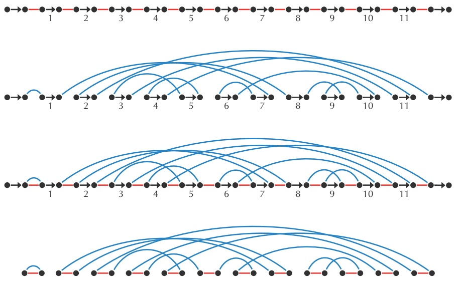

breakpoint graph, which has five alternating red-blue cycles.

**STOP and Think:** Prove the following analogue of the Cycle Theorem for permutations: Given permutations P and $Q ,$ any reversal applied to P can increase CYCLES $( P , Q )$ by at most 1.

flowchart

FIGURE 6.28 (1st panel) An alternating red-black path representing the human X chromosome $( + 1 + 2 + 3 + 4 + 5 + 6 + 7 + 8 + 9 + 1 0 + 1 1 )$ . (2nd panel) An alternating blue-black path representing the mouse X chromosome $(+1 -7 +6 -10 +9 -8 +2$ $-11 - 3 + 5 + 4 )$ (3rd panel) The breakpoint graph of the mouse and human X chromosomes is obtained by superimposing red-black and blue-black paths from the first two panels. (4th panel) To highlight the five alternating red-blue cycles in the breakpoint graph, black edges are removed.

Whereas the number of trivial cycles is equal to $\scriptstyle \mathrm { B L O C K S } \left( Q , Q \right)$ in the trivial breakpoint graph of a circular permutation, the trivial breakpoint graph of a linear permutation has $\mathrm { B L O C K S } \big ( Q , Q \big ) + 1$ trivial cycles. Since the Cycle Theorem holds for linear permutations, perhaps the reversal distance $d _ { \mathrm { r e v } } \big ( P , Q \big )$ is equal to BLOCKS $\left( P , Q \right) + 1 -$ CYCLES $( P , Q )$ for linear chromosomes? After all, for the human and mouse X chromosomes, BLOCKS $( P , Q ) + 1 - \mathsf { C Y C L E S } \big ( P , Q \big )$ is equal to $1 1 + 1 - 5 = 7 ,$ , which we already know to be the reversal distance between the human and mouse X chromosomes.

**STOP and Think:** Can you modify the proof of the 2-Break Distance Theorem to prove that $d_{\mathrm{rev}}(P, Q) = \mathrm{BLOCKS}(P, Q) + 1 - \mathrm{CYCLES}(P, Q)$ for linear permutations P and Q?

You can verify that if $P = ( + 2   +   1 )$ and $Q = ( + 1   +   2 )$ , then $d _ { \mathrm { r e v } } \big ( P , Q \big ) \neq \mathrm { B L O C K S } \big ( P , Q \big ) +$ $1 - \operatorname { C Y C L E S } ( P , Q )$ . This makes it unlikely that we will be able to develop a simple algorithm for the computation of reversal distance.

However, the lower bound $d_{\mathrm{rev}}(P, Q) \geq \mathrm{BLOCKS}(P, Q) + 1 - \mathrm{CYCLES}(P, Q)$ approximates the reversal distance between linear permutations extremely well. This intriguing performance raised the question of whether this bound is close to an exact formula. In 1999, Hannenhalli and Pevzner found this formula by defining two special types of breakpoint graph structures called “hurdles” and “fortresses”. Denoting the number of hurdles and fortresses in BREAKPOINTGRAPH $( P , Q )$ by HURDLES $( P , Q )$ and FORTRESSES $( P , Q )$ , respectively, they proved that the reversal distance $d _ { \mathrm { r e v } } \big ( P , Q \big )$ is given by

$$
\text {BLOCKS} (P, Q) + 1 - \text {CYCLES} (P, Q) + \text {HURDLES} (P, Q) + \text {FORTRESSES} (P, Q).
$$

Using this formula, they developed a polynomial algorithm for computing $d _ { \mathrm { r e v } } \big ( P , Q \big )$

## Bibliography Notes

Alfred Sturtevant was the first to discover rearrangements while comparing gene orders in fruit flies (Sturtevant, 1921). Together with Theodosius Dobzhansky, Sturtevant pioneered the analysis of genome rearrangements, publishing a milestone paper that presented a rearrangement scenario for many fruit fly species (Sturtevant and Dobzhansky, 1936). The Random Breakage Model was proposed by Ohno, 1973, further developed by Nadeau and Taylor, 1984, and refuted by Pevzner and Tesler, 2003b.

The notion of the breakpoint graph was proposed by Bafna and Pevzner, 1996. The polynomial algorithm for sorting by reversals was developed by Hannenhalli and Pevzner, 1999. The synteny block construction algorithm presented in this chapter was described by Pevzner and Tesler, 2003a. The 2-break operation was introduced in Yancopoulos, Attie, and Friedberg, 2005 under the name of “double cut and join”

The first algorithmic analysis of the Pancake Flipping problem was described by Gates and Papadimitriou, 1979. The first algorithmic analysis of the Burnt Pancake Flipping problem was described by Cohen and Blum, 1995.

The Multiple Genome Rearrangement problem was addressed by Ma et al., 2008 and Alekseyev and Pevzner, 2009. Zhao and Bourque, 2009 observed that matching duplications may trigger genome rearrangements.

## Bibliography

- Alekseyev, M. A. and P. A. Pevzner (2009). “Breakpoint graphs and ancestral genome reconstructions”. Genome Research Vol. 19: 943–957.
- Bafna, V. and P. A. Pevzner (1996). “Genome Rearrangements and Sorting by Reversals”. SIAM Journal on Computing Vol. 25: 272–289.
- Butler, J., I MacCallum, M. Kleber, I. A. Shlyakhter, M. Belmonte, E. S. Lander, C. Nusbaum, and D. B. Jaffe (2008). “ALLPATHS: de novo assembly of whole-genome shotgun microreads.” Genome Research Vol. 18: 810–820.
- Cohen, D. S. and M. Blum (1995). “On the Problem of Sorting Burnt Pancakes”. Discrete Applied Mathematics Vol. 61: 105–120.
- Conti, E., T. Stachelhaus, M. A. Marahiel, and P. Brick (1997). “Structural basis for the activation of phenylalanine in the non-ribosomal biosynthesis of gramicidin S”. The EMBO Journal Vol. 16: 4174–4183.
- Conti, E., N. P. Franks, and P. Brick (1996). “Crystal structure of firefly luciferase throws light on a superfamily of adenylate-forming enzymes”. Structure Vol. 4: 287–298.
- Cristianini, N. and M. W. Hahn (2006). Introduction to Computational Genomics: A Case Studies Approach. Cambridge University Press.
- de Bruijn, N. (1946). “A Combinatorial Problem”. In: Proceedings of the Section of Sciences, Koninklijke Akademie van Wetenschappen te Amsterdam. Vol. 49: 758–764.
- Doolittle, R. F., M. W. Hunkapiller, L. E. Hood, S. G. Devare, K. C. Robbins, S. A. Aaronson, and H. N. Antoniades (1983). “Simian sarcoma virus onc gene, v-sis, is derived from the gene (or genes) encoding a platelet-derived growth factor”. Science Vol. 221: 275–277.
- Drmanac, R., I. Labat, I. Brukner, and R. Crkvenjakov (1989). “Sequencing of megabase plus DNA by hybridization: Theory of the method”. Genomics Vol. 4: 114–128.
- Euler, L. (1758). “Solutio Problematis ad Geometriam Situs Pertinentis”. Novi Commentarii Academiae Scientarium Imperialis Petropolitanque, 9–28.
- Gao, F. and C.-T. Zhang (2008). “Ori-Finder: A web-based system for finding oriCs in unannotated bacterial genomes”. BMC Bioinformatics Vol. 9: 79.
- Gardner, M. (1974). “Mathematical Games”. Scientific American Vol. 230: 120–125.
- Gates, W. H. and C. H. Papadimitriou (1979). “Bounds for sorting by prefix reversal”. Discrete Mathematics Vol. 27: 47–57.
- Geman, S. and D. Geman (1984). “Stochastic Relaxation, Gibbs Distributions, and the Bayesian Restoration of Images”. IEEE Transactions on Pattern Analysis and Machine Intelligence Vol. PAMI-6: 721–741.
- Good, I. J. (1946). “Normal Recurring Decimals”. Journal of the London Mathematical Society Vol. 21: 167–169.
- Grigoriev, A. (1998). “Analyzing genomes with cumulative skew diagrams”. Nucleic Acids Research Vol. 26: 2286–2290.
- Grigoriev, A. (2011). “How do replication and transcription change genomes?” In: Bioinformatics for Biologists. Ed. by P. A. Pevzner and R. Shamir. Cambridge University Press, 111–125.
- Guibas, L. and A. Odlyzko (1981). “String overlaps, pattern matching, and nontransitive games”. Journal of Combinatorial Theory, Series A Vol. 30: 183 –208.
- Hannenhalli, S. and P. A. Pevzner (1999). “Transforming Cabbage into Turnip: Polynomial Algorithm for Sorting Signed Permutations by Reversals”. Journal of the ACM Vol. 46: 1–27.
- Harmer, S. L., J. B. Hogenesch, M. Straume, H. S. Chang, B. Han, T. Zhu, X. Wang, J. A. Kreps, and S. A. Kay (2000). “Orchestrated transcription of key pathways in Arabidopsis by the circadian clock”. Science Vol. 290: 2110–2113.
- Hertz, G. Z. and G. D. Stormo (1999). “Identifying DNA and protein patterns with statistically significant alignments of multiple sequences.” Bioinformatics Vol. 15: 563–577.
- Idury, R. M. and M. S. Waterman (1995). “A New Algorithm for DNA Sequence Assembly.” Journal of Computational Biology Vol. 2: 291–306.
- Ivics, Z., P. Hackett, R. Plasterk, and Z. Izsvák (1997). “Molecular reconstruction of Sleeping Beauty, a Tc1-like transposon from fish, and its transposition in human cells”. Cell Vol. 91: 501–510.
- Konopka, R. J. and S. Benzer (1971). “Clock mutants of Drosophila melanogaster”. Proceedings of the National Academy of Sciences of the United States of America Vol. 68: 2112–2116.
- Lawrence, C. E., S. F. Altschul, M. S. Boguski, J. S. Liu, A. F. Neuwald, and J. C. Wootton (1993). “Detecting subtle sequence signals: a Gibbs sampling strategy for multiple alignment”. Science Vol. 262: 208–214.
- Levenshtein, V. I. (1966). “Binary codes capable of correcting deletions, insertions, and reversals”. Soviet Physics Doklady Vol. 10: 707–710.
- Liachko, I., R. A. Youngblood, U. Keich, and M. J. Dunham (2013). “High-resolution mapping, characterization, and optimization of autonomously replicating sequences in yeast”. Genome Research Vol. 23: 698–704.
- Lobry, J. R. (1996). “Asymmetric substitution patterns in the two DNA strands of bacteria”. Molecular Biology and Evolution Vol. 13: 660–665.
- Lundgren, M., A. Andersson, L. Chen, P. Nilsson, and R. Bernander (2004). “Three replication origins in Sulfolobus species: Synchronous initiation of chromosome replication and asynchronous termination”. Proceedings of the National Academy of Sciences of the United States of America Vol. 101: 7046–7051.
- Lysov, Y., V. Florent’ev, A. Khorlin, K. Khrapko, V. Shik, and A. Mirzabekov (1988). “DNA sequencing by hybridization with oligonucleotides”. Doklady Academy Nauk USSR Vol. 303: 1508–1511.
- Ma, J., A. Ratan, B. J. Raney, B. B. Suh, W. Miller, and D. Haussler (2008). “The infinite sites model of genome evolution”. Proceedings of the National Academy of Sciences of the United States of America Vol. 105: 14254–14261.
- Maxam, A. M. and W. Gilbert (1977). “A new method for sequencing DNA.” Proceedings of the National Academy of Sciences of the United States of America Vol. 74: 560–564.
- Medvedev, P., S. K. Pham, M. Chaisson, G. Tesler, and P. A. Pevzner (2011). “Paired de Bruijn Graphs: A Novel Approach for Incorporating Mate Pair Information into Genome Assemblers.” Journal of Computational Biology Vol. 18: 1625–1634.
- Nadeau, J. H. and B. A. Taylor (1984). “Lengths of chromosomal segments conserved since divergence of man and mouse”. Proceedings of the National Academy of Sciences of the United States of America Vol. 81: 814–818.
- Ng, J., N. Bandeira, W.-T. Liu, M. Ghassemian, T. L. Simmons, W. H. Gerwick, R. Linington, P. Dorrestein, and P. A. Pevzner (2009). “Dereplication and de novo sequencing of nonribosomal peptides”. Nature Methods Vol. 6: 596–599.
- Ohno, S. (1973). “Ancient linkage groups and frozen accidents”. Nature Vol. 244: 259–262.
- Park, H. D., K. M. Guinn, M. I. Harrell, R. Liao, M. I. Voskuil, M. Tompa, G. K. Schoolnik, and D. R. Sherman (2003). “Rv3133c/dosR is a transcription factor that mediates the hypoxic response of Mycobacterium tuberculosis”. Molecular Microbiology Vol. 48: 833–843.
- Pevzner, P. and G. Tesler (2003a). “Genome rearrangements in mammalian evolution: lessons from human and mouse genomes”. Genome Research Vol. 13: 37–45.
- Pevzner, P. and G. Tesler (2003b). “Human and mouse genomic sequences reveal extensive breakpoint reuse in mammalian evolution”. Proceedings of the National Academy of Sciences of the United States of America Vol. 100: 7672–7677.
- Pevzner, P. A. (1989). “1-Tuple DNA sequencing: computer analysis”. Journal of Biomolecular Structure and Dynamics Vol. 7: 63–73.
- Pevzner, P. A., H Tang, and M. S. Waterman (2001). “An Eulerian path approach to DNA fragment assembly”. Proceedings of the National Academy of Sciences of the United States of America Vol. 98: 9748–53.
- Rosenblatt, J. and P. Seymour (1982). “The Structure of Homometric Sets”. SIAM Journal on Algebraic Discrete Methods Vol. 3: 343–350.
- Sanger, F, S Nicklen, and A. Coulson (1977). “DNA sequencing with chain-terminating inhibitors”. Proceedings of The National Academy of Sciences of The United States Of America Vol. 74: 5463–5467.
- Sedgewick, R. and P. Flajolet (2013). An Introduction to the Analysis of Algorithms. Addison-Wesley.
- Sernova, N. V. and M. S. Gelfand (2008). “Identification of replication origins in prokaryotic genomes”. Briefings in Bioinformatics Vol. 9: 376–391.
- Smith, T. F. and M. S. Waterman (1981). “Identification of common molecular subsequences.” Journal of Molecular Biology Vol. 147: 195–197.
- Solov’ev, A. (1966). “A combinatorial identity and its application to the problem about the first occurence of a rare event”. Theory of Probability and its Applications Vol. 11: 276–282.
- Southern, E. (1988). “Analysing Polynucleotide Sequences”. Patent (United Kingdom).
- Stachelhaus, T., H. D. Mootz, and M. A. Marahiel (1999). “The specificity-conferring code of adenylation domains in nonribosomal peptide synthetases.” Chemistry & Biology Vol. 6: 493–505.
- Sturtevant, A. H. (1921). “A Case of Rearrangement of Genes in Drosophila”. Proceedings of the National Academy of Sciences of the United States of America Vol. 7: 235–237.
- Sturtevant, A. H. and T. Dobzhansky (1936). “Inversions in the Third Chromosome of Wild Races of Drosophila Pseudoobscura, and Their Use in the Study of the History of the Species”. Proceedings of the National Academy of Sciences of the United States of America Vol. 22: 448–450.
- Tang, Y. Q., J. Yuan, G. Osapay, K. Osapay, D. Tran, C. J. Miller, A. J. Ouellette, and M. E. Selsted (1999). “A cyclic antimicrobial peptide produced in primate leukocytes by the ligation of two truncated alpha-defensins”. Science Vol. 286: 498–502.
- Venkataraman, N., A. L. Cole, P. Ruchala, A. J. Waring, R. I. Lehrer, O. Stuchlik, J. Pohl, and A. M. Cole (2009). “Reawakening retrocyclins: ancestral human defensins active against HIV-1”. PLoS Biology Vol. 7: e95.
- Wang, X., C. Lesterlin, R. Reyes-Lamothe, G. Ball, and D. J. Sherratt (2011). “Replication and segregation of an Escherichia coli chromosome with two replication origins”. Proceedings of the National Academy of Sciences Vol. 108: E243–E250.
- Xia, X. (2012). “DNA replication and strand asymmetry in prokaryotic and mitochondrial genomes”. Current Genomics Vol. 13: 16–27.
- Yancopoulos, S., O. Attie, and R. Friedberg (2005). “Efficient sorting of genomic permutations by translocation, inversion and block interchange”. Bioinformatics Vol. 21: 3340–3346.
- Zerbino, D. R. and E. Birney (2008). “Velvet: Algorithms for de novo short read assembly using de Bruijn graphs”. Genome Research Vol. 18: 821–829.
- Zhao, H. and G. Bourque (2009). “Recovering genome rearrangements in the mammalian phylogeny”. Genome Research Vol. 19: 934–942.

## Image Courtesies

**Figure 1.26:** Ævar Arnfjörð Bjarmason
**Figure 3.5:** Dan Gilbert
**Figure 3.45 (left):** Royal Irish Academy
**Figure 4.1:** Open Clip Art
**Figure 6.27:** Wikimedia Commons user Skbkekas
**Figure 6.1:** Glenn Tesler
**Figure 6.2:** Glenn Tesler
**Figure 6.3:** Max Alekseyev
**Figure 6.4:** Max Alekseyev
**Figure 6.5:** Glenn Tesler
**Figure 6.6:** Glenn Tesler
**Figure 6.22:** Glenn Tesler