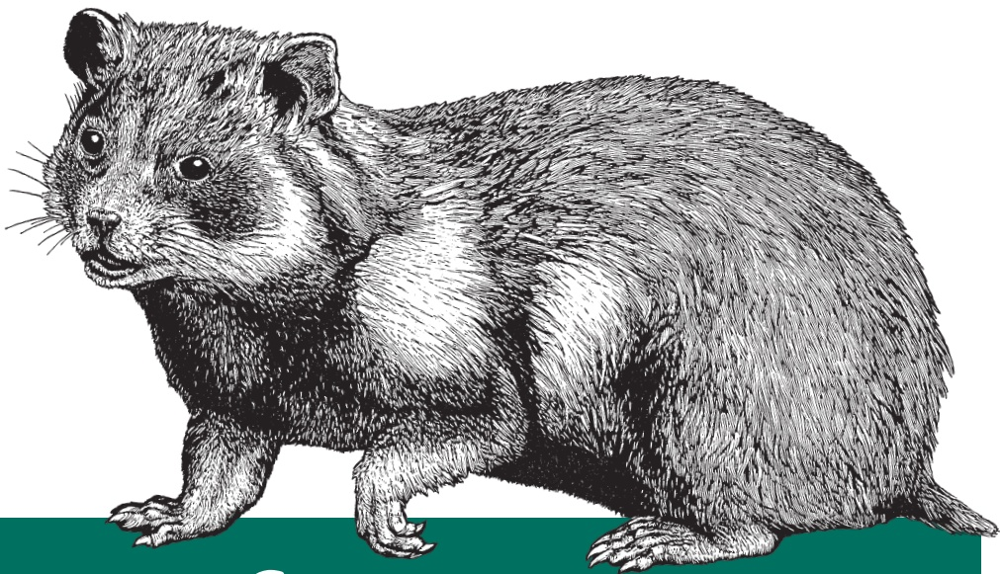

natural_image

Illustration of a rodent with detailed fur texture and facial features, standing on a green surface (no text or symbols)

## Bioinformatics Data Skills

REPRODUCIBLE AND ROBUST RESEARCH WITH OPEN SOURCE TOOLS

## Bioinformatics Data Skills

Learn the data skills necessary for turning large sequencing datasets into reproducible and robust biological findings. With this practical guide, you’ll learn how to use freely available open source tools to extract meaning from large complex biological datasets.

At no other point in human history has our ability to understand life’s complexities been so dependent on our skills to work with and analyze data. This intermediate-level book teaches the general computational and data skills you need to analyze biological data. If you have experience with a scripting language like Python, you’re ready to get started.

Go from handling small problems with messy scripts to tackling large problems with clever methods and tools
Process bioinformatics data with powerful Unix pipelines and data tools
Learn how to use exploratory data analysis techniques in the R language
Use efficient methods to work with genomic range data and range operations
Work with common genomics data file formats like FASTA, FASTQ, SAM, and BAM
Manage your bioinformatics project with the Git version control system
Tackle tedious data processing tasks with with Bash scripts and Makefiles

“ Most existing bioinformatics texts focus on algorithms and theories. Bioinformatics Data Skills takes a refreshingly practical approach by providing a comprehensive introduction to the techniques, tools, and best practices that foster reproducible research in genome informatics. Its handson approach is perfect for graduate students, postdocs, professors, and hobbyists alike.”

—Aaron Quinlan

Associate Professor at University of Utah

and author of the BEDTools and

GEMINI utilities for bioinformatics

Vince Buffalo is currently a first-year graduate student studying population genetics in Graham Coop's lab at University of California, Davis, in the Population Biology Graduate Group. Before starting his PhD in population genetics, Vince worked professionally as a bioinformatician in the Bioinformatics Core at the UC Davis Genome Center and in the Department of Plant Sciences.

SCIENCE

**US \$49.99**

**CAN \$57.99**

ISBN: 978-1-449-36737-4

text_image

QR code image containing encoded data, no visible human-readable text

Twitter: @oreillymedia facebook.com/oreilly

# Bioinformatics Data Skills

**Vince Buffalo**

## Bioinformatics Data Skills

by Vince Buffalo

Copyright © 2015 Vince Buffalo. All rights reserved.

Printed in the United States of America.

Published by O’Reilly Media, Inc., 1005 Gravenstein Highway North, Sebastopol, CA 95472.

O’Reilly books may be purchased for educational, business, or sales promotional use. Online editions are also available for most titles ([http://safaribooksonline.com](http://safaribooksonline.com)). For more information, contact our corporate/ institutional sales department: 800-998-9938 or corporate@oreilly.com.

**Editors:** Courtney Nash and Amy Jollymore

**Production Editor:** Nicole Shelby

**Copyeditor:** Jasmine Kwityn

**Proofreader:** Kim Cofer

**Indexer:** Ellen Troutman

**Interior Designer:** David Futato

**Cover Designer:** Ellie Volckhausen

**Illustrator:** Rebecca Demarest

June 2015:

First Edition

## Revision History for the First Edition

2015-06-30: First Release

See [http://oreilly.com/catalog/errata.csp?isbn=9781449367374](http://oreilly.com/catalog/errata.csp?isbn=9781449367374) for release details.

The O’Reilly logo is a registered trademark of O’Reilly Media, Inc. Bioinformatics Data Skills, the cover image, and related trade dress are trademarks of O’Reilly Media, Inc.

While the publisher and the author have used good faith efforts to ensure that the information and instructions contained in this work are accurate, the publisher and the author disclaim all responsibility for errors or omissions, including without limitation responsibility for damages resulting from the use of or reliance on this work. Use of the information and instructions contained in this work is at your own risk. If any code samples or other technology this work contains or describes is subject to open source licenses or the intellectual property rights of others, it is your responsibility to ensure that your use thereof complies with such licenses and/or rights.

To my (rather large) family for their continued support: Mom, Dad, Anne, Lisa, Lauren, Violet, and Dalilah; the Buffalos, the Kihns, and the Lambs.

And my earliest mentors for inspiring me to be who I am today: Randy Siverson and Duncan Temple Lang.

## Table of Contents

Preface. . . . . . . . . . . . . . . . . . . . xiii

## Part I. Ideology: Data Skills for Robust and Reproducible Bioinformatics

## 1. How to Learn Bioinformatics. . . 1

Why Bioinformatics? Biology’s Growing Data 1

Learning Data Skills to Learn Bioinformatics 4

New Challenges for Reproducible and Robust Research 5

Reproducible Research 6

Robust Research and the Golden Rule of Bioinformatics 8

Adopting Robust and Reproducible Practices Will Make Your Life Easier, Too 9

Recommendations for Robust Research 10

Pay Attention to Experimental Design 10

Write Code for Humans, Write Data for Computers 11

Let Your Computer Do the Work For You 12

Make Assertions and Be Loud, in Code and in Your Methods 12

Test Code, or Better Yet, Let Code Test Code 13

Use Existing Libraries Whenever Possible 14

Treat Data as Read-Only 14

Spend Time Developing Frequently Used Scripts into Tools 15

Let Data Prove That It’s High Quality 15

Recommendations for Reproducible Research 16

Release Your Code and Data 16

Document Everything 16

Make Figures and Statistics the Results of Scripts 17

Use Code as Documentation 17

Continually Improving Your Bioinformatics Data Skills 17

## Part II. Prerequisites: Essential Skills for Getting Started with a Bioinformatics Project

## 2. Setting Up and Managing a Bioinformatics Project. . . . . 21

Project Directories and Directory Structures 21

Project Documentation 24

Use Directories to Divide Up Your Project into Subprojects 26

Organizing Data to Automate File Processing Tasks 26

Markdown for Project Notebooks 31

Markdown Formatting Basics 31

Using Pandoc to Render Markdown to HTML 35

## 3. Remedial Unix Shell. . . . 37

Why Do We Use Unix in Bioinformatics? Modularity and the Unix Philosophy 37

Working with Streams and Redirection 41

Redirecting Standard Out to a File 41

Redirecting Standard Error 43

Using Standard Input Redirection 45

The Almighty Unix Pipe: Speed and Beauty in One 45

Pipes in Action: Creating Simple Programs with Grep and Pipes 47

Combining Pipes and Redirection 48

Even More Redirection: A tee in Your Pipe 49

Managing and Interacting with Processes 50

Background Processes 50

Killing Processes 51

Exit Status: How to Programmatically Tell Whether Your

Command Worked 52

Command Substitution 54

## 4. Working with Remote Machines. . . . . 57

Connecting to Remote Machines with SSH 57

Quick Authentication with SSH Keys 59

Maintaining Long-Running Jobs with nohup and tmux 61

nohup 61

Working with Remote Machines Through Tmux 61

Installing and Configuring Tmux 62

Creating, Detaching, and Attaching Tmux Sessions 62

Working with Tmux Windows 64

## 5. Git for Scientists. . . . . . . . . . . . . . . . 67

Why Git Is Necessary in Bioinformatics Projects 68

Git Allows You to Keep Snapshots of Your Project 68

Git Helps You Keep Track of Important Changes to Code 69

Git Helps Keep Software Organized and Available After People Leave 69

Installing Git 70

Basic Git: Creating Repositories, Tracking Files, and Staging and Committing Changes 70

Git Setup: Telling Git Who You Are 70

git init and git clone: Creating Repositories 70

Tracking Files in Git: git add and git status Part I 72

Staging Files in Git: git add and git status Part II 73

git commit: Taking a Snapshot of Your Project 76

Seeing File Differences: git diff 77

Seeing Your Commit History: git log 79

Moving and Removing Files: git mv and git rm 80

Telling Git What to Ignore: .gitignore 81

Undoing a Stage: git reset 83

Collaborating with Git: Git Remotes, git push, and git pull 83

Creating a Shared Central Repository with GitHub 86

Authenticating with Git Remotes 87

Connecting with Git Remotes: git remote 87

Pushing Commits to a Remote Repository with git push 88

Pulling Commits from a Remote Repository with git pull 89

Working with Your Collaborators: Pushing and Pulling 90

Merge Conflicts 92

More GitHub Workflows: Forking and Pull Requests 97

Using Git to Make Life Easier: Working with Past Commits 97

Getting Files from the Past: git checkout 97

Stashing Your Changes: git stash 99

More git diff: Comparing Commits and Files 100

Undoing and Editing Commits: git commit --amend 102

Working with Branches 102

Creating and Working with Branches: git branch and git checkout 103

Merging Branches: git merge 105

Branches and Remotes 106

Continuing Your Git Education 108

## 6. Bioinformatics Data. . . . . 109

Retrieving Bioinformatics Data 110

Downloading Data with wget and curl 110

Rsync and Secure Copy (scp) 113

Data Integrity 114

SHA and MD5 Checksums 115

Looking at Differences Between Data 116

Compressing Data and Working with Compressed Data 118

gzip 119

Working with Gzipped Compressed Files 120

Case Study: Reproducibly Downloading Data 120

## Part III. Practice: Bioinformatics Data Skills

## 7. Unix Data Tools. . . . 125

Unix Data Tools and the Unix One-Liner Approach: Lessons from Programming Pearls 125

When to Use the Unix Pipeline Approach and How to Use It Safely 127

Inspecting and Manipulating Text Data with Unix Tools 128

Inspecting Data with Head and Tail 129

less 131

Plain-Text Data Summary Information with wc, ls, and awk 134

Working with Column Data with cut and Columns 138

Formatting Tabular Data with column 139

The All-Powerful Grep 140

Decoding Plain-Text Data: hexdump 145

Sorting Plain-Text Data with Sort 147

Finding Unique Values in Uniq 152

Join 155

Text Processing with Awk 157

Bioawk: An Awk for Biological Formats 163

Stream Editing with Sed 165

Advanced Shell Tricks 169

Subshells 169

Named Pipes and Process Substitution 171

The Unix Philosophy Revisited 173

## 8. A Rapid Introduction to the R Language. . . . . . 175

Getting Started with R and RStudio 176

R Language Basics 178

Simple Calculations in R, Calling Functions, and Getting Help in R 178

Variables and Assignment 182

Vectors, Vectorization, and Indexing 183

Working with and Visualizing Data in R 193

Loading Data into R 194

Exploring and Transforming Dataframes 199

Exploring Data Through Slicing and Dicing: Subsetting Dataframes 203

Exploring Data Visually with ggplot2 I: Scatterplots and Densities 207

Exploring Data Visually with ggplot2 II: Smoothing 213

Binning Data with cut() and Bar Plots with ggplot2 215

Merging and Combining Data: Matching Vectors and Merging Dataframes 219

Using ggplot2 Facets 224

More R Data Structures: Lists 228

Writing and Applying Functions to Lists with lapply() and sapply() 231

Working with the Split-Apply-Combine Pattern 239

Exploring Dataframes with dplyr 243

Working with Strings 248

Developing Workflows with R Scripts 253

Control Flow: if, for, and while 253

Working with R Scripts 254

Workflows for Loading and Combining Multiple Files 257

Exporting Data 260

Further R Directions and Resources 261

## 9. Working with Range Data. . . . . . . 263

A Crash Course in Genomic Ranges and Coordinate Systems 264

An Interactive Introduction to Range Data with GenomicRanges 269

Installing and Working with Bioconductor Packages 269

Storing Generic Ranges with IRanges 270

Basic Range Operations: Arithmetic, Transformations, and Set Operations 275

Finding Overlapping Ranges 281

Finding Nearest Ranges and Calculating Distance 290

Run Length Encoding and Views 292

Storing Genomic Ranges with GenomicRanges 299

Grouping Data with GRangesList 303

Working with Annotation Data: GenomicFeatures and rtracklayer 308

Retrieving Promoter Regions: Flank and Promoters 314

Retrieving Promoter Sequence: Connection GenomicRanges with Sequence Data 315

Getting Intergenic and Intronic Regions: Gaps, Reduce, and Setdiffs in Practice 319

Finding and Working with Overlapping Ranges 324

Calculating Coverage of GRanges Objects 327

Working with Ranges Data on the Command Line with BEDTools 329

Computing Overlaps with BEDTools Intersect 330

BEDTools Slop and Flank 333

Coverage with BEDTools 335

Other BEDTools Subcommands and pybedtools 336

## 10. Working with Sequence Data. . . 339

The FASTA Format 339

The FASTQ Format 341

Nucleotide Codes 343

Base Qualities 344

Example: Inspecting and Trimming Low-Quality Bases 346

A FASTA/FASTQ Parsing Example: Counting Nucleotides 349

Indexed FASTA Files 352

## 11. Working with Alignment Data. . . . . 355

Getting to Know Alignment Formats: SAM and BAM 356

The SAM Header 356

The SAM Alignment Section 359

Bitwise Flags 360

CIGAR Strings 363

Mapping Qualities 365

Command-Line Tools for Working with Alignments in the SAM Format 365

Using samtools view to Convert between SAM and BAM 365

Samtools Sort and Index 367

Extracting and Filtering Alignments with samtools view 368

Visualizing Alignments with samtools tview and the Integrated Genomics

Viewer 372

Pileups with samtools pileup, Variant Calling, and Base Alignment Quality 378

Creating Your Own SAM/BAM Processing Tools with Pysam 384

Opening BAM Files, Fetching Alignments from a Region, and Iterating Across Reads 384

Extracting SAM/BAM Header Information from an AlignmentFile Object 387

Working with AlignedSegment Objects 388

Writing a Program to Record Alignment Statistics 391

Additional Pysam Features and Other SAM/BAM APIs 394

## 12. Bioinformatics Shell Scripting, Writing Pipelines, and Parallelizing Tasks. . . . . . . . . . 395

Basic Bash Scripting 396

Writing and Running Robust Bash Scripts 396

Variables and Command Arguments 398

Conditionals in a Bash Script: if Statements 401

Processing Files with Bash Using for Loops and Globbing 405

Automating File-Processing with find and xargs 411

Using find and xargs 411

Finding Files with find 412

find’s Expressions 413

find’s -exec: Running Commands on find’s Results 415

xargs: A Unix Powertool 416

Using xargs with Replacement Strings to Apply Commands to Files 418

xargs and Parallelization 419

Make and Makefiles: Another Option for Pipelines 421

## 13. Out-of-Memory Approaches: Tabix and SQLite. . . 425

Fast Access to Indexed Tab-Delimited Files with BGZF and Tabix 425

Compressing Files for Tabix with Bgzip 426

Indexing Files with Tabix 427

Using Tabix 427

Introducing Relational Databases Through SQLite 428

When to Use Relational Databases in Bioinformatics 429

Installing SQLite 431

Exploring SQLite Databases with the Command-Line Interface 431

Querying Out Data: The Almighty SELECT Command 434

SQLite Functions 441

SQLite Aggregate Functions 442

Subqueries 447

Organizing Relational Databases and Joins 448

Writing to Databases 455

Dropping Tables and Deleting Databases 458

Interacting with SQLite from Python 459

Dumping Databases 465

## 14. Conclusion. . . . . . . . . . . 467

Where to Go From Here? 468

Glossary. . . . . . . . . . . . . . . . . . . . . . . . . 471

Bibliography. . . . . . . . . . . . . . . 479

Index. . . . . . . . . . . . . . . . . . . . . . . . . . . . . . 483

This book is the answer to a question I asked myself two years ago: “What book would I want to read first when getting started in bioinformatics?” When I began working in this field, I had programming experience in Python and R but little else. I had hunted around for a terrific introductory text on bioinformatics, and while I found some good books, most were not targeted to the daily work I did as a bioinformatician. A few of the texts I found approached bioinformatics from a theoretical and algorithmic perspective, covering topics like Smith-Waterman alignment, phylogeny reconstruction, motif finding, and the like. Although they were fascinating to read (and I do recommend that you explore this material), I had no need to implement bioinformatics algorithms from scratch in my daily bioinformatics work—numerous terrific, highly optimized, well-tested implementations of these algorithms already existed. Other bioinformatics texts took a more practical approach, guiding readers unfamiliar with computing through each step of tasks like running an aligner or downloading sequences from a database. While these were more applicable to my work, much of those books’ material was outdated.

As you might guess, I couldn’t find that best “first” bioinformatics book. Bioinformatics Data Skills is my version of the book I was seeking. This book is targeted toward readers who are unsure how to bridge the giant gap between knowing a scripting language and practicing bioinformatics to answer scientific questions in a robust and reproducible way. To bridge this gap, one must learn data skills—an approach that uses a core set of tools to manipulate and explore any data you’ll encounter during a bioinformatics project.

Data skills are the best way to learn bioinformatics because these skills utilize timetested, open source tools that continue to be the best way to manipulate and explore changing data. This approach has stood the test of time: the advent of highthroughput sequencing rapidly changed the field of bioinformatics, yet skilled bioinformaticians adapted to this new data using these same tools and skills. Nextgeneration data was, after all, just data (different data, and more of it), and master bioinformaticians had the essential skills to solve problems by applying their tools to this new data. Bioinformatics Data Skills is written to provide you with training in these core tools and help you develop these same skills.

## The Approach of This Book

Many biologists starting out in bioinformatics tend to equate “learning bioinformatics” with “learning how to run bioinformatics software.” This is an unfortunate and misinformed idea of what bioinformaticians actually do. This is analogous to thinking “learning molecular biology” is just “learning pipetting.” Other than a few simple examples used to generate data in Chapter 11, this book doesn’t cover running bioinformatics software like aligners, assemblers, or variant callers. Running bioinformatics software isn’t all that difficult, doesn’t take much skill, and it doesn’t embody any of the significant challenges of bioinformatics. I don’t teach how to run these types of bioinformatics applications in Bioinformatics Data Skills for the following reasons:

• It’s easy enough to figure out on your own
• The material would go rapidly out of date as new versions of software or entirely new programs are used in bioinformatics
• The original manuals for this software will always be the best, most up-to-date resource on how to run a program

Instead, the approach of this book is to focus on the skills bioinformaticians use to explore and extract meaning from complex, large bioinformatics datasets. Exploring and extracting information from these datasets is the fun part of bioinformatics research. The goal of Bioinformatics Data Skills is to teach you the computational tools and data skills you need to explore these large datasets as you please. These data skills give you freedom; you’ll be able to look at any bioinformatics data—in any format, and files of any size—and begin exploring data to extract biological meaning.

Throughout Bioinformatics Data Skills, I emphasize working in a robust and reproducible manner. I believe these two qualities—reproducibility and robustness—are too often overlooked in modern computational work. By robust, I mean that your work is resilient against silent errors, confounders, software bugs, and messy or noisy data. In contrast, a fragile approach is one that does not decrease the odds of some type of error adversely affecting your results. By reproducible, I mean that your work can be repeated by other researchers and they can arrive at the same results. For this to be the case, your work must be well documented, and your methods, code, and data all need to be available so that other researchers have the materials to reproduce everything. Reproducibility also relies on your work being robust—if a workflow run on a different machine yields a different outcome, it is neither robust nor fully reproducible. I introduce these concepts in more depth in Chapter 2, and these are themes that reappear throughout the book.