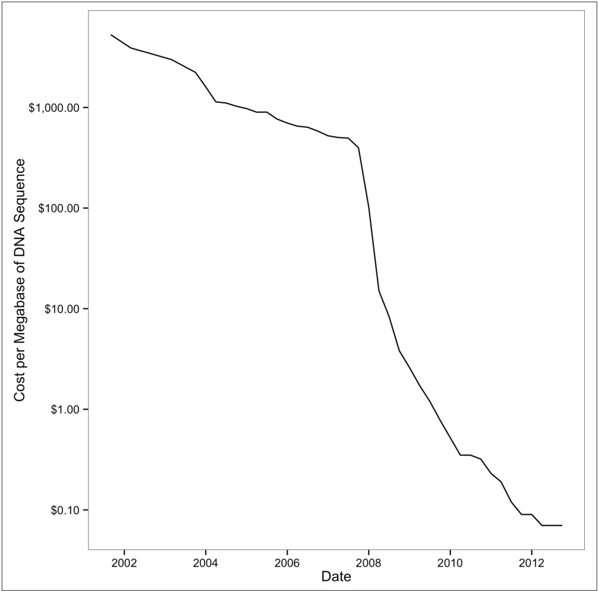

## Why This Book Focuses on Sequencing Data

Bioinformatics is a broad discipline, and spans subfields like proteomics, metabolomics, structure bioinformatics, comparative genomics, machine learning, and image processing. Bioinformatics Data Skills focuses primarily on handling sequencing data for a few reasons.

First, sequencing data is abundant. Currently, no other “omics” data is as abundant as high-throughput sequencing data. Sequencing data has broad applications across biology: variant detection and genotyping, transcriptome sequencing for gene expression studies, protein-DNA interaction assays like ChIP-seq, and bisulfite sequencing for methylation studies just to name a few examples. The ways in which sequencing data can be used to answer biological questions will only continue to increase.

Second, sequencing data is terrific for honing your data skills. Even if your goal is to analyze other types of data in the future, sequencing data serves as great example data to learn with. Developing the text-processing skills necessary to work with sequencing data will be applicable to working with many other data types.

Third, other subfields of bioinformatics are much more domain specific. The wide availability and declining costs of sequencing have allowed scientists from all disciplines to use genomics data to answer questions in their systems. In contrast, bioinformatics subdisciplines like proteomics or high-throughput image processing are much more specialized and less widespread. Still, if you’re interested in these fields, Bioinformatics Data Skills will teach you useful computational and data skills that will be helpful in your research.

## Audience

In my experience teaching bioinformatics to friends, colleagues, and students of an intensive week-long course taught at UC Davis, most people wishing to learn bioinformatics are either biologists, or computer scientists/programmers. Biologists wish to develop the computational skills necessary to analyze their own data, while the programmers and computer scientists wish to apply their computational skills to biological problems. Although these two groups differ considerably in biological knowledge and computational experience, Bioinformatics Data Skills covers material that should be helpful to both.

If you’re a biologist, Bioinformatics Data Skills will teach you the core data skills you need to work with bioinformatics data. It’s important to note that Bioinformatics Data Skills is not a how-to bioinformatics book; such a book on bioinformatics would quickly go out of date or be too narrow in focus to help the majority of biologists. You will need to supplement this book with knowledge of your specific research and system, as well as the modern statistical and bioinformatics methods that your subfield uses. For example, if your project involves aligning sequencing reads to a reference genome, this book won’t tell you the newest and best alignment software for your particular system. But regardless of which aligner you use, you will need to have a thorough understanding of alignment formats and how to manipulate alignment data —a topic covered in Chapter 11. Throughout this book, these general computational and data skills are meant to be a solid, widely applicable foundation on which the majority of biologists can build.

If you’re a computer scientist or programmer, you are likely already familiar with some of the computational tools I teach in this book. While the material presented in Bioinformatics Data Skills may overlap knowledge you already have, you will still learn about the specific formats, tools, and approaches bioinformaticians use in their work. Also, working through the examples in this book will give you good practice in applying your computational skills to genomics data.

## The Difficulty Level of Bioinformatics Data Skills

Bioinformatics Data Skills is designed to be a thorough—and in parts, dense—book. When I started writing this book, I decided the greatest misdeed I could do would be to treat bioinformatics as a subject that’s easier than it truly is. Working as a professional bioinformatician, I routinely saw how very subtle issues could crop up and adversely change the outcome of the analysis had they not been caught. I don’t want your bioinformatics work to be incorrect because I’ve made a topic artificially simple. The depth at which I cover topics in Bioinformatics Data Skills is meant to prepare you to catch similar issues in your own work so your results are robust.

The result is that sections of this book are quite advanced and will be difficult for some readers. Don’t feel discouraged! Like most of science, this material is hard, and may take a few reads before it fully sinks in. Throughout the book, I try to indicate when certain sections are especially advanced so that you can skip over these and return to them later.

Lastly, I often use technical jargon throughout the book. I don’t like using jargon, but it’s necessary to communicate technical concepts in computing. Primarily it will help you search for additional resources and help. It’s much easier to Google successfully for “left outer join” than “data merge where null records are included in one table.”

## Assumptions This Book Makes

Bioinformatics Data Skills is meant to be an intermediate book on bioinformatics. To make sure everyone starts out on the same foot, the book begins with a few simple chapters. In Chapter 2, I cover the basics of setting up a bioinformatics project, and in Chapter 3 I teach some remedial Unix topics meant to ensure that you have a solid grasp of Unix (because Unix is a large component in later chapters). Still, as an intermediate book, I make a few assumptions about you:

## You know a scripting language

This is the biggest assumption of the book. Except for a few Python programs and the R material (R is introduced in Chapter 8), this book doesn’t directly rely on using lots of scripting. However, in learning a scripting language, you’ve already encountered many important computing concepts such as working with a text editor, running and executing programs on the command line, and basic programming. If you do not know a scripting language, I would recommend learning Python while reading this book. Books like [Bioinformatics Programming Using Python](http://bit.ly/bioinformatics-prog) by Mitchell L. Model (O’Reilly, 2009), [Learning Python, 5th Edition](http://bit.ly/LearningPython-5E), by Mark Lutz (O’Reilly, 2013), and [Python in a Nutshell, 2nd](http://bit.ly/Python-IAN), by Alex Martelli (O’Reilly, 2006) are great to get started. If you know a scripting language other than Python (e.g., Perl or Ruby), you’ll be prepared to follow along with most examples (though you will need to translate some examples to your scripting language of choice).

## You know how to use a text editor

It’s essential that you know your way around a text editor (e.g., Emacs, Vim, Text‐Mate2, or Sublime Text). Using a word processor (e.g., Microsoft Word) will not work, and I would discourage using text editors such as Notepad or OS X’s TextEdit, as they lack syntax highlighting support for common programming languages.

## You have basic Unix command-line skills

For example, I assume you know the difference between a terminal and a shell, understand how to enter commands, what command-line options/flags and arguments are, and how to use the up arrow to retrieve your last entered command. You should also have a basic understanding of the Unix file hierarchy (including concepts like your home directory, relative versus absolute directories, and root directories). You should also be able to move about and manipulate the directories and files in Unix with commands like cd, ls, pwd, mv, rm, rmdir, and mkdir. Finally, you should have a basic grasp of Unix file ownership and permis sions, and changing these with chown and chmod. If these concepts are unclear, I would recommend you play around in the Unix command line first (carefully!) and consult a good beginner-level book such as Practical Computing for Biologists by Steven Haddock and Casey Dunn (Sinauer, 2010) or UNIX and Perl to the Rescue by Keith Bradnam and Ian Korf (Cambridge University Press, 2012).

## You have a basic understanding of biology

Bioinformatics Data Skills is a BYOB book—bring your own biology. The examples don’t require a lot of background in biology beyond what DNA, RNA, proteins, and genes are, and the central dogma of molecular biology. You should also be familiar with some very basic genetics and genomic concepts (e.g., single nucleotide polymorphisms, genotypes, GC content, etc.). All biological examples in the book are designed to be quite simple; if you’re unfamiliar with any topic, you should be able to quickly skim a Wikipedia article and proceed with the example.

## You have a basic understanding of regular expressions

Occasionally, I’ll make use of regular expressions in this book. In most cases, I try to quickly step through the basics of how a regular expression works so that you can get the general idea. If you’ve encountered regular expressions while learning a scripting language, you’re ready to go. If not, I recommend you learn the basics —not because regular expressions are used heavily throughout the book, but because mastering regular expressions is an important skill in bioinformatics. [Introducing Regular Expressions](http://bit.ly/Intro-RegEx) by Michael Fitzgerald (O’Reilly) is a great introduction. Nowadays, writing, testing, and debugging regular expressions is easier than ever thanks to online tools like [http://regex101.com](http://regex101.com) and [http://www.debuggex.com](http://www.debuggex.com). I recommend using these tools in your own work and when stepping through my regular expression examples.

## You know how to get help and read documentation

Throughout this book, I try to minimize teaching information that can be found in manual pages, help documentation, or online. This is for three reasons:

• I want to save space and focus on presenting material in a way you can’t find elsewhere
• Manual pages and documentation will always be the best resource for this information
• The ability to quickly find answers in documentation is one of the most important skills you can develop when learning computing

This last point is especially important; you don’t need to remember all arguments of a command or R function—you just need to know where to find this information. Programmers consult documentation constantly in their work, which is why documentation tools like man (in Unix) and help() (in R) exist.

## You can manage your computer system (or have a system administrator)

This book does not teach you system administration skills like setting up a bioinformatics server or cluster, managing user accounts, network security, managing disks and disk space, RAID configurations, data backup, and high-performance computing concepts. There simply isn’t the space to adequately cover these important topics. However, these are all very, very important—if you don’t have a system administrator and need to fill that role for your lab or research group, it’s essential for you to master these skills, too. Frankly, system administration skills take years to master and good sysadmins have incredible patience and experience in handling issues that would make most scientists go insane. If you can employ a full-time system administrator shared across labs or groups or utilize a university cluster with a sysadmin, I would do this. Lastly, this shouldn’t need to be said, but just in case: constantly back up your data and work. It’s easy when learning Unix to execute a command that destroys files—your best protection from losing everything is continual backups.

## Supplementary Material on GitHub

The supplementary material needed for this book’s examples is available in the [Git‐Hub repository](http://github.com/vsbuffalo/bds-files). You can download material from this repository as you need it (the repository is organized by chapter), or you can download everything using the Download Zip link. Once you learn Git in Chapter 5, I would recommend cloning the repository so that you can restore any example files should you accidentally overwrite them.

Try navigating to this repository now and poking around so you’re familiar with the layout. Look in the Preface’s directory and you’ll find [the README.md file](http://bit.ly/bds-readme), which includes additional information about many of the topics I’ve discussed. In addition to the supplementary files needed for all examples in the book, this repository contains:

• Documentation on how all supplementary files were produced or how they were acquired. In some cases, I’ve used makefiles or scripts (both of these topics are covered in Chapter 12) to create example data, and all of these resources are available in each chapter’s GitHub directory. I’ve included these materials not only for reproducible purposes, but also to serve as additional learning material.
• Additional information readers may find interesting for each chapter. This information is in each chapter’s README.md file. I’ve also included other resources like lists of recommended books for further learning.
• Errata, and any necessary updates if material becomes outdated for some reason.

I chose to host the supplementary files for Bioinformatics Data Skills on GitHub so that I could keep everything up to date and address any issues readers may have. Feel free to create [a new issue on GitHub](http://github.com/vsbuffalo/bds-files/issues) should you find any problem with the book or its supplementary material.

## Computing Resources and Setup

I’ve written this entire book on my laptop, a 15-inch MacBook Pro with 16 GB of RAM. Although this is a powerful laptop, it is much smaller than the servers common in bioinformatics computing. All examples are designed and tested to run a machine this size. Nearly every example should run on a machine with 8 GB of memory.

All examples in this book work on Mac OS X and Linux—other operating systems are not supported (mostly because modern bioinformatics relies on Unix-based operating systems). All software required throughout the book is freely available and is easily installable; I provide some basic instructions in each section as software installation is needed. In general, you should use your operating system’s package management system (e.g., apt-get on Ubuntu/Debian). If you’re using a Mac, I highly recommend Homebrew, a terrific package manager for OS X that allows you to easily install software from the command line. You can find detailed instructions on [Home brew’s website](http://brew.sh), Most important, Homebrew maintains a collection of scientific software packages called [homebrew-science](http://github.com/Homebrew/homebrew-science), including the bioinformatics software we use throughout this book. Follow the directions in homebrew-science’s README.md to learn how to install these scientific programs.

## Organization of This Book

This book is composed of three parts: Part I, containing one chapter on ideology; Part II, which covers the basics of getting started with a bioinformatics project; and Part III, which covers bioinformatics data skills. Although chapters were written to be read sequentially, if you’re comfortable with Unix and R, you may find that you can skip around without problems.

In Chapter 1, I introduce why learning bioinformatics by developing data skills is the best approach. I also introduce the ideology of this book, and describe reproducible and robust bioinformatics and some recommendations to apply in your own work.

Part II of Bioinformatics Data Skills introduces the basic skills needed to start a bioinformatics project. First, we’ll look at how to set up and manage a project directory in Chapter 2. This may seem like trivial topic, but complex bioinformatics projects demand we think about project management. In the frenzy of research, there will be files everywhere. Starting out with a carefully organized project can prevent a lot of hassle in the future. We’ll also learn about documentation with Markdown, a useful format for plain-text project documentation.

In Chapter 3, we explore intermediate Unix in bioinformatics. This is to make sure that you have a solid grasp of essential concepts (e.g., pipes, redirection, standard input and output, etc.). Understanding these prerequisite topics will allow you to focus on analyzing data in later chapters, not struggling to understand Unix basics.

Most bioinformatics tasks require more computing power than we have on our personal workstations, meaning we have to work with remote servers and clusters. Chapter 4 covers some tips and tricks to increase your productivity when working with remote machines.

In Chapter 5, we learn Git, which is a version control system that makes managing versions of projects easy. Bioinformatics projects are filled with lots of code and data that should be managed using the same modern tools as collaboratively developed software. Git is a large, powerful piece of software, so this is a long chapter. However, this chapter was written so that you could skip the section on branching and return to it later.

Chapter 6 looks at data in bioinformatics projects: how to download large amounts of data, use data compression, validate data integrity, and reproducibly download data for a project.

In Part III, our attention turns to developing the essential data skills all bioinformaticians need to tackle problems in their daily work. Chapter 7 focuses on Unix data tools, which allow you to quickly write powerful stream-processing Unix pipelines to process bioinformatics data. This approach is a cornerstone of modern bioinformatics, and is an absolutely essential data skill to have.

In Chapter 8, I introduce the R language through learning exploratory data analysis techniques. This chapter prepares you to use R to explore your own data using techniques like visualization and data summaries.

Genomic range data is ubiquitous in bioinformatics, so we look at range data and range operations in Chapter 9. We’ll first step through the different ways to represent genomic ranges, and work through range operations using Bioconductor’s IRanges package to bolster our range-thinking intuition. Then, we’ll work with genomic data using GenomicRanges. Finally, we’ll look at the BEDTools Suite of tools for working with range data on the command line.

In Chapter 10, we learn about sequence data, a mainstay of bioinformatics data. We’ll look at the FASTA and FASTQ formats (and their limitations) and work through trimming low-quality bases off of sequences and seeing how this affects the distribution of quality scores. We’ll also look at FASTA and FASTQ parsing.

Chapter 11 focuses on the alignment data formats SAM and BAM. Understanding and manipulating files in these formats is an integral bioinformatics skill in working with high-throughput sequencing data. We’ll see how to use Samtools to manipulate these files and visualize the data, and step through a detailed example that illustrates some of the intricacies of variant calling. Finally, we’ll learn how to use Pysam to parse SAM/BAM files so you can write your own scripts that work with these specialized data formats.

Most daily bioinformatics work involves writing data-processing scripts and pipelines. In Chapter 12, we look at how to write such data-processing pipelines in a robust and reproducible way. We’ll look specifically at Bash scripting, manipulating files using Unix powertools like find and xargs, and finally take a quick look at how you can write pipelines using Make and makefiles.

In bioinformatics, our data is often too large to fit in our computer’s memory. In Chapter 7, we saw how streaming with Unix pipes can help to solve this problem, but Chapter 13 looks at a different method: out-of-memory approaches. First, we’ll look at Tabix, a fast way to access information in indexed tab-delimited files. Then, we’ll look at the basics of SQL through analyzing some GWAS data using SQLite.

Finally, in Chapter 14, I discuss where you should head next to further develop your bioinformatics skills.

## Code Conventions

Most bioinformatics data has one thing in common: it’s large. In code examples, I often need to truncate the output to have it fit into the width of a page. To indicate that output has been truncated, I will always use [...] in the output. Also, in code examples I often use variable names that are short to save space. I encourage you to use more descriptive names than those I’ve used throughout this book in your own personal work.

## Conventions Used in This Book

The following typographical conventions are used in this book:

## Italic

Indicates new terms, URLs, email addresses, filenames, and file extensions.

## Constant width

Used for program listings, as well as within paragraphs to refer to program elements such as variable or function names, databases, data types, environment variables, statements, and keywords.

## Constant width bold

Shows commands or other text that should be typed literally by the user.

## Constant width italic

Shows text that should be replaced with user-supplied values or by values determined by context.

This element signifies a tip or suggestion.

This element signifies a general note.

This element indicates a warning or caution.

## Using Code Examples

This book is here to help you get your job done. In general, if example code is offered with this book, you may use it in your programs and documentation. You do not need to contact us for permission unless you’re reproducing a significant portion of the code. For example, writing a program that uses several chunks of code from this book does not require permission. Selling or distributing a CD-ROM of examples from O’Reilly books does require permission. Answering a question by citing this book and quoting example code does not require permission. Incorporating a significant amount of example code from this book into your product’s documentation does require permission.

We appreciate, but do not require, attribution. An attribution usually includes the title, author, publisher, and ISBN. For example: “Bioinformatics Data Skills by Vince Buffalo (O’Reilly). Copyright 2015 Vince Buffalo, 978-1-449-36737-4.”

If you feel your use of code examples falls outside fair use or the permission given above, feel free to contact us at [permissions@oreilly.com](mailto:permissions@oreilly.com).

## Safari® Books Online

[Safari Books Online](http://safaribooksonline.com) is an on-demand digital library that delivers expert [content](https://www.safaribooksonline.com/explore/) in both book and video form from the world’s leading authors in technology and business.

Technology professionals, software developers, web designers, and business and creative professionals use Safari Books Online as their primary resource for research, problem solving, learning, and certification training.

Safari Books Online offers a range of [plans and pricing](https://www.safaribooksonline.com/pricing/) for [enterprise](https://www.safaribooksonline.com/enterprise/), [government](https://www.safaribooksonline.com/government/), [education](https://www.safaribooksonline.com/academic-public-library/), and individuals.

Members have access to thousands of books, training videos, and prepublication manuscripts in one fully searchable database from publishers like O’Reilly Media, Prentice Hall Professional, Addison-Wesley Professional, Microsoft Press, Sams, Que, Peachpit Press, Focal Press, Cisco Press, John Wiley & Sons, Syngress, Morgan Kaufmann, IBM Redbooks, Packt, Adobe Press, FT Press, Apress, Manning, New Riders, McGraw-Hill, Jones & Bartlett, Course Technology, and hundreds [more](https://www.safaribooksonline.com/our-library/). For more information about Safari Books Online, please visit us online.

## How to Contact Us

Please address comments and questions concerning this book to the publisher:

O’Reilly Media, Inc.

1005 Gravenstein Highway North

Sebastopol, CA 95472

800-998-9938 (in the United States or Canada)

707-829-0515 (international or local)

707-829-0104 (fax)

We have a web page for this book, where we list errata, examples, and any additional information. You can access this page at [http://bit.ly/Bio-DS](http://bit.ly/Bio-DS).

To comment or ask technical questions about this book, send email to [bookquestions@oreilly.com](mailto:bookquestions@oreilly.com).

For more information about our books, courses, conferences, and news, see our website at [http://www.oreilly.com](http://www.oreilly.com).

Find us on Facebook: [http://facebook.com/oreilly](http://facebook.com/oreilly)

Follow us on Twitter: [http://twitter.com/oreillymedia](http://twitter.com/oreillymedia)

Watch us on YouTube: [http://www.youtube.com/oreillymedia](http://www.youtube.com/oreillymedia)

## Acknowledgments

Writing a book is a monumental effort—for two years, I’ve worked on Bioinformatics Data Skills during nights and weekends. This is in addition to a demanding career as a professional bioinformatician (and for the last five months of writing, as a PhD student). Balancing work and life is already difficult enough for most scientists; I now know that balancing work, life, and writing a book is nearly impossible. I wouldn’t have survived this process without the support of my partner, Helene Hopfer.

I thank Ciera Martinez for continually providing useful feedback and helping me calibrate the tone and target audience of this book. Cody Markelz tirelessly provided feedback and was never afraid to say when I’d missed the mark on a chapter—for this, all readers should be thankful. My friend Al Marks deserves special recognition not only for proving valuable feedback on many chapters, but also for introducing me to computing and programming back in high school. I also thank Jeff Ross-Ibarra for inspiring my passion for population genetics and presenting me with challenging and interesting projects in his lab. I owe a debt of gratitude to the entire UC Davis Bioinformatics Core for the fantastic time I spent working there; thanks especially to Dawei Lin, Joe Fass, Nikhil Joshi, and Monica Britton for sharing their knowledge and granting me freedom to explore bioinformatics. Mike Lewis also deserves a special thanks for teaching me about computing and being a terrific person to nerd out on techie details with. Peter Morrell, his lab, and the “Does[0]compute?” reading group provided lots of useful feedback that I’m quite grateful for. I thank Jorge Dubcovsky—witnessing his tireless pursuit of science has motivated me to do the same. Lastly, I’m indebted to my wonderful advisor, Graham Coop, for his patience in allowing me to finish this book—with this book out of the way, I’m eager to pursue my future directions under his mentorship.

This book was significantly improved by the valuable input of many reviewers, colleagues, and friends. Thank you Peter Cock, Titus Brown, Keith Bradnam, Mike Coving ton, Richard Smith-Unna, Stephen Turner, Karthik Ram, Gabe Becker, Noam Ross, Chris Hamm, Stephen Pearce, Anke Schennink, Patrik D’haeseleer, Bill Broadley, Kate Crosby, Arun Durvasula, Aaron Quinlan, and David Ruddock. Shaun Jackman deserves recognition for his tireless effort in making bioinformatics software easy to install through the Homebrew and apt-get projects—my readers will greatly benefit from this. I also am grateful for the comments and positive feedback I received from many of the early release readers of this book; the positive reception provided a great motivating push to finish everything. However, as author, I do take full credit for any errors or omissions that have slipped by these devoted reviewers.

Most authors are lucky if they work with one great editor—I got to work with two. Thank you, Courtney Nash and Amy Jollymore, for your continued effort and encouragement throughout this process. Simply put, I wouldn’t have been able to do this without you both. I’d also like to thank my production editor Nicole Shelby, copyeditor Jasmine Kwityn, and the rest of the O’Reilly production team for their extremely hard work in editing Bioinformatics Data Skills. Finally, thank you, Mike Loukides, for your feedback and for taking an interest in my book when it was just a collection of early, rough ideas—you saw more.

## Ideology: Data Skills for Robust and Reproducible Bioinformatics

# How to Learn Bioinformatics

Right now, in labs across the world, machines are sequencing the genomes of the life on earth. Even with rapidly decreasing costs and huge technological advancements in genome sequencing, we’re only seeing a glimpse of the biological information contained in every cell, tissue, organism, and ecosystem. However, the smidgen of total biological information we’re gathering amounts to mountains of data biologists need to work with. At no other point in human history has our ability to understand life’s complexities been so dependent on our skills to work with and analyze data.

This book is about learning bioinformatics through developing data skills. In this chapter, we’ll see what data skills are, and why learning data skills is the best way to learn bioinformatics. We’ll also look at what robust and reproducible research entails.

## Why Bioinformatics? Biology’s Growing Data

Bioinformaticians are concerned with deriving biological understanding from large amounts of data with specialized skills and tools. Early in biology’s history, the datasets were small and manageable. Most biologists could analyze their own data after taking a statistics course, using Microsoft Excel on a personal desktop computer. However, this is all rapidly changing. Large sequencing datasets are widespread, and will only become more common in the future. Analyzing this data takes different tools, new skills, and many computers with large amounts of memory, processing power, and disk space.

In a relatively short period of time, sequencing costs dropped drastically, allowing researchers to utilize sequencing data to help answer important biological questions. Early sequencing was low-throughput and costly. Whole genome sequencing efforts were expensive (the human genome cost around \$2.7 billion) and only possible through large collaborative efforts. Since the release of the human genome, sequencing costs have decreased exponentially until about 2008, as shown in Figure 1-1. With the introduction of next-generation sequencing technologies, the cost of sequencing a megabase of DNA dropped even more rapidly. At this crucial point, a technology that was only affordable to large collaborative sequencing efforts (or individual researchers with very deep pockets) became affordable to researchers across all of biology. You’re likely reading this book to learn to work with sequencing data that would have been much too expensive to generate less than 10 years ago.

line

| Date | Cost per Megabase of DNA Sequence ($) |
| --- | --- |
| 2002 | ~4500 |
| 2003 | ~3500 |
| 2004 | ~2500 |
| 2005 | ~1100 |
| 2006 | ~900 |
| 2007 | ~600 |
| 2008 | ~400 |
| 2009 | ~15 |
| 2010 | ~0.4 |
| 2011 | ~0.2 |
| 2012 | ~0.1 |
| 2013 | ~0.1 |

Figure 1-1. Drop of sequencing costs (note the y-axis is on a logarithmic scale); the sharp drop around 2008 was due to the introduction of next-generation sequencing data. (fig ure reproduced and data downloaded from [the NIH](http://genome.gov/sequencingcosts))

What was the consequence of this drop in sequencing costs due to these new technologies? As you may have guessed, lots and lots of data. Biological databases have