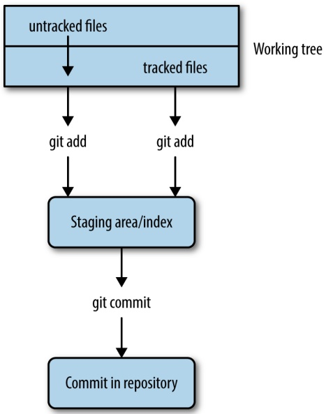
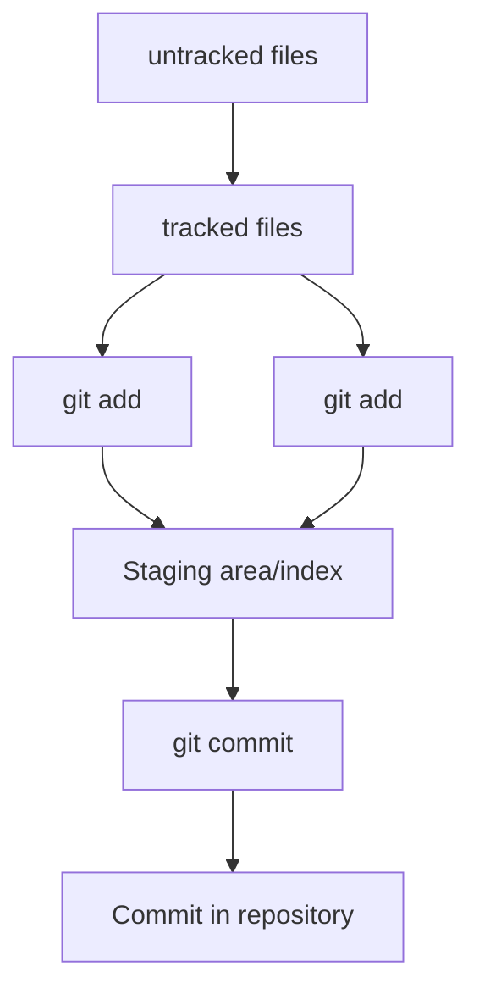
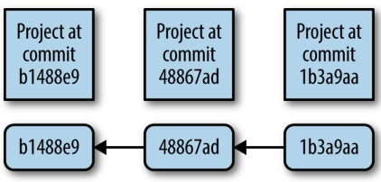
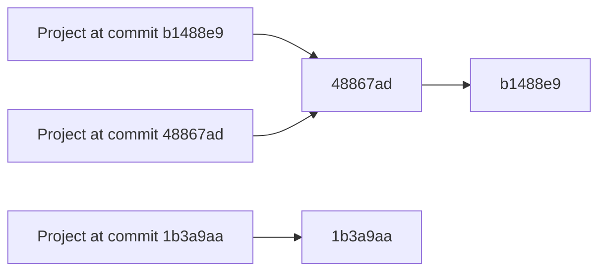

# Git for Scientists

In Chapter 2, we discussed organizing a bioinformatics project directory and how this helps keep your work tidy during development. Good organization also facilitates automating tasks, which makes our lives easier and leads to more reproducible work. However, as our project changes over time and possibly incorporates the work of our collaborators, we face an additional challenge: managing different file versions.

It’s likely that you already use some sort of versioning system in your work. For example, you may have files with names such as thesis-vers1.docx, thesisvers3\_CD\_edits.docx, analysis-vers6.R, and thesis-vers8\_CD+GM+SW\_edits.docx. Storing these past versions is helpful because it allows us to go back and restore whole files or sections if we need to. File versions also help us differentiate our copies of a file from those edited by a collaborator. However, this ad hoc file versioning system doesn’t scale well to complicated bioinformatics projects—our otherwise tidy project directories would be muddled with different versioned scripts, R analyses, README files, and papers.

Project organization only gets more complicated when we work collaboratively. We could share our entire directory with a colleague through a service like Dropbox or Google Drive, but we run the risk of something getting deleted or corrupted. It’s also not possible to drop an entire bioinformatics project directory into a shared directory, as it likely contains gigabytes (or more) of data that may be too large to share across a network. These tools are useful for sharing small files, but aren’t intended to manage large collaborative projects involving changing code and data.

Luckily, software engineers have faced these same issues in modern collaborative software development and developed version control systems (VCS) to manage different versions of collaboratively edited code. The VCS we’ll use in this chapter was written by Linus Torvalds and is called Git. Linus wrote Git to manage the Linux kernel (which he also wrote), a large codebase with thousands of collaborators simultaneously changing and working on files. As you can imagine, Git is well suited for project version control and collaborative work.

Admittedly, Git can be tricky to learn at first. I highly recommend you take the time to learn Git in this chapter, but be aware that understanding Git (like most topics in this book, and arguably everything in life) will take time and practice. Throughout this chapter, I will indicate when certain sections are especially advanced; you can revisit these later without problems in continuity with the rest of the book. Also, I recommend you practice Git with the example projects and code from the book to get the basic commands in the back of your head. After struggling in the beginning with Git, you’ll soon see how it’s the best version control system out there.

## Why Git Is Necessary in Bioinformatics Projects

As a longtime proponent of Git, I’ve suggested it to many colleagues and offered to teach them the basics. In most cases, I find the hardest part is actually in convincing scientists they should adopt version control in their work. Because you may be wondering whether working through this chapter is worth it, I want to discuss why learning Git is definitely worth the effort. If you’re already 100% convinced, you can dive into learning Git in the next section.

## Git Allows You to Keep Snapshots of Your Project

With version control systems, you create snapshots of your current project at specific points in its development. If anything goes awry, you can rewind to a past snapshot of your project’s state (called a commit) and restore files. In the fast pace of bioinformatics work, having this safeguard is very useful.

Git also helps fix a frustrating type of bug known as software regression, where a piece of code that was once working mysteriously stops working or gives different results. For example, suppose that you’re working on an analysis of SNP data. You find in your analysis that 14% of your SNPs fall in coding regions in one stretch of a chromosome. This is relevant to your project, so you cite this percent in your paper and make a commit.

Two months later, you’ve forgotten the details of this analysis, but need to revisit the 14% statistic. Much to your surprise, when you rerun the analysis code, this changes to 26%! If you’ve been tracking your project’s development by making commits (e.g., taking snapshots), you’ll have an entire history of all of your project’s changes and can pinpoint when your results changed.

Git commits allow you to easily reproduce and rollback to past versions of analysis. It’s also easy to look at every commit, when it was committed, what has changed across commits, and even compare the difference between any two commits. Instead of redoing months of work to find a bug, Git can give you line-by-line code differences across versions.

In addition to simplifying bug finding, Git is an essential part of proper documentation. When your code produces results, it’s essential that this version of code is fully documented for reproducibility. A good analogy comes from my friend and colleague Mike Covington: imagine you keep a lab notebook in pencil, and each time you run a new PCR you erase your past results and jot down the newest ones. This may sound extreme, but is functionally no different than changing code and not keeping a record of past versions.

## Git Helps You Keep Track of Important Changes to Code

Most software changes over time as new features are added or bugs are fixed. It’s important in scientific computing to follow the development of software we use, as a fixed bug could mean the difference between correct and incorrect results in our own work. Git can be very helpful in helping you track changes in code—to see this, let’s look at a situation I’ve run into (and I suspect happens in labs all over the world).

Suppose a lab has a clever bioinformatician who has written a script that trims poor quality regions from reads. This bioinformatician then distributes this to all members of his lab. Two members of his lab send it to friends in other labs. About a month later, the clever bioinformatician realizes there’s a bug that leads to incorrect results in certain cases. The bioinformatician quickly emails everyone in his lab the new version and warns them of the potential for incorrect results. Unfortunately, members of the other lab may not get the message and could continue using the older buggy version of the script.

Git helps solve this problem by making it easy to stay up to date with software development. With Git, it’s easy to both track software changes and download new software versions. Furthermore, services like GitHub and Bitbucket host Git repositories on the Web, which makes sharing and collaborating on code across labs easy.

## Git Helps Keep Software Organized and Available After People Leave

Imagine another situation: a postdoc moves to start her own lab, and all of her different software tools and scripts are scattered in different directories, or worse, completely lost. Disorderedly code disrupts and inconveniences other lab members; lost code leads to irreproducible results and could delay future research.

Git helps maintain both continuity in work and a full record of a project’s history. Centralizing an entire project into a repository keeps it organized. Git stores every committed change, so the entire history of a project is available even if the main developer leaves and isn’t around for questions. With the ability to roll back to past versions, modifying projects is less risky, making it easier to build off existing work.

## Installing Git

If you’re on OS X, install Git through Homebrew (e.g., brew install git); on Linux, use apt-get (e.g., apt-get install git). If your system does not have a package manager, [the Git website](http://git-scm.com/) has both source code and executable versions of Git.

## Basic Git: Creating Repositories, Tracking Files, and Staging and Committing Changes

Now that we’ve seen some Git concepts and how Git fits into your bioinformatics workflow, let’s explore the most basic Git concepts of creating repositories, telling Git which files to track, and staging and committing changes.

## Git Setup: Telling Git Who You Are

Because Git is meant to help with collaborative editing of files, you need to tell Git who you are and what your email address is. To do this, use:

\$ git config --global user.name "Sewall Wright"
\$ git config --global user.email "swright@adaptivelandscape.org"

Make sure to use your own name and email, or course. We interact with Git through subcommands, which are in the format git &lt;subcommand&gt;. Git has loads of subcommands, but you’ll only need a few in your daily work.

Another useful Git setting to enable now is terminal colors. Many of Git’s subcommands use terminal colors to visually indicate changes (e.g., red for deletion and green for something new or modified). We can enable this with:

\$ git config --global color.ui true

## git init and git clone: Creating Repositories

To get started with Git, we first need to initialize a directory as a Git repository. A repository is a directory that’s under version control. It contains both your current working files and snapshots of the project at certain points in time. In version control lingo, these snapshots are known as commits. Working with Git is fundamentally about creating and manipulating these commits: creating commits, looking at past commits, sharing commits, and comparing different commits.

With Git, there are two primary ways to create a repository: by initializing one from an existing directory, or cloning a repository that exists elsewhere. Either way, the result is a directory that Git treats as a repository. Git only manages the files and subdirectories inside the repository directory—it cannot manage files outside of your repository.

Let’s start by initializing the zmays-snps/ project directory we created in Chapter 2 as a Git repository. Change into the zmays-snps/ directory and use the Git subcommand git init:

\$ git init

Initialized empty Git repository in /Users/vinceb/Projects/zmays-snps/.git/

git init creates a hidden directory called .git/ in your zmays-snps/ project directory (you can see it with ls -a). This .git/ directory is how Git manages your repository behind the scenes. However, don’t modify or remove anything in this directory—it’s meant to be manipulated by Git only. Instead, we interact with our repository through Git subcommands like git init.

The other way to create a repository is through cloning an existing repository. You can clone repositories from anywhere: somewhere else on your filesystem, from your local network, or across the Internet. Nowadays, with repository hosting services like GitHub and Bitbucket, it’s most common to clone Git repositories from the Web.

Let’s practice cloning a repository from GitHub. For this example, we’ll clone the Seqtk code from Heng Li’s GitHub page. Seqtk is short for SEQuence ToolKit, and contains a well-written and useful set of tools for processing FASTQ and FASTA files. First, [visit the GitHub repository](http://github.com/lh3/seqtk) and poke around a bit. All of GitHub’s repositories have this URL syntax: user/repository. Note on this repository’s page that clone URL on the righthand side—this is where you can copy the link to clone this repository.

Now, let’s switch to a directory outside of zmays-snps/. Whichever directory you choose is fine; I use a \~/src/ directory for cloning and compiling other developers tools. From this directory, run:

```txt
$ git clone git://github.com/lh3/seqtk.git
Cloning into 'seqtk'...
remote: Counting objects: 92, done.
remote: Compressing objects: 100% (47/47), done.
remote: Total 92 (delta 56), reused 80 (delta 44)
Receiving objects: 100% (92/92), 32.58 KiB, done.
Resolving deltas: 100% (56/56), done.
```

git clone clones seqtk to your local directory, mirroring the original repository on GitHub. Note that you won’t be able to directly modify Heng Li’s original GitHub repository—cloning this repository only gives you access to retrieve new updates from the GitHub repository as they’re released.

Now, if you cd into seqtk/ and run ls, you’ll see seqtk’s source:

```perl
$ cd seqtk
$ ls
Makefile README.md khash.h kseq.h seqtk.c
```

Despite originating through different methods, both zmays-snps/ and seqtk/ are Git repositories.

## Tracking Files in Git: git add and git status Part I

Although you’ve initialized the zmays-snps/ as a Git repository, Git doesn’t automatically begin tracking every file in this directory. Rather, you need to tell Git which files to track using the subcommand git add. This is actually a useful feature of Git—bioinformatics projects contain many files we don’t want to track, including large data files, intermediate results, or anything that could be easily regenerated by rerunning a command.

Before tracking a file, let’s use the command git status to check Git’s status of the files in our repository (switch to the zmays-snps/ directory if you are elsewhere):

```txt
$ git status
# On branch master ①
#
# Initial commit
#
# Untracked files: ②
# (use "git add <file>..." to include in what will be committed)
#
#       README
#       data/
nothing added to commit but untracked files present (use "git add" to track)
```

git status tell us:

1 We’re on branch master, which is the default Git branch. Branches allow you to work on and switch between different versions of your project simultaneously. Git’s simple and powerful branches are a primary reason it’s such a popular version control system. We’re only going to work with Git’s default master branch for now, but we’ll learn more about branches later in this chapter.
We have a list of “Untracked files,” which include everything in the root project directory. Because we haven’t told Git to track anything, Git has nothing to put in a commit if we were to try.

It’s good to get git status under your fingers, as it’s one of the most frequently used Git commands. git status describes the current state of your project repository: what’s changed, what’s ready to be included in the next commit, and what’s not being tracked. We’ll use it extensively throughout the rest of this chapter.

Let’s use git add to tell Git to track the README and data/README files in our zmays-snps/ directory:

\$ git add README data/README

Now, Git is tracking both data/README and README. We can verify this by running git status again:

```perl
$ ls
README   analysis data    scripts
$ git status
# On branch master
#
# Initial commit
#
# Changes to be committed:
#   (use "git rm --cached <file>..." to unstage)
#
#       new file:  README ①
#       new file:  data/README
#
# Untracked files:
#   (use "git add <file>..." to include in what will be committed)
#
#       data/seqs/ ②
```

1 Note now how Git lists README and data/README as new files, under the section “changes to be committed.” If we made a commit now, our commit would take a snapshot of the exact version of these files as they were when we added them with git add.
There are also untracked directories like data/seqs/, as we have not told Git to track these yet. Conveniently, git status reminds us we could use git add to add these to a commit.

The scripts/ and analysis/ directories are not included in git status because they are empty. The data/seqs/ directory is included because it contains the empty sequence files we created with touch in Chapter 2.

## Staging Files in Git: git add and git status Part II

With Git, there’s a difference between tracked files and files staged to be included in the next commit. This is a subtle difference, and one that often causes a lot of confusion for beginners learning Git. A file that’s tracked means Git knows about it. A staged file is not only tracked, but its latest changes are staged to be included in the next commit (see Figure 5-1).

A good way to illustrate the difference is to consider what happens when we change one of the files we started tracking with git add. Changes made to a tracked file will not automatically be included in the next commit. To include these new changes, we would need to explicitly stage them—using git add again. Part of the confusion lies in the fact that git add both tracks new files and stages the changes made to tracked files. Let’s work through an example to make this clearer.



<details>
<summary>flowchart</summary>


</details>

Figure 5-1. Git’s separation of the working tree (all files in your repository), the staging area (files to be included in the next commit), and committed changes (a snapshot of a version of your project at some point in time); git add on an untracked file begins tracking it and stages it, while git add on a tracked file just stages it for the next commit

From the git status output from the last section, we see that both the data/ README and README files are ready to be committed. However, look what hap pens when we make a change to one of these tracked files and then call git status:

```txt
$ echo "Zea Mays SNP Calling Project" >> README    # change file README
$ git status
# On branch master
#
# Initial commit
#
# Changes to be committed:
#   (use "git rm --cached <file>..." to unstage)
#
#       new file:  README
#       new file:  data/README
#
# Changes not staged for commit:
#   (use "git add <file>..." to update what will be committed)
#   (use "git checkout -- <file>..." to discard changes in working directory)
#
```

```txt
#       modified:  README
#
# Untracked files:
#   (use "git add <file>..." to include in what will be committed)
#
#       data/seqs/
```

After modifying README, git status lists README under “changes not staged for commit.” This is because we’ve made changes to this file since initially tracking and staging README with git add (when first tracking a file, its current version is also staged). If we were to make a commit now, our commit would include the previous version of README, not this newly modified version.

To add these recent modifications to README in our next commit, we stage them using git add. Let’s do this now and see what git status returns:

```txt
$ git add README
$ git status
# On branch master
#
# Initial commit
#
# Changes to be committed:
# (use "git rm --cached <file>..." to unstage)
#
# new file: README
# new file: data/README
#
# Untracked files:
# (use "git add <file>..." to include in what will be committed)
#
# data/seqs/
# notebook.md
```

Now, README is listed under “Changes to be committed” again, because we’ve staged these changes with git add. Our next commit will include the most recent version.

Again, don’t fret if you find this confusing. The difference is subtle, and it doesn’t help that we use git add for both operations. Remember the two roles of git add:

• Alerting Git to start tracking untracked files (this also stages the current version of the file to be included in the next commit)
• Staging changes made to an already tracked file (staged changes will be included in the next commit)

It’s important to be aware that any modifications made to a file since the last time it was staged will not be included in the next commit unless they are staged with git add. This extra step may seem like an inconvenience but actually has many benefits.

Suppose you’ve made changes to many files in a project. Two of these files’ changes are complete, but everything else isn’t quite ready. Using Git’s staging, you can stage and commit only these two complete files and keep other incomplete files out of your commit. Through planned staging, your commits can reflect meaningful points in development rather than random snapshots of your entire project directory (which would likely include many files in a state of disarray). When we learn about committing in the next section, we’ll see a shortcut to stage and commit all modified files.

## git commit: Taking a Snapshot of Your Project

We’ve spoken a lot about commits, but haven’t actually made one yet. When first learning Git, the trickiest part of making a commit is understanding staging. Actually committing your staged commits is quite easy:

```txt
\$ git commit -m "initial import"
2 files changed, 1 insertion(+)
create mode 100644 README
create mode 100644 data/README
```

This command commits your staged changes to your repository with the commit message “initial import.” Commit messages are notes to your collaborators (and yourself in the future) about what a particular commit includes. Optionally, you can omit the -m option, and Git will open up your default text editor. If you prefer to write commit messages in a text editor (useful if they are multiline messages), you can change the default editor Git uses with:

\$ git config --global core.editor emacs

where emacs can be replaced by vim (the default) or another text editor of your choice.


## Some Advice on Commit Messages

Commit messages may seem like an inconvenience, but it pays off in the future to have a description of how a commit changes code and what functionality is affected. In three months when you need to figure out why your SNP calling analyses are returning unexpected results, it’s much easier to find relevant commits if they have messages like “modifying SNP frequency function to fix singleton bug, refactored coverage calculation” rather than “cont” (that’s an actual commit I’ve seen in a public project). For an entertaining take on this, see [xkcd’s “Git Commit” comic](http://xkcd.com/1296/).

Earlier, we staged our changes using git add. Because programmers like shortcuts, there’s an easy way to stage all tracked files’ changes and commit them in one command: git commit -a -m "your commit message". The option -a tells git commit to automatically stage all modified tracked files in this commit. Note that while this saves time, it also will throw all changes to tracked files in this commit. Ideally commits should reflect helpful snapshots of your project’s development, so including every slightly changed file may later be confusing when you look at your repository’s history. Instead, make frequent commits that correspond to discrete changes to your project like “new counting feature added” or “fixed bug that led to incorrect translation.”

We’ve included all changes in our commit, so our working directory is now “clean”: no tracked files differ from the version in the last commit. Until we make modifications, git status indicates there’s nothing to commit:

```txt
$ git status
# On branch master
# Untracked files:
# (use "git add <file>..." to include in what will be committed)
#
# data/seqs/
```

Untracked files and directories will still remain untracked (e.g., data/seqs/), and any unstaged changes to tracked files will not be included in the next commit unless added. Sometimes a working directory with unstaged changes is referred to as “messy,” but this isn’t a problem.

## Seeing File Differences: git diff

So far we’ve seen the Git tools needed to help you stage and commit changes in your repository. We’ve used the git status subcommand to see which files are tracked, which have changes, and which are staged for the next commit. Another subcommand is quite helpful in this process: git diff.

Without any arguments, git diff shows you the difference between the files in your working directory and what’s been staged. If none of your changes have been staged, git diff shows us the difference between your last commit and the current versions of your files. For example, if I add a line to README.md and run git diff:

```powershell
$ echo "Project started 2013-01-03" >> README
$ git diff
diff --git a/README b/README
index 5483cfd..ba8d7fc 100644
--- a/README ①
+++ b/README
@@ -1 +1,2 @@ ②
 Zea Mays SNP Calling Project
+Project started 2013-01-03 ③
```

This format (called a unified diff) may seem a bit cryptic at first. When Git’s terminal colors are enabled, git diff’s output is easier to read, as added lines will be green and deleted lines will be red.

1 This line (and the one following it) indicate there are two versions of the README file we are comparing, a and b. The --- indicates the original file—in our case, the one from our last commit. +++ indicates the changed version.
2 This denotes the start of a changed hunk (hunk is diff ’s term for a large changed block), and indicates which line the changes start on, and how long they are. Diffs try to break your changes down into hunks so that you can easily identify the parts that have been changed. If you’re curious about the specifics, see [Wikipedia’s page on the diff utility](http://bit.ly/diff-utility).
3 Here’s the meat of the change. Spaces before the line (e.g., the line that begins Zea Mays… indicates nothing was changed (and just provide context). Plus signs indicate a line addition (e.g., the line that begins Project…), and negative signs indicate a line deletion (not shown in this diff because we’ve only added a line). Changes to a line are represented as a deletion of the original line and an addition of the new line.

After we stage a file, git diff won’t show any changes, because git diff compares the version of files in your working directory to the last staged version. For example:

```txt
$ git add README
$ git diff # shows nothing
```

If we wanted to compare what’s been staged to our last commit (which will show us exactly what’s going into the next commit), we can use git diff --staged (in old versions of Git this won’t work, so upgrade if it doesn’t). Indeed, we can see the change we just staged:

```diff
$ git diff --staged
diff --git a/README b/README
index 5483cfd..ba8d7fc 100644
--- a/README
+++ b/README
@@ -1 +1,2 @@
 Zea Mays SNP Calling Project
+Project started 2013-01-03
```

git diff can also be used to compare arbitrary objects in our Git commit history, a topic we’ll see in “More git diff: Comparing Commits and Files” on page 100.

## Seeing Your Commit History: git log

Commits are like chains (more technically, directed acyclic graphs), with each commit pointing to its parent (as in Figure 5-2).



<details>
<summary>flowchart</summary>


</details>

Initial import

Figure 5-2. Commits in Git take discrete snapshots of your project at some point in time, and each commit (except the first) points to its parent commit; this chain of commits is your set of connected snapshots that show how your project repository evolves

We can use git log to visualize our chain of commits:

```txt
$ git log
commit 3d7ffa6f0276e607dcd94e18d26d21de2d96a460 ①
Author: Vince Buffalo <vsbuffaloAAAAAA@gmail.com>
Date:    Mon Sep 23 23:55:08 2013 -0700
```

initial import

1 This strange looking mix of numbers and characters is a SHA-1 checksum. Each commit will have one of these, and they will depend on your repository’s past commit history and the current files. SHA-1 hashes act as a unique ID for each commit in your repository. You can always refer to a commit by its SHA-1 hash.


## git log and Your Terminal Pager

git log opens up your repository’s history in your default pager (usually either the program more or less). If you’re unfamiliar with pagers, less, and more, don’t fret. To exit and get back to your prompt, hit the letter q. You can move forward by pressing the space bar, and move backward by pressing b. We’ll look at less in more detail in Chapter 7.

Let’s commit the change we made in the last section:

```txt
$ git commit -a -m "added information about project to README"
[master 94e2365] added information about project to README
1 file changed, 1 insertion(+)
```

Now, if we look at our commit history with git log, we see:

```txt
$ git log
commit 94e2365dd66701a35629d29173d640fdae32fa5c
Author: Vince Buffalo <vsbuffaloAAAAA@gmail.com>
Date:   Tue Sep 24 00:02:11 2013 -0700
```

added information about project to README

```txt
commit 3d7ffa6f0276e607dcd94e18d26d21de2d96a460
Author: Vince Buffalo <vsbuffaloAAAAA@gmail.com>
Date: Mon Sep 23 23:55:08 2013 -0700
```

initial import

As we continue to make and commit changes to our repository, this chain of commits will grow. If you want to see a nice example of a longer Git history, change directories to the seqtk repository we cloned earlier and call git log.

## Moving and Removing Files: git mv and git rm

When Git tracks your files, it wants to be in charge. Using the command mv to move a tracked file will confuse Git. The same applies when you remove a file with rm. To move or remove tracked files in Git, we need to use Git’s version of mv and rm: git mv and git rm.

For example, our README file doesn’t have an extension. This isn’t a problem, but because the README file might later contain Markdown, it’s not a bad idea to change its extension to .md. You can do this using git mv:

```shell
$ git mv README README.md
$ git mv data/README data/README.md
```

Like all changes, this isn’t stored in your repository until you commit it. If you ls your files, you can see your working copy has been renamed:

```txt
\$ ls
README.md analysis data notebook.md scripts
```

Using git status, we see this change is staged and ready to be committed:

```perl
$ git status
# On branch master
# Changes to be committed:
# (use "git reset HEAD <file>..." to unstage)
#
#       renamed:   README -> README.md
#       renamed:   data/README -> data/README.md
#
# Untracked files:
# (use "git add <file>..." to include in what will be committed)
#
#       data/seqs/
```

git mv already staged these commits for us; git add is only necessary for staging modifications to the contents of files, not moving or removing files. Let’s commit these changes:

```txt
$ git commit -m "added markdown extensions to README files"
[master e4feb22] added markdown extensions to README files
2 files changed, 0 insertions(+), 0 deletions(-)
rename README => README.md (100%)
rename data/{README => README.md} (100%)
```

Note that even if you change or remove a file and commit it, it still exists in past snapshots. Git does its best to make everything recoverable. We’ll see how to recover files later on in this chapter.

## Telling Git What to Ignore: .gitignore

You may have noticed that git status keeps listing which files are not tracked. As the number of files in your bioinformatics project starts to increase (this happens quickly!) this long list will become a burden.

Many of the items in this untracked list may be files we never want to commit. Sequencing data files are a great example: they’re usually much too large to include in a repository. If we were to commit these large files, collaborators cloning your repository would have to download these enormous data files. We’ll talk about other ways of managing these later, but for now, let’s just ignore them.

Suppose we wanted to ignore all FASTQ files (with the extension .fastq) in the data/ seqs/ directory. To do this, create and edit the file .gitignore in your zmays-snps/ repository directory, and add:

```ignorefile
data/seqs/*.fastq
```

Now, git status gives us:

```txt
\$ git status
# On branch master
# Untracked files:
# (use "git add <file>..." to include in what will be committed)
#
# .gitignore
```

It seems we’ve gotten rid of one annoyance (the data/seqs/ directory in “Untracked files”) but added another (the new .gitignore). Actually, the best way to resolve this is to add and commit your .gitignore file. It may seem counterintuitive to contribute a file to a project that’s merely there to tell Git what to ignore. However, this is a good practice; it saves collaborators from seeing a listing of untracked files Git should ignore. Let’s go ahead and stage the .gitignore file, and commit this and the filename changes we made earlier:

```txt
$ git add .gitignore
$ git commit -m "added .gitignore"
[master c509f63] added .gitignore
 1 file changed, 1 insertion(+)
 create mode 100644 .gitignore
```

What should we tell .gitignore to ignore? In the context of a bioinformatics project, here are some guidelines:

## Large files

These should be ignored and managed by other means, as Git isn’t designed to manage really large files. Large files slow creating, pushing, and pulling commits. This can lead to quite a burden when collaborators clone your repository.

## Intermediate files

Bioinformatics projects are often filled with intermediate files. For example, if you align reads to a genome, this will create SAM or BAM files. Even if these aren’t large files, these should probably be ignored. If a data file can easily be reproduced by rerunning a command (or better yet, a script), it’s usually preferable to just store how it was created. Ultimately, recording and storing how you created an intermediate file in Git is more important than the actual file. This also ensures reproducibility.

## Text editor temporary files

Text editors like Emacs and Vim will sometimes create temporary files in your directory. These can look like textfile.txt\~ or #textfile.txt#. There’s no point in storing these in Git, and they can be an annoyance when viewing progress with git status. These files should always be added to .gitignore. Luckily, .gitignore takes wildcards, so these can be ignored with entries like \*\~ and \#\*\#.

## Temporary code files

Some language interpreters (e.g., Python) produce temporary files (usually with some sort of optimized code). With Python, these look like overlap.pyc.

We can use a global .gitignore file to universally ignore a file across all of our projects. Good candidates of files to globally ignore are our text editor’s temporary files or files your operating system creates (e.g., OS X will sometimes create hidden files named .DS\_Store in directories to store details like icon position). GitHub maintains [a useful repository of global .gitignore suggestions](http://bit.ly/git_ignore).

You can create a global .gitignore file in \~/.gitignore\_global and then configure Git to use this with the following:

git config --global core.excludesfile \~/.gitignore\_global

A repository should store everything required to replicate a project except large datasets and external programs. This includes all scripts, documentation, analysis, and possibly even a final manuscript. Organizing your repository this way means that all