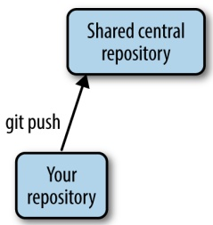
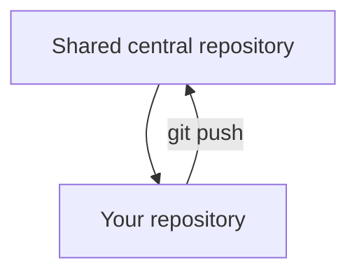
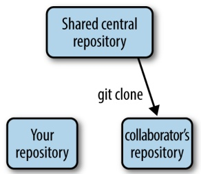
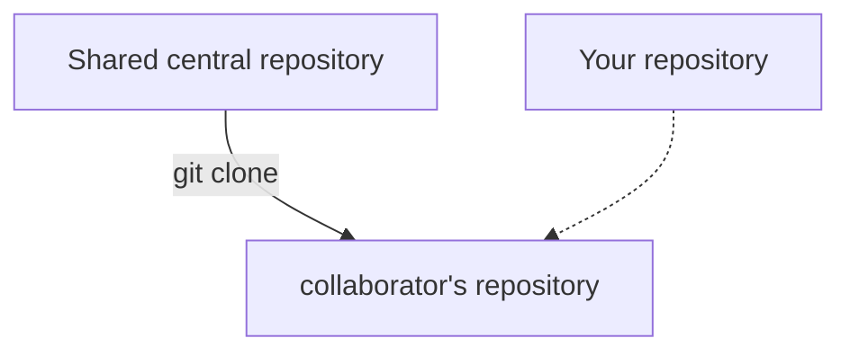
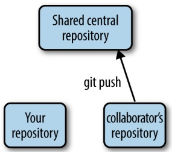
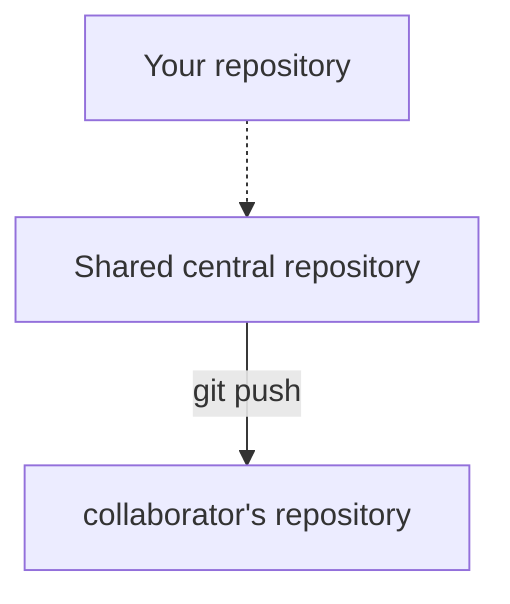
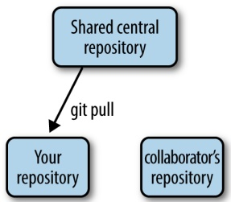
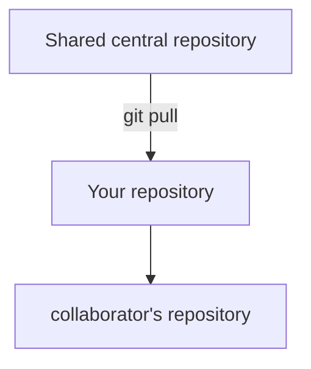
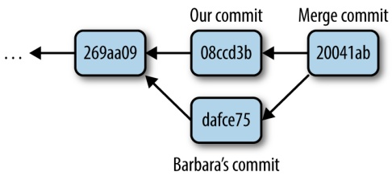
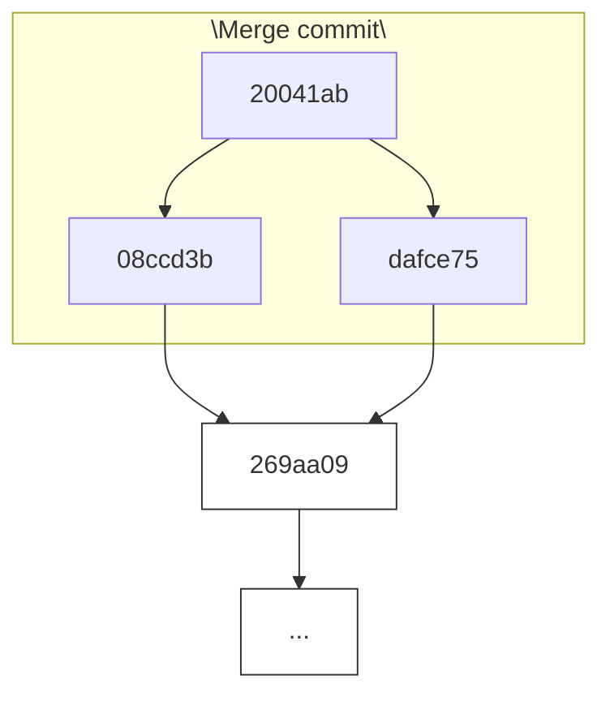

of your project’s dependencies are in one place and are managed by Git. In the long run, it’s far easier to have Git keep track of your project’s files, than try to keep track of them yourself.

## Undoing a Stage: git reset

Recall that one nice feature of Git is that you don’t have to include messy changes in a commit—just don’t stage these files. If you accidentally stage a messy file for a commit with git add, you can unstage it with git reset. For example, suppose you add a change to a file, stage it, but decide it’s not ready to be committed:

```txt
$ echo "TODO: ask sequencing center about adapters" >> README.md
$ git add README.md
$ git status
# On branch master
# Changes to be committed:
# (use "git reset HEAD <file>..." to unstage)
#
# new file: README.md
#
```

With git status, we can see that our change to README.md is going to be included in the next commit. To unstage this change, follow the directions git status provides:

```perl
$ git reset HEAD README.md
$ git status
# On branch master
# Changes not staged for commit:
# (use "git add <file>..." to update what will be committed)
# (use "git checkout -- <file>..." to discard changes in working directory)
#
# modified: README.md
#
```

The syntax seems a little strange, but all we’re doing is resetting our staging area (which Git calls the index) to the version at HEAD for our README.md file. In Git’s lingo, HEAD is an alias or pointer to the last commit on the current branch (which is, as mentioned earlier, the default Git branch called master). Git’s reset command is a powerful tool, but its default action is to just reset your index. We’ll see additional ways to use git reset when we learn about working with commit histories.

## Collaborating with Git: Git Remotes, git push, and git pull

Thus far, we’ve covered the very basics of Git: tracking and working with files, staging changes, making commits, and looking at our commit history. Commits are the foundation of Git—they are the snapshots of our project as it evolves. Commits allow you to go back in time and look at, compare, and recover past versions, which are all topics we look at later in this chapter. In this section, we’re going to learn how to collaborate with Git, which at its core is just about sharing commits between your repository and your collaborators’ repositories.

The basis of sharing commits in Git is the idea of a remote repository, which is just a version of your repository hosted elsewhere. This could be a shared departmental server, your colleague’s version of your repository, or on a repository hosting service like GitHub or Bitbucket. Collaborating with Git first requires we configure our local repository to work with our remote repositories. Then, we can retrieve commits from a remote repository (a pull) and send commits to a remote repository (a push).

Note that Git, as a distributed version control system, allows you to work with remote repositories any way you like. These workflow choices are up to you and your collaborators. In this chapter, we’ll learn an easy common workflow to get started with: collaborating over a shared central repository.

Let’s take a look at an example: suppose that you’re working on a project you wish to share with a colleague. You start the project in your local repository. After you’ve made a few commits, you want to share your progress by sharing these commits with your collaborator. Let’s step through the entire workflow before seeing how to execute it with Git:

1. You create a shared central repository on a server that both you and your collaborator have access to.
2. You push your project’s initial commits to this repository (seen in (a) in Figure 5-3).
3. Your collaborator then retrieves your initial work by cloning this central repository (seen in (b) in Figure 5-3).
4. Then, your collaborator makes her changes to the project, commits them to her local repository, and then pushes these commits to the central repository (seen in (a) in Figure 5-4).
5. You then pull in the commits your collaborator pushed to the central repository (seen in (b) in Figure 5-4). The commit history of your project will be a mix of both you and your collaborator’s commits.



<details>
<summary>flowchart</summary>


</details>

(a)



<details>
<summary>flowchart</summary>


</details>

(b)

Figure 5-3. After creating a new shared central repository, you push your project’s commits (a); your collaborator can retrieve your project and its commits by cloning this central repository (b)



<details>
<summary>flowchart</summary>


</details>

(a)



<details>
<summary>flowchart</summary>


</details>

(b)

Figure 5-4. After making and committing changes, your collaborator pushes them to the central repository (a); to retrieve your collaborator’s new commits, you pull them from the central repository (b)

This process then repeats: you and your collaborator work independently in your own local repositories, and when either of you have commits to share, you push them to the central repository. In many cases, if you and your collaborator work on different files or different sections of the same file, Git can automatically figure out how best to merge these changes. This is an amazing feature of collaborating with Git: you and your collaborator can work on the same project simultaneously. Before we dive into how to do this, there is one caveat to discuss.

It’s important to note that Git cannot always automatically merge code and documents. If you and your collaborator are both editing the same section of the same file and both of you commit these changes, this will create a merge conflict. Unfortunately, one of you will have to resolve the conflicting files manually. Merge conflicts occur when you (or your collaborator) pull in commits from the central repository and your collaborator’s (or your) commits conflict with those in the local repository. In these cases, Git just isn’t smart enough to figure out how to reconcile you and your collaborator’s conflicting versions.

Most of us are familiar with this process when we collaboratively edit manuscripts in a word processor. If you write a manuscript and send it to all your collaborators to edit, you will need to manually settle sections with conflicting edits. Usually, we get around this messy situation through planning and prioritizing which coauthors will edit first, and gradually incorporating changes. Likewise, good communication and planning with your collaborators can go far in preventing Git merge conflicts, too. Additionally, it’s helpful to frequently push and pull commits to the central repository; this keeps all collaborators synced so everyone’s working with the newest versions of files.

## Creating a Shared Central Repository with GitHub

The first step of our workflow is to create a shared central repository, which is what you and your collaborator(s) share commits through. In our examples, we will use GitHub, a web-based Git repository hosting service. [Bitbucket](http://bitbucket.org/) is another Git repository hosting service you and your collaborators could use. Both are excellent; we’ll use GitHub because it’s already home to many large bioinformatics projects like Biopython and Samtools.

Navigate to [http://github.com](http://github.com) and sign up for an account. After your account is set up, you’ll be brought to the GitHub home page, which is a newsfeed for you to follow project development (this newsfeed is useful to follow how bioinformatics software you use changes over time). On the main page, there’s a link to create a new repository. After you’ve navigated to [the Create a New Repository page](https://github.com/new), you’ll see you need to provide a repository name, and you’ll have the choice to initialize with a README.md file (GitHub plays well with Markdown), a .gitignore file, and a license (to license your software project). For now, just create a repository named zmayssnps. After you’ve clicked the “Create repository” button, GitHub will forward you to an empty repository page—the public frontend of your project.

There are a few things to note about GitHub:

• Public repositories are free, but private repositories require you to pay. Luckily, GitHub has [a special program for educational users](http://github.com/edu). If you need private repositories without cost, Bitbucket has a different pricing scheme and provides some for free. Or, you can set up your own internal Git repository on your network if you have shared server space. Setting up your own Git server is out of the scope of this book, but see “Git on the Server - Setting Up the Server” in Scott Chacon and Ben Straub’s free online book [Pro Git](http://bit.ly/setup-server) for more information. If your repository is public, anyone can see the source (and even clone and develop their own versions of your repository). However, other users don’t have access to modify your GitHub repository unless you grant it to them.

• If you’re going to use GitHub for collaboration, all participating collaborators need a GitHub account.
• By default, you are the only person who has write (push) access to the repository you created. To use your remote repository as a shared central repository, you’ll have to add collaborators in your GitHub repository’s settings. Collaborators are GitHub users who have access to push their changes to your repository on Git‐Hub (which modifies it).
• There are other common GitHub workflows. For example, if you manage a lab or other group, you can set up an organization account. You can create repositories and share them with collaborators under the organization’s name. We’ll discuss other GitHub workflows later in this chapter.

## Authenticating with Git Remotes

GitHub uses SSH keys to authenticate you (the same sort we generated in “Quick Authentication with SSH Keys” on page 59). SSH keys prevent you from having to enter a password each time you push or pull from your remote repository. Recall in “Quick Authentication with SSH Keys” on page 59 we generated two SSH keys: a public key and a private key. Navigate to your account settings on GitHub, and in account settings, find the SSH keys tab. Here, you can enter your public SSH key (remember, don’t share your private key!) by using cat \~/.ssh/id\_rsa.pub to view it, copying it to your clipboard, and pasting it into GitHub’s form. You can then try out your SSH public key by using:

```txt
\$ ssh -T git@github.com
Hi vsbuffalo! You've successfully authenticated, but GitHub does not provide shell access.
```

If you’re having troubles with this, consult GitHub’s [“Generating SSH Keys” article](http://bit.ly/genkeys).

GitHub allows you to use to HTTP as a protocol, but this is typically only used if your network blocks SSH. By default, HTTP asks for passwords each time you try to pull and push (which gets tiresome quickly), but there are ways around this—see GitHub’s [“Caching Your GitHub Password in Git”](http://bit.ly/cache-pw) article.

## Connecting with Git Remotes: git remote

Now, let’s configure our local repository to use the GitHub repository we’ve just created as a remote repository. We can do this with git remote add:

\$ git remote add origin git@github.com:username/zmays-snps.git

In this command, we specify not only the address of our Git repository (git@github.com:username/zmays-snps.git), but also a name for it: origin. By convention, origin is the name of your primary remote repository. In fact, earlier when we cloned Seqtk from GitHub, Git automatically added the URL we cloned from as a remote named origin.

Now if you enter git remote -v (the -v makes it more verbose), you see that our local Git repository knows about the remote repository:

```txt
$ git remote -v
origin  git@github.com:username/zmays-snps.git (fetch)
origin  git@github.com:username/zmays-snps.git (push)
```

Indeed, origin is now a repository we can push commits to and fetch commits from. We’ll see how to do both of these operations in the next two sections.

It’s worth noting too that you can have multiple remote repositories. Earlier, we mentioned that Git is a distributed version control system; as a result, we can have many remote repositories. We’ll come back to how this is useful later on. For now, note that you can add other remote repositories with different names. If you ever need to delete an unused remote repository, you can with git remote rm &lt;repository-name&gt;.

## Pushing Commits to a Remote Repository with git push

With our remotes added, we’re ready to share our work by pushing our commits to a remote repository. Collaboration on Git is characterized by repeatedly pushing your work to allow your collaborators to see and work on it, and pulling their changes into your own local repository. As you start collaborating, remember you only share the commits you’ve made.

Let’s push our initial commits from zmays-snps into our remote repository on Git‐Hub. The subcommand we use here is git push &lt;remote-name&gt; &lt;branch&gt;. We’ll talk more about using branches later, but recall from “Tracking Files in Git: git add and git status Part I” on page 72 that our default branch name is master. Thus, to push our zmays-snps repository’s commits, we do this:

```txt
$ git push origin master
Counting objects: 14, done.
Delta compression using up to 2 threads.
Compressing objects: 100% (9/9), done.
Writing objects: 100% (14/14), 1.24 KiB | 0 bytes/s, done.
Total 14 (delta 0), reused 0 (delta 0)
To git@github.com:vsbuffalo/zmays-snps.git
 * [new branch]      master -> master
```

That’s it—your collaborator now has access to all commits that were on your master branch through the central repository. Your collaborator retrieves these commits by pulling them from the central repository into her own local repository.

## Pulling Commits from a Remote Repository with git pull

As you push new commits to the central repository, your collaborator’s repository will go out of date, as there are commits on the shared repository she doesn’t have in her own local repository. She’ll need to pull these commits in before continuing with her work. Collaboration on Git is a back-and-forth exchange, where one person pushes their latest commits to the remote repository, other collaborators pull changes into their local repositories, make their own changes and commits, and then push these commits to the central repository for others to see and work with.

To work through an example of this exchange, we will clone our own repository to a different directory, mimicking a collaborator’s version of the project. Let’s first clone our remote repository to a local directory named zmay-snps-barbara/. This directory name reflects that this local repository is meant to represent our colleague Barbara’s repository. We can clone zmays-snps from GitHub to a local directory named zmayssnps-barbara/ as follows:

```txt
$ git clone git@github.com:vsbuffalo/zmays-snps.git zmays-snps-barbara
Cloning into 'zmays-snps-barbara'...
remote: Counting objects: 14, done.
remote: Compressing objects: 100% (9/9), done.
remote: Total 14 (delta 0), reused 14 (delta 0)
Receiving objects: 100% (14/14), done.
Checking connectivity... done
```

Now, both repositories have the same commits. You can verify this by using git log and seeing that both have the same commits. Now, in our original zmay-snps/ local repository, let’s modify a file, make a commit, and push to the central repository:

```txt
$ echo "Samples expected from sequencing core 2013-01-10" >> README.md
$ git commit -a -m "added information about samples"
[master 46f0781] added information about samples
 1 file changed, 1 insertion(+)
$ git push origin master
Counting objects: 5, done.
Delta compression using up to 2 threads.
Compressing objects: 100% (3/3), done.
Writing objects: 100% (3/3), 415 bytes | 0 bytes/s, done.
Total 3 (delta 0), reused 0 (delta 0)
To git@github.com:vsbuffalo/zmays-snps.git
    c509f63..46f0781 master -> master
```

Now, Barbara’s repository (zmays-snps-barbara) is a commit behind both our local zmays-snps repository and the central shared repository. Barbara can pull in this change as follows:

```txt
$ # in zmays-snps-barbara/
$ git pull origin master
remote: Counting objects: 5, done.
remote: Compressing objects: 100% (3/3), done.
```

```txt
remote: Total 3 (delta 0), reused 3 (delta 0)
Unpacking objects: 100% (3/3), done.
From github.com:vsbuffalo/zmays-snps
 * branch          master      -> FETCH_HEAD
   c509f63..46f0781 master      -> origin/master
Updating c509f63..46f0781
Fast-forward
 README.md | 1 +
 1 file changed, 1 insertion(+)
```

We can verify that Barbara’s repository contains the most recent commit using git log. Because we just want a quick image of the last few commits, I will use git log with some helpful formatting options:

```shell
$ # in zmays-snps-barbara/
$ git log --pretty=oneline --abbrev-commit
46f0781 added information about samples
c509f63 added .gitignore
e4feb22 added markdown extensions to README files
94e2365 added information about project to README
3d7ffa6 initial import
```

Now, our commits are in both the central repository and Barbara’s repository.

## Working with Your Collaborators: Pushing and Pulling

Once you grow a bit more acquainted with pushing and pulling commits, it will become second nature. I recommend practicing this with fake repositories with a labmate or friend to get the hang of it. Other than merge conflicts (which we cover in the next section), there’s nothing tricky about pushing and pulling. Let’s go through a few more pushes and pulls so it’s extremely clear.

In the last section, Barbara pulled our new commit into her repository. But she will also create and push her own commits to the central repository. To continue our example, let’s make a commit from Barbara’s local repository and push it to the central repository. Because there is no Barbara (Git is using the account we made at the beginning of this chapter to make commits), I will modify git log’s output to show Barbara as the collaborator. Suppose she adds the following line to the README.md:

```powershell
$ # in zmays-snps-barbara/ -- Barbara's version
$ echo "\n\nMaize reference genome version: refgen3" >> README.md
$ git commit -a -m "added reference genome info"
[master 269aa09] added reference genome info
 1 file changed, 3 insertions(+)
$ git push origin master
Counting objects: 5, done.
Delta compression using up to 2 threads.
Compressing objects: 100% (3/3), done.
Writing objects: 100% (3/3), 390 bytes | 0 bytes/s, done.
Total 3 (delta 1), reused 0 (delta 0)
```

```txt
To git@github.com:vsbuffalo/zmays-snps.git
46f0781..269aa09 master -> master
```

Now Barbara’s local repository and the central repository are two commits ahead of our local repository. Let’s switch to our zmays-snps repository, and pull these new commits in. We can see how Barbara’s commits changed README.md with cat:

```txt
$ # in zmays-snps/ -- our version
$ git pull origin master
From github.com:vsbuffalo/zmays-snps
  * branch          master      -> FETCH_HEAD
Updating 46f0781..269aa09
Fast-forward
  README.md | 3 +++
  1 file changed, 3 insertions(+)
```

```txt
$ cat README.md
Zea Mays SNP Calling Project
Project started 2013-01-03
Samples expected from sequencing core 2013-01-10
```

```txt
Maize reference genome version: refgen3
```

If we were to look at the last two log entries, they would look as follows:

```txt
$ git log -n 2
commit 269aa09418b0d47645c5d077369686ff04b16393
Author: Barbara <barbara@barbarasmaize.com>
Date:   Sat Sep 28 22:58:55 2013 -0700
```

```txt
added reference genome info
```

```txt
commit 46f0781e9e081c6c9ee08b2d83a8464e9a26ae1f
Author: Vince Buffalo <vsbuffaloAAAAAA@gmail.com>
Date:   Tue Sep 24 00:31:31 2013 -0700
```

```txt
added information about samples
```

This is what collaboration looks like in Git’s history: a set of sequential commits made by different people. Each is a snapshot of their repository and the changes they made since the last commit. All commits, whether they originate from your collaborator’s or your repository, are part of the same history and point to their parent commit.

Because new commits build on top of the commit history, it’s helpful to do the following to avoid problems:

• When pulling in changes, it helps to have your project’s changes committed. Git will error out if a pull would change a file that you have uncommitted changes to, but it’s still helpful to commit your important changes before pulling.

• Pull often. This complements the earlier advice: planning and communicating what you’ll work on with your collaborators. By pulling in your collaborator’s changes often, you’re in a better position to build on your collaborators’ changes. Avoid working on older, out-of-date commits.

## Merge Conflicts

Occasionally, you’ll pull in commits and Git will warn you there’s a merge conflict. Resolving merge conflicts can be a bit tricky—if you’re struggling with this chapter so far, you can bookmark this section and return to it when you encounter a merge conflict in your own work.

Merge conflicts occur when Git can’t automatically merge your repository with the commits from the latest pull—Git needs your input on how best to resolve a conflict in the version of the file. Merge conflicts seem scary, but the strategy to solve them is always the same:

1. Use git status to find the conflicting file(s).
2. Open and edit those files manually to a version that fixes the conflict.
3. Use git add to tell Git that you’ve resolved the conflict in a particular file.
4. Once all conflicts are resolved, use git status to check that all changes are staged. Then, commit the resolved versions of the conflicting file(s). It’s also wise to immediately push this merge commit, so your collaborators see that you’ve resolved a conflict and can continue their work on this new version accordingly.

As an example, let’s create a merge conflict between our zmays-snps repository and Barbara’s zmays-snps-barbara repository. One common situation where merge conflicts arise is to pull in a collaborator’s changes that affect a file you’ve made and committed changes to. For example, suppose that Barbara changed README.md to something like the following (you’ll have to do this in your text editor if you’re following along):

Zea Mays SNP Calling Project Project started 2013-01-03 Samples expected from sequencing core 2013-01-10

Maize reference genome version: refgen3, downloaded 2013-01-04 from http://maizegdb.org into \`/share/data/refgen3/\`.

After making these edits to README.md, Barbara commits and pushes these changes. Meanwhile, in your repository, you also changed the last line:

Zea Mays SNP Calling Project Project started 2013-01-03

We downloaded refgen3 on 2013-01-04.

You commit this change, and then try to push to the shared central repository. To your surprise, you get the following error message:

```txt
$ git push origin master
To git@github.com:vsbuffalo/zmays-snps.git
  ! [rejected]          master -> master (fetch first)
error: failed to push some refs to 'git@github.com:vsbuffalo/zmays-snps.git'
hint: Updates were rejected because the remote contains work that you do
hint: not have locally. This is usually caused by another repository pushing
hint: to the same ref. You may want to first integrate the remote changes
hint: (e.g., 'git pull ...') before pushing again.
hint: See the 'Note about fast-forwards' in 'git push --help' for details.
```

Git rejects your push attempt because Barbara has already updated the central repository’s master branch. As Git’s message describes, we need to resolve this by integrating the commits Barbara has pushed into our own local repository. Let’s pull in Barbara’s commit, and then try pushing as the message suggests (note that this error is not a merge conflict—rather, it just tells us we can’t push to a remote that’s one or more commits ahead of our local repository):

```txt
$ git pull origin master
remote: Counting objects: 5, done.
remote: Compressing objects: 100% (2/2), done.
remote: Total 3 (delta 1), reused 3 (delta 1)
Unpacking objects: 100% (3/3), done.
From github.com:vsbuffalo/zmays-snps
 * branch          master      -> FETCH_HEAD
   269aa09..dafce75  master     -> origin/master
Auto-merging README.md
CONFLICT (content): Merge conflict in README.md
Automatic merge failed; fix conflicts and then commit the result.
```

This is the merge conflict. This message isn’t very helpful, so we follow the first step of the merge strategy by checking everything with git status:

```txt
$ git status
# On branch master
# You have unmerged paths.
# (fix conflicts and run "git commit")
#
# Unmerged paths:
# (use "git add <file>..." to mark resolution)
#
# both modified: README.md
#
no changes added to commit (use "git add" and/or "git commit -a")
```

git status tells us that there is only one file with a merge conflict, README.md (because we both edited it). The second step of our strategy is to look at our conflicting file(s) in our text editor:

```txt
Zea Mays SNP Calling Project
Project started 2013-01-03
Samples expected from sequencing core 2013-01-10
```

```txt
<<<<<< HEAD ①
We downloaded refgen3 on 2013-01-04.
====== ②
Maize reference genome version: refgen3, downloaded 2013-01-04 from http://maizegdb.org into `/share/data/refgen3/'. >>>>>> dafce75dc531d123922741613d8f29b894e605ac ③
```

Notice Git has changed the content of this file in indicating the conflicting lines.

This is the start of our version, the one that’s HEAD in our repository. HEAD is Git’s lingo for the latest commit (technically, HEAD points to the latest commit on the current branch).
Indicates the end of HEAD and beginning of our collaborator’s changes.
This final delimiter indicates the end of our collaborator’s version, and the different conflicting chunk. Git does its best to try to isolate the conflicting lines, so there can be many of these chunks.

Now we use step two of our merge conflict strategy: edit the conflicting file to resolve all conflicts. Remember, Git raises merge conflicts when it can’t figure out what to do, so you’re the one who has to manually resolve the issue. Resolving merge conflicts in files takes some practice. After resolving the conflict in README.md, the edited file would appear as follows:

```txt
Zea Mays SNP Calling Project
Project started 2013-01-03
Samples expected from sequencing core 2013-01-10
```

```txt
We downloaded the B73 reference genome (refgen3) on 2013-01-04 from http://maizegdb.org into `/share/data/refgen3/`.
```

I’ve edited this file so it’s a combination of both versions. We’re happy now with our changes, so we continue to the third step of our strategy—using git add to declare this conflict has been resolved:

```txt
\$ git add README.md
```

Now, the final step in our strategy—check git status to ensure all conflicts are resolved and ready to be merged, and commit them:

```shell
$ git status
git status
# On branch master
# All conflicts fixed but you are still merging.
# (use "git commit" to conclude merge)
#
# Changes to be committed:
#
# modified: README.md
#
$ git commit -a -m "resolved merge conflict in README.md"
[master 20041ab] resolved merge conflict in README.md
```

That’s it: our merge conflict is resolved! With our local repository up to date, our last step is to share our merge commit with our collaborator. This way, our collaborators know of the merge and can continue their work from the new merged version of the file.

After pushing our merge commit to the central repository with git push, let’s switch to Barbara’s local repository and pull in the merge commit:

```txt
$ git pull origin master
remote: Counting objects: 10, done.
remote: Compressing objects: 100% (4/4), done.
remote: Total 6 (delta 2), reused 5 (delta 2)
Unpacking objects: 100% (6/6), done.
From github.com:vsbuffalo/zmays-snps
 * branch          master      -> FETCH_HEAD
   dafce75..20041ab master     -> origin/master
Updating dafce75..20041ab
Fast-forward
 README.md | 2 +-
 1 file changed, 1 insertion(+), 1 deletion(-)
```

Using git log we see that this is a special commit—a merge commit:

```txt
commit cd72acf0a81cdd688cb713465cb774320caeb2fd
Merge: f9114a1 d99121e
Author: Vince Buffalo <vsbuffaloAAAAA@gmail.com>
Date:   Sat Sep 28 20:38:01 2013 -0700
```

resolved merge conflict in README.md

Merge commits are special, in that they have two parents. This happened because both Barbara and I committed changes to the same file with the same parent commit. Graphically, this situation looks like Figure 5-5.



<details>
<summary>flowchart</summary>


</details>

Figure 5-5. A merge commit has two parents—in this case, Barbara’s version and our version; merge commits resolve conflicts between versions

We can also see the same story through git log with the option --graph, which draws a plain-text graph of your commits:

```txt
* commit 20041abaab156c39152a632ea7e306540f89f706
|\ Merge: 08ccd3b dafce75
| | Author: Vince Buffalo <vsbuffaloAAAAAA@gmail.com>
| | Date: Sat Sep 28 23:13:07 2013 -0700
||
|| resolved merge conflict in README.md
||
| * commit dafce75dc531d123922741613d8f29b894e605ac
| | Author: Vince Buffalo <vsbuffaloAAAAAA@gmail.com>
| | Date: Sat Sep 28 23:09:01 2013 -0700
||
|| added ref genome download date and link
||
* | commit 08ccd3b056785513442fc405f568e61306d62d4b
|/ Author: Vince Buffalo <vsbuffaloAAAAAA@gmail.com>
| Date: Sat Sep 28 23:10:39 2013 -0700
|
| added reference download date
```

Merge conflicts are intimidating at first, but following the four-step strategy introduced at the beginning of this section will get you through it. Remember to repeatedly check git status to see what needs to be resolved, and use git add to stage edited files as you resolve the conflicts in them. At any point, if you’re overwhelmed, you can abort a merge with git merge --abort and start over (but beware: you’ll lose any changes you’ve made).

There’s one important caveat to merging: if your project’s code is spread out across a few files, resolving a merge conflict does not guarantee that your code works. Even if Git can fast-forward your local repository after a pull, it’s still possible your collaborator’s changes may break something (such is the danger when working with collaborators!). It’s always wise to do some sanity checks after pulling in code.

For complex merge conflicts, you may want to use a merge tool. Merge tools help visualize merge conflicts by placing both versions side by side, and pointing out what’s different (rather than using Git’s inline notation that uses inequality and equal signs). Some commonly used merge tools include [Meld](http://meldmerge.org/) and [Kdiff](http://kdiff3.sourceforge.net/).

## More GitHub Workflows: Forking and Pull Requests

While the shared central repository workflow is the easiest way to get started collabo rating with Git, GitHub suggests a slightly different workflow based on forking repositories. When you visit a repository owned by another user on GitHub, you’ll see a “fork” link. Forking is an entirely GitHub concept—it is not part of Git itself. By forking another person’s GitHub repository, you’re copying their repository to your own GitHub account. You can then clone your forked version and continue development in your own repository. Changes you push from your local version to your remote repository do not interfere with the main project. If you decide that you’ve made changes you want to share with the main repository, you can request that your commits are pulled using a pull request (another feature of GitHub).

This is the workflow GitHub is designed around, and it works very well with projects with many collaborators. Development primarily takes place in contributors’ own repositories. A developer’s contributions are only incorporated into the main project when pulled in. This is in contrast to a shared central repository workflow, where collaborators can push their commits to the main project at their will. As a result, lead developers can carefully control what commits are added to the project, which prevents the hassle of new changes breaking functionality or creating bugs.

## Using Git to Make Life Easier: Working with Past Commits

So far in this chapter we’ve created commits in our local repository and shared these commits with our collaborators. But our commit history allows us to do much more than collaboration—we can compare different versions of files, retrieve past versions, and tag certain commits with helpful messages.

After this point, the material in this chapter becomes a bit more advanced. Readers can skip ahead to Chapter 6 without a loss of continuity. If you do skip ahead, bookmark this section, as it contains many tricks used to get out of trouble (e.g., restoring files, stashing your working changes, finding bugs by comparing versions, and editing and undoing commits). In the final section, we’ll also cover branching, which is a more advanced Git workflow—but one that can make your life easier.

## Getting Files from the Past: git checkout

Anything in Git that’s been committed is easy to recover. Suppose you accidentally overwrite your current version of README.md by using > instead of >>. You see this change with git status:

```txt
\$ echo "Added an accidental line" > README.md
\$ cat README.md
Added an accidental line
\$ git status
# On branch master
# Changes not staged for commit:
# (use "git add <file>..." to update what will be committed)
# (use "git checkout -- <file>..." to discard changes in working directory)
#
# modified: README.md
#
no changes added to commit (use "git add" and/or "git commit -a")
```

This mishap accidentally wiped out the previous contents of README.md! However, we can restore this file by checking out the version in our last commit (the commit HEAD points to) with the command git checkout -- &lt;file&gt;. Note that you don’t need to remember this command, as it’s included in git status messages. Let’s restore README.md:

```txt
$ git checkout -- README.md
$ cat README.md
Zea Mays SNP Calling Project
Project started 2013-01-03
Samples expected from sequencing core 2013-01-10
```

We downloaded the B72 reference genome (refgen3) on 2013-01-04 from http://maizegdb.org into \`/share/data/refgen3/\`.

But beware: restoring a file this way erases all changes made to that file since the last commit! If you’re curious, the cryptic -- indicates to Git that you’re checking out a file, not a branch (git checkout is also used to check out branches; commands with multiple uses are common in Git).

By default, git checkout restores the file version from HEAD. However, git checkout can restore any arbitrary version from commit history. For example, suppose we want to restore the version of README.md one commit before HEAD. The past three commits from our history looks like this (using some options to make git log more concise):

```shell
$ git log --pretty=oneline --abbrev-commit -n 3
20041ab resolved merge conflict in README.md
08ccd3b added reference download date
dafce75 added ref genome download date and link
```

Thus, we want to restore README.md to the version from commit 08ccd3b. These SHA-1 IDs (even the abbreviated one shown here) function as absolute references to your commits (similar to absolute paths in Unix like /some/dir/path/file.txt). We can