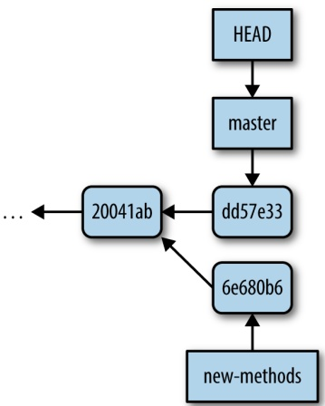
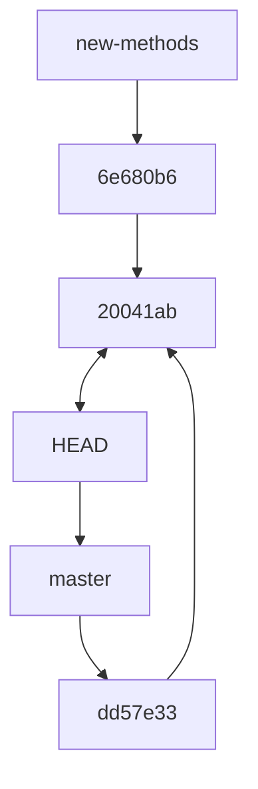

always refer to a specific commit by its SHA-1 ID. So, to restore README.md to the version from commit 08ccd3b, we use:

```txt
$ git checkout 08ccd3b -- README.md
$ cat README.md
Zea Mays SNP Calling Project
Project started 2013-01-03
Samples expected from sequencing core 2013-01-10
```

We downloaded refgen3 on 2013-01-04.

If we restore to get the most recent commit’s version, we could use:

```txt
$ git checkout 20041ab -- README.md
$ git status
# On branch master
nothing to commit, working directory clean
```

Note that after checking out the latest version of the README.md file from commit 20041ab, nothing has effectively changed in our working directory; you can verify this using git status.

## Stashing Your Changes: git stash

One very useful Git subcommand is git stash, which saves any working changes you’ve made since the last commit and restores your repository to the version at HEAD. You can then reapply these saved changes later. git stash is handy when we want to save our messy, partial progress before operations that are best performed with a clean working directory—for example, git pull or branching (more on branching later).

Let’s practice using git stash by first adding a line to README.md:

```txt
$ echo "\nAdapter file: adapters.fa" >> README.md
$ git status
# On branch master
# Changes not staged for commit:
# (use "git add <file>..." to update what will be committed)
# (use "git checkout -- <file>..." to discard changes in working directory)
#
# modified: README.md
#
no changes added to commit (use "git add" and/or "git commit -a")
```

Then, let’s stash this change using git stash:

```txt
\$ git stash
Saved working directory and index state WIP on master: 20041ab resolved merge conflict in README.md
HEAD is now at 20041ab resolved merge conflict in README.md
```

Stashing our working changes sets our directory to the same state it was in at the last commit; now our project directory is clean.

To reapply the changes we stashed, use git stash pop:

```txt
$ git stash pop
# On branch master
# Changes not staged for commit:
# (use "git add <file>..." to update what will be committed)
# (use "git checkout -- <file>..." to discard changes in working
# directory)
#
# modified: README.md
#
no changes added to commit (use "git add" and/or "git commit -a")
Dropped refs/stash@{0} (785dad46104116610d5840b317f05465a5f07c8b)
```

Note that the changes stored with git stash are not committed; git stash is a separate way to store changes outside of your commit history. If you start using git stash a lot in your work, check out other useful stash subcommands like git stash apply and git stash list.

## More git diff: Comparing Commits and Files

Earlier, we used git diff to look at the difference between our working directory and our staging area. But git diff has many other uses and features; in this section, we’ll look at how we can use git diff to compare our current working tree to other commits.

One use for git diff is to compare the difference between two arbitrary commits. For example, if we wanted to compare what we have now (at HEAD) to commit dafce75:

```diff
$ git diff dafce75
diff --git a/README.md b/README.md
index 016ed0c..9491359 100644
--- a/README.md
+++ b/README.md
@@ -3,5 +3,7 @@ Project started 2013-01-03
  Samples expected from sequencing core 2013-01-10

-Maize reference genome version: refgen3, downloaded 2013-01-04 from
+We downloaded the B72 reference genome (refgen3) on 2013-01-04 from
  http://maizegdb.org into `/share/data/refgen3/'.
+
+Adapter file: adapters.fa
```

## Specifying Revisions Relative to HEAD

Like writing out absolute paths in Unix, referring to commits by their full SHA-1 ID is tedious. While we can reduce typing by using the abbreviated commits (the first seven characters of the full SHA-1 ID), there’s an easier way: relative ancestry references. Similar to using relative paths in Unix like ./ and ../, Git allows you to specify commits relative to HEAD (or any other commit, with SHA-1 IDs).

The caret notation (^) represents the parent commit of a commit. For example, to refer to the parent of the most recent commit on the current branch (HEAD), we’d use HEAD^ (commit 08ccd3b in our examples).

Similarly, if we’d wanted to refer to our parent’s parent commit (dafce75 in our example), we use HEAD^^. Our example repository doesn’t have enough commits to refer to the parent of this commit, but if it did, we could use HEAD^^^. At a certain point, using this notation is no easier than copying and pasting a SHA-1, so a succinct alternative syntax exists: git HEAD\~&lt;n&gt;, where &lt;n&gt; is the number of commits back in the ances try of HEAD (including the last one). Using this notation, HEAD^^ is the same as HEAD\~2.

Specifying revisions becomes more complicated with merge commits, as these have two parents. Git has an elaborate language to specify these commits. For a full specification, enter git rev-parse --help and see the “Specifying Revisions” section of this manual page.

Using git diff, we can also view all changes made to a file between two commits. To do this, specify both commits and the file’s path as arguments (e.g., git diff &lt;com mit&gt; &lt;commit&gt; &lt;path&gt;). For example, to compare our version of README.md across commits 269aa09 and 46f0781, we could use either:

```shell
$ git diff 46f0781 269aa09 README.md
# or
$ git diff HEAD~3 HEAD~2 README.md
```

This second command utilizes the relative ancestry references explained in “Specify ing Revisions Relative to HEAD” on page 101.

How does this help? Git’s ability to compare the changes between two commits allows you to find where and how a bug entered your code. For example, if a modified script produces different results from an earlier version, you can use git diff to see exactly which lines differ across versions. Git also has a tool called git bisect to help developers find where exactly bugs entered their commit history. git bisect is out of the scope of this chapter, but there are some good examples in git bisect --help.

## Undoing and Editing Commits: git commit --amend

At some point, you’re bound to accidentally commit changes you didn’t mean to or make an embarrassing typo in a commit message. For example, suppose we were to make a mistake in a commit message:

```txt
\$ git commit -a -m "added adapters file to readme"
[master f4993e3] added adapters file to readme
1 file changed, 2 insertions(+)
```

We could easily amend our commit with:

```txt
\$ git commit --amend
```

git commit --amend opens up your last commit message in your default text editor, allowing you to edit it. Amending commits isn’t limited to just changing the commit message though. You can make changes to your file, stage them, and then amend these staged changes with git commit --amend. In general, unless you’ve made a mistake, it’s best to just use separate commits.

It’s also possible to undo commits using either git revert or the more advanced git reset (which if used improperly can lead to data loss). These are more advanced topics that we don’t have space to cover in this chapter, but I’ve listed some resources on this issue in this chapter’s README file on GitHub.

## Working with Branches

Our final topic is probably Git’s greatest feature: branching. If you’re feeling overwhelmed so far by Git (I certainly did when I first learned it), you can move forward to Chapter 6 and work through this section later.

Branching is much easier with Git than in other version control systems—in fact, I switched to Git after growing frustrated with another version control system’s branching model. Git’s branches are virtual, meaning that branching doesn’t require actually copying files in your repository. You can create, merge, and share branches effortlessly with Git. Here are some examples of how branches can help you in your bioinformatics work:

• Branches allow you to experiment in your project without the risk of adversely affecting the main branch, master. For example, if in the middle of a variant calling project you want to experiment with a new pipeline, you can create a new branch and implement the changes there. If the new variant caller doesn’t work out, you can easily switch back to the master branch—it will be unaffected by your experiment.
• If you’re developing software, branches allow you to develop new features or bug fixes without affecting the working production version, the master branch. Once the feature or bug fix is complete, you can merge it into the master branch, incorporating the change into your production version.

Similarly, branches simplify working collaboratively on repositories. Each collab orator can work on their own separate branches, which prevents disrupting the master branch for other collaborators. When a collaborator’s changes are ready to be shared, they can be merged into the master branch.

## Creating and Working with Branches: git branch and git checkout

As a simple example, let’s create a new branch called readme-changes. Suppose we want to make some edits to README.md, but we’re not sure these changes are ready to be incorporated into the main branch, master.

To create a Git branch, we use git branch &lt;branchname&gt;. When called without any arguments, git branch lists all branches. Let’s create the readme-changes branch and check that it exists:

```txt
$ git branch readme-changes
$ git branch
* master
  readme-changes
```

The asterisk next to master is there to indicate that this is the branch we’re currently on. To switch to the readme-changes branch, use git checkout readme-changes:

```txt
$ git checkout readme-changes
Switched to branch 'readme-changes'
$ git branch
  master
* readme-changes
```

Notice now that the asterisk is next to readme-changes, indicating this is our current branch. Now, suppose we edit our README.md section extensively, like so:

```txt
# Zea Mays SNP Calling Project
Project started 2013-01-03.

## Samples
Samples downloaded 2013-01-11 into `data/seqs`:

        data/seqs/zmaysA_R1.fastq
        data/seqs/zmaysA_R2.fastq
        data/seqs/zmaysB_R1.fastq
        data/seqs/zmaysB_R2.fastq
        data/seqs/zmaysC_R1.fastq
        data/seqs/zmaysC_R2.fastq
```

```markdown
## Reference
```

We downloaded the B72 reference genome (refgen3) on 2013-01-04 from http://maizegdb.org into \`/share/data/refgen3/\`.

Now if we commit these changes, our commit is added to the readme-changes branch. We can verify this by switching back to the master branch and seeing that this commit doesn’t exist:

```txt
$ git commit -a -m "reformatted readme, added sample info" ①
[readme-changes 6e680b6] reformatted readme, added sample info
1 file changed, 12 insertions(+), 3 deletions(-)
$ git log --abbrev-commit --pretty=oneline -n 3 ②
6e680b6 reformatted readme, added sample info
20041ab resolved merge conflict in README.md
08ccd3b added reference download date
$ git checkout master ③
Switched to branch 'master'
$ git log --abbrev-commit --pretty=oneline -n 3 ④
20041ab resolved merge conflict in README.md
08ccd3b added reference download date
dafce75 added ref genome download date and link
```

0 Our commit, made on the branch readme-changes.
2 The commit we just made (6e680b6).
Switching back to our master branch.
④ Our last commit on master is 20041ab. Our changes to README.md are only on the readme-changes branch, and when we switch back to master, Git swaps our files out to those versions on that branch.

Back on the master branch, suppose we add the adapters.fa file, and commit this change:

```shell
$ git branch
* master
  readme-changes
$ echo ">adapter-1\\nGATGATCATTCAGCGACTACGATCG" >> adapters.fa
$ git add adapters.fa
$ git commit -a -m "added adapters file"
[master dd57e33] added adapters file
 1 file changed, 2 insertions(+)
  create mode 100644 adapters.fa
```

Now, both branches have new commits. This situation looks like Figure 5-6.



<details>
<summary>flowchart</summary>


</details>

Figure 5-6. Our two branches (within Git, branches are represented as pointers at commits, as depicted here), the master and readme-changes branches have diverged, as they point to different commits (our HEAD points to master, indicating this is the current branch we’re on)

Another way to visualize this is with git log. We’ll use the --branches option to specify we want to see all branches, and -n 2 to only see these last commits:

```txt
$ git log --abbrev-commit --pretty=oneline --graph --branches -n2
* dd57e33 added adapters file
| * 6e680b6 reformatted readme, added sample info
|/
```

## Merging Branches: git merge

With our two branches diverged, we now want to merge them together. The strategy to merge two branches is simple. First, use git checkout to switch to the branch we want to merge the other branch into. Then, use git merge &lt;otherbranch&gt; to merge the other branch into the current branch. In our example, we want to merge the readme-changes branch into master, so we switch to master first. Then we use:

```txt
$ git merge readme-changes
Merge made by the 'recursive' strategy.
  README.md | 15 +++++++++++++---
  1 file changed, 12 insertions(+), 3 deletions(-)
```

There wasn’t a merge conflict, so git merge opens our text editor and has us write a merge commit message. Once again, let’s use git log to see this:

```txt
$ git log --abbrev-commit --pretty=oneline --graph --branches -n 3
*   e9a81b9 Merge branch 'readme-changes'
|\
| * 6e680b6 reformatted readme, added sample info
```

```txt
* | dd57e33 added adapters file
|/
```

Bear in mind that merge conflicts can occur when merging branches. In fact, the merge conflict we encountered in “Merge Conflicts” on page 92 when pulling in remote changes was a conflict between two branches; git pull does a merge between a remote branch and a local branch (more on this in “Branches and Remotes” on page 106). Had we encountered a merge conflict when running git merge, we’d follow the same strategy as in “Merge Conflicts” on page 92 to resolve it.

When we’ve used git log to look at our history, we’ve only been looking a few commits back—let’s look at the entire Git history now:

```shell
$ git log --abbrev-commit --pretty=oneline --graph --branches
*   e9a81b9 Merge branch 'readme-changes'
|\
| * 6e680b6 reformatted readme, added sample info
* | dd57e33 added adapters file
|/
*   20041ab resolved merge conflict in README.md
|\
| * dafce75 added ref genome download date and link
* | 08ccd3b added reference download date
|/
* 269aa09 added reference genome info
* 46f0781 added information about samples
* c509f63 added .gitignore
* e4feb22 added markdown extensions to README files
* 94e2365 added information about project to README
* 3d7ffa6 initial import
```

Note that we have two bubbles in our history: one from the merge conflict we resolved after git pull, and the other from our recent merge of the readme-changes branch.

## Branches and Remotes

The branch we created in the previous section was entirely local—so far, our collaborators are unable to see this branch or its commits. This is a nice feature of Git: you can create and work with branches to fit your workflow needs without having to share these branches with collaborators. In some cases, we do want to share our local branches with collaborators. In this section, we’ll see how Git’s branches and remote repositories are related, and how we can share work on local branches with collaborators.

Remote branches are a special type of local branch. In fact, you’ve already interacted with these remote branches when you’ve pushed to and pulled from remote repositories. Using git branch with the option --all, we can see these hidden remote branches:

```txt
$ git branch --all
* master
  readme-changes
  remotes/origin/master
```

remotes/origin/master is a remote branch—we can’t do work on it, but it can be synchronized with the latest commits from the remote repository using git fetch. Interestingly, a git pull is nothing more than a git fetch followed by a git merge. Though a bit technical, understanding this idea will greatly help you in working with remote repositories and remote branches. Let’s step through an example.

Suppose that Barbara is starting a new document that will detail all the bioinformatics methods of your project. She creates a new-methods branch, makes some commits, and then pushes these commits on this branch to our central repository:

```txt
$ git push origin new-methods
Counting objects: 4, done.
Delta compression using up to 2 threads.
Compressing objects: 100% (2/2), done.
Writing objects: 100% (3/3), 307 bytes | 0 bytes/s, done.
Total 3 (delta 1), reused 0 (delta 0)
To git@github.com:vsbuffalo/zmays-snps.git
 * [new branch]      new-methods -> new-methods
```

Back in our repository, we can fetch Barbara’s latest branches using git fetch &lt;remo tename&gt;. This creates a new remote branch, which we can see with git branch -- all:

```txt
$ git fetch origin
remote: Counting objects: 4, done.
remote: Compressing objects: 100% (1/1), done.
remote: Total 3 (delta 1), reused 3 (delta 1)
Unpacking objects: 100% (3/3), done.
From github.com:vsbuffalo/zmays-snps
= [up to date] master -> origin/master
* [new branch] new-methods -> origin/new-methods
$ git branch --all
* master
  new-methods
  remotes/origin/master
  remotes/origin/new-methods
```

git fetch doesn’t change any of your local branches; rather, it just synchronizes your remote branches with the newest commits from the remote repositories. If after a git fetch we wanted to incorporate the new commits on our remote branch into our local branch, we would use a git merge. For example, we could merge Barbara’s newmethods branch into our master branch with git merge origin/new-methods, which emulates a git pull.

However, Barbara’s branch is just getting started—suppose we want to develop on the new-methods branch before merging it into our master branch. We cannot develop on remote branches (e.g., our remotes/origin/new-methods), so we need to make a new branch that starts from this branch:

```txt
\$ git checkout -b new-methods origin/new-methods
Branch new-methods set up to track remote branch new-methods from origin.
Switched to a new branch 'new-methods'
```

Here, we’ve used git checkout to simultaneously create and switch a new branch using the -b option. Note that Git notified us that it’s tracking this branch. This means that this local branch knows which remote branch to push to and pull from if we were to just use git push or git pull without arguments. If we were to commit a change on this branch, we could then push it to the remote with git push:

```txt
$ echo "\n(1) trim adapters\n(2) quality-based trimming" >> methods.md
$ git commit -am "added quality trimming steps"
[new-methods 5f78374] added quality trimming steps
 1 file changed, 3 insertions(+)
$ git push
Counting objects: 5, done.
Delta compression using up to 2 threads.
Compressing objects: 100% (3/3), done.
Writing objects: 100% (3/3), 339 bytes | 0 bytes/s, done.
Total 3 (delta 1), reused 0 (delta 0)
To git@github.com:vsbuffalo/zmays-snps.git
    6364ebb..9468e38 new-methods -> new-methods
```

Development can continue on new-methods until you and your collaborator decide to merge these changes into master. At this point, this branch’s work has been incorporated into the main part of the project. If you like, you can delete the remote branch with git push origin :new-methods and your local branch with git branch -d new-methods.

## Continuing Your Git Education

Git is a massively powerful version control system. This chapter has introduced the basics of version control and collaborating through pushing and pulling, which is enough to apply to your daily bioinformatics work. We’ve also covered some basic tools and techniques that can get you out of trouble or make working with Git easier, such as git checkout to restore files, git stash to stash your working changes, and git branch to work with branches. After you’ve mastered all of these concepts, you may want to move on to more advanced Git topics such as rebasing (git rebase), searching revisions (git grep), and submodules. However, none of these topics are required in daily Git use; you can search out and learn these topics as you need them. A great resource for these advanced topics is Scott Chacon and Ben Straub’s [Pro Git book](http://git-scm.com/book/en/v2).

# Bioinformatics Data

Thus far, we’ve covered many of the preliminaries to get started in bioinformatics: organizing a project directory, intermediate Unix, working with remote machines, and using version control. However, we’ve ignored an important component of a new bioinformatics project: data.

Data is a requisite of any bioinformatics project. We further our understanding of complex biological systems by refining a large amount of data to a point where we can extract meaning from it. Unfortunately, many tasks that are simple with small or medium-sized datasets are a challenge with the large and complex datasets common in genomics. These challenges include:

## Retrieving data

Whether downloading large sequencing datasets or accessing a web application hundreds of times to download specific files, retrieving data in bioinformatics can require special tools and skills.

## Ensuring data integrity

Transferring large datasets across networks creates more opportunities for data corruption, which can later lead to incorrect analyses. Consequently, we need to ensure data integrity with tools before continuing with analysis. The same tools can also be used to verify we’re using the correct version of data in an analysis.

## Compression

The data we work with in bioinformatics is large enough that it often needs to be compressed. Consequently, working with compressed data is an essential skill in bioinformatics.

## Retrieving Bioinformatics Data

Suppose you’ve just been told the sequencing for your project has been completed: you have six lanes of Illumina data to download from your sequencing center. Downloading this amount of data through your web browser is not feasible: web browsers are not designed to download such large datasets. Additionally, you’d need to download this sequencing data to your server, not the local workstation where you browse the Internet. To do this, you’d need to SSH into your data-crunching server and download your data directly to this machine using command-line tools. We’ll take a look at some of these tools in this section.

## Downloading Data with wget and curl

Two common command-line programs for downloading data from the Web are wget and curl. Depending on your system, these may not be already installed; you’ll have to install them with a package manager (e.g., Homebrew or apt-get). While curl and wget are similar in basic functionality, their relative strengths are different enough that I use both frequently.

## wget

wget is useful for quickly downloading a file from the command line—for example, human chromosome 22 from the GRCh37 (also known as hg19) assembly version:

```txt
$ wget http://hgdownload.soe.ucsc.edu/goldenPath/hg19/chromosomes/chr22.fa.gz
--2013-06-30 00:15:45--  http://[...]/goldenPath/hg19/chromosomes/chr22.fa.gz
Resolving hgdownload.soe.ucsc.edu... 128.114.119.163
Connecting to hgdownload.soe.ucsc.edu|128.114.119.163|:80... connected.
HTTP request sent, awaiting response... 200 OK
Length: 11327826 (11M) [application/x-gzip]
Saving to: 'chr22.fa.gz'
```

```txt
17% [=================>
```

```txt
] 1,989,172    234KB/s eta 66s
```

wget downloads this file to your current directory and provides a useful progress indicator. Notice that the link to chromosome 22 begins with “http” (short for Hyper‐Text Transfer Protocol). wget can also handle FTP links (which start with “ftp,” short for File Transfer Protocol). In general, FTP is preferable to HTTP for large files (and is often recommended by websites like the UCSC Genome Browser).

Because UCSC generously provides the human reference genome publicly, we don’t need any authentication to gain access to this file. However, if you’re downloading data from a Lab Information Management System (LIMS), you may need to first authenticate with a username and password. For simple HTTP or FTP authentication, you can authenticate using wget’s --user= and --ask-password options. Some sites use more elaborate authentication procedures; in these cases, you’ll need to contact the site administrator.

One of wget’s strengths is that it can download data recursively. When run with the recursive option (--recursive or -r), wget will also follow and download the pages linked to, and even follow and download links on these pages, and so forth. By default (to avoid downloading the entire Internet), wget limits itself to only follow five links deep (but this can be customized using the option --level or -l).

Recursive downloading can be useful for downloading all files of a certain type from a page. For example, if another lab has a web page containing many GTF files we wish to download, we could use:

```powershell
$ wget --accept "*.gtf" --no-directories --recursive --no-parent \
http://genomics.someuniversity.edu/labsite/annotation.html
```

But beware! wget’s recursive downloading can be quite aggressive. If not constrained, wget will download everything it can reach within the maximum depth set by -- level. In the preceding example, we limited wget in two ways: with --no-parent to prevent wget from downloading pages higher in the directory structure, and with -- accept "\*.gtf", which only allows wget to download filenames matching this pattern.

Exercise caution when using wget’s recursive option; it can utilize a lot of network resources and overload the remote server. In some cases, the remote host may block your IP address if you’re downloading too much too quickly. If you plan on downloading a lot of data from a remote host, it’s best to inquire with the website’s sysadmin about recommended download limits so your IP isn’t blocked. wget’s --limitrate option can be used to limit how quickly wget downloads files.

wget is an incredibly powerful tool; the preceding examples have only scraped the surface of its capabilities. See Table 6-1 for some commonly used options, or man wget for an exhaustive list.

Table 6-1. Useful wget options

| Option | Values | Use |
| --- | --- | --- |
| -A, --accept | Either a suffix like ".fastq" or a pattern with *, ?, or [ and ], optionally comma-separated list | Only download files matching this criteria. |
| -R, --reject | Same as with --accept | Don't download files matching this; for example, to download all files on a page except Excel files, use --reject ".xls". |
| -nd, --no-directory | No value | Don't place locally downloaded files in same directory hierarchy as remote files. |
| -r, --recursive | No value | Follow and download links on a page, to a maximum depth of five by default. |
| -np, --no-parent | No value | Don't move above the parent directory. |
| --limit-rate | number of bytes to allow per second | Throttle download bandwidth. |
| --user=user | FTP or HTTP username | Username for HTTP or FTP authentication. |
| --ask-password | No value | Prompt for password for HTTP of FTP authentication; --password= could also be used, but then your password is in your shell's history. |
| -O | Output filename | Download file to filename specified; useful if link doesn't have an informative name (e.g., http://lims.sequencingcenter.com/seqs.html?id=sample_A_03). |

## Curl

curl serves a slightly different purpose than wget. wget is great for downloading files via HTTP or FTP and scraping data from a web page using its recursive option. curl behaves similarly, although by default writes the file to standard output. To download chromosome 22 as we did with wget, we’d use:

<table><tr><td colspan="11">$ curl http://[...]/goldenPath/hg19/chromosomes/chr22.fa.gz &gt; chr22.fa.gz</td></tr><tr><td>% Total</td><td>% Received</td><td>% Xferd</td><td colspan="2">Average Speed</td><td>Time</td><td>Time</td><td>Time</td><td>Current</td><td></td><td></td></tr><tr><td></td><td></td><td></td><td>Dload</td><td>Upload</td><td>Total</td><td>Spent</td><td>Left</td><td>Speed</td><td></td><td></td></tr><tr><td>14</td><td>10.8M</td><td>14</td><td>1593k</td><td>0</td><td>0</td><td>531k</td><td>0</td><td>0:00:20</td><td>0:00:02</td><td>0:00:18</td></tr></table>

Note that I’ve had to truncate the URL so this example fits within a page; the URL is the same as we used with wget earlier.

If you prefer not to redirect curl’s output, use -O &lt;filename&gt; to write the results to &lt;filename&gt;. If you omit the filename argument, curl will use same filename as the remote host.

curl has the advantage that it can transfer files using more protocols than wget, including SFTP (secure FTP) and SCP (secure copy). One especially nice feature of curl is that it can follow page redirects if the -L/--location option is enabled. With this enabled, curl will download the ultimate page the link redirects to, not the redirect page itself. Finally, Curl itself is also a library, meaning in addition to the command-line curl program, Curl’s functionality is wrapped by software libraries like [RCurl](http://bit.ly/cran-rcurl) and [pycurl](http://pycurl.sourceforge.net/doc/).

## Rsync and Secure Copy (scp)

wget and curl are appropriate for quickly downloading files from the command line, but are not optimal for some heavier-duty tasks. For example, suppose a colleague needs all large sequencing datasets in your project directory that are ignored by Git (e.g., in your .gitignore). A better tool for synchronizing these entire directories across a network is Rsync.

Rsync is a superior option for these types of tasks for a few reasons. First, Rsync is often faster because it only sends the difference between file versions (when a copy already exists or partially exists) and it can compress files during transfers. Second, Rsync has an archive option that preserves links, modification timestamps, permissions, ownership, and other file attributes. This makes Rsync an excellent choice for network backups of entire directories. Rsync also has numerous features and options to handle different backup scenarios, such as what to do if a file exists on the remote host.

rsync’s basic syntax is rsync source destination, where source is the source of the files or directories you’d like to copy, and destination is the destination you’d like to copy these files to. Either source or destination can be a remote host specified in the format user@host:/path/to/directory/.

Let’s look at an example of how we can use rsync to copy over an entire directory to another machine. Suppose you’d like to copy all of your project’s data in zea\_mays/ data to your colleague’s directory /home/deborah/zea\_mays/data on the host 192.168.237.42. The most common combination of rsync options used to copy an entire directory are -avz. The option -a enables wrsync’s archive mode, -z enables file transfer compression, and -v makes rsync’s progress more verbose so you can see what’s being transferred. Because we’ll be connecting to the remote host through SSH, we also need to use -e ssh. Our directory copying command would look as follows:

```shell
\$ rsync -avz -e ssh zea_mays/data/ vinceb@[...]:/home/deborah/zea_mays/data
building file list ... done
zmaysA_R1.fastq
zmaysA_R2.fastq
zmaysB_R1.fastq
zmaysB_R2.fastq
zmaysC_R1.fastq
zmaysC_R2.fastq
sent 2861400 bytes received 42 bytes 107978.94 bytes/sec
total size is 8806085 speedup is 3.08
```

One subtle yet important behavior of rsync is that trailing slashes (e.g., data/ versus data) are meaningful when specifying paths in rsync. A trailing slash in the source path means copy the contents of the source directory, whereas no trailing slash means copy the entire directory itself. Because we’d like to copy all contents of zea\_mays/data/ to /home/deborah/zea\_mays/data in our example, we use a trailing slash. If the data/ directory didn’t already exist on the remote destination host, we’d want to copy it and its contents by using zea\_mays/data (e.g., omitting the trailing slash).

Because rsync only transmits files if they don’t exist or they’ve changed, you can (and should) run rsync again after your files have transferred. This operates as a simple check to ensure everything is synchronized between the two directories. It’s also a good idea to check the exit status of rsync when calling it in scripts; rsync will exit with a nonzero status if it runs into problems transferring files. Lastly, rsync can use host aliases specified in an SSH config file (see the first Tip in “Connecting to Remote Machines with SSH” on page 57). You can omit -e ssh if you connect to a host through an SSH host alias.

Occasionally, we just need to quickly copy a single file over SSH—for tasks where Unix’s cp would be sufficient, but needs to work over an SSH connection. rsync would work, but it’s a bit overkill. Secure copy (scp) is perfect for this purpose. Secure copy works just like cp, except we need to specify both host and path (using the same user@host:/path/to/file notation as wget). For example, we could transfer a single GTF file to 192.168.237.42:/home/deborah/zea\_mays/data/ using:

\$ scp Zea\_mays.AGPv3.20.gtf 192.168.237.42:/home/deborah/zea\_mays/data/

Zea\_mays.AGPv3.20.gtf

100% 55 0.1KB/s 00:00

## Data Integrity

Data we download into our project directory is the starting point of all future analyses and conclusions. Although it may seem improbable, the risk of data corruption during transfers is a concern when transferring large datasets. These large files take a long time to transfer, which translates to more opportunities for network connections to drop and bits to be lost. In addition to verifying your transfer finished without error, it’s also important to explicitly check the transferred data’s integrity with checksums. Checksums are very compressed summaries of data, computed in a way that even if just one bit of the data is changed, the checksum will be different.

Data integrity checks are also helpful in keeping track of data versions. In collaborative projects, our analyses may depend on our colleagues’ intermediate results. When these intermediate results change, all downstream analyses that depend on these results need to be rerun. With many intermediate files, it’s not always clear which data has changed and which steps need to be rerun. The checksums would differ if the data changed even the tiniest bit, so we can use them to calculate the version of the data. Checksums also facilitate reproducibility, as we can link a particular analysis