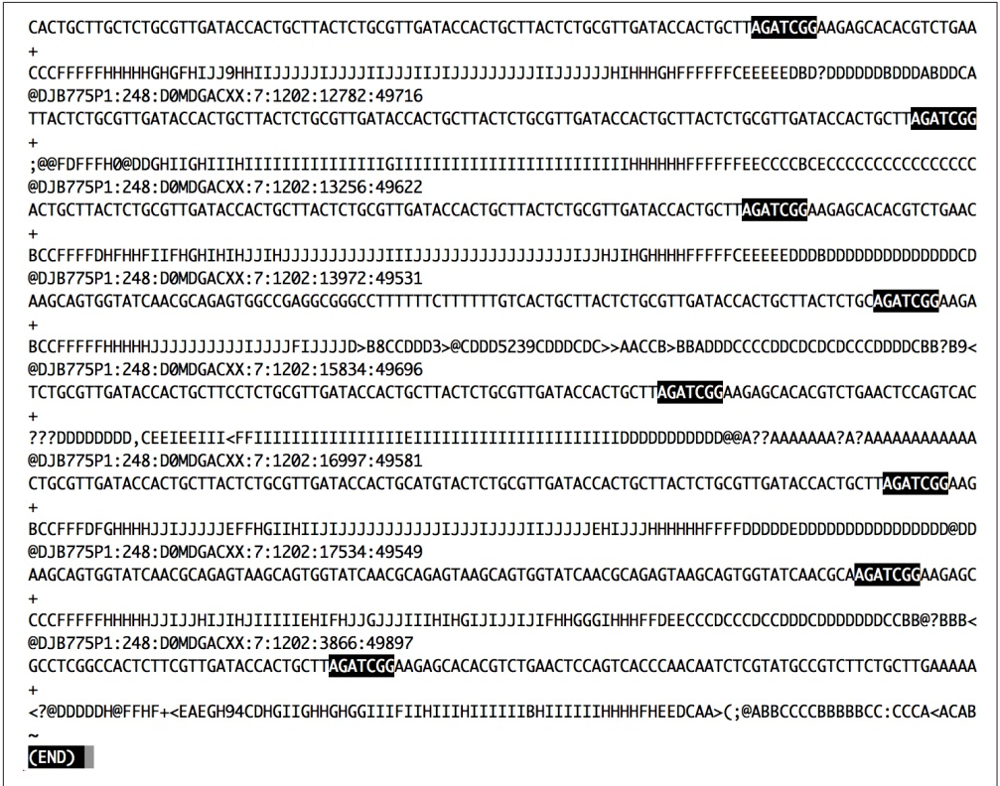
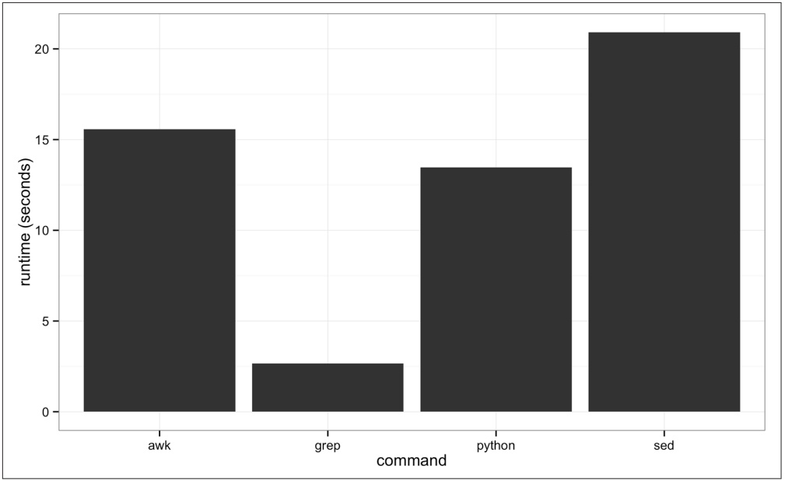

```txt
# inspect the first and last 3 lines of a file
i() { (head -n 2; tail -n 2) < "\$1" | column -t}
```

Then, either run source on your shell configuration file, or start a new terminal session and ensure this works. Then we can use i (for inspect) as a normal command:

```csv
$ i Mus_musculus.GRCm38.75_chr1.bed
1 3054233    3054733
1 3054233    3054733
1 195240910 195241007
1 195240910 195241007
```

head is also useful for taking a peek at data resulting from a Unix pipeline. For example, suppose we want to grep the Mus\_musculus.GRCm38.75\_chr1.gtf file for rows containing the string gene\_id "ENSMUSG00000025907" (because our GTF is well structured, it’s safe to assume that these are all features belonging to this gene—but this may not always be the case!). We’ll use grep’s results as the standard input for the next program in our pipeline, but first we want to check grep’s standard out to see if everything looks correct. We can pipe the standard out of grep directly to head to take a look:

```shell
\$ grep 'gene_id "ENSMUSG00000025907"' Mus_musculus.GRCm38.75_chr1.gtf | head -n 1
1 protein_coding gene 6206197 6276648 [...] gene_id "ENSMUSG00000025907" [...]
```

Note that for the sake of clarity, I’ve omitted the full line of this GTF, as it’s quite long.

After printing the first few rows of your data to ensure your pipeline is working properly, the head process exits. This is an important feature that helps ensure your pipes don’t needlessly keep processing data. When head exits, your shell catches this and stops the entire pipe, including the grep process too. Under the hood, your shell sends a signal to other programs in the pipe called SIGPIPE—much like the signal that’s sent when you press Control-c (that signal is SIGINT). When building complex pipelines that process large amounts of data, this is extremely important. It means that in a pipeline like:

```shell
\$ grep "some_string" huge_file.txt | program1 | program2 | head -n 5
```

grep won’t continue searching huge\_file.txt, and program1 and program2 don’t continue processing input after head outputs 5 lines and exits. While head is a good illustration of this feature of pipes, SIGPIPE works with all programs (unless the program explicitly catches and ignore this symbol—a possibility, but not one we encounter with bioinformatics programs).

## less

less is also a useful program for a inspecting files and the output of pipes. less is a terminal pager, a program that allows us to view large amounts of text in our terminals. Normally, if we cat a long file to screen, the text flashes by in an instant—less allows us to view and scroll through long files and standard output a screen at a time. Other applications can call the default terminal pager to handle displaying large amounts of output; this is how git log displays an entire Git repository’s commit history. You might run across another common, but older terminal pager called more, but less has more features and is generally preferred (the name of less is a play on “less is more”).

less runs more like an application than a command: once we start less, it will stay open until we quit it. Let’s review an example—in this chapter’s directory in the book’s GitHub repository, there’s a file called contaminated.fastq. Let’s look at this with less:

\$ less contaminated.fastq

This will open up the program less in your terminal and display a FASTQ file full of sequences. First, if you need to quit less, press q. At any time, you can bring up a help page of all of less’s commands with h.

Moving around in less is simple: press space to go down a page, and b to go up a page. You can use j and k to go down and up a line at a time (these are the same keys that the editor Vim uses to move down and up). To go back up to the top of a file, enter g; to go to the bottom of a file, press G. Table 7-1 lists the most commonly used less commands. We’ll talk a bit about how this works when less is taking input from another program through a pipe in a bit.

Table 7-1. Commonly used less commands

| Shortcut | Action |
| --- | --- |
| space bar | Next page |
| b | Previous page |
| g | First line |
| G | Last line |
| j | Down (one line at at time) |
| k | Up (one line at at time) |
| / | Search down (forward) for string |
| ?&lt;pattern> | Search up (backward) for string |
| n | Repeat last search downward (forward) |
| N | Repeat last search upward (backward) |

One of the most useful features of less is that it allows you to search text and highlights matches. Visually highlighting matches can be an extremely useful way to find potential problems in data. For example, let’s use less to get a quick sense of whether there are 3’ adapter contaminants in the contaminated.fastq file. In this case, we’ll look for AGATCGGAAGAGCACACGTCTGAACTCCAGTCAC (a known adapter from the Illumina Tru‐Seq® kit<sup>1</sup>). Our goal isn’t to do an exhaustive test or remove these adapters—we just want to take a 30-second peek to check if there’s any indication there could be contamination.

Searching for this entire string won’t be very helpful, for the following reasons:

• It’s likely that only part of the adapter will be in sequences
• It’s common for there to be a few mismatches in sequences, making exact matching ineffective (especially since the base calling accuracy typically drops at the 3 end of Illumina sequencing reads)

To get around this, let’s search for the first 11 bases, AGATCGGAAGA. First, we open contaminated.fastq in less, and then press / and enter AGATCGG. The results are in Figure 7-1, which passes the interocular test—the results hit you right between the eyes. Note the skew in match position toward the end of sequencing reads (where we expect contamination) and the high similarity in bases after the match. Although only a quick visual inspection, this is quite informative.

less is also extremely useful in debugging our command-line pipelines. One of the great beauties of the Unix pipe is that it’s easy to debug at any point—just pipe the output of the command you want to debug to less and delete everything after. When you run the pipe, less will capture the output of the last command and pause so you can inspect it.

less is also crucial when iteratively building up a pipeline—which is the best way to construct pipelines. Suppose we have an imaginary pipeline that involves three programs, step1, step2, and step3. Our finished pipeline will look like step1 input.txt | step2 | step3 > output.txt. However, we want to build this up in pieces, running step1 input.txt first and checking its output, then adding in step3 and checking that output, and so forth. The natural way to do this is with less:

```powershell
$ step1 input.txt | less                      # inspect output in less
$ step1 input.txt | step2 | less
$ step1 input.txt | step2 | step3 | less
```

<small><span class="docvortex-page-footnote" data-block-type="page_footnote" style="color:#6b7280">1 Courtesy of Illumina, Inc.</span></small>



<details>
<summary>text_image</summary>

CACTGCTTGCTCTGCGTTGATACCACTGCTTACTCTGCGTTGATACCACTGCTTACTCTGCGTTGATACCACTGCTTAGATCGGAAGAGCACACGTCTGAA
+
CCCFFFFHHHHHGHGFHIJJ9HHIIJJJJJJJJJJJJJJJJJJJJJJJJJJJJJJJJJJJJJJJJJJJJJJJJJJJJJJJJJJJJJJJJJJJJJJJJJJJJJJJJJJJJJJJJJJJJJJJJJJJJJJJJJJJJJJJJJJJJJJJJJJJJJJJJJJJJJJJJJJJJJJJJJJJJJJJJJJJJJJJJJJJJJJJJJJJJJJJJJJJJJJJJJJJJJJJJJJJJJJJJJ
@DJB775P1:248:D0MDGACXX:7:1202:12782:49716
TTACTCTGCGTTGATACCACTGCTTACTCTGCGTTGATACCACTGCTTACTCTGCGTTGATACCACTGCTTACTCTGCGTTGATACCACTGCTTAGATCGGA
+;@FDFFFH0@DDGHIIIGHIIIIIIIIIIIIIIIIIIIIIGIIIIIIIIIIIIIIIIIIIIIIIIIIIIIIIIIIIIIIIIIIIIIIIIIIIIIIIIIIIIIIIIIIIIIIIIIIIIIIIIIIIIIIIIIIIIIIIIIIIIIIIIIIIIIIIIIIIIIIIIIIIIIIIIIIIIIIIIIIIIIIIIIIIIIIIIIIIIIIIIIIIIIIIIIIIIIIIII
ACTGCTTACTCTGCGTTGATACCACTGCTTACTCTGCGTTGATACCACTGCTTAGATCGGAAGAGCACACGTCTGAAC
+
BCCFFFFDFHHFHIIFHGHIIIHJHJIHJIHJIHJIHJIHJIHJIHJIHJIHJIHJIHJIHJIHJIHJIHJIHJIHJIHJIHJIHJIHJIHJIHJIHJIHJIHJIHJIHJIHJIHJIHJIHJIHJIHJIHJIHJIHJIHJIHJIHJIHJIHJIHJIHJIHJIHJIHJIHJIHJIHJ
@DJB775P1:248:D0MDGACXX:7:1202:13972:49531
AAGCAGTGGTATCAACGCAGAGTGGCCGAGGCGGGCCTTTTTTCTTTTTTGTCACTGCTTACTCTGCGTTGATACCACTGCTTAGATCGGAAGAGCACACGTCTGAAC
+
BCCFFFFHHHHHJJJJJJJJJJJJJJFJJJJD>B8CCDDD3>@CDDD5239CDDDCDC>>AACCB>BBADDCCCCDDCDCDCDCCCDDDDCBB?B9<
@DJB775P1:248:D0MDGACXX:7:1202:15834:49696
TCTGCGTTGATACCACTGCTTCCTCTGCGTTGATACCACTGCTTAGATCGGAAGAGCACACGTCTGAACCTCCAGTCAC
+
???DDDDDDD,CEEIEEIII<FFIIIIIIIIIIIIIIIIIIIIEIIIIIIIIIIIIIIIIIIIIIIIDDDDDDDDDD@@A??AAAAAAA?A?AAAAAAAAAAA
@DJB775P1:248:D0MDGACXX:7:1202:16997:49581
CTGCGTTGATACCACTGCTTACTCTGCGTTGATACCACTGCATGTACTCTGCGTTGATACCACTGCTTAGATCGGAAGAGCACACGTCTGAACCTCCAGTCAC
+
BCCFFFFDFGHHHHJJIJJJEFFHGIIIHIJIJJJJJJJJJJJJJJJJJJJJEHIJJJHHHHHHHHHHHHHHHHHHHHHHHHHHHHHHHHHHHHHHHHHHHHHHHHHHHHHHHHHHHHHHHHHHHHHHHHHHHHHHHHHHHHHHHHHHHHHHHHHHHHHHHHHHHHHHHHHHHHHHHHHHHHHHHHHHHHHHHHHHHHHHHHHHHHHHHHHHHHHHHHHHHHHHHHHHHHHHHHHHHHHHHHHHHHHHHHHHHHHHHHHA
@DJB775P1:248:D0MDGACXX:7:1202:17534:49549
AAGCAGTGGTATCAACGCAGAGTAAGCAGTGGTATCAACGCAGAGTAAGCAGTGGTATCAACGCAGAGTAAGCAGTGGTATCAACGCAGAGTAAGCAGTGGTATCAACGCAGAGTAAGCAGTGGTATCAACGCAGAGTAAGCAGTGGTATCAACGCAGAGTAAGCAGTGGTATCAACGCAGAGTAAGCAGTGGTATCAACC
+CCCFFFFHHHHHJIJJHIJIHJIIIIEHIFHJJGJJIIIHIHIHIJIJIJIIFHHGGGIHHHFDEECCCDDCCDCDDDDDDDDCCBB@?BBB<
@DJB775P1:248:D0MDGACXX:7:1202:3866:49897
GCCTCGGCCACTCTTCGTTGATACCACTGCTTAGATCGGAAGAGCACACGTCTGAACCTCCAGTCACCACAATCTCGTATGCCGTCTTCTGCTTGAAAAA
+
<?@DDDDDH@FFHF+<EAEGH94CDHGIG HHGHGGIIFIHIHIHIIIIIBHIIIIIIIIVHHHFHEEDCAA>;(;@ABBCCCCBBBBCCC:CCCA<ACAB
~
(END)
</details>

Figure 7-1. Using less to search for contaminant adapter sequences starting with “AGATCGG”; note how the nucleotides after the match are all very similar

A useful behavior of pipes is that the execution of a program with output piped to less will be paused when less has a full screen of data. This is due to how pipes block programs from writing to a pipe when the pipe is full. When you pipe a program’s output to less and inspect it, less stops reading input from the pipe. Soon, the pipe becomes full and blocks the program putting data into the pipe from continuing. The result is that we can throw less after a complex pipe processing large data and not worry about wasting computing power—the pipe will block and we can spend as much time as needed to inspect the output.

## Plain-Text Data Summary Information with wc, ls, and awk

In addition to peeking at a file with head, tail, or less, we may want other bits of summary information about a plain-text data file like the number of rows or columns. With plain-text data formats like tab-delimited and CSV files, the number of rows is usually the number of lines. We can retrieve this with the program wc (for word count):

```txt
$ wc Mus_musculus.GRCm38.75_chr1.bed
    81226  243678 1698545 Mus_musculus.GRCm38.75_chr1.bed
```

By default, wc outputs the number of words, lines, and characters of the supplied file. It can also work with many files:

```txt
$ wc Mus_musculus.GRCm38.75_chr1.bed Mus_musculus.GRCm38.75_chr1.gtf
 81226  243678 1698545 Mus_musculus.GRCm38.75_chr1.bed
 81231 2385570 26607149 Mus_musculus.GRCm38.75_chr1.gtf
162457 2629248 28305694 total
```

Often, we only care about the number of lines. We can use option -l to just return the number of lines:

```batch
$ wc -l Mus_musculus.GRCm38.75_chr1.bed
81226 Mus_musculus.GRCm38.75_chr1.bed
```

You might have noticed a discrepancy between the BED file and the GTF file for this chromosome 1 mouse annotation. What’s going on? Using head, we can inspect the Mus\_musculus.GRCm38.75\_chr1.gtf file and see that the first few lines are comments:

```powershell
$ head -n 5 Mus_musculus.GRCm38.75_chr1.gtf
#!genome-build GRCm38.p2
#!genome-version GRCm38
#!genome-date 2012-01
#!genome-build-accession NCBI:GCA_000001635.4
#!genebuild-last-updated 2013-09
```

The five-line discrepancy we see with wc -l is due to this header. Using a hash mark (#) as a comment field for metadata is a common convention; it is one we need to consider when using Unix data tools.

Another bit of information we usually want about a file is its size. The easiest way to do this is with our old Unix friend, ls, with the -l option:

```batch
$ ls -l Mus_musculus.GRCm38.75_chr1.bed
-rw-r--r-- 1 vinceb staff 1698545 Jul 14 22:40 Mus_musculus.GRCm38.75_chr1.bed
```

In the fourth column (the one before the creation data) ls -l reports file sizes in bytes. If we wish to use human-readable sizes, we can use ls -lh:

```batch
$ ls -lh Mus_musculus.GRCm38.75_chr1.bed
-rw-r--r-- 1 vinceb staff 1.6M Jul 14 22:40 Mus_musculus.GRCm38.75_chr1.bed
```

Here, “M” indicates megabytes; if a file is gigabytes in size, ls -lh will output results in gigabytes, “G.”


## Data Formats and Assumptions

Although wc -l is a quick way to determine how many rows there are in a plain-text data file (e.g., a TSV or CSV file), it makes the assumption that your data is well formatted. For example, imagine that a script writes data output like:

```csv
$ cat some_data.bed
1 3054233 3054733
1 3054233 3054733
1 3054233 3054733
```

```batch
\$ wc -l data.txt
5 data.txt
```

There’s a subtle problem here: while there are only three rows of data, there are five lines. These two extra lines are empty newlines at the end of the file. So while wc -l is a quick and easy way to count the number of lines in a file, it isn’t the most robust way to check how many rows of data are in a file. Still, wc -l will work well enough in most cases when we just need a rough idea how many rows there are. If we wish to exclude lines with just whitespace (spaces, tabs, or newlines), we can use grep:

```batch
\$ grep -c "[^ \\n\\t]" some_data.bed
3
```

We’ll talk a lot more about grep later on.

There’s one other bit of information we often want about a file: how many columns it contains. We could always manually count the number of columns of the first row with head -n 1, but a far easier way is to use awk. Awk is an easy, small programming language great at working with text data like TSV and CSV files. We’ll introduce awk as a language in much more detail in “Text Processing with Awk” on page 157, but let’s use an awk one-liner to return how many fields a file contains:

```txt
$ awk -F "\t" '{print NF; exit}' Mus_musculus.GRCm38.75_chr1.bed
3
```

awk was designed for tabular plain-text data processing, and consequently has a builtin variable NF set to the number of fields of the current dataset. This simple awk oneliner simply prints the number of fields of the first row of the Mus\_musculus.GRCm38.75\_chr1.bed file, and then exits. By default, awk treats whitespace (tabs and spaces) as the field separator, but we could change this to just tabs by setting the -F argument of awk (because the examples in both BED and GTF formats we’re working in are tab-delimited).

Finding how many columns there are in Mus\_musculus.GRCm38.75\_chr1.gtf is a bit trickier. Remember that our Mus\_musculus.GRCm38.75\_chr1.gtf file has a series of comments before it: five lines that begin with hash symbols (#) that contain helpful metadata like the genome build, version, date, and accession number. Because the first line of this file is a comment, our awk trick won’t work—instead of reporting the number of data columns, it returns the number of columns of the first comment. To see how many columns of data there are, we need to first chop off the comments and then pass the results to our awk one-liner. One way to do this is with a tail trick we saw earlier:

```shell
$ tail -n +5 Mus_musculus.GRCm38.75_chr1.gtf | head -n 1 ①
#!genebuild-last-updated 2013-09
$ tail -n +6 Mus_musculus.GRCm38.75_chr1.gtf | head ②
1    pseudogene    gene    3054233    3054733    .   +   . [...]

$ tail -n +6 Mus_musculus.GRCm38.75_chr1.gtf | awk -F "\t" '{print NF; exit}' ③
16
```

Using tail with the -n +5 argument (note the preceding plus sign), we can chop off some rows. Before piping these results to awk, we pipe it to head to inspect what we have. Indeed, we see we’ve made a mistake: the first line returned is the last comment—we need to chop off one more line.
Incrementing our -n argument to 6, and inspecting the results with head, we get the results we want: the first row of the standard output stream is the first row of the Mus\_musculus.GRCm38.75\_chr1.gtf GTF file.
Now, we can pipe this data to our awk one-liner to get the number of columns in this file.

While removing a comment header block at the beginning of a file with tail does work, it’s not very elegant and has weaknesses as an engineering solution. As you become more familiar with computing, you’ll recognize a solution like this as brittle. While we’ve engineered a solution that does what we want, will it work on other files? Is it robust? Is this a good way to do this? The answer to all three questions is no. Recognizing when a solution is too fragile is an important part of developing Unix data skills.

The weakness with using tail -n +6 to drop commented header lines from a file is that this solution must be tailored to specific files. It’s not a general solution, while removing comment lines from a file is a general problem. Using tail involves figuring out how many lines need to be chopped off and then hardcoding this value in our Unix pipeline. Here, a better solution would be to simply exclude all lines that match a comment line pattern. Using the program grep (which we’ll talk more about in “The All-Powerful Grep” on page 140), we can easily exclude lines that begin with “#”:

```shell
$ grep -v "^#" Mus_musculus.GRCm38.75_chr1.gtf | head -n 3
1 pseudogene gene 3054233 3054733 . + . [...]
1 unprocessed_pseudogene transcript 3054233 3054733 . + . [...]
1 unprocessed_pseudogene exon 3054233 3054733 . + . [...]
```

This solution is faster and easier (because we don’t have to count how many commented header lines there are), in addition to being less fragile and more robust. Overall, it’s a better engineered solution—an optimal balance of robustness, being generalizable, and capable of being implemented quickly. These are the types of solutions you should hunt for when working with Unix data tools: they get the job done and are neither over-engineered nor too fragile.

## Working with Column Data with cut and Columns

When working with plain-text tabular data formats like tab-delimited and CSV files, we often need to extract specific columns from the original file or stream. For example, suppose we wanted to extract only the start positions (the second column) of the Mus\_musculus.GRCm38.75\_chr1.bed file. The simplest way to do this is with cut. This program cuts out specified columns (also known as fields) from a text file. By default, cut treats tabs as the delimiters, so to extract the second column we use:

```shell
$ cut -f 2 Mus_musculus.GRCm38.75_chr1.bed | head -n 3
3054233
3054233
3054233
```

The -f argument is how we specify which columns to keep. The argument -f also allows us to specify ranges of columns (e.g., -f 3-8) and sets of columns (e.g., -f 3,5,8). Note that it’s not possible to reorder columns using using cut (e.g., -f 6,5,4,3 will not work, unfortunately). To reorder columns, you’ll need to use awk, which is discussed later.

Using cut, we can convert our GTF for Mus\_musculus.GRCm38.75\_chr1.gtf to a three-column tab-delimited file of genomic ranges (e.g., chromosome, start, and end position). We’ll chop off the metadata rows using the grep command covered earlier, and then use cut to extract the first, fourth, and fifth columns (chromosome, start, end):

```shell
$ grep -v "^#" Mus_musculus.GRCm38.75_chr1.gtf | cut -f1,4,5 | head -n 3
1 3054233 3054733
1 3054233 3054733
1 3054233 3054733
$ grep -v "^#" Mus_musculus.GRCm38.75_chr1.gtf | cut -f1,4,5 > test.txt
```

Note that although our three-column file of genomic positions looks like a BED-formatted file, it’s not due to subtle differences in genomic range formats. We’ll learn more about this in Chapter 9.

cut also allows us to specify the column delimiter character. So, if we were to come across a CSV file containing chromosome names, start positions, and end positions, we could select columns from it, too:

```csv
$ head -n 3 Mus_musculus.GRCm38.75_chr1_bed.csv
1,3054233,3054733
1,3054233,3054733
1,3054233,3054733
$ cut -d, -f2,3 Mus_musculus.GRCm38.75_chr1_bed.csv | head -n 3
3054233,3054733
3054233,3054733
3054233,3054733
```

## Formatting Tabular Data with column

As you may have noticed when working with tab-delimited files, it’s not always easy to see which elements belong to a particular column. For example:

```txt
$ grep -v "^#" Mus_musculus.GRCm38.75_chr1.gtf | cut -f1-8 | head -n3
pseudogene gene 3054233 3054733 . + .
unprocessed_pseudogene transcript 3054233 3054733 . + .
unprocessed_pseudogene exon 3054233 3054733 . + .
```

While tabs are a terrific delimiter in plain-text data files, our variable width data leads our columns to not stack up well. There’s a fix for this in Unix: program column -t (the -t option tells column to treat data as a table). column -t produces neat columns that are much easier to read:

```txt
$ grep -v "^#" Mus_musculus.GRCm38.75_chr1.gtf | cut -f 1-8 | column -t
| head -n 3
pseudogene                 gene        3054233    3054733    . + .
unprocessed_pseudogene       transcript   3054233    3054733    . + .
unprocessed_pseudogene       exon         3054233    3054733    . + .
```

Note that you should only use columnt -t to visualize data in the terminal, not to reformat data to write to a file. Tab-delimited data is preferable to data delimited by a variable number of spaces, since it’s easier for programs to parse.

Like cut, column’s default delimiter is the tab character (\t). We can specify a different delimiter with the -s option. So, if we wanted to visualize the columns of the Mus\_musculus.GRCm38.75\_chr1\_bed.csv file more easily, we could use:

```csv
$ column -s"," -t Mus_musculus.GRCm38.75_chr1_bed.csv | head -n 3
1 3054233      3054733
1 3054233      3054733
1 3054233      3054733
```

column illustrates an important point about how we should treat data: there’s no reason to make data formats attractive at the expense of readable by programs. This relates to the recommendation, “write code for humans, write data for computers” (“Write Code for Humans, Write Data for Computers” on page 11). Although singlecharacter delimited columns (like CSV or tab-delimited) can be difficult for humans to read, consider the following points:

• They work instantly with nearly all Unix tools.
• They are easy to convert to a readable format with column -t.

In general, it’s easier to make computer-readable data attractive to humans than it is to make data in a human-friendly format readable to a computer. Unfortunately, data in formats that prioritize human readability over computer readability still linger in bioinformatics.

## The All-Powerful Grep

Earlier, we’ve seen how grep is a useful tool for extracting lines of a file that match (or don’t match) a pattern. grep -v allowed us to exclude the header rows of a GTF file in a more robust way than tail. But as we’ll see in this section, this is just scratching the surface of grep’s capabilities; grep is one of the most powerful Unix data tools.

First, it’s important to mention grep is fast. Really fast. If you need to find a pattern (fixed string or regular expression) in a file, grep will be faster than anything you could write in Python. Figure 7-2 shows the runtimes of four methods of finding exact matching lines in a file: grep, sed, awk, and a simple custom Python script. As you can see, grep dominates in these benchmarks: it’s five times faster than the fastest alternative, Python. However, this is a bit of unfair comparison: grep is fast because it’s tuned to do one task really well: find lines of a file that match a pattern. The other programs included in this benchmark are more versatile, but pay the price in terms of efficiency in this particular task. This demonstrates a point: if computational speed is our foremost priority (and there are many cases when it isn’t as important as we think), Unix tools tuned to do certain tasks really often are the fastest implementation.



<details>
<summary>bar</summary>

| command | runtime (seconds) |
| --- | --- |
| awk | ~15.5 |
| grep | ~2.5 |
| python | ~13.5 |
| sed | ~21.0 |
</details>

Figure 7-2. Benchmark of the time it takes to search the Maize genome for the exact string “AGATGCATG”

While we’ve seen grep used before in this book let’s briefly review its basic usage. grep requires two arguments: the pattern (the string or basic regular expression you want to search for), and the file (or files) to search for it in. As a very simple example, let’s use grep to find a gene, “Olfr418-ps1,” in the file Mus\_musculus.GRCm38.75\_chr1\_genes.txt (which contains all Ensembl gene identifiers and gene names for all protein-coding genes on chromosome 1):

```powershell
$ grep "Olfr418-ps1" Mus_musculus.GRCm38.75_chr1_genes.txt
ENSMUSG00000049605          Olfr418-ps1
```

The quotes around the pattern aren’t required, but it’s safest to use quotes so our shells won’t try to interpret any symbols. grep returns any lines that match the pattern, even ones that only partially match:

```txt
$ grep Olfr Mus_musculus.GRCm38.75_chr1_genes.txt | head -n 5
ENSMUSG00000067064          Olfr1416
ENSMUSG00000057464          Olfr1415
ENSMUSG00000042849          Olfr1414
ENSMUSG00000058904          Olfr1413
ENSMUSG00000046300          Olfr1412
```

One useful option when using grep is --color=auto. This option enables terminal colors, so the matching part of the pattern is colored in your terminal.


## GNU, BSD, and the Flavors of Grep

Up until now, we’ve glossed over a very important detail: there are different implementations of Unix tools. Tools like grep, cut, and sort come from one of two flavors: BSD utils and GNU coreutils. Both of these implementations contain all standard Unix tools we use in this chapter, but their features may slightly differ from each other. BSD’s tools are found on Max OS X and other Berkeley Software Distribution-derived operating systems like FreeBSD. GNU’s coreutils are the standard set of tools found on Linux systems. It’s important to know which implementation you’re using (this is easy to tell by reading the man page). If you’re using Mac OS X and would like to use GNU coreutils, you can install these through Homebrew with brew install coreutils. Each program will install with the prefix “g” (e.g., cut would be aliased to gcut), so as to not interfere with the system’s default tools.

Unlike BSD’s utils, GNU’s coreutils are still actively developed. GNU’s coreutils also have many more features and extensions than BSD’s utils, some of which we use in this chapter. In general, I recommend you use GNU’s coreutils over BSD utils, as the documentation is more thorough and the GNU extensions are helpful (and sometimes necessary). Throughout the chapter, I will indicate when a particular feature relies on the GNU version.

Earlier, we saw how grep could be used to only return lines that do not match the specified pattern—this is how we excluded the commented lines from our GTF file. The option we used was -v, for invert. For example, suppose you wanted a list of all genes that contain “Olfr,” except “Olfr1413.” Using -v and chaining together to calls to grep with pipes, we could use:

```txt
\$ grep Olfr Mus_musculus.GRCm38.75_chr1_genes.txt | grep -v Olfr1413
```

But beware! What might go wrong with this? Partially matching may bite us here: while we wanted to exclude “Olfr1413,” this command would also exclude genes like “Olfr1413a” and “Olfr14130.” But we can get around this by using -w, which matches entire words (surrounded by whitespace). Let’s look at how this works with a simpler toy example:

```txt
$ cat example.txt
bio
bioinfo
bioinformatics
computational biology
$ grep -v bioinfo example.txt
bio
computational biology
$ grep -v -w bioinfo example.txt
```

```txt
bio
bioinformatics
computational biology
```

By constraining our matches to be words, we’re using a more restrictive pattern. In general, our patterns should always be as restrictive as possible to avoid unintentional matches caused by partial matching.

grep’s default output often doesn’t give us enough context of a match when we need to inspect results by eye; only the matching line is printed to standard output. There are three useful options to get around this context before (-B), context: after (-A), and context before and after (-C). Each of these arguments takes how many lines of context to provide:

```powershell
$ grep -B1 "AGATCGG" contam.fastq | head -n 6 ①
@DJB775P1:248:D0MDGACXX:7:1202:12362:49613
TGCTTACTCTGCGTTGATACCACTGCTTAGATCGGAAGAGCACACGTCTGAA
--
@DJB775P1:248:D0MDGACXX:7:1202:12782:49716
CTCTGCGTTGATACCACTGCTTACTCTGCGTTGATACCACTGCTTAGATCGG
--
$ grep -A2 "AGATCGG" contam.fastq | head -n 6 ②
TGCTTACTCTGCGTTGATACCACTGCTTAGATCGGAAGAGCACACGTCTGAA
+
JJJJJJIIJJJJJJJHIHHHHGHFFFFFFFCEEEEEEDBD?DDDDDBDDDABDDCA
--
CTCTGCGTTGATACCACTGCTTACTCTGCGTTGATACCACTGCTTAGATCGG
+
```

Print one line of context before (-B) the matching line.
2 Print two lines of context after (-A) the matching line.

grep also supports a flavor of regular expression called POSIX Basic Regular Expressions (BRE). If you’re familiar with the regular expressions in Perl or Python, you’ll notice that grep’s regular expressions aren’t quite as powerful as the ones in these languages. Still, for many simple applications they work quite well. For example, if we wanted to find the Ensembl gene identifiers for both “Olfr1413” and “Olfr1411,” we could use:

```txt
$ grep "Olfr141[13]" Mus_musculus.GRCm38.75_chr1_genes.txt
ENSMUSG00000058904          Olfr1413
ENSMUSG00000062497         Olfr1411
```

Here, we’re using a shared prefix between these two gene names, and allowing the last single character to be either “1” or “3”. However, this approach is less useful if we have more divergent patterns to search for. For example, constructing a BRE pattern to match both “Olfr218” and “Olfr1416” would be complex and error prone. For tasks like these, it’s far easier to use grep’s support for POSIX Extended Regular Expressions (ERE). grep allows us to turn on ERE with the -E option (which on many systems is aliased to egrep). EREs allow us to use alternation (regular expression jargon for matching one of several possible patterns) to match either “Olfr218” or “Olfr1416.” The syntax uses a pipe symbol (|):

```txt
$ grep -E "(Olfr1413|Olfr1411)" Mus_musculus.GRCm38.75_chr1_genes.txt
ENSMUSG00000058904          Olfr1413
ENSMUSG00000062497          Olfr1411
```

We’re just scratching the surface of BRE and ERE now; we don’t have the space to cover these two regular expression flavors in depth here (see “Assumptions This Book Makes” on page xvi for some resources on regular expressions). The important part is that you recognize there’s a difference and know the terms necessary to find further help when you need it.

grep has an option to count how many lines match a pattern: -c. For example, suppose we wanted a quick look at how many genes start with “Olfr”:

```batch
\$ grep -c "\tOlfr" Mus_musculus.GRCm38.75_chr1_genes.txt
27
```

Alternatively, we could pipe the matching lines to wc -l:

```batch
\$ grep "\tOlfr" Mus_musculus.GRCm38.75_chr1_genes.txt | wc -l 27
```

Counting matching lines is extremely useful—especially with plain-text data where lines represent rows, and counting the number of lines that match a pattern can be used to count occurrences in the data. For example, suppose we wanted to know how many small nuclear RNAs are in our Mus\_musculus.GRCm38.75\_chr1.gtf file. snRNAs are annotated as gene\_biotype "snRNA" in the last column of this GTF file. A simple way to count these features would be:

```shell
\$ grep -c 'gene_biotype "snRNA"' Mus_musculus.GRCm38.75_chr1.gtf 315
```

Note here how we’ve used single quotes to specify our pattern, as our pattern includes the double-quote characters (").

Currently, grep is outputting the entire matching line. In fact, this is one reason why grep is so fast: once it finds a match, it doesn’t bother searching the rest of the line and just sends it to standard output. Sometimes, however, it’s useful to use grep to extract only the matching part of the pattern. We can do this with -o:

```shell
$ grep -o "Olfr.*" Mus_musculus.GRCm38.75_chr1_genes.txt | head -n 3
Olfr1416
Olfr1415
Olfr1414
```

Or, suppose we wanted to extract all values of the “gene\_id” field from the last column of our Mus\_musculus.GRCm38.75\_chr1.gtf file. This is easy with -o:

```tcl
$ grep -E -o 'gene_id "\w+"' Mus_musculus.GRCm38.75_chr1.gtf | head -n 5
gene_id "ENSMUSG00000090025"
gene_id "ENSMUSG00000090025"
gene_id "ENSMUSG00000090025"
gene_id "ENSMUSG00000064842"
gene_id "ENSMUSG00000064842"
```

Here, we’re using extended regular expressions to capture all gene names in the field. However, as you can see there’s a great deal of redundancy: our GTF file has multiple features (transcripts, exons, start codons, etc.) that all have the same gene name. As a taste of what’s to come in later sections, Example 7-1 shows how we could quickly convert this messy output from grep to a list of unique, sorted gene names.

Example 7-1. Cleaning a set of gene names with Unix data tools

```shell
$ grep -E -o 'gene_id "(\w+)"' Mus_musculus.GRCm38.75_chr1.gtf | \
cut -f2 -d" " | \
sed 's/"//g' | \
sort | \
uniq > mm_gene_id.txt
```

Even though it looks complex, this took less than one minute to write (and there are other possible solutions that omit cut, or only use awk). The length of this file (according to wc -l) is 2,027 line long—the same number we get when clicking around Ensembl’s BioMart database interface for the same information. In the remaining sections of this chapter, we’ll learn these tools so you can employ this type of quick pipeline in your work.

## Decoding Plain-Text Data: hexdump

In bioinformatics, the plain-text data we work with is often encoded in ASCII. ASCII is a character encoding scheme that uses 7 bits to represent 128 different values, including letters (upper- and lowercase), numbers, and special nonvisible characters. While ASCII only uses 7 bits, nowadays computers use an 8-bit byte (a unit representing 8 bits) to store ASCII characters. More information about ASCII is available in your terminal through man ascii. Because plain-text data uses characters to encode information, our encoding scheme matters. When working with a plain-text file, 98% of the time you won’t have to worry about the details of ASCII and how your file is encoded. However, the 2% of the time when encoding does matter—usually when an invisible non-ASCII character has entered data—it can lead to major headaches. In this section, we’ll cover the basics of inspecting text data at a low level to solve these types of problems. If you’d like to skip this section for now, bookmark it in case you run into this issue at some point.

First, to look at a file’s encoding use the program file, which infers what the encoding is from the file’s content. For example, we see that many of the example files we’ve been working with in this chapter are ASCII-encoded:

```txt
$ file Mus_musculus.GRCm38.75_chr1.bed Mus_musculus.GRCm38.75_chr1.gtf
Mus_musculus.GRCm38.75_chr1.bed: ASCII text
Mus_musculus.GRCm38.75_chr1.gtf: ASCII text, with very long lines
```

Some files will have non-ASCII encoding schemes, and may contain special characters. The most common character encoding scheme is UTF-8, which is a superset of ASCII but allows for special characters. For example, the utf8.txt included in this chapter’s GitHub directory is a UTF-8 file, as evident from file’s output:

```txt
$ file utf8.txt
utf8.txt: UTF-8 Unicode English text
```

Because UTF-8 is a superset of ASCII, if we were to delete the special characters in this file and save it, file would return that this file is ASCII-encoded.

Most files you’ll download from data sources like Ensembl, NCBI, and UCSC’s Genome Browser will not have special characters and will be ASCII-encoded (which again is simply UTF-8 without these special characters). Often, the problems I’ve run into are from data generated by humans, which through copying and pasting data from other sources may lead to unintentional special characters. For example, the improper.fa file in this chapter’s directory in the GitHub repository looks like a regular FASTA file upon first inspection:

```shell
$ cat improper.fa
>good-sequence
AGCTAGCTACTAGCAGCTACTACGAGCATCTACGGCGCGATCTACG
>bad-sequence
GATCAGGCGACATCGAGCTATCACTACGAGCGAGAGATCAGCTATT
```

However, finding the reverse complement of these sequences using bioawk (don’t worry about the details of this program yet—we’ll cover it later) leads to strange results:

```powershell
$ bioawk -cfastx '{print revcomp($seq)}' improper.fa
CGTAGATCGCGCCGTAGATGCTCGTAGTAGCTGCTAGTAGCTAGCT
AATAGCTGATC
```

What’s going on? We have a non-ASCII character in our second sequence:

```txt
$ file improper.fa
improper.fa: UTF-8 Unicode text
```

Using the hexdump program, we can identify which letter is causing this problem. The hexdump program returns the hexadecimal values of each character. With the -c option, this also prints the character:

```txt
$ hexdump -c improper.fa
0000000 > g o o d - s e q u e n c e \n A
```