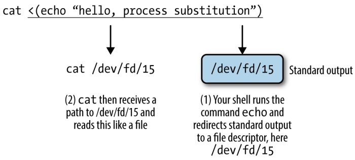
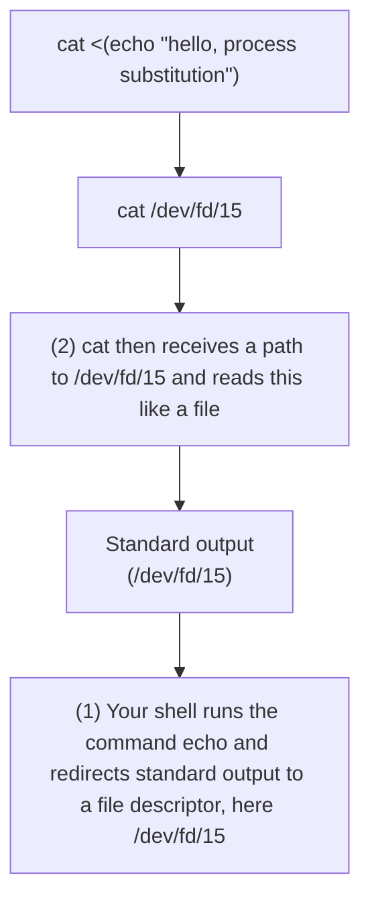

However, if we needed to also filter on column-specific information (e.g., strand), an approach using just base Unix tools would be quite messy. With Awk, adding an additional filter would be trivial: we’d just use && to add another expression in the pattern.

## Bioawk: An Awk for Biological Formats

Imagine extending Awk’s powerful processing of tabular data to processing tasks involving common bioinformatics formats like FASTA/FASTQ, GTF/GFF, BED, SAM, and VCF. This is exactly what Bioawk, a program written by Heng Li (author of other excellent bioinformatics tools such as BWA and Samtools) does. You can [download, compile, and install Bioawk from source](http://github.com/lh3/bioawk), or if you use Mac OS X’s Homebrew package manager, Bioawk is also in homebrew-science (so you can install with brew tap homebrew/science; brew install bioawk).

The basic idea of Bioawk is that we specify what bioinformatics format we’re working with, and Bioawk will automatically set variables for each field (just as regular Awk sets the columns of a tabular text file to \$1, \$1, \$2, etc.). For Bioawk to set these fields, specify the format of the input file or stream with -c. Let’s look at Bioawk’s supported input formats and what variables these formats set:

```yaml
$ bioawk -c help
bed:
    1:chrom 2:start 3:end 4:name 5:score 6:strand 7:thickstart
        8:thickend 9:rgb 10:blockcount 11:blocksizes 12:blockstarts
sam:
    1:qname 2:flag 3:rname 4:pos 5:mapq 6:cigar 7:rnext 8:pnext
        9:tlen 10:seq 11:qual
vcf:
    1:chrom 2:pos 3:id 4:ref 5-alt 6:qual 7:filter 8:info
gff:
    1:seqname 2:source 3:feature 4:start 5:end 6:score 7:filter
        8:strand 9:group 10:attribute
fastx:
    1:name 2:seq 3:qual 4:comment
```

As an example of how this works, let’s read in example.bed and append a column with the length of the feature (end position - start position) for all protein coding genes:

```powershell
$ bioawk -c gff '$3 ~ /gene/ && $2 ~ /protein_coding/ \
{print $seqname,$end-$start}' Mus_musculus.GRCm38.75_chr1.gtf | head -n 4
1       465597
1       16807
1       5485
1       12533
```

We could add gene names too, but this gets trickier as we need to split key/values out of the group column (column 9). We can do this with Awk’s split command and with some cleanup after using sed, but this is stretching what we should attempt with a one-liner. See this chapter’s README.md file in the book’s GitHub repository for a comparison of using Bioawk and Python for this problem.

Bioawk is also quite useful for processing FASTA/FASTQ files. For example, we could use it to turn a FASTQ file into a FASTA file:

```txt
bioawk -c fastx '{print ">$name"\n"$seq}' contam.fastq | head -n 4
>DJB775P1:248:D0MDGACXX:7:1202:12362:49613
TGCTTACTCTGCGTTGATACCACTGCTTAGATCGGAAGAGCACACGTCTGAA
>DJB775P1:248:D0MDGACXX:7:1202:12782:49716
CTCTGCGTTGATACCACTGCTTACTCTGCGTTGATACCACTGCTTAGATCGG
```

Note that Bioawk detects whether to parse input as FASTQ or FASTA when we use -c fastx.

Bioawk can also serve as a method of counting the number of FASTQ/FASTA entries:

```powershell
$ bioawk -c fastx 'END{print NR}' contam.fastq
8
```

Or Bioawk’s function revcomp() can be used to reverse complement a sequence:

```txt
$ bioawk -c fastx '{print>$name"\n"revcomp($seq)}' contam.fastq | head -n 4
>DJB775P1:248:D0MDGACXX:7:1202:12362:49613
TTCAGACGTGTGCTCTTCCGATCTAAGCAGTGGTATCAACGCAGAGTAAGCA
>DJB775P1:248:D0MDGACXX:7:1202:12782:49716
CCGATCTAAGCAGTGGTATCAACGCAGAGTAAGCAGTGGTATCAACGCAGAG
```

Bioawk is also useful for creating a table of sequence lengths from a FASTA file. For example, to create a table of all chromosome lengths of the Mus musculus genome:

```txt
$ bioawk -c fastx '{print $name,length($seq)} \
    Mus_musculus.GRCm38.75.dna_rm.toplevel.fa.gz > mm_genome.txt
$ head -n 4 mm_genome.txt
1   195471971
10   130694993
11   122082543
12   120129022
13   120421639
14   124902244
```

Finally, Bioawk has two options that make working with plain tab-delimited files easier: -t and -c hdr. -t is for processing general tab-delimited files; it sets Awk’s field separator (FS) and output field separator (OFS) to tabs. The option -c hdr is for unspecific tab-delimited formats with a header as the first line. This option sets field variables, but uses the names given in the header. Suppose we had a simple tabdelimited file containing variant names and genotypes for individuals (in columns):

```txt
$ head -n 4 genotypes.txt
id     ind_A   ind_B   ind_C   ind_D
S_000    T/T     A/T     A/T     T/T
S_001    G/C     C/C     C/C     C/G
S_002    C/A     A/C     C/C     C/C
```

If we wanted to return all variants for which individuals ind\_A and ind\_B have identical genotypes (note that this assumes a fixed allele order like ref/alt or major/minor):

```powershell
$ bioawk -c hdr '$ind_A == $ind_B {print $id}' genotypes.txt
S_001
S_003
S_005
S_008
S_009
```

## Stream Editing with Sed

In “The Almighty Unix Pipe: Speed and Beauty in One” on page 45, we covered how Unix pipes are fast because they operate on streams of data (rather than data written to disk). Additionally, pipes don’t require that we load an entire file in memory at once—instead, we can operate one line at a time. We’ve used pipes throughout this chapter to transform plain-text data by selecting columns, sorting values, taking the unique values, and so on. Often we need to make trivial edits to a stream (we did this in Example 7-1), usually to prepare it for the next step in a Unix pipeline. The stream editor, or sed, allows you to do exactly that. sed is remarkably powerful, and has capabilities that overlap other Unix tools like grep and awk. As with awk, it’s best to keep your sed commands simple at first. We’ll cover a small subset of sed’s vast functionality that’s most useful for day-to-day bioinformatics tasks.


## GNU Sed versus BSD Sed

As with many other Unix tools, the BSD and GNU versions of sed differ considerably in behavior. In this section and in general, I recommend you use the GNU version of sed. GNU sed has some additional features, and supports functionality such as escape codes for special characters like tab (\t) we expect in command-line tools.

sed reads data from a file or standard input and can edit a line at a time. Let’s look at a very simple example: converting a file (chroms.txt) containing a single column of chromosomes in the format “chrom12,” “chrom2,” and so on to the format “chr12,” “chr2,” and so on:

```shell
$ head -n 3 chroms.txt # before sed
chrom1 3214482 3216968
chrom1 3216025 3216968
chrom1 3216022 3216024
$ sed 's/chrom/chr/' chroms.txt | head -n 3
chr1 3214482 3216968
```

chr1 3216025 3216968

chr1 3216022 3216024

It’s a simple but important change: although chroms.txt is a mere 10 lines long, it could be 500 gigabytes of data and we can edit it without opening the entire file in memory. This is the beauty of stream editing, sed’s bread and butter. Our edited output stream is then easy to redirect to a new file (don’t redirect output to the input file; this causes bad things to happen).

Let’s dissect how the sed command in the preceding code works. First, this uses sed’s substitute command, by far the most popular use of sed. sed’s substitute takes the first occurrence of the pattern between the first two slashes, and replaces it with the string between the second and third slashes. In other words, the syntax of sed’s substitute is s/pattern/replacement/.

By default, sed only replaces the first occurrence of a match. Very often we need to replace all occurrences of strings that match our pattern. We can enable this behavior by setting the global flag g after the last slash: s/pattern/replacement/g. If we need matching to be case-insensitive, we can enable this with the flag i (e.g., s/pattern/ replacement/i).

By default, sed’s substitutions use POSIX Basic Regular Expressions (BRE). As with grep, we can use the -E option to enable POSIX Extended Regular Expressions (ERE). Whether basic or extended, sed’s regular expressions give us considerable freedom to match patterns. Perhaps most important is the ability to capture chunks of text that match a pattern, and use these chunks in the replacement (often called grouping and capturing). For example, suppose we wanted to capture the chromosome name, and start and end positions in a string containing a genomic region in the format "chr1:28427874-28425431", and output this as three columns. We could use:

```shell
$ echo "chr1:28427874-28425431" | \
    sed -E 's/^(chr[^:]+):([0-9]+)-([0-9]+)/\1\t\2\t\3/'
chr1      28427874          28425431
```

That looks quite complex! Let’s dissect each part of this. The first component of this regular expression is ^$chr[^:]+$:. This matches the text that begins at the start of the line (the anchor ^ enforces this), and then captures everything between $and$. The pattern used for capturing begins with “chr” and matches one or more characters that are not “:”, our delimiter. We match until the first “:” through a character class defined by everything that’s not “:”, [^:]+.

The second and third components of this regular expression are the same: match and capture more than one number. Finally, our replacement is these three captured groups, interspersed with tabs, \t. If you’re struggling to understand the details of this regular expression, don’t fret—regular expressions are tricky and take time and practice to master.

Explicitly capturing each component of our genomic region is one way to tackle this, and nicely demonstrates sed’s ability to capture patterns. But just as there’s always more than one way to bash a nail into wood, there are numerous ways to use sed or other Unix tools to parse strings like this. Here are a few more ways to do the same thing:

```shell
$ echo "chr1:28427874-28425431" | sed 's/[:-]/\t/g' ①
chr1     28427874         28425431
$ echo "chr1:28427874-28425431" | sed 's/:\t/' | sed 's/-/\t/' ②
chr1     28427874         28425431
$ echo "chr1:28427874-28425431" | tr ':-' '\t' ③
chr1     28427874         28425431
```

Rather than explicitly capturing each chunk of information (the chromosome, start position, and end position), here we just replace both delimiters (: and -) with a tab. Note that we’ve enabled the global flag g, which is necessary for this approach to work.
2 Here, we use two sed commands to carry out these edits separately. For complex substitutions, it can be much easier to use two or more calls to sed rather than trying to do this with one regular expression. sed has a feature to chain pattern/ replacements within sed too, using -e. For example, this line is equivalent to: sed -e 's/:/\t/' -e 's/-/\t/'.
Using tr to translate both delimiters to a tab character is also another option. tr translates all occurrences of its first argument to its second (see man tr for more details).

By default, sed prints every line, making replacements to matching lines. Sometimes this behavior isn’t what we want (and can lead to erroneous results). Imagine the following case: we want to use capturing to capture all transcript names from the last (9<sup>th</sup>) column of a GTF file. Our pipeline would look like (working with the first three lines to simplify output):

```shell
# warning: this is incorrect!
$ grep -v "^#" Mus_musculus.GRCm38.75_chr1.gtf | head -n 3 | \
sed -E 's/.*transcript_id "([^"]+)".*/\1/'

1 pseudogene gene 3054233 3054733 . [...] [...]
ENSMUST00000160944
ENSMUST00000160944
```

What happened? Some lines of the last column of Mus\_musculus.GRCm38.75\_chr1.gtf don’t contain transcript\_id, so sed prints the entire line rather than the captured group. One way to solve this would be to use grep "tran script\_id" before sed to only work with lines containing the string "tran script\_id". However, sed offers a cleaner way. First, disable sed from outputting all lines with -n. Then, by appending p after the last slash sed will print all lines it’s made a replacement on. The following is an illustration of -n used with p:

```shell
$ grep -v "^#" Mus_musculus.GRCm38.75_chr1.gtf | head -n 3 | \
sed -E -n 's/.*transcript_id "([^"]+)".*/\1/p'
ENSMUST00000160944
ENSMUST00000160944
```

This example uses an important regular expression idiom: capturing text between delimiters (in this case, quotation marks). This is a useful pattern, so let’s break it down:

1. First, match zero or more of any character (.\*) before the string "tran script\_id".
2. Then, match and capture (because there are parentheses around the pattern) one or more characters that are not a quote. This is accomplished with [^"]+, the important idiom in this example. In regular extension jargon, the brackets make up a character class. Character classes specify what characters the expression is allowed to match. Here, we use a caret (^) inside the brackets to match anything except what’s inside these brackets (in this case, a quote). The end result is that we match and capture one or more nonquote characters (because there’s a trailing +). This approach is nongreedy; often beginners make the mistake of taking a greedy approach and use .\*. Consider:

```txt
\$ echo 'transcript_id "ENSMUST00000160944"; gene_name "Gm16088"'
> greedy_example.txt
```

```txt
\$ sed -E 's/transcript_id "(.*)".*/\1/' greedy_example.txt
ENSMUST00000160944"; gene_name "Gm16088
\$ sed -E 's/transcript_id "([^"]+)".*/\1/' greedy_example.txt
ENSMUST00000160944
```

The first example was greedy; it not only captured the transcript identifier inside the quotes, but everything until the last quotation mark (which follows the gene name)!

It’s also possible to select and print certain ranges of lines with sed. In this case, we’re not doing pattern matching, so we don’t need slashes. To print the first 10 lines of a file (similar to head -n 10), we use:

```batch
\$ sed -n '1,10p' Mus_musculus.GRCm38.75_chr1.gtf
```

If we wanted to print lines 20 through 50, we would use:

```batch
\$ sed -n '20,50p' Mus_musculus.GRCm38.75_chr1.gtf
```

Substitutions make up the majority of sed’s usage cases, but this is just scratching the surface of sed’s capabilities. sed has features that allow you to make any type of edit to a stream of text, but for complex stream processing tasks it can be easier to write a Python script than a long and complicated sed command. Remember the KISS principal: Keep Incredible Sed Simple.

## Advanced Shell Tricks

With both the Unix shell refresher in Chapter 3 and the introduction to Unix data tools in this chapter, we’re ready to dig into a few more advanced shell tricks. If you’re struggling with the shell, don’t hesitate to throw a sticky note on this page and come back to this section later.

## Subshells

The first trick we’ll cover is using Unix subshells. Before explaining this trick, it’s helpful to remember the difference between sequential commands (connected with && or ;), and piped commands (connected with |). Sequential commands are simply run one after the other; the previous command’s standard output does not get passed to the next program’s standard in. In contrast, connecting two programs with pipes means the first program’s standard out will be piped into the next program’s standard in.

The difference between sequential commands linked with && and ; comes down to exit status, a topic covered in “Exit Status: How to Programmatically Tell Whether Your Command Worked” on page 52. If we run two commands with command1 ; com mand2, command2 will always run, regardless of whether command1 exits successfully (with a zero exit status). In contrast, if we use command1 && command2, command2 will only run if command1 completed with a zero-exit status. Checking exit status with pipes unfortunately gets tricky (we’ll explore this important topic in Chapter 12).

So how do subshells fit into all of this? Subshells allow us to execute sequential commands together in a separate shell process. This is useful primarily to group sequential commands together (such that their output is a single stream). This gives us a new way to construct clever one-liners and has practical uses in command-line data processing. Let’s look at a toy example first:

```shell
$ echo "this command"; echo "that command" | sed 's/command/step/'
this command
that step
$ (echo "this command"; echo "that command") | sed 's/command/step/'
this step
that step
```

In the first example, only the second command’s standard out is piped into sed. This is because your shell interprets echo "this command" as one command and echo "that command" | sed 's/command/step/' as a second separate command. But grouping both echo commands together using parentheses causes these two commands to be run in a separate subshell, and both commands’ combined standard output is passed to sed. Combining two sequential commands’ standard output into a single stream with a subshell is a useful trick, and one we can apply to shell problems in bioinformatics.

Consider the problem of sorting a GTF file with a metadata header. We can’t simply sort the entire file with sort, because this header could get shuffled in with rows of data. Instead, we want to sort everything except the header, but still include the header at the top of the final sorted file. We can solve this problem using a subshell to group sequential commands that print the header to standard out and sort all other lines by chromosome and start position, printing all lines to standard out after the header. Admittedly, this is a bit of Unix hackery, but it turns out to be a useful trick.

Let’s do this using the gzipped GTF file Mus\_musculus.GRCm38.75\_chr1.gtf.gz, and zgrep (the gzip analog of grep). We’ll pipe the output to less first, to inspect our results:

```shell
$ (zgrep "^#" Mus_musculus.GRCm38.75_chr1.gtf.gz; \
    zgrep -v "^#" Mus_musculus.GRCm38.75_chr1.gtf.gz | \
    sort -k1,1 -k4,4n) | less
```

Because we’ve used a subshell, all standard output from these sequential commands will be combined into a single stream, which here is piped to less. To write this stream to a file, we could redirect this stream to a file using something like > Mus\_mus culus.GRCm38.75\_chr1\_sorted.gtf. But a better approach would be to use gzip to compress this stream before writing it to disk:

```shell
$ (zgrep "^#" Mus_musculus.GRCm38.75_chr1.gtf.gz; \
    zgrep -v "^#" Mus_musculus.GRCm38.75_chr1.gtf.gz | \
    sort -k1,1 -k4,4n) | gzip > Mus_musculus.GRCm38.75_chr1_sorted.gtf.gz
```

Subshells give us another way to compose commands in the shell. While these are indeed tricky to understand at first (which is why this section is labelled “advanced”), these do have tangible, useful applications—especially in manipulating large data streams. Note that we could have written a custom Python script to do this same task, but there are several disadvantages with this approach: it would be more work to implement, it would require more effort to have it work with compressed streams, and sorting data in Python would almost certainly be much, much less efficient than using Unix sort.

## Named Pipes and Process Substitution

Throughout this chapter, we’ve used pipes to connect command-line tools to build custom data-processing pipelines. However, some programs won’t interface with the Unix pipes we’ve come to love and depend on. For example, certain bioinformatics tools read in multiple input files and write to multiple output files:

\$ processing\_tool --in1 in1.fq --in2 in2.fq --out1 out2.fq --out2.fq

In this case, the imaginary program processing\_tool requires two separate input files, and produces two separate output files. Because each file needs to be provided separately, we can’t pipe the previous processing step’s results through process ing\_tool’s standard in. Likewise, this program creates two separate output files, so it isn’t possible to pipe processing\_tool’s standard output to another program in the processing pipeline. This isn’t just an unlikely toy example; many bioinformatics programs that process two paired-end sequencing files together operate like this.

In addition to the inconvenience of not being able to use a Unix pipe to interface processing\_tool with other programs, there’s a more serious problem: we would have to write and read four intermediate files to disk to use this program. If process ing\_tool were in the middle of a data-processing pipeline, this would lead to a significant computational bottleneck (remember from “The Almighty Unix Pipe: Speed and Beauty in One” on page 45 that reading and writing to disk is very slow).

Fortunately, Unix provides a solution: named pipes. A named pipe, also known as a FIFO (First In First Out, a concept in computer science), is a special sort of file. Regular pipes are anonymous—they don’t have a name, and only persist while both processes are running. Named pipes behave like files, and are persistent on your filesystem. We can create a named pipe with the program mkfifo:

```powershell
$ mkfifo fqin
$ ls -l fqin
prw-r--r-- 1 vinceb staff 0 Aug 5 22:50 fqin
```

You’ll notice that this is indeed a special type of file: the p before the file permissions is for pipe. Just like pipes, one process writes data into the pipe, and another process reads data out of the pipe. As a toy example, we can simulate this by using echo to redirect some text into a named pipe (running it in the background, so we can have our prompt back), and then cat to read the data back out:

```csv
$ echo "hello, named pipes" > fqin & ①
[1] 16430
$ cat fqin ②
[1] + 16430 done
hello, named pipes
$ rm fqin ③
```

Write some lines to the named pipe we created earlier with mkfifo.

Treating the named pipe just as we would any other file, we can access the data we wrote to it earlier. Any process can access this file and read from this pipe. Like a standard Unix pipe, data that has been read from the pipe is no longer there.
Like a file, we clean up by using rm to remove it.

Although the syntax is similar to shell redirection to a file, we’re not actually writing anything to our disk. Named pipes provide all of the computational benefits of pipes with the flexibility of interfacing with files. In our earlier example, in1.fq and in2.fq could be named pipes that other processes are writing input to. Additionally, out1.fq and out2.fq could be named pipes that processing\_tool is writing to, that other processes read from.

However, creating and removing these file-like named pipes is a bit tedious. Programmers like syntactic shortcuts, so there’s a way to use named pipes without having to explicitly create them. This is called process substitution, or sometimes known as anonymous named pipes. These allow you to invoke a process, and have its standard output go directly to a named pipe. However, your shell treats this process substitution block like a file, so you can use it in commands as you would a regular file or named pipe. This is a bit confusing at first, but it should be clearer with some examples.

If we were to re-create the previous toy example with process substitution, it would look as follows:

```txt
\$ cat <(echo "hello, process substitution")
hello, process substitution
```

Remember that cat takes file arguments. The chunk <(echo "hello, process sub stition") runs the echo command and pipes the output to an anonymous named pipe. Your shell then replaces this chunk (the <(...) part) with the path to this anonymous named pipe. No named pipes need to be explicitly created, but you get the same functionality. Process substitution allows us to connect two (or potentially more) programs, even if one doesn’t take input through standard input. This is illustrated in Figure 7-3.



<details>
<summary>flowchart</summary>


</details>

Figure 7-3. Process substitution broken down by what your shell does.

In the program example we saw earlier, two inputs were needed (--in1 and --in2). Because this program takes two inputs, and not one from standard input, there’s no way to use a classic Unix pipe (|) if these input files are the outputs of another program. Instead of creating two explicit named pipes with mkfifo, we can use process substitution. For the sake of this example, assume that a program called makein is creating the input streams for --in1 and --in2:

```batch
program --in1 <(makein raw1.txt) --in2 <(makein raw2.txt) \
    --out1 out1.txt --out2 out2.txt
```

The last thing to know about process substitution is that it can also be used to capture an output stream. This is used often in large data processing to compress output on the fly before writing it to disk. In the preceding program example, assume that we wanted to take the output that’s being written to files out1.txt and out2.txt and compress these streams to files out1.txt.gz and out2.txt.gz. We can do this using the intuitive analog to <(...), >(...). For clarity, I am omitting our previous process substitutions:

```batch
program --in1 in1.txt --in2 in2.txt \
    --out1 >(gzip > out1.txt.gz) --out2 >(gzip > out2.txt.gz)
```

This creates two anonymous named pipes, and their input is then passed to the gzip command. gzip then compresses these and writes to standard out, which we redirect to our gzipped files.

## The Unix Philosophy Revisited

Throughout this chapter, the Unix philosophy—equipped with the power of the Unix pipe—allowed us to rapidly stitch together tiny programs using a rich set of Unix tools. Not only are Unix piped workflows fast to construct, easy to debug, and versatile, but they’re often the most computationally efficient solution, too. It’s a testament to the incredible design of Unix that so much of the way we approach modern bioinformatics is driven by the almighty Unix pipe, a piece of technology invented over 40 years ago in “one feverish night” by Ken Thompson (as described by Doug McIlroy).

# A Rapid Introduction to the R Language

In summary, data analysis, like experimentation, must be considered as an open-ended, highly interactive, iterative process, whose actual steps are selected segments of a stubbily branching, tree-like pattern of possible actions.

— Data analysis and statistics: an expository overview J. W. Tukey and M. B. Wilk (1966)

…exploratory data analysis is an attitude, a state of flexibility, a willingness to look for those things that we believe are not there, as well as for those we believe might be there. Except for its emphasis on graphs, its tools are secondary to its purpose.

—J. W. Tukey in a comment to E. Parzen (1979)

Many biologists are first exposed to the R language by following a cookbook-type approach to conduct a statistical analysis like a t-test or an analysis of variance (ANOVA). Although R excels at these and more complicated statistical tasks, R’s real power is as a data programming language you can use to explore and understand data in an open-ended, highly interactive, iterative way. Learning R as a data programming language will give you the freedom to experiment and problem solve during data analysis—exactly what we need as bioinformaticians. In particular, we’ll focus on the subset of the R language that allows you to conduct exploratory data analysis (EDA). Note, however, that EDA is only one aspect of the R language—R also includes stateof-the-art statistical and machine learning methods.

Popularized by statistician John W. Tukey, EDA is an approach that emphasizes understanding data (and its limitations) through interactive investigation rather than explicit statistical modeling. In his 1977 book Exploratory Data Analysis, Tukey described EDA as “detective work” involved in “finding and revealing the clues” in data. As Tukey’s quote emphasizes, EDA is more an approach to exploring data than using specific statistical methods. In the face of rapidly changing sequencing technologies, bioinformatics software, and statistical methods, EDA skills are not only widely applicable and comparatively stable—they’re also essential to making sure that our analyses are robust to these new data and methods.

Exploratory data analysis plays an integral role throughout an entire bioinformatics project. Exploratory data analysis skills are just as applicable in analyzing intermediate bioinformatics data (e.g., are fewer reads from this sequencing lane aligning?) as they are in making sense of results from statistical analyses (e.g., what’s the distribution of these p-values, and do they correlate with possible confounders like gene length?). These exploratory analyses need not be complex or exceedingly detailed (many patterns are visible with simple analyses and visualization); it’s just about wanting to look into the data and having the skill set to do so.

In many cases, exploratory data analysis—and especially visualization—can reveal patterns in bioinformatics data we might overlook with statistical modeling or hypothesis testing. Bioinformatics data is high dimensional and messy, with each data point being a possible mix of biological signal, measurement noise, bias due to ad hoc bioinformatics filtering criteria or analysis steps, and confounding by both technical and biological covariates. Our brains are the most sophisticated pattern-finding instruments on the planet, and exploratory data analysis is the craft of presenting data in different ways to allow our brains to find patterns—both those that indicate interesting biological signals or suggest potential problems. Compared to our brains, statistical tests are a blunt instrument—and one that’s even duller when working with the complex, high-dimensional datasets widespread in bioinformatics.

Although this chapter emphasizes exploratory data analysis, statistical analysis of high-dimensional genomics data is just as important; in fact, this topic is so important that you should seek books and articles that cover it in depth. As stated in Chapter 1, no amount of post-experiment data analysis can rescue a poorly designed experiment. Likewise, no amount of terrific exploratory data analysis is substitute for having a good experimental question and applying appropriate statistical methods. Rather, EDA techniques like visualization should play an ongoing role throughout statistical analysis and complement other statistical methods, assessing the output at each step. The objective of this chapter is to teach you the EDA skills that give you the freedom to explore and experiment with your data at any stage of analysis.

## Getting Started with R and RStudio

To capitalize on R’s interactive capabilities, we need a development environment that promotes interactive coding. The most popular option is RStudio, an open source integrated development environment for R. RStudio supports many features useful for working in R: syntax highlighting, quick access to R’s internal help and documentation system, and plots visible alongside code. Additionally, RStudio has an intuitive interface, is easy to use, and is the editor I’d recommend for beginner R users.

Developing code in R is a back-and-forth between writing code in a rerunnable script and exploring data interactively in the R interpreter. To be reproducible, all steps that lead to results you’ll use later must be recorded in the R script that accompanies your analysis and interactive work. While R can save a history of the commands you’ve entered in the interpreter during a session (with the command savehistory()), storing your steps in a well-commented R script makes your life much easier when you need to backtrack to understand what you did or change your analysis. RStudio simplifies developing R scripts this way by allowing you to send lines from your R script to the R interpreter with a simple keyboard shortcut: Command-Enter (for OS X) or Control-Enter (for Windows and Linux).

## The Comprehensive R Archive Network (CRAN)

Among R’s greatest strengths are the numerous packages that extend its functionality. The R Project hosts many of these packages (over 6,400) on the Comprehensive R Archive Network, or CRAN, on a variety of servers that mirror the R project’s server. You can install these packages directly from within R with the install.packages() function. For example, we can install the ggplot2 package (which we’ll use through out this chapter) as follows:

```txt
> install.packages("ggplot2")
trying URL 'http://cran.cnr.Berkeley.edu/src/contrib/ggplot2_1.0.0.tar.gz'
Content type 'application/x-gzip' length 2351447 bytes (2.2 Mb)
opened URL
```

downloaded 2.2 Mb

```txt
Loading required package: devtools
* installing *source* package 'ggplot2' ...
** package 'ggplot2' successfully unpacked and MD5 sums checked
** R
** data
*** moving datasets to lazyload DB
** inst
** preparing package for lazy loading
** help
*** installing help indices
** building package indices
** installing vignettes
** testing if installed package can be loaded
Loading required package: devtools
* DONE (ggplot2)
```

This downloads and installs ggplot2 from a CRAN repository (for information on setting various options, including how to configure your repository to a nearby mirror, see help(install.packages)).

CRAN isn’t the only R package repository—in Chapter 9, we’ll use many packages from the Bioconductor project. Bioconductor has its own way of installing packages that we’ll learn about in “Installing and Working with Bioconductor Packages” on page 269.

To get started with the examples in this chapter, we first need to install R. You can do this by either downloading R from the [R-Project’s website](http://cran.r-project.org/) or installing it from a ports or package manager like Ubuntu’s apt-get or OS X’s Homebrew. Then, you’ll need to install RStudio IDE from [RStudio’s website](http://www.rstudio.com/). Be sure to keep both R and RStudio up to date. I’ve included some additional resources on getting started with RStudio in this chapter’s README on GitHub.

## R Language Basics

Before getting our hands dirty working with real data in R, we need to learn the basics of the R language. Even if you’ve poked around in R and seen these concepts before, I would still recommend skimming through this section. Many of the difficul ties beginning R users face stem from misunderstanding the language’s basic concepts, data structures, and behavior (which can differ quite significantly from other languages like Python and Perl). In this section, we’ll learn how to do simple calcula tions in R, assign values to variables, and call functions. Then, we’ll look at R’s vectors, vector data types, and vectorization. Vectors and vectorization underpin how we approach many problems in R—a theme we’ll continue to see throughout this chapter.

## Simple Calculations in R, Calling Functions, and Getting Help in R

Let’s begin by looking at some simple calculations in R. Open RStudio (or a terminal R prompt) and try some basic arithmetic calculations in R:

```diff
> 4 + 3
[1] 7
> 4 - 3
[1] 1
> 4 * 3
[1] 12
> 4 / 3
[1] 1.333333
```

You’ll need to familiarize yourself with some R lingo: we say each line contains an expression that is evaluated by R when you press Enter. Whitespace around the arithmetic operations does not change how R evaluates these expressions. In some cases, you will need to surround parts of an expression with parentheses to indicate the order of evaluation. For example: