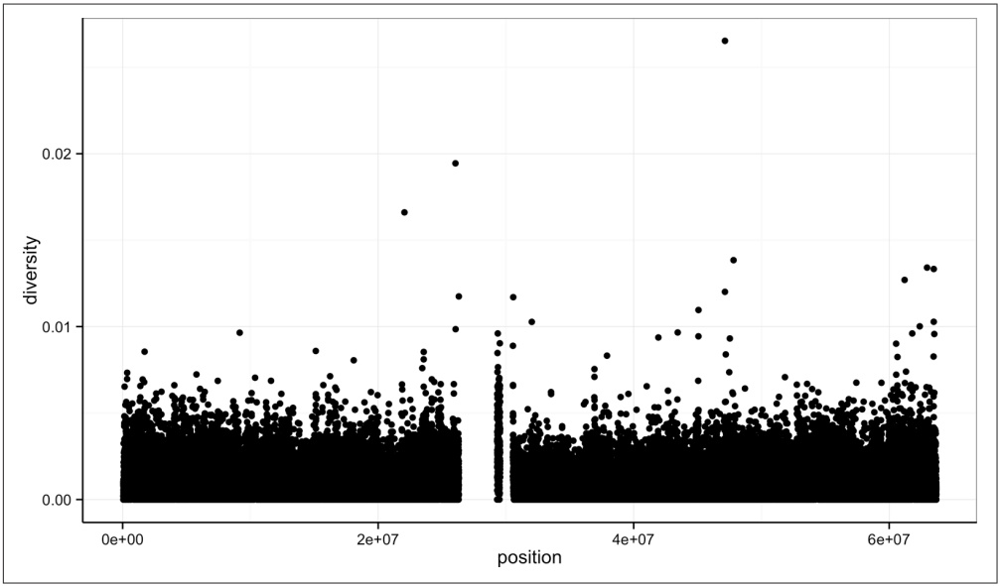
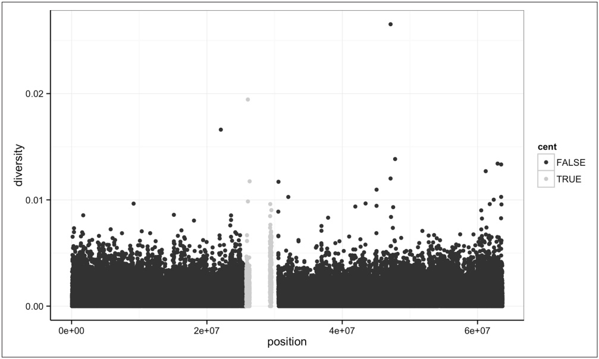

For all examples in this chapter, I’ll assume R’s working directory is this chapter’s directory in the book’s GitHub repository. We’ll come back to working directories again when we discuss R scripts in “Working with R Scripts” on page 254.

Next, it’s wise to first inspect a file from the command line before loading it into R. This will give you a sense of the column delimiter being used, whether there are comment lines (e.g., lines that don’t contain data and begin with a character like #), and if the first line is a header containing column names. Either head or less work well for this:

```csv
$ head -n 3 Dataset_S1.txt
start,end,total SNPs,total Bases,depth,unique SNPs,dhSNPs, [...] 
55001,56000,0,1894,3.41,0,0, [...] 
56001,57000,5,6683,6.68,2,2, [...]
```

From this, we see Dataset\_S1.txt is a comma-separated value file with a header. If you explore this file in more detail with less, you’ll notice this data is tidy and organized. Each column represents a single variable (e.g., window start position, window end position, percent GC, etc.) and each row represents an observation (in this case, the values for a particular 1kb window). Loading tidy plain-text data like Dataset\_S1.txt requires little effort, so you can quickly get started working with it. Your R scripts should organize data in a similar tidy fashion (and in a format like tab-delimited or CSV), as it’s much easier to work with tidy data using Unix tools and R.

## Large Genomics Data into R: colClasses, Compression, and More

It’s quite common to encounter genomics datasets that are difficult to load into R because they’re large files. This is either because it takes too long to load the entire dataset into R, or your machine simply doesn’t have enough memory. In many cases, the best strategy is to reduce the size of your data somehow: summarizing data in earlier processing steps, omitting unnecessary columns, splitting your data into chunks (e.g., working with a chromosome at a time), or working on a random subset of your data. Many bioinformatics analyses do not require working on an entire genomic dataset at once, so these strategies can work quite well. These approaches are also the only way to work with data that is truly too large to fit in your machine’s memory (apart from getting a machine with more memory).

If your data will fit in your machine’s memory, it’s still possible that loading the data into R may be quite slow. There are a few tricks to make the read.csv() and read.delim() functions load large data files more quickly. First, we could explicitly set the class of each column through the colClasses argument. This saves R time (usually making the R’s data reading functions twice as fast), as it takes R time to figure out what type of class a column has and convert between classes. If your dataset has columns you don’t need in your analysis (and unnecessarily take up memory), you can set their value in the colClasses vector to "NULL" (in quotes) to force R to skip them.

Additionally, specifying how many rows there are in your data by setting nrow in read.delim() can lead to some performance gains. It’s OK to somewhat overestimate this number; you can get a quick estimate using wc -l. If these solutions are still too slow, you can install the data.table package and use its fread() function, which is the fastest alternative to read.\* functions (though be warned: fread() returns a data.table, not a data.frame, which behaves differently; see the manual).

If your data is larger than the available memory on your machine, you’ll need to use a strategy that keeps the bulk of your data out of memory, but still allows for easy access from R. A good solution for moderately large data is to use SQLite and query out subsets for computation using the R package RSQLite (we’ll cover SQLite and other strategies for data too large to fit in memory in Chapter 13).

Finally, as we saw in Chapter 6, many Unix data tools have versions that work on gzipped files: zless, zcat (gzcat on BSD-derived systems like Max OS X), and others. Likewise, R’s data-reading functions can also read gzipped files directly—there’s no need to uncompress gzipped files first. This saves disk space and there can be some slight performance gains in reading in gzipped files, as there are fewer bytes to read off of (slow) hard disks.

With our working directory properly set, let’s load Dataset\_S1.txt into R. The R functions read.csv() and read.delim() are used for reading CSV and tab-delimited files, respectively. Both are thin wrappers around the function read.table() with the proper arguments set for CSV and tab-delimited files—see help(read.table) for more information. To load the CSV file Dataset\_S1.txt, we’d use read.csv() with "Dataset\_S1.txt" as the file argument (the first argument). To avoid repeatedly typing a long name when we work with our data, we’ll assign this to a variable named d:

```txt
> d <- read.csv("Dataset_S1.txt")
```

Note that the functions read.csv() and read.delim() have the argument header set to TRUE by default. This is important because Dataset\_S1’s first line contains column names rather than the first row of data. Some data files don’t include a header, so you’d need to set header=FALSE. If your file lacks a column name header, it’s a good idea to assign column names as you read in the data using the col.names argument. For example, to load a fake tab-delimited file named noheader.bed that contains three columns named chrom, start, and end, we’d use:

```r
> bd <- read.delim("noheader.bed", header=FALSE,
                       col.names=c("chrom", "start", "end"))
```

R’s read.csv() and read.delim() functions have numerous arguments, many of which will need to be adjusted for certain files you’ll come across in bioinformatics. See Table 8-4 for a list of some commonly used arguments, and consult help(read.csv) for full documentation. Before we move on to working with the data in Dataset\_S1.txt, we need to discuss one common stumbling block when loading data into R: factors. As we saw in “Factors and classes in R” on page 191, factors are R’s way of encoding categorical data in a vector. By default, R’s read.delim() and read.csv() functions will coerce a column of strings to a factor, rather than treat it as a character vector. It’s important to know that R does this so you can disable this coercion when you need a column as a character vector. To do this, set the argument stringsAsFactors=FALSE (or use asis; see help(read.table) for more information). In “Factors and classes in $\mathbb { R } ^ { \mathfrak { z } }$ on page 191, we saw how factors are quite useful, despite the headaches they often cause new R users.

Table 8-4. Commonly used read.csv() and read.delim() arguments

| Argument | Description | Additional comments |
| --- | --- | --- |
| header | A TRUE/FALSE value indicating whether the first row contains column names rather than data |  |
| sep | A character value indicating what delimits columns; using the empty string "" treats all whitespace as a separator |  |
| stringsAs Factors | Setting this argument as FALSE prevents R from coercing character vectors to factors for all columns; see argument as is in help(read.delim) to prevent coercion to factor on specific columns | This is an important argument to be aware of, because R's default behavior of coercing character vector columns to factors is a common stumbling block for beginners. |
| col.names | A character vector to be used as column names |  |
| row.names | A vector to use for row names, or a single integer or column name indicating which column to use as row names |  |
| na.strings | A character vector of possible missing values to convert to NA | Files using inconsistent missing values (e.g., a mix of "NA," "Na," "na") can be corrected using nastrings=c("NA", "Na", "na"). |
| colClasses | A character vector of column classes; "NULL" indicates a column should be skipped and NA indicates R should infer the type | colClasses can drastically decrease the time it takes to load a file into R, and is a useful argument when working with large bioinformatics files. |
| com ment.char | Lines beginning with this argument are ignored; the empty string (i.e., "") disables this feature | This argument is useful in ignoring metadata lines in bioinformatics files. |

## Getting Data into Shape

Quite often, data we load in to R will be in the wrong shape for what we want to do with it. Tabular data can come in two different formats: long and wide. With wide data, each measured variable has its own column (Table 8-5).

Table 8-5. A gene expression counts table by tissue in wide format

| Gene | Meristem | Root | Flower |
| --- | --- | --- | --- |
| gene_1 | 582 | 91 | 495 |
| gene_2 | 305 | 3505 | 33 |

With long data, one column is used to store what type of variable was measured and another column is used to store the measurement (Table 8-6).

Table 8-6. A gene expression counts table by tissue in long format

| Gene | Tissue | Expression |
| --- | --- | --- |
| gene_1 | meristem | 582 |
| gene_2 | meristem | 305 |
| gene_1 | root | 91 |
| gene_2 | root | 3503 |
| gene_1 | flower | 495 |
| gene_2 | flower | 33 |

In many cases, data is recorded by humans in wide format, but we need data in long format when working with and plotting statistical modeling functions. Hadley Wickham’s reshape2 package provides functions to reshape data: the function melt() turns wide data into long data, and cast() turns long data into wide data. There are numerous resources for learning more about the reshape2 package:

• [reshape2 CRAN page](http://bit.ly/reshape-2)
• [Hadley Wickham’s reshape page](http://had.co.nz/reshape/)

## Exploring and Transforming Dataframes

The Dataset\_S1.txt data we’ve loaded into R with read.csv() is stored as a dataframe. Dataframes are R’s workhorse data structure for storing tabular data. Dataframes consist of columns (which represent variables in your dataset), and rows (which represent observations). In this short section, we’ll learn the basics of accessing the dimensions, rows, columns, and row and column names of a dataframe. We’ll also see how to transform columns of a dataframe and add additional columns.

Each of the columns of a dataframe are vectors just like those introduced in “Vectors, Vectorization, and Indexing” on page 183. Consequently, each element in a dataframe column has the same type. But a dataframe can contain many columns of all different types; storing columns of heterogeneous types of vectors is what dataframes are designed to do.

First, let’s take a look at the dataframe we’ve loaded in with the function head(). By default, head() prints the first six lines of a dataframe, but we’ll limit this to three using the n argument:

<table><tr><td colspan="9">&gt; head(d, n=3)</td></tr><tr><td>start</td><td>end</td><td>total.SNPs</td><td>total.Bases</td><td>depth</td><td>unique.SNPs</td><td>dhSNPs</td><td>reference.Bases</td><td></td></tr><tr><td>1</td><td>55001</td><td>56000</td><td>0</td><td>1894</td><td>3.41</td><td>0</td><td>0</td><td>556</td></tr><tr><td>2</td><td>56001</td><td>57000</td><td>5</td><td>6683</td><td>6.68</td><td>2</td><td>2</td><td>1000</td></tr><tr><td>3</td><td>57001</td><td>58000</td><td>1</td><td>9063</td><td>9.06</td><td>1</td><td>0</td><td>1000</td></tr><tr><td colspan="2">Theta</td><td>Pi</td><td>Heterozygosity</td><td>X.GC</td><td>Recombination</td><td>Divergence</td><td>Constraint</td><td>SNPs</td></tr><tr><td>1</td><td>0.000</td><td>0.000</td><td>0.000</td><td>54.8096</td><td>0.009601574</td><td>0.003006012</td><td></td><td>0</td></tr><tr><td>2</td><td>8.007</td><td>10.354</td><td>7.481</td><td>42.4424</td><td>0.009601574</td><td>0.018018020</td><td></td><td>0</td></tr><tr><td>3</td><td>3.510</td><td>1.986</td><td>1.103</td><td>37.2372</td><td>0.009601574</td><td>0.007007007</td><td></td><td>0</td></tr></table>

(Note that R has wrapped the columns of this dataset.)

Other things we might want to know about this dataframe are its dimensions, which we can access using nrow() (number of rows), ncol() (number of columns), and dim() (returns both):

```txt
> nrow(d)
[1] 59140
> ncol(d)
[1] 16
> dim(d)
[1] 59140    16
```

We can also print the columns of this dataframe using col.names() (there’s also a row.names() function):

```txt
> colnames(d)
[1] "start"          "end"          "total.SNPs"      "total.Bases"
[5] "depth"          "unique.SNPs"      "dhSNPs"          "reference.Bases"
[9] "Theta"          "Pi"              "Heterozygosity"  "X.GC"
[13] "Recombination"   "Divergence"       "Constraint"      "SNPs"
```

Note that R’s read.csv() function has automatically renamed some of these columns for us: spaces have been converted to periods and the percent sign in %GC has been changed to an “X.” “X.GC” isn’t a very descriptive column name, so let’s change this. Much like we’ve set the names of a vector using names() <-, we can set column names with col.names() <-. Here, we only want to change the 12<sup>th</sup> column name, so we’d use:

```txt
> colnames(d)[12] # original name
[1] "X.GC"
> colnames(d)[12] <- "percent.GC"
> colnames(d)[12] # after change
[1] "percent.GC"
```


## Creating Dataframes from Scratch

R’s data loading functions read.csv() and read.delim() read in data from a file and return the results as a data.frame. Sometimes you’ll need to create a dataframe from scratch from a set of vectors. You can do this with the function data.frame(), which creates a dataframe from vector arguments (recycling the shorter vectors when necessary). One nice feature of data.frame() is that if you provide vectors as named arguments, data.frame() will use these names as column names. For example, if we simulated data from a simple linear model using sample() and rnorm(), we could store it in a dataframe with:

```r
> x <- sample(1:50, 300, replace=TRUE)
> y <- 3.2*x + rnorm(300, 0, 40)
> d_sim <- data.frame(y=y, x=x)
```

As with R’s read.csv() and read.delim() functions, data.frame() will convert character vectors into factors. You can disable this behavior by setting stringsAsFactors=FALSE.

Similarly, we could set row names using row.names() <- (note that row names must be unique).

The most common way to access a single column of a dataframe is with the dollar sign operator. For example, we could access the column depth in d using:

```txt
> d\$depth
[1] 3.41 6.68 9.06 10.26 8.06 7.05 [...]
```

This returns the depth column as a vector, which we can then pass to R functions like mean() or summary() to get an idea of what depth looks like across this dataset:

```txt
> mean(d\$depth)
[1] 8.183938
> summary(d\$depth)
```

```txt
Min. 1st Qu. Median Mean 3rd Qu. Max.
1.000 6.970 8.170 8.184 9.400 21.910
```

The dollar sign operator is a syntactic shortcut for a more general bracket operator used to access rows, columns, and cells of a dataframe. Using the bracket operator is similar to accessing the elements of a vector (e.g., vec[2]), except as two-dimensional data structures, dataframes use two indexes separated by a comma: df[row, col]. Just as with indexing vectors, these indexes can be vectors to select multiple rows and columns simultaneously. Omitting the row index retrieves all rows, and omitting the column index retrieves all columns. This will be clearer with some examples. To access the first two columns (and all rows), we’d use:

```txt
> d[ , 1:2]
    start end
1 55001 56000
2 56001 57000
3 57001 58000
[...]
```

It’s important to remember the comma (and note that whitespace does not matter here; it’s just to increase readability). Selecting two columns like this returns a dataframe. Equivalently, we could use the column names (much like we could use names to access elements of a vector):

```txt
> d[, c("start", "end")]
  start   end
1 55001 56000
2 56001 57000
3 57001 58000
[...]
```

If we only wanted the first row of start and end positions, we’d use:

```txt
> d[1, c("start", "end")]
  start end
1 55001 56000
```

Similarly, if we wanted the first row of data for all columns, we’d omit the column index:

```txt
> d[1, ]
  start   end total.SNPs total.Bases depth unique.SNPs dhSNPs reference.Bases
1 55001 56000          0       1894 3.41         0      0           556
  Theta Pi Heterozygosity percent.GC Recombination Divergence Constraint SNPs
1     0  0           0   54.8096   0.009601574 0.003006012         0      0
```

Single cells can be accessed by specifying a single row and a single column:

```txt
> d[2, 3]
[1] 5
```

However, in practice we don’t usually need to access single rows or cells of a dataframe during data analysis (see Fragile Code and Accessing Rows and Columns in Dataframes).


## Fragile Code and Accessing Rows and Columns in Dataframes

It’s a good idea to avoid referring to specific dataframe rows in your analysis code. This would produce code fragile to row permutations or new rows that may be generated by rerunning a previous analysis step. In every case in which you might need to refer to a specific row, it’s avoidable by using subsetting (see “Exploring Data Through Slicing and Dicing: Subsetting Dataframes” on page 203).

Similarly, it’s a good idea to refer to columns by their column name, not their position. While columns may be less likely to change across dataset versions than rows, it still happens. Column names are more specific than positions, and also lead to more readable code.

When accessing a single column from a dataframe, R’s default behavior is to return this as a vector—not a dataframe with one column. Sometimes this can cause problems if downstream code expects to work with a dataframe. To disable this behavior, we set the argument drop to FALSE in the bracket operator:

```txt
> d[, "start", drop=FALSE]
  start
1 55001
2 56001
3 57001
[...]
```

Now, let’s add an additional column to our dataframe that indicates whether a window is in the centromere region. The positions of the chromosome 20 centromere (based on Giemsa banding) are 25,800,000 to 29,700,000 (see this chapter’s README on GitHub to see how these coordinates were found). We can append to our d dataframe a column called cent that has TRUE/FALSE values indicating whether the current window is fully within a centromeric region using comparison and logical operations:

```perl
> d$cent <- d$start >= 25800000 & d$end <= 29700000
```

Note the single ampersand (&), which is the vectorized version of logical AND. & operates on each element of the two vectors created by dd\$start >= 25800000 and dd\$end <= 29700000 and returns TRUE when both are >true. How many windows fall into this centromeric region? There are a few ways to tally the TRUE values. First, we could use table():

```txt
> table(d$cent)
FALSE    TRUE
58455     685
```

Another approach uses the fact that sum() will coerce logical values to integers (so TRUE has value 1 and FALSE has value 0). To count how many windows fall in this centromeric region, we could use:

```txt
> sum(d$cent)
[1] 685
```

Lastly, note that according to the supplementary material of this paper, the diversity estimates (columns Theta, Pi, and Heterozygosity) are all scaled up by 10x in the dataset (see supplementary Text S1 for more details). We’ll use the nucleotide diversity column Pi later in this chapter in plots, and it would be useful to have this scaled as per basepair nucleotide diversity (so as to make the scale more intuitive). We can create a new rescaled column called diversity with:

```csv
> d$diversity <- d$Pi / (10*1000)  # rescale, removing 10x and making per bp
> summary(d$diversity )
    Min.   1st Qu.   Median      Mean   3rd Qu.     Max.
0.0000000 0.0005577 0.0010420 0.0012390 0.0016880 0.0265300
```

Average nucleotide diversity per basepair in this data is around 0.001 (0.12%), roughly what we’d expect from other estimates of human diversity (Hernandez et al., 2012, Perry et al., 2012).

## Exploring Data Through Slicing and Dicing: Subsetting Dataframes

The most powerful feature of dataframes is the ability to slice out specific rows by applying the same vector subsetting techniques we saw in “Vectors, Vectorization, and Indexing” on page 183 to columns. Combined with R’s comparison and logical operators, this leads to an incredibly powerful method to query out rows in a dataframe. Understanding and mastering dataframe subsetting is one of the most important R skills to develop, as it gives you considerable power to interrogate and explore your data. We’ll learn these skills in this section by applying them to the Dataset\_S1.txt dataset to explore some features of this data.

Let’s start by looking at the total number of SNPs per window. From summary(), we see that this varies quite considerably across all windows on chromosome 20:

```txt
> summary(d$total.SNPs)
    Min. 1st Qu.   Median      Mean 3rd Qu.     Max.
    0.000    3.000    7.000    8.906   12.000    93.000
```

Notice how right-skewed this data is: the third quartile is 12 SNPs, but the maximum is 93 SNPs. Often we want to investigate such outliers more closely. Let’s use data subsetting to select out some rows that have 85 or more SNPs (this arbitrary threshold is just for exploratory data analysis, so it doesn’t matter much). We can create a logical vector containing whether each observation (row) has 85 or more SNPs using the following:

```txt
> d$total.SNPs >= 85
[1] FALSE FALSE FALSE FALSE FALSE FALSE [...]
```

Recall from “Vectors, Vectorization, and Indexing” on page 183 that in addition to integer indexing vectors, we can use logical vectors (Example 8-1). Likewise, we can use the logical vector we created earlier to extract the rows of our dataframe. R will keep only the rows that have a TRUE value:

```txt
> d[d$total.SNPs >= 85, ]
        start      end total.SNPs total.Bases depth unique.SNPs dhSNPs
2567   2621001 2622000          93       11337 11.34         13     10
12968 13023001 13024000          88       11784 11.78         11     1
43165 47356001 47357000          87       12505 12.50         9     7
        reference.Bases Theta    Pi Heterozygosity percent.GC Recombination
2567           1000 43.420 50.926          81.589   43.9439   0.000706536
12968           1000 33.413 19.030          74.838   28.8288   0.000082600
43165           1000 29.621 27.108          69.573   46.7467   0.000500577
        Divergence Constraint SNPs cent
2567 0.01701702            0     1 FALSE
12968 0.01401401            0     1 FALSE
43165 0.02002002            0     7 FALSE
```

This subset of the data gives a view of windows with 85 or greater SNPs. With the start and end positions of these windows, we can see if any potential confounders stand out. If you’re curious, explore these windows using the [UCSC Genome Browser](http://genome.ucsc.edu); remember to use the NCBI34/hg16 version of the human genome).

We can build more elaborate queries by chaining comparison operators. For example, suppose we wanted to see all windows where Pi (nucleotide diversity) is greater than 16 and percent GC is greater than 80. Equivalently, we could work with the rescaled diversity column but subsetting with larger numbers like 16 is easier and less error prone than with numbers like 0.0016. We’d use:

```txt
> d[d$Pi > 16 & d$percent.GC > 80, ]
    start      end total.SNPs total.Bases depth unique.SNPs dhSNPs
58550 63097001 63098000          5           947 2.39         2       1
58641 63188001 63189000          2           1623 3.21         2       0
58642 63189001 63190000          5           1395 1.89         3       2
    reference.Bases Theta     Pi Heterozygosity percent.GC Recombination
58550            397 37.544 41.172        52.784   82.0821   0.000781326
58641            506 16.436 16.436          12.327   82.3824   0.000347382
58642            738 35.052 41.099        35.842   80.5806   0.000347382
    Divergence Constraint SNPs cent
58550 0.03826531        226   1 FALSE
58641 0.01678657        148   0 FALSE
58642 0.01793722        0   0 FALSE
```

In these examples, we’re extracting all columns by omitting the column argument in the bracket operator (e.g., col in df[row, col]). If we only care about a few particular columns, we could specify them by their position or their name:

```txt
> d[d$Pi > 16 & d$percent.GC > 80, c("start", "end", "depth", "Pi")]
        start     end depth    Pi
58550 63097001 63098000  2.39 41.172
58641 63188001 63189000  3.21 16.436
58642 63189001 63190000  1.89 41.099
```

Similarly, you could reorder columns by providing the column names or column indexes in a different order. For example, if you wanted to swap the order of depth and Pi, use:

```julia
> d[d$Pi > 16 & d$percent.GC > 80, c("start", "end", "Pi", "depth")]
        start     end     Pi depth
58550 63097001 63098000 41.172  2.39
58641 63188001 63189000 16.436  3.21
58642 63189001 63190000 41.099  1.89
```

Remember, columns of a dataframe are just vectors. If you only need the data from one column, just subset it as you would a vector:

```txt
> d$percent.GC[d$Pi > 16]
[1] 39.1391 38.0380 36.8368 36.7367 43.0430 41.1411 [...]
```

This returns all of the percent GC values for observations where that observation has a Pi value greater than 16. Note that there’s no need to use a comma in the bracket because d\$percent is a vector, not a two-dimensional dataframe.

Subsetting columns can be a useful way to summarize data across two different conditions. For example, we might be curious if the average depth in a window (the depth column) differs between very high GC content windows (greater than 80%) and all other windows:

```perl
> summary(d\$depth[d\$percent.GC >= 80])
    Min. 1st Qu.   Median      Mean 3rd Qu.    Max.
    1.05     1.89     2.14     2.24     2.78     3.37
> summary(d\$depth[d\$percent.GC < 80])
    Min. 1st Qu.   Median      Mean 3rd Qu.    Max.
    1.000    6.970    8.170    8.185    9.400    21.910
```

This is a fairly large difference, but it’s important to consider how many windows this includes. Indeed, there are only nine windows that have a GC content over 80%:

```txt
> sum(d$percent.GC >= 80)
[1] 9
```

As another example, consider looking at Pi by windows that fall in the centromere and those that do not. Because d\$cent is a logical vector, we can subset with it directly (and take its complement by using the negation operator, !):

```txt
> summary(d$Pi[d$cent])
    Min. 1st Qu.   Median      Mean 3rd Qu.     Max.
    0.00      7.95    16.08    20.41    27.36    194.40
> summary(d$Pi[!d$cent])
    Min. 1st Qu.   Median      Mean 3rd Qu.     Max.
    0.000    5.557    10.370    12.290    16.790    265.300
```

Indeed, the centromere does appear to have higher nucleotide diversity than other regions in this data. Extracting specific observations using subsetting, and summarizing particular columns is a quick way to explore relationships within the data. Later on in “Working with the Split-Apply-Combine Pattern” on page 239, we’ll learn ways to group observations and create per-group summaries.

In addition to using logical vectors to subset dataframes, it’s also possible to subset rows by referring to their integer positions. The function which() takes a vector of logical values and returns the positions of all TRUE values. For example:

```txt
> d$Pi > 3
[1] FALSE   TRUE FALSE   TRUE   TRUE   TRUE [...]
> which(d$Pi > 3)
[1]  2  4  5  6  7 10 [...]
```

Thus, d[\$Pi > 3, ] is identical to d[which(d\$Pi > 3), ]; subsetting operations can be expressed using either method. In general, you should omit which() when subsetting dataframes and use logical vectors, as it leads to simpler and more readable code. Under other circumstances, which() is necessary—for example, if we wanted to select the four first TRUE values in a vector:

```txt
> which(d$Pi > 10)[1:4]
[1] 2 16 21 23
```

which() also has two related functions that return the index of the first minimum or maximum element of a vector: which.min() and which.max(). For example:

```txt
> d[which.min(d$total.Bases),]
        start     end total.SNPs total.Bases depth [...]
25689 25785001 25786000          0         110 1.24  [...]

> d[which.max(d$depth),]
        start     end total.SNPs total.Bases depth [...]
8718 8773001 8774000          58       21914 21.91 [...]
```

Sometimes subsetting expressions inside brackets can be quite redundant (because each column must be specified like d\$Pi, d\$depth, etc). A useful convenience function (intended primarily for interactive use) is the R function subset(). subset() takes two arguments: the dataframe to operate on, and then conditions to include a row. With subset(), d[d\$Pi > 16 & d\$percent.GC > 80, ] can be expressed as:

```txt
$ subset(d, Pi > 16 & percent.GC > 80)
    start      end total.SNPs total.Bases depth [...]
58550 63097001 63098000          5           947  2.39 [...]
```

| 58641 | 63188001 | 63189000 | 2 | 1623 | 3.21 | [...] |
| --- | --- | --- | --- | --- | --- | --- |
| 58642 | 63189001 | 63190000 | 5 | 1395 | 1.89 | [...] |

Optionally, a third argument can be supplied to specify which columns (and in what order) to include:

```txt
> subset(d, Pi > 16 & percent.GC > 80,
    c(start, end, Pi, percent.GC, depth))
        start     end     Pi percent.GC depth
58550 63097001 63098000 41.172      82.0821  2.39
58641 63188001 63189000 16.436      82.3824  3.21
58642 63189001 63190000 41.099      80.5806  1.89
```

Note that we (somewhat magically) don’t need to quote column names. This is because subset() follows special evaluation rules, and for this reason, subset() is best used only for interactive work.

## Exploring Data Visually with ggplot2 I: Scatterplots and Densities

Instead of spending time making your graph look pretty, [ggplot2 allows you to] focus on creating a graph that best reveals the messages in your data.

— ggplot2: Elegant Graphics for Data Analysis Hadley Wickham

Exploratory data analysis emphasizes visualization as the best tool to understand and explore our data—both to learn what the data says and what its limitations are. We’ll learn visualization in R through Hadley Wickham’s powerful ggplot2 package, which is just one of a few ways to plot data in R; R also has a built-in graphics system (known as base graphics) and the lattice package. Every R user should be acquainted with base graphics (at some point, you’ll encounter a base graphics plot you need to modify), but we’re going to skip base graphics in this chapter to focus entirely on learning visualization with ggplot2. The reason for this is simple: you’ll be able to create more informative plots with less time and effort invested with ggplot2 than possible with base graphics.

As with other parts of this chapter, this discussion of ggplot2 will be short and deficient in some areas. This introduction is meant to get you on your feet so you can start exploring your data, rather than be an exhaustive reference. The best up-to-date reference for ggplot2 is [the ggplot2 online documentation](http://docs.ggplot2.org/). As you shift from beginning ggplot2 to an intermediate user, I highly recommend the books ggplot2: Elegant Graphics for Data Analysis by Hadley Wickham (Springer, 2010) and [R Graphics Cookbook](http://bit.ly/r-graphics-ckbk) by Winston Chang (O’Reilly, 2012) for more detail.

First, we need to load the ggplot2 package with R’s library() function. If you don’t have ggplot2 installed, you’ll need to do that first with install.packages():

```scala
> install.packages("ggplot2")
> library(ggplot2)
```

ggplot2 is quite different from R’s base graphics because it’s built on top of a grammar inspired by Leland Wilkinson’s Grammar of Graphics (Springer, 2005). This grammar provides an underlying logic to creating graphics, which considerably simplifies creating complex plots. Each ggplot2 plot is built by adding layers to a plot that map the aesthetic properties of geometric objects to data. Layers can also apply statistical transformations to data and change the scales of axes and colors. This may sound abstract now, but you’ll become familiar with gplot2’s grammar through examples.

Let’s look at how we’d use ggplot2 to create a scatterplot of nucleotide diversity along the chromosome in the diversity column in our d dataframe. Because our data is window-based, we’ll first add a column called position to our dataframe that’s the midpoint between each window:

```txt
> d$position <- (d$end + d$start) / 2
> ggplot(d) + geom_point(aes(x=position, y=diversity))
```

## This creates Figure 8-1.

There are two components of this ggplot2 graphic: the call to the function ggplot(), and the call to the function geom\_point(). First, we use ggplot(d) to supply this plot with our d dataframe. ggplot2 works exclusively with dataframes, so you’ll need to get your data tidy and into a dataframe before visualizing it with ggplot2.



<details>
<summary>scatter</summary>

| Position | Diversity |
| --- | --- |
| ~0.1e+07 | ~0.008 |
| ~0.2e+07 | ~0.009 |
| ~0.3e+07 | ~0.010 |
| ~0.4e+07 | ~0.008 |
| ~0.5e+07 | ~0.009 |
| ~0.6e+07 | ~0.008 |
| ~0.7e+07 | ~0.009 |
| ~0.8e+07 | ~0.017 |
| ~1.5e+07 | ~0.019 |
| ~2.5e+07 | ~0.012 |
| ~2.6e+07 | ~0.010 |
| ~2.7e+07 | ~0.012 |
| ~2.8e+07 | ~0.011 |
| ~3.5e+07 | ~0.014 |
| ~4.5e+07 | ~0.028 |
| ~5.5e+07 | ~0.013 |
| ~5.6e+07 | ~0.013 |
</details>

Figure 8-1. ggplot2 scatterplot nucleotide diversity by position for human chromosome 20

Second, with our data specified, we then add layers to our plot (remember: ggplot2 is layer-based). To add a layer, we use the same + operator that we use for addition in R. Each layer updates our plot by adding geometric objects such as the points in a scatterplot, or the lines in a line plot.

We add geom\_point() as a layer because we want points to create a scatterplot. geom\_point() is a type of geometric object (or geom in ggplot2 lingo). ggplot2 has many geoms (e.g., geom\_line(), geom\_bar(), geom\_density(), geom\_boxplot(), etc.), which we’ll see throughout this chapter. Geometric objects have many aesthetic attributes (e.g., x and y positions, color, shape, size, etc.). Different geometric objects will have different aesthetic attributes (ggplot2 documentation refers to these as aesthetics). The beauty of ggplot2s grammar is that it allows you to map geometric objects’ aesthetics to columns in your dataframe. In our diversity by position scatterplot, we mapped the x position aesthetic to the position column, and the y position to the diversity column. We specify the mapping of aesthetic attributes to columns in our dataframe using the function aes().


## Axis Labels, Plot Titles, and Scales

As my high school mathematics teacher Mr. Williams drilled into my head, no plot is complete without proper axis labels and a title. While ggplot2 chooses smart labels based on your column names, you might want to change this down the road. ggplot2 makes specifying labels easy: simply use the xlab(), ylab(), and ggti tle() functions to specify the x-axis label, y-axis label, and plot title. For example, we could change our x- and y-axis labels when plotting the diversity data with p + xlab("chromosome position (basepairs)") + ylab("nucleotide diversity"). To avoid clutter in examples in this book, I’ll just use the default labels.

You can also set the limits for continuous axes using the function scale\_x\_continuous(limits=c(start, end)) where start and end are the start and end of the axes (and scale\_y\_continuous() for the y axis). Similarly, you can change an axis to a log10-scale using the functions scale\_x\_log10() and scale\_y\_log10(). ggplot2 has numerous other scale options for discrete scales, other axes transforms, and color scales; see [http://docs.ggplot2.org](http://docs.ggplot2.org) for more detail.

Aesthetic mappings can also be specified in the call to ggplot()—geoms will then use this mapping. Example 8-2 creates the exact same scatterplot as Figure 8-1.

Example 8-2. Including aes() in ggplot()

> ggplot(d, aes(x=position, y=diversity)) + geom\_point()

Notice the missing diversity estimates in the middle of this plot. What’s going on in this region? ggplot2’s strength is that it makes answering these types of questions with exploratory data analysis techniques effortless. We simply need to map a possible confounder or explanatory variable to another aesthetic and see if this reveals any unexpected patterns. In this case, let’s map the color aesthetic of our point geometric objects to the column cent, which indicates whether the window falls in the centromeric region of this chromosome (see Example 8-3).

## Example 8-3. A simple diversity scatterplot with ggplot2

As you can see from Figure 8-2, the region with missing diversity estimates is around the centromere. This is intentional; centromeric and heterochromatic regions were excluded from this study.



<details>
<summary>scatter</summary>

| Series | position (range) | diversity (range) |
| --- | --- | --- |
| FALSE | 0e+00~6.5e+07 | 0.00~0.028 |
| TRUE | 2.5e+07~3.0e+07 | 0.00~0.019 |
</details>

Figure 8-2. ggplot2 scatterplot nucleotide diversity by position coloring by whether windows are in the centromeric region


Throughout this chapter, I’ve used a slightly different ggplot theme than the default to optimize graphics for print and screen. All of the code to produce the plots exactly as they appear in this chapter is in this chapter’s directory on GitHub.