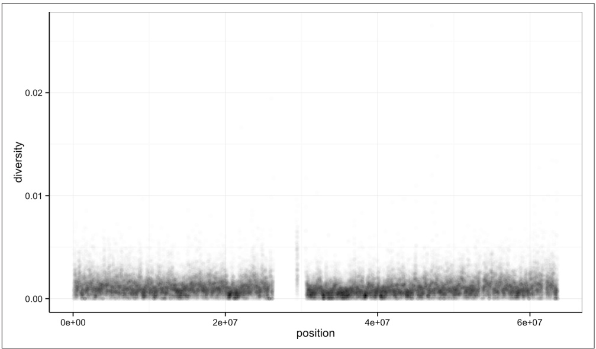
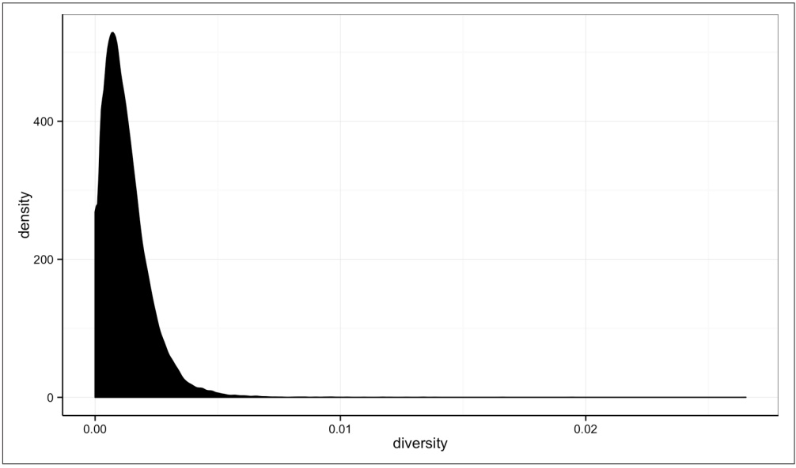
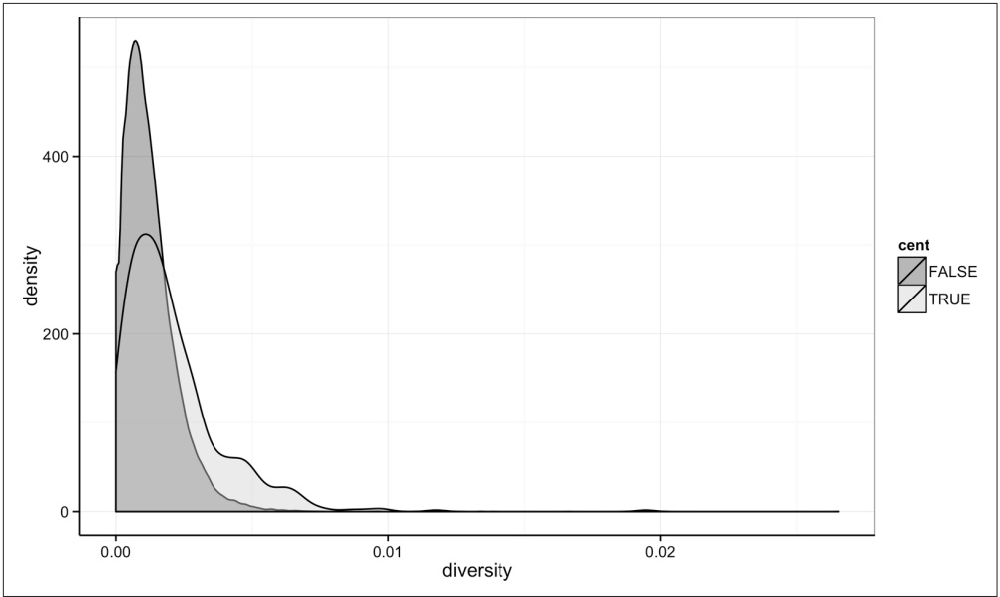
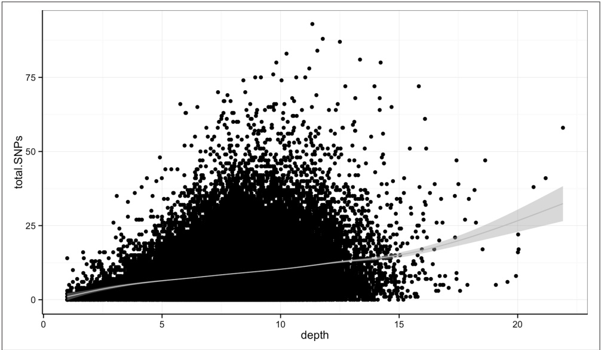
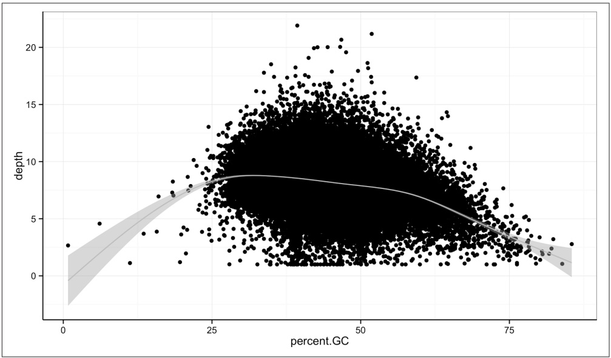
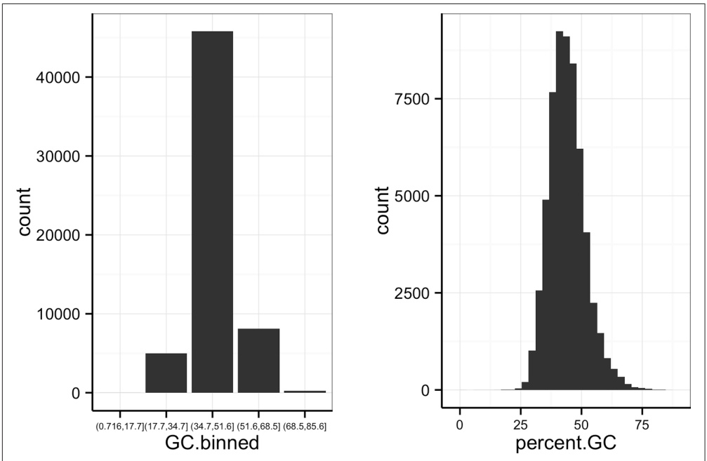
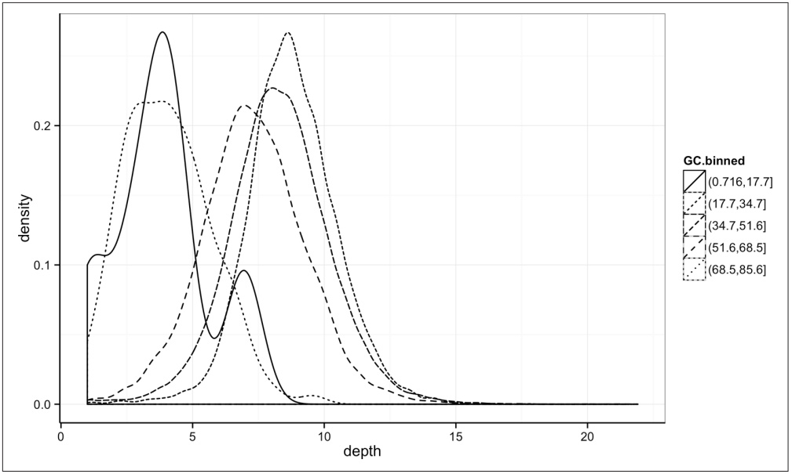
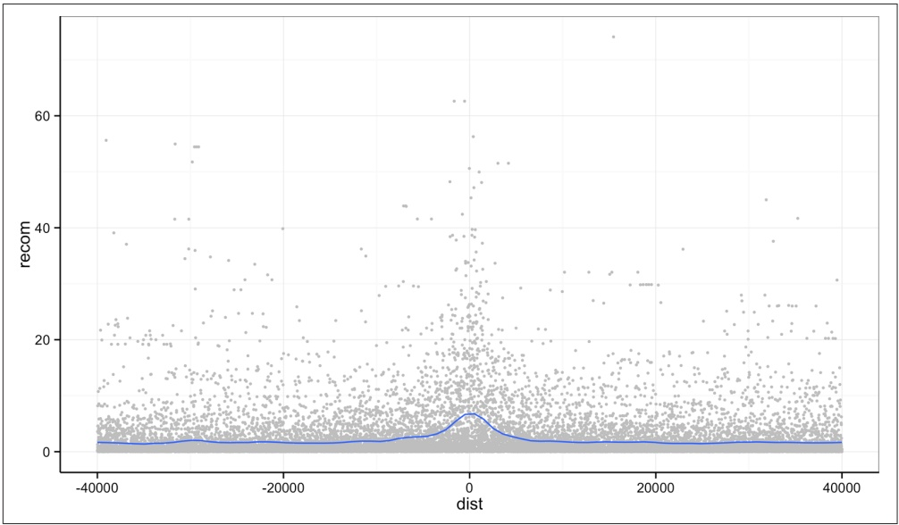
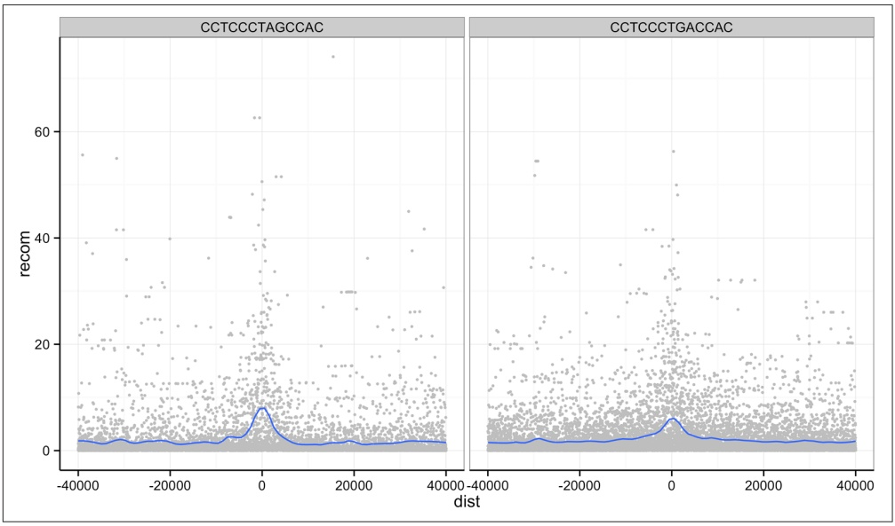

A particularly nice feature of ggplot2 is that it has well-chosen default behaviors, which allow you to quickly create or adjust plots without having to consider technical details like color palettes or a legend (though these details are customizable). For example, in mapping the color aesthetic to the cent column, ggplot2 considered cent’s type (logical) when choosing a color palette. Discrete color palettes are automatically used with columns of logical or factor data mapped to the color aesthetic; continuous color palettes are used for numeric data. We’ll see further examples of mapping data to the color aesthetic later on in this chapter.

As Tukey’s quote at the beginning of this chapter explains, exploratory analysis is an interactive, iterative process. Our first plot gives a quick first glance at what the data say, but we need to keep exploring to learn more. One problem with this plot is the degree of overplotting (data oversaturating a plot so as to obscure the information of other data points). We can’t get a sense of the distribution of diversity from this figure —everything is saturated from about 0.05 and below.

One way to alleviate overplotting is to make points somewhat transparent (the transparency level is known as the alpha). Let’s make points almost entirely transparent so only regions with multiple overlapping points appear dark (this produces a plot like Figure 8-3):

> ggplot(d) + geom\_point(aes(x=position, y=diversity), alpha=0.01)



<details>
<summary>scatter</summary>

| Series | position (range) | diversity (range) |
| --- | --- | --- |
| Cluster 1 | 0e+00~2.5e+07 | 0.00~0.006 |
| Cluster 2 | 3e+07~6.5e+07 | 0.00~0.006 |
</details>

Figure 8-3. Using transparency to address overplotting

There’s a subtlety here that illustrates a very important ggplot2 concept: we set alpha=0.01 outside of the aesthetic mapping function aes(). This is because we’re not mapping the alpha aesthetic to a column of data in our dataframe, but rather giving it a fixed value for all data points.

Other than highlighting the lack of diversity estimates in centromeric windows, the position axes isn’t revealing any positional patterns in diversity. Part of the problem is still overplotting (which occurs often when visualizing genomic data). But the more severe issue is that these windows span 63 megabases, and it’s difficult to detect regional patterns with data at this scale.

Let’s now look at the density of diversity across all positions. We’ll use a different geometric object, geom\_density(), which is slightly different than geom\_point() in that it takes the data and calculates a density from it for us (see Figure 8-4):

> ggplot(d) + geom\_density(aes(x=diversity), fill="black")



<details>
<summary>violin</summary>

| Diversity | Density |
| --- | --- |
| 0.00 | ~270 |
| ~0.001 | ~530 |
| ~0.002 | ~250 |
| ~0.003 | ~100 |
| ~0.004 | ~40 |
| ~0.005 | ~15 |
| ~0.006 | ~8 |
| ~0.007 | ~4 |
| ~0.008 | ~2 |
| ~0.009 | ~1 |
| 0.01~0.028 | ~0 |
</details>

Figure 8-4. Density plot of diversity

By default, ggplot2 uses lines to draw densities. Setting fill="black" fills the density so it’s clearer to see (try running this same command without this fill argument).

We can also map the color aesthetic of geom\_density() to a discrete-valued column in our dataframe, just as we did with geom\_point() in Example 8-3. geom\_density() will create separate density plots, grouping data by the column mapped to the color aesthetic and using colors to indicate the different densities. To see both overlapping densities, we use alpha to set the transparency to half (see Figure 8-5):



<details>
<summary>violin</summary>

| Diversity | Density (FALSE) | Density (TRUE) |
| --- | --- | --- |
| 0.000 | ~160 | ~160 |
| 0.001 | ~530 | ~280 |
| 0.002 | ~450 | ~310 |
| 0.003 | ~350 | ~290 |
| 0.004 | ~250 | ~250 |
| 0.005 | ~150 | ~180 |
| 0.006 | ~80 | ~120 |
| 0.007 | ~60 | ~80 |
| 0.008 | ~60 | ~60 |
| 0.009 | ~30 | ~40 |
| 0.010 | ~30 | ~30 |
| 0.011 | ~10 | ~10 |
| 0.012 | ~5 | ~5 |
| 0.013 | ~5 | ~5 |
| 0.014 | ~5 | ~5 |
| 0.015 | ~5 | ~5 |
| 0.016 | ~5 | ~5 |
| 0.017 | ~5 | ~5 |
| 0.018 | ~5 | ~5 |
| 0.019 | ~5 | ~5 |
| 0.020 | ~5 | ~5 |
| 0.021 | ~5 | ~5 |
| 0.022 | ~5 | ~5 |
| 0.023 | ~5 | ~5 |
| 0.024 | ~5 | ~5 |
| 0.025 | ~5 | ~5 |
| 0.026 | ~5 | ~5 |
| 0.027 | ~5 | ~5 |
| 0.028 | ~5 | ~5 |
| 0.029 | ~5 | ~5 |
| 0.030 | ~5 | ~5 |
</details>

Figure 8-5. Densities of diversity, colored by whether a window is in the centromere or not

Immediately we’re able to see a trend that wasn’t clear by using a scatterplot: diversity is skewed to more extreme values in centromeric regions. Try plotting this same figure without mapping the color aesthetic to cent—you’ll see there’s no indication of bimodality. Again (because this point is worth repeating), mapping columns to additional aesthetic attributes can reveal patterns and information in the data that may not be apparent in simple plots. We’ll see this again and again throughout this chap ter.

## Exploring Data Visually with ggplot2 II: Smoothing

Let’s look at the Dataset\_S1.txt data using another useful ggplot2 feature: smoothing. We’ll use ggplot2 in particular to investigate potential confounders in genomic data. There are numerous potential confounders in genomic data (e.g., sequencing read depth; GC content; mapability, or whether a region is capable of having reads correctly align to it; batch effects; etc.). Often with large and high-dimension datasets, visualization is the easiest and best way to spot these potential issues.

In the previous section, we saw how overplotting can obscure potential relationships between two variables in a scatterplot. The number of observations in whole genome datasets almost ensures that overplotting will be a problem during visualization. Earlier, we used transparency to give us a sense of the most dense regions. Another strategy is to use ggplot2’s geom\_smooth() to add a smoothing line to plots and look for an unexpected trend. This geom requires x and y aesthetics, so it can fit the smoothed curve to the data. Because we often superimpose a smooth curve on a scatterplot created from the same x and y mappings, we can specify the aesthetic in ggplot() as we did in Example 8-2. Let’s use a scatterplot and smoothing curve to look at the relationship between the sequencing depth (the depth column) and the total number of SNPs in a window (the total.SNPs column; see Figure 8-6):

> ggplot(d, aes(x=depth, y=total.SNPs)) + geom\_point() + geom\_smooth()



<details>
<summary>scatter</summary>

| Series | depth (range) | total.SNPs (range) |
| --- | --- | --- |
| Data Points | 1~23 | 0~95 |
</details>

Figure 8-6. A scatterplot (demonstrating overplotting) and GAM smoothing curve illustrating how total number of SNPs in a window depends on sequencing depth

By default, ggplot2 uses generalized additive models (GAM) to fit this smoothed curve for datasets with more than 1,000 rows (which ours has). You can manually specify the smoothing method through the method argument of geom\_smooth() (see help(stat\_smooth) for the method options). Also, ggplot2 adds confidence intervals around the smoothing curve; this can be disabled by using geom\_smooth(se=FALSE).

Visualizing the data this way reveals a well-known relationship between depth and SNPs: higher sequencing depth increases the power to detect and call SNPs, so in general more SNPs will be found in higher-depth regions. However, this isn’t the entire story—the relationship among these variables is made more complex by GC content. Both higher and lower GC content regions have been shown to decrease read coverage, likely through less efficient PCR in these regions (Aird et al., 2011). We can get a sense of the effect GC content has on depth in our own data through a similar scatterplot and smoothing curve plot:

> ggplot(d, aes(x=percent.GC, y=depth)) + geom\_point() + geom\_smooth()

The trajectory of the smoothing curve (in Figure 8-7) indicates that GC content does indeed have an effect on sequencing depth in this data. There’s less support in the data that low GC content leads to lower depth, as there are few windows that have a GC content below 25%. However, there’s clearly a sharp downward trend in depth for GC contents above 60%.



<details>
<summary>scatter</summary>

| percent.GC (range) | depth (range) |
| --- | --- |
| 0~90 | 0~22 |
</details>

Figure 8-7. A scatterplot and GAM smoothing curve show a relationship between extreme GC content windows and sequencing depth

## Binning Data with cut() and Bar Plots with ggplot2

Another way we can extract information from complex datasets is by reducing the resolution of the data through binning (or discretization). Binning takes continuous numeric values and places them into a discrete number of ranged bins. At first, it might sound counterintuitive to reduce the resolution of the data through binning to learn more about the data. The benefit is that discrete bins facilitate conditioning on a variable. Conditioning is an incredibly powerful way to reveal patterns in data. This idea stems from William S. Cleveland’s concept of a coplot (a portmanteau of conditioning plot); I encourage you to read Cleveland’s Visualizing Data for more information if this topic is of interest. We’ll create plots like Cleveland’s coplots when we come to gplot2’s facets in “Using ggplot2 Facets” on page 224.

In R, we bin data through the cut() function (see Example 8-4):

Example 8-4. Using cut() to bin GC content

```txt
> d$GC.binned <- cut(d$percent.GC, 5)
> d$GC.binned
[1] (51.6,68.5] (34.7,51.6] (34.7,51.6] (34.7,51.6] (34.7,51.6]
[...]
Levels: (0.716,17.7] (17.7,34.7] (34.7,51.6] (51.6,68.5] (68.5,85.6)]
```

When cut()’s second argument breaks is a single number, cut() divides the data into that number of equally sized bins. The returned object is a factor, which we introduced in “Factors and classes in R” on page 191. The levels of the factor returned from cut() will always have labels like (34.7,51.6], which indicate the particular bin that value falls in. We can count how many items fall into a bin using table():

```txt
> table(d$GC.binned)
(0.716,17.7] (17.7,34.7] (34.7,51.6] (51.6,68.5] (68.5,85.6]
6 4976 45784 8122 252
```

We can also use prespecified ranges when binning data with cut() by setting breaks to a vector. For example, we could cut the percent GC values with breaks at 0, 25, 50, 75, and 100:

```html
> cut(d$percent.GC, c(0, 25, 50, 75, 100))
[1] (50,75] (25,50] (25,50] (25,50] (25,50] (25,50]
[...]
Levels: (0,25] (25,50] (50,75] (75,100]
```

An important gotcha to remember about cut() is that if you manually specify breaks that don’t fully enclose all values, values outside the range of breaks will be given the value NA. You can check if your manually specified breaks have created NA values using any(is.na(cut(x, breaks))) (for your particular vector x and breaks).

Bar plots are the natural visualization tool to use when looking at count data like the number of occurrences in bins created with cut(). ggplot2’s geom\_bar() can help us visualize the number of windows that fall into each GC bin we’ve created previously:

```txt
> ggplot(d) + geom_bar(aes(x=GC.binned))
```

When geom\_bar()’s x aesthetic is a factor (e.g., d\$binned.GC), ggplot2 will create a bar plot of counts (see Figure 8-8, left). When geom\_bar()’s x aesthetic is mapped to a continuous column (e.g., percent.GC) geom\_bar() will automatically bin the data itself, creating a histogram (see Figure 8-8, right):

```txt
> ggplot(d) + geom_bar(aes(x=percent.GC))
```



Figure 8-8. ggplot2’s geom\_bar() used to visualize the GC.binned column we created with cut(), and the numeric percent.GC column using its own binning scheme

The bins created from cut() are useful in grouping data (a concept we often use in data analysis). For example, we can use the GC.binned column to group data by the 10 GC content bins to see how GC content has an impact on other variables. To do this, we map aesthetics like color, fill, or linetype to our GC.binned column. Again, looking at sequencing depth and GC content:

The same story of depth and GC content comes out in Figure 8-9: both the lowest GC content windows and the highest GC content windows have lower depth. Try to create this sample plot, except don’t group by GC.binned—the entire story disappears. Also, try plotting the densities of other variables like Pi and Total.SNPs, grouping by GC.binned again.



<details>
<summary>violin</summary>

| Depth | GC.binned (0.716, 17.7] | GC.binned (17.7, 34.7] | GC.binned (34.7, 51.6] | GC.binned (51.6, 68.5] | GC.binned (68.5, 85.6] |
| --- | --- | --- | --- | --- | --- |
| 0 | 0 | 0 | 0 | 0 | 0 |
| 1 | ~0.10 | ~0.05 | ~0.01 | ~0.005 | ~0.002 |
| 2 | ~0.11 | ~0.15 | ~0.02 | ~0.01 | ~0.005 |
| 3 | ~0.22 | ~0.22 | ~0.04 | ~0.02 | ~0.01 |
| 4 | ~0.27 | ~0.22 | ~0.06 | ~0.03 | ~0.015 |
| 5 | ~0.15 | ~0.18 | ~0.10 | ~0.05 | ~0.02 |
| 6 | ~0.05 | ~0.12 | ~0.18 | ~0.12 | ~0.04 |
| 7 | ~0.09 | ~0.06 | ~0.22 | ~0.21 | ~0.12 |
| 8 | ~0.04 | ~0.02 | ~0.23 | ~0.23 | ~0.22 |
| 9 | ~0.01 | ~0.01 | ~0.18 | ~0.22 | ~0.27 |
| 10 | 0 | 0 | ~0.12 | ~0.18 | ~0.24 |
| 11 | 0 | 0 | ~0.06 | ~0.12 | ~0.18 |
| 12 | 0 | 0 | ~0.03 | ~0.07 | ~0.12 |
| 13 | 0 | 0 | ~0.02 | ~0.04 | ~0.07 |
| 14 | 0 | 0 | ~0.01 | ~0.02 | ~0.04 |
| 15 | 0 | 0 | 0 | ~0.01 | ~0.02 |
| 22 | 0 | 0 | 0 | 0 | 0 |
</details>

Figure 8-9. Density plots of depth, grouped by GC content bin


## Finding the Right Bin Width

Notice in Figure 8-8 how different bin widths can drastically change the way we view and understand the data. Try creating a histogram of Pi with varying binwidths using: ggplot(d) + geom\_bar(aes(x=Pi), binwidth=1) + scale\_x\_continu ous(limits=c(0.01, 80)).

Using scale\_x\_continuous() just ignores all windows with 0 Pi and zooms into the figure. Try binwidths of 0.05, 0.5, 1, 5, and 10. Smaller bin widths can fit the data better (revealing more subtle details about the distribution), but there’s a trade-off. As bin widths become narrower, each bin will contain fewer data points and consequently be more noisy (and undersmoothed). Using wider bins smooth over this noise. However, bins that are too wide result in oversmoothing, which can hide details about the data. This trade-off is a case of the more general bias-variance trade-off in statistics; see the Wikipedia pages on the [bias–variance trade-off](http://bit.ly/bias-var-to) and [histograms](http://en.wikipedia.org/wiki/Histogram) for more information on these topics. In your own data, be sure to explore a variety of bin widths.

We can learn an incredible amount about our data by grouping by possible confounding factors and creating simple summaries like densities by group. Because it’s a powerful exploratory data analysis skill, we’ll look at other ways to group and summarize data in “Working with the Split-Apply-Combine Pattern” on page 239.

## Merging and Combining Data: Matching Vectors and Merging Dataframes

We’re now going to switch topics to merging and combining data so we can create example data for the next sections. Bioinformatics analyses involve connecting many numerous datasets: sequencing data, genomic features (e.g., gene annotation), functional genomics data, population genetic data, and so on. As data piles up in repositories, the ability to connect different datasets together to tell a cohesive story will become an increasingly more important analysis skill. In this section, we’ll look at some canonical ways to combine datasets together in R. For more advanced joins (or data approaching the limits of what R can store in memory), using a database (which we learn about in Chapter 13) may be a better fit.

The simplest operation to match two vectors is checking whether some of a vector’s values are in another vector using R’s %in% operator. x %in% y returns a logical vector indicating which of the values of x are in y. As a simple example:

```txt
> c(3, 4, -1) %in% c(1, 3, 4, 8)
[1] TRUE TRUE FALSE
```

We often use %in% to select rows from a dataframe by specifying the levels a factor column can take. We’ll use the dataset chrX\_rmsk.txt, the repeats on human chromosome X found by Repeat Masker, to illustrate this. Unlike Dataset\_S1.txt, this data is on human reference genome version hg17 (because these same Repeat Masker files are used in a later example that replicates findings that also use hg17). Let’s load in and look at this file:

```txt
> reps <- read.delim("chrX_rmsk.txt.gz", header=TRUE)
> head(reps, 3)
  bin swScore milliDiv milliDel milliIns genoName genoStart genoEnd    genoLeft
1 585      342       0       0       0     chrX        0       38 -154824226
2 585      392       109       0       0     chrX        41       105 -154824159
3 585      302       240       31       20     chrX        105       203 -154824061
  strand   repName      repClass    repFamily repStart repEnd repLeft id
1      + (CCCTAA)n Simple_repeat Simple_repeat     3     40       0   1
2      +     LTR12C           LTR          ERV1    1090   1153   -425   2
3      +     LTR30           LTR          ERV1    544   642   -80   3
```

repClass is an example of a factor column—try class(d\$repClass) and levels(d \$repClass) to verify for yourself. Suppose we wanted to select out rows for a few common repeat classes: DNA, LTR, LINE, SINE, and Simple\_repeat. Even with just five repeat classes, it would be error prone and tedious to construct a statement to select these values using logical operators: reps\$repClass == "SINE" | reps\$repClass == "LINE" | reps\$repClass == "LTR" | and so on. Instead, we can create a vector common\_repclass and use %in%:

```txt
> common_repclass <- c("SINE", "LINE", "LTR", "DNA", "Simple_repeat")
> reps[reps$repClass %in% common_repclass, ]
```

<div class="docvortex-algorithm" style="white-space: pre-wrap; font-family:monospace;">
bin swScore milliDiv milliDel milliIns genoName genoStart genoEnd genoLeft
1 585     342      0       0       0   chrX         0       38 -154824226
2 585     392      109       0       0   chrX         41    105 -154824159
3 585     302      240       31     20   chrX         105    203 -154824061
[...]
strand repName repClass repFamily repStart repEnd repLeft id
1 + (CCCTAA)n Simple_repeat Simple_repeat          3     40      0 1
2 + LTR12C           LTR              ERV1    1090   1153 -425 2
3 + LTR30           LTR              ERV1    544   642 -80 3
[...]
</div>

It’s worth noting that we can also create vectors like common\_repclass programmatically. For example, we could always just directly calculate the five most common repeat classes using:

<div class="docvortex-algorithm" style="white-space: pre-wrap; font-family:monospace;">
&gt; sort(table(reps$repClass), decreasing=TRUE)[1:5]

        SINE          LINE          LTR          DNA Simple_repeat
        45709         30965       14854       11347         9163

&gt; top5_repclass &lt;- names(sort(table(reps$repClass), decreasing=TRUE)[1:5])
&gt; top5_repclass
[1] "LINE"           "SINE"          "LTR"          "Simple_repeat"
[5] "DNA"
</div>

The %in% operator is a simplified version of another function, match(). x %in% y returns TRUE/FALSE for each value in x depending on whether it’s in y. In contrast, match(x, y) returns the first occurrence of each of x’s values in y. If match() can’t find one of x’s elements in y, it returns its nomatch argument (which by default has the value NA).

It’s important to remember the directionality of match(x, y): the first argument x is what you’re searching for (the proverbial needle) in the second argument y (the hay stack). The positions returned are always the first occurrences in y (if an occurrence was found). Here’s a simple example:

<div class="docvortex-algorithm" style="white-space: pre-wrap; font-family:monospace;">
&gt; match(c("A", "C", "E", "A"), c("A", "B", "A", "E"))
[1]  1 NA  4  1
</div>

Study this example carefully—to use match() safely, it’s important to understand its subtle behavior. First, although there are two “A” values in the second argument, the position of the first one is returned. Second, “C” does not occur in the second argument, so match() returns NA. Lastly, the vector returned will always have the same length as the first argument and contains positions in the second argument.

Because match() returns where it finds a particular value, match()’s output can be used to join two dataframes together by a shared column. We’ll see this in action by stepping through a merge of two datasets. I’ve intentionally chosen data that is a bit tricky to merge; the obstacles in this example are ones you’re likely to encounter with real data. I’ll review various guidelines you should follow when applying the lessons of this section. Our reward for merging these datasets is that we’ll use the result to replicate an important finding in human recombination biology.

For this example, we’ll merge two datasets to explore recombination rates around a degenerate sequence motif that occurs in repeats. This motif has been shown to be enriched in recombination hotspots (see Myers et al., 2005; Myers et al., 2008) and is common in some repeat classes. The first dataset (motif\_recombrates.txt in the Git‐Hub directory) contains estimates of the recombination rate for all windows within 40kb of each motif (for two motif variants). The second dataset (motif\_repeats.txt) contains which repeat each motif occurs in. Our goal is to merge these two datasets so that we can look at the local effect of recombination of each motif on specific repeat backgrounds.


## Creating These Example Datasets

Both of these datasets were created using the GenomicRanges tools we will learn about in Chapter 9, from tracks downloaded directly from the UCSC Genome Browser. With the appropriate tools and bioinformatics data skills, it takes surprisingly few steps to replicate part of this important scientific finding (though the original paper did much more than this—see Myers et al., 2008). For the code to reproduce the data used in this example, see the motif-example/ directory in this chapter’s directory on GitHub.

Let’s start by loading in both files and peeking at them with head():

```txt
> mtfs <- read.delim("motif_recombrates.txt", header=TRUE)
> head(mtfs, 3)
    chr motif_start motif_end     dist recomb_start recomb_end recom
1 chrX      35471312 35471325 39323.0      35430651   35433340 0.0015
2 chrX      35471312 35471325 36977.0      35433339   35435344 0.0015
3 chrX      35471312 35471325 34797.5      35435343   35437699 0.0015
        motif
1 CCTCCCTGACCAC
2 CCTCCCTGACCAC
3 CCTCCCTGACCAC

> rpts <- read.delim("motif_repeats.txt", header=TRUE)
> head(rpts, 3)
    chr       start         end name motif_start
1 chrX   63005829   63006173   L2    63005830
2 chrX   67746983   67747478   L2    67747232
3 chrX 118646988 118647529   L2    118647199
```

The first guideline of combining data is always to carefully consider the structure of both datasets. In mtfs, each motif is represented across multiple rows. Each row gives the distance between a focal motif and a window over which recombination rate was estimated (in centiMorgans). For example, in the first three rows of mtfs, we see recombination rate estimates across three windows, at 39,323, 36,977, and 34,797 bases away from the motif at position chrX:35471312-35471325. The dataframe rpts contains the positions of THE1 or L2 repeats that completely overlap motifs, and the start positions of the motifs they overlap.

Our goal is to merge the column name in the rpts dataframe into the mtfs column, so we know which repeat each motif is contained in (if any). The link between these two datasets are the positions of each motif, identified by the chromosome and motif start position columns chr and motif\_start. When two or more columns are used as a link between datasets, concatenating these columns into a single key string column can simplify merging. We can merge these two columns into a string using the function paste(), which takes vectors and combines them with a separating string specified by sep:

```csv
> mtfs$pos <- paste(mtfs$chr, mtfs$motif_start, sep="-")
> rpts$pos <- paste(rpts$chr, rpts$motif_start, sep="-")

> head(mtfs, 2) # results
    chr motif_start motif_end dist recomb_start recomb_end recom motif
1 chrX 35471312 35471325 39323 35430651 35433340 0.0015 CCTCCCTGACCAC
2 chrX 35471312 35471325 36977 35433339 35435344 0.0015 CCTCCCTGACCAC
        pos
1 chrX-35471312
2 chrX-35471312
> head(rpts, 2)
    chr start end name motif_start pos
1 chrX 63005829 63006173 L2 63005830 chrX-63005830
2 chrX 67746983 67747478 L2 67747232 chrX-67747232
```

Now, this pos column functions as a common key between the two datasets.

The second guideline in merging data is to validate that your keys overlap in the way you think they do before merging. One way to do this is to use table() and %in% to see how many motifs in mtfs have a corresponding entry in rpts:

> table(mtfs\$pos %in% rpts\$pos)

FALSE TRUE 10832 9218

This means there are 9,218 motifs in mtfs with a corresponding entry in rpts and 10,832 without. Biologically speaking, this means 10,832 motifs in our dataset don’t overlap either the THE1 or L2 repeats. By the way I’ve set up this data, all repeats in rpts have a corresponding motif in mtfs, but you can see for yourself using table(rpts\$pos %in% mtfs\$pos). Remember: directionality matters—you don’t go looking for a haystack in a needle!

Now, we use match() to find where each of the mtfs\$pos keys occur in the rpts\$pos. We’ll create this indexing vector first before doing the merge:

```txt
> i <- match(mtfs$pos, rpts$pos)
```

All motif positions without a corresponding entry in rpts are NA; our number of NAs is exactly the number of mts\$pos elements not in rpts\$pos:

```txt
> table(is.na(i))

FALSE  TRUE
9218 10832
```

Finally, using this indexing vector we can select out the appropriate elements of rpts \$name and merge these into mtfs:

```perl
> mtfs\$repeat_name <- rpts\$name[i]
```

Often in practice you might skip assigning match()’s results to i and use this directly:

```perl
> mtfs\$repeat_name <- rpts\$name[match(mtfs\$pos, rpts\$pos)]
```

The third and final guideline of merging data: validate, validate, validate. As this example shows, merging data is tricky; it’s easy to make mistakes. In our case, good external validation is easy: we can look at some rows where mtfs\$repeat\_name isn’t NA and check with the UCSC Genome Browser that these positions do indeed overlap these repeats (you’ll need to visit UCSC Genome Browser and do this yourself):

```txt
> head(mtfs[!is.na(mtfs\$repeat_name), ], 3)
    chr motif_start motif_end   dist recomb_start recomb_end recom
102 chrX     63005830 63005843 37772.0      62965644   62970485 1.4664
103 chrX     63005830 63005843 34673.0      62970484   62971843 0.0448
104 chrX     63005830 63005843 30084.5      62971842   62979662 0.0448
        motif         pos repeat_name
102 CCTCCCTGACCAC chrX-63005830          L2
103 CCTCCCTGACCAC chrX-63005830          L2
104 CCTCCCTGACCAC chrX-63005830          L2
```

Our result is that we’ve combined the rpts\$name vector directly into our mtfs dataframe (technically, this type of join is called a left outer join). Not all motifs have entries in rpts, so some values in mfs\$repeat\_name are NA. We could easily remove these NAs with:

```txt
> mtfs_inner <- mtfs[!is.na(mtfs $repeat_name), ]
> nrow(mtfs_inner)
[1] 9218
```

In this case, only motifs in mtfs contained in a repeat in rpts are kept (technically, this type of join is called an inner join). Inner joins are the most common way to merge data. We’ll talk more about the different types of joins in Chapter 13.

We’ve learned match() first because it’s a general, extensible way to merge data in R. match() reveals some of the gritty details involved in merging data necessary to avoid pitfalls. However, R does have a more user-friendly merging function: merge(). Merge can directly merge two datasets:

```txt
> recm <- merge(mtfs, rpts, by.x="pos", by.y="pos")
> head(recm, 2)
        pos chr.x motif_start.x motif_end    dist recomb_start recomb_end
1 chr1-101890123  chr1     101890123 101890136 34154.0   101855215  101856736
2 chr1-101890123  chr1     101890123 101890136 35717.5   101853608  101855216
    recom       motif repeat_name chr.y    start      end name
1 0.0700 CCTCCCTAGCCAC      THE1B chr1 101890032 101890381 THE1B
2 0.0722 CCTCCCTAGCCAC      THE1B chr1 101890032 101890381 THE1B
    motif_start.y
1     101890123
2     101890123
> nrow(recm)
[1] 9218
```

merge() takes two dataframes, x and y, and joins them by the columns supplied by by.x and by.y. If they aren’t supplied, merge() will try to infer what these columns are, but it’s much safer to supply them explicitly. By default, merge() behaves like our match() example after we removed the NA values in repeat\_name (technically, merge() uses a variant of an inner join known as a natural join). But merge() can also perform joins similar to our first match() example (left outer joins), through the argument all.x=TRUE:

```r
> recm <- merge(mtfs, rpts, by.x="pos", by.y="pos", all.x=TRUE)
```

Similarly, merge() can also perform joins that keep all rows of the second argument (a join known as a right outer join) through the argument all.y=TRUE. If you want to keep all rows in both datasets, you can specify all=TRUE. See help(merge) for more details on how merge() works. To continue our recombination motif example, we’ll use mtfs because unlike the recm dataframe created by merge(), mtfs doesn’t have any duplicated columns.

## Using ggplot2 Facets

After merging our two datasets in the last example, we’re ready to explore this data using visualization. One useful visualization technique we’ll introduce in this section is facets. Facets allow us to visualize grouped data by creating a series of separate adjacent plots for each group. Let’s first glimpse at the relationship between recombination rate and distance to a motif using the mtfs dataframe created in the previous section. We’ll construct this graphic in steps:

```txt
> p <- ggplot(mtfs, aes(x=dist, y=recom)) + geom_point(size=1)
```

```txt
> p <- p + geom_smooth(method="loess", se=FALSE, span=1/10)
> print(p)
```

This creates Figure 8-10. Note that I’ve turned off geom\_smooth()’s standard error estimates, adjusted the smoothing with span, and set the smoothing method to "loess". Try playing with these settings yourself to become familiar with how each changes the visualization and what we learn from the data. From this data, we only see a slight bump in the smoothing curve where the motifs reside. However, this data is a convolution of two different motif sequences on many different genomic backgrounds. In other words, there’s a large amount of heterogeneity we’re not accounting for, and this could be washing out our signal. Let’s use faceting to pick apart this data.



<details>
<summary>scatter</summary>

| dist | recom |
| --- | --- |
| -40000 | ~56 |
| -38000 | ~39 |
| -37000 | ~21 |
| -36000 | ~23 |
| -35000 | ~19 |
| -34000 | ~22 |
| -33000 | ~21 |
| -32000 | ~23 |
| -31000 | ~21 |
| -30000 | ~22 |
| -29000 | ~21 |
| -28000 | ~23 |
| -27000 | ~21 |
| -26000 | ~22 |
| -25000 | ~21 |
| -24000 | ~23 |
| -23000 | ~21 |
| -22000 | ~22 |
| -21000 | ~21 |
| -20000 | ~23 |
| -19000 | ~21 |
| -18000 | ~22 |
| -17000 | ~21 |
| -16000 | ~23 |
| -15000 | ~21 |
| -14000 | ~22 |
| -13000 | ~21 |
| -12000 | ~23 |
| -11000 | ~21 |
| -10000 | ~22 |
| -9000 | ~21 |
| -8000 | ~23 |
| -7000 | ~21 |
| -6000 | ~22 |
| -5000 | ~21 |
| -4000 | ~23 |
| -3000 | ~21 |
| -2000 | ~22 |
| -1000 | ~21 |
| 0 | ~63 |
| 1000 | ~56 |
| 2000 | ~51 |
| 3000 | ~48 |
| 4000 | ~45 |
| 5000 | ~42 |
| 6000 | ~41 |
| 7000 | ~44 |
| 8000 | ~43 |
| 9000 | ~45 |
| 1000 | ~44 |
| 1100 | ~43 |
| 1200 | ~45 |
| 1300 | ~44 |
| 1400 | ~46 |
| 1500 | ~45 |
| 1600 | ~47 |
| 1700 | ~46 |
| 1800 | ~48 |
| 1900 | ~47 |
| 2000 | ~49 |
| 2100 | ~48 |
| 2200 | ~47 |
| 2300 | ~49 |
| 2400 | ~48 |
| 2500 | ~51 |
| 2600 | ~52 |
| 2700 | ~51 |
| 2800 | ~53 |
| 2900 | ~54 |
| 3000 | ~55 |
| 3100 | ~56 |
| 3200 | ~57 |
| 3300 | ~58 |
| 3400 | ~59 |
| 3500 | ~63 |
| 3600 | ~64 |
| 3700 | ~65 |
| 3800 | ~66 |
| 3900 | ~67 |
| 4000 | ~68 |
| 4100 | ~69 |
| 4200 | ~73 |
| 4300 | ~74 |
| 4400 | ~75 |
| 4500 | ~76 |
| 4600 | ~77 |
| 4700 | ~78 |
| 4800 | ~79 |
| 4900 | ~81 |
| 58558.99999999.99999999.99999999.99999999.99999999.99999999.99999999.99999999.99999999.99999999.99999999.99999999 .999 .999 .999 .999 .999 .999 .999 .999 .999 .999 .999 .999 .99<nl>
</details>

Figure 8-10. Recombination rate by distance to sequence motif

First, if you’ve explored the mtfs dataframe, you’ll notice that the mtfs\$motif column contains two variations of the sequence motif:

```txt
> unique(mtfs\$motif)
[1] CCTCCCTGACCAC CCTCCCTAGCCAC
Levels: CCTCCCTAGCCAC CCTCCCTGACCAC
```

We might wonder if these motifs have any noticeably different effects on local recombination. One way to compare these is by grouping and coloring the loess curves by motif sequence. I’ve omitted this plot to save space, but try this on your own:

```prolog
> ggplot(mtfs, aes(x=dist, y=recom)) + geom_point(size=1) +
    geom_smooth(aes(color=motif), method="loess", se=FALSE, span=1/10)
```

Alternatively, we can split these motifs apart visually with facets using ggplot2’s facet\_wrap() (shown in Figure 8-11):

```r
> p <- ggplot(mtfs, aes(x=dist, y=recom)) + geom_point(size=1, color="grey")
> p <- p + geom_smooth(method='loess', se=FALSE, span=1/10)
> p <- p + facet_wrap(~ motif)
> print(p)
```



<details>
<summary>scatter</summary>

| Series | dist (range) | recom (range) |
| --- | --- | --- |
| CCTCCCTAGCCAC | -40000~40000 | 0~75 |
| CCTCCCTGACCAC | -40000~40000 | 0~60 |
</details>

Figure 8-11. Faceting plots by motif sequence using facet\_wrap()

ggplot2 has two facet methods: facet\_wrap() and facet\_grid(). facet\_wrap() (used earlier) takes a factor column and creates a panel for each level and wraps around horizontally. facet\_grid() allows finer control of facets by allowing you to specify the columns to use for vertical and horizontal facets. For example:

```r
> p <- ggplot(mtfs, aes(x=dist, y=recom)) + geom_point(size=1, color="grey")
> p <- p + geom_smooth(method='loess', se=FALSE, span=1/16)
> p <- p + facet_grid(repeat_name ~ motif)
> print(p)
```

Figure 8-12 shows some of the same patterns seen in Figure 1 of Myers et al., 2008. Motif CCTCCCTAGCCAC on a THE1B repeat background has a strong effect, as does CCTCCCTGACCAC on a L2 repeat background. You can get a sense of the data that goes into this plot with table(mtfs\$repeat\_name, mtfs\$motif, useNA="ifany").