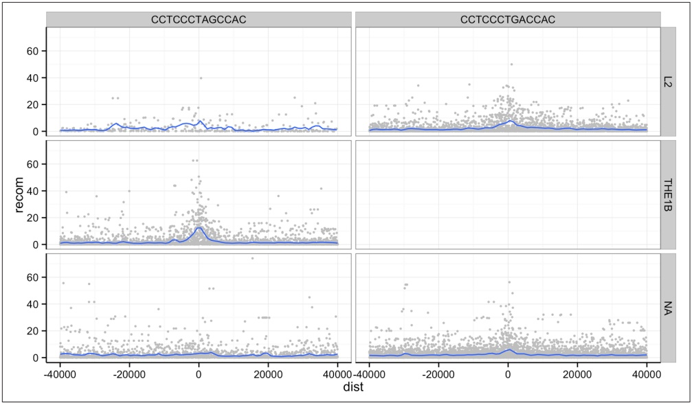
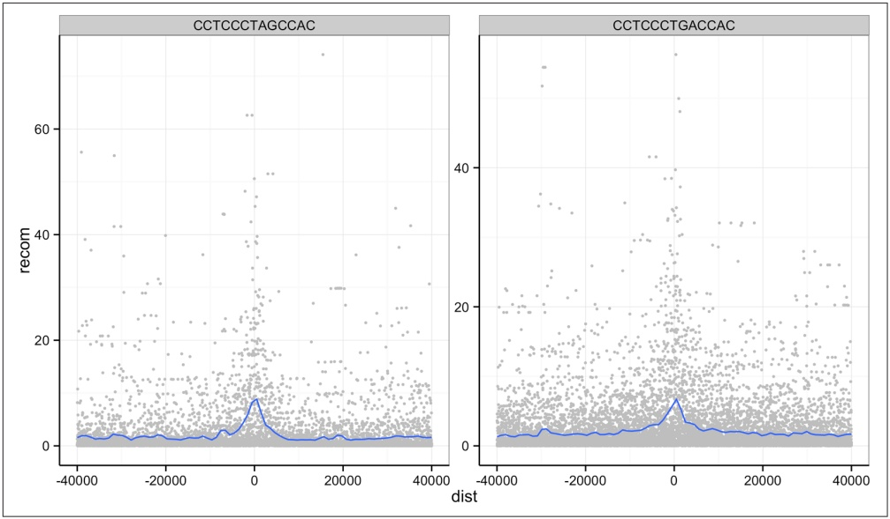

<details>
<summary>scatter</summary>

| Category | Dataset | X-axis (dist) range | Y-axis (recom) range |
| --- | --- | --- | --- |
| L2 | CCTCCCTAGCCAC | -40000~40000 | 0~60 |
| L2 | CCTCCCTGACCAC | -40000~40000 | 0~50 |
| THE1B | CCTCCCTAGCCAC | -40000~40000 | 0~60 |
| THE1B | CCTCCCTGACCAC | -40000~40000 | 0~15 |
| NA | CCTCCCTAGCCAC | -40000~40000 | 0~60 |
| NA | CCTCCCTGACCAC | -40000~40000 | 0~60 |
</details>

Figure 8-12. Using facet\_grid() to facet by both repeat background and motif sequence; the empty panel indicates there is no data for this particular motif/repeat combination

The tilde (\~) used with facet\_wrap() and facet\_grid() is how we specify model formula in R. If you’ve used R to fit linear models, you’ve encountered \~ before. We can ignore the specifics when using it in facet\_wrap() (but see help(formula) if you’re curious).

One important feature of facet\_wrap() and facet\_grid() is that by default, x- and y-scales will be the same across all panels. This is a good default because people have a natural tendency to compare adjacent graphics as if they’re on the same scale. However, forcing facets to have fixed scales can obscure patterns that occur on different scales. Both facet\_grid() and facet\_wrap() have scales arguments that by default are "fixed". You can set scales to be free with scales="free\_x" and scales="free\_y" (to free the x- and y-scales, respectively), or scales="free" to free both axes. For example (see Figure 8-13):

```r
> p <- ggplot(mtfs, aes(x=dist, y=recom)) + geom_point(size=1, color="grey")
> p <- p + geom_smooth(method='loess', se=FALSE, span=1/10)
> p <- p + facet_wrap( ~ motif, scales="free_y")
> print(p)
```



<details>
<summary>scatter</summary>

| Series | dist (range) | recom (range) |
| --- | --- | --- |
| CCTCCCTAGCCAC | -40000~40000 | 0~75 |
| CCTCCCTGACCAC | -40000~40000 | 0~55 |
</details>

Figure 8-13. Recombination rates around two sequence motifs, with the y-scales free

Try using facets to look at this data when grouped by chromosome with facet\_wrap( \~ chr).

## More R Data Structures: Lists

Thus far, we’ve used two R data structures for everything: vectors and dataframes. In this section, we’ll learn about another R data structure as important as these two: the list. Recall the following points about R’s vectors:

• R vectors require all elements to have the same data type (that is, vectors are homogenous)
• They only support the six data types discussed earlier (integer, double, character, logical, complex, and raw)

In contrast, R’s lists are more versatile:

• Lists can contain elements of different types (they are heterogeneous)
• Elements can be any object in R (vectors with different types, other lists, environments, dataframes, matrices, functions, etc.)
• Because lists can store other lists, they allow for storing data in a recursive way (in contrast, vectors cannot contain other vectors)

The versatility of lists make them indispensable in programming and data analysis with R. You’ve actually been using lists already without knowing it—dataframes are built using R’s lists. This makes sense, because the columns of a dataframe are vectors and each column can have a different type. The R data structure used to store heterogeneous elements is the list. See for yourself that dataframes are truly lists; try is.list(mtfs).

We create lists with the list() function. Like creating dataframes with the data.frame() function or combining vectors with c(), list() will interpret named arguments as the names of the elements. For example, suppose we wanted to store a specific genomic position using a list:

```txt
> adh <- list(chr="2L", start=14615555L, end=14618902L, name="Adh")
> adh
\$chr
[1] "2L"
\$start
[1] 14615555
\$end
[1] 14618902
\$name
[1] "Adh"
```

Had we tried to store these three values in a vector, vector coercion would coerce them into a character vector. Lists allow heterogeneous typed elements, so the character vectors “chr2L” and “Adh”, and integer vectors 14,615,555 and 14,618,902 can exist in the same list without being coerced.

As with R’s vectors, we can extract subsets of a list or change values of specific elements using indexing. However, accessing elements from an R list is slightly different than with vectors. Because R’s lists can contain objects with different types, a subset containing multiple list elements could contain objects with different types. Consequently, the only way to return a subset of more than one list element is with another list. As a result, there are two indexing operators for lists: one for accessing a subset of multiple elements as a list (the single bracket; e.g., adh[1:2]) and one for accessing an element within a list (the double bracket; e.g., adh[[3]]).

For example, if we were to access the first two elements of the list x we created before, we would use single bracket indexing:

```txt
> adh[1:2]
\$chr
[1] "2L"
\$start
[1] 14615555
```

## Peeking into R’s Structures with str()

Because R’s lists can be nested and can contain any type of data, list-based data structures can grow to be quite complex. In some cases, it can be difficult to understand the overall structure of some lists. The function str() is a convenient R function for inspecting complex data structures. str() prints a line for each contained data structure, complete with its type, length (or dimensions), and the first few elements it contains. We can see an example by creating an artificially complex nested list (for the sake of this example) and looking at its structure:

```txt
> z <- list(a=list(rn1=rnorm(20), rn2=rnorm(20)), b=rnorm(10))
> str(z)
List of 2
$ a:List of 2
  ..$ rn1: num [1:20] -2.8126 1.0328 -0.6777 0.0821 0.7532 ...
  ..$ rn2: num [1:20] 1.09 1.27 1.31 2.03 -1.05 ...
$ b: num [1:10] 0.571 0.929 1.494 1.123 1.713 ...
```

For deeply nested lists, you can simplify str()’s output by specifying the maximum depth of nested structured to return with str()’s second argument, max.level. By default, max.level is NA, which returns all nested structures.

Note that this subset of the original list is returned as a list. We can verify this using the function is.list(). Additionally, note that single brackets return a list even if a single element is selected (for consistency):

```txt
> is.list(adh[1:2])
[1] TRUE
> is.list(adh[1])
[1] TRUE
```

Because the single bracket operator always returns subjects of a list as a list, R has the double bracket operator to extract an object from a list position (either by position or name):

```txt
> adh[[2]]
[1] 14615555
> adh[['start']]
[1] 14615555
```

Unlike the single bracket operator, the double bracket operator will return the value from inside a list position (e.g., not as a list). Because accessing list elements by name is quite common, R has a syntactic shortcut:

```txt
> adh\$chr
[1] "2L"
```

You should be familiar with this syntax already—we used the same syntax to extract columns from a dataframe. This isn’t a coincidence: dataframes are built from lists, and each dataframe column is a vector stored as a list element.

We can create new elements or change existing elements in a list using the familiar <-. Assigning a list element the value NULL removes it from the list. Some examples are shown here:

```txt
> adh$id <- "FBgn0000055"
> adh$chr <- "chr2L"
> adh
$chr
[1] "chr2L"
$start
[1] 14615555
$end
[1] 14618902
$name
[1] "Adh"
$id
[1] "FBgn0000055"

> adh$id <- NULL # remove the FlyBase ID
> adh
$chr
[1] "chr2L"
$start
[1] 14615555
$end
[1] 14618902
$name
[1] "Adh"
```

Similar to vectors, list names can be accessed with names() or changed using names(x) <-. We’ll use lists extensively in the next few sections of this book, so it’s important that you’re familiar with these basic operations.

## Writing and Applying Functions to Lists with lapply() and sapply()

Understanding R’s data structures and how subsetting works are fundamental to having the freedom in R to explore data any way you like. In this section, we’ll cover another cornerstone of R: how to write and apply functions to data. This approach of applying functions to data rather than writing explicit loops follows from a functional-programming style that R inherited from one of its language influences, Scheme. Specifically, our focus will be on applying functions to R’s lists using lapply() and sapply(), but the same ideas extend to other R data structures through similar “apply” functions. Solving common data analysis problems with apply functions is tricky at first, but mastering it will serve you well in R.

## Using lapply()

Let’s work through a simple example on artificial data first (we’ll see how to apply these concepts to real data in the next section). Suppose you have a list of numeric values (here, generated at random with rnorm()):

```txt
> ll <- list(a=rnorm(6, mean=1), b=rnorm(6, mean=4), c=rnorm(6, mean=6))
> ll
```

```txt
$a
[1] 2.2629543 0.6737666 2.3297993 2.2724293 1.4146414 -0.5399500
$b
[1] 3.071433 3.705280 3.994233 6.404653 4.763593 3.200991
$c
[1] 4.852343 5.710538 5.700785 5.588489 6.252223 5.108079
```

How might we calculate the mean of each vector stored in this list? If you’re familiar with for loops in other languages, you may approach this problem using R’s for loops (a topic we save for “Control Flow: if, for, and while” on page 253):

```r
# create an empty numeric vector for the means
ll_means <- numeric(length(ll))

# loop over each list element and calculate mean
for (i in seq_along(ll)) {
    ll_means[i] <- mean(ll[[i]])
}
```

However, this is not idiomatic R; a better approach is to use an apply function that applies another function to each list element. For example, to calculate the mean of each list element, we’d want to apply the function mean() to each element. To do so, we can use the function lapply() (the l is for list, as lapply() returns the result as a list):

```perl
> lapply(ll, mean)
$a
[1] 0.5103648
$b
[1] 0.09681026
$c
[1] -0.2847329
```

lapply() has several advantages: it creates the output list for us, uses fewer lines of code, leads to clearer code, and is in some cases faster than using a for loop. While using lapply() rather than loops admittedly takes time getting used to, it’s worth the effort.


## lapply() in Parallel

A great feature of using the lapply() approach is that parallelizing lapply()s is simple. R’s parallel package has a parallelized drop in version of lapply() called mclapply() (“mc” stands for multicore). We can use mclapply() just as we would use lapply():

```r
> library(parallel)
> results <- mclapply(my_samples, slowFunction)
```

This would run the function slowFunction on each of the elements of my\_samples in parallel. By default, mclapply() will use as many cores as are set in your options (or two cores if this option is not set). You can explicitly set the number of cores to use by setting this option:

```txt
> options(cores=3)
> getOption('cores')
[1] 3
```

Even though for some tasks parallelization is absolutely indispensable, it’s not a substitute for writing idiomatic, efficient R code. Often, efficient R code will lead to sizable performance gains without requiring parallelization.

A few remarks: first, don’t call the function you pass to lapply()—for example, don’t do lapply(d\_split, mean(x)) or lapply(d\_split, mean()). Remember, you’re passing lapply() the function you want it to apply to each list element. It’s lapply()’s job to call the mean() function. Note that lapply() calls the supplied function using each list element as the function’s first argument.

Second, in some cases you will need to specify additional arguments to the function you’re passing to lapply(). For example, suppose an element of ll was a vector that contained an NA. In this case, mean() would return NA unless we ignore NA values by calling mean() with the argument na.rm=TRUE. To supply this argument to mean(), we could use:

```txt
> ll$a[3] <- NA      # replace an element with a missing value
> lapply(ll, mean)
$a
[1] NA
$b
[1] 4.19003
$c
[1] 5.53541

> lapply(ll, mean, na.rm=TRUE)
$a
[1] 1.216768
$b
[1] 4.19003
```

```txt
$c
[1] 5.53541
```

In general, it’s a good idea to pass arguments by name—both to help readers understand what’s going on and to prevent issues in argument matching.

## Writing functions

There’s another way to specify additional arguments in functions that illustrates the flexibility of R’s functions: write a function that wraps another function. R makes writing functions very easy, both because you should be writing lots of them to organize your code and applying functions is such a common operation in R. For example, we could write a simple version of R’s mean() function with na.rm=TRUE:

```r
> meanRemoveNA <- function(x) mean(x, na.rm=TRUE)
> lapply(ll, meanRemoveNA)
$a
[1] 1.216768
$b
[1] 4.19003
$c
[1] 5.53541
```

The syntax for meanRemoveNA() is a common shortened version of the general syntax for R functions:

```r
fun_name <- function(args) {
    # body, containing R expressions
    return(value)
}
```

Function definitions consist of arguments, a body, and a return value. Functions that contain only one line in their body can omit the braces (as the meanRemoveNA() func tion does). Similarly, using return() to specify the return value is optional; R’s functions will automatically return the last evaluated expression in the body. These syntactic shortcuts are commonly used in R, as we often need to quickly write func tions to apply to data.

Alternatively, we could forgo creating a function named meanRemoveNA() in our global environment altogether and instead use an anonymous function (named so because anonymous functions are functions without a name). Anonymous functions are useful when we only need a function once for a specific task. For example, instead of writing meanRemoveNA(), we could use:

```txt
> lapply(ll, function(x) mean(x, na.rm=TRUE))
$a
[1] 1.216768
$b
[1] 4.19003
```

```txt
$c
[1] 5.53541
```

In other cases, we might need to create polished functions that we’ll use repeatedly throughout our code. In theses cases, it pays off to carefully document your functions and add some extra features. For example, the following is a version of meanRemo veNA() that will warn the user when it encounters and automatically removes missing values. This more verbose behavior can be disabled by setting the argument warn=FALSE. Note how in constructing this meanRemoveNAVerbose() function, we specify that the argument warn is TRUE by default in the arguments:

```r
meanRemoveNAVerbose <- function(x, warn=TRUE) {
  # A function that removes missing values when calculating the mean
  # and warns us about it.
    if (any(is.na(x)) && warn) {
      warning("removing some missing values!")
    }
  mean(x, na.rm=TRUE)
}
```

Don’t try to type out long function definitions like meanRemoveNAVerbose() directly in the R interpreter: functions over one line should be kept in a file and sent to the interpreter. RStudio conveniently allows you to send a whole function definition at once with Command-Option-f on a Mac and Control-Alt-f on Windows.


## Function Scope

One of the benefits of using functions in your code is that they organize code into separate units. One way functions separate code is through scoping, which is how R’s function finds the value of variables. The limited scope of R’s functions prevents mistakes due to name collisions; for example:

```txt
> x <- 3
> fun <- function(y) {
    x <- 2.3
    x + y
}
> fun(x)
[1] 5.3
> x
[1] 3
```

Note that although we’ve assigned x a new value in our fun() func tion, this does not affect the value of x defined earlier in our global environment. The technical name for R scoping rules is lexical scoping. Fully understanding how lexical scoping works is outside of the scope of this introductory chapter, but there are many good resource on the subject. Hadley Wickham’s terrific book [Advanced R](http://bit.ly/lex-scoping) is a good place to start.

There are several benefits to using functions in code. Functions can easily turn complex code into neatly contained, reusable, easy-to-debug blocks of code. Functions also make code easier to read; it’s much easier to figure out what a function named normalizeRNASeqCounts() does than looking at its code (though you should still document your functions). In general, if you find yourself copying and pasting code, this is almost surely a sign you’re repeating code that should be turned into a function.

## Digression: Debugging R Code

Functions are great because they help organize code into reusable containers. But this can make debugging code more difficult, as without the right tools it can be hard to poke around in misbehaving functions. Fortunately, R has numerous debugging tools. Often it’s hard to convince new programmers to take the time to play around and learn these debugging tools. If you’re doubtful about taking the time to learn R’s debugging tools, I can promise you: you will have bugs in your code, and debugging tools help you find and fix these frustrating bugs faster. With that advice, let’s take a quick look.

One of the best ways to debug a function is to pause execution at a breakpoint in code and poke around. With execution paused, you can step through code line by line, look at variables’ values, and inspect what functions called other functions (known as the call stack). The function browser() allows us to do this—let’s place a call to browser() in a fake function foo():

```r
foo <- function(x) {
  a <- 2
  browser()
  y <- x + a
  return(y)
}
```

Load this function into R, and then run:

```txt
> foo(1)
Called from: foo(1)
Browse[1]>
```

We use one-letter commands to control stepping through code with browser(). The mostly frequently used are n (execute the next line), c (continue running the code), and Q (exit without continuing to run code). You can see help(browser) for other commands. Within browser(), we can view variables’ values:

```txt
Browse[1]> ls() # list all variables in local scope
[1] "a" "x"
Browse[1]> a
[1] 2
```

If we step to the two next lines, our function assigns a value to y, which we can inspect:

```txt
Browse[1]> n
debug at #4: y <- x + a
Browse[2]> n
debug at #5: return(y)
Browse[2]> y
[1] 3
```

Then, we can continue with c, and foo(1) runs normally and returns 3:

```txt
Browse[2]> c
[1] 3
```

Another useful debugging trick is to set options(error=recover). Setting this option will drop you into an interactive debugging session anytime an error is encountered. For example, if you were to have a buggy function bar():

```txt
> bar <- function(x) x + "1"
> bar(2)
Error in x + "1" : non-numeric argument to binary operator
```

There’s not much we can do here. But setting options(error=recover) allows us to select which function (only one in this simple case) we’d like to enter to inspect:

```txt
> options(error=recover)
> bar(2)
Error in x + "1" : non-numeric argument to binary operator

Enter a frame number, or 0 to exit

1: bar(2)

Selection: 1
Selection: 1
Called from: top level
Browse[1]> # now at browser() prompt
```

To turn this off, enter options(error=NULL).

We’ve only scratched the surface of R’s debugging capabilities. See the help pages for browser(), debug(), traceback(), and recover() for more detail.

## More list apply functions: sapply() and mapply()

In the same family as lapply() are the functions sapply() and mapply(). The sap ply() function is similar to lapply(), except that it simplifies the results into a vector, array, or matrix (see “Other Apply Functions for Other R Data Structures” on page 238 for a quick note about these other data structures). For example, if we were to replace our earlier lapply() call with sapply():

```txt
> sapply(ll, function(x) mean(x, na.rm=TRUE))
      a       b       c
1.216768 4.190030 5.535410
```

sapply() can simplify more complex data structures than this simple list, but occasionally sapply() simplifies something in a strange way, leading to more headaches than it’s worth. In “Working with the Split-Apply-Combine Pattern” on page 239, we’ll see other ways to combine data from lists into more interpretable structures.

The last apply function we’ll discuss is mapply(). mapply() is a multivariate version of sapply(): the function you pass to mapply() can take in and use multiple arguments. Suppose you had two lists of genotypes and you wanted to see how many alleles are shared by calling intersect() pairwise on both lists:

```txt
> ind_1 <- list(loci_1=c("T", "T"), loci_2=c("T", "G"), loci_3=c("C", "G"))
> ind_2 <- list(loci_1=c("A", "A"), loci_2=c("G", "G"), loci_3=c("C", "G"))
> mapply(function(a, b) length(intersect(a, b)), ind_1, ind_2)
loci_1 loci_2 loci_3
       0      1      2
```

Unlike lapply() and sapply(), mapply()’s first argument is the function you want to apply. mapply() then takes as many vectors as there are needed arguments in the function applied to the data. Here, each loci in these two lists is processed pairwise using an anonymous function across the two lists ind\_1 and ind\_2. intersect() is one of R’s set functions (see help(intersect) for some useful others).

Like sapply(), mapply() tries to simplify the result as much as possible. Unfortunately, sometimes this will wreak havoc on your resulting data. To prevent this, specify SIMPLIFY=FALSE. Also, mapply(fun, x, y, SIMPLIFY=FALSE) is equivalent to using the function Map() like Map(fun, x, y), which saves some typing.

## Other Apply Functions for Other R Data Structures

There are two other R data structures we won’t cover in this chapter: arrays and matrices. Both are simply R vectors with dimensions. Arrays can be any number of dimensions; matrices are arrays with two dimensions (like the matrices from linear algebra). Because arrays and matrices are simply vectors, they follow the same coercion rules and are of homogeneous type. We use dataframes rather than matrices because most data we encounter has a mix of different column types. However, if you need to implement lower-level statistical or mathematical functionality, you’ll likely need to work with R’s arrays or matrices. While these topics are out of the scope of this introductory chapter, it’s worth mentioning that these data structures have their own useful apply functions—for example, see apply() and sweep().

## Working with the Split-Apply-Combine Pattern

Grouping data is a powerful method in exploratory data analysis. With data grouped by a factor, per-group summaries can reveal interesting patterns we may have missed by exploring ungrouped data. We’ve already used grouping implicitly with ggplot2, through coloring or faceting plots by a factor column (such as motif sequence, repeat, or the GC bins we created with cut()). For example, in Figure 8-9, binning GC content and plotting depth densities per GC bin revealed that both low GC contents and high GC content windows have lower sequencing depth. In this section, we’ll learn a common data analysis pattern used to group data, apply a function to each group, and then combine the results. This pattern is split-apply-combine, a widely used strategy in data analysis (see Hadley Wickham’s paper [“The Split-Apply-Combine Strategy for Data Analysis”](http://www.jstatsoft.org/v40/i01/paper) for a nice detailed introduction). At first, we’ll use standard R functions to implement the split-apply-combine pattern, but later in “Exploring Dataframes with dplyr” on page 243 we’ll apply this same strategy using the dplyr package.

Let’s get started with a simple example of split-apply-combine: finding the mean depth for the three GC bins we created in Example 8-4 for the d dataframe. This will give us some numeric summaries of the pattern we saw in Figure 8-9.

The first step is to split our data. Splitting data combines observations into groups based on the levels of the grouping factor. We split a dataframe or vector using split(x, f), where x is a dataframe/vector and f is a factor. In this example, we’ll split the d\$depth column into a list based on the factor column d\$GC.binned:

```matlab
> d_split <- split(d\$depth, d\$GC.binned)
> str(d_split)
List of 5
\$ (0.716,17.7]: num [1:6] 4.57 1.12 6.95 2.66 3.69 3.87
\$ (17.7,34.7] : num [1:4976] 8 8.38 9.02 10.31 12.09 ...
\$ (34.7,51.6] : num [1:45784] 6.68 9.06 10.26 8.06 7.05 ...
\$ (51.6,68.5] : num [1:8122] 3.41 7 6.63 7.15 6.97 4.77 5.18 ...
\$ (68.5,85.6] : num [1:252] 8.04 1.96 3.71 1.97 4.82 4.22 3.76 ...
```

Be sure to understand what’s happened here: split() returns a list with each element containing all observations for a particular level of the factor used in grouping. The elements in the list returned from split() correspond to the levels of the grouping factor d\$GC.binned. You can verify that the list returned by split() contains elements corresponding to the levels of d\$GC.binned using names(d\_split), levels(d \$GC.binned), length(d\_split), and nlevels(d\$GC.binned).

With our data split into groups, we can then apply a function to each group using the lapply() function we learned earlier. Continuing our example, let’s find the mean depth of each GC bin by applying the function mean() to d\_split:

<div class="docvortex-algorithm" style="white-space: pre-wrap; font-family:monospace;">
&gt; lapply(d_split, mean)
$'(0.716,17.7]$
[1] 3.81
$'(17.7,34.7]$
[1] 8.788244
$'(34.7,51.6]$
[1] 8.296699
$'(51.6,68.5]$
[1] 7.309941
$'(68.5,85.6]$
[1] 4.037698
</div>

Finally, the last step is to combine this data together somehow (because it’s currently split). In this case, the data in this list is already understandable without combining it back together (though this won’t always be the case). But we can simplify our splitapply results by converting it to a vector. One way to do this is to call unlist():

```python
> unlist(lapply(d_split, mean))
(0.716,17.7] (17.7,34.7] (34.7,51.6] (51.6,68.5] (68.5,85.6]
    3.810000     8.788244     8.296699     7.309941     4.037698
```

unlist() returns a vector with the highest type it can (following R’s coercion rules; see help(unlist) for more information). Equivalently, we could just replace our call to lapply() with sapply():

```python
> sapply(d_split, mean)
(0.716,17.7] (17.7,34.7] (34.7,51.6] (51.6,68.5] (68.5,85.6]
    3.810000     8.788244     8.296699     7.309941     4.037698
```

Now, let’s look at an example that involves a slightly trickier combine step: applying the summary() function to each group. We’ll run both the split and apply steps in one expression:

```txt
> dpth_summ <- lapply(split(d\$depth, d\$GC.binned), summary)
> dpth_summ
\$(0.716,17.7]`
    Min. 1st Qu.    Median      Mean 3rd Qu.     Max.
    1.120   2.918    3.780    3.810    4.395    6.950
\$(17.7,34.7]`
    Min. 1st Qu.    Median      Mean 3rd Qu.     Max.
    1.000   7.740    8.715    8.788    9.800    17.780

[...]
```

dpth\_summ is a list of depth summary tables for each GC bin. The routine way to combine a list of vectors is by binding each element together into a matrix or dataframe using either cbind() (column bind) or rbind() (row bind). For example:

```txt
> rbind(dpth_summ[[1]], dpth_summ[[2]])
        Min. 1st Qu. Median Mean 3rd Qu. Max.
[1,] 1.12  2.918 3.780 3.810 4.395 6.95
[2,] 1.00  7.740 8.715 8.788 9.800 17.78
```

```txt
> cbind(dpth_summ[[1]], dpth_summ[[2]])
          [,1]   [,2]
Min.    1.120  1.000
1st Qu. 2.918  7.740
Median   3.780  8.715
Mean     3.810  8.788
3rd Qu. 4.395  9.800
Max.    6.950 17.780
```

However, this approach won’t scale if we needed to bind together many list elements. No one wants to type out rbind(x[[1]], x[[2]], x[[3]], … for a thousand list entries. Fortunately, R’s do.call() function takes a function and a list as arguments, and calls the function using the list as the function’s arguments (see the following tip). We can use do.call() with rbind() to merge the list our split-apply steps produces into a matrix:

```csv
> do.call(rbind, lapply(split(d\$depth, d\$GC.binned), summary))
        Min. 1st Qu. Median Mean 3rd Qu. Max.
(0.716,17.7] 1.12 2.918 3.780 3.810 4.395 6.95
(17.7,34.7] 1.00 7.740 8.715 8.788 9.800 17.78
(34.7,51.6] 1.00 7.100 8.260 8.297 9.470 21.91
(51.6,68.5] 1.00 6.030 7.250 7.310 8.540 21.18
(68.5,85.6] 1.00 2.730 3.960 4.038 5.152 9.71
```

Combining this data such that the quantiles and means are columns is the natural way to represent it. Replacing rbind with cbind in do.call() would swap the rows and columns.

There are a few other useful tricks to know about the split-apply-combine pattern built from split(), lapply(), and do.call() with rbind() that we don’t have the space to cover in detail here, but are worth mentioning. First, it’s possible to group by more than one factor—just provide split() with a list of factors. split() will split the data by all combinations of these factors. Second, you can unsplit a list back into its original vectors using the function unsplit(). unsplit() takes a list and the same factor (or list of factors) used as the second argument of split() to reconstruct the new list back into its original form (see help(split) for more information). Third, although we split single columns of a dataframe (which are just vectors), split() will happily split dataframes. Splitting entire dataframes is necessary when your apply step requires more than one column. For example, if you wanted to fit separate linear models for each set of observations in a group, you could write a function that takes each dataframe passed lapply() and fits a model using its column with lm().


## Understanding do.call()

If do.call() seems confusing, this is because it is at first. But understanding do.call() will provide you with an essential tool in problem solving in R. They key point about do.call() is that it constructs and executes a function call. Function calls have two parts: the name of the function you’re calling, and the arguments supplied to the function. For example, in the function call func(arg1, arg2, arg3), func is the name of the function and arg1, arg2, arg3 are the arguments. All do.call() does is allow you to construct and call a function using the function name and a list of arguments. For example, calling func(arg1, arg2, arg3) is the same as do.call(func, list(arg1, arg2, arg3)). If the list passed to do.call() has named elements, do.call() will match these named elements with named arguments in the function call. For example, one could build a call to rnorm() using:

```txt
> do.call(rnorm, list(n=4, mean=3.3, sd=4))
[1] 8.351817 1.995067 8.619197 8.389717
```

do.call() may seem like a complex way to construct and execute a function call, but it’s the most sensible way to handle situations where the arguments we want to pass to a function are already in a list. This usually occurs during data processing when we need to combine a list into a single data structure by using functions like cbind() or rbind() that take any number of arguments (e.g., their first argument is ...).

Lastly, R has some convenience functions that wrap the split(), lapply(), and combine steps. For example, the functions tapply() and aggregate() can be used to create per-group summaries too:

```csv
> tapply(d\$depth, d\$GC.binned, mean)
(0.716,17.7] (17.7,34.7] (34.7,51.6] (51.6,68.5] (68.5,85.6]
    3.810000    8.788244    8.296699    7.309941    4.037698

> aggregate(d\$depth, list(gc=d\$GC.binned), mean)
        gc      x
1 (0.716,17.7] 3.810000
2 (17.7,34.7] 8.788244
3 (34.7,51.6] 8.296699
4 (51.6,68.5] 7.309941
5 (68.5,85.6] 4.037698
```

Both tapply() and aggregate() have the same split-apply-combine pattern at their core, but vary slightly in the way they present their output. If you’re interested in similar functions in R, see the help pages for aggregate(), tapply(), and by().