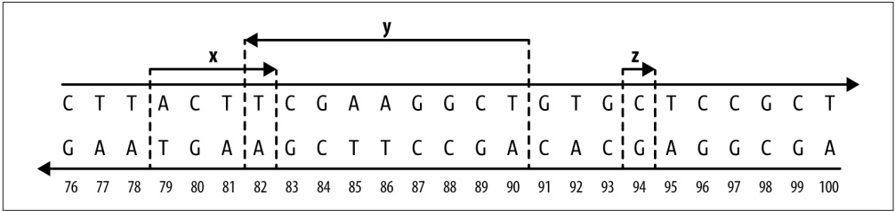
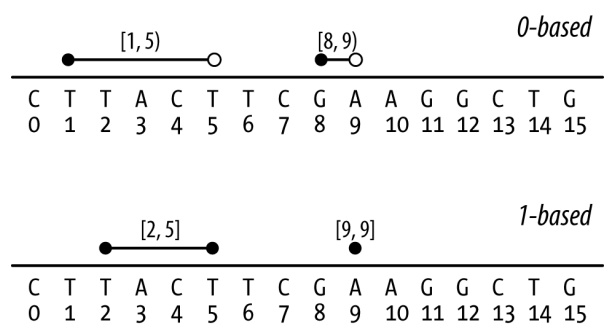
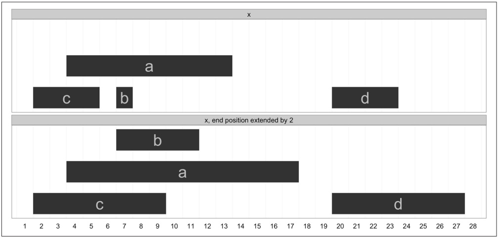

```scss
df$file <- x
    df
}
```

This version of loadFile() uses sub() to extract part of each file’s name. Because we don’t care about the path of each file, we use basename() to extract the nondirectory part of each filepath (but depending on your directory structure, you may need to extract information from the full path!). basename() works like:

```txt
> hs_files[[1]]
[1] "hotspots/hotspots_chr1.bed"
> basename(hs_files[[1]])
[1] "hotspots_chr1.bed"
```

Now, applying this new version of loadFile() to our data:

```txt
> hs <- lapply(hs_files, loadFile)
> head(hs[[1]])
    chr   start     end chr_name            file
1 chr1 1138865 1161866      chr1 hotspots/hotspots_chr1.bed
2 chr1 2173749 2179750       chr1 hotspots/hotspots_chr1.bed
3 chr1 2246749 2253750       chr1 hotspots/hotspots_chr1.bed
[...]
```

Just as there’s more than one way to pet a cat, there are many ways to bulk load data into R. Alternatively, one might use mapply() or Map() to loop over both file paths (to load in files) and filenames (to extract relevant metadata from a filename).

Lastly, for projects with many large files, it may not be feasible to load all data in at once and combine it into a single large dataframe. In this case, you might need to use lapply() to apply a per-file summarizing function to this data. As a simple example, let’s build a workflow that summarizes the number and average length of hotspots by chromosome file. Using lapply(), this is actually quite easy:

```r
loadAndSummarizeFile <- function(x) {
  df <- read.table(x, header=FALSE, col.names=bedcols)
  data.frame(chr=unique(df\$chr), n=nrow(df), mean_len=mean(df\$end - df\$start))
}
```

After sourcing this function, let’s run it:

```txt
> chr_hs_summaries <- lapply(hs_files, loadAndSummarizeFile)
> chr_hs_summaries[1:2]
[[1]]
    chr     n mean_len
1 chr1 1753 10702.44

[[2]]
    chr     n mean_len
1 chr10 1080 10181.56
```

If needed, you could use do.call(rbind, chr\_hs\_summaries) to merge this data into a single dataframe.

Processing files this way is very convenient for large files, and is even more powerful because it’s possible to parallelize data processing by simply replacing lapply() with mclapply().

## Exporting Data

At some point during an analysis, you’ll need to export data from R. We can export dataframes to plain-text files using the R function write.table(). Unfortunately, write.table() has some poorly chosen defaults that we usually need to adjust. For example, if we wanted to write our dataframe mtfs to a tab-delimited file named hotspot\_motifs.txt, we would use:

```python
> write.table(mtfs, file="hotspot_motifs.txt", quote=FALSE,
            sep="\t", row.names=FALSE, col.names=TRUE)
```

write.table()’s first two arguments are the dataframe (or matrix) to write to file and the file path to save it to. By default, write.table() quotes factor and character columns and includes rownames—we disable these with quote=FALSE and row.names=FALSE. We also can set the column separators to tabs with the sep argument. A header can be included or excluded with the col.names argument.

Given how we saw in Chapters 6 and 7 that many Unix tools work well with Gzipped files, it’s worth mentioning you can write a compressed version of a file directly from R. In addition to a string file path, write.table’s file argument also handles open file connections. So to write our dataframe to a compressed file, we open a gzipped file connect with gzfile(). For example:

```txt
> hs_gzf <- gzfile("hotspot_motifs.txt.gz")
> write.table(mtfs, file=hs_gzf, quote=FALSE, sep="\t", row.names=FALSE,
           col.names=TRUE)
```

Functions like read.delim() and write.table() are for reading and writing plaintext data. Throughout the book, we’ve seen how plain text is preferable to specialty formats because it’s more portable, easy to read and understand, and works well with Unix data tools. While plain-text formats are the preferable way to share tabular datasets, it’s not the best way to save complex R data structures like lists or special R objects. In these cases, it’s usually preferable to save R objects as R objects. Encoding and saving objects to disk in a way that allows them to be restored as the original object is known as serialization. R’s functions for saving and loading R objects are save() and load(). For the sake of this example, let’s create a simple R data structure using a list containing a vector and a dataframe and save this to file, remove the original object, and then reload it:

```python
> tmp <- list(vec=rnorm(4), df=data.frame(a=1:3, b=3:5))
> save(tmp, file="example.Rdata")
> rm(tmp) # remove the original 'tmp' list
> load("example.Rdata") # this fully restores the 'tmp' list from file
> str(tmp)
List of 2
$ vec: num [1:4] -0.655 0.274 -1.724 -0.49
$ df :'data.frame':     3 obs. of  2 variables:
    ..$ a: int [1:3] 1 2 3
    ..$ b: int [1:3] 3 4 5
```

The function save() has an analogous function called save.image() that saves all objects in your workspace rather than just the objects you specify. Combined with savehistory(), save.image() can be a quick way to store your past work in R in a rush (personally, save.history() has saved my skin a few times when I’ve needed to record past interactive work right before a server has crashed!).

## Further R Directions and Resources

In this rapid R introduction, we’ve covered many key features of the R language and seen how they can be used to explore, visualize, and understand data. But we’ve only scratched the surface of R’s capabilities. As you continue to use and learn R, I recommend the following texts:

• Hadley Wickham’s [Advanced R](http://adv-r.had.co.nz/) (Chapman & Hall, 2014)
• Joseph Adler’s [R in a Nutshell](http://bit.ly/r-nutshell) (O’Reilly, 2010)
• Hadley Wickham’s ggplot2: Elegant Graphics for Data Analysis (Springer, 2010)
• Winston Chang’s [R Graphics Cookbook](http://bit.ly/r-graphics-ckbk) (O’Reilly, 2012)
• Norman Matloff ’s The Art of R Programming: A Tour of Statistical Software Design (No Starch Press, 2011)

One reason R is popular (and increasingly so) are the numerous R packages available to scientists. New statistical methods are routinely published with R packages implementations released on CRAN. In Chapter 9, we’ll use packages created and maintained by the [Bioconductor](http://bioconductor.org/) project extensively. Bioconductor is an open source R software project focused on developing tools for high-throughput genomics and molecular biology data. Another useful project is [rOpenSci](http://ropensci.org/), which develops packages that simplify accessing data from and submitting data to public repositories, mining journal articles, and visualizing data. These R software projects have each fostered healthy communities of scientists and statisticians creating and using R packages, which continue to improve and advance R’s capabilities in the sciences.

# Working with Range Data

Here is a problem related to yours and solved before. Could you use it? Could you use its result? Could you use its method?

— How to Solve It George Pólya (1945)

Luckily for bioinformaticians, every genome from every branch of life on earth consists of chromosome sequences that can be represented on a computer in the same way: as a set of nucleotide sequences (genomic variation and assembly uncertainty aside). Each separate sequence represents a reference DNA molecule, which may correspond to a fully assembled chromosome, or a scaffold or contig in a partially assembled genome. Although nucleotide sequences are linear, they may also represent biologically circular chromosomes (e.g., with plasmids or mitochondria) that have been cut. In addition to containing nucleotide sequences (the As, Ts, Cs, and Gs of life), these reference sequences act as our coordinate system for describing the location of everything in a genome. Moreover, because the units of these chromosomal sequences are individual base pairs, there’s no finer resolution we could use to specify a location on a genome.

Using this coordinate system, we can describe location or region on a genome as a range on a linear chromosome sequence. Why is this important? Many types of genomic data are linked to a specific genomic region, and this region can be represented as a range containing consecutive positions on a chromosome. Annotation data and genomic features like gene models, genetic variants like SNPs and insertions/deletions, transposable elements, binding sites, and statistics like pairwise diversity and GC content can all be represented as ranges on a linear chromosome sequence. Sequencing read alignment data resulting from experiments like whole genome resequencing, RNA-Seq, ChIP-Seq, and bisulfite sequencing can also be represented as ranges.

Once our genomic data is represented as ranges on chromosomes, there are numerous range operations at our disposal to tackle tasks like finding and counting overlaps, calculating coverage, finding nearest ranges, and extracting nucleotide sequences from specific ranges. Specific problems like finding which SNPs overlap coding sequences, or counting the number of read alignments that overlap an exon have simple, general solutions once we represent our data as ranges and reshape our problem into one we can solve with range operations.

As we’ll see in this chapter, there are already software libraries (like R’s GenomicRanges) and command-line tools (bedtools) that implement range operations to solve our problems. Under the hood, these implementations rely on specialized data structures like interval trees to provide extremely fast range operations, making them not only the easiest way to solve many problems, but also the fastest.

## A Crash Course in Genomic Ranges and Coordinate Systems

So what are ranges exactly? Ranges are integer intervals that represent a subsequence of consecutive positions on a sequence like a chromosome. We use integer intervals because base pairs are discrete—we can’t have a fractional genomic position like 50,403,503.53. Ranges alone only specify a region along a single sequence like a chromosome; to specify a genomic region or position, we need three necessary pieces of information:

## Chromosome name

This is also known as sequence name (to allow for sequences that aren’t fully assembled, such as scaffolds or contigs). Each genome is made up of a set of chromosome sequences, so we need to specify which one a range is on. Rather unfortunately, there is no standard naming scheme for chromosome names across biology (and this will cause you headaches). Examples of chromosome names (in varying formats) include “chr17,” “22,” “chrX,” “Y,” and “MT” (for mitochondrion), or scaffolds like “HE667775” or “scaffold\_1648.” These chromosome names are always with respect to some particular genome assembly version, and may differ between versions.

## Range

For example, 114,414,997 to 114,693,772 or 3,173,498 to 3,179,449. Ranges are how we specify a single subsequence on a chromosome sequence. Each range is composed of a start position and an end position. As with chromosome names, there’s no standard way to represent a range in bioinformatics. The technical details of ranges are quite important, so we’ll discuss them in more detail next.

## Strand

Because chromosomal DNA is double-stranded, features can reside on either the forward (positive) or reverse (negative) strand. Many features on a chromosome are strand-specific. For example, because protein coding exons only make biolog ical sense when translated on the appropriate strand, we need to specify which strand these features are on.

These three components make up a genomic range (also know as a genomic interval). Note that because reference genomes are our coordinate system for ranges, ranges are completely linked to a specific genome version. In other words, genomic locations are relative to reference genomes, so when working with and speaking about ranges we need to specify the version of genome they’re relative to.

To get an idea of what ranges on a linear sequence look like, Figure 9-1 depicts three ranges along a stretch of chromosome. Ranges x and y overlap each other (with a one base pair overlap), while range z is not overlapping any other range (and spans just a single base pair). Ranges x and z are both on the forward DNA strand (note the directionality of the arrows), and their underlying nucleotide sequences are ACTT and C, respectively; range y is on the reverse strand, and its nucleotide sequence would be AGCCTTCGA.



<details>
<summary>text_image</summary>

C T T A C T T C G A A G G C T G T G C T C C G C T
G A A T G A A G C T T C C G A C A C G A G C G A
76 77 78 79 80 81 82 83 84 85 86 87 88 89 90 91 92 93 94 95 96 97 98 99 100
x y z
76 77 78 79 80 81 82 83 84 85 86 87 88 89 90 91 92 93 94 95 96 97 98 99 100
</details>

Figure 9-1. Three ranges on an imaginary stretch of chromosome

## Reference Genome Versions

Assembling and curating reference genomes is a continuous effort, and reference genomes are perpetually changing and improving. Unfortunately, this also means that our coordinate system will often change between genome versions, so a genomic region like chr15:27,754,876-27,755,076 will not refer to the same genomic location across different genome versions. For example, this 200bp range on human genome version GRCh38 are at chr15:28,000,022-28,000,222 on version GRCh37/hg19, chr15:25,673,617-25,673,817 on versions NCBI36/hg18 and NCBI35/hg17, and chr15: 25,602,381-25,602,581 on version NCBI34/hg16! Thus genomic locations are always relative to specific reference genomes versions. For reproducibility’s sake (and to make your life easier later on), it’s vital to specify which version of reference genome you’re working with (e.g., human genome version GRCh38, Heliconius melpomene v1.1, or Zea mays AGPv3). It’s also imperative that you and collaborators use the same genome version so any shared data tied to a genomic regions is comparable.

At some point, you’ll need to remap genomic range data from an older genome version’s coordinate system to a newer version’s coordinate system. This would be a tedious undertaking, but luckily there are established tools for the task:

• [CrossMap](http://crossmap.sourceforge.net/) is a command-line tool that converts many data formats (BED, GFF/ GTF, SAM/BAM, Wiggle, VCF) between coordinate systems of different assembly versions.
• [NCBI Genome Remapping Service](http://bit.ly/remap-tool) is a web-based tool supporting a variety of genomes and formats.
• [LiftOver](http://bit.ly/liftover) is also a web-based tool for converting between genomes hosted on the [UCSC Genome Browser’s site](http://genome.ucsc.edu/).

Despite the convenience that comes with representing and working with genomic ranges, there are unfortunately some gritty details we need to be aware of. First, there are two different flavors of range systems used by bioinformatics data formats (see Table 9-1 for a reference) and software programs:

• 0-based coordinate system, with half-closed, half-open intervals.
• 1-based coordinate system, with closed intervals.

With 0-based coordinate systems, the first base of a sequence is position 0 and the last base’s position is the length of the sequence - 1. In this 0-based coordinate system, we use half-closed, half-open intervals. Admittedly, these half-closed, half-open intervals can be a little unintuitive at first—it’s easiest to borrow some notation from mathematics when explaining these intervals. For some start and end positions, halfclosed, half-open intervals are written as [start, end). Brackets indicate a position is included in the interval range (in other words, the interval is closed on this end), while parentheses indicate that a position is excluded in the interval range (the interval is open on this end). So a half-closed, half-open interval like [1, 5) includes the bases at positions 1, 2, 3, and 4 (illustrated in Figure 9-2). You may be wondering why on earth we’d ever use a system that excludes the end position, but we’ll come to that after discussing 1-based coordinate systems. In fact, if you’re familiar with Python, you’ve already seen this type of interval system: Python’s strings (and lists) are 0- indexed and use half-closed, half-open intervals for indexing portions of a string:

```txt
>>> "CTTACTTCGAAGGCTG"[1:5]
'TTAC'
```

The second flavor is 1-based. As you might have guessed, with 1-based systems the first base of a sequence is given the position 1. Because positions are counted as we do natural numbers, the last position in a sequence is always equal to its length. With the 1-based systems we encounter in bioinformatics, ranges are represented as closed intervals. In the notation we saw earlier, this is simply [start, end], meaning both the start and end positions are included in our range. As Figure 9-2 illustrates, the same bases that cover the 0-based range [1, 5) are covered in the 1-based range [2, 5]. R uses 1-based indexing for its vectors and strings, and extracting a portion of a string with substr() uses closed intervals:

```txt
> substr("CTTACTTCGAAGGCTG", 2, 5)
[1] "TTAC"
```

If your head is spinning a bit, don’t worry too much—this stuff is indeed confusing. For now, the important part is that you are aware of the two flavors and note which applies to the data you’re working with.



Figure 9-2. Ranges on 0-based and 1-based coordinate systems (lines indicate ranges, open circles indicate open interval endpoints, and closed circles indicate closed endpoints)

Because most of us are accustomed to counting in natural numbers (i.e., 1, 2, 3, etc.), there is a tendency to lean toward the 1-based system initially. Yet both systems have advantages and disadvantages. For example, to calculate how many bases a range spans (sometimes known as the range width) in the 0-based system, we use end - start. This is simple and intuitive. With the 1-based system, we’d use the less intuitive end - start + 1. Another nice feature of the 0-based system is that it supports zero-width features, whereas with a 1-based system the smallest supported width is 1 base (though sometimes ranges like [30,29] are used for zero-width features). Zerowidth features are useful if we need to represent features between bases, such as where a restriction enzyme would cut a DNA sequence. For example, a restriction enzyme that cut at position [12, 12) in Figure 9-2 would leave fragments CTTACTTCGAAGG and CTG.

Table 9-1. Range types of common bioinformatics formats

| Format/library | Type |
| --- | --- |
| BED | 0-based |
| GTF | 1-based |
| GFF | 1-based |
| SAM | 1-based |
| BAM | 0-based |
| VCF | 1-based |
| BCF | 0-based |
| Wiggle | 1-based |
| GenomicRanges | 1-based |
| BLAST | 1-based |
| GenBank/EMBL Feature Table | 1-based |

The second gritty detail we need to worry about is strand. There’s little to say except: you need to mind strand in your work. Because DNA is double stranded, genomic features can lie on either strand. Across nearly all range formats (BLAST results being the exception), a range’s coordinates are given on the forward strand of the reference sequence. However, a genomic feature can be either on the forward or reverse strand. For genomic features like protein coding regions, strand matters and must be specified. For example, a range representing a protein coding region only makes biological sense given the appropriate strand. If the protein coding feature is on the forward strand, the nucleotide sequence underlying this range is the mRNA created during transcription. In contrast, if the protein coding feature is on the reverse strand, the reverse complement of the nucleotide sequence underlying this range is the mRNA sequence created during transcription.

We also need to mind strand when comparing features. Suppose you’ve aligned sequencing reads to a reference genome, and you want to count how many reads overlap a specific gene. Each aligned read creates a range over the region it aligns to, and we want to count how many of these aligned read ranges overlap a gene range. However, information about which strand a sequencing read came from is lost during sequencing (though there are now strand-specific RNA-seq protocols). Aligned reads will map to both strands, and which strand they map to is uninformative. Consequently, when computing overlaps with a gene region that we want to ignore strand, an overlap should be counted regardless of whether the aligned read’s strand and gene’s strand are identical. Only counting overlapping aligned reads that have the same strand as the gene would lead to an underestimate of the reads that likely came from this gene’s region.

## An Interactive Introduction to Range Data with GenomicRanges

To get a feeling for representing and working with data as ranges on a chromosome, we’ll step through creating ranges and using range operations with the Bioconductor packages IRanges and GenomicRanges. Like those in Chapter 8, these examples will be interactive so you grow comfortable exploring and playing around with your data. Through interactive examples, we’ll also see subtle gotchas in working with range operations that are important to be aware of.

## Installing and Working with Bioconductor Packages

Before we get started with working with range data, let’s learn a bit about Bioconductor and install its requisite packages. [Bioconductor](http://www.bioconductor.org) is an open source software project that creates R bioinformatics packages and serves as a repository for them; it emphasizes tools for high-throughput data. In this section, we’ll touch on some of Bioconductor’s core packages:

## GenomicRanges

Used to represent and work with genomic ranges

## GenomicFeatures

Used to represent and work with ranges that represent gene models and other features of a genome (genes, exons, UTRs, transcripts, etc.)

## Biostrings and BSgenome

Used for manipulating genomic sequence data in R (we’ll cover the subset of these packages used for extracting sequences from ranges)

## rtracklayer

Used for reading in common bioinformatics formats like BED, GTF/GFF, and WIG

Bioconductor’s package system is a bit different than those on the Comprehensive R Archive Network (CRAN). Bioconductor packages are released on a set schedule, twice a year. Each release is coordinated with a version of R, making Bioconductor’s versions tied to specific R versions. The motivation behind this strict coordination is that it allows for packages to be thoroughly tested before being released for public use. Additionally, because there’s considerable code re-use within the Bioconductor project, this ensures that all package versions within a Bioconductor release are compatible with one another. For users, the end result is that packages work as expected and have been rigorously tested before you use it (this is good when your scientific results depend on software reliability!). If you need the cutting-edge version of a package for some reason, it’s always possible to work with their development branch.

When installing Bioconductor packages, we use the biocLite() function. bio cLite() installs the correct version of a package for your R version (and its corresponding Bioconductor version). We can install Bioconductor’s primary packages by running the following (be sure your R version is up to date first, though):

**> source**("http://bioconductor.org/biocLite.R")
> biocLite()

One package installed by the preceding lines is BiocInstaller, which contains the function biocLite(). We can use biocLite() to install the GenomicRanges package, which we’ll use in this chapter:

> biocLite("GenomicRanges")

This is enough to get started with the ranges examples in this chapter. If you wish to install other packages later on (in other R sessions), load the BiocInstaller package with library(BiocInstaller) first. biocLite() will notify you when some of your packages are out of date and need to be upgraded (which it can do automatically for you). You can also use biocUpdatePackages() to manually update Bioconductor (and CRAN) packages . Because Bioconductor’s packages are all tied to a specific version, you can make sure your packages are consistent with biocValid(). If you run into an unexpected error with a Bioconductor package, it’s a good idea to run biocUp datePackages() and biocValid() before debugging.

In addition to a careful release cycle that fosters package stability, Bioconductor also has extensive, excellent documentation. The best, most up-to-date documentation for each package will always be at [Bioconductor](http://bioconductor.org). Each package has a full reference manual covering all functions and classes included in a package, as well as one or more in-depth vignettes. Vignettes step through many examples and common workflows using packages. For example, see [the GenomicRanges reference manual and vignettes](http://bit.ly/genomicranges). I highly recommend that you read the vignettes for all Bioconductor packages you intend to use—they’re extremely well written and go into a lot of useful detail.

## Storing Generic Ranges with IRanges

Before diving into working with genomic ranges, we’re going to get our feet wet with generic ranges (i.e., ranges that represent a contiguous subsequence of elements over any type of sequence). Beginning this way allows us to focus more on thinking abstractly about ranges and how to solve problems using range operations. The real power of using ranges in bioinformatics doesn’t come from a specific range library implementation, but in tackling problems using the range abstraction (recall Pólya’s quote at the beginning of this chapter). To use range libraries to their fullest potential in real-world bioinformatics, you need to master this abstraction and “range thinking.”

The purpose of the first part of this chapter is to teach you range thinking through the use of use Bioconductor’s IRanges package. This package implements data structures for generic ranges and sequences, as well as the necessary functions to work with these types of data in R. This section will make heavy use of visualizations to build your intuition about what range operations do. Later in this chapter, we’ll learn about the GenomicRanges package, which extends IRanges by handling biological details like chromosome name and strand. This approach is common in software development: implement a more general solution than the one you need, and then extend the general solution to solve a specific problem (see [xkcd’s “The General Problem” comic](http://xkcd.com/974/) for a funny take on this).

Let’s get started by creating some ranges using IRanges. First, load the IRanges package. The IRanges package is a dependency of the GenomicRanges package we installed earlier with biocLite(), so it should already be installed:

```txt
> library(IRanges) # you might see some package startup
# messages when you run this
```

The ranges we create with the IRanges package are called IRanges objects. Each IRanges object has the two basic components of any range: a start and end position. We can create ranges with the IRanges() function. For example, a range starting at position 4 and ending at position 13 would be created with:

```c
> rng <- IRanges(start=4, end=13)
> rng
IRanges of length 1
    start end width
[1]      4  13   10
```

The most important fact to note: IRanges (and GenomicRanges) is 1-based, and uses closed intervals. The 1-based system was adopted to be consistent with R’s 1-based system (recall the first element in an R vector has index 1).

You can also create ranges by specifying their width, and either start or end position:

```python
> IRanges(start=4, width=3)
IRanges of length 1
    start end width
[1]     4   6     3
> IRanges(end=5, width=5)
IRanges of length 1
    start end width
[1]     1   5     5
```

Also, the IRanges() constructor (a function that creates a new object) can take vector arguments, creating an IRanges object containing many ranges:

```txt
> x <- IRanges(start=c(4, 7, 2, 20), end=c(13, 7, 5, 23))
> x
IRanges of length 4
    start end width
[1]      4   13     10
[2]      7   7     1
[3]      2   5     4
[4]      20   23     4
```

Like many R objects, each range can be given a name. This can be accomplished by setting the names argument in IRanges, or using the function names():

```txt
> names(x) <- letters[1:4]
> x
IRanges of length 4
    start end width names
[1]     4  13     10     a
[2]     7   7     1     b
[3]     2   5     4     c
[4]     20  23     4     d
```

These four ranges are depicted in Figure 9-3. If you wish to try plotting your ranges, the source for the function I’ve used to create these plots, plotIRanges(), is available in this chapter’s directory in the book’s GitHub repository.

While on the outside x may look like a dataframe, it’s not—it’s a special object with class IRanges. In “Factors and classes in R” on page 191, we learned that an object’s class determines its behavior and how we interact with it in R. Much of Bioconductor is built from objects and classes. Using the function class(), we can see it’s an IRanges object:

```txt
> class(x)
[1] "IRanges"
attr(,"package")
[1] "IRanges"
```


<details>
<summary>bar</summary>

| Category | x | x, end position extended by 4 |
| --- | --- | --- |
| a | ~13.5 | ~17.5 |
| b | ~7.5 | ~11.5 |
| c | ~6.0 | ~9.5 |
| d | ~23.0 | ~27.5 |
</details>

Figure 9-3. An IRanges object containing four ranges

IRanges objects contain all information about the ranges you’ve created internally. If you’re curious what’s under the hood, call str(x) to take a peek. Similar to how we used the accessor function levels() to access a factor’s levels (“Factors and classes in R” on page 191), we use accessor functions to get parts of an IRanges object. For example, you can access the start positions, end positions, and widths of each range in this object with the methods start(), end(), and width():

```txt
> start(x)
[1] 4 7 2 20
> end(x)
[1] 13 7 5 23
> width(x)
[1] 10 1 4 4
```

These functions also work with <- to set start, end, and width position. For example, we could increment a range’s end position by 4 positions with:

```c
> end(x) <- end(x) + 4
> x
IRanges of length 4
    start end width names
[1]      4  17     14      a
[2]      7  11     5       b
```

```txt
[3]        2   9       8      c
[4]        20 27       8      d
```

Figure 9-4 shows this IRanges object before and after extending the end position. Note that the y position in these plots is irrelevant; it’s chosen so that ranges can be visualized clearly.



<details>
<summary>bar</summary>

| Category | x | x, end position extended by 2 |
| --- | --- | --- |
| a | ~13.5 | ~17.5 |
| b | ~7.5 | ~11.5 |
| c | ~5.5 | ~9.5 |
| d | ~23.5 | ~27.5 |
</details>

Figure 9-4. Before and after extending the range end position by 4

The range() method returns the span of the ranges kept in an IRanges object:

```txt
> range(x)
IRanges of length 1
    start end width
[1]     2  27    26
```

We can subset IRanges just as we would any other R objects (vectors, dataframes, matrices), using either numeric, logical, or character (name) index:

```txt
> x[2:3]
IRanges of length 2
    start end width names
[1]     7  11     5     b
[2]     2  9     8     c
> start(x) < 5
[1]   TRUE FALSE   TRUE FALSE
> x[start(x) < 5]
IRanges of length 2
    start end width names
[1]     4  17     14     a
[2]     2  9     8     c
> xacial(x) > 8]
IRanges of length 1
    start end width names
[1]     4  17     14     a
```