```python
> x['a']
IRanges of length 1
    start end width names
[1]     4  17   14    a
```

As with dataframes, indexing using logical vectors created by statements like width(x) > 8 is a powerful way to select the subset of ranges you’re interested in.

Ranges can also be easily merged using the function c(), just as we used to combine vectors:

```txt
> a <- IRanges(start=7, width=4)
> b <- IRanges(start=2, end=5)
> c(a, b)
IRanges of length 2
    start end width
[1]      7  10     4
[2]      2  5     4
```

With the basics of IRanges objects under our belt, we’re now ready to look at some basic range operations.

## Basic Range Operations: Arithmetic, Transformations, and Set Operations

In the previous section, we saw how IRanges objects conveniently store generic range data. So far, IRanges may look like nothing more than a dataframe that holds range data; in this section, we’ll see why these objects are so much more. The purpose of using a special class for storing ranges is that it allows for methods to perform specialized operations on this type of data. The methods included in the IRanges package to work with IRanges objects simplify and solve numerous genomics data analysis tasks. These same methods are implemented in the GenomicRanges package, and work similarly on GRanges objects as they do generic IRanges objects.

First, IRanges objects can be grown or shrunk using arithmetic operations like +, -, and \* (the division operator, /, doesn’t make sense on ranges, so it’s not supported). Growing ranges is useful for adding a buffer region. For example, we might want to include a few kilobases of sequence up and downstream of a coding region rather than just the coding region itself. With IRanges objects, addition (subtraction) will grow (shrink) a range symmetrically by the value added (subtracted) to it:

```txt
> x <- IRanges(start=c(40, 80), end=c(67, 114))
> x + 4L
IRanges of length 2
    start end width
[1]     36  71    36
[2]     76 118    43
> x - 10L
IRanges of length 2
```

|  | start | end | width |
| --- | --- | --- | --- |
| [1] | 50 | 57 | 8 |
| [2] | 90 | 104 | 15 |

The results of these transformations are depicted in Figure 9-5. Multiplication transforms with the width of ranges in a similar fashion. Multiplication by a positive num ber “zooms in” to a range (making it narrower), while multiplication by a negative number “zooms out” (making it wider). In practice, most transformations needed in genomics are more easily expressed by adding or subtracting constant amounts.

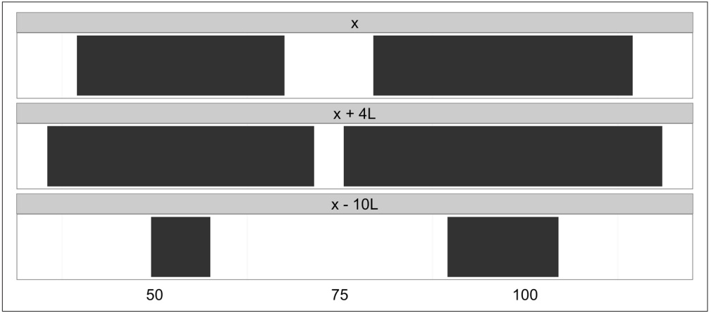

<details>
<summary>text_image</summary>

x
x + 4L
x - 10L
50	75	100
</details>

Figure 9-5. Ranges transformed by arithemetic operations

Sometimes, rather than growing ranges by some amount, we want to restrict ranges within a certain bound. The IRanges package method restrict() cuts a set of ranges such that they fall inside of a certain bound (pictured in Figure 9-6):

```txt
> y <- IRanges(start=c(4, 6, 10, 12), width=13)
> y
IRanges of length 4
    start end width
[1]      4   16     13
[2]      6   18     13
[3]      10   22     13
[4]      12   24     13
> restrict(y, 5, 10)
IRanges of length 3
    start end width
[1]      5   10     6
[2]      6   10     5
[3]      10   10     1
```

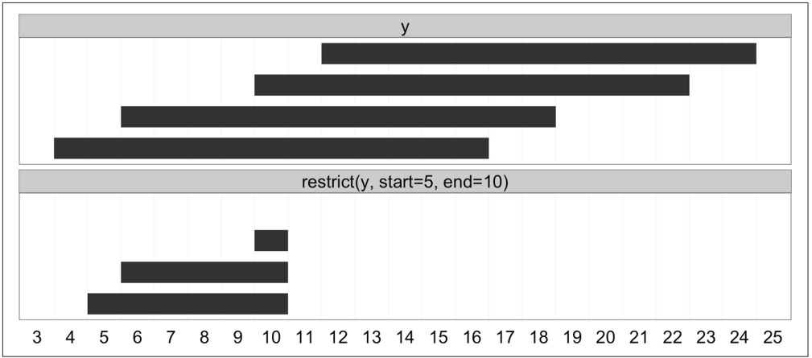

<details>
<summary>bar</summary>

| Category | Range (Y) | Range (restrict(y)) |
| --- | --- | --- |
| y | 11.5~24.5 | — |
| y | 9.5~22.5 | — |
| y | 5.5~18.5 | — |
| y | 3.5~16.5 | — |
| restrict(y, start=5, end=10) | 9.5~10.5 | 4.5~10.5 |
</details>

Figure 9-6. Ranges transformed by restrict

Another important transformation is flank(), which returns the regions that flank (are on the side of) each range in an IRanges object. flank() is useful in creating ranges upstream and downstream of protein coding genes that could contain promoter sequences. For example, if our ranges demarcate the transition start site (TSS) and transcription termination site (TTS) of a set of genes, flank() can be used to create a set of ranges upstream of the TSS that contain promoters. To make the example (and visualization) clearer, we’ll use ranges much narrower than real genes:

```txt
> x
IRanges of length 2
    start end width
[1]     40   67      28
[2]     80 114       35
> flank(x, width=7)
IRanges of length 2
    start end width
[1]     33   39       7
[2]     73   79       7
```

By default, flank() creates ranges width positions upstream of the ranges passed to it. Flanking ranges downstream can be created by setting start=FALSE:

```txt
> flank(x, width=7, start=FALSE)
IRanges of length 2
    start end width
[1]     68  74      7
[2]    115 121      7
```

Both upstream and downstream flanking by 7 positions are visualized in Figure 9-7. flank() has many other options; see help(flank) for more detail.

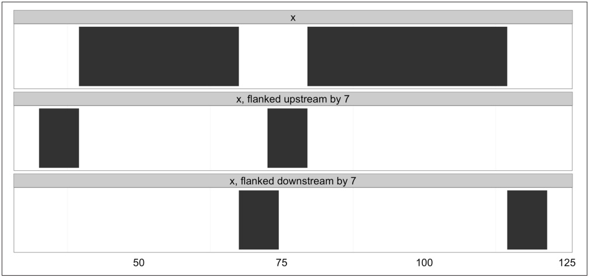

<details>
<summary>bar</summary>

| Category | Value Range |
| --- | --- |
| x | ~40 ~115 |
| x, flanked upstream by 7 | ~35 ~80 |
| x, flanked downstream by 7 | ~65 ~120 |
</details>

Figure 9-7. Ranges that have been flanked by 7 elements, both upstream and downstream

Another common operation is reduce(). the reduce() operation takes a set of possibly overlapping ranges and reduces them to a set of nonoverlapping ranges that cover the same positions. Any overlapping ranges are merged into a single range in the result. reduce() is useful when all we care about is what regions of a sequence are covered (and not about the specifics of the ranges themselves). Suppose we had many ranges corresponding to read alignments and we wanted to see which regions these reads cover. Again, for the sake of clarifying the example, we’ll use simple, small ranges (here, randomly sampled):

```txt
> set.seed(0) # set the random number generator seed
> alns <- IRanges(start=sample(seq_len(50), 20), width=5)
> head(alns, 4)
IRanges of length 4
    start end width
[1]     45   49      5
[2]     14   18      5
[3]     18   22      5
[4]     27   31      5
> reduce(alns)
IRanges of length 3
    start end width
[1]     3   22      20
[2]     24   36      13
[3]     40   53      14
```

See Figure 9-8 for a visualization of how reduce() transforms the ranges alns.

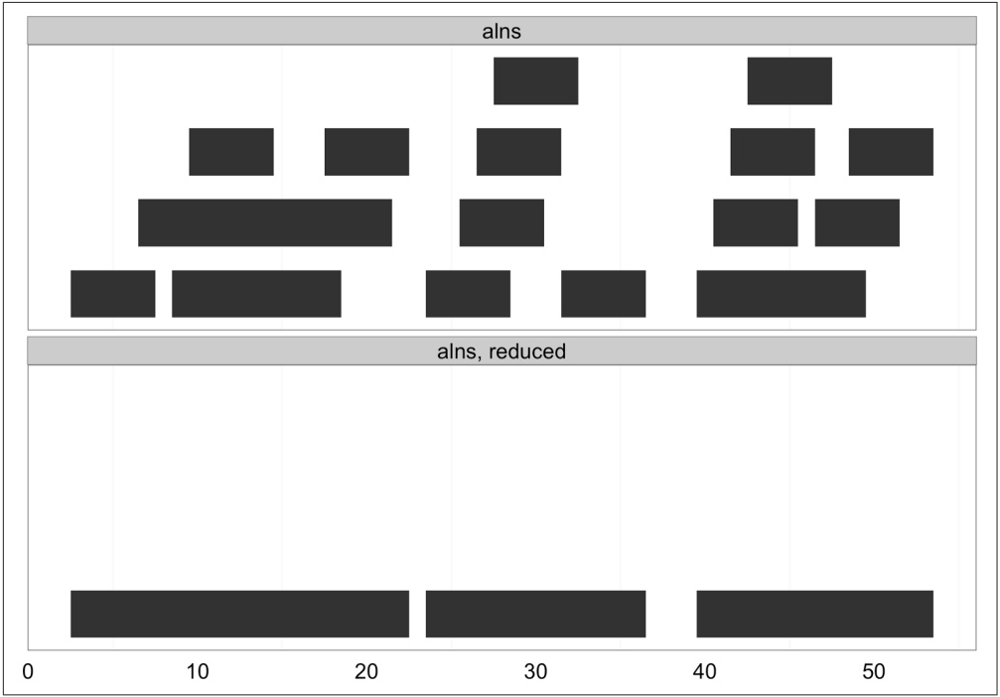

<details>
<summary>bar</summary>

| Category | X Range (approx) | Y Range (approx) |
| --- | --- | --- |
| alns | 2~30 | 1~4 |
| alns | 30~40 | 1~4 |
| alns | 40~50 | 1~4 |
| alns, reduced | 2~23 | 0~4 |
| alns, reduced | 23~37 | 0~4 |
| alns, reduced | 40~53 | 0~4 |
</details>

Figure 9-8. Ranges collapsed into nonoverlapping ranges with reduce

A similar operation to reduce() is gaps(), which returns the gaps (uncovered portions) between ranges. gaps() has numerous applications in genomics: creating intron ranges between exons ranges, finding gaps in coverage, defining intragenic regions between genic regions, and more. Here’s an example of how gaps() works (see Figure 9-9 for an illustration):

```txt
> gaps(alns)
IRanges of length 2
    start end width
[1]     23  23      1
[2]     37  39      3
```

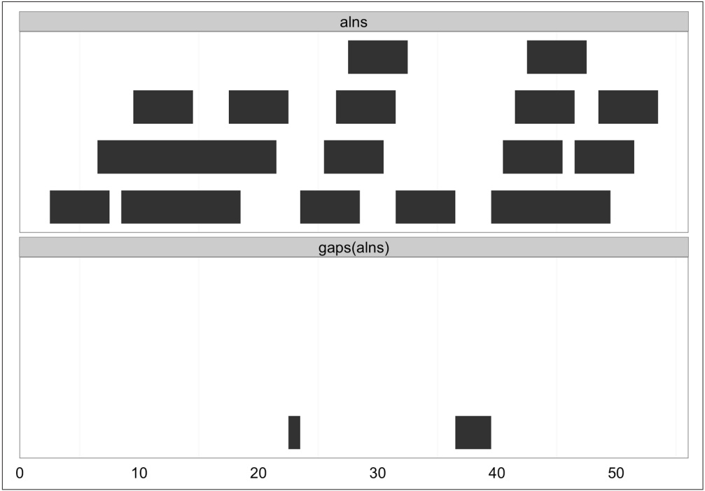

<details>
<summary>bar</summary>

| Category | Value Range |
| --- | --- |
| alns (Top) | 5~48 |
| gaps(alns) (Bottom) | 23~39 |
</details>

Figure 9-9. Gaps between ranges created with gaps

By default, gaps() only returns the gaps between ranges, and does not include those from the beginning of the sequence to the start position of the first range, and the end of the last range to the end of the sequence. IRanges has a good reason for behaving this way: IRanges doesn’t know where your sequence starts and ends. If you’d like gaps() to include these gaps, specify the start and end positions in gaps (e.g., gaps(alns, start=1, end=60)).

Another class of useful range operations are analogous to set operations. Each range can be thought of as a set of consecutive integers, so an IRange object like IRange(start=4, end=7) is simply the integers 4, 5, 6, and 7. This opens up the ability to think about range operations as set operations like difference (setdiff()), intersection (intersect()), union (union()), and complement (which is simply the function gaps() we saw earlier)—see Figure 9-10 for an illustration:

```txt
> a <- IRanges(start=4, end=13)
> b <- IRanges(start=12, end=17)
> intersect(a, b)
IRanges of length 1
    start end width
[1]     12   13      2
> setdiff(a, b)
IRanges of length 1
```

```txt
start end width
[1]     4  11    8
> union(b, a)
IRanges of length 1
start end width
[1]     4  17    14
> union(a, b)
IRanges of length 1
start end width
[1]     4  17    14
```

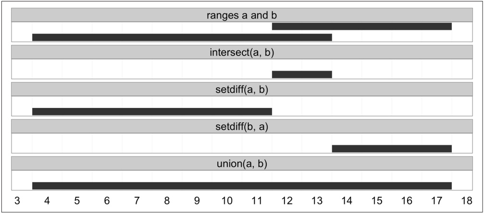

<details>
<summary>bar</summary>

| Method | Range (Start) | Range (End) |
| --- | --- | --- |
| ranges a and b | ~11.5 | ~17.5 |
| intersect(a, b) | ~11.5 | ~13.5 |
| setdiff(a, b) | ~3.5 | ~11.5 |
| setdiff(b, a) | ~13.5 | ~17.5 |
| union(a, b) | ~3.5 | ~17.5 |
</details>

Figure 9-10. Set operations with ranges

Sets operations operate on IRanges with multiple ranges (rows) as if they’ve been collapsed with reduce() first (because mathematically, overlapping ranges make up the same set). IRanges also has a group of set operation functions that act pairwise, taking two equal-length IRanges objects and working range-wise: psetdiff(), pinter sect(), punion(), and pgap(). To save space, I’ve omitted covering these in detail, but see help(psetdiff) for more information.

The wealth of functionality to manipulate range data stored in IRanges should convince you of the power of representing data as IRanges. These methods provide the basic generalized operations to tackle common genomic data analysis tasks, saving you from having to write custom code to solve specific problems. All of these functions work with genome-specific range data kept in GRanges objects, too.

## Finding Overlapping Ranges

Finding overlaps is an essential part of many genomics analysis tasks. Computing overlaps is how we connect experimental data in the form of aligned reads, inferred variants, or peaks of alignment coverage to annotated biological features of the genome like gene regions, methylation, chromatin status, evolutionarily conserved regions, and so on. For tasks like RNA-seq, overlaps are how we quantify our cellular activity like expression and identify different transcript isoforms. Computing overlaps also exemplifies why it’s important to use existing libraries: there are advanced data structures and algorithms that can make the computationally intensive task of comparing numerous (potentially billions) ranges to find overlaps efficient. There are also numerous very important technical details in computing overlaps that can have a drastic impact on the end result, so it’s vital to understand the different types of overlaps and consider which type is most appropriate for a specific task.

We’ll start with the basic task of finding overlaps between two sets of IRanges objects using the findOverlaps() function. findOverlaps() takes query and subject IRanges objects as its first two arguments. We’ll use the following ranges (visualized in Figure 9-11):

```txt
> qry <- IRanges(start=c(1, 26, 19, 11, 21, 7), end=c(16, 30, 19, 15, 24, 8),
                  names=letters[1:6])
> sbj <- IRanges(start=c(1, 19, 10), end=c(5, 29, 16), names=letters[24:26])
> qry
IRanges of length 6
    start end width names
[1]      1   16     16     a
[2]      26   30     5     b
[3]      19   19     1     c
[4]      11   15     5     d
[5]      21   24     4     e
[6]      7   8     2     f
> sbj
IRanges of length 3
    start end width names
[1]      1   5     5     x
[2]      19   29     11     y
[3]      10   16     7     z
```

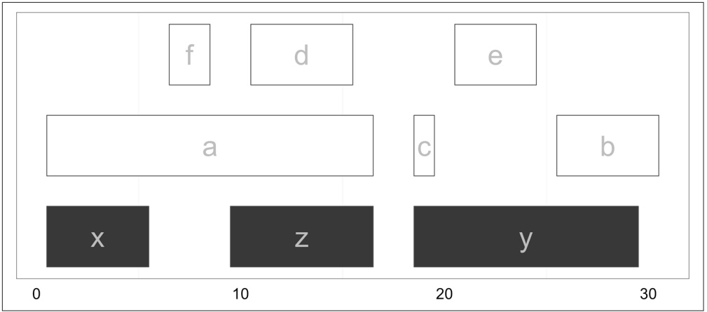

<details>
<summary>text_image</summary>

f
d
e
a
c
b
x
z
y
0
10
20
30
</details>

Figure 9-11. Subject ranges (x, y, and z) depicted in gray and query ranges (a through f) depicted in white

Using the IRanges qry and sbj, we can now find overlaps. Calling findOver laps(qry, sbj) returns an object with class Hits, which stores these overlaps:

```txt
> hts <- findOverlaps(qry, sbj)
> hts
Hits of length 6
queryLength: 6
subjectLength: 3
    queryHits subjectHits
        <integer>      <integer>
1           1           1
2           1           3
3           2           2
4           3           2
5           4           3
6           5           2
```

Thinking abstractly, overlaps represent a mapping between query and subject. Depending on how we find overlaps, each query can have many hits in different subjects. A single subject range will always be allowed to have many query hits. Finding qry ranges that overlap sbj ranges leads to a mapping similar to that shown in Figure 9-12 (check that this follows your intuition from Figure 9-13).

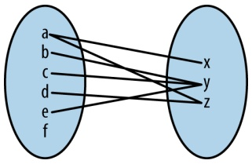

<details>
<summary>flowchart</summary>

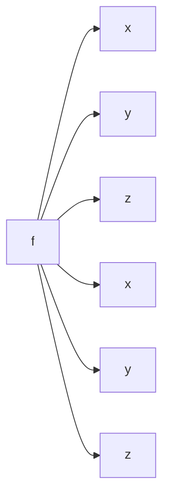
</details>

Figure 9-12. Mapping between qry and sbj ranges representing any overlap

The Hits object from findOverlaps() has two columns on indices: one for the query ranges and one for the subject ranges. Each row contains the index of a query range that overlaps a subject range, and the index of the subject range it overlaps. We can access these indices by using the accessor functions queryHits() and subjectHits(). For example, if we wanted to find the names of each query and subject range with an overlap, we could do:

```scala
> names(qry)[queryHits(hts)]
[1] "a" "a" "b" "c" "d" "e"
> names(sbj)[subjectHits(hts)]
[1] "x" "z" "y" "y" "z" "y"
```

Figure 9-13 shows which of the ranges in qry overlap the ranges in sbj. From this graphic, it’s easy to see how findOverlaps() is computing overlaps: a range is considered to be overlapping if any part of it overlaps a subject range. This type of overlap behavior is set with the type argument to findOverlaps(), which is "any" by default. Depending on our biological task, type="any" may not be the best form of overlap. For example, we could limit our overlap results to only include query ranges that fall entirely within subject ranges with type=within (Figure 9-14):

```txt
> hts_within <- findOverlaps(qry, sbj, type="within")
> hts_within
Hits of length 3
queryLength: 6
subjectLength: 3
    queryHits subjectHits
        <integer>      <integer>
1          3          2
2          4          3
3          5          2
```


<details>
<summary>text_image</summary>

d
e
a
c
b
x
z
y
0 10 20 30
</details>

Figure 9-13. Ranges in qry that overlap sbj using findOverlaps

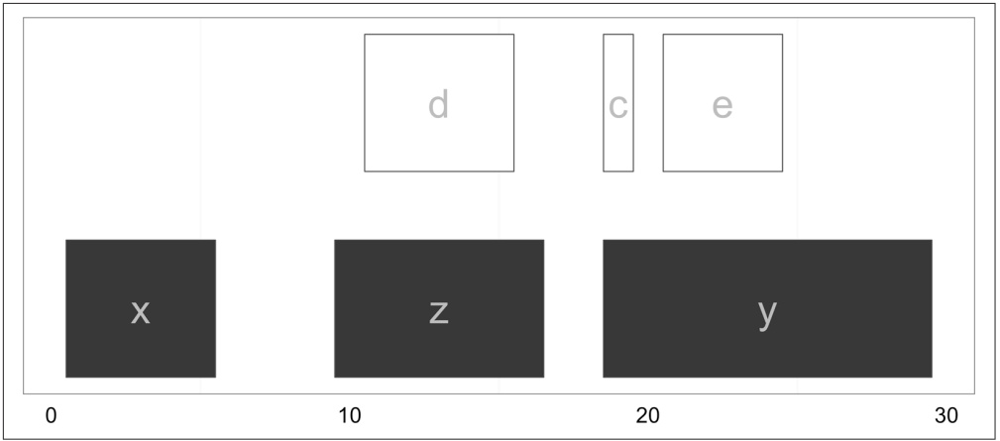

<details>
<summary>text_image</summary>

d
c
e
x
z
y
0 10 20 30
</details>

Figure 9-14. Ranges in qry that overlap entirely within sbj

While type="any" and type="within" are the most common options in day-to-day work, findOverlaps() supports other overlap types. See help(findOverlaps) to see the others (and much more information about findOverlaps() and related functions).

Another findOverlaps() parameter that we need to consider when computing overlaps is select, which determines how findOverlaps() handles cases where a single query range overlaps more than one subject range. For example, the range named a in qry overlaps both x and y. By default, select="all", meaning that all overlapping ranges are returned. In addition, select allows the options "first", "last", and "arbitrary", which return the first, last, and an arbitrary subject hit, respectively. Because the options "first", "last", and "arbitrary" all lead findOverlaps() to return only one overlapping subject range per query (or NA if no overlap is found), results are returned in an integer vector where each element corresponds to a query range in qry:

```txt
> findOverlaps(qry, sbj, select="first")
[1] 1 2 2 3 2 NA
> findOverlaps(qry, sbj, select="last")
[1] 3 2 2 3 2 NA
> findOverlaps(qry, sbj, select="arbitrary")
[1] 1 2 2 3 2 NA
```


## Mind Your Overlaps (Part I)

What an overlap “is” may seem obvious at first, but the specifics can matter a lot in real-life genomic applications. For example, allowing for a query range to overlap any part of a subject range makes sense when we’re looking for SNPs in exons. However, classifying a 1kb genomic window as coding because it overlaps a single base of a gene may make less sense (though depends on the application). It’s important to always relate your quantification methods to the underlying biology of what you’re trying to understand.

The intricacies of overlap operations are especially important when we use overlaps to quantify something, such as expression in an RNA-seq study. For example, if two transcript regions overlap each other, a single alignment could overlap both transcripts and be counted twice—not good. Likewise, if we count how many alignments overlap exons, it’s not clear how we should aggregate overlaps to obtain transcript or gene-level quantification. Again, different approaches can lead to sizable differences in statistical results. The take-home lessons are as follows:

• Mind what your code is considering an overlap.
• For quantification tasks, simple overlap counting is best thought of as an approximation (and more sophisticated methods do exist).

See Trapnell, et al., 2013 for a really nice introduction of these issues in RNA-seq quantification.

Counting many overlaps can be a computationally expensive operation, especially when working with many query ranges. This is because the naïve solution is to take a query range, check to see if it overlaps any of the subject ranges, and then repeat across all other query ranges. If you had Q query ranges and S subject ranges, this would entail Q × S comparisons. However, there’s a trick we can exploit: ranges are naturally ordered along a sequence. If our query range has an end position of 230,193, there’s no need to check if it overlaps subject ranges with start positions larger than 230,193—it won’t overlap. By using a clever data structure that exploits this property, we can avoid having to check if each of our Q query ranges overlap our S subject ranges. The clever data structure behind this is the interval tree. It takes time to build an interval tree from a set of subject ranges, so interval trees are most appropriate for tasks that involve finding overlaps of many query ranges against a fixed set of subject ranges. In these cases, we can build the subject interval tree once and then we can use it over and over again when searching for overlaps with each of the query ranges.

Implementing interval trees is an arduous task, but luckily we don’t have to utilize their massive computational benefits. IRanges has an IntervalTree class that uses interval trees under the hood. Creating an IntervalTree object from an IRanges object is simple:

```txt
> sbj_it <- IntervalTree(sbj)
> sbj_it
IntervalTree of length 3
    start end width
[1]     1   5      5
[2]     19  29      11
[3]     10  16      7
> class(sbj_it)
[1] "IntervalTree"
attr(,"package")
[1] "IRanges"
```

Using this sbj\_it object illustrates we can use findOverlaps() with IntervalTree objects just as we would a regular IRanges object—the interfaces are identical:

```txt
> findOverlaps(qry, sbj_it)
Hits of length 6
queryLength: 6
subjectLength: 3
    queryHits subjectHits
        <integer>      <integer>
1           1           1
2           1           3
3           2           2
4           3           2
5           4           3
6           5           2
```

Note that in this example, we won’t likely realize any computational benefits from using an interval tree, as we have few subject ranges.

After running findOverlaps(), we need to work with Hits objects to extract information from the overlapping ranges. Hits objects support numerous helpful methods in addition to the queryHits() and subjectHits() accessor functions (see help(queryHits) for more information):

```txt
> as.matrix(hts) ①
    queryHits subjectHits
[1,]          1         1
[2,]          1         3
[3,]          2         2
[4,]          3         2
[5,]          4         3
[6,]          5         2
> countQueryHits(hts) ②
[1] 2 1 1 1 1 0
```

```txt
> setNames(countQueryHits(hts), names(qry))
a b c d e f
2 1 1 1 1 0
> countSubjectHits(hts) ③
[1] 1 3 2
> setNames(countSubjectHits(hts), names(sbj))
x y z
1 3 2
> ranges(hts, qry, sbj) ④
IRanges of length 6
start end width
[1]     1    5     5
[2]     10   16     7
[3]     26   29     4
[4]     19   19     1
[5]     11   15     5
[6]     21   24     4
```

0 Hits objects can be coerced to matrix using as.matrix().
countQueryHits() returns a vector of how many subject ranges each query IRanges object overlaps. Using the function setNames(), I’ve given the resulting vector the same names as our original ranges on the next line so the result is clearer. Look at Figure 9-11 and verify that these counts make sense.
The function countSubjectHits() is like countQueryHits(), but returns how many query ranges overlap the subject ranges. As before, I’ve used setNames() to label these counts with the subject ranges’ names so these results are clearly labelled.
④ Here, we create a set of ranges for overlapping regions by calling the ranges() function using the Hits object as the first argument, and the same query and subject ranges we passed to findOverlaps() as the second and third arguments. These intersecting ranges are depicted in Figure 9-15 in gray, alongside the original subject and query ranges. Note how these overlapping ranges differ from the set created by intersect(qry, sbj): while intersect() would create one range for the regions of ranges a and d that overlap z, using ranges() with a Hits object creates two separate ranges.

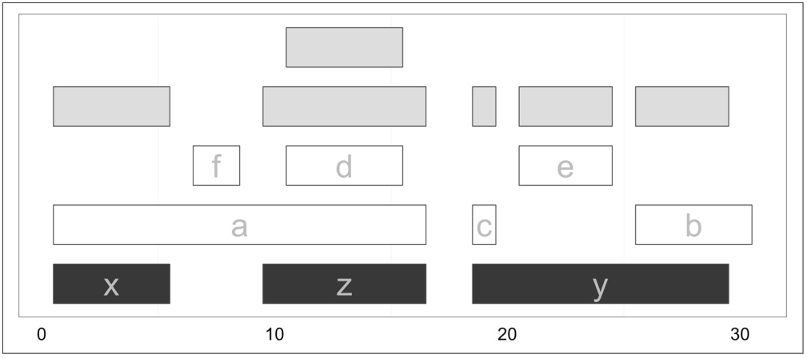

<details>
<summary>text_image</summary>

f
d
a
c
e
b
x
z
y
0
10
20
30
</details>

Figure 9-15. Overlapping ranges created from a Hits object using the function ranges

A nice feature of working with ranges in R is that we can leverage R’s full array of data analysis capabilities to explore these ranges. For example, after using ranges(hts, qry, sbj) to create a range corresponding to the region shared between each overlapping query and subject range, you could use summary(width(ranges(hts, qry, sbj))) to get a summary of how large the overlaps are, or use ggplot2 to plot a histogram of all overlapping widths. This is one of the largest benefits of working with ranges within R—you can interactively explore and understand your results immediately after generating them.

The functions subsetByOverlaps() and countOverlaps() simplify some of the most common operations performed on ranges once overlaps are found: keeping only the subset of queries that overlap subjects, and counting overlaps. Both functions allow you to specify the same type of overlap to use via the type argument, just as findOverlaps() does. Here are some examples using the objects qry and sbj we created earlier:

```txt
> countOverlaps(qry, sbj) ①
a b c d e f
2 1 1 1 1 0
> subsetByOverlaps(qry, sbj) ②
IRanges of length 5
    start end width names
[1]     1  16    16    a
[2]     26  30    5    b
[3]     19  19    1    c
[4]     11  15    5    d
[5]     21  24    4    e
```

0 countOverlaps is similar to the solution using countQueryOverlaps() and set Names().

subsetByOverlaps returns the same as qry[unique(queryHits(hts))]. You can verify this yourself (and think through why unique() is necessary).

## Finding Nearest Ranges and Calculating Distance

Another common set of operations on ranges focuses on finding ranges that neighbor query ranges. In the IRanges package, there are three functions for this type of operation: nearest(), precede(), and follow(). The nearest() function returns the nearest range, regardless of whether it’s upstream or downstream of the query. precede() and follow() return the nearest range that the query is upstream of or downstream of, respectively. Each of these functions take the query and subject ranges as their first and second arguments, and return an index to which subject matches (for each of the query ranges). This will be clearer with examples and visualization:

```txt
> qry <- IRanges(start=6, end=13, name='query')
> sbj <- IRanges(start=c(2, 4, 18, 19), end=c(4, 5, 21, 24), names=1:4)
> qry
IRanges of length 1
    start end width names
[1]     6   13      8 query
> sbj
IRanges of length 4
    start end width names
[1]     2   4      3      1
[2]     4   5      2      2
[3]    18   21      4      3
[4]    19   24      6      4
> nearest(qry, sbj)
[1] 2
> precede(qry, sbj)
[1] 3
> follow(qry, sbj)
[1] 1
```

To keep precede() and follow() straight, remember that these functions are with respect to the query: precede() finds ranges that the query precedes and follow() finds ranges that the query follows. Also, illustrated in this example (seen in Figure 9-16), the function nearest() behaves slightly differently than precede() and follow(). Unlike precede() and follow(), nearest() will return the nearest range even if it overlaps the query range. These subtleties demonstrate how vital it is to carefully read all function documentation before using libraries.