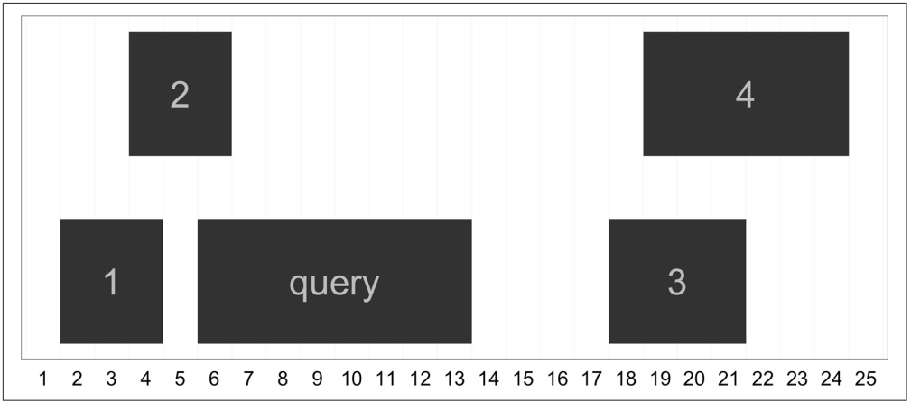
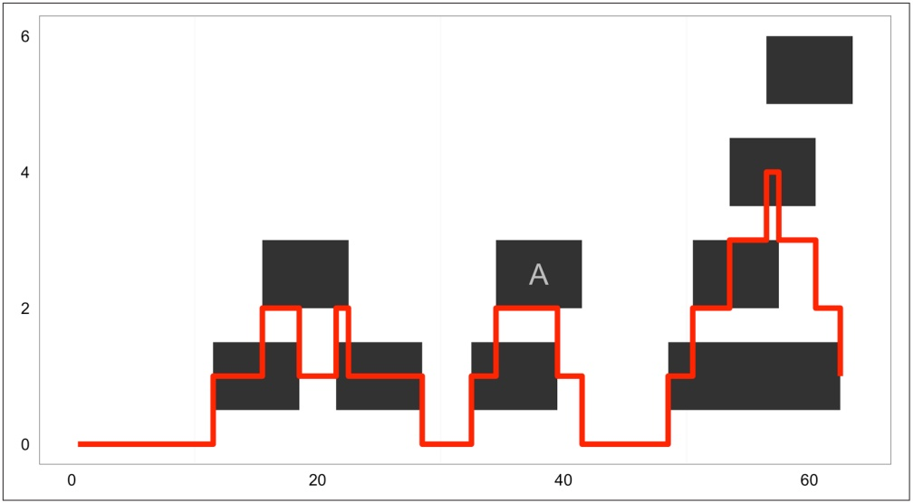

<details>
<summary>treemap</summary>

| Block | X Range | Y Range |
| --- | --- | --- |
| 1 | 1~4 | 0~1 |
| 2 | 4~6 | 1~3 |
| query | 6~13 | 0~1 |
| 3 | 18~21 | 0~1 |
| 4 | 18~25 | 1~3 |
</details>

Figure 9-16. The ranges used in nearest, precede, and follow example

Note too that these operations are all vectorized, so you can provide a query IRanges object with multiple ranges:

```txt
> qry2 <- IRanges(start=c(6, 7), width=3)
> nearest(qry2, sbj)
[1] 2 2
```

This family of functions for finding nearest ranges also includes distan ceToNearest() and distance(), which return the distance to the nearest range and the pairwise distances between ranges. We’ll create some random ranges to use in this example:

```c
> qry <- IRanges(sample(seq_len(1000), 5), width=10)
> sbj <- IRanges(sample(seq_len(1000), 5), width=10)
> qry
IRanges of length 5
    start end width
[1]   897 906    10
[2]   266 275    10
[3]   372 381    10
[4]   572 581    10
[5]   905 914    10
> sbj
IRanges of length 5
    start end width
[1]   202 211    10
[2]   898 907    10
[3]   943 952    10
[4]   659 668    10
[5]   627 636    10
```

Now, let’s use distanceToNearest() to find neighboring ranges. It works a lot like findOverlaps()—for each query range, it finds the closest subject range, and returns everything in a Hits object with an additional column indicating the distance:

<div class="docvortex-algorithm" style="white-space: pre-wrap; font-family:monospace;">
&gt; distanceToNearest(qry, sbj)
Hits of length 5
queryLength: 5
subjectLength: 5
    queryHits subjectHits distance
    &lt;integer&gt;      &lt;integer&gt; &lt;integer&gt;
1         1          2        0
2         2          1       54
3         3          1       160
4         4          5       45
5         5          2       0
</div>

The method distance() returns each pairwise distance between query and subject ranges:

<div class="docvortex-algorithm" style="white-space: pre-wrap; font-family:monospace;">
&gt; distance(qry, sbj)
[1] 685 622 561 77 268
</div>

## Run Length Encoding and Views

The generic ranges implemented by IRanges can be ranges over any type of sequence. In the context of genomic data, these ranges’ coordinates are based on the underlying nucleic acid sequence of a particular chromosome. Yet, many other types of genomic data form a sequence of numeric values over each position of a chromosome sequence. Some examples include:

• Coverage, the depth of overlap of ranges across the length of a sequence. Coverage is used extensively in genomics, from being an important factor in how variants are called to being used to discover coverage peaks that indicate the presence of some feature (as in a ChIP-seq study).
• Conservation tracks, which are base-by-base evolutionary conservation scores between species, generated by a program like phastCons (see Siepel et al., 2005 as an example).
• Per-base pair estimates of population genomics summary statistics like nucleotide diversity.

In this section, we’ll take a closer look at working with coverage data, creating ranges from numeric sequence data, and a powerful abstraction called views. Each of these concepts provides a powerful new way to manipulate sequence and range data. However, this section is a bit more advanced than earlier ones; if you’re feeling overwhelmed, you can skim the section on coverage and then skip ahead to “Storing Genomic Ranges with GenomicRanges” on page 299.

## Run-length encoding and coverage()

Long sequences can grow quite large in memory. For example, a track containing numeric values over each of the 248,956,422 bases of chromosome 1 of the human genome version GRCh38 would be 1.9Gb in memory. To accommodate working with data this size in R, IRanges can work with sequences compressed using a clever trick: it compresses runs of the same value. For example, imagine a sequence of integers that represent the coverage of a region in a chromosome:

```txt
4 4 4 3 3 2 1 1 1 1 1 0 0 0 0 0 0 0 0 1 1 1 4 4 4 4 4 4 4
```

Data like coverage often exhibit runs: consecutive stretches of the same value. We can compress these runs using a scheme called run-length encoding. Run-length encoding compresses this sequence, storing it as: 3 fours, 2 threes, 1 two, 5 ones, 7 zeros, 3 ones, 7 fours. Let’s see how this looks in R:

```txt
> x <- as.integer(c(4, 4, 4, 3, 3, 2, 1, 1, 1, 1, 1, 0, 0, 0,
                                      0, 0, 0, 0, 1, 1, 1, 4, 4, 4, 4, 4, 4, 4))
> xrle <- Rle(x)
> xrle
integer-Rle of length 28 with 7 runs
    Lengths: 3 2 1 5 7 3 7
    Values : 4 3 2 1 0 1 4
```

The function Rle() takes a vector and returns a run-length encoded version. Rle() is a function from a low-level Bioconductor package called S4Vectors, which is automatically loaded with IRanges. We can revert back to vector form with as.vector():

```txt
> as.vector(xrle)
[1] 4 4 4 3 3 2 1 1 1 1 1 0 0 0 0 0 0 0 1 1 1 4 4 4 4 4 4 4
```

Run-length encoded objects support most of the basic operations that regular R vectors do, including subsetting, arithemetic and comparison operations, summary functions, and math functions:

```snap
> xrle + 4L
integer-Rle of length 28 with 7 runs
 Lengths: 3 2 1 5 7 3 7
 Values : 8 7 6 5 4 5 8
> xrle/2
numeric-Rle of length 28 with 7 runs
 Lengths:   3   2   1   5   7   3   7
 Values :   2 1.5   1 0.5   0 0.5   2
> xrle > 3
logical-Rle of length 28 with 3 runs
 Lengths:     3    18      7
 Values : TRUE FALSE TRUE
> xrle[xrle > 3]
numeric-Rle of length 11 with 3 runs
 Lengths:   3   1   7
 Values :   4 100   4
> sum(xrle)
```

<div class="docvortex-algorithm" style="white-space: pre-wrap; font-family:monospace;">
[1] 56
&gt; summary(xrle)
    Min. 1st Qu.   Median      Mean 3rd Qu.     Max.
    0.00      0.75      1.00      2.00       4.00       4.00
&gt; round(cos(xrle), 2)
numeric-Rle of length 28 with 7 runs
    Lengths:      3       2       1       5       7       3       7
    Values : -0.65 -0.99 -0.42  0.54       1  0.54 -0.65
</div>

We can also access an Rle object’s lengths and values using the functions run Lengths() and runValues():

<div class="docvortex-algorithm" style="white-space: pre-wrap; font-family:monospace;">
&gt; runLength(xrle)
[1] 3 2 1 5 7 3 7
&gt; runValue(xrle)
[1] 4 3 2 1 0 1 4
</div>

While we don’t save any memory by run-length encoding vectors this short, runlength encoding really pays off with genomic-sized data.

One place where we encounter run-length encoded values is in working with cover age(). The coverage() function takes a set of ranges and returns their coverage as an Rle object (to the end of the rightmost range). Simulating 70 random ranges over a sequence of 100 positions:

<div class="docvortex-algorithm" style="white-space: pre-wrap; font-family:monospace;">
&gt; set.seed(0)
&gt; rngs &lt;- IRanges(start=sample(seq_len(60), 10), width=7)
&gt; names(rngs)[9] &lt;- "A" # label one range for examples later
&gt; rngs_cov &lt;- coverage(rngs)
&gt; rngs_cov
integer-Rle of length 63 with 18 runs
Lengths: 11 4 3 3 1 6 4 2 5 2 7 2 3 3 1 3 2 1
Values : 0 1 2 1 2 1 0 1 2 1 0 1 2 3 4 3 2 1
</div>

These ranges and coverage can be seen in Figure 9-17 (as before, the y position of the ranges does not mean anything; it’s chosen so they can be viewed without overlapping).



<details>
<summary>bar_stacked</summary>

| X | Value |
| --- | --- |
| 0 | 0 |
| ~12 | 1 |
| ~15 | 2 |
| ~18 | 1 |
| ~22 | 2 |
| ~25 | 1 |
| ~30 | 0 |
| ~35 | 1 |
| ~38 | 2 |
| ~42 | 1 |
| ~45 | 0 |
| ~50 | 1 |
| ~53 | 2 |
| ~55 | 3 |
| ~57 | 4 |
| ~60 | 2 |
| ~62 | 6 |
</details>

Figure 9-17. Ranges and their coverage plotted

In Chapter 8, we saw how powerful R’s subsetting is at allowing us to extract and work with specific subsets of vectors, matrices, and dataframes. We can work with subsets of a run-length encoded sequence using similar semantics:

```txt
> rngs_cov > 3  # where is coverage greater than 3?
logical-Rle of length 63 with 3 runs
  Lengths:    56     1      6
  Values : FALSE  TRUE FALSE
> rngs_cov[as.vector(rngs_cov) > 3]  # extract the depths that are greater than 3
integer-Rle of length 1 with 1 run
  Lengths: 1
  Values : 4
```

Additionally, we also have the useful option of using IRanges objects to extract subsets of a run-length encoded sequence. Suppose we wanted to know what the coverage was in the region overlapping the range labeled “A” in Figure 9-17. We can subset Rle objects directly with IRanges objects:

```txt
> rngs_cov[rngs['A']]
integer-Rle of length 7 with 2 runs
Lengths: 5 2
Values : 2 1
```

If instead we wanted the mean coverage within this range, we could simply pass the result to mean():

```txt
> mean(rngs_cov[rngs['A']])
[1] 1.714286
```

Numerous analysis tasks in genomics involve calculating a summary of some sequence (coverage, GC content, nucleotide diversity, etc.) for some set of ranges (repetitive regions, protein coding sequences, low-recombination regions, etc.). These calculations are trivial once our data is expressed as ranges and sequences, and we use the methods in IRanges. Later in this chapter, we’ll see how GenomicRanges provides nearly identical methods tailored to these tasks on genomic data.

## Going from run-length encoded sequences to ranges with slice()

Earlier, we used rngs\_cov > 3 to create a run-length encoded vector of TRUE/FALSE values that indicate whether the coverage for a position was greater than 3. Suppose we wanted to now create an IRanges object containing all regions where coverage is greater than 3. What we want is an operation that’s the inverse of using ranges to subset a sequence—using a subset of sequence to define new ranges. In genomics, we use these types of operations that define new ranges quite frequently—for example, taking coverage and defining ranges corresponding to extremely high-coverage peaks, or a map of per-base pair recombination estimates and defining a recombinational hotspot region.

It’s very easy to create ranges from run-length encoded vectors. The function slice() takes a run-length encoded numeric vector (e.g., of coverage) as its argument and slices it, creating a set of ranges where the run-length encoded vector has some minimal value. For example, we could take our coverage Rle object rngs\_cov and slice it to create ranges corresponding to regions with more than 2x coverage:

```txt
> min_cov2 <- slice(rngs_cov, lower=2)
> min_cov2
Views on a 63-length Rle subject

views:
    start end width
[1]     16  18      3 [2 2 2]
[2]     22  22      1 [2]
[3]     35  39      5 [2 2 2 2 2]
[4]     51  62      12 [2 2 2 3 3 3 4 3 3 3 2 2]
```

This object that’s returned is called a view. Views combine a run-length encoded vectors and ranges, such that each range is a “view” of part of the sequence. In this case, each view is a view on to the part of the sequence that has more than 2x coverage. The numbers to the right of the ranges are the underlying elements of the run-length encoded vector in this range. If you’re simply interested in ranges, it’s easy to extract out the underlying ranges:

```txt
> ranges(min_cov2)
IRanges of length 4
    start end width
[1]     16   18      3
[2]     22   22      1
```

```txt
[3]    35  39    5
[4]    51  62    12
```

The slice() method is quite handy when we need to define coverage peaks—regions where coverage of experimental data like aligned reads is high such that could indicate something biologically interesting. For example, after looking at a histogram of genome-wide coverage, we could define a coverage threshold that encapsulates outliers, use slice() to find the regions with high coverage, and then see where these regions fall and if they overlap other interesting biological features.

## Advanced IRanges: Views

Before we go any further, the end of this section goes into some deeper, slightly more complex material. If you’re struggling to keep up at this point, it may be worth skipping to “Storing Genomic Ranges with GenomicRanges” on page 299 and coming back later to this section.

OK, intrepid reader, let’s dig a bit deeper into these Views objects we saw earlier. While they may seem a bit strange at first, views are incredibly handy. By combining a sequence vector and ranges, views simplify operations that involve aggregating a sequence vector by certain ranges. In this way, they’re similar to calculating per-group summaries as we did in Chapter 8, but groups are ranges.

For example, we could summarize the views we created earlier using slice() using functions like viewMeans(), viewMaxs(), and even viewApply(), which applies an arbitrary function to views:

```txt
> viewMeans(min_cov2)
[1] 2.000000 2.000000 2.000000 2.666667
> viewMaxs(min_cov2)
[1] 2 2 2 4
> viewApply(min_cov2, median)
[1] 2 2 2 3
```

Each element of these returned vectors is a summary of a range’s underlying runlength encoded vector (in this case, our coverage vector min\_cov2 summarized by the ranges we carved out using slice()). Also, there are a few other built-in view summarization methods; see help(viewMeans) for a full list.

Using Views, we can also create summaries of sequences by window/bin. In the views lingo, we create a set of ranges for each window along a sequence and then summarize the views onto the underlying sequence these windows create. For example, if we wanted to calculate the average coverage for windows 5-positions wide:

```r
> length(rngs_cov) ①
[1] 63
> bwidth <- 5L ②
> end <- bwidth * floor(length(rngs_cov) / bwidth) ③
> windows <- IRanges(start=seq(1, end, bwidth), width=bwidth) ④
```

```txt
> head(windows)
IRanges of length 6
    start end width
[1]     1   5       5
[2]     6  10       5
[3]     11  15       5
[4]     16  20       5
[5]     21  25       5
[6]     26  30       5
> cov_by_wnd <- Views(rngs_cov, windows) ⑤
> head(cov_by_wnd)
Views on a 63-length Rle subject

views:
    start end width
[1]     1   5       5 [0 0 0 0 0]
[2]     6  10       5 [0 0 0 0 0]
[3]     11  15       5 [0 1 1 1 1]
[4]     16  20       5 [2 2 2 1 1]
[5]     21  25       5 [1 2 1 1 1]
[6]     26  30       5 [1 1 1 0 0]
> viewMeans(cov_by_wnd) ⑥
[1] 0.0 0.0 0.8 1.6 1.2 0.6 0.8 1.8 0.2 0.4 2.4 3.2
```

There’s a bit of subtle arithmetic going on here, so let’s step through piece by piece.

1 First, note that our coverage vector is 63 elements long. We want to create consecutive windows along this sequence, with each window containing 5 elements. If we do so, we’ll have 3 elements of the coverage vector hanging off the end (63 divided by 5 is 12, with a remainder of 3). These overhanging ends are a common occurrence when summarizing data by windows, and it’s common to just ignore these last elements. While cutting these elements off seems like a strange approach, a summary calculated over a smaller range will have a higher variance that can lead to strange results. Dropping this remainder is usually the simplest and best option.
We’ll set bwidth to be our bin width.
Now, we compute the end position of our window. To do so, we divide our coverage vector length by the bin width, and chop off the remainder using the floor() function. Then, we multiply by the bin width to give the end position.
4 Next, we create our windows using IRanges. We use seq() to generate the start positions: a start position from 1 to our end (60, as we just programmatically calculated), moving by 5 each time. If we wanted a different window step width, we could change the third (by) argument of seq() here. With our start position specified, we simply set width=bwidth to give each window range a width of 5.

With our run-length encoded coverage vector and our windows as IRanges objects, we create our Views object. Views effectively groups each element of the coverage vector rngs\_cov inside a window.
Finally, we compute summaries on these Views. Here we use viewMeans() to get the mean coverage per window. We could use any other summarization view method (e.g., viewMaxs(), viewSums(), etc.) or use viewApply() to apply any function to each view.

Summarizing a sequence of numeric values by window over a sequence such as a chromosome is a common task in genomics. The techniques used to implement the generic solution to this problem with ranges, run-length encoded vectors, and views are directly extensible to tackling this problem with real genomics data.

Because GenomicRanges extends IRanges, everything we’ve learned in the previous sections can be directly applied to the genomic version of an IRanges object, GRanges. None of the function names nor behaviors differ much, besides two added complications: dealing with multiple chromosomes and strand. As we’ll see in the next sections, GenomicRanges manages these complications and greatly simplifies our lives when working with genomic data.

## Storing Genomic Ranges with GenomicRanges

The GenomicRanges package introduces a new class called GRanges for storing genomic ranges. The GRanges builds off of IRanges. IRanges objects are used to store ranges of genomic regions on a single sequence, and GRanges objects contain the two other pieces of information necessary to specify a genomic location: sequence name (e.g., which chromosome) and strand. GRanges objects also have metadata columns, which are the data linked to each genomic range. We can create GRanges objects much like we did with IRanges objects:

```txt
> library(GenomicRanges)
> gr <- GRanges(seqname=c("chr1", "chr1", "chr2", "chr3"),
                   ranges=IRanges(start=5:8, width=10),
                   strand=c("+", "-", "-", "+"))
> gr
GRanges with 4 ranges and 0 metadata columns:
    seqnames      ranges strand
        <Rle> <IRanges>   <Rle>
[1]     chr1    [5, 14]     +
[2]     chr1    [6, 15]     -
[3]     chr2    [7, 16]     -
[4]     chr3    [8, 17]     +
---
seqlengths:
```

```txt
chr1 chr2 chr3
    NA    NA    NA
```

Using the GRanges() constructor, we can also add arbitrary metadata columns by specifying additional named arguments:

```txt
> gr <- GRanges(seqname=c("chr1", "chr1", "chr2", "chr3"),
        ranges=IRanges(start=5:8, width=10),
        strand=c("+", "-", "-", "+"), gc=round(runif(4), 3))
> gr
GRanges with 4 ranges and 1 metadata column:
    seqnames      ranges strand |       gc
        <Rle> <IRanges>  <Rle> | <numeric>
[1]     chr1   [5, 14]      + |      0.897
[2]     chr1   [6, 15]      - |      0.266
[3]     chr2   [7, 16]      - |      0.372
[4]     chr3   [8, 17]      + |      0.573
---
seqlengths:
    chr1 chr2 chr3
        NA    NA    NA
```

This illustrates the structure of GRanges objects: genomic location specified by sequence name, range, and strand (on the left of the dividing bar), and metadata columns (on the right). Each row of metadata corresponds to a range on the same row.

All metadata attached to a GRanges object are stored in a DataFrame, which behaves identically to R’s base data.frame, but supports a wider variety of column types. For example, DataFrames allow for run-length encoded vectors to save memory (whereas R’s base data.frame does not). Whereas in the preceding example metadata columns are used to store numeric data, in practice we can store any type of data: identifiers and names (e.g., for genes, transcripts, SNPs, or exons), annotation data (e.g., conservation scores, GC content, repeat content, etc.), or experimental data (e.g., if ranges correspond to alignments, data like mapping quality and the number of gaps). As we’ll see throughout the rest of this chapter, the union of genomic location with any type of data is what makes GRanges so powerful.

Also, notice seqlengths in the gr object we’ve just created. Because GRanges (and genomic range data in general) is always with respect to a particular genome version, we usually know beforehand what the length of each sequence/chromosome is. Knowing the length of chromosomes is necessary when computing coverage and gaps (because we need to know where the end of the sequence is, not just the last range). We can specify the sequence lengths in the GRanges constructor, or set it after the object has been created using the seqlengths() function:

```python
> seqlens <- c(chr1=152, chr2=432, chr3=903)
> gr <- GRanges(seqname=c("chr1", "chr1", "chr2", "chr3"),
                  ranges=IRanges(start=5:8, width=10),
                  strand=c("+", "-", "-", "+"),
```

```txt
gc=round(runif(4), 3),
    seqlengths=seqlens)
> seqlengths(gr) <- seqlens # another way to do the same as above
> gr
GRanges with 4 ranges and 1 metadata column:
    seqnames      ranges strand |     gc
        <Rle> <IRanges>   <Rle> | <numeric>
[1]     chr1    [5, 14]       + |     0.897
[2]     chr1    [6, 15]       - |     0.266
[3]     chr2    [7, 16]       - |     0.372
[4]     chr3    [8, 17]       + |     0.573
---
seqlengths:
    chr1 chr2 chr3
    152  432 903
```

We access data in GRanges objects much like we access data from IRanges objects: with accessor functions. Accessors for start position, end position, and width are the same as with IRanges object:

```txt
> start(gr)
[1] 5 6 7 8
> end(gr)
[1] 14 15 16 17
> width(gr)
[1] 10 10 10 10
```

For the GRanges-specific data like sequence name and strand, there are new accessor functions—seqnames and strand:

```txt
> seqnames(gr)
factor-Rle of length 4 with 3 runs
  Lengths:   2   1   1
  Values : chr1 chr2 chr3
Levels(3): chr1 chr2 chr3
> strand(gr)
factor-Rle of length 4 with 3 runs
  Lengths: 1 2 1
  Values : + - +
Levels(3): + - *
```

The returned objects are all run-length encoded. If we wish to extract all IRanges ranges from a GRanges object, we can use the ranges accessor function:

```txt
> ranges(gr)
IRanges of length 4
    start end width
[1]     5  14    10
[2]     6  15    10
[3]     7  16    10
[4]     8  17    10
```

Like most objects in R, GRanges has a length that can be accessed with length(), and supports names:

```asm
> length(gr)
[1] 4
> names(gr) <- letters[1:length(gr)]
> gr
GRanges with 4 ranges and 1 metadata column:
    seqnames      ranges strand |        gc
        <Rle> <IRanges>  <Rle> | <numeric>
    a     chr1   [5, 14]       + |       0.897
    b     chr1   [6, 15]       - |       0.266
    c     chr2   [7, 16]       - |       0.372
    d     chr3   [8, 17]       + |       0.573
    ---
    seqlengths:
        chr1 chr2 chr3
        100  100  100
```

The best part of all is that GRanges objects support the same style of subsetting you’re already familiar with (i.e., from working with other R objects like vectors and dataframes). For example, if you wanted all ranges with a start position greater than 7:

```txt
> start(gr) > 7
[1] FALSE FALSE FALSE  TRUE
> gr[start(gr) > 7]
GRanges with 1 range and 1 metadata column:
    seqnames   ranges strand |      gc
        <Rle> <IRanges>  <Rle> | <numeric>
    d     chr3   [8, 17]      + |      0.573
  ---
  seqlengths:
    chr1 chr2 chr3
      100  100  100
```

Once again, there’s no magic going on; GRanges simply interprets a logical vector of TRUE/FALSE values given by start(gr) > 7 as which rows to include/exclude. Using the seqname() accessor, we can count how many ranges there are per chromosome and then subset to include only ranges for a particular chromosome:

```txt
> table(seqnames(gr))

chr1 chr2 chr3
  2   1   1
> gr[seqnames(gr) == "chr1"]
GRanges with 2 ranges and 1 metadata column:
    seqnames     ranges strand |      gc
      <Rle> <IRanges>  <Rle> | <numeric>
a     chr1    [5, 14]       + |      0.897
b     chr1    [6, 15]       - |      0.266
---
seqlengths:
```

```txt
chr1 chr2 chr3
 100  100  100
```

The mcols() accessor is used access metadata columns:

```txt
> mcols(gr)
DataFrame with 4 rows and 1 column
        gc
    <numeric>
1       0.897
2       0.266
3       0.372
4       0.573
```

Because this returns a DataFrame and DataFrame objects closely mimic data.frame, \$ works to access specific columns. The usual syntactic shortcut for accessing a column works too:

```txt
> mcols(gr)$gc
[1] 0.897 0.266 0.372 0.573
> gr$gc
[1] 0.897 0.266 0.372 0.573
```

The real power is when we combine subsetting with the data kept in our metadata columns. Combining these makes complex queries trivial. For example, we could easily compute the average GC content of all ranges on chr1:

```txt
> mcols(gr[seqnames(gr) == "chr1")]$gc
[1] 0.897 0.266
> mean(mcols(gr[seqnames(gr) == "chr1")]$gc)
[1] 0.5815
```

If we wanted to find the average GC content for all chromosomes, we would use the same split-apply-combine strategy we learned about in Chapter 9. We’ll see this later on.

## Grouping Data with GRangesList

In Chapter 8, we saw how R’s lists can be used to group data together, such as after using split() to split a dataframe by a factor column. Grouping data this way is useful for both organizing data and processing it in chunks. GRanges objects also have their own version of a list, called GRangesList, which are similar to R’s lists. GRanges Lists can be created manually:

```txt
> gr1 <- GRanges(c("chr1", "chr2"), IRanges(start=c(32, 95), width=c(24, 123)))
> gr2 <- GRanges(c("chr8", "chr2"), IRanges(start=c(27, 12), width=c(42, 34)))
> gr1 <- GRangesList(gr1, gr2)
> gr1
GRangesList of length 2:
[[1]]
GRanges with 2 ranges and 0 metadata columns:
```

```txt
seqnames   ranges strand
        <Rle> <IRanges>  <Rle>
[1]     chr1 [32,  55]      *
[2]     chr2 [95, 217]      *

[[2]]
GRanges with 2 ranges and 0 metadata columns:
    seqnames  ranges strand
[1]     chr8 [27, 68]      *
[2]     chr2 [12, 45]      *

---
seqlengths:
chr1 chr2 chr8
NA    NA    NA
```

GRangesList objects behave almost identically to R’s lists:

```txt
> unlist(grl) ①
GRanges with 4 ranges and 0 metadata columns:
        seqnames    ranges strand
            <Rle> <IRanges>  <Rle>
[1]     chr1 [32,  55]      *
[2]     chr2 [95, 217]      *
[3]     chr8 [27,  68]      *
[4]     chr2 [12,  45]      *
---
seqlengths:
    chr1 chr2 chr8
        NA   NA   NA

> doubled_grl <- c(grl, grl) ②
> length(doubled_grl)
[1] 4
```

1 unlist() combines all GRangesList elements into a single GRanges object (much like unlisting an R list of vectors to create one long vector).
We can combine many GRangesList objects with c().

Accessing certain elements works exactly as it did with R’s lists. Single brackets return GRangesList objects, and double brackets return what’s in a list element—in this case, a GRanges object:

```python
> doubled_grl[2]
GRangesList of length 1:
[[1]]
GRanges with 2 ranges and 0 metadata columns:
    seqnames   ranges strand
        <Rle> <IRanges>  <Rle>
[1]     chr8 [27, 68]      *
[2]     chr2 [12, 45]      *
```

```yaml
---
seqlengths:
  chr1 chr2 chr8
    NA   NA   NA
> doubled_grl[[2]]
GRanges with 2 ranges and 0 metadata columns:
    seqnames   ranges strand
      <Rle> <IRanges>  <Rle>
[1]     chr8 [27, 68]     *
[2]     chr2 [12, 45]     *
---
seqlengths:
  chr1 chr2 chr8
    NA   NA   NA
```

Like lists, we can also give and access list element names with the function names(). GRangesList objects also have some special features. For example, accessor functions for GRanges data (e.g., seqnames(), start(), end(), width(), ranges(), strand(), etc.) also work on GRangesList objects:

```txt
> seqnames(grl)
RleList of length 2
[[1]]
factor-Rle of length 2 with 2 runs
    Lengths:   1   1
    Values : chr1 chr2
Levels(3): chr1 chr2 chr8

[[2]]
factor-Rle of length 2 with 2 runs
    Lengths:   1   1
    Values : chr8 chr2
Levels(3): chr1 chr2 chr8

> start(grl)
IntegerList of length 2
[[1]] 32 95
[[2]] 27 12
```

Note the class of object Bioconductor uses for each of these: RleList and Integer List. While these are classes we haven’t seen before, don’t fret—both are analogous to GRangesList: a list for a specific type of data. Under the hood, both are specialized, low-level data structures from the S4Vectors package. RleList are lists for runlength encoded vectors, and IntegerList objects are lists for integers (with added features). Both RleList and IRangesList are a bit advanced for us now, but suffice to say they behave a lot like R’s lists and they’re useful for intermediate and advanced GenomicRanges users. I’ve included some resources about these in the README file in this chapter’s directory on GitHub.

In practice, we’re usually working with too much data to create GRanges objects manually with GRangesList(). More often, GRangesLists come about as the result of using the function split() on GRanges objects. For example, I’ll create some random GRanges data, and demonstrate splitting by sequence name:

```txt
> chrs <- c("chr3", "chr1", "chr2", "chr2", "chr3", "chr1")
> gr <- GRanges(chrs, IRanges(sample(1:100, 6, replace=TRUE),
                    width=sample(3:30, 6, replace=TRUE)))
> head(gr)
GRanges with 6 ranges and 0 metadata columns:
        seqnames     ranges strand
            <Rle> <IRanges>  <Rle>
[1]      chr3 [90,  93]       *
[2]      chr1 [27,  34]       *
[3]      chr2 [38,  44]       *
[4]      chr2 [58,  79]       *
[5]      chr3 [91, 103]       *
[6]      chr1 [21,  44]       *
---
seqlengths:
    chr3 chr1 chr2
        NA   NA   NA

> gr_split <- split(gr, seqnames(gr))
> gr_split[[1]]
GRanges with 4 ranges and 0 metadata columns:
        seqnames     ranges strand
            <Rle> <IRanges>  <Rle>
[1]      chr3 [90,  93]       *
[2]      chr3 [91, 103]       *
[3]      chr3 [90, 105]       *
[4]      chr3 [95, 117]       *
---
seqlengths:
    chr3 chr1 chr2
        NA   NA   NA
> names(gr_split)
[1] "chr3" "chr1" "chr2"
```

Bioconductor also provides an unsplit() method to rejoin split data on the same factor that was used to split it. For example, because we created gr\_split by splitting on seqnames(gr), we could unsplit gr\_split with unsplit(gr\_split, seq names(gr)).

So why split GRanges objects into GRangesList objects? The primary reason is that GRangesList objects, like R’s base lists, are a natural way to group data. For example, if we had a GRanges object containing all exons, we may want to work with exons grouped by what gene or transcript they belong to. With all exons grouped in a GRangesList object, exons for a particular gene or transcript can be returned by accessing a particular list element.