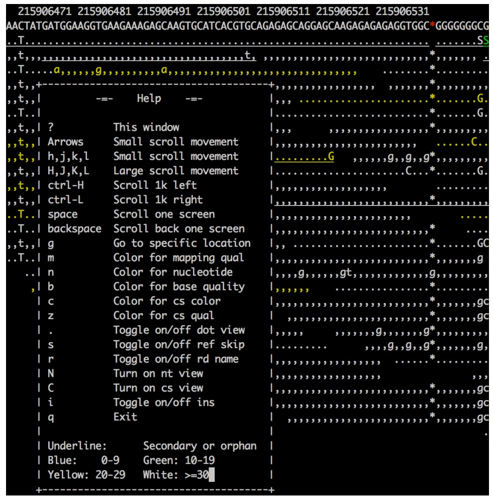
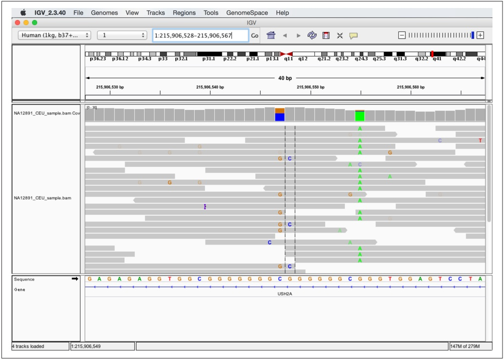
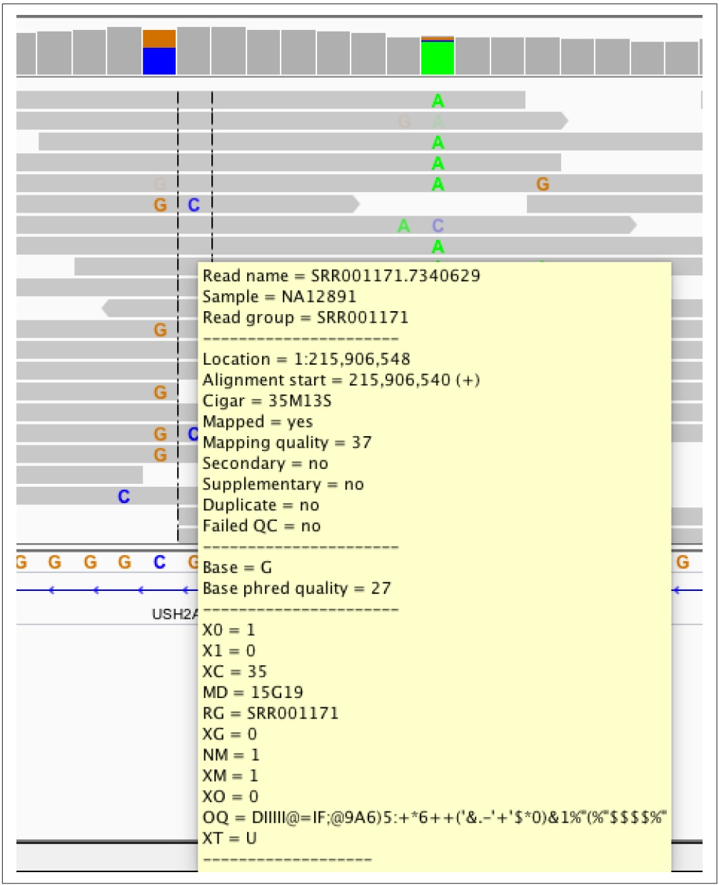

## SAM Bitwise Flags and SAM Fields

It’s vital to consider how some bitflags may affect other bitflags (technically speaking, some bitflags are non-orthogonal). Similarly, if some bitflags are set, certain SAM fields may no longer apply.

For example, 0x4 (unmapped) is the only reliable way to tell if an alignment is unaligned. In other words, one cannot tell if a read is aligned by looking at fields such as mapped position (POS and reference RNAME); the SAM format specification does not limit these fields’ values if a read is unaligned. If the 0x4 bit is set (meaning the read is unmapped), the fields regarding alignment including position, CIGAR string, mapping quality, and reference name are not relevant and their values cannot be relied upon. Similarly, if the 0x4 bit is set, bits that only apply to mapped reads such as 0x2 (proper pair), 0x10 (aligned to reverse strand), and others cannot be relied upon. The primary lesson is you should carefully consider all flags that may apply when working with SAM entries, and start with low-level attributes (whether it’s aligned, paired). See the SAM format specification for more detail on bitflags.

Instead, we want to make sure the unmapped (0x4) and proper paired bits are unset (so the read is aligned and paired), and the paired end bit is set (so the read is not in a proper pair). We do this by combining bits:

```txt
$ samtools flags paired
0x1      1       PAIRED
$ samtools flags unmap,proper_pair
0x6      6       PROPER_PAIR,UNMAP
$ samtools view -F 6 -f 1 NA12891_CEU_sample.bam | head -n 3
SRR003208.1496374   137  1  215623168  0  35M16S =  215623168  [...]
ERR002297.5178166   177  1  215623174  0  36M    =  215582813  [...]
SRR002141.16953736  121  1  215623191  0  7S44M =  215623191  [...]
```

One way to verify that these results make sense is to check the counts (note that this may be very time consuming for large files). In this case, our total number of reads that are mapped and paired should be equal to the sum of the number of reads that are mapped, paired, and properly paired, and the number of reads that are mapped, paired, and not properly paired:

```txt
$ samtools view -F 6 NA12891_CEU_sample.bam | wc -l # total mapped and paired
233628
$ samtools view -F 7 NA12891_CEU_sample.bam | wc -l # total mapped, paired,
201101
# proper paired
$ samtools view -F 6 -f 1 NA12891_CEU_sample.bam | wc -l # total mapped, paired,
32527
# and not proper paired
$ echo "201101 + 32527" | bc
233628
```

Summing these numbers with the command-line bench calculator bc validates that our totals add up. Also, for set operations like this drawing a Venn diagram can help you reason through what’s going on.

## Visualizing Alignments with samtools tview and the Integrated Genomics Viewer

As we saw in Chapter 8, we can learn a lot about our data through visualization. The same applies with alignment data: one of the best ways to explore alignment data is through visualization. The samtools suite includes the useful tview subcommand for quickly looking at alignments in your terminal. We’ll take a brief look at tview first, then look at the Broad Institute’s Integrated Genomics Viewer (IGV) application.

samtools tview requires position-sorted and indexed BAM files as input. We already indexed the position-sorted BAM file NA12891\_CEU\_sample.bam (in this chapter’s GitHub directory) in “Extracting alignments from a region with samtools view” on page 368, so we’re ready to visualize it with samtools tview. samtools tview can also load the reference genome alongside alignments so the reference sequence can be used in comparisons. The reference genome file used to align the reads in NA12891\_CEU\_sample.bam is human\_g1k\_v37.fasta, and although it’s too large to include in this chapter’s GitHub directory, it can be easily downloaded (see the directory’s README.md for directions). So to view these alignments with samtools tview, we use:

\$ samtools tview NA12891\_CEU\_sample.bam human\_g1k\_v37.fasta

However, this will view the very beginning of a chromosome; because NA12891\_CEU\_sample.bam is a subset of reads, let’s go to a specific region with the option -p:

\$ samtools tview -p 1:215906469-215906652 NA12891\_CEU\_sample.bam \ human\_g1k\_v37.fasta

This will open up a terminal-based application. samtools tview has many options to navigate around, jump to particular regions, and change the output format and colors of alignments; press ? to see these options (and press again to close the help screen). Figure 11-1 shows an example of what tview looks like.



<details>
<summary>text_image</summary>

215906471 215906481 215906491 215906501 215906511 215906521 215906531
AACTATGATGGAAGGTGAAGAAAGAGCAAGTGCATCACGTGCAGAGAGCAGGAGCAAGAGAGAGAGGTGGC*GGGGGGCG
..T...........S
,,t,,,,,,,,,,,,,,,,,,,,,,,*,,,,,,,,,
..T......a,,,,g,,,,,,a,,,,,,,,,,,, ........*...........
,,t,,+----------+,,,,,,,,,,,,,,,,,,,,,,*,,,,,,,,,
,,t,,|      -- Help   --- |,,, ...........*........G.
..T..l                      |...........*........G.
,,t,,| ?          This window |,,, ,,,,,,,,,,,,,,,*,,,,,,,,
,,t,,| Arrows      Small scroll movement |,,,,,,,,,,,,,,,,, ....C..
,,t,,| h,j,k,l      Small scroll movement |........G ,,,,,g,,g,,g*,,,,,,,,,
,,t,,| H,J,K,L      Large scroll movement |............C...*........G.
,,t,,| ctrl-H      Scroll 1k left |,,,,,,,,,,,,,,,,, .............
,,t,,| ctrl-L      Scroll 1k right |,,,,,,,,,,,,*,,,,,,,,,
..T..l space      Scroll one screen |,,,,,,,,,,,,,,,,,,,, ....
..T..l backspace      Scroll back one screen |,,,,,,,,,,,,,,,,,,,,*, ....
,,t,,| g          Go to specific location |,,, ...........*........G
..T..l m          Color for mapping qual |,,,,,,,,,,,,,,,,,,,*,,,,,,g
..l n          Color for nucleotide |,,,g,,,,gt,,,,,,,g,,,,,,,,,
,| b          Color for base quality |,,,,, ...........*.........
| c          Color for cs color |,,,,,,,,,,,,,,,,,,,*,,,,,,gc
| z          Color for cs qual | ,,,,,,,,,,,,,,,,,*,,,,,,gc
| .          Toggle on/off dot view |,,, , ,,,,g,,,,g*,,,,,,,,
| s          Toggle on/off ref skip |........ ... ,,,,g,,g,,g*,,,,g,
| r          Toggle on/off rd name |,,,,,,,,,,,,,,,, ........*.........
| N          Turn on nt view |,,,,,,,,,,,,,,,,, ,,,
| C          Turn on cs view |,,,,,,,,,,,,,,,,*,,,,,,gc
| i          Toggle on/off ins |,,,,,,,,,,,,,,,,*,,,,,,gc
| q          Exit | ,,,,,,,,,,,,,***,*,,,,,,,gc
|
Underline: Secondary or orphan
Blue: 0-9 Green: 10-19
Yellow: 20-29 White: >=30
</details>

Figure 11-1. A region in samtools tview with the help dialog box open

As a command-line visualization program, samtools tview is great for quickly inspecting a few alignments. However, if you need to spend more time investigating alignments, variants, and insertions/deletions in BAM data, the Integrated Genomics Viewer (IGV) may be more well suited. As an application with a graphical user interface, IGV is easy to use. IGV also has numerous powerful features we won’t cover in this brief introduction, so I encourage you to explore IGV’s excellent documentation.

First, we need to install IGV. It’s distributed as a Java application, so you’ll need to have Java installed on your system. After Java is installed, you can install IGV through a package manager such as Homebrew on OS X or apt-get. See the README.md file in this chapter’s GitHub directory for more detail on installing IGV.

If you’ve installed IGV through Homebrew or apt-get, you can launch the application with:

\$ igv

The command igv calls a small shell script wrapper for the Java application and opens IGV.

Once in IGV, we need load our reference genome before loading our alignments. Reference genomes can be loaded from a file by navigating to Genomes → Load Genome from File, and then choosing your reference genome through the file browser. IGV also has prepared reference genomes for common species and versions; these can be accessed through Genomes → Load Genome From Server. Navigate to this menu and load the “Human (1kg, b37+decoy)” genome. This prepared genome file has some nice additional features used in display such as gene tracks and chromosome ideograms.

Once our reference genome is loaded, we can load in the BAM alignments in NA12891\_CEU\_sample.bam by navigating to File → Load from File and choosing the reference genome through the file browser. Note that you will not see any alignments, as this file contains a subset of alignments in a region IGV’s not currently focused on.

IGV’s graphical user interface provides many methods for navigation, zooming in and out of a chromosome, and jumping to particular regions. Let’s jump to a region that our alignments in NA12891\_CEU\_sample.bam overlap: 1:215,906,528-215,906,567 (there’s a copyable version of this region in this chapter’s README.md for convenience). Enter this region in the text box at the top of the window, and press Enter; this region should look like Figure 11-2.



<details>
<summary>text_image</summary>

IGV_2.3.40 File Genomes View Tracks Regions Tools GenomeSpace Help
Human (1kg, b37+... 1 1:215,906,528-215,906,567 Go IGV
p36.23 p36.12 p34.3 p33 p32.1 p31.1 p22.2 p21.1 p13.1 q11 q12 q21.2 q23.2 q24.3 q25.3 q31.3 q32.2 q41 q42.2 q44
40 bp
215,906,530 bp 215,906,540 bp 215,906,550 bp 215,906,560 bp
NA12891_CEU_sample.bam Cov
NA12891_CEU_sample.bam
Sequence
0ene
G A G A G A G G T G G C G G G G G G C G G G G G G C G G G T G G A G T C C T A
USH2A
4 tracks loaded 1:215,906,549 147M of 279M
</details>

Figure 11-2. A region in IGV that shows possible paralogous alignments

As shown in Figure 11-2, IGV shows an ideogram to indicate where on the chromosome the region is and base pair positions in the top pane, coverage and alignment tracks in the middle pane, and the sequence and gene track information in the bottom pane. The colored letters in alignments indicate bases mismatched between the read sequence and the reference. These mismatching bases can be caused either by sequencing errors, misalignment, errors in library preparation, or an authentic SNP. In this case, we might make a ballpark guess that the stacked mismatches at positions 215,906,547, 215,906,548 and 215,906,555 are true polymorphisms. However, let’s use some of IGV’s features to take a closer look, specifically at the variants around 215,906,547–215,906,548.

Let’s start our exploration by hovering over alignments in this region to reveal IGV’s pop-up window full of that alignment’s information (see Figure 11-3). This allows you to inspect useful information about each alignment such as the base qualities of mismatches and the alignment’s mapping quality. For example, hovering over the alignments in the region from 215,906,547–215,906,548 shows that some aligned with lower mapping quality.



<details>
<summary>text_image</summary>

Read name = SRR001171.7340629
Sample = NA12891
Read group = SRR001171
G
Location = 1:215,906,548
Alignment start = 215,906,540 (+)
Cigar = 35M13S
Mapped = yes
Mapping quality = 37
Secondary = no
Supplementary = no
Duplicate = no
Failed QC = no
Base = G
Base phred quality = 27
USH2A
X0 = 1
X1 = 0
XC = 35
MD = 15G19
RG = SRR001171
XG = 0
NM = 1
XM = 1
XO = 0
OQ = DIIIII@=IF;@9A6)5:+*6++('&.-'+'$*0)&1%"(%"$$$%^"
XT = U
</details>

Figure 11-3. IGV’s pop-up window of alignment information

We can also learn a lot about our variants by looking at which reads they are carried on. For the potential variants at 215,906,547 and 215,906,548, mismatches are carried on three categories of reads that span these positions:

• Reads with a reference base at 215,906,547 and a reference base at 215,906,548 (e.g., the first alignment from the top)
• Reads with a G and a reference base (e.g., the twelfth alignment from the top)
• Reads with a G and a C (e.g., the sixth alignment from the top)

A single read contains a single continuous stretch of DNA, so the presence of three different combinations of mismatching bases in these reads indicates three different haplotypes in this region (ignoring for the moment the possibility that these mismatches might be sequencing errors). Because these sequences come from a single diploid human individual, this indicates a likely problem—probably due to misalignment.

The mismatches in this region could be due to misalignment caused by reads from a different region in the genome aligning to this region due to similar sequence (creating that third haplotype). Misalignments of this nature can be caused by common repeats, paralogous sequences, or similar domains. Misalignments of this type are a major cause of false positive variant calls, and visual inspection with tools like IGV can greatly help in recognizing these issues. While somewhat tedious, manual inspection of alignment data is especially important for entries at the top of lists of significant variants. However, for this particular region, it’s more likely a different misalignment mishap is creating these mismatches that look like variants.

Note that IGV also displays the reference sequence track in the bottom pane, which gives us another clue as to what could be causing these variants. This region is composed of low-complexity sequences: GGCGGGGGGGCGGGGGGCGGG. Low-complexity sequences are composed of runs of bases or simple repeats, and are a major cause of erroneous variant calls (Li, 2014). In this low-complexity region, reads containing the mismatches G-C might actually contain an upstream G insertion. In low-complexity regions, an aligner may align a read with a single base mismatch rather than an indel, creating a false SNP. Indeed, there’s some evidence that this type of misalignment is occurring here: the only reads that carry the G-C mismatches are those that do not span the low-complexity region on the left.

Finally, it’s worth noting that in addition to being a low-complexity sequence, the base composition in this region might be a concern as well. GGC sequences are known to generate sequence-specific errors in some Illumina data (see Nakamura et al., 2011). We can inspect the sequencing platform metadata in the BAM header and indeed see that this data comes from an Illumina sequencer:

```batch
\$ samtools view -H NA12891_CEU_sample.bam | grep PL | tail -n 1
@RG ID:SRR035334 PL:ILLUMINA LB:Solexa-3628 [...] SM:NA12891 CN:BI
```

## Pileups with samtools pileup, Variant Calling, and Base Alignment Quality

In this section, we’ll discuss the pileup format, a plain-text format that summarizes reads’ bases at each chromosome position by stacking or “piling up” aligned reads. The per-base summary of the alignment data created in a pileup can then be used to identify variants (regions different from the reference), and determine sample individuals’ genotypes. samtools’s mpileup subcommand creates pileups from BAM files, and this tool is the first step in samtools-based variant calling pipelines. In this chapter, we’ll introduce the pileup format and samtools variant calling tools through simple examples that explore how the misalignments we saw in the previous section can lead to erroneous variant calls. We’ll also examine how samtools’s clever Base Alignment Quality algorithm can prevent erroneous variant calls due to misalignment. Note that this chapter is not meant to teach variant calling, as this subject is complex, procedures are project- and organism-specific, and methods will rapidly change with improvements to sequencing technology and advancement in variant calling methods.

To begin, let’s look at how a “vanilla” (all extra features turned off) samtools variant calling pipeline handles this region. We’ll start by creating a pileup to learn more about this format. To do this, we run samtools mpileup in the same region we visualized in IGV in “Visualizing Alignments with samtools tview and the Integrated Genomics Viewer” on page 372 (again using the human\_g1k\_v37.fasta file):

```txt
$ samtools mpileup --no-BAQ --region 1:215906528-215906567 \ ①
    --fasta-ref human_g1k_v37.fasta NA12891_CEU_sample.bam
[mpileup] 1 samples in 1 input files
<mpileup> Set max per-file depth to 8000
1  215906528 G 21 ,,,,,,,,,,,,,,.,,, ;=?./:?>>>;=7?>>@A?==: ②
1  215906529 A 18 ,,,,,,,,,,,,,,., D>AA:@A>9>?;;?>@=
[...]
1  215906547 C 15 gGg$,GggGG,,.... <;80;><9=86=C>= ③
1  215906548 G 19 c$,ccC.,.,.,.,.,...,^]. ;58610=7=>75=7<463;
[...]
1  215906555 G 16 .$aaaaaA.AAAaAAA^:A 2@>?8?;<:335?:A> ④
[...]
```

1 First, samtools mpileup requires an input BAM file (in this example, we use NA12891\_CEU\_sample.bam). We also supply a reference genome in FASTA format through the --fasta-ref or -f options (be sure to use the exact same reference used for mapping) so samtools mpileup knows each reference base. Additionally, we use the --region or -r options to limit our pileup to the same region we visualized with IGV. Lastly, we disable Base Alignment Quality (BAQ) with --no-BAQ or -B, an additional feature of samtools mpileup we’ll discuss later.

This is is a typical line in the pileup format. The columns are:

• Reference sequence name (e.g., chromosome 1 in this entry).
• Position in reference sequence, 1-indexed (position 215,906,528 in this entry).
• Reference sequence base at this position (G in this entry).

• Depth of aligned reads at this position (the depth or coverage, 21 in this entry).

• This column encodes the reference reads bases. Periods (.) indicate a refer ence sequence match on the forward strand, commas (,) indicate a reference sequence match to the reverse strand, an uppercase base (either A, T, C, G, or N) indicates a mismatch on the forward strand, and a lowercase base (a, t, c, g, or n) indicates a mismatch on the reverse strand. The ^ and \$ characters indicate the start and end of reads, respectively. Insertions are denoted with a plus sign (+), followed by the length of the insertion, followed by the sequence of the insertion. An insertion on a line indicates it’s between the current line and the next line. Similarly, deletions are encoded with a minus sign (-), followed by the length of the deletion and the deleted sequence. Lastly, the mapping quality of each alignment is specified after the beginning of the alignment character, ^ as the ASCII character value minus 33.

• Finally, the last column indicates the base qualities (the ASCII value minus 33).

3 On this line and the next line are the stacked mismatches we saw at positions 215,906,547 and 215,906,548 with IGV in Figure 11-2. These lines show the stacked mismatches as nucleotides in the fifth column. Note that variants in this column are both lower- and uppercase, indicating they are supported by both reads aligning to both the forward and reverse strands.

4 Finally, note at this position most reads disagree with the reference base. Also, this line contains the start of a new read (indicated with the ^ mark), with mapping quality 25 (the character : has ASCII code 58, and 58 - 33 = 25; try ord(:) - 33 in Python).

Altering our mpileup command to output variant calls rather than a pileup is not difficult (we’ll see how in a bit). However, while pileups are simply per-position summaries of the data in aligned reads, variant and genotype calls require making inferences from noisy alignment data. Most variant calling approaches utilize probabilistic frameworks to make reliable inferences in spite of low coverage, poor base qualities, possible misalignments, and other issues. Additionally, methods can increase power to detect variants by jointly calling variants on many individuals simultaneously. sam tools mpileup will jointly call SNPs and genotypes for multiple individuals—each individual simply needs to be identified through the SM tags in the @RG lines in the SAM header.

Calling variants with samtools and its companion tool bcftools is a two-step process (excluding the very important steps of validation). In the first step, samtools mpi leup called with the -v or -g arguments will generate genotype likelihoods for every site in the genome (or all sites within a region if one is specified). These results will be returned in either a plain-text tab-delimited Variant Call Format (known more commonly by its abbreviation, VCF) if -v is used, or BCF (the binary analog of VCF) if -g is used. In the second step, bcftools call will filter these results so only variant sites remain, and call genotypes for all individuals at these sites. Let’s see how the first step works by calling samtools mpileup with -v in the region we investigated earlier with IGV:

```shell
$ samtools mpileup -v --no-BAQ --region 1:215906528-215906567 \
    --fasta-ref human_g1k_v37.fasta NA12891_CEU_sample.bam   \
    > NA12891_CEU_sample.vcf.gz
[mpileup] 1 samples in 1 input files
<mpileup> Set max per-file depth to 8000
```


## The VCF Format

VCF is a tab-delimited format that has three parts:

• A metadata header consisting of lines that start with ##
• A header line with the eight mandatory fields and if genotypes are called, the individuals’ sample names
• The data lines, where each line consists of the information for a variant at a particular position and all individuals’ genotypes for this variant

VCF can be a deceivingly complex format that comes in different versions and flavors (and is very likely to change, and may at some point be replaced entirely). For these reasons, the specifics of VCF won’t be covered in depth here, but see [the format specification](http://github.com/samtools/hts-specs) and the supplementary information in this chapter’s GitHub directory. I encourage you to become familiar with the VCF format, as it will aid in understanding these examples.

This produces a gzipped VCF file full of intermediate variant and genotype data for every site in the region (or if you haven’t specified a region with --region or -r, the entire genome). Note that you can force samtools mpileup to output uncompressed results with -u. These intermediate results are then fed into bcftools call, which uses the estimated genotype likelihoods and other information to call certain sites as variant or not, and infer the genotypes of all individuals (in our example, our file only has one individual, NA12891). The VCF file produced is long and too wide to show in a book page, so I’ve used zgrep -v to remove the header and awk to select some columns of interest. Because VCF is a tab-delimited file, we can use all of our Unix tricks to manipulate and explore it:

```txt
$ zgrep "^##" -v NA12891_CEU_sample.vcf.gz | \
awk 'BEGIN{OFS="\t"} {split($8, a, ";"); print $1,$2,$4,$5,$6,a[1],$9,$10}'
#CHROM POS REF ALT QUAL INFO FORMAT NA12891
1 215906528 G <X> 0 DP=21 PL 0,63,236
1 215906529 A <X> 0 DP=22 PL 0,54,251
[...]
1 215906547 C G,<X> 0 DP=22 PL 123,0,103,144,127,233
1 215906548 G C,<X> 0 DP=22 PL 23,0,163,68,175,207
[...]
1 215906555 G A,<X> 0 DP=19 PL 184,7,0,190,42,204
[...]
```

First, note that some positions such as 215,906,528 and 215,906,528 only contain the alternative allele (in the ALT column) &lt;X&gt;. &lt;X&gt; represents the possibility that an alternative allele has not been observed in the data due to under-sampling (e.g., low coverage). Second, note how the sites 215,906,547, 215,906,548, and 215,906,555 all have an alternative allele other than &lt;X&gt;. These are the same sites we saw earlier in IGV that had multiple mismatches that looked like variants. The alternative alleles in column ALT represent possible variants at these positions samtools mpileup has identified. Additional information about these variants is passed in this intermediate VCF file to bcftools call, which uses this information to make an inference whether sites are really variant and what each individuals’ genotype is. Let’s run this bcftools call step, and then do some exploring of where we lose variants and why:

\$ bcftools call -v -m NA12891\_CEU\_sample.vcf.gz > NA12891\_CEU\_sample\_calls.vcf.gz bcftools call run with -m uses the multiallelic caller (the other option is to use the original consensus caller with -c). The -v option only outputs variant sites, which is why our output is much shorter:

```perl
$ zgrep "^##" -v NA12891_CEU_sample_calls.vcf.gz | \
awk 'BEGIN{OFS="\t"} {split($8, a, ";"); print $1,$2,$4,$5,$6,a[1],$9,$10}'
#CHROM POS REF ALT QUAL INFO FORMAT NA12891
1 215906547 C G 90 DP=22 GT:PL 0/1:123,0,103
1 215906555 G A 157 DP=19 GT:PL 1/1:184,7,0
```

We see that bcftools calls calls only two variant sites in this region, which is fewer sites than have alternative alleles in the intermediate VCF output from samtools mpileup. Noticeably, the site 215,906,548 is not called as a variant site after being processed through bcftools call’s multiallelic caller. This is good—looking at the alignments in IGV (“Visualizing Alignments with samtools tview and the Integrated

Genomics Viewer” on page 372), you can see that there are 4 C alleles and 20 reference (G) alleles; hardly convincing evidence that this a true variant. More individuals with this alternative allele in a joint variant calling context may have tipped the balance toward this being called a variant site.

Additionally, bcftools call has estimated a quality score (the QUAL column) for each alternative allele in ALT. These quality scores are Phred-scaled values that estimate the probability that the alternative allele is incorrect (see “Base Qualities” on page 344 for more on Phred-scaled values). Higher QUAL scores indicate the variant caller is more confident in a call.

If the alternative allele in column ALT is . (representing no variant), this quality score reflects the probability that the site really does have a variant. We can see how bcftools call is less certain about the nonvariant call at position 215,906,548 by looking at the QUAL value for this variant. Omitting the flag -v with bcftools call to see all sites’ information is shown in Example 11-1:

Example 11-1. bcftools call with all sites

```txt
$ bcftools call -m NA12891_CEU_sample.vcf.gz | grep -v "^##" | \
awk 'BEGIN{OFS="\t"} {split($8, a, ";"); print $1,$2,$4,$5,$6,a[1],$9,$10}'
#CHROM POS REF ALT QUAL INFO FORMAT NA12891
1 215906528 G . 999 DP=21 GT 0/0
1 215906529 A . 999 DP=22 GT 0/0
[...]
1 215906547 C G 90 DP=22 GT:PL 0/1:123,0,103
1 215906548 G . 12.1837 DP=22 GT 0/0
[...]
1 215906555 G A 157 DP=19 GT:PL 1/1:184,7,0
[...]
```

Compared to other nonvariant sites like 215,906,528 and 215,906,529, and sites with visible stacked mismatches (like 215,906,547), 215,906,548 has a very low QUAL reflecting the variant caller’s uncertainty at this site (because there were four mismatches of the same base). Recalculating this Phred-value into a probability using the formula Q = -10 log<sub>10</sub> P(alternative call is incorrect), we see that P(alternative call is incorrect) = 10(-1<sup>2</sup>.1837/10) ≈ 0.060, or about a 6% chance the call that this site is invariant is in incorrect—a fairly large chance. Compare that to the quality at 215,906,555 where the P(alternative call is incorrect) $\approx 2 \mathrm { ~ x ~ } 1 0 ^ { - 1 6 }$

A lot of information regarding each individual’s genotype call can be crammed into the VCF format. The VCF format supports variable numbers of information about genotypes (e.g., genotype call, genotype quality, likelihoods, etc.) by concatenating many values together into a single column per individual. Values are separated by colons (:), and the FORMAT column describes the order of each value in the genotype columns. For example, in Example 11-1, the entry for position 215,906,555 has a FOR

MAT entry of GT:PL and the entry for individual NA12891 is 1/1:184,7,0. This means that the key GT has a value 1/1, and the key PL has a value 184,7,0. A really nice feature of the VCF format is that all FORMAT keys are described in the header, so we can use grep to figure out what these keys mean:

```shell
$ bcftools call -m NA12891_CEU_sample.vcf.gz > NA12891_CEU_sample_calls.vcf.gz
```

```erb
$ grep "FORMAT=<ID=GT" NA12891_CEU_sample_calls.vcf.gz
##FORMAT=<ID=GT,Number=1,Type=String,Description="Genotype">
$ grep "FORMAT=<ID=PL" NA12891_CEU_sample_calls.vcf.gz
##FORMAT=<ID=PL,Number=G,Type=Integer,
    Description="List of Phred-scaled genotype likelihoods">
```

So we see that these values are the genotypes (key GT) and Phred-scaled genotype likelihoods (key PL) of each individual. These are always in the order ref/ref, ref/alt, and alt/alt alleles for biallelic loci (and a similar pattern for multiallelic loci; see the VCF format specification for an example). All genotype likelihoods (PL) are rescaled so the most likely genotype is 1 (so it’s Phred-scaled likelihood is 0). Thus, at position 215,906,555 the most likely genotype is alt/alt, the next most likely is ref/alt, and the least likely is ref/ref. There are additional resources on interpreting VCF genotype fields in this chapter’s README file.

Lastly, let’s return to the idea that our reads may have misaligned around the low complexity region near the 215,906,547. Misalignments in low-complexity regions (usually due to indels being aligned as mismatches) are a major cause of erroneous SNP calls. To address this, samtools mpileup enables Base Alignment Quality (BAQ), which uses uses a Hidden Markov Model to adjust base qualities to reflect not only the probability of an incorrect base call, but also of a particular base being misaligned. We disabled this algorithm earlier in our simple pipeline, but let’s see how it affects our calls:

```shell
$ samtools mpileup -u -v --region 1:215906528-215906567 \
    --fasta-ref human_g1k_v37.fasta NA12891_CEU_sample.bam > \
    NA12891_CEU_sample_baq.vcf.gz

$ grep -v "^##" NA12891_CEU_sample_baq.vcf.gz | \
awk 'BEGIN{OFS="\t"} {split($8, a, ";"); print $1,$2,$4,$5,$6,a[1],$9,$10}'
#CHROM POS REF ALT QUAL INFO FORMAT NA12891
1 215906528 G <X> 0 DP=21 PL 0,63,236
1 215906529 A <X> 0 DP=22 PL 0,54,249
[...]
1 215906547 C <X> 0 DP=22 PL 0,21,141
1 215906548 G <X> 0 DP=22 PL 0,42,200
[...]
1 215906555 G A,<X> 0 DP=19 PL 194,36,0,194,36,194
[...]
```

Note how both sites 215,906,547 and 215,906,548 are now not considered as possible variant sites—the BAQ algorithm has downweighted the bases around the low complexity region we saw in IGC sufficiently enough that samtools mpileup no longer considers these invariant sites.

## Creating Your Own SAM/BAM Processing Tools with Pysam

In this section, we’ll learn about the basics of Pysam, an application programming interface (more commonly known as an API). As the name suggests, APIs provide a defined interface to some component (in this case, the data in SAM and BAM files) through a set of well-defined classes and functions. The Pysam API allows for us to quickly work with data in SAM and BAM files without having to implement parsers, write code to read binary BAM files, or parse bitflags. The classes and functions in the pysam module take care of all these intermediate steps for you, and provide a consistent interface for you to access the data kept in the lower-level SAM and BAM formats.

Learning to work with software libraries (which implement APIs) is one of the most important steps in becoming a skilled programmer. Often, beginning programmers are eager to implement everything themselves—while this can be a good learning exercise, for production projects it’s far better to utilize libraries. Not only does using libraries save a considerable amount of time, libraries are community tested and less likely to contain bugs that can lead to incorrect results. Fundamentally, libraries allow you as the programmer to ignore lower-level details and work with higher-level abstractions.

Let’s start by installing Pysam. While [the source](http://github.com/pysam-developers/pysam) is available on GitHub, the easiest way to install Pysam is through PyPI (the Python Package Index):

\$ pip install pysam

Once Pysam is installed, open [its documentation](http://pysam.readthedocs.org). Using APIs efficiently is largely about learning how to effectively access information about classes and functions as you need them in the API’s documentation. This is one of the most vital skills to develop in working with APIs.

## Opening BAM Files, Fetching Alignments from a Region, and Iterating Across Reads

Let’s start by opening our NA12891\_CEU\_sample.bam file using Pysam. We’ll do this interactively to introduce useful Python functions that help in exploring APIs:

```txt
>>> import pysam
>>> fname = "NA12891_CEU_sample.bam"
>>> bamfile = pysam.AlignmentFile(filename=fname, mode="rb")

>>> type(bamfile)
<type 'pysamakovignmentfile.AlignmentFile'>
>>> dir(bamfile)
```

```python
['__class__', '___delattr__', ..., 'close', 'count', 'fetch', 'filename',
'getrname', 'gettid', 'head', 'header', 'lengths', 'mapped', 'mate',
'next', 'nocoordinate', 'nreferences', 'pileup', 'references', 'reset',
'seek', 'tell', 'text', 'unmapped', 'write']
```

pysam.AlignmentFile opens the specified file and returns an AlignmentFile object. pysam.AlignmentFile’s default mode is to read plain-text SAM files; because we’re reading a BAM file here, we specify the mode as "rb", which opens a binary BAM file (b) for reading (r). We could also open SAM/BAM files for writing, but we won’t cover that in this quick introduction.

As a well-designed higher-level API, Pysam abstracts away many lower-level technical details we shouldn’t have to worry about when writing higher-level applications. For example, we use the exact same pysam.AlignmentFile class and its methods when working with both SAM and BAM files. Similarly, when you open a BAM file, Pysam will check to see if the file has a corresponding .bai index and automatically load this. This allows for quick random access of position-sorted and indexed BAM files, much like we achieved earlier with samtools view.

We could use the pysam.AlignmentFile.fetch() method to fetch aligned reads from a particular region of an indexed BAM file:

```python
>>> for read in bamfile.fetch('1', start=215906528, end=215906567):
...   print read.qname, "aligned at position", read.pos
...
SRR005672.5788073 aligned at position 215906479
SRR005666.5830972 aligned at position 215906486
ERR002294.5383813 aligned at position 215906495
[...]
```

Similarly, we can iterate through all reads in the BAM file (aligned and unaligned) with the code shown in Example 11-2:

Example 11-2. Iterating through all reads with Pysam

```txt
>>> bamfile = pysam.AlignmentFile(filename=fname, mode="rb")
>>> for read in bamfile:
...   status = "unaligned" if read.is_unmapped else "aligned"
...   print read.qname, "is", status
...
SRR005672.8895 is aligned
SRR010927.10846964 is aligned
SRR005674.4317449 is aligned
SRR005675.5348609 is aligned
[...]
```

Each iteration returns a single AlignedSegment object, which contains all information kept in a single SAM/BAM entry. These objects contain attributes that store align ment and read information, as well as many useful methods that simplify common tasks such as counting how many bases an AlignedSegment object overlaps a supplied region, or returning the reference positions this aligned read overlaps. We’ll cover AlignedSegment objects in “Working with AlignedSegment Objects” on page 388.

There’s a very important but subtle behavior to remember: when we iterate through an AlignmentFile object this way, the current position in the file is remembered. If you iterate through half a file, break out of the loop, and then begin again, you will start where you left off, not at the beginning of the file. This should be no surprise if you’ve used iterators in Python before; state about the current position is also stored when you iterate through the lines of regular files in Python. But if you’re still relatively unfamiliar with Python, this is a common gotcha to remember. As a result of the file position being stored, if you iterate through an entire file, you’ll need to reset the file position with reset. Let’s demonstrate this gotcha and Alignment File.reset():

```txt
>>> bamfile = pysam.AlignmentFile(filename=fname, mode="rb")
>>> nmapped = 0
>>> for read in bamfile: ①
...    nmapped += not read.is_unmapped
...
...
>>> bamfile.next() ②
Traceback (most recent call last):
  File "<stdin>", line 1, in <module>
  File "calignmentfile.pyx", line 1282, [...]
StopIteration
>>> bamfile.reset() ③
0
>>> read = bamfile.next() ④
>>> read.qname
'SRR005672.8895'
```

We iterate through each entry in the bamfile object in this for loop (which in the body simply counts how many mapped reads there are).
2 Once the for loop is complete, the bamfile object’s internal state is pointing at the end of the file (because we looped through everything). If we were to try to grab another entry in bamfile using the AlignmentFile.next() method, the Python exception StopIteration is raised signaling that there’s nothing left to iterate over.
Calling the AlignmentFile.reset() method resets the file position to the head of the BAM file (below the header).