# 1 Introduction to data

原始 PDF 第 10–87 页。

## Chapter 1

## Introduction to data

**1.1 Case study**
**1.2 Data basics**
**1.3 Data collection principles**
**1.4 Numerical data**
**1.5 Categorical data**
**1.6 Relationships between two variables**
**1.7 Exploratory data analysis**
**1.8 Notes**
**1.9 Exercises**

---

11

Making observations and recording **data** form the backbone of empirical research, and represent the beginning of a systematic approach to investigating scientific questions. As a discipline, statistics focuses on addressing the following three questions in a rigorous and efficient manner: How can data best be collected? How should data be analyzed? What can be inferred from data?

This chapter provides a brief discussion on the principles of data collection, and introduces basic methods for summarizing and exploring data.

For labs, slides, and other resources, please visit

[**www.openintro.org/book/biostat**](http://www.openintro.org/redirect.php?go=biostat&referrer=biostat1_pdf)

---

12

CHAPTER 1. INTRODUCTION TO DATA

## 1.1 Case study: preventing peanut allergies

The proportion of young children in Western countries with peanut allergies has doubled in the last 10 years. Previous research suggests that exposing infants to peanut-based foods, rather than excluding such foods from their diets, may be an effective strategy for preventing the development of peanut allergies. The "Learning Early about Peanut Allergy" (LEAP) study was conducted to investigate whether early exposure to peanut products reduces the probability that a child will develop peanut allergies.

The study team enrolled children in the United Kingdom between 2006 and 2009, selecting 640 infants with eczema, egg allergy, or both. Each child was randomly assigned to either the peanut consumption (treatment) group or the peanut avoidance (control) group. Children in the treatment group were fed at least 6 grams of peanut protein daily until 5 years of age, while children in the control group avoided consuming peanut protein until 5 years of age.

At 5 years of age, each child was tested for peanut allergy using an oral food challenge (OFC): 5 grams of peanut protein in a single dose. A child was recorded as passing the oral food challenge if no allergic reaction was detected, and failing the oral food challenge if an allergic reaction occurred. These children had previously been tested for peanut allergy through a skin test, conducted at the time of study entry; the main analysis presented in the paper was based on data from 530 children with an earlier negative skin test.2

Individual-level data from the study are shown in Figure 1.1 for 5 of the 530 children—each row represents a participant and shows the participant’s study ID number, treatment group assignment, and OFC outcome.3

| participant.ID | treatment.group | overall.V60.outcome |
| --- | --- | --- |
| LEAP_100522 | Peanut Consumption | PASS OFC |
| LEAP_103358 | Peanut Consumption | PASS OFC |
| LEAP_105069 | Peanut Avoidance | PASS OFC |
| LEAP_994047 | Peanut Avoidance | PASS OFC |
| LEAP_997608 | Peanut Consumption | PASS OFC |

Figure 1.1: Individual-level LEAP results, for five children.

The data can be organized in the form of a two-way summary table; Figure 1.2 shows the results categorized by treatment group and OFC outcome.

|  | FAIL OFC | PASS OFC | Sum |
| --- | --- | --- | --- |
| Peanut Avoidance | 36 | 227 | 263 |
| Peanut Consumption | 5 | 262 | 267 |
| Sum | 41 | 489 | 530 |

Figure 1.2: Summary of LEAP results, organized by treatment group (either peanut avoidance or consumption) and result of the oral food challenge at 5 years of age (either pass or fail).

<small>1Du Toit, George, et al. Randomized trial of peanut consumption in infants at risk for peanut allergy. New England Journal of Medicine 372.9 (2015): 803-813.</small>

<small>2Although a total of 542 children had an earlier negative skin test, data collection did not occur for 12 children.</small>

<small>3The data are available as LEAP in the R package oibiostat.</small>

---

1.1. CASE STUDY

13

The summary table makes it easier to identify patterns in the data. Recall that the question of interest is whether children in the peanut consumption group are more or less likely to develop peanut allergies than those in the peanut avoidance group. In the avoidance group, the proportion of children failing the OFC is $3 6 / 2 6 3 = 0 . 1 3 7$ (13.7%); in the consumption group, the proportion of children failing the OFC is $5 / 2 6 7 = 0 . 0 1 9$ (1.9%). Figure 1.3 shows a graphical method of displaying the study results, using either the number of individuals per category from Figure 1.2 or the proportion of individuals with a specific OFC outcome in a group.

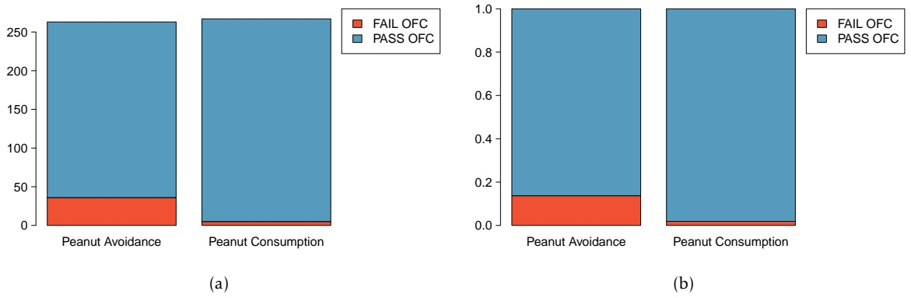

Figure 1.3: (a) A bar plot displaying the number of individuals who failed or passed the OFC in each treatment group. (b) A bar plot displaying the proportions of individuals in each group that failed or passed the OFC.

The proportion of participants failing the OFC is 11.8% higher in the peanut avoidance group than the peanut consumption group. Another way to summarize the data is to compute the ratio of the two proportions $\left( 0.137 / 0.019 = 7.31 \right)$ , and conclude that the proportion of participants failing the OFC in the avoidance group is more than 7 times as large as in the consumption group; i.e., the risk of failing the OFC was more than 7 times as great for participants in the avoidance group relative to the consumption group.

Based on the results of the study, it seems that early exposure to peanut products may be an effective strategy for reducing the chances of developing peanut allergies later in life. It is important to note that this study was conducted in the United Kingdom at a single site of pediatric care; it is not clear that these results can be generalized to other countries or cultures.

The results also raise an important statistical issue: does the study provide definitive evidence that peanut consumption is beneficial? In other words, is the 11.8% difference between the two groups larger than one would expect by chance variation alone? The material on inference in later chapters will provide the statistical tools to evaluate this question.

---

14

CHAPTER 1. INTRODUCTION TO DATA

## 1.2 Data basics

Effective organization and description of data is a first step in most analyses. This section introduces a structure for organizing data and basic terminology used to describe data.

## 1.2.1 Observations, variables, and data matrices

In evolutionary biology, parental investment refers to the amount of time, energy, or other resources devoted towards raising offspring. This section introduces the frog dataset, which originates from a 2013 study about maternal investment in a frog species.4 Reproduction is a costly process for female frogs, necessitating a trade-off between individual egg size and total number of eggs produced. Researchers were interested in investigating how maternal investment varies with altitude and collected measurements on egg clutches found at breeding ponds across 11 study sites; for 5 sites, the body size of individual female frogs was also recorded.

|  | altitude | latitude | egg.size | clutch.size | clutch.volume | body.size |
| --- | --- | --- | --- | --- | --- | --- |
| 1 | 3,462.00 | 34.82 | 1.95 | 181.97 | 177.83 | 3.63 |
| 2 | 3,462.00 | 34.82 | 1.95 | 269.15 | 257.04 | 3.63 |
| 3 | 3,462.00 | 34.82 | 1.95 | 158.49 | 151.36 | 3.72 |
| 150 | 2,597.00 | 34.05 | 2.24 | 537.03 | 776.25 | NA |

Figure 1.4: Data matrix for the frog dataset.

Figure 1.4 displays rows 1, 2, 3, and 150 of the data from the 431 clutches observed as part of the study.5 Each row in the table corresponds to a single clutch, indicating where the clutch was collected (altitude and latitude), egg.size, clutch.size, clutch.volume, and body.size of the mother when available. "NA" corresponds to a missing value, indicating that information on an individual female was not collected for that particular clutch. The recorded characteristics are referred to as **variables**; in this table, each column represents a variable.

| variable | description |
| --- | --- |
| altitude | Altitude of the study site in meters above sea level |
| latitude | Latitude of the study site measured in degrees |
| egg.size | Average diameter of an individual egg to the 0.01 mm |
| clutch.size | Estimated number of eggs in clutch |
| clutch.volume | Volume of egg clutch in $mm^{3}$ |
| body.size | Length of mother frog in cm |

Figure 1.5: Variables and their descriptions for the frog dataset.

It is important to check the definitions of variables, as they are not always obvious. For example, why has clutch.size not been recorded as whole numbers? For a given clutch, researchers counted approximately 5 grams’ worth of eggs and then estimated the total number of eggs based on the mass of the entire clutch. Definitions of the variables are given in Figure 1.5.6

<small>4Chen, W., et al. Maternal investment increases with altitude in a frog on the Tibetan Plateau. Journal of evolutionary biology 26.12 (2013): 2710-2715.</small>

<small>5The frog dataset is available in the R package oibiostat.</small>

<small>6The data discussed here are in the original scale; in the published paper, some values have undergone a natural log transformation.</small>

---

1.2. DATA BASICS

15

The data in Figure 1.4 are organized as a **data matrix**. Each row of a data matrix corresponds to an observational unit, and each column corresponds to a variable. A piece of the data matrix for the LEAP study introduced in Section 1.1 is shown in Figure 1.1; the rows are study participants and three variables are shown for each participant. Data matrices are a convenient way to record and store data. If the data are collected for another individual, another row can easily be added; similarly, another column can be added for a new variable.

## 1.2.2 Types of variables

The Functional polymorphisms Associated with human Muscle Size and Strength study (FA-MuSS) measured a variety of demographic, phenotypic, and genetic characteristics for about 1,300 participants.7 Data from the study have been used in a number of subsequent studies,8such as one examining the relationship between muscle strength and genotype at a location on the ACTN3 gene.9

The famuss dataset is a subset of the data for 595 participants.10 Four rows of the famuss dataset are shown in Figure 1.6, and the variables are described in Figure 1.7.

|  | sex | age | race | height | weight | actn3.r577x | ndrm.ch |
| --- | --- | --- | --- | --- | --- | --- | --- |
| 1 | Female | 27 | Caucasian | 65.0 | 199.0 | CC | 40.0 |
| 2 | Male | 36 | Caucasian | 71.7 | 189.0 | CT | 25.0 |
| 3 | Female | 24 | Caucasian | 65.0 | 134.0 | CT | 40.0 |
| 595 | Female | 30 | Caucasian | 64.0 | 134.0 | CC | 43.8 |

Figure 1.6: Four rows from the famuss data matrix.

| variable | description |
| --- | --- |
| sex | Sex of the participant |
| age | Age in years |
| race | Race, recorded as African Am (African American), Caucasian, Asian, Hispanic or Other |
| height | Height in inches |
| weight | Weight in pounds |
| actn3.r577x | Genotype at the location r577x in the ACTN3 gene. |
| ndrm.ch | Percent change in strength in the non-dominant arm, comparing strength after to before training |

Figure 1.7: Variables and their descriptions for the famuss dataset.

The variables age, height, weight, and ndrm.ch are **numerical variables**. They take on numerical values, and it is reasonable to add, subtract, or take averages with these values. In contrast, a variable reporting telephone numbers would not be classified as numerical, since sums, differences, and averages in this context have no meaning. Age measured in years is said to be **discrete**, since it can only take on numerical values with jumps; i.e., positive integer values. Percent change in strength in the non-dominant arm (ndrm.ch) is **continuous**, and can take on any value within a specified range.

<small>7Thompson PD, Moyna M, Seip, R, et al., 2004. Functional Polymorphisms Associated with Human Muscle Size and Strength. Medicine and Science in Sports and Exercise 36:1132 - 1139.</small>

<small>8Pescatello L, et al. Highlights from the functional single nucleotide polymorphisms associated with human muscle size and strength or FAMuSS study, BioMed Research International 2013.</small>

<small>9Clarkson P, et al., Journal of Applied Physiology 99: 154-163, 2005.</small>

<small>10The subset is from Foulkes, Andrea S. Applied statistical genetics with R: for population-based association studies. Springer Science & Business Media, 2009. The full version of the data is available at [http://people.umass.edu/foulkes/asg/data.html](http://people.umass.edu/foulkes/asg/data.html).</small>

---

16

CHAPTER 1. INTRODUCTION TO DATA

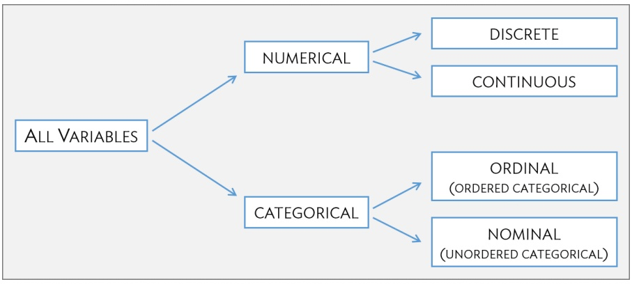

flowchart

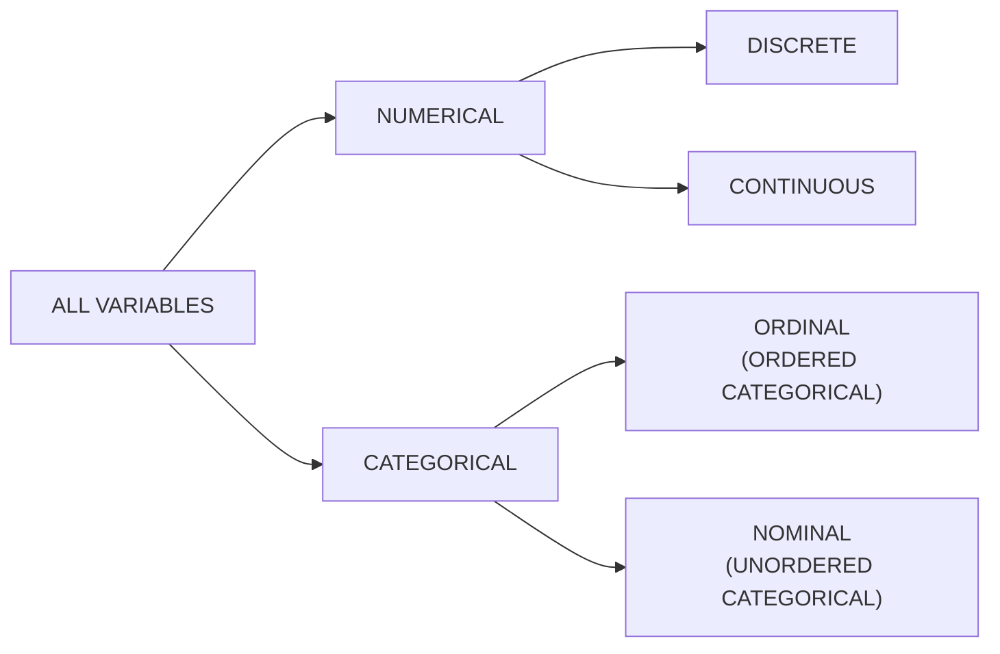

Figure 1.8: Breakdown of variables into their respective types.

The variables sex, race, and actn3.r577x are **categorical variables**, which take on values that are names or labels. The possible values of a categorical variable are called the variable’s **levels**.11 For example, the levels of actn3.r577x are the three possible genotypes at this particular locus: CC, CT, or TT. Categorical variables without a natural ordering are called **nominal categorical variables**; sex, race, and actn3.r577x are all nominal categorical variables. Categorical variables with levels that have a natural ordering are referred to as **ordinal categorical variables**. For example, age of the participants grouped into 5-year intervals (15-20, 21-25, 26-30, etc.) is an ordinal categorical variable.

## EXAMPLE 1.1

Classify the variables in the frog dataset: altitude, latitude, egg.size, clutch.size, clutch.volume, and body.size.

The variables egg.size, clutch.size, clutch.volume, and body.size are continuous numerical variables, and can take on all positive values.

In the context of this study, the variables altitude and latitude are best described as categorical variables, since the numerical values of the variables correspond to the 11 specific study sites where data were collected. Researchers were interested in exploring the relationship between altitude and maternal investment; it would be reasonable to consider altitude an ordinal categorical variable.

## GUIDED PRACTICE 1.2

Characterize the variables treatment.group and overall.V60.outcome from the LEAP study (discussed in Section 1.1).12

## GUIDED PRACTICE 1.3

Suppose that on a given day, a research assistant collected data on the first 20 individuals visiting a walk-in clinic: age (measured as less than 21, 21 - 65, and greater than 65 years of age), sex, height, weight, and reason for the visit. Classify each of the variables.13

E

G

G

<small>11Categorical variables are sometimes called factor variables.</small>

<small>12These variables measure non-numerical quantities, and thus are categorical variables with two levels.</small>

<small>13Height and weight are continuous numerical variables. Age as measured by the research assistant is ordinal categorical. Sex and the reason for the visit are nominal categorical variables.</small>

---

1.2. DATA BASICS

17

## 1.2.3 Relationships between variables

Many studies are motivated by a researcher examining how two or more variables are related. For example, do the values of one variable increase as the values of another decrease? Do the values of one variable tend to differ by the levels of another variable?

One study used the famuss data to investigate whether ACTN3 genotype at a particular lo cation (residue 577) is associated with change in muscle strength. The ACTN3 gene codes for a protein involved in muscle function. A common mutation in the gene at a specific location changes the cytosine (C) nucleotide to a thymine (T) nucleotide; individuals with the TT genotype are unable to produce any ACTN3 protein.

Researchers hypothesized that genotype at this location might influence muscle function. As a measure of muscle function, they recorded the percent change in non-dominant arm strength after strength training; this variable, ndrm.ch, is the **response variable** in the study. A response variable is defined by the particular research question a study seeks to address, and measures the outcome of interest in the study. A study will typically examine whether the values of a response variable differ as values of an **explanatory variable** change, and if so, how the two variables are related. A given study may examine several explanatory variables for a single response variable.14 The explanatory variable examined in relation to ndrm.ch in the study is actn3.r557x, ACTN3 genotype at location 577.

## EXAMPLE 1.4

In the maternal investment study conducted on frogs, researchers collected measurements on egg clutches and female frogs at 11 study sites, located at differing altitudes, in order to investigate how maternal investment varies with altitude. Identify the response and explanatory variables in the study.

E

The variables egg.size, clutch.size, and clutch.volume are response variables indicative of maternal investment.

The explanatory variable examined in the study is altitude.

While latitude is an environmental factor that might potentially influence features of the egg clutches, it is not a variable of interest in this particular study.

Female body size (body.size) is neither an explanatory nor response variable.

G

## GUIDED PRACTICE 1.5

Refer to the variables from the famuss dataset described in Figure 1.7 to formulate a question about the relationships between these variables, and identify the response and explanatory variables in the context of the question.15

<small>14Response variables are sometimes called dependent variables and explanatory variables are often called independent variables or predictors.</small>

<small>15Two sample questions: (1) Does change in participant arm strength after training seem associated with race? The response variable is ndrm.ch and the explanatory variable is race. (2) Do male participants appear to respond differently to strength training than females? The response variable is ndrm.ch and the explanatory variable is sex.</small>

---

18

CHAPTER 1. INTRODUCTION TO DATA

## 1.3 Data collection principles

The first step in research is to identify questions to investigate. A clearly articulated research question is essential for selecting subjects to be studied, identifying relevant variables, and determining how data should be collected.

## 1.3.1 Populations and samples

Consider the following research questions:

1. Do bluefin tuna from the Atlantic Ocean have particularly high levels of mercury, such that they are unsafe for human consumption?
2. For infants predisposed to developing a peanut allergy, is there evidence that introducing peanut products early in life is an effective strategy for reducing the risk of developing a peanut allergy?
3. Does a recently developed drug designed to treat glioblastoma, a form of brain cancer, appear more effective at inducing tumor shrinkage than the drug currently on the market?

Each of these questions refers to a specific target **population**. For example, in the first question, the target population consists of all bluefin tuna from the Atlantic Ocean; each individual bluefin tuna represents a case. It is almost always either too expensive or logistically impossible to collect data for every case in a population. As a result, nearly all research is based on information obtained about a sample from the population. A **sample** represents a small fraction of the population. Researchers interested in evaluating the mercury content of bluefin tuna from the Atlantic Ocean could collect a sample of 500 bluefin tuna (or some other quantity), measure the mercury content, and use the observed information to formulate an answer to the research question.

G

## GUIDED PRACTICE 1.6

Identify the target populations for the remaining two research questions.16

<small>16In Question 2, the target population consists of infants predisposed to developing a peanut allergy. In Question 3, the target population consists of patients with glioblastoma.</small>

---

1.3. DATA COLLECTION PRINCIPLES

19

## 1.3.2 Anecdotal evidence

Anecdotal evidence typically refers to unusual observations that are easily recalled because of their striking characteristics. Physicians may be more likely to remember the characteristics of a single patient with an unusually good response to a drug instead of the many patients who did not respond. The dangers of drawing general conclusions from anecdotal information are obvious; no single observation should be used to draw conclusions about a population.

While it is incorrect to generalize from individual observations, unusual observations can sometimes be valuable. E.C. Heyde was a general practitioner from Vancouver who noticed that a few of his elderly patients with aortic-valve stenosis (an abnormal narrowing) caused by an accumulation of calcium had also suffered massive gastrointestinal bleeding. In 1958, he published his observation.17 Further research led to the identification of the underlying cause of the association, now called Heyde’s Syndrome.18

An anecdotal observation can never be the basis for a conclusion, but may well inspire the design of a more systematic study that could be definitive.

<small>17Heyde EC. Gastrointestinal bleeding in aortic stenosis. N Engl J Med 1958;259:196.</small>

<small>18Greenstein RJ, McElhinney AJ, Reuben D, Greenstein AJ. Co-lonic vascular ectasias and aortic stenosis: coincidence or causal relationship? Am J Surg 1986;151:347-51.</small>

---

20

CHAPTER 1. INTRODUCTION TO DATA

## 1.3.3 Sampling from a population

Sampling from a population, when done correctly, provides reliable information about the characteristics of a large population. The US Centers for Disease Control (US CDC) conducts sev eral surveys to obtain information about the US population, including the Behavior Risk Factor Surveillance System (BRFSS).19 The BRFSS was established in 1984 to collect data about healthrelated risk behaviors, and now collects data from more than 400,000 telephone interviews conducted each year. Data from a recent BRFSS survey are used in Chapter 4. The CDC conducts similar surveys for diabetes, health care access, and immunization. Likewise, the World Health Organization (WHO) conducts the World Health Survey in partnership with approximately 70 countries to learn about the health of adult populations and the health systems in those countries.20

The general principle of sampling is straightforward: a sample from a population is useful for learning about a population only when the sample is **representative** of the population. In other words, the characteristics of the sample should correspond to the characteristics of the population.

Suppose that the quality improvement team at an integrated health care system, such as Harvard Pilgrim Health Care, is interested in learning about how members of the health plan perceive the quality of the services offered under the plan. A common pitfall in conducting a survey is to use a **convenience sample**, in which individuals who are easily accessible are more likely to be included in the sample than other individuals. If a sample were collected by approaching plan members visiting an outpatient clinic during a particular week, the sample would fail to enroll generally healthy members who typically do not use outpatient services or schedule routine physical examinations; this method would produce an unrepresentative sample (Figure 1.9).

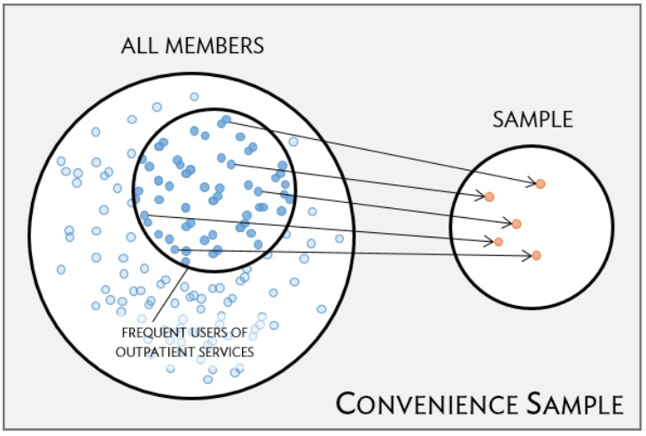

flowchart

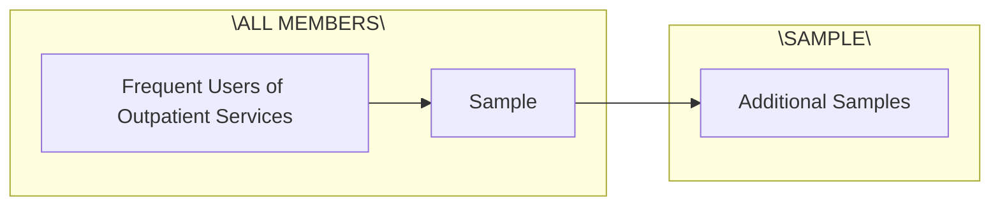

Figure 1.9: Instead of sampling from all members equally, approaching members visiting a clinic during a particular week disproportionately selects members who frequently use outpatient services.

Random sampling is the best way to ensure that a sample reflects a population. In a **simple random sample**, each member of a population has the same chance of being sampled. One way to achieve a simple random sample of the health plan members is to randomly select a certain number of names from the complete membership roster, and contact those individuals for an interview (Figure 1.10).

<small>19<a href="https://www.cdc.gov/brfss/index.html">https://www.cdc.gov/brfss/index.html</a></small>

<small>20<a href="http://www.who.int/healthinfo/survey/en/">http://www.who.int/healthinfo/survey/en/</a></small>

---

1.3. DATA COLLECTION PRINCIPLES

21

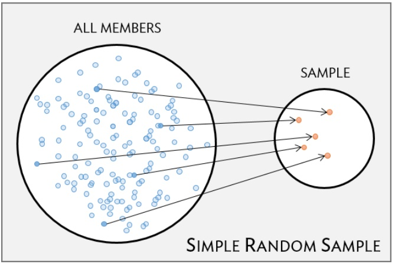

flowchart

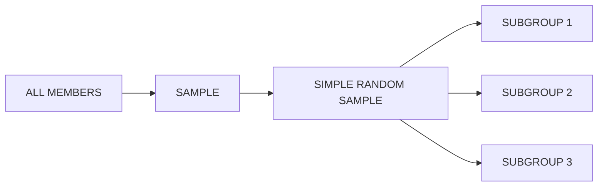

Figure 1.10: Five members are randomly selected from the population to be interviewed.

Even when a simple random sample is taken, it is not guaranteed that the sample is representative of the population. If the **non-response** rate for a survey is high, that may be indicative of a biased sample. Perhaps a majority of participants did not respond to the survey because only a certain group within the population is being reached; for example, if questions assume that participants are fluent in English, then a high non-response rate would be expected if the population largely consists of individuals who are not fluent in English (Figure 1.11). Such **non-response bias** can skew results; generalizing from an unrepresentative sample may likely lead to incorrect conclusions about a population.

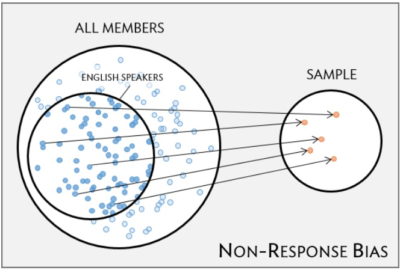

flowchart

Figure 1.11: Surveys may only reach a certain group within the population, which leads to non-response bias. For example, a survey written in English may only result in responses from health plan members fluent in English.

## GUIDED PRACTICE 1.7

It is increasingly common for health care facilities to follow-up a patient visit with an email providing a link to a website where patients can rate their experience. Typically, less than 50% of patients visit the website. If half of those who respond indicate a negative experience, do you think that this implies that at least 25% of patient visits are unsatisfactory?21

G

<small>21It is unlikely that the patients who respond constitute a representative sample from the larger population of patients. This is not a random sample, because individuals are selecting themselves into a group, and it is unclear that each person has an equal chance of answering the survey. If our experience is any guide, dissatisfied people are more likely to respond to these informal surveys than satisfied patients.</small>

---

22

CHAPTER 1. INTRODUCTION TO DATA

## 1.3.4 Sampling methods

Almost all statistical methods are based on the notion of implied randomness. If data are not sampled from a population at random, these statistical methods – calculating estimates and errors associated with estimates – are not reliable. Four random sampling methods are discussed in this section: simple, stratified, cluster, and multistage sampling.

In a **simple random sample**, each case in the population has an equal chance of being included in the sample (Figure 1.12). Under simple random sampling, each case is sampled independently of the other cases; i.e., knowing that a certain case is included in the sample provides no information about which other cases have also been sampled.

In **stratified sampling**, the population is first divided into groups called **strata** before cases are selected within each stratum (typically through simple random sampling) (Figure 1.12). The strata are chosen such that similar cases are grouped together. Stratified sampling is especially useful when the cases in each stratum are very similar with respect to the outcome of interest, but cases between strata might be quite different.

Suppose that the health care provider has facilities in different cities. If the range of services offered differ by city, but all locations in a given city will offer similar services, it would be effective for the quality improvement team to use stratified sampling to identify participants for their study, where each city represents a stratum and plan members are randomly sampled from each city.

---

1.3. DATA COLLECTION PRINCIPLES

23

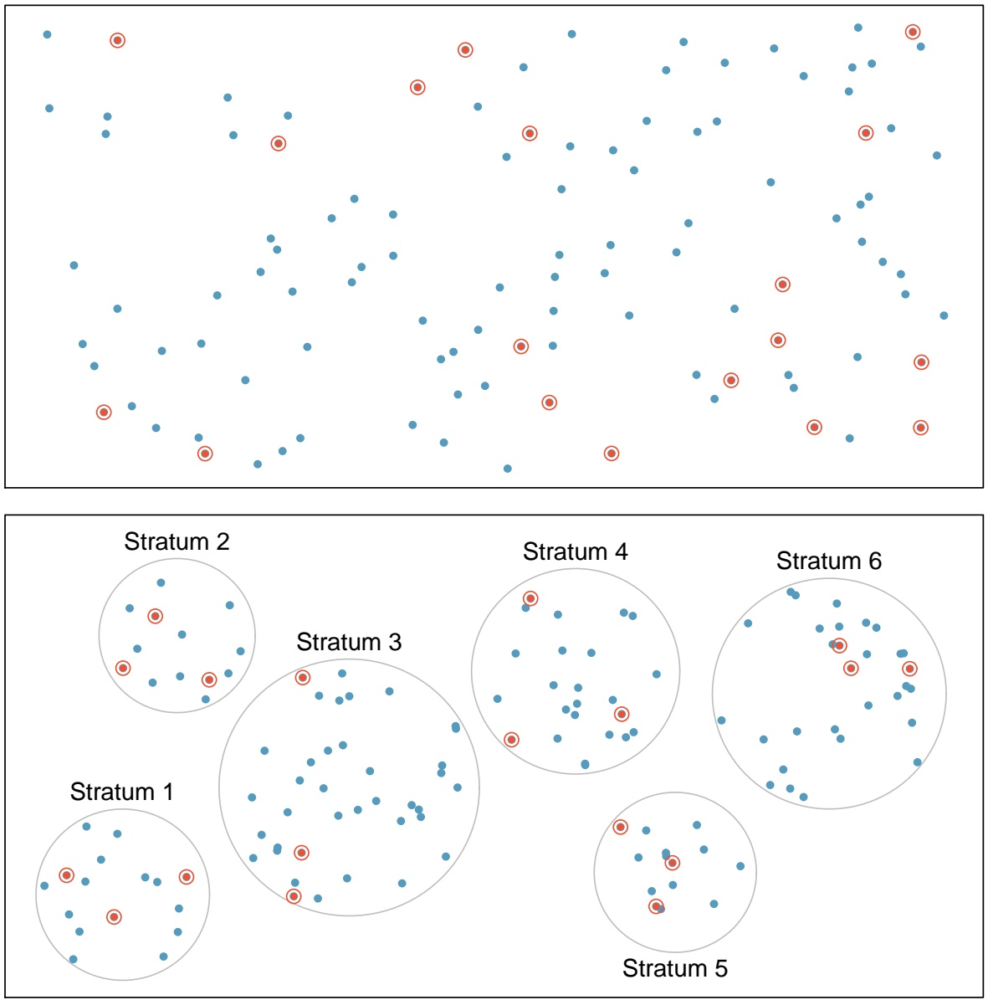

Figure 1.12: Examples of simple random and stratified sampling. In the top panel, simple random sampling is used to randomly select 18 cases (circled orange dots) out of the total population (all dots). The bottom panel illustrates stratified sampling: cases are grouped into six strata, then simple random sampling is employed within each stratum.

---

24

CHAPTER 1. INTRODUCTION TO DATA

In a **cluster sample**, the population is first divided into many groups, called **clusters**. Then, a fixed number of clusters is sampled and all observations from each of those clusters are included in the sample (Figure 1.13). A **multistage sample** is similar to a cluster sample, but rather than keeping all observations in each cluster, a random sample is collected within each selected cluster (Figure 1.13).

Unlike with stratified sampling, cluster and multistage sampling are most helpful when there is high case-to-case variability within a cluster, but the clusters themselves are similar to one another. For example, if neighborhoods in a city represent clusters, cluster and multistage sampling work best when the population within each neighborhood is very diverse, but neighborhoods are relatively similar.

Applying stratified, cluster, or multistage sampling can often be more economical than only drawing random samples. However, analysis of data collected using such methods is more complicated than when using data from a simple random sample; this text will only discuss analysis methods for simple random samples.

## EXAMPLE 1.8

Suppose researchers are interested in estimating the malaria rate in a densely tropical portion of rural Indonesia. There are 30 villages in the area, each more or less similar to the others. The goal is to test 150 individuals for malaria. Evaluate which sampling method should be employed.

A simple random sample would likely draw individuals from all 30 villages, which could make data collection extremely expensive. Stratified sampling is not advisable, since there is not enough information to determine how strata of similar individuals could be built. However, cluster sampling or multistage sampling are both reasonable options. For example, with multistage sampling, half of the villages could be randomly selected, and then 10 people selected from each village. This strategy is more efficient than a simple random sample, and can still provide a sample representative of the population of interest.

## 1.3.5 Introducing experiments and observational studies

The two primary types of study designs used to collect data are experiments and observational studies.

In an **experiment**, researchers directly influence how data arise, such as by assigning groups of individuals to different treatments and assessing how the outcome varies across treatment groups. The LEAP study is an example of an experiment with two groups, an experimental group that received the intervention (peanut consumption) and a control group that received a standard approach (peanut avoidance). In studies assessing effectiveness of a new drug, individuals in the control group typically receive a **placebo**, an inert substance with the appearance of the experimental intervention. The study is designed such that on average, the only difference between the individuals in the treatment groups is whether or not they consumed peanut protein. This allows for observed differences in experimental outcome to be directly attributed to the intervention and constitute evidence of a causal relationship between intervention and outcome.

In an **observational study**, researchers merely observe and record data, without interfering with how the data arise. For example, to investigate why certain diseases develop, researchers might collect data by conducting surveys, reviewing medical records, or following a **cohort** of many similar individuals. Observational studies can provide evidence of an association between variables, but cannot by themselves show a causal connection. However, there are many instances where randomized experiments are unethical, such as to explore whether lead exposure in young children is associated with cognitive impairment.

E

---

1.3. DATA COLLECTION PRINCIPLES

25

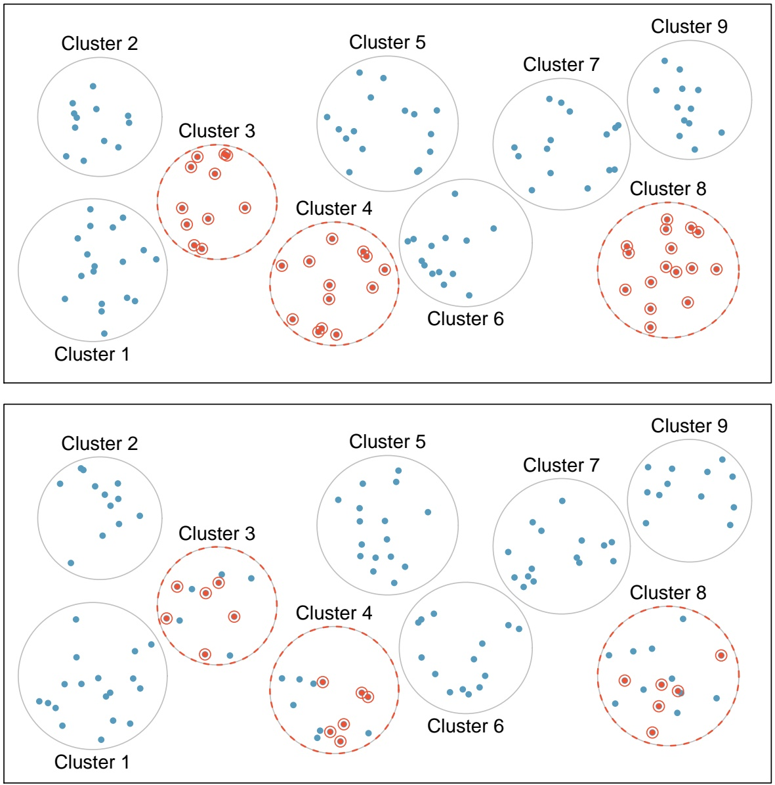

Figure 1.13: Examples of cluster and multistage sampling. The top panel illustrates cluster sampling: data are binned into nine clusters, three of which are sampled, and all observations within these clusters are sampled. The bottom panel illustrates multistage sampling, which differs from cluster sampling in that only a subset from each of the three selected clusters are sampled.

---

26

CHAPTER 1. INTRODUCTION TO DATA

## 1.3.6 Experiments

Experimental design is based on three principles: control, randomization, and replication.

**Control.** When selecting participants for a study, researchers work to **control** for extraneous variables and choose a sample of participants that is representative of the population of interest. For example, participation in a study might be restricted to individuals who have a condition that suggests they may benefit from the intervention being tested. Infants enrolled in the LEAP study were required to be between 4 and 11 months of age, with severe eczema and/or allergies to eggs.

**Randomization.** Randomly assigning patients to treatment groups ensures that groups are balanced with respect to both variables that can and cannot be controlled. For example, randomization in the LEAP study ensures that the proportion of males to females is approximately the same in both groups. Additionally, perhaps some infants were more susceptible to peanut allergy because of an undetected genetic condition; under randomization, it is reasonable to assume that such infants were present in equal numbers in both groups. Randomization allows differences in outcome between the groups to be reasonably attributed to the treatment rather than inherent variability in patient characteristics, since the treatment represents the only systematic difference between the two groups.

In situations where researchers suspect that variables other than the intervention may influence the response, individuals can be first grouped into **blocks** according to a certain attribute and then randomized to treatment group within each block; this technique is referred to as **blocking** or **stratification**. The team behind the LEAP study stratified infants into two cohorts based on whether or not the child developed a red, swollen mark (a wheal) after a skin test at the time of enrollment; afterwards, infants were randomized between peanut consumption and avoidance groups. Figure 1.14 illustrates the blocking scheme used in the study.

**Replication.** The results of a study conducted on a larger number of cases are generally more reliable than smaller studies; observations made from a large sample are more likely to be representative of the population of interest. In a single study, **replication** is accomplished by collecting a sufficiently large sample. The LEAP study randomized a total of 640 infants.

Randomized experiments are an essential tool in research. The US Food and Drug Adminis tration typically requires that a new drug can only be marketed after two independently conducted randomized trials confirm its safety and efficacy; the European Medicines Agency has a similar policy. Large randomized experiments in medicine have provided the basis for major public health initiatives. In 1954, approximately 750,000 children participated in a randomized study comparing polio vaccine with a placebo.22 In the United States, the results of the study quickly led to the widespread and successful use of the vaccine for polio prevention.

22Meier, Paul. "The biggest public health experiment ever: the 1954 field trial of the Salk poliomyelitis vaccine." Statistics: a guide to the unknown. San Francisco: Holden-Day (1972): 2-13.

---

1.3. DATA COLLECTION PRINCIPLES

27

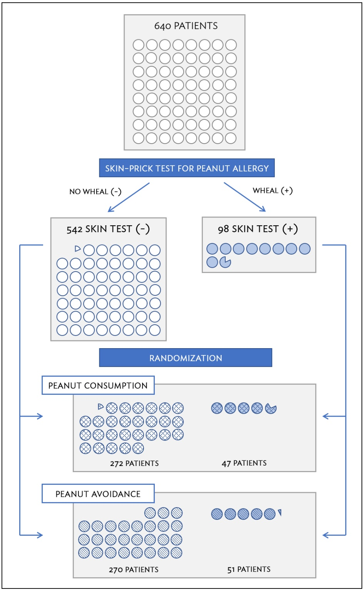

flowchart

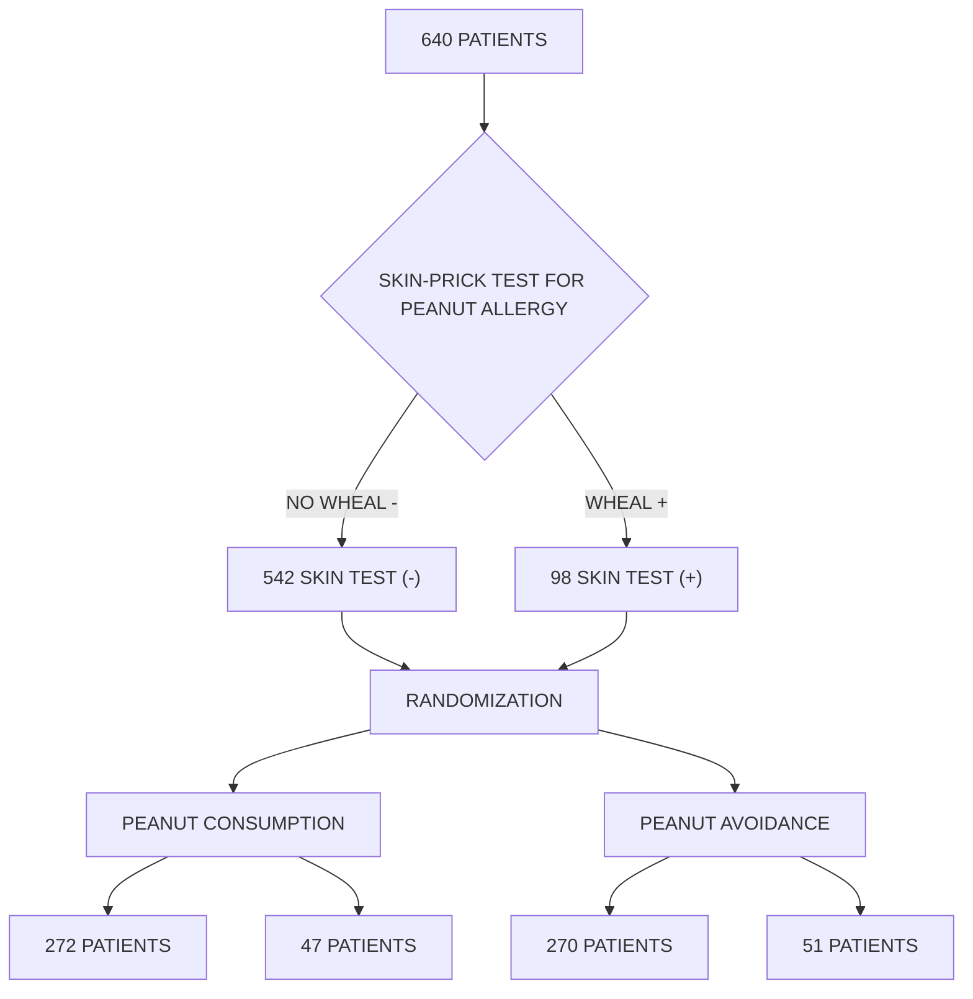

Figure 1.14: A simplified schematic of the blocking scheme used in the LEAP study, depicting 640 patients that underwent randomization. Patients are first divided into blocks based on response to the initial skin test, then each block is randomized between the avoidance and consumption groups. This strategy ensures an even representation of patients in each group who had positive and negative skin tests.

---

28

CHAPTER 1. INTRODUCTION TO DATA

## 1.3.7 Observational studies

In observational studies, researchers simply observe selected potential explanatory and response variables. Participants who differ in important explanatory variables may also differ in other ways that influence response; as a result, it is not advisable to make causal conclusions about the relationship between explanatory and response variables based on observational data. For example, while observational studies of obesity have shown that obese individuals tend to die sooner than individuals with normal weight, it would be misleading to conclude that obesity causes shorter life expectancy. Instead, underlying factors are probably involved; obese individuals typically exhibit other health behaviors that influence life expectancy, such as reduced exercise or unhealthy diet.

Suppose that an observational study tracked sunscreen use and incidence of skin cancer, and found that the more sunscreen a person uses, the more likely they are to have skin cancer. These results do not mean that sunscreen causes skin cancer. One important piece of missing information is sun exposure – if someone is often exposed to sun, they are both more likely to use sunscreen and to contract skin cancer. Sun exposure is a **confounding variable**: a variable associated with both the explanatory and response variables.23 There is no guarantee that all confounding variables can be examined or measured; as a result, it is not advisable to draw causal conclusions from observational studies.

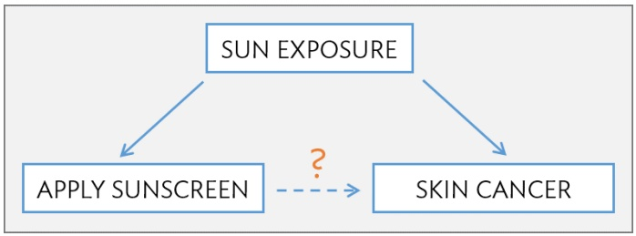

flowchart

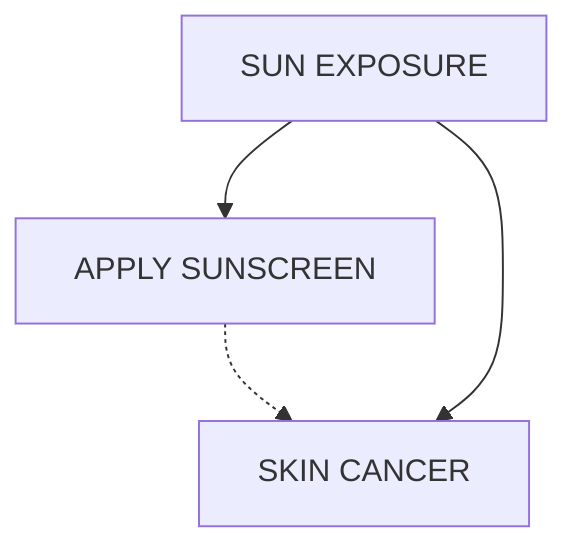

Confounding is not limited to observational studies. For example, consider a randomized study comparing two treatments (varenicline and buproprion) against a placebo as therapies for aiding smoking cessation.24 At the beginning of the study, participants were randomized into groups: 352 to varenicline, 329 to buproprion, and 344 to placebo. Not all participants successfully completed the assigned therapy: 259, 225, and 215 patients in each group did so, respectively. If an analysis were based only on the participants who completed therapy, this could introduce confounding; it is possible that there are underlying differences between individuals who complete the therapy and those who do not. Including all randomized participants in the final analysis maintains the original randomization scheme and controls for differences between the groups.25

## GUIDED PRACTICE 1.9

As stated in Example 1.4, female body size (body.size) in the parental investment study is neither an explanatory nor a response variable. Previous research has shown that larger females tend to produce larger eggs and egg clutches; however, large body size can be costly at high altitudes. Discuss a possible reason for why the study team chose to measure female body size when it is not directly related to their main research question.26

<small>23Also called a lurking variable, confounding factor, or a confounder.</small>

<small>24Jorenby, Douglas E., et al. "Efficacy of varenicline, an α4β2 nicotinic acetylcholine receptor partial agonist, vs placebo or sustained-release bupropion for smoking cessation: a randomized controlled trial." JAMA 296.1 (2006): 56-63.</small>

<small>25This strategy, commonly used for analyzing clinical trial data, is referred to as an intention-to-treat analysis.</small>

<small>26Female body size is a potential confounding variable, since it may be associated with both the explanatory variable (altitude) and response variables (measures of maternal investment). If the study team observes, for example, that clutch size tends to decrease at higher altitudes, they should check whether the apparent association is not simply due to frogs at higher altitudes having smaller body size and thus, laying smaller clutches.</small>

G

---

1.3. DATA COLLECTION PRINCIPLES

29

Observational studies may reveal interesting patterns or associations that can be further in vestigated with follow-up experiments. Several observational studies based on dietary data from different countries showed a strong association between dietary fat and breast cancer in women. These observations led to the launch of the Women’s Health Initiative (WHI), a large randomized trial sponsored by the US National Institutes of Health (NIH). In the WHI, women were randomized to standard versus low fat diets, and the previously observed association was not confirmed.

Observational studies can be either prospective or retrospective. A **prospective study** identifies participants and collects information at scheduled times or as events unfold. For example, in the Nurses’ Health Study, researchers recruited registered nurses beginning in 1976 and collected data through administering biennial surveys; data from the study have been used to investigate risk factors for major chronic diseases in women.27 **Retrospective studies** collect data after events have taken place, such as from medical records. Some datasets may contain both retrospectively- and prospectively-collected variables. The Cancer Care Outcomes Research and Surveillance Consortium (CanCORS) enrolled participants with lung or colorectal cancer, collected information about diagnosis, treatment, and previous health behavior, but also maintained contact with participants to gather data about long-term outcomes.28

<small>27<a href="http://www.openintro.org/redirect.php?go=textbook-channing_nurse_study&amp;referrer=biostat1_pdf">www.channing.harvard.edu/nhs</a></small>

<small>28Ayanian, John Z., et al. "Understanding cancer treatment and outcomes: the cancer care outcomes research and surveillance consortium." Journal of Clinical Oncology 22.15 (2004): 2992-2996</small>

---

30

CHAPTER 1. INTRODUCTION TO DATA

## 1.4 Numerical data

This section discusses techniques for exploring and summarizing numerical variables, using the frog data from the parental investment study introduced in Section 1.2.

## 1.4.1 Measures of center: mean and median

The **mean**, sometimes called the average, is a measure of center for a **distribution** of data. To find the average clutch volume for the observed egg clutches, add all the clutch volumes and divide by the total number of clutches.29

$$
\overline {{x}} = \frac {1 7 7 . 8 + 2 5 7 . 0 + \cdots + 9 3 3 . 3}{4 3 1} = 8 8 2. 5 \mathrm{mm} ^ {3}.
$$

The sample mean is often labeled ${ \overline { { x } } } ,$ to distinguish it from $\mu ,$ the mean of the entire population from which the sample is drawn. The letter x is being used as a generic placeholder for the variable of interest, clutch.volume.

## MEAN

The sample mean of a numerical variable is the sum of the values of all observations divided by the number of observations:

$$
\overline {{x}} = \frac {x _ {1} + x _ {2} + \cdots + x _ {n}}{n}, \tag {1.10}
$$

where $x_{1},x_{2},\cdots,x_{n}$ represent the n observed values.

The **median** is another measure of center; it is the middle number in a distribution after the values have been ordered from smallest to largest. If the distribution contains an even number of observations, the median is the average of the middle two observations. There are 431 clutches in the dataset, so the median is the clutch volume of the $2 1 6 ^ { t h }$ observation in the sorted values of clutch.volume: 831.8 mm3.

\$\overline{x}\$
sample
mean
\$\mu\$
population
mean

<small>29For computational convenience, the volumes are rounded to the first decimal.</small>

---

1.4. NUMERICAL DATA

31

## 1.4.2 Measures of spread: standard deviation and interquartile range

The spread of a distribution refers to how similar or varied the values in the distribution are to each other; i.e., whether the values are tightly clustered or spread over a wide range.

The standard deviation for a set of data describes the typical distance between an observation and the mean. The distance of a single observation from the mean is its **deviation**. Below are the deviations for the $1 ^ { s t } ,   2 ^ { n d } ,   3 ^ { r d }$ , and $4 3 1 ^ { s t }$ observations in the clutch.volume variable.

$$
\begin{array}{l} x _ {1} - \overline {{x}} = 1 7 7. 8 - 8 8 2. 5 = - 7 0 4. 7 \\ x _ {2} - \overline {{x}} = 2 5 7. 0 - 8 8 2. 5 = - 6 2 5. 5 \\ x _ {3} - \overline {{x}} = 1 5 1. 4 - 8 8 2. 5 = - 7 3 1. 1 \\ x _ {4 3 1} - \overline {{x}} = 9 3 3. 2 - 8 8 2. 5 = 5 0. 7 \\ \end{array}
$$

..

The sample **variance**, the average of the squares of these deviations, is denoted by $s ^ { 2 } ;$

$s ^ { 2 }$ sample variance

$$
\begin{array}{l} s ^ {2} = \frac {(- 7 0 4 . 7) ^ {2} + (- 6 2 5 . 5) ^ {2} + (- 7 3 1 . 1) ^ {2} + \cdots + (5 0 . 7) ^ {2}}{4 3 1 - 1} \\ = \frac {4 9 6 , 6 0 2 . 0 9 + 3 9 1 , 2 5 0 . 2 5 + 5 3 4 , 5 0 7 . 2 1 + \cdots + 2 5 7 0 . 4 9}{4 3 0} \\ = 1 4 3, 6 8 0. 9. \\ \end{array}
$$

The denominator is n − 1 rather than n; this mathematical nuance accounts for the fact that sample mean has been used to estimate the population mean in the calculation. Details on the statistical theory can be found in more advanced texts.

The sample **standard deviation** s is the square root of the variance:

$$
s = \sqrt {1 4 3 , 6 8 0 . 9} = 3 7 9. 0 5 \mathrm{mm} ^ {3}.
$$

Like the mean, the population values for variance and standard deviation are denoted by Greek letters: $\sigma ^ { 2 }$ for the variance and σ for the standard deviation.

## STANDARD DEVIATION

The sample standard deviation of a numerical variable is computed as the square root of the variance, which is the sum of squared deviations divided by the number of observations minus 1.

$$
s = \sqrt {\frac {(x _ {1} - \overline {{x}}) ^ {2} + (x _ {2} - \overline {{x}}) ^ {2} + \cdots + (x _ {n} - \overline {{x}}) ^ {2}}{n - 1}}, \tag {1.11}
$$

where $x_{1},x_{2},\cdots,x_{n}$ represent the n observed values.

s sample standard deviation $\sigma ^ { 2 }$ population variance

σ population standard deviation

---

32

CHAPTER 1. INTRODUCTION TO DATA

Variability can also be measured using the **interquartile range** (IQR). The IQR for a distribution is the difference between the first and third quartiles: $Q _ { 3 } - Q _ { 1 }$ . The first quartile $( Q _ { 1 } )$ is equivalent to the $2 5 ^ { t h }$ percentile; i.e., 25% of the data fall below this value. The third quartile $( Q _ { 3 } )$ is equivalent to the $7 5 ^ { t h }$ percentile. By definition, the median represents the second quartile, with half the values falling below it and half falling above. The IQR for clutch.volume is $1096.0 - 609.6 = 486.4    mm ^3$

Measures of center and spread are ways to summarize a distribution numerically. Using numerical summaries allows for a distribution to be efficiently described with only a few numbers.30 For example, the calculations for clutch.volume indicate that the typical egg clutch has volume of about 880 $\mathrm { m m } ^ { 3 } ]$ , while the middle 50% of egg clutches have volumes between approximately $6 0 0 \; \mathrm { { m m } } ^ { 3 }$ and 1100.0 mm3.

## 1.4.3 Robust estimates

Figure 1.15 shows the values of clutch.volume as points on a single axis. There are a few values that seem extreme relative to the other observations: the four largest values, which appear distinct from the rest of the distribution. How do these extreme values affect the value of the numerical summaries?

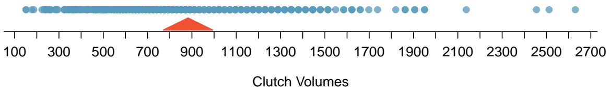

scatter

| Clutch Volumes (range) | Value (range) |
| --- | --- |
| 100~2700 | 0~2700 |

Figure 1.15: Dot plot of clutch volumes from the frog data.

Figure 1.16 shows the summary statistics calculated under two scenarios, one with and one without the four largest observations. For these data, the median does not change, while the IQR differs by only about 6 $\mathrm { i   m m ^ { 3 } }$ . In contrast, the mean and standard deviation are much more affected, particularly the standard deviation.

<table><tr><td rowspan="2">scenario</td><td colspan="2">robust</td><td colspan="2">not robust</td></tr><tr><td>median</td><td>IQR</td><td> $\bar{x}$ </td><td>s</td></tr><tr><td>original data (with extreme observations)</td><td>831.8</td><td>486.9</td><td>882.5</td><td>379.1</td></tr><tr><td>data without four largest observations</td><td>831.8</td><td>493.9</td><td>867.9</td><td>349.2</td></tr></table>

Figure 1.16: A comparison of how the median, IQR, mean (x), and standard deviation (s) change when extreme observations are present.

The median and IQR are referred to as **robust estimates** because extreme observations have little effect on their values. For distributions that contain extreme values, the median and IQR will provide a more accurate sense of the center and spread than the mean and standard deviation.

<small>30Numerical summaries are also known as summary statistics.</small>

---

1.4. NUMERICAL DATA

33

## 1.4.4 Visualizing distributions of data: histograms and boxplots

Graphs show important features of a distribution that are not evident from numerical summaries, such as asymmetry or extreme values. While dot plots show the exact value of each observation, histograms and boxplots graphically summarize distributions.

In a **histogram**, observations are grouped into bins and plotted as bars. Figure 1.17 shows the number of clutches with volume between 0 and 200 mm3, 200 and 400 mm3, etc. up until 2,600 and 2,800 mm3.31 These binned counts are plotted in Figure 1.18.

| Clutch volumes | 0-200 | 200-400 | 400-600 | 600-800 | ... | 2400-2600 | 2600-2800 |
| --- | --- | --- | --- | --- | --- | --- | --- |
| Count | 4 | 29 | 69 | 99 | ... | 2 | 1 |

Figure 1.17: The counts for the binned clutch.volume data.

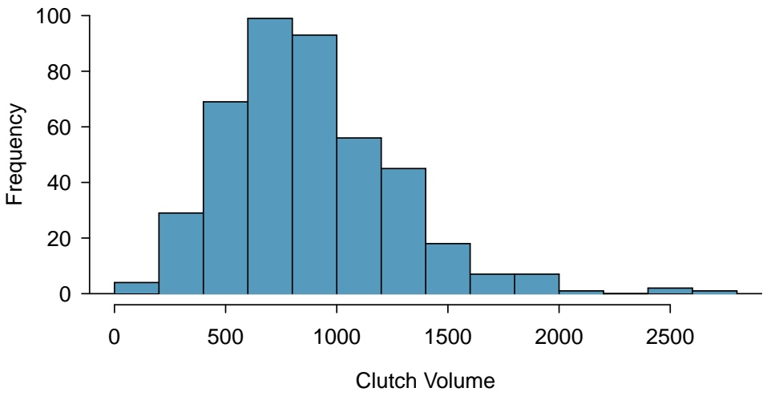

histogram

| Clutch Volume (Bin) | Frequency |
| --- | --- |
| 0~250 | ~4 |
| 250~500 | ~30 |
| 500~750 | ~70 |
| 750~1000 | ~100 |
| 1000~1250 | ~94 |
| 1250~1500 | ~56 |
| 1500~1750 | ~45 |
| 1750~2000 | ~18 |
| 2000~2250 | ~7 |
| 2250~2500 | ~7 |
| 2500~2750 | ~1 |
| 2750~3000 | ~2 |
| 3000~3250 | ~1 |

Figure 1.18: A histogram of clutch.volume.

Histograms provide a view of the **data density**. Higher bars indicate more frequent observations, while lower bars represent relatively rare observations. Figure 1.18 shows that most of the egg clutches have volumes between 500-1,000 mm3, and there are many more clutches with volumes smaller than 1,000 mm3than clutches with larger volumes.

Histograms show the **shape** of a distribution. The tails of a **symmetric** distribution are roughly equal, with data trailing off from the center roughly equally in both directions. Asym metry arises when one tail of the distribution is longer than the other. A distribution is said to be **right skewed** when data trail off to the right, and **left skewed** when data trail off to the left.32 Figure 1.18 shows that the distribution of clutch volume is right skewed; most clutches have relatively small volumes, and only a few clutches have high volumes.

<small>31By default in R, the bins are left-open and right-closed; i.e., the intervals are of the form (a, b]. Thus, an observation with value 200 would fall into the 0-200 bin instead of the 200-400 bin.</small>

<small>32Other ways to describe data that are skewed to the right/left: skewed to the right/left or skewed to the positive/negative end.</small>

---

34

CHAPTER 1. INTRODUCTION TO DATA

A **mode** is represented by a prominent peak in the distribution.33 Figure 1.19 shows histograms that have one, two, or three major peaks. Such distributions are called **unimodal**, **bimodal**, and **multimodal**, respectively. Any distribution with more than two prominent peaks is called multimodal. Note that the less prominent peak in the unimodal distribution was not counted since it only differs from its neighboring bins by a few observations. Prominent is a subjective term, but it is usually clear in a histogram where the major peaks are.

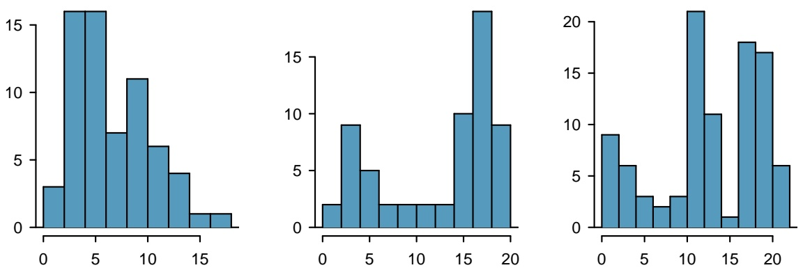

Figure 1.19: From left to right: unimodal, bimodal, and multimodal distributions.

A **boxplot** indicates the positions of the first, second, and third quartiles of a distribution in addition to extreme observations.34 Figure 1.20 shows a boxplot of clutch.volume alongside a vertical dot plot.

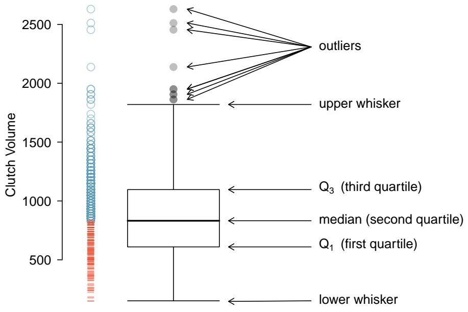

boxplot

| Metric | Value |
| --- | --- |
| Q1 (first quartile) | ~600 |
| Q3 (third quartile) | ~1100 |
| Median (second quartile) | ~850 |
| Upper Whisker | ~1850 |
| Lower Whisker | ~200 |

Figure 1.20: A boxplot and dot plot of clutch.volume. The horizontal dashes indicate the bottom 50% of the data and the open circles represent the top 50%.

<small>33Another definition of mode, which is not typically used in statistics, is the value with the most occurrences. It is common that a dataset contains no observations with the same value, which makes this other definition impractical for many datasets.</small>

<small>34Boxplots are also known as box-and-whisker plots.</small>

---

1.4. NUMERICAL DATA

35

In a boxplot, the interquartile range is represented by a rectangle extending from the first quartile to the third quartile, and the rectangle is split by the median (second quartile). Extending outwards from the box, the **whiskers** capture the data that fall between $Q_{1}-1.5 \times IQR   and   Q_{3}+1.5 \times$ IQR. The whiskers must end at data points; the values given by adding or subtracting $1 . 5 \times I Q R$ define the maximum reach of the whiskers. For example, with the clutch.volume variable, $Q _ { 3 } +$ $1.5 \times IQR = 1, 096.5 + 1.5 \times 486.4 = 1, 826.1 \;  mm ^3$ . However, there was no clutch with volume 1,826.1 $\mathrm { m m } ^ { 3 } ;$ thus, the upper whisker extends to 1,819.7 mm3, the largest observation that is smaller than $Q _ { 3 } + 1 . 5 \times I Q R .$

Any observation that lies beyond the whiskers is shown with a dot; these observations are called outliers. An **outlier** is a value that appears extreme relative to the rest of the data. For the clutch.volume variable, there are several large outliers and no small outliers, indicating the presence of some unusually large egg clutches.

The high outliers in Figure 1.20 reflect the right-skewed nature of the data. The right skew is also observable from the position of the median relative to the first and third quartiles; the median is slightly closer to the first quartile. In a symmetric distribution, the median will be halfway between the first and third quartiles.

## GUIDED PRACTICE 1.12

Use the histogram and boxplot in Figure 1.21 to describe the distribution of height in the famuss data, where height is measured in inches.35

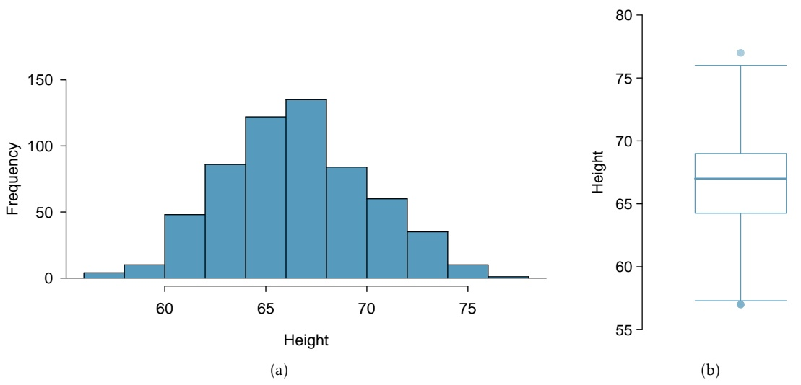

Figure 1.21: A histogram and boxplot of height in the famuss data.

<small>35The data are roughly symmetric (the left tail is slightly longer than the right tail), and the distribution is unimodal with one prominent peak at about 67 inches. The middle 50% of individuals are between 5.5 feet and just under 6 feet tall. There is one low outlier and one high outlier, representing individuals that are unusually short/tall relative to the other individuals.</small>

---

36

CHAPTER 1. INTRODUCTION TO DATA

## 1.4.5 Transforming data

When working with strongly skewed data, it can be useful to apply a **transformation**, and rescale the data using a function. A natural log transformation is commonly used to clarify the features of a variable when there are many values clustered near zero and all observations are positive.

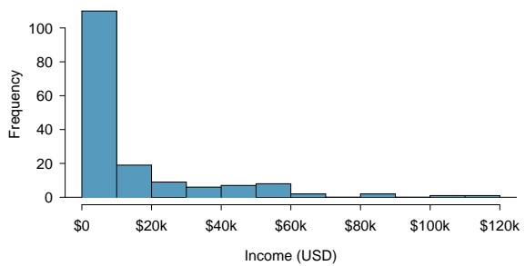

histogram

| Income (USD) | Frequency |
| --- | --- |
| 0~10k | ~110 |
| 10k~20k | ~20 |
| 20k~30k | ~10 |
| 30k~40k | ~7 |
| 40k~50k | ~8 |
| 50k~60k | ~9 |
| 60k~70k | ~3 |
| 70k~80k | ~0 |
| 80k~90k | ~3 |
| 90k~100k | ~0 |
| 100k~110k | ~2 |
| 110k~120k | ~1 |

(a)

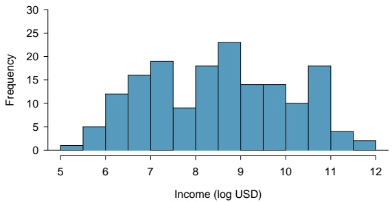

histogram

| Income (log USD) | Frequency |
| --- | --- |
| 5.0~5.3 | ~1 |
| 5.3~5.6 | ~5 |
| 5.6~5.9 | ~12 |
| 5.9~6.2 | ~16 |
| 6.2~6.5 | ~19 |
| 6.5~6.8 | ~9 |
| 6.8~7.1 | ~18 |
| 7.1~7.4 | ~23 |
| 7.4~7.7 | ~14 |
| 7.7~8.0 | ~14 |
| 8.0~8.3 | ~10 |
| 8.3~8.6 | ~18 |
| 8.6~8.9 | ~4 |
| 8.9~9.2 | ~2 |

(b)

Figure 1.22: (a) Histogram of per capita income. (b) Histogram of the logtransformed per capita income.

For example, income data are often skewed right; there are typically large clusters of low to moderate income, with a few large incomes that are outliers. Figure 1.22(a) shows a histogram of average yearly per capita income measured in US dollars for 165 countries in 2011.36 The data are heavily right skewed, with the majority of countries having average yearly per capita income lower than \$10,000. Once the data are log-transformed, the distribution becomes roughly symmetric (Figure 1.22(b)).37

For symmetric distributions, the mean and standard deviation are particularly informative summaries. If a distribution is symmetric, approximately 70% of the data are within one standard deviation of the mean and 95% of the data are within two standard deviations of the mean; this guideline is known as the **empirical rule**.

## EXAMPLE 1.13

On the log-transformed scale, mean log income is 8.50, with standard deviation 1.54. Apply the empirical rule to describe the distribution of average yearly per capita income among the 165 countries.

According to the empirical rule, the middle 70% of the data are within one standard deviation of the mean, in the range (8.50 - 1.54, 8.50 + 1.54) = (6.96, 10.04) log(USD). 95% of the data are within two standard deviations of the mean, in the range $\left( 8.50 \text{- } 2(1.54),   8.50 \text{+ } 2(1.54) \right) = \left( 5.42,   11.58 \right)$ log(USD).

Undo the log transformation. The middle 70% of the data are within the range $( e ^ { 6 . 9 6 } , e ^ { 1 0 . 0 4 } )$ = (\$1,054, \$22,925). The middle 95% of the data are within the range $( e ^ { 5 . 4 2 } , e ^ { 1 1 . 5 8 } )   =   ( \S 2 2 6 ,$ \$106,937).

Functions other than the natural log can also be used to transform data, such as the square root and inverse.

E

<small>36The data are available as wdi.2011 in the R package oibiostat.</small>

<small>37In statistics, the natural logarithm is usually written log. In other settings it is sometimes written as ln.</small>

---

1.5. CATEGORICAL DATA

37

## 1.5 Categorical data

This section introduces tables and plots for summarizing categorical data, using the famuss dataset introduced in Section 1.2.2.

A table for a single variable is called a **frequency table**. Figure 1.23 is a frequency table for the actn3.r577x variable, showing the distribution of genotype at location r577x on the ACTN3 gene for the FAMuSS study participants.

In a **relative frequency table** like Figure 1.24, the proportions per each category are shown instead of the counts.

|  | CC | CT | TT | Sum |
| --- | --- | --- | --- | --- |
| Counts | 173 | 261 | 161 | 595 |

Figure 1.23: A frequency table for the actn3.r577x variable.

|  | CC | CT | TT | Sum |
| --- | --- | --- | --- | --- |
| Proportions | 0.291 | 0.439 | 0.271 | 1.000 |

Figure 1.24: A relative frequency table for the actn3.r577x variable.

A bar plot is a common way to display a single categorical variable. The left panel of Figure 1.25 shows a **bar plot** of the counts per genotype for the actn3.r577x variable. The plot in the right panel shows the proportion of observations that are in each level (i.e. in each genotype).

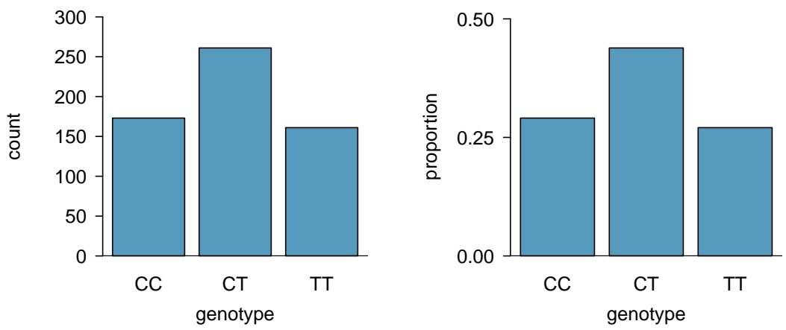

Figure 1.25: Two bar plots of actn3.r577x. The left panel shows the counts, and the right panel shows the proportions for each genotype.

---

38

CHAPTER 1. INTRODUCTION TO DATA

## 1.6 Relationships between two variables

This section introduces numerical and graphical methods for exploring and summarizing relationships between two variables. Approaches vary depending on whether the two variables are both numerical, both categorical, or whether one is numerical and one is categorical.

## 1.6.1 Two numerical variables

## Scatterplots

In the frog parental investment study, researchers used clutch volume as a primary variable of interest rather than egg size because clutch volume represents both the eggs and the protective gelatinous matrix surrounding the eggs. The larger the clutch volume, the higher the energy required to produce it; thus, higher clutch volume is indicative of increased maternal investment. Previous research has reported that larger body size allows females to produce larger clutches; is this idea supported by the frog data?

A **scatterplot** provides a case-by-case view of the relationship between two numerical variables. Figure 1.26 shows clutch volume plotted against body size, with clutch volume on the y-axis and body size on the x-axis. Each point represents a single case. For this example, each case is one egg clutch for which both volume and body size (of the female that produced the clutch) have been recorded.

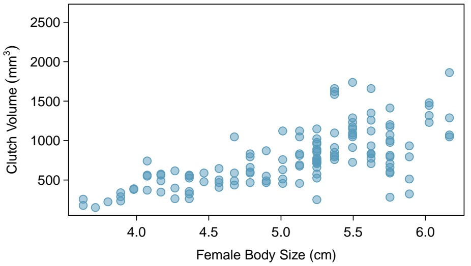

scatter

| Female Body Size (cm) | Clutch Volume \((mm^{3})\) |
| --- | --- |
| ~3.75 | ~200 |
| ~3.75 | ~250 |
| ~3.85 | ~150 |
| ~3.90 | ~250 |
| ~3.90 | ~300 |
| ~3.95 | ~350 |
| ~4.00 | ~400 |
| ~4.05 | ~750 |
| ~4.10 | ~550 |
| ~4.15 | ~600 |
| ~4.20 | ~500 |
| ~4.25 | ~650 |
| ~4.30 | ~400 |
| ~4.35 | ~300 |
| ~4.40 | ~550 |
| ~4.45 | ~350 |
| ~4.50 | ~600 |
| ~4.60 | ~450 |
| ~4.65 | ~650 |
| ~4.70 | ~1050 |
| ~4.75 | ~600 |
| ~4.80 | ~850 |
| ~4.85 | ~650 |
| ~4.90 | ~900 |
| ~4.95 | ~550 |
| ~5.00 | ~1150 |
| ~5.05 | ~750 |
| ~5.10 | ~1150 |
| ~5.15 | ~850 |
| ~5.20 | ~1150 |
| ~5.25 | ~750 |
| ~5.30 | ~1650 |
| ~5.35 | ~1750 |
| ~5.40 | ~1650 |
| ~5.45 | ~1750 |
| ~5.50 | ~1700 |
| ~5.60 | ~1650 |
| ~5.70 | ~1450 |
| ~5.75 | ~1200 |
| ~5.80 | ~1200 |
| ~5.85 | ~950 |
| ~5.90 | ~800 |
| ~6.00 | ~1450 |
| ~6.10 | ~1850 |
| ~6.15 | ~1300 |
| ~6.20 | ~1100 |

Figure 1.26: A scatterplot showing clutch.volume (vertical axis) vs. body.size (horizontal axis).

The plot shows a discernible pattern, which suggests an **association**, or relationship, between clutch volume and body size; the points tend to lie in a straight line, which is indicative of a **linear association**. Two variables are **positively associated** if increasing values of one tend to occur with increasing values of the other; two variables are **negatively associated** if increasing values of one variable occurs with decreasing values of the other. If there is no evident relationship between two variables, they are said to be **uncorrelated** or **independent**.

As expected, clutch volume and body size are positively associated; larger frogs tend to produce egg clutches with larger volumes. These observations suggest that larger females are capable of investing more energy into offspring production relative to smaller females.

---

1.6. RELATIONSHIPS BETWEEN TWO VARIABLES

39

The National Health and Nutrition Examination Survey (NHANES) consists of a set of surveys and measurements conducted by the US CDC to assess the health and nutritional status of adults and children in the United States. The following example uses data from a sample of 500 adults (individuals ages 21 and older) from the NHANES dataset.38

## EXAMPLE 1.14

Body mass index (BMI) is a measure of weight commonly used by health agencies to assess whether someone is overweight, and is calculated from height and weight.39 Describe the relationships shown in Figure 1.27. Why is it helpful to use BMI as a measure of obesity, rather than weight?

Figure 1.27(a) shows a positive association between height and weight; taller individuals tend to be heavier. Figure 1.27(b) shows that height and BMI do not seem to be associated; the range of BMI values observed is roughly consistent across height.

Weight itself is not a good measure of whether someone is overweight; instead, it is more reasonable to consider whether someone’s weight is unusual relative to other individuals of a comparable height. An individual weighing 200 pounds who is 6 ft tall is not necessarily an unhealthy weight; however, someone who weighs 200 pounds and is 5 ft tall is likely overweight. It is not reasonable to classify individuals as overweight or obese based only on weight.

BMI acts as a relative measure of weight that accounts for height. Specifically, BMI is used as an estimate of body fat. According to US National Institutes of Health (US NIH) and the World Health Organization (WHO), a BMI between 25.0 - 29.9 is considered overweight and a BMI over 30 is considered obese.40

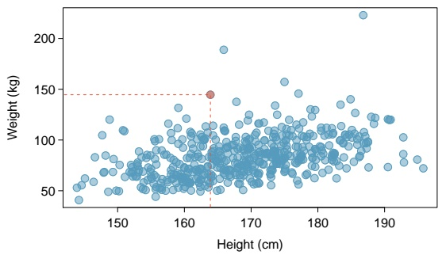

scatter

| Height (cm) | Weight (kg) |
| --- | --- |
| ~145 | ~42 |
| ~146 | ~58 |
| ~147 | ~60 |
| ~148 | ~85 |
| ~149 | ~105 |
| ~150 | ~122 |
| ~151 | ~110 |
| ~152 | ~70 |
| ~153 | ~65 |
| ~154 | ~75 |
| ~155 | ~80 |
| ~156 | ~90 |
| ~157 | ~100 |
| ~158 | ~110 |
| ~159 | ~135 |
| ~160 | ~105 |
| ~161 | ~95 |
| ~162 | ~85 |
| ~163 | ~75 |
| ~164 | 145 |
| ~165 | ~190 |
| ~166 | ~140 |
| ~167 | ~125 |
| ~168 | ~115 |
| ~169 | ~105 |
| ~170 | ~95 |
| ~171 | ~85 |
| ~172 | ~75 |
| ~173 | ~65 |
| ~174 | ~55 |
| ~175 | ~45 |
| ~176 | ~35 |
| ~177 | ~25 |
| ~178 | ~15 |
| ~179 | ~5 |
| ~180 | ~20 |
| ~181 | ~30 |
| ~182 | ~40 |
| ~183 | ~50 |
| ~184 | ~60 |
| ~185 | ~70 |
| ~186 | ~80 |
| ~187 | ~90 |
| ~188 | ~100 |
| ~189 | ~110 |
| ~190 | 225 |
| ~191 | 122 |
| ~192 | 75 |
| ~193 | 85 |
| ~194 | 72 |

(a)

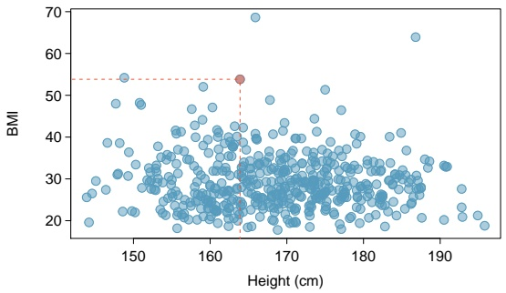

scatter

| Series | Height (cm) (range) | BMI (range) |
| --- | --- | --- |
| Blue circles | 145~195 | 20~70 |
| Red circle | ~164 | ~54 |

(b)

Figure 1.27: (a) A scatterplot showing height versus weight from the 500 individuals in the sample from NHANES. One participant 163.9 cm tall (about 5 ft, 4 in) and weighing 144.6 kg (about 319 lb) is highlighted. (b) A scatterplot showing height versus BMI from the 500 individuals in the sample from NHANES. The same individual highlighted in (a) is marked here, with BMI 53.83.

E

<small>38The sample is available as nhanes.samp.adult.500 in the R oibiostat package.</small>

<small>39BMI = weightkg weightlb × 703. height2m = height2i</small>

<small>40<a href="https://www.nhlbi.nih.gov/health/educational/lose_wt/risk.htm">https://www.nhlbi.nih.gov/health/educational/lose\_wt/risk.htm</a></small>

---

40

CHAPTER 1. INTRODUCTION TO DATA

## EXAMPLE 1.15

Figure 1.28 is a scatterplot of life expectancy versus annual per capita income for 165 countries in 2011. Life expectancy is measured as the expected lifespan for children born in 2011 and income is adjusted for purchasing power in a country. Describe the relationship between life expectancy and annual per capita income; do they seem to be linearly associated?

Life expectancy and annual per capita income are positively associated; higher per capita income is associated with longer life expectancy. However, the two variables are not linearly associated. When income is low, small increases in per capita income are associated with relatively large increases in life expectancy. However, once per capita income exceeds approximately \$20,000 per year, increases in income are associated with smaller gains in life expectancy.

In a linear association, change in the y-variable for every unit of the x-variable is consistent across the range of the x-variable; for example, a linear association would be present if an increase in income of \$10,000 corresponded to an increase in life expectancy of 5 years, across the range of income.

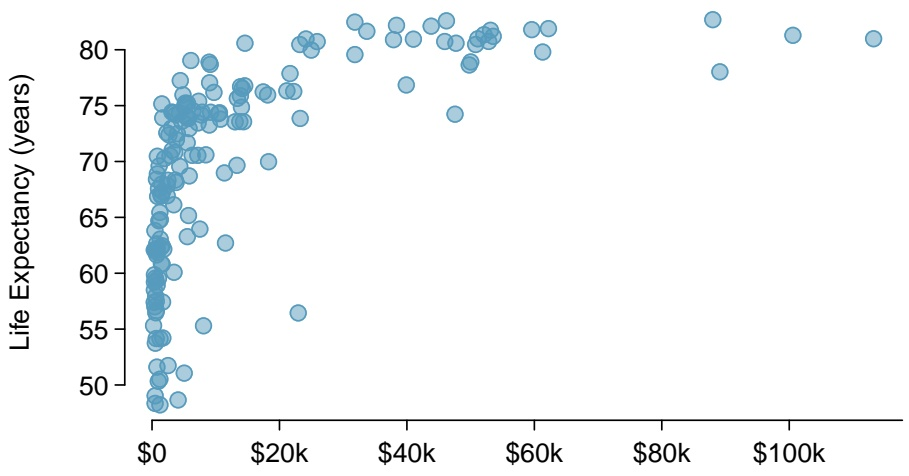

bubble

| X ($) | Life Expectancy (years) |
| --- | --- |
| ~1000 | ~48 |
| ~1500 | ~52 |
| ~2000 | ~51 |
| ~2500 | ~55 |
| ~3000 | ~60 |
| ~3500 | ~63 |
| ~4000 | ~67 |
| ~4500 | ~70 |
| ~5000 | ~72 |
| ~5500 | ~74 |
| ~6000 | ~76 |
| ~6500 | ~78 |
| ~7000 | ~79 |
| ~7500 | ~81 |
| ~8000 | ~82 |
| ~8500 | ~83 |
| ~9000 | ~84 |
| ~9500 | ~85 |
| ~10000 | ~86 |
| ~10500 | ~87 |
| ~11000 | ~88 |
| ~11500 | ~89 |
| ~12000 | ~90 |
| ~12500 | ~91 |
| ~13000 | ~92 |
| ~13500 | ~93 |
| ~14000 | ~94 |
| ~14500 | ~95 |
| ~15000 | ~96 |
| ~15500 | ~97 |
| ~16000 | ~98 |
| ~16500 | ~99 |
| ~17000 | ~100 |
| ~17500 | ~101 |
| ~18000 | ~102 |
| ~18500 | ~103 |
| ~19000 | ~104 |
| ~19500 | ~105 |
| ~20000 | ~106 |
| ~21000 | ~107 |
| ~22000 | ~108 |
| ~23000 | ~109 |
| ~24000 | ~110 |
| ~25000 | ~111 |
| ~26000 | ~112 |
| ~27000 | ~113 |
| ~28000 | ~114 |
| ~29000 | ~115 |
| ~30000 | ~116 |
| ~31000 | ~117 |
| ~32000 | ~118 |
| ~33000 | ~119 |
| ~34000 | ~120 |
| ~35000 | ~121 |
| ~36000 | ~122 |
| ~37000 | ~123 |
| ~38000 | ~124 |
| ~39000 | ~125 |
| ~40000 | ~126 |
| ~41000 | ~127 |
| ~42000 | ~128 |
| ~43000 | ~129 |
| ~44000 | ~130 |
| ~45000 | ~131 |
| ~46000 | ~132 |
| ~47000 | ~133 |
| ~48000 | ~134 |
| ~49000 | ~135 |
| ~50000 | ~136 |
| ~51000 | ~137 |
| ~52000 | ~138 |
| ~53000 | ~139 |
| ~54000 | ~140 |
| ~55000 | ~141 |
| ~56000 | ~142 |
| ~57000 | ~143 |
| ~58000 | ~144 |
| ~59000 | ~145 |
| ~60000 | ~146 |
| ~61000 | ~147 |
| ~62000 | ~148 |
| ~63000 | ~149 |
| ~64000 | ~150 |
| ~65000 | ~151 |
| ~66000 | ~152 |
| ~67000 | ~153 |
| ~68000 | ~154 |
| ~69000 | ~155 |
| ~70000 | ~156 |
| ~71000 | ~157 |
| ~72000 | ~158 |
| ~73000 | ~159 |
| ~74000 | ~160 |
| ~75000 | ~161 |
| ~76000 | ~162 |
| ~77<fcel>67~78 (clustered points) |

Figure 1.28: A scatterplot of life expectancy (years) versus annual per capita income (US dollars) in the wdi.2011 dataset.

## Correlation

**Correlation** is a numerical summary statistic that measures the strength of a linear relationship between two variables. It is denoted by r, the **correlation coe**ffi**cient**, which takes on values between -1 and 1.

If the paired values of two variables lie exactly on a line, r = ±1; the closer the correlation coefficient is to ±1, the stronger the linear association. When two variables are positively associated, with paired values that tend to lie on a line with positive slope, $r > 0 .$ . If two variables are negatively associated, $r < 0 .$ A value of r that is 0 or approximately 0 indicates no apparent association between two variables.41

r
correlation
coefficient

<small>41If paired values lie perfectly on either a horizontal or vertical line, there is no association and r is mathematically undefined.</small>

---

1.6. RELATIONSHIPS BETWEEN TWO VARIABLES

41

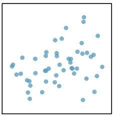

scatter

| X (range) | Y (range) |
| --- | --- |
| 0~100 | 0~100 |

R = 0.33

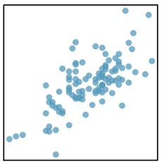

scatter

| X (range) | Y (range) |
| --- | --- |
| 0~100 | 0~100 |

R = 0.69

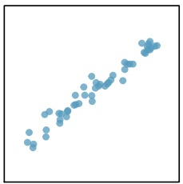

scatter

| X (range) | Y (range) |
| --- | --- |
| 0~100 | 0~100 |

R = 0.98

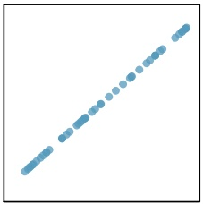

scatter

| X (range) | Y (range) |
| --- | --- |
| 0~100 | 0~100 |

R = 1.00

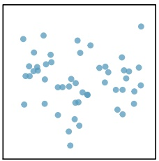

scatter

| X (range) | Y (range) |
| --- | --- |
| 0~100 | 0~100 |

R = −0.08

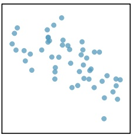

scatter

| X (range) | Y (range) |
| --- | --- |
| 0~100 | 0~100 |

R = −0.64

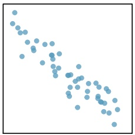

scatter

| X (range) | Y (range) |
| --- | --- |
| 0~100 | 0~100 |

R = −0.92

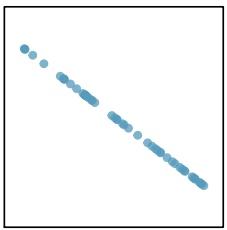

scatter

| X (range) | Y (range) |
| --- | --- |
| 0~100 | 0~100 |

R = −1.00

Figure 1.29: Scatterplots and their correlation coefficients. The first row shows positive associations and the second row shows negative associations. From left to right, strength of the linear association between x and y increases.

The correlation coefficient quantifies the strength of a linear trend. Prior to calculating a correlation, it is advisable to confirm that the data exhibit a linear relationship. Although it is mathematically possible to calculate correlation for any set of paired observations, such as the life expectancy versus income data in Figure 1.28, correlation cannot be used to assess the strength of a nonlinear relationship.

## CORRELATION

The correlation between two variables x and y is given by:

$$
r = \frac {1}{n - 1} \sum_ {i = 1} ^ {n} \left(\frac {x _ {i} - \overline {{x}}}{s _ {x}}\right) \left(\frac {y _ {i} - \overline {{y}}}{s _ {y}}\right), \tag {1.16}
$$

where $(x_{1},y_{1}),(x_{2},y_{2}),\cdots,(x_{n},y_{n})$ are the n paired values of x and y, and $s _ { x }$ and $s _ { y }$ are the sample standard deviations of the x and y variables, respectively.

---

42

CHAPTER 1. INTRODUCTION TO DATA

## EXAMPLE 1.17

Calculate the correlation coefficient of x and y, plotted in Figure 1.30.

Calculate the mean and standard deviation for x and y: $\overline { { x } } = 2 ,   \overline { { y } } = 3 ,   s _ { x } = 1$ , and $s _ { y } = 2 . 6 5 .$

$$
\begin{array}{l} r = \frac {1}{n - 1} \sum_ {i = 1} ^ {n} \left(\frac {x _ {i} - \overline {{x}}}{s _ {x}}\right) \left(\frac {y _ {i} - \overline {{y}}}{s _ {y}}\right) \\ = \frac {1}{3 - 1} \left[ \left(\frac {1 - 2}{1}\right) \left(\frac {5 - 3}{2 . 6 5}\right) + \left(\frac {2 - 2}{1}\right) \left(\frac {4 - 3}{2 . 6 5}\right) + \left(\frac {3 - 2}{1}\right) \left(\frac {0 - 3}{2 . 6 5}\right) \right] \\ = - 0. 9 4. \\ \end{array}
$$

The correlation is -0.94, which reflects the negative association visible from the scatterplot in Figure 1.30.

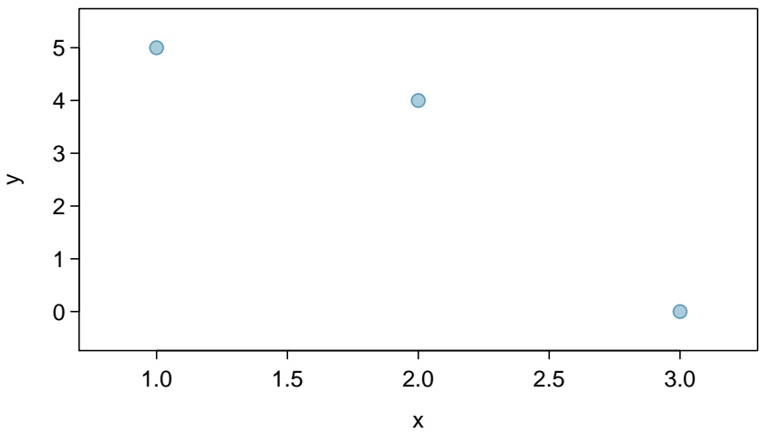

scatter

| x | y |
| --- | --- |
| 1.0 | 5 |
| 2.0 | 4 |
| 3.0 | 0 |

Figure 1.30: A scatterplot showing three points: (1, 5), (2, 4), and (3, 0).

E

---

1.6. RELATIONSHIPS BETWEEN TWO VARIABLES

43

## EXAMPLE 1.18

Is it appropriate to use correlation as a numerical summary for the relationship between life expectancy and income after a log transformation is applied to both variables? Refer to Figure 1.31.

Figure 1.31 shows an approximately linear relationship; a correlation coefficient is a reasonable numerical summary of the relationship. As calculated from statistical software, $r = 0 . 7 9$ , which is indicative of a strong linear relationship.

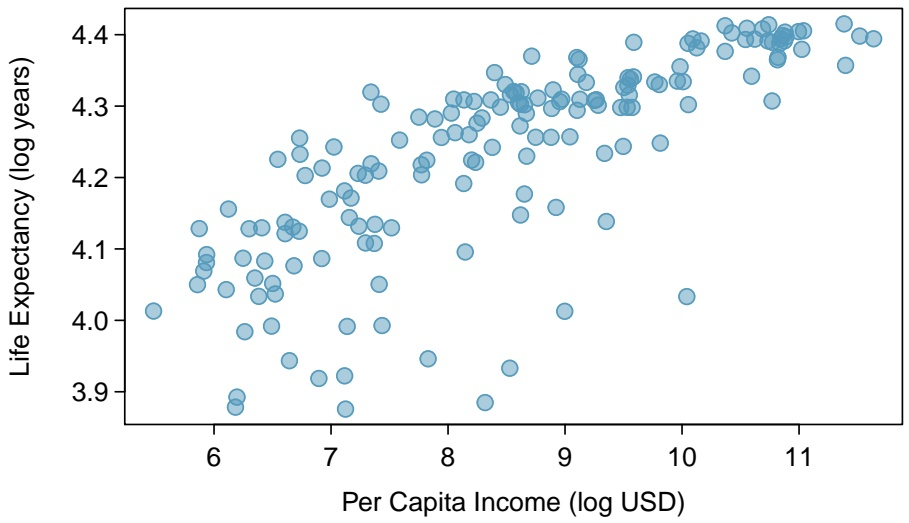

scatter

| Per Capita Income (log USD) | Life Expectancy (log years) |
| --- | --- |
| ~5.6 | ~4.01 |
| ~5.9 | ~4.05 |
| ~6.0 | ~4.08 |
| ~6.1 | ~4.13 |
| ~6.2 | ~3.88 |
| ~6.2 | ~3.90 |
| ~6.3 | ~4.16 |
| ~6.4 | ~4.09 |
| ~6.5 | ~4.13 |
| ~6.6 | ~4.04 |
| ~6.7 | ~4.13 |
| ~6.8 | ~4.23 |
| ~6.9 | ~4.13 |
| ~7.0 | ~3.95 |
| ~7.1 | ~4.25 |
| ~7.2 | ~3.92 |
| ~7.3 | ~4.18 |
| ~7.4 | ~4.21 |
| ~7.5 | ~3.88 |
| ~7.6 | ~4.11 |
| ~7.7 | ~4.00 |
| ~7.8 | ~4.21 |
| ~7.9 | ~4.29 |
| ~8.0 | ~3.95 |
| ~8.1 | ~4.22 |
| ~8.2 | ~4.10 |
| ~8.3 | ~3.89 |
| ~8.4 | ~4.26 |
| ~8.5 | ~4.31 |
| ~8.6 | ~4.32 |
| ~8.7 | ~4.35 |
| ~8.8 | ~4.15 |
| ~8.9 | ~4.37 |
| ~9.0 | ~4.01 |
| ~9.1 | ~4.31 |
| ~9.2 | ~4.37 |
| ~9.3 | ~4.24 |
| ~9.4 | ~4.30 |
| ~9.5 | ~4.39 |
| ~9.6 | ~4.25 |
| ~9.7 | ~4.33 |
| ~9.8 | ~4.30 |
| ~9.9 | ~4.39 |
| ~10.0 | ~4.03 |
| ~10.1 | ~4.39 |
| ~10.2 | ~4.38 |
| ~10.3 | ~4.41 |
| ~10.4 | ~4.38 |
| ~10.5 | ~4.42 |
| ~10.6 | ~4.39 |
| ~10.7 | ~4.41 |
| ~10.8 | ~4.31 |
| ~10.9 | ~4.40 |
| ~11.0 | ~4.36 |
| ~11.1 | ~4.42 |
| ~11.2 | ~4.39 |

Figure 1.31: A scatterplot showing log(income) (horizontal axis) vs. log(life.expectancy) (vertical axis).

## 1.6.2 Two categorical variables

## Contingency tables

A **contingency table** summarizes data for two categorical variables, with each value in the table representing the number of times a particular combination of outcomes occurs.42 Figure 1.32 summarizes the relationship between race and genotype in the famuss data.

The **row totals** provide the total counts across each row and the **column totals** are the total counts for each column; collectively, these are the **marginal totals**.

|  | CC | CT | TT | Sum |
| --- | --- | --- | --- | --- |
| African Am | 16 | 6 | 5 | 27 |
| Asian | 21 | 18 | 16 | 55 |
| Caucasian | 125 | 216 | 126 | 467 |
| Hispanic | 4 | 10 | 9 | 23 |
| Other | 7 | 11 | 5 | 23 |
| Sum | 173 | 261 | 161 | 595 |

Figure 1.32: A contingency table for race and actn3.r577x.

E

<small>42Contingency tables are also known as two-way tables.</small>

---

44

CHAPTER 1. INTRODUCTION TO DATA

Like relative frequency tables for the distribution of one categorical variable, contingency tables can also be converted to show proportions. Since there are two variables, it is necessary to specify whether the proportions are calculated according to the row variable or the column variable.

Figure 1.33 shows the row proportions for Figure 1.32; these proportions indicate how genotypes are distributed within each race. For example, the value of 0.593 in the upper left corner indicates that of the African Americans in the study, 59.3% have the CC genotype.

|  | CC | CT | TT | Sum |
| --- | --- | --- | --- | --- |
| African Am | 0.593 | 0.222 | 0.185 | 1.000 |
| Asian | 0.382 | 0.327 | 0.291 | 1.000 |
| Caucasian | 0.268 | 0.463 | 0.270 | 1.000 |
| Hispanic | 0.174 | 0.435 | 0.391 | 1.000 |
| Other | 0.304 | 0.478 | 0.217 | 1.000 |

Figure 1.33: A contingency table with row proportions for the race and actn3.r577x variables.

Figure 1.34 shows the column proportions for Figure 1.32; these proportions indicate the distribution of races within each genotype category. For example, the value of 0.092 indicates that of the CC individuals in the study, 9.2% are African American.

|  | CC | CT | TT |
| --- | --- | --- | --- |
| African Am | 0.092 | 0.023 | 0.031 |
| Asian | 0.121 | 0.069 | 0.099 |
| Caucasian | 0.723 | 0.828 | 0.783 |
| Hispanic | 0.023 | 0.038 | 0.056 |
| Other | 0.040 | 0.042 | 0.031 |
| Sum | 1.000 | 1.000 | 1.000 |

Figure 1.34: A contingency table with column proportions for the race and actn3.r577x variables.

## EXAMPLE 1.19

For African Americans in the study, CC is the most common genotype and TT is the least common genotype. Does this pattern hold for the other races in the study? Do the observations from the study suggest that distribution of genotypes at r577x vary between populations?

The pattern holds for Asians, but not for other races. For the Caucasian individuals sampled in the study, CT is the most common genotype at 46.3%. CC is the most common genotype for Asians, but in this population, genotypes are more evenly distributed: 38.2% of Asians sampled are CC, 32.7% are CT, and 29.1% are TT. The distribution of genotypes at r577x seems to vary by population.

## GUIDED PRACTICE 1.20

As shown in Figure 1.34, 72.3% of CC individuals in the study are Caucasian. Do these data suggest that in the general population, people of CC genotype are highly likely to be Caucasian?43

E

G

<small>43No, this is not a reasonable conclusion to draw from the data. The high proportion of Caucasians among CC individuals primarily reflects the large number of Caucasians sampled in the study – 78.5% of the people sampled are Caucasian. The uneven representation of different races is one limitation of the famuss data.</small>

---

1.6. RELATIONSHIPS BETWEEN TWO VARIABLES

45

## Segmented bar plots

A **segmented bar plot** is a way of visualizing the information from a contingency table. Figure 1.35 graphically displays the data from Figure 1.32; each bar represents a level of actn3.r577x and is divided by the levels of race. Figure 1.35(b) uses the row proportions to create a standardized segmented bar plot.

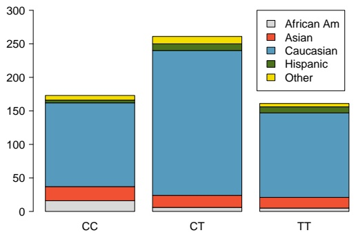

bar_stacked

| Category | African Am | Asian | Caucasian | Hispanic | Other |
| --- | --- | --- | --- | --- | --- |
| CC | ~15 | ~25 | ~130 | ~5 | ~8 |
| CT | ~5 | ~20 | ~220 | ~10 | ~12 |
| TT | ~5 | ~18 | ~125 | ~12 | ~7 |

(a)

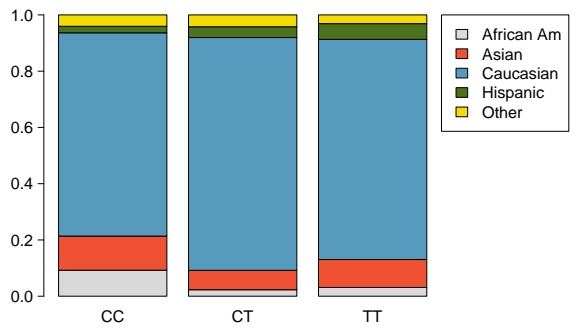

bar_stacked

| Category | African Am | Asian | Caucasian | Hispanic | Other |
| --- | --- | --- | --- | --- | --- |
| CC | ~0.10 | ~0.12 | ~0.73 | ~0.01 | ~0.04 |
| CT | ~0.02 | ~0.08 | ~0.81 | ~0.03 | ~0.05 |
| TT | ~0.03 | ~0.11 | ~0.76 | ~0.06 | ~0.03 |

(b)

Figure 1.35: (a) Segmented bar plot for individuals by genotype, with bars divided by race. (b) Standardized version of Figure (a).

Alternatively, the data can be organized as shown in Figure 1.36, with each bar representing a level of race. The standardized plot is particularly useful in this case, presenting the distribution of genotypes within each race more clearly than in Figure 1.36(a).

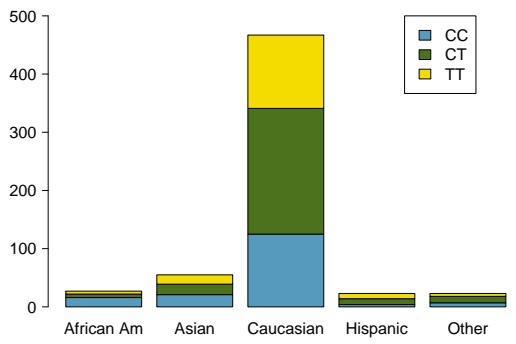

bar_stacked

| Category | CC | CT | TT |
| --- | --- | --- | --- |
| African Am | ~15 | ~10 | ~8 |
| Asian | ~20 | ~20 | ~18 |
| Caucasian | ~125 | ~235 | ~145 |
| Hispanic | ~5 | ~10 | ~10 |
| Other | ~10 | ~10 | ~10 |

(a)

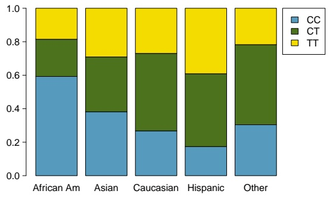

bar_stacked

| Category | CC | CT | TT |
| --- | --- | --- | --- |
| African Am | ~0.60 | ~0.21 | ~0.18 |
| Asian | ~0.38 | ~0.32 | ~0.30 |
| Caucasian | ~0.27 | ~0.45 | ~0.26 |
| Hispanic | ~0.18 | ~0.43 | ~0.39 |
| Other | ~0.30 | ~0.47 | ~0.21 |

(b)

Figure 1.36: (a) Segmented bar plot for individuals by race, with bars divided by genotype. (b) Standardized version of Figure (a).

---

46

CHAPTER 1. INTRODUCTION TO DATA

## Two-by-two tables: relative risk

The results from medical studies are often presented in **two-by-two tables** (2 × 2 tables), contingency tables for categorical variables that have two levels. One of the variables defines two groups of participants, while the other represents the two possible outcomes. Figure 1.37 shows a hypo thetical two-by-two table of outcome by group.

|  | Outcome A | Outcome B | Sum |
| --- | --- | --- | --- |
| Group 1 | a | b | a+b |
| Group 2 | c | d | c+d |
| Sum | a+c | b+d | a+b+c+d=n |

Figure 1.37: A hypothetical two-by-two table of outcome by group.

In the LEAP study, participants are divided into two groups based on treatment (peanut avoidance versus peanut consumption), while the outcome variable records whether an individual passed or failed the oral food challenge (OFC). The results of the LEAP study as shown in Figure 1.2 are in the form of a $: 2 \times 2$ table; the table is reproduced below as Figure 1.38.

A statistic called the **relative risk** (RR) can be used to summarize the data in a $2 \times 2$ table; the relative risk is a measure of the risk of a certain event occurring in one group relative to the risk of the event occurring in another group.44

|  | FAIL OFC | PASS OFC | Sum |
| --- | --- | --- | --- |
| Peanut Avoidance | 36 | 227 | 263 |
| Peanut Consumption | 5 | 262 | 267 |
| Sum | 41 | 489 | 530 |

Figure 1.38: Results of the LEAP study, described in Section 1.1.

The question of interest in the LEAP study is whether the risk of developing peanut allergy (i.e., failing the OFC) differs between the peanut avoidance and consumption groups. The relative risk of failing the OFC equals the ratio of the proportion of individuals in the avoidance group who failed the OFC to the proportion of individuals in the consumption group who failed the OFC.

## EXAMPLE 1.21

Using the results from the LEAP study, calculate and interpret the relative risk of failing the oral food challenge, comparing individuals in the avoidance group to individuals in the consumption group.

$$
R R _ {\text {failing OFC}} = \frac {\text {proportion in avoidance group who failed OFC}}{\text {proportion in consumption group who failed OFC}} = \frac {3 6 / 2 6 3}{5 / 2 6 7} = 7. 3 1.
$$

The relative risk is 7.31. The risk of failing the oral food challenge was more than 7 times greater for participants in the peanut avoidance group than for those in the peanut consumption group.

E

<small>44Chapter 8 discusses another numerical summary for 2 × 2 tables, the odds ratio.</small>

---

1.6. RELATIONSHIPS BETWEEN TWO VARIABLES

47

## EXAMPLE 1.22

An observational study is conducted to assess the association between smoking and cardiovascular disease (CVD), in which researchers identified a cohort of individuals and categorized them ac cording to smoking and disease status. If the relative risk of CVD is calculated as the ratio of the proportion of smokers with CVD to the proportion of non-smokers with CVD, interpret the results of the study if the relative risk equals 1, is less than 1, or greater than 1.

A relative risk of 1 indicates that the risk of CVD is equal for smokers and non-smokers.

A relative risk less than 1 indicates that smokers are at a lower risk of CVD than non-smokers; i.e., the proportion of individuals with CVD among smokers is lower than the proportion among non-smokers.

A relative risk greater than 1 indicates that smokers are at a higher risk of CVD than non-smokers; i.e., the proportion of individuals with CVD among smokers is higher than the proportion among non-smokers.

## GUIDED PRACTICE 1.23

For the study described in Example 1.22, suppose that of the 231 individuals, 111 are smokers. 40 smokers and 32 non-smokers have cardiovascular disease. Calculate and interpret the relative risk of CVD.45

Relative risk relies on the assumption that the observed proportions of an event occurring in each group are representative of the risk, or incidence, of the event occurring within the populations from which the groups are sampled. For example, in the LEAP data, the relative risk assumes that the proportions 33/263 and 5/267 are estimates of the proportion of individuals who would fail the OFC among the larger population of infants who avoid or consume peanut products.

## EXAMPLE 1.24

Suppose another study to examine the association between smoking and cardiovascular disease is conducted, but researchers use a different study design than described in Example 1.22. For the new study, 90 individuals with CVD and 110 individuals without CVD are recruited. 40 of the individuals with CVD are smokers, and 80 of the individuals without CVD are non-smokers. Should relative risk be used to summarize the observations from the new study?

Relative risk should not be calculated for these observations. Since the number of individuals with and without CVD is fixed by the study design, the proportion of individuals with CVD within a certain group (smokers or non-smokers) as calculated from the data is not a measure of CVD risk for that population.

<small>45The relative risk of CVD, comparing smokers to non-smokers, is (40/111)/(32/120) = 1.35. Smoking is associated with a 35% increase in the probability of CVD; in other words, the risk of CVD is 35% greater in smokers compared to non-smokers.</small>

---

48

CHAPTER 1. INTRODUCTION TO DATA

## GUIDED PRACTICE 1.25

For a study examining the association between tea consumption and esophageal carcinoma, researchers recruited 300 patients with carcinoma and 571 without carcinoma and administered a questionnaire about tea drinking habits.46 Of the 47 individuals who reported that they regularly drink green tea, 17 had carcinoma. Of the 824 individuals who reported that they never, or very rarely, drink green tea, 283 had carcinoma. Evaluate whether the proportions 17/47 and 283/824 are representative of the incidence rate of carcinoma among individuals who drink green tea regularly and those who do not.47

## RELATIVE RISK

The relative risk of Outcome A in the hypothetical two-by-two table (Figure 1.37) can be calculated using either Group 1 or Group 2 as the reference group:

$$
R R _ {\mathrm{A,comparingGroup1toGroup2}} = \frac {a / (a + b)}{c / (c + d)}
$$

$$
R R _ {\mathrm{A,comparingGroup2toGroup1}} = \frac {c / (c + d)}{a / (a + b)}
$$

The relative risk should only be calculated for data where the proportions a/(a+b) and $c / ( c   +   d )$ represent the incidence of Outcome A within the populations from which Groups 1 and 2 are sampled.

## 1.6.3 A numerical variable and a categorical variable

Methods for comparing numerical data across groups are based on the approaches introduced in Section 1.4. **Side-by-side boxplots** and **hollow histograms** are useful for directly comparing how the distribution of a numerical variable differs by category.

Recall the question introduced in Section 1.2.3: is ACTN3 genotype associated with variation in muscle function? Figure 1.39 visually shows the relationship between muscle function (measured as percent change in non-dominant arm strength) and ACTN3 genotype in the famuss data with side-by-side boxplots and hollow histograms. The hollow histograms highlight how the shapes of the distributions of ndrm.ch for each genotype are essentially similar, although the distribution for the CC genotype has less right skewing. The side-by-side boxplots are especially useful for comparing center and spread, and reveal that the T allele appears to be associated with greater muscle function; median percent change in non-dominant arm strength increases across the levels from CC to TT.

## GUIDED PRACTICE 1.26

Using Figure 1.40, assess how maternal investment varies with altitude.48

<small>46Tea drinking habits and oesophageal cancer in a high risk area in northern Iran: population based casecontrol study, Islami F, et al., BMJ (2009), doi 10.1136/bmj.b929</small>

<small>47The proportions calculated from the study data should not be used as estimates of the incidence rate of esophageal carcinoma among individuals who drink green tea regularly and those who do not, since the study selected participants based on carcinoma status.</small>

<small>48As a general rule, clutches found at higher altitudes have greater volume; median clutch volume tends to increase as altitude increases. This suggests that increased altitude is associated with a higher level of maternal investment.</small>

---

1.6. RELATIONSHIPS BETWEEN TWO VARIABLES

49

Figure 1.39: Side-by-side boxplot and hollow histograms for ndrm.ch, split by levels of actn3.r577x.

boxplot

| Altitude | Q1 | Q2 (Median) | Q3 | IQR |
| --- | --- | --- | --- | --- |
| 2,035.00 | ~600 | ~800 | ~900 | ~300 |
| 2,926.00 | ~600 | ~750 | ~800 | ~200 |
| 3,080.00 | ~700 | ~1050 | ~1350 | ~650 |
| 3,189.00 | ~800 | ~1100 | ~1550 | ~750 |
| 3,479.00 | ~650 | ~1150 | ~1480 | ~830 |
| 3,493.00 | ~950 | ~1100 | ~1300 | ~450 |

Figure 1.40: Side-by-side boxplot comparing the distribution of clutch.volume for different altitudes.

---

50

CHAPTER 1. INTRODUCTION TO DATA

## 1.7 Exploratory data analysis

The simple techniques for summarizing and visualizing data that have been introduced in this chapter may not seem especially powerful, but when applied in practice, they can be instrumental for gaining insight into the interesting features of a dataset. This section provides three examples of data-driven research questions that can be investigated through exploratory data analysis.

## 1.7.1 Case study: discrimination in developmental disability support

In the United States, individuals with developmental disabilities typically receive services and support from state governments. The State of California allocates funds to developmentally disabled residents through the California Department of Developmental Services (DDS); individuals receiving DDS funds are referred to as ’consumers’. The dataset dds.discr represents a sample of 1,000 DDS consumers (out of a total population of approximately 250,000), and includes information about age, gender, ethnicity, and the amount of financial support per consumer provided by the DDS.49 Figure 1.41 shows the first five rows of the dataset, and the variables are described in Figure 1.42.

A team of researchers examined the mean annual expenditures on consumers by ethnicity, and found that the mean annual expenditures on Hispanic consumers was approximately onethird of the mean expenditures on White non-Hispanic consumers. As a result, an allegation of ethnic discrimination was brought against the California DDS.

Does this finding represent sufficient evidence of ethnic discrimination, or might there be more to the story? This section will illustrate the process behind conducting an exploratory analysis that not only investigates the relationship between two variables of interest, but also considers whether other variables might be influencing that relationship.

|  | id | age.cohort | age | gender | expenditures | ethnicity |
| --- | --- | --- | --- | --- | --- | --- |
| 1 | 10210 | 13-17 | 17 | Female | 2113 | White not Hispanic |
| 2 | 10409 | 22-50 | 37 | Male | 41924 | White not Hispanic |
| 3 | 10486 | 0-5 | 3 | Male | 1454 | Hispanic |
| 4 | 10538 | 18-21 | 19 | Female | 6400 | Hispanic |
| 5 | 10568 | 13-17 | 13 | Male | 4412 | White not Hispanic |

Figure 1.41: Five rows from the dds.discr data matrix.

| variable | description |
| --- | --- |
| id | Unique identification code for each resident |
| age.cohort | Age as sorted into six groups, 0-5 years, 6-12 years, 13-17 years, 18-21 years, 22-50 years, and 51+ years |
| age | Age, measured in years |
| gender | Gender, either Female or Male |
| expenditures | Amount of expenditures spent by the State on an individual annually, measured in USD |
| ethnicity | Ethnic group, recorded as either American Indian, Asian, Black, Hispanic, Multi Race, Native Hawaiian, Other, or White Not Hispanic |

Figure 1.42: Variables and their descriptions for the dds.discr dataset.

<small>49The dataset is based on actual attributes of consumers, but has been altered to maintain consumer privacy.</small>

---

1.7. EXPLORATORY DATA ANALYSIS

51

## Distributions of single variables

To begin understanding a dataset, start by examining the distributions of single variables using numerical and graphical summaries. This process is essential for developing a sense of context; in this case, examining variables individually addresses questions such as "What is the range of annual expenditures?", "Do consumers tend to be older or younger?", and "Are there more consumers from one ethnic group versus another?".

Figure 1.43 illustrates the right skew of expenditures, indicating that for the majority of consumers, expenditures are relatively low; most are within the \$0 - \$5,000 range. There are some consumers for which expenditures are much higher, such as within the \$60,000 - \$80,000 range. Precise numerical summaries can be calculated using statistical software: the quartiles for expenditures are \$2,899, \$7,026, and \$37,710.

histogram

| Expenditures (USD) (range) | Frequency |
| --- | --- |
| 0~5000 | ~450 |
| 5000~10000 | ~120 |
| 10000~15000 | ~90 |
| 15000~20000 | ~15 |
| 20000~25000 | ~5 |
| 25000~30000 | ~15 |
| 30000~35000 | ~35 |
| 35000~40000 | ~65 |
| 40000~45000 | ~75 |
| 45000~50000 | ~65 |
| 50000~55000 | ~50 |
| 55000~60000 | ~35 |
| 60000~65000 | ~15 |
| 65000~70000 | ~5 |
| 70000~75000 | ~2 |
| 75000~80000 | ~2 |

Figure 1.43: A histogram of expenditures.

A consumer’s age is directly recorded as the variable age; in the age.cohort variable, con sumers are assigned to one of six age cohorts. The cohorts are indicative of particular life phases. In the first three cohorts, consumers are still living with their parents as they move through preschool age, elementary/middle school age, and high school age. In the 18-21 cohort, consumers are transitioning from their parents’ homes to living on their own or in supportive group homes. From ages 22-50, individuals are mostly no longer living with their parents but may still receive some support from family. In the 51+ cohort, consumers often have no living parents and typically require the most amount of support.

---

52

CHAPTER 1. INTRODUCTION TO DATA

Figure 1.44 reveals the right-skewing of age. Most consumers are younger than 30. The plot in Figure 1.44(b) graphically shows the number of individuals in each age cohort. There are approximately 200 individuals in each of the middle four cohorts, while there are about 100 individuals in the other two cohorts.

Figure 1.44: (a) Histogram of age. (b) Plot of age.cohort.

There are eight ethnic groups represented in dds.discr. The two largest groups, Hispanic and White non-Hispanic, together represent about 80% of the consumers.

bar

| Ethnicity | Frequency |
| --- | --- |
| American Indian | ~5 |
| Asian | ~130 |
| Black | ~60 |
| Hispanic | ~380 |
| Multi Race | ~30 |
| Native Hawaiian | ~5 |
| Other | ~5 |
| White not Hispanic | 400 |

Figure 1.45: A plot of ethnicity.

## GUIDED PRACTICE 1.27

Using Figure 1.46, does gender appear to be balanced in the dds.discr dataset?50

Figure 1.46: A plot of gender.

<small>50Yes, approximately half of the individuals are female and half are male.</small>

---

1.7. EXPLORATORY DATA ANALYSIS

53

## Relationships between two variables

After examining variables individually, explore how variables are related to each other. While there exist methods for summarizing more than two variables simultaneously, focusing on two variables at a time can be surprisingly effective for making sense of a dataset. It is useful to begin by inves tigating the relationships between the primary response variable of interest and the exploratory variables. In this case study, the response variable is expenditures, the amount of funds the DDS allocates annually to each consumer. How does expenditures vary by age, ethnicity, and gender?

Figure 1.47 shows a side-by-side boxplot of expenditures by age cohort. There is a clear upward trend, in which older individuals tend to receive more DDS funds. This reflects the underlying context of the data. The purpose of providing funds to developmentally disabled individuals is to help them maintain a quality of life similar to those without disabilities; as individuals age, it is expected their financial needs will increase. Some of the observed variation in expenditures can be attributed to the fact that the dataset includes a wide range of ages. If the data included only individuals in one cohort, such as the 22-50 cohort, the distribution of expenditures would be less variable, and range between \$30,000 and \$60,000 instead of from \$0 and \$80,000.

boxplot

| Age (years) | Q1 | Q2 (Median) | Q3 | IQR |
| --- | --- | --- | --- | --- |
| 0–5 | ~1000 | ~1500 | ~2000 | ~1000 |
| 6–12 | ~1500 | ~2500 | ~3000 | ~1500 |
| 13–17 | ~3000 | ~4000 | ~5000 | ~2000 |
| 18–21 | ~7500 | ~10000 | ~12000 | ~4500 |
| 22–50 | ~36500 | ~40500 | ~45000 | ~9500 |
| 51+ | ~49500 | ~53500 | ~58000 | ~9500 |

Figure 1.47: A plot of expenditures by age.cohort.

---

54

CHAPTER 1. INTRODUCTION TO DATA

How does the distribution of expenditures vary by ethnic group? Does there seem to be a difference in the amount of funding that a person receives, on average, between different ethnicities? A side-by-side boxplot of expenditures by ethnicity (Figure 1.48) reveals that the distribution of expenditures is quite different between ethnic groups. For example, there is very little variation in expenditures for the Multi Race, Native Hawaiian, and Other groups. Additionally, the median expenditures are not the same between groups; the medians for American Indian and Native Hawaiian individuals are about \$40,000, as compared to medians of approximately \$10,000 for Asian and Black consumers.

boxplot

| Ethnicity | Q1 | Q2 (Median) | Q3 | IQR |
| --- | --- | --- | --- | --- |
| American Indian | ~22000 | ~42000 | ~56000 | ~34000 |
| Asian | ~3000 | ~9000 | ~34000 | ~31000 |
| Black | ~3000 | ~8000 | ~42000 | ~39000 |
| Hispanic | ~3000 | ~4000 | ~11000 | ~8000 |
| Multi Race | ~1500 | ~2500 | ~4500 | ~3000 |
| Native Hawaiian | ~38000 | ~41000 | ~46000 | ~8000 |
| Other | ~2500 | ~3500 | ~4500 | ~2000 |
| White not Hispanic | ~4000 | ~16000 | ~43000 | ~47000 |

Figure 1.48: A plot of expenditures by ethnicity.

The trend visible in Figure 1.48 seems potentially indicative of ethnic discrimination. Before proceeding with the analysis, however, it is important to take into account the fact that two of the groups, Hispanic and White non-Hispanic, comprise the majority of the data; some ethnic groups represent less than 10% of the observations (Figure 1.45). For ethnic groups with relatively small sample sizes, it is possible that the observed samples are not representative of the larger populations. The rest of this analysis will focus on comparing how expenditures varies between the two largest groups, White non-Hispanic and Hispanic.

## GUIDED PRACTICE 1.28

Using Figure 1.49, do annual expenditures seem to vary by gender?51

boxplot

| Gender | Q1 | Q2 (Median) | Q3 | Min | Max |
| --- | --- | --- | --- | --- | --- |
| Female | ~4000 | ~7000 | 40000 | ~1000 | ~76000 |
| Male | ~4000 | ~8000 | ~38000 | ~1000 | ~69000 |

Figure 1.49: A plot of expenditures by gender.

<small>51No, the distribution of expenditures within males and females is very similar; both are right skewed, with approximately equal median and interquartile range.</small>

---

1.7. EXPLORATORY DATA ANALYSIS

55

Figure 1.50 compares the distribution of expenditures between Hispanic and White non-Hispanic consumers. Most Hispanic consumers receive between about \$0 to \$20,000 from the California DDS; individuals receiving amounts higher than this are upper outliers. However, for White non-Hispanic consumers, median expenditures is at \$20,000, and the middle 50% of consumers receive between \$5,000 and \$40,000. The precise summary statistics can be calculated from computing software, as shown in the corresponding R lab. The mean expenditures for Hispanic consumers is \$11,066, while the mean expenditures for White non-Hispanic consumers is over twice as large at \$24,698. On average, a Hispanic consumer receives less financial support from the California DDS than a White non-Hispanic consumer. Does this represent evidence of discrimination?

boxplot

| Ethnicity | Q1 | Q2 (Median) | Q3 | IQR |
| --- | --- | --- | --- | --- |
| Hispanic | ~2000 | ~4000 | ~10000 | ~8000 |
| White not Hispanic | ~4000 | ~16000 | ~43000 | ~47000 |

Figure 1.50: A plot of expenditures by ethnicity, showing only Hispanics and White Non-Hispanics.

Recall that expenditures is strongly associated with age—older individuals tend to receive more financial support. Is there also an association between age and ethnicity, for these two ethnic groups? When using data to investigate a question, it is important to explore not only how explanatory variables are related to the response variable(s), but also how explanatory variables influence each other.

Figures 1.51 and 1.52 show the distribution of age within Hispanics and White non-Hispanics. Hispanics tend to be younger, with most Hispanic consumers falling into the 6-12, 13-17, and 18-21 age cohorts. In contrast, White non-Hispanics tend to be older; most consumers in this group are in the 22-50 age cohort, and relatively more White non-Hispanic consumers are in the 51+ age cohort as compared to Hispanics.

bar

| Age (years) | Frequency |
| --- | --- |
| 0–5 | ~44 |
| 6–12 | ~91 |
| 13–17 | ~103 |
| 18–21 | ~78 |
| 22–50 | ~43 |
| 51+ | ~17 |

(a)

bar

| Age (years) | Frequency |
| --- | --- |
| 0–5 | ~20 |
| 6–12 | ~46 |
| 13–17 | ~67 |
| 18–21 | ~69 |
| 22–50 | ~132 |
| 51+ | ~66 |

(b)

Figure 1.51: (a) Plot of age.cohort within Hispanics. (b) Plot of age.cohort within White non-Hispanics.

---

56

CHAPTER 1. INTRODUCTION TO DATA

| Age Cohort | Hispanic | White Non-Hispanic |
| --- | --- | --- |
| 0-5 | 44/376 = 12% | 20/401 = 5% |
| 6-12 | 91/376 = 24% | 46/401 = 11% |
| 13-17 | 103/376 = 27% | 67/401 = 17% |
| 18-21 | 78/376 = 21% | 69/401 = 17% |
| 22-50 | 43/376 = 11% | 133/401 = 33% |
| 51+ | 17/376 = 5% | 66/401 = 16% |
| Sum | 376/376 = 100% | 401/401 = 100% |

Figure 1.52: Consumers by ethnicity and age cohort, shown both as counts and proportions.

Recall that a confounding variable is a variable that is associated with the response variable and the explanatory variable under consideration; confounding was initially introduced in the context of sunscreen use and incidence of skin cancer, where sun exposure is a confounder. In this setting, age is a confounder for the relationship between expenditures and ethnicity. Just as it would be incorrect to claim that sunscreen causes skin cancer, it is essential here to recognize that there is more to the story than the apparent association between expenditures and ethnicity.

flowchart

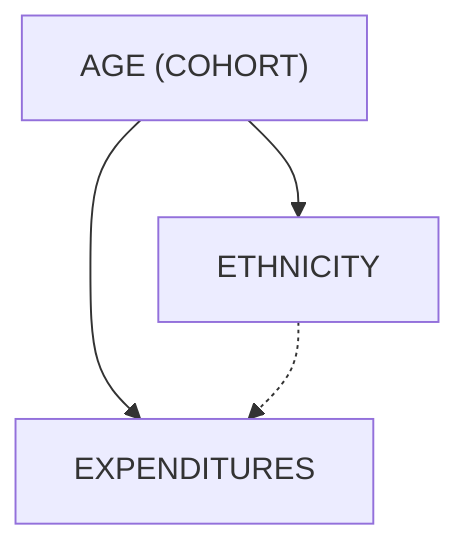

For a closer look at the relationship between age, ethnicity, and expenditures, subset the data further to compare how expenditures differs by ethnicity within each age cohort. If age is indeed the primary source of the observed variation in expenditures, then there should be little difference in average expenditures between individuals in different ethnic groups but the same age cohort.

Figure 1.53 shows the average expenditures within each age cohort, for Hispanics versus White non-Hispanics. The last column contains the difference between the two averages (calculated as White Non-Hispanics average - Hispanics average).

| Age Cohort | Hispanics | White non-Hispanics | Difference |
| --- | --- | --- | --- |
| 0-5 | 1,393 | 1,367 | -26 |
| 6-12 | 2,312 | 2,052 | -260 |
| 13-17 | 3,955 | 3,904 | -51 |
| 18-21 | 9,960 | 10,133 | 173 |
| 22-50 | 40,924 | 40,188 | -736 |
| 51+ | 55,585 | 52,670 | -2915 |
| Average | 11,066 | 24,698 | 13,632 |

Figure 1.53: Average expenditures by ethnicity and age cohort, in USD (\$). For all age cohorts except 18-21 years, average expenditures for White non-Hispanics is lower than for Hispanics.

When expenditures is compared within age cohorts, there are not large differences between mean expenditures for White non-Hispanics versus Hispanics. Comparing individuals of similar ages reveals that the association between ethnicity and expenditures is not nearly as strong as it seemed from the initial comparison of overall averages.

---

1.7. EXPLORATORY DATA ANALYSIS

57

Instead, it is the difference in age distributions of the two populations that is driving the observed discrepancy in expenditures. The overall average of expenditures for the Hispanic consumers is lower because the population of Hispanic consumers is relatively young compared to the population of White non-Hispanic consumers, and the amount of expenditures for younger consumers tends to be lower than for older consumers. Based on an exploratory analysis that accounts for age as a confounding variable, there does not seem to be evidence of ethnic discrimination.

Identifying confounding variables is essential for understanding data. Confounders are often context-specific; for example, age is not necessarily a confounder for the relationship between ethnicity and expenditures in a different population. Additionally, it is rarely immediately obvious which variables in a dataset are confounders; looking for confounding variables is an integral part of exploring a dataset.

Chapter 7 introduces multiple linear regression, a method that can directly summarize the relationship between ethnicity, expenditures, and age, in addition to the tools for evaluating whether the observed discrepancies within age cohorts are greater than would be expected by chance variation alone.

## Simpson’s paradox

These data represent an extreme example of confounding known as **Simpson’s paradox**, in which an association observed in several groups may disappear or reverse direction once the groups are combined. In other words, an association between two variables X and Y may disappear or reverse direction once data are partitioned into subpopulations based on a third variable Z (i.e., a confounding variable).

Figure 1.53 shows how mean expenditures is higher for Hispanics than White non-Hispanics in all age cohorts except one. Yet, once all the data are aggregated, the average expenditures for White non-Hispanics is over twice as large as the average for Hispanics. The paradox can be explored from a mathematical perspective by using weighted averages, where the average expenditure for each cohort is weighted by the proportion of the population in that cohort.

## EXAMPLE 1.29

Using the proportions in Figure 1.52 and the average expenditures for each cohort in Figure 1.53, calculate the overall weighted average expenditures for Hispanics and for White non-Hispanics.52

For Hispanics:

$$
1, 3 9 3 (. 1 2) + 2, 3 1 2 (. 2 4) + 3, 9 5 5 (. 2 7) + 9, 9 6 0 (. 2 1) + 4 0, 9 2 4 (. 1 1) + 5 5, 5 8 5 (. 0 5) = \$ 1 1, 1 6 2.
$$

For White non-Hispanics:

$$
1, 3 6 7 (0. 0 5) + 2, 0 5 2 (. 1 1) + 3, 9 0 4 (. 1 7) + 1 0, 1 3 3 (. 1 7) + 4 0, 1 8 8 (. 3 3) + 5 2, 7 6 0 (. 1 6) = \$ 2 4, 3 8 4.
$$

The weights for the youngest four cohorts, which have lower expenditures, are higher for the Hispanic population than the White non-Hispanic population; additionally, the weights for the oldest two cohorts, which have higher expenditures, are higher for the White non-Hispanic population. This leads to overall average expenditures for the White non-Hispanics being higher than for Hispanics.

E

<small>52Due to rounding, the overall averages calculated via this method will not exactly equal \$11,066 and \$24,698.</small>

---

58

CHAPTER 1. INTRODUCTION TO DATA

## 1.7.2 Case study: molecular cancer classification

The genetic code stored in DNA contains the necessary information for producing the proteins that ultimately determine an organism’s observable traits (phenotype). Although nearly every cell in an organism contains the same genes, cells may exhibit different patterns of gene expression. Not only can genes be switched on or off in certain tissues, but they can also be expressed at varying levels. These variations in gene expression underlie the wide range of physical, biochemical, and developmental differences that characterize specific cells and tissues.

Originally, scientists were limited to monitoring the expression of only a single gene at a time. The development of microarray technology in the 1990’s made it possible to examine the expression of thousands of genes simultaneously. While newer genomic technologies have started to replace microarrays for gene expression studies, microarrays continue to remain clinically relevant as a tool for genetic diagnosis. For example, a 2002 study examined the effectiveness of gene expression profiling as a tool for predicting disease outcome in breast cancer patients, reporting that the expression data from 70 genes constituted a more powerful predictor of survival than standard systems based on clinical criteria.53

This section introduces the principles behind DNA microarrays and discusses the 1999 Golub leukemia study, which represents one of the earliest applications of microarray technology for diagnostic purposes.

## DNA microarrays

Microarray technology is based on hybridization, a basic property of nucleic acids in which complementary nucleotide sequences specifically bind together. Each microarray consists of a glass or silicon slide dotted with a grid of short (25-40 base pairs long), single-stranded DNA fragments, known as probes. The probes in a single spot are present in millions of copies, and optimized to uniquely correspond to a gene.

To measure the gene expression profile of a sample, mRNA is extracted from the sample and converted into complementary-DNA (cDNA). The cDNA is then labeled with a fluorescent dye and added to a microarray. When cDNA from the sample encounters complementary DNA probes, the two strands will hybridize, allowing the cDNA to adhere to specific spots on the slide. Once the chip is illuminated (to activate the fluorescence) and scanned, the intensity of fluorescence detected at each spot corresponds to the amount of bound cDNA.

Microarrays are commonly used to compare gene expression between an experimental sample and a reference sample. Suppose that the reference sample is taken from healthy cells and the experimental sample from cancer cells. First, the cDNA from the samples are differentially labeled, such as green dye for the healthy cells and red dye for the cancer cells. The samples are then mixed together and allowed to bind to the slide. If the expression of a particular gene is higher in the experimental sample than in the reference sample, then the corresponding spot on the microarray will appear red. In contrast, the spot will appear green if expression in the experimental sample is lower than in the reference sample. Equal expression levels result in a yellow spot, while no expression in either sample shows as a black dot. The fluorescence intensity data provide a relative measure of gene expression, showing which genes on the chip seem to be more or less active in relation to each other.

53van de Vijver MJ, He YD, van’t Veer LJ, et al. A gene-expression sign as a predictor of survival in breast cancer. New England Journal of Medicine 2002;347:1999-2009.

---

1.7. EXPLORATORY DATA ANALYSIS

59

The raw data produced by a microarray is messy, due to factors such as imperfections during chip manufacturing or unpredictable probe behavior. It is also possible for inaccuracies to be introduced from cDNA binding to probes that are not precise sequence matches; this nonspe cific binding will contribute to observed intensity, but not reflect the expression level of a gene. Methods to improve microarray accuracy by reducing the frequency of nonspecific binding include using longer probes or multiple probes per gene that correspond to different regions of the gene sequence.54 The Affymetrix company developed a different strategy involving the use of probe pairs; one set of probes are a perfect match to the gene sequence (PM probes), while the mismatch probes contain a single base difference in the middle of the sequence (MM probes). The MM probes act as a control for any cDNA that exhibit nonspecific binding; subtracting the MM probe intensity from the PM intensity (PM - MM) provides a more accurate measure of fluorescence produced by specific hybridization.

Considerable research has been done to develop methods for pre-processing microarray data to adjust for various errors and produce data that can be analyzed. When analyzing "cleaned" data from any experiment, it is important to be aware that the reliability of any conclusions drawn from the data depends, to a large extent, on the care that has been taken in collecting and processing the data.

## Golub leukemia study

Accurate cancer classification is critical for determining an appropriate course of therapy. The chemotherapy regimens for acute leukemias differs based on whether the leukemia affects bloodforming cells (acute myeloid leukemia, AML) or white blood cells (acute lymphoblastic leukemia, ALL). At the time of the Golub study, no single diagnostic test was sufficient for distinguishing between AML and ALL. To investigate whether gene expression profiling could be a tool for classifying acute leukemia type, Golub and co-authors used Affymetrix DNA microarrays to measure the expression level of 7,129 genes from children known to have either AML or ALL.55

The original data (after some initial pre-processing) are available from the Broad Institute.56 The version of the data presented in this text have undergone further processing; the expression levels have been normalized to adjust for the variability between the separate arrays used for each sampled individual.57 Figure 1.54 describes the variables in the first six columns of the Golub data. The last 7,129 columns of the dataset contain the expression data for the genes examined in the study; each column is named after the probe corresponding to a specific gene.

| variable | description |
| --- | --- |
| Samples | Sample number; unique to each patient. |
| BM.PB | Type of patient material. BM for bone marrow; PB for peripheral blood. |
| Gender | F for female, M for male. |
| Source | Hospital where the patient was treated. |
| tissue.mf | Combination of BM.PB and Gender |
| cancer | Leukemia type; aml is acute myeloid leukemia, allB is acute lymphoblastic leukemia with B-cell origin, and allT is acute lymphoblastic leukemia with T-cell origin. |

Figure 1.54: Variables and their descriptions for the patient descriptors in Golub dataset.

<small>54Chou, C.C. et al. Optimization of probe length and the number of probes per gene for optimal microarray analysis of gene expression. Nucleic Acids Research 2004; 32: e99.</small>

<small>55Golub, Todd R., et al. Molecular classification of cancer: class discovery and class prediction by gene expression monitoring. Science 286 (1999): 531-537.</small>

<small>56http://www-genome.wi.mit.edu/mpr/data\_set\_ALL\_AML.html</small>

<small>57John Maindonald, W. John Braun. Data Analysis and Graphics using R: An Example-Based Approach.</small>

---

60

CHAPTER 1. INTRODUCTION TO DATA

Figure 1.55 shows five rows and seven columns from the dataset. Each row corresponds to a patient. These five patients were all treated at the Dana Farber Cancer Institute (DFCI) (Source) for ALL with B-cell origin (cancer), and samples were taken from bone marrow (BM.PB). Four of the patients were female and one was male (Gender). The last row in the table shows the normalized gene expression level for the gene corresponding to the probe AFFX.BioB.5.at.

| Samples | BM.PB | Gender | Source | tissue.mf | cancer | AFFX-BioB-5_at |
| --- | --- | --- | --- | --- | --- | --- |
| 39 | BM | F | DFCI | BM:f | allB | -1363.28 |
| 40 | BM | F | DFCI | BM:f | allB | -796.29 |
| 42 | BM | F | DFCI | BM:f | allB | -679.14 |
| 47 | BM | M | DFCI | BM:m | allB | -1164.40 |
| 48 | BM | F | DFCI | BM:f | allB | -1299.65 |

Figure 1.55: Five rows and seven columns from the Golub data.

The goal of the Golub study was to develop a procedure for distinguishing between AML and ALL based only on the gene expression levels of a patient. There are two major issues to be addressed:

1. Which genes are the most informative for making a prediction? If a gene is differentially expressed between individuals with AML versus ALL, then measuring the expression level of that gene may be informative for diagnosing leukemia type. For example, if a gene tends to be highly expressed in AML individuals, but only expressed at low levels in ALL individuals, it is more likely to be a good predictor of leukemia type than a gene that is expressed at similar levels in both AML and ALL patients.
2. How can leukemia type be predicted from expression data? Suppose that a patient’s expression profile is measured for a group of genes. In an ideal scenario, all the genes measured would exhibit AML-like expression, or ALL-like expression, making a prediction obvious. In reality, however, a patient’s expression profile will not follow an idealized pattern. Some of the genes may have expression levels more typical of AML, while others may suggest ALL. It is necessary to clearly define a strategy for translating raw expression data into a prediction of leukemia type.

Even though the golub dataset is relatively small by modern standards, it is already too large to feasibly analyze without the use of statistical computing software. In this section, conceptual details will be demonstrated with a small version of the dataset (golub.small) that contains only the data for 10 patients and 10 genes. Figure 1.56 shows the cancer type and expression data in golub.small; the expression values have been rounded to the nearest whole number, and the gene probes are labeled A-J for convenience.

| cancer | A | B | C | D | E | F | G | H | I | J |
| --- | --- | --- | --- | --- | --- | --- | --- | --- | --- | --- |
| allB | 39308 | 35232 | 41171 | 35793 | -593 | -1053 | -513 | -537 | 1702 | 1120 |
| allT | 32282 | 41432 | 59329 | 49608 | -123 | -511 | 265 | -272 | 3567 | -489 |
| allB | 47430 | 35569 | 56075 | 42858 | -208 | -712 | 32 | -313 | 433 | 400 |
| allB | 25534 | 16984 | 28057 | 32694 | 89 | -534 | -24 | 195 | 3355 | 990 |
| allB | 35961 | 24192 | 27638 | 22241 | -274 | -632 | -488 | 20 | 2259 | 348 |
| aml | 46178 | 6189 | 12557 | 34485 | -331 | -776 | -551 | -48 | 4074 | -578 |
| aml | 43791 | 33662 | 38380 | 29758 | -47 | 124 | 1118 | 3425 | 7018 | 1133 |
| aml | 53420 | 26109 | 31427 | 23810 | 396 | 108 | 1040 | 1915 | 4095 | -709 |
| aml | 41242 | 37590 | 47326 | 30099 | 15 | -429 | 784 | -532 | 1085 | -1912 |
| aml | 41301 | 49198 | 66026 | 56249 | -418 | -948 | -340 | -905 | 877 | 745 |

Figure 1.56: Leukemia type and expression data from golub.small.

---

1.7. EXPLORATORY DATA ANALYSIS

61

To start understanding how gene expression differs by leukemia type, summarize the data separately for AML patients and for ALL patients, then make comparisons. For example, how does the expression of Gene A differ between individuals with AML versus ALL? Among the 5 individuals with AML, the mean expression for Gene A is 45,186; among the 5 ALL individuals, mean expression for Gene A is 36,103.

Figure 1.57 shows mean expression values for each gene among AML patients and Figure 1.58 among ALL patients.

| AML | A | B | C | D | E | F | G | H | I | J |
| --- | --- | --- | --- | --- | --- | --- | --- | --- | --- | --- |
|  | 46178 | 6189 | 12557 | 34485 | -331 | -776 | -551 | -48 | 4074 | -578 |
|  | 43791 | 33662 | 38380 | 29758 | -47 | 124 | 1118 | 3425 | 7018 | 1133 |
|  | 53420 | 26109 | 31427 | 23810 | 396 | 108 | 1040 | 1915 | 4095 | -709 |
|  | 41242 | 37590 | 47326 | 30099 | 15 | -429 | 784 | -532 | 1085 | -1912 |
|  | 41301 | 49198 | 66026 | 56249 | -418 | -948 | -340 | -905 | 877 | 745 |
| Mean | 45186 | 30550 | 39143 | 34880 | -77 | -384 | 410 | 771 | 3430 | -264 |

Figure 1.57: Expression data for AML patients, where the last row contains mean expression value for each gene among the 5 AML patients. The first five rows are duplicated from the last five rows in Figure 1.56.

| ALL | A | B | C | D | E | F | G | H | I | J |
| --- | --- | --- | --- | --- | --- | --- | --- | --- | --- | --- |
|  | 39308 | 35232 | 41171 | 35793 | -593 | -1053 | -513 | -537 | 1702 | 1120 |
|  | 32282 | 41432 | 59329 | 49608 | -123 | -511 | 265 | -272 | 3567 | -489 |
|  | 47430 | 35569 | 56075 | 42858 | -208 | -712 | 32 | -313 | 433 | 400 |
|  | 25534 | 16984 | 28057 | 32694 | 89 | -534 | -24 | 195 | 3355 | 990 |
|  | 35961 | 24192 | 27638 | 22241 | -274 | -632 | -488 | 20 | 2259 | 348 |
| Mean | 36103 | 30682 | 42454 | 36639 | -222 | -689 | -146 | -181 | 2263 | 474 |

Figure 1.58: Expression data for ALL patients, where the last row contains mean expression value for each gene among the 5 ALL patients. The first five rows are duplicated from the first five rows in Figure 1.56.

## EXAMPLE 1.30

On average, which genes are more highly expressed in AML patients? Which genes are more highly expressed in ALL patients?

For each gene, compare the mean expression value among ALL patients to the mean among AML patients. For example, the difference in mean expression levels for Gene A is

$$
\overline {{x}} _ {A M L} - \overline {{x}} _ {A L L} = 4 5 1 8 6 - 3 6 1 0 3 = 9 0 8 3.
$$

The differences in means for each gene are shown in Figure 1.59. Due to the order of subtraction used, genes with a positive difference value are more highly expressed in AML patients: A, E, F, G, H, and I. Genes B, C, D, and J are more highly expressed in ALL patients.

|  | A | B | C | D | E | F | G | H | I | J |
| --- | --- | --- | --- | --- | --- | --- | --- | --- | --- | --- |
| AML mean | 45186 | 30550 | 39143 | 34880 | -77 | -384 | 410 | 771 | 3430 | -264 |
| ALL mean | 36103 | 30682 | 42454 | 36639 | -222 | -689 | -146 | -181 | 2263 | 474 |
| Difference | 9083 | -132 | -3310 | -1758 | 145 | 304 | 556 | 952 | 1167 | -738 |

Figure 1.59: The difference in mean expression levels by leukemia type for each gene in golub.small.

E

---

62

CHAPTER 1. INTRODUCTION TO DATA

The most informative genes for predicting leukemia type are ones for which the difference in means seems relatively large, compared to the entire distribution of differences. Figure 1.60 visually displays the distribution of differences; the boxplot indicates that there is one large outlier and one small outlier.

histogram

| Bin (Difference in Mean Expression) | Frequency |
| --- | --- |
| -4000~-2000 | 1 |
| -2000~0 | 3 |
| 0~2000 | 5 |
| 8000~10000 | 1 |

(a)

boxplot

| Metric | Value |
| --- | --- |
| Q1 | ~-600 |
| Q2 (Median) | ~300 |
| Q3 | ~900 |
| IQR | ~800 |
| Outliers | ~9100, ~-3300 |

(b)

Figure 1.60: A histogram and boxplot of the differences in mean expression level between AML and ALL in the golub.small data.

It is possible to identify the outliers from simply looking at the list of differences, since the list is short: Genes A and C, with differences of 9,083 and -3,310, respectively.58 It is important to remember that Genes A and C are only outliers out of the specific 10 genes in golub.small, where mean expression has been calculated using data from 10 patients; these genes do not necessarily show outlier levels of expression relative to the complete dataset.

With the use of computing software, the same process of calculating means, differences of means, and identifying outliers can easily be applied to the complete version of the data. Figure 1.61 shows the distribution of differences in mean expression level between AML and ALL patients for all 7,129 genes in the dataset, from 62 patients. The vast majority of genes are expressed at similar levels in AML and ALL patients; most genes have a difference in mean expression within -5,000 to 5,000. However, there are many genes that show extreme differences, as much as higher by 20,000 in AML or lower by 30,000 in ALL. These genes may be useful for differentiating between AML and ALL. The corresponding R lab illustrates the details of using R to identify these genes.59

Note how Figure 1.61 uses data from only 62 patients out of the 72 in the Golub dataset; this subset is called golub.train. The remaining 10 patients have been set aside as a "test" dataset (golub.test). Based on what has been learned about expression patterns from the 62 patients in golub.train, how well can the leukemia type of the 10 patients in golub.test be predicted?60

<small>58For a numerical approach, calculate the outlier boundaries defined by 1.5 × IQR.</small>

<small>59Lab 3, Chapter 1.</small>

<small>60The original analysis used data from 38 patients to identify informative genes, then tested predictions on an independent collection of data from 34 patients.</small>

---

1.7. EXPLORATORY DATA ANALYSIS

63

histogram

| Bin (Difference in Mean Expression) | Frequency |
| --- | --- |
| -10000~-9000 | ~10 |
| -9000~-8000 | ~10 |
| -8000~-7000 | ~10 |
| -7000~-6000 | ~20 |
| -6000~-5000 | ~30 |
| -5000~-4000 | ~40 |
| -4000~-3000 | ~60 |
| -3000~-2000 | ~180 |
| -2000~-1000 | ~3150 |
| -1000~0 | ~3450 |
| 0~1000 | ~130 |
| 1000~2000 | ~80 |
| 2000~3000 | ~40 |
| 3000~4000 | ~20 |
| 4000~5000 | ~15 |
| 5000~6000 | ~15 |
| 6000~7000 | ~15 |
| 7000~8000 | ~15 |
| 8000~9000 | ~15 |
| 9000~10000 | ~15 |
| 10000~11000 | ~15 |
| 11000~12000 | ~15 |
| 12000~13000 | ~15 |
| 13000~14000 | ~15 |
| 14000~15000 | ~15 |
| 15000~16000 | ~15 |
| 16000~17000 | ~15 |
| 17000~18000 | ~15 |
| 18000~19000 | ~15 |
| 19000~20000 | ~15 |

(a)

scatter

| Series | Difference in Mean Expression (AML-ALL) (range) |
| --- | --- |
| Data Points | -11500~20000 |

(b)

Figure 1.61: A histogram and boxplot of the differences in mean expression level between AML and ALL, using information from 7,129 genes and $6 2$ patients in the Golub data (golub.train).

---

64

CHAPTER 1. INTRODUCTION TO DATA

bar

| Gene | \(\mu AML\) Range | \(\mu ALL\) Range | AML | ALL |
| --- | --- | --- | --- | --- |
| gene 1 | ~0.2 ~1.0 | ~0.8 ~1.0 | — | v1 |
| gene 2 | ~0.4 ~0.9 | ~0.6 ~0.9 | — | v2 |
| gene 3 | ~0.3 ~1.0 | ~0.7 ~1.0 | v3 | — |
| gene 4 | ~0.3 ~0.8 | ~0.5 ~0.8 | v4 | — |
| gene 5 | ~0.2 ~1.0 | ~0.8 ~1.0 | — | v5 |
| ... | — | — | ... | ... |
| ... | — | — | VAML | VALL |

Figure 1.62: Schematic of the prediction strategy used by the Golub team, reproduced with modifications from Fig. 1B of the original paper.

Figure 1.62 illustrates the main ideas behind the strategy developed by the Golub team to predict leukemia type from expression data. The vertical orange bars represent the gene expression levels of a patient for each gene, relative to the mean expression for AML patients and ALL patients from the training dataset (vertical blue bars). A gene will "vote" for either AML or ALL, depending on whether the patient’s expression level is closer to $\mu _ { A M L }$ or $\mu _ { A L L }$ . In the example shown, three of the genes are considered to have ALL-like expression, versus the other two that are more AML-like. The votes are also weighted to account for how far an observation is from the midpoint between the two means (horizontal dotted blue line), i.e. the length of the dotted line shows the deviation from the midpoint. For example, the observed expression value for gene 2 is not as strong an indicator of ALL as the expression value for gene 1. The magnitude of the deviations $( v _ { 1 } , v _ { 2 } , \ldots )$ are summed to obtain $V _ { A M L }$ and $V _ { A L L } ,$ and a higher value indicates a prediction of either AML or ALL, respectively.

The published analysis chose to use 50 informative genes; a decision about how many genes to use in a diagnostic panel typically involves considering factors such as the number of genes practical for a clinical setting. For simplicity, a smaller number of genes will be used in the analysis shown here.

Suppose that 10 genes are selected as predictors—the 5 largest outliers and 5 smallest outliers for the difference in mean expression between AML and ALL. Figure 1.63 shows expression data for these 10 genes from the 10 patients in golub.test, while Figure 1.64 contains the mean expression value for each gene among AML and ALL patients in golub.train.

---

1.7. EXPLORATORY DATA ANALYSIS

65

|  | M19507_at | M27891_at | M11147_at | M96326_rna1_at | Y00787_s_at | M14483_rna1_s_at | X82240_rna1_at | X58529_at | M33680_at | U05259_rna1_at |
| --- | --- | --- | --- | --- | --- | --- | --- | --- | --- | --- |
| 1 | 4481 | 47532 | 56261 | 1785 | -77 | 7824 | -231 | 9520 | 7181 | 2757 |
| 2 | 11513 | 2839 | 42469 | 5018 | 20831 | 27407 | -1116 | -221 | 6978 | -187 |
| 3 | 21294 | 6439 | 30239 | 61951 | -187 | 19692 | -540 | 216 | 1741 | -84 |
| 4 | -399 | 26023 | 40910 | 1271 | 26842 | 30092 | -1247 | 19033 | 13117 | -188 |
| 5 | -147 | 29609 | 37606 | 20053 | 12745 | 26985 | -1104 | -273 | 8701 | -168 |
| 6 | -1229 | -1206 | 16932 | 2250 | 360 | 38058 | 20951 | 12406 | 9927 | 8378 |
| 7 | -238 | -610 | 21798 | -991 | -348 | 23986 | 6500 | 20451 | 8500 | 7005 |
| 8 | -1021 | -792 | 17732 | 730 | 5102 | 17893 | 158 | 9287 | 7924 | 9221 |
| 9 | 432 | -1099 | 9683 | -576 | -804 | 14386 | 7097 | 5556 | 9915 | 5594 |
| 10 | -518 | -862 | 26386 | -2971 | -1032 | 30100 | 32706 | 21007 | 23932 | 14841 |

Figure 1.63: Expression data from the 10 patients in golub.test, for the 10 genes selected as predictors. Each row represents a patient; the five right-most columns are the 5 largest outliers and the five left-most columns are the 5 smallest outliers.

| Probe | AML Mean | ALL Mean | Midpoint |
| --- | --- | --- | --- |
| M19507_at | 20143 | 322 | 10232 |
| M27891_at | 17395 | -262 | 8567 |
| M11147_at | 32554 | 16318 | 24436 |
| M96326_rna1_at | 16745 | 830 | 8787 |
| Y00787_s_at | 16847 | 1002 | 8924 |
| M14483_rna1_s_at | 22268 | 33561 | 27914 |
| X82240_rna1_at | -917 | 9499 | 4291 |
| X58529_at | 598 | 10227 | 5413 |
| M33680_at | 4151 | 13447 | 8799 |
| U05259_rna1_at | 74 | 8458 | 4266 |

Table 1.64: Mean expression value for each gene among AML patients and ALL patients in golub.train, and the midpoint between the means.

## EXAMPLE 1.31

Consider the expression data for the patient in the first row of Figure 1.63. For each gene, identify whether the expression level is more AML-like or more ALL-like.

For the gene represented by the M19507\_at probe, the patient has a recorded expression level of 4,481, which is closer to the ALL mean of 322 than the AML mean of 20,143. However, for the gene represented by the M27891\_at probe, the expression level of 47,532 is closer to the AML mean of 17,395 than the ALL mean of -262.

Expression at genes represented by M19507\_at, M96326\_rna1\_at, Y00787\_s\_at, and X58529\_at are more ALL-like than AML-like. All other expression levels are closer to $\mu _ { A M L }$

## EXAMPLE 1.32

Use the information in Figures 1.63 and 1.64 to calculate the magnitude of the deviations $v _ { 1 }$ and $v _ { 1 0 }$ for the first patient.

For the gene represented by the M19507\_at probe, the magnitude of the deviation is $v _ { 1 } = | 4 , 4 8 1 -$ $| 1 0 , 2 3 2 | = 5 , 7 5 1$

For the gene represented by the U05259\_rna1\_at probe, the magnitude of the deviation is $v _ { 1 0 } =$ $| 2 , 7 5 7 - 4 , 2 6 6 | = 1 , 5 0 9$

E

E

---

66

CHAPTER 1. INTRODUCTION TO DATA

|  | M19507_at | M27891_at | M11147_at | M96326_rnal_at | Y00787_s_at | M14483_rnal_s_at | X82240_rnal_at | X58529_at | M33680_at | U05259_rnal_at |
| --- | --- | --- | --- | --- | --- | --- | --- | --- | --- | --- |
| 1 | 5751 | 38966 | 31825 | 7003 | 9001 | 20090 | 4522 | 4108 | 1618 | 1509 |
| 2 | 1281 | 5727 | 18032 | 3769 | 11906 | 507 | 5408 | 5634 | 1821 | 4453 |
| 3 | 11061 | 2128 | 5803 | 53164 | 9111 | 8222 | 4831 | 5196 | 7058 | 4350 |
| 4 | 10632 | 17457 | 16474 | 7516 | 17918 | 2178 | 5538 | 13621 | 4318 | 4454 |
| 5 | 10379 | 21042 | 13169 | 11265 | 3820 | 929 | 5395 | 5685 | 98 | 4434 |
| 6 | 11461 | 9773 | 7504 | 6537 | 8564 | 10144 | 16660 | 6994 | 1128 | 4112 |
| 7 | 10470 | 9176 | 2638 | 9778 | 9272 | 3928 | 2209 | 15038 | 300 | 2739 |
| 8 | 11254 | 9358 | 6704 | 8057 | 3823 | 10021 | 4133 | 3875 | 875 | 4955 |
| 9 | 9800 | 9666 | 14754 | 9363 | 9728 | 13529 | 2806 | 144 | 1116 | 1328 |
| 10 | 10750 | 9428 | 1949 | 11759 | 9956 | 2186 | 28415 | 15594 | 15133 | 10575 |

Table 1.65: The magnitude of deviations from the midpoints. Cells for which the expression level is more ALL-like (closer to $\mu _ { A L L }$ than $\mu _ { A M L } )$ are highlighted in blue.

## EXAMPLE 1.33

Using the information in Figure 1.65, make a prediction for the leukemia status of Patient 1.

Calculate the total weighted votes for each category:

$$
V _ {A M L} = 3 8, 9 6 6 + 3 1, 8 2 5 + 2 0, 0 9 0 + 4, 5 2 2 + 1, 6 1 8 + 1, 5 0 9 = 9 8, 5 3 0
$$

$$
V _ {A L L} = 5, 5 7 1 + 7, 0 0 3 + 9, 0 0 1 + 4, 1 0 8 = 2 5, 8 6 3
$$

Since $V _ { A M L } > V _ { A L L . }$ , Patient 1 is predicted to have AML.

E

G

## GUIDED PRACTICE 1.34

Make a prediction for the leukemia status of Patient 10.61

Figure 1.66 shows the comparison between actual leukemia status and predicted leukemia status based on the described prediction strategy. The prediction matches patient leukemia status for all patients.

|  | Actual | Prediction |
| --- | --- | --- |
| 1 | aml | aml |
| 2 | aml | aml |
| 3 | aml | aml |
| 4 | aml | aml |
| 5 | aml | aml |
| 6 | allB | all |
| 7 | allB | all |
| 8 | allB | all |
| 9 | allB | all |
| 10 | allB | all |

Figure 1.66: Actual leukemia status versus predicted leukemia status for the patients in golub.test

The analysis presented here is meant to illustrate how basic statistical concepts such as the definition of an outlier can be leveraged to address a relatively complex scientific question. There are entirely different approaches possible for analyzing these data, and many other considerations that have not been discussed. For example, this method of summing the weighted votes for each gene assumes that each gene is equally informative; the analysis in the published paper incorporates an additional weighting factor when calculating $V _ { A M L }$ and $V _ { A L L }$ that accounts for how correlated each gene is with leukemia type. The published analysis also calculates prediction strength based on the values of $V _ { A M L }$ and $V _ { A M L }$ in order to provide a measure of how reliable each prediction is.

<small>61Since VAML = 1,949 and VALL = 113,796, Patient 10 is predicted to have ALL.</small>

---

1.7. EXPLORATORY DATA ANALYSIS

67

Finally, it is important to remember that the Golub analysis represented one of the earliest investigations into the use of gene expression data for diagnostic purposes. While the overall logical goals remain the same—identifying informative genes and developing a prediction strategy—the means of accomplishing them have become far more sophisticated. A modern study would have the benefit of referencing established, well-defined techniques for analyzing microarray data.

## 1.7.3 Case study: cold-responsive genes in the plant Arabidopsis arenosa

In contrast to hybridization-based approaches, RNA sequencing (RNA-Seq) allows for the entire transcriptome to be surveyed in a high-throughput, quantitative manner.62 Microarrays require gene-specific probes, which limits microarray experiments to detecting transcripts that correspond to known gene sequences. In contrast, RNA-Seq can still be used when genome sequence information is not available, such as for non-model organisms. RNA-Seq is an especially powerful tool for researchers interested in studying small-scale genetic variation, such as single nucleotide polymorphisms, which microarrays are not capable of detecting.63 Compared to microarrays, RNA-Seq technology offers increased sensitivity for detecting genes expressed at either low or very high levels.

This section introduces the concepts behind RNA-Seq technology and discusses a study that used RNA-Seq to explore the genetic basis of cold response in the plant Arabidopsis arenosa.

## RNA sequencing (RNA-Seq)

The first step in an RNA-Seq experiment is to prepare cDNA sequence libraries for each RNA sample being sequenced. RNA is converted into cDNA and sheared into short fragments; sequencing adapters and barcodes are added to each fragment that initiate the sequencing reaction and identify sequences that originate from different samples. Once all the cDNA fragments are sequenced, the resulting short sequence reads must be re-constructed to produce the transcriptome. At this point, even the simplest RNA-Seq experiment has generated a relatively large amount of data; the complexity involved in processing and analyzing RNA-Seq data represents a significant challenge to widespread adoption of RNA-Seq technology. While a number of programs are available to help researchers process RNA-Seq data, improving computational methods for working with RNA-Seq data remains an active area of research.

A transcriptome can be assembled from the short sequence reads by either de novo assembly or genome mapping. In de novo assembly, sequencing data are run through computer algorithms that identify overlapping regions in the short sequence reads to gradually piece together longer stretches of continuous sequence. Alternatively, the reads can be aligned to a reference genome, a genome sequence which functions as a representative template for a given species; in cases where a species has not been sequenced, the genome of a close relative can also function as a reference genome. By mapping reads against a genome, it is possible to identify the position (and thus, the gene) from which a given RNA transcript originated. It is also possible to use a combination of these two strategies, an approach that is especially advantageous when genomes have experienced major rearrangements, such as in the case of cancer cells.64 Once the transcripts have been assembled, information stored in sequence databases such as those hosted by the National Center for Biotechnology (NCBI) can be used to identify gene sequences (i.e., annotate the transcripts).

<small>62Wang, et al. RNA-Seq: a revolutionary tool for transcriptomics. Nature Genetics 2009; 10: 57-63.</small>

<small>63A single nucleotide polymorphism (SNP) represents variation at a single position in DNA sequence among individuals.</small>

<small>64Garber, et al. Computational methods for transcriptome annotation and quantification using RNA-seq. Nature Methods 2011; 8: 469-477.</small>

---

68

CHAPTER 1. INTRODUCTION TO DATA

Quantifying gene expression levels from RNA-Seq data is based on counting the number of sequence reads per gene. If a particular gene is highly expressed, there will be a relatively high number of RNA transcripts originating from that gene; thus, the probability that transcripts from this gene are sequenced multiple times is also relatively high, and the gene will have a high number of sequencing reads associated with it. The number of read counts for a given gene provides a measure of gene expression level, when normalized for transcript length. If a short transcript and long transcript are present in equal amounts, the long transcript will have more sequencing reads associated with it due to the fragmentation step in library construction. Additional normalization steps are necessary when comparing data between samples to account for factors such as differences in the starting amount of RNA or the total number of sequencing reads generated (sequencing depth, in the language of genomics). A variety of strategies have been developed to carry out such normalization procedures.

## Cold-responsive genes in A. arenosa

Arabidopsis arenosa populations exist in different habitats, and exhibit a range of differences in flowering time, cold sensitivity, and perenniality. Sensitivity to cold is an important trait for perennials, plants that live longer than one year. It is common for perennials to require a period of prolonged cold in order to flower. This mechanism, known as vernalization, allows perennials to synchronize their life cycle with the seasons such that they flower only once winter is over. Plant response to low temperatures is under genetic control, and mediated by a specific set of cold-responsive genes.

In a recent study, researchers used RNA-Seq to investigate how cold responsiveness differs in two populations of A. arenosa: TBG (collected from Triberg, Germany) and KA (collected from Kasparstein, Austria).65 TBG grows in and around railway tracks, while KA is found on shaded limestone outcrops in wooded forests. As an annual, TBG has lost the vernalization response and does not required extended cold in order to flower; in the wild, TBG plants usually die before the onset of winter. In contrast, KA is a perennial plant, in which vernalization is known to greatly accelerate the onset of flowering.

Winter conditions can be simulated by incubating plants at 4 ◦C for several weeks; a plant that has undergone cold treatment is considered vernalized, while plants that have not been exposed to cold treatment are non-vernalized. Expression data were collected for 1,088 genes known to be cold-responsive in TBG and KA plants that were either vernalized or non-vernalized.

Figure 1.67 shows the data collected for the KA plants analyzed in the study, while Figure 1.68 shows the TBG expression data. Each row corresponds to a gene; the first column indicates gene name, while the rest correspond to expression measured in a plant sample. Three individuals of each population were exposed to cold (vernalized, denoted by V), and three were not (non-vernalized, denoted by NV). Expression was measured in gene counts (i.e. the number of RNA transcripts present in a sample); the data were then normalized between samples to allow for comparisons between gene counts. For example, a value of 288.20 for the PUX4 gene in KA NV 1 indicates that in one of the non-vernalized KA individuals, about 288 copies of PUX4 were detected.

A high number of transcripts indicates a high level of gene expression. As seen by comparing the expression levels across the first rows of Figures 1.67 and 1.68, the expression levels of PUX4 are higher in vernalized plants than non-vernalized plants.

65Baduel P, et al. Habitat-Associated Life History and Stress-Tolerance Variation in Arabidopsis arenosa. Plant Physiology 2016; 171: 437-451.

---

1.7. EXPLORATORY DATA ANALYSIS

69

|  | Gene Name | KA NV 1 | KA NV 2 | KA NV 3 | KA V 1 | KA V 2 | KA V 3 |
| --- | --- | --- | --- | --- | --- | --- | --- |
| 1 | PUX4 | 288.20 | 322.55 | 305.35 | 1429.29 | 1408.25 | 1487.08 |
| 2 | TZP | 79.36 | 93.34 | 73.44 | 1203.40 | 1230.49 | 1214.03 |
| 3 | GAD2 | 590.59 | 492.69 | 458.02 | 2639.42 | 2645.05 | 2705.32 |
| 4 | GAUT6 | 86.88 | 99.25 | 57.98 | 586.24 | 590.03 | 579.71 |
| 5 | FB | 791.08 | 912.12 | 746.94 | 3430.03 | 3680.12 | 3467.06 |

Figure 1.67: Five rows and seven columns from the arenosa dataset, showing expression levels in KA plants.

|  | Gene Name | TBG NV 1 | TBG NV 2 | TBG NV 3 | TBG V 1 | TBG V 2 | TBG V 3 |
| --- | --- | --- | --- | --- | --- | --- | --- |
| 1 | PUX4 | 365.23 | 288.13 | 365.01 | 601.39 | 800.64 | 698.73 |
| 2 | TZP | 493.23 | 210.27 | 335.33 | 939.72 | 974.36 | 993.14 |
| 3 | GAD2 | 1429.14 | 1339.50 | 2215.27 | 1630.77 | 1500.36 | 1621.28 |
| 4 | GAUT6 | 129.63 | 76.40 | 135.02 | 320.57 | 298.91 | 399.27 |
| 5 | FB | 1472.35 | 1120.49 | 1313.14 | 3092.37 | 3230.72 | 3173.00 |

Figure 1.68: Five rows and seven columns from the arenosa dataset, showing expression levels in TBG plants.

The three measured individuals in a particular group represent biological replicates, individuals of the same type grown under identical conditions; collecting data from multiple individuals of the same group captures the inherent biological variability between organisms. Averaging expression levels across these replicates provides an estimate of the typical expression level in the larger population. Figure 1.69 shows the mean expression levels for five genes.

|  | Gene Name | KA NV | KA V | TBG NV | TBG V |
| --- | --- | --- | --- | --- | --- |
| 1 | PUX4 | 305.36 | 1441.54 | 339.46 | 700.25 |
| 2 | TZP | 82.05 | 1215.97 | 346.28 | 969.07 |
| 3 | GAD2 | 513.77 | 2663.26 | 1661.30 | 1584.14 |
| 4 | GAUT6 | 81.37 | 585.33 | 113.68 | 339.58 |
| 5 | FB | 816.71 | 3525.74 | 1301.99 | 3165.36 |

Figure 1.69: Mean gene expression levels of five cold-responsive genes, for non-vernalized and vernalized KA and TBG.

Figure 1.70(a) plots the mean gene expression levels of all 1,088 genes for each group. The expression levels are heavily right-skewed, with many genes present at unusually high levels relative to other genes. This is an example of a situation in which a transformation can be useful for clarifying the features of a distribution. In Figure 1.70(b), it is easier to see that expression levels of vernalized plants are shifted upward relative to non-vernalized plants. Additionally, while median expression is slightly higher in non-vernalized TBG than non-vernalized KA, median expression in vernalized KA is higher than in vernalized TBG. Vernalization appears to trigger a stronger change in expression of cold-responsive genes in KA plants than in TBG plants.

Figure 1.70 is only a starting point for exploring how expression of cold-responsive genes differs between KA and TBG plants. Consider a gene-level approach, in which the responsiveness of a gene to vernalization is quantified as the ratio of expression in a vernalized sample to expression in a non-vernalized sample.

---

70

CHAPTER 1. INTRODUCTION TO DATA

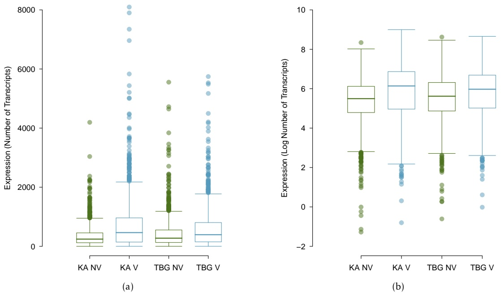

Figure 1.70: (a) Mean gene expression levels for non-vernalized KA, vernalized KA, non-vernalized TBG, and vernalized TBG plants. (b) Log-transformed mean gene expression levels.

Figure 1.71(a) shows responsiveness for five genes, calculated separately between V and NV TBG and V and NV KA, using the means in Figure 1.69. The ratios provide a measure of how much expression differs between vernalized and non-vernalized individuals. For example, the gene T ZP is expressed almost 15 times as much in vernalized KA than it is in non-vernalized KA. In contrast, the gene GAD2 is expressed slightly less in vernalized TBG than in non-vernalized TBG.

As with the mean gene expression levels, it is useful to apply a log transformation (Figure 1.71(b)). On the log scale, values close to 0 are indicative of low responsiveness, while large values in either direction correspond to high responsiveness. Figure 1.72 shows the log2-transformed expression ratios as a side-by-side boxplot.66

|  | Gene Name | TBG | KA |
| --- | --- | --- | --- |
| 1 | PUX4 | 2.06 | 4.72 |
| 2 | TZP | 2.80 | 14.82 |
| 3 | GAD2 | 0.95 | 5.18 |
| 4 | GAUT6 | 2.99 | 7.19 |
| 5 | FB | 2.43 | 4.32 |

(a)

|  | Gene Name | TBG | KA |
| --- | --- | --- | --- |
| 1 | PUX4 | 1.04 | 2.24 |
| 2 | TZP | 1.48 | 3.89 |
| 3 | GAD2 | -0.07 | 2.37 |
| 4 | GAUT6 | 1.58 | 2.85 |
| 5 | FB | 1.28 | 2.11 |

(b)

Figure 1.71: (a) Ratio of mean expression in vernalized individuals to mean expression in non-vernalized individuals. (b) Log2-transformation of expression ratios in Figure 1.71(a).

<small>66One gene is omitted because the expression ratio in KA is 0, and the logarithm of 0 is undefined.</small>

---

1.7. EXPLORATORY DATA ANALYSIS

71

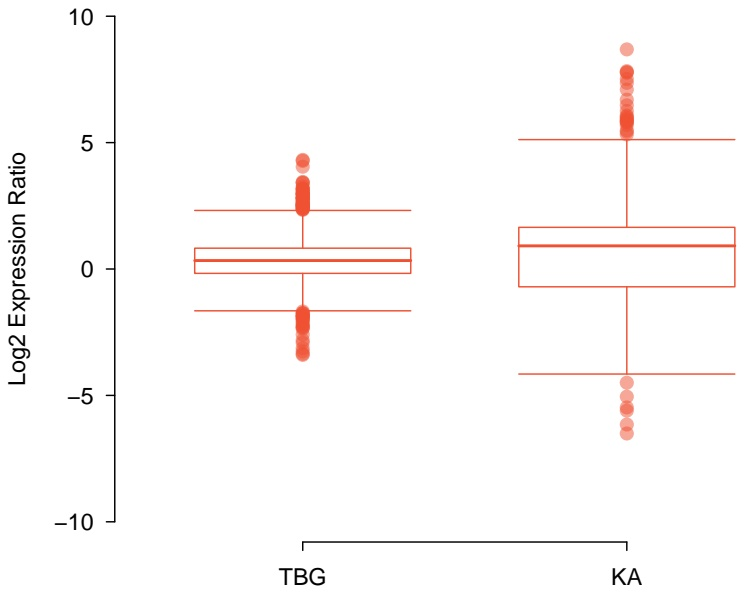

boxplot

| Category | Q1 | Q2 (Median) | Q3 |
| --- | --- | --- | --- |
| TBG | ~0 | ~0.4 | ~0.9 |
| KA | ~-0.8 | ~1.0 | ~1.7 |

Figure 1.72: Responsiveness for 1,087 genes in arenosa, calculated as the log2 ratio of vernalized over non-vernalized expression levels.

Figure 1.72 directly illustrates how the magnitude of response to vernalization in TBG is smaller than in KA. The spread of responsiveness in KA is larger than for TBG, as indicated by the larger IQR and range of values; this indicates that more genes in KA are differentially expressed between vernalized and non-vernalized samples. Additionally, the median responsiveness in KA is higher than in TBG.

There are several outliers for both KA and TBG, with large outliers representing genes that were much more highly expressed in vernalized plants than non-vernalized plants, and vice versa for low outliers. These highly cold-responsive genes likely play a role in how plants cope with colder temperatures; they could be involved in regulating freezing tolerance, or controlling how plants detect cold temperatures. With the help of computing software, it is a simple matter to identify the outliers and address questions such as whether particular genes are highly vernalizationresponsive in both KA and TBG.

---

72

CHAPTER 1. INTRODUCTION TO DATA

## Advanced data visualization

There are many ways to numerically and graphically summarize data that are not explicitly introduced in this chapter. Presentation-style graphics in published manuscripts can be especially complex, and may feature techniques specific to a certain field as well as novel approaches de signed to highlight particular features of a dataset. This section discusses the figures generated by the Baduel, et al. research team to visualize the differences in vernalization response between KA and TBG A. arenosa plants.

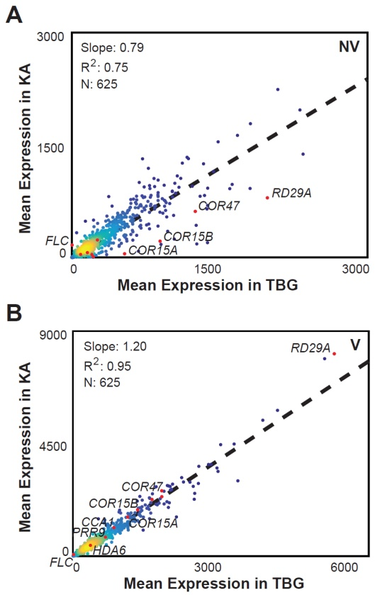

Figure 1.73: Figure 4 from the original manuscript. Plot A compares mean expression levels between non-vernalized KA and TBG; Plot B compares mean expression levels between vernalized KA and TBG.

Each dot in Figure 1.73 represents a gene; each gene is plotted by its mean expression level in KA against its mean expression level in TBG. The overall trend can be summarized by a line fit to the points.67 For the slope of the line to equal 1, each gene would have to be equally expressed in KA and TBG. In the upper plot, the slope of the line is less than 1, which indicates that for non-vernalized plants, cold-responsive genes have a higher expression in TBG than in KA. In the lower plot, the slope is greater than 1, indicating that the trend is reversed in vernalized plants: cold-responsive genes are more highly expressed in KA. This trend is also discernible from the side by-side boxplot in Figure 1.70. Using a scatterplot, however, makes it possible to directly compare expression in KA versus TBG on a gene-by-gene basis, and also locate particular genes of interest that are known from previous research (e.g., the labeled genes in Figure 1.73.)68 The colors in the plot signify plot density, with warmer colors representing a higher concentration of points.

<small>67Lines of best fit are discussed in Chapter 6.</small>

<small>68Only a subset of the 1,088 genes are plotted in Figure 1.73.</small>

---

1.7. EXPLORATORY DATA ANALYSIS

73

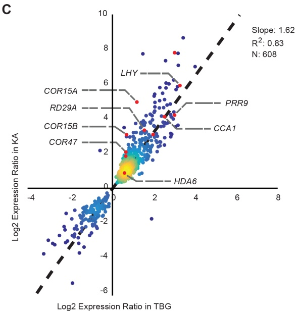

scatter

| Category | Log2 Expression Ratio in TBG (range) | Log2 Expression Ratio in KA (range) |
| --- | --- | --- |
| Data Points | -4~8 | -6~9 |

Figure 1.74: Figure 3 from the original manuscript. Each gene is plotted based on the values of the log2 expression ratio in KA versus TBG.

Figure 1.74, like Figure 1.72, compares the cold-responsiveness in KA versus TBG, calculating responsiveness as the log2 ratio of vernalized over non-vernalized expression levels. As in Figure 1.73, each dot represents a single gene. The slope of the best fitting line is greater than 1, indicating that the assayed genes typically show greater responsiveness in KA than in TBG.69

While presentation-style graphics may use relatively sophisticated approaches to displaying data that seem far removed from the simple plots discussed in this chapter, the end goal remains the same – to effectively highlight key features of data.

69These 608 genes are a subset of the ones plotted in Figure 1.73; genes with expression ratio 0 are not included.

---

74

CHAPTER 1. INTRODUCTION TO DATA

## 1.8 Notes

Introductory treatments of statistics often emphasize the value of formal methods of probability and inference, topics which are covered in the remaining chapters of this text. However, numerical and graphical summaries are essential for understanding the features of a dataset and should be applied before the process of inference begins. It is inadvisable to begin conducting tests or constructing models without a careful understanding of the strengths and weaknesses of a dataset. For example, are some measurements out of range, or the result of errors in data recording?

The tools of descriptive statistics form the basis of exploratory data analysis; having the intuition for exploring and interpreting data in the context of a research question is an essential statistical skill. With computing software, it is a relatively simple matter to produce numerical and graphical summaries, even with large datasets. The challenge lies instead in understanding how to wade through a dataset, disentangle complex relationships between variables, and piece together the underlying story.

It is important to note that the graphical methods illustrated in the text are relatively simple, static graphs that, for instance, do not show changes dynamically over time. They will be surprisingly useful in the later chapters. But there has been considerable progress in the visual display of data in the last decade, and many wonderful displays exist that show complex, time dependent data. For examples of sophisticated graphical displays, we especially recommend the bubble charts available at the Gapminder web site ([https://www.gapminder.org](https://www.gapminder.org)) that show international trends in public health outcomes and the graphical displays of data in the Upshot section of the New York Times ([https://www.nytimes.com/section/upshot](https://www.nytimes.com/section/upshot)).

There are four labs associated with Chapter 1. The first lab introduces basic commands for working with data in R, and shows how to produce the graphical and numerical summaries discussed in this chapter. The exercises in Lab 1 rely heavily on the introduction to R and R Studio in Lab 00 (Getting Started). The Lab Notes corresponding to Lab 1 provide a systematic introduction to R functions useful for getting started with applied data analysis.

The remaining three labs explore the data presented in the case studies in Section 1.7, outlining analyses driven by questions similar to what one might encounter in practice. Does the state of California discriminate in its distribution of funds for developmental disability support (Lab 2)? Are particular genes associated with a subtype of pediatric leukemia (Lab 3)? Is there a genetic basis to the cold weather response in the plant Arabidopsis arenosa (Lab 4)? Labs 3 and 4 demonstrate how computing is essential for data analysis; even though the two datasets are relatively small by modern standards, they are already too large to feasibly analyze without statistical computing software. All three labs illustrate how important questions can be examined even with relatively simple statistical concepts.

---

1.9. EXERCISES

75

## 1.9 Exercises

## 1.9.1 Case study

**1.1 Migraine and acupuncture, Part I.** A migraine is a particularly painful type of headache, which pa tients sometimes wish to treat with acupuncture. To determine whether acupuncture relieves migraine pain, researchers conducted a randomized controlled study where 89 females diagnosed with migraine headaches were randomly assigned to one of two groups: treatment or control. 43 patients in the treatment group received acupuncture that is specifically designed to treat migraines. 46 patients in the control group received placebo acupuncture (needle insertion at non-acupoint locations). 24 hours after patients received acupuncture, they were asked if they were pain free. Results are summarized in the contingency table below.70Neurol Sci (2011) 32 (Suppl 1):S173–S175

<table><tr><td rowspan="5">Group</td><td rowspan="2"></td><td colspan="2">Pain free</td><td rowspan="2">Total</td></tr><tr><td>Yes</td><td>No</td></tr><tr><td>Treatment</td><td>10</td><td>33</td><td>43</td></tr><tr><td>Control</td><td>2</td><td>44</td><td>46</td></tr><tr><td>Total</td><td>12</td><td>77</td><td>89</td></tr></table>

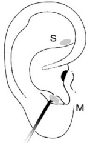

Figure from the original paper displaying the appropriate area (M) versus the inappropriate area (S) used in the treatment of migraine attacks.

priate in terms of giving a therapeutic effect onk , i i h  i l i I  B, h l b h f h h li(a) What percent of patients in the treatment group were pain free 24 hours after receiving acupuncture?

ad pain.repeatedly tested with the algomet(b) What percent were pain free in the control group?

l d th d auricular maps, this area corresponds to the representationf h i i  (Fi . 1,  S) d i ifi ll d(c) In which group did a higher percent of patients become pain free 24 hours after receiving acupuncture?

to treat sciatic pain. Four needles were inserted in this area,(d) Your findings so far might suggest that acupuncture is an effective treatment for migraines for all people following the International Classification ofIn all patients, the ear acupuncture was always per-who suffer from migraines. However this is not the only possible conclusion that can be drawn based’s Headache Centre, Department of Gynae- the diaries collecting VAS data was conducted by anon your findings so far. What is one other possible explanation for the observed difference between the.   e study during a migraine attack provided that         was in.percentages of patients that are pain free 24 hours after receiving acupuncture in the two groups?

atients were randomly and blindly assigned to thetical evaluation of the differences between the values1.2 Sinusitis and antibiotics, Part I. Researchers studying the effect of antibiotic treatment for acute siears, range 15–60), group B (n = 48) (average age studied was performed using an analysis of variancenusitis compared to symptomatic treatments randomly assigned 166 adults diagnosed with acute sinusitis to ars, range – ). or repea e measures o owe y mu p eone of two groups: treatment or control. Study participants received either a 10-day course of amoxicillin (an ed consent to participation in the study.Moreover, to evaluate the difference between group Bantibiotic) or a placebo similar in appearance and taste. The placebo consisted of symptomatic treatments applying NCT (T0).formed for each level of the variable ‘‘time’’. In the case ofsuch as acetaminophen, nasal decongestants, etc. At the end of the 10-day period, patients were asked if they e of 250 g (SEDATELEC, France) was chosen to were performed using the Statistical Package for the Socialexperienced improvement in symptoms. The distribution of responses is summarized below.71

<table><tr><td rowspan="5">Group</td><td rowspan="2"></td><td colspan="2">Self-reported improvement in symptoms</td><td rowspan="2">Total</td></tr><tr><td>Yes</td><td>No</td></tr><tr><td>Treatment</td><td>66</td><td>19</td><td>85</td></tr><tr><td>Control</td><td>65</td><td>16</td><td>81</td></tr><tr><td>Total</td><td>131</td><td>35</td><td>166</td></tr></table>

e intensity of the pain with a VAS at the followingthey requested the removal of the needles. One patient(a) What percent of patients in the treatment group experienced improvement in symptoms?
(T3), after 120 min (T4), and after 24 h (T5).semi-permanent needles. In group A, the mean number of(b) What percent experienced improvement in symptoms in the control group?
(c) In which group did a higher percentage of patients experience improvement in symptoms?
(d) Your findings so far might suggest a real difference in effectiveness of antibiotic and placebo treatments for improving symptoms of sinusitis. However, this is not the only possible conclusion that can be drawn based on your findings so far. What is one other possible explanation for the observed difference between the percentages of patients in the antibiotic and placebo treatment groups that experience improvement in symptoms of sinusitis?

<small>70G. Allais et al. “[Ear acupuncture in the treatment of migraine attacks: a randomized trial on the efficacy of appropriate versus inappropriate acupoints](http://www.openintro.org/redirect.php?go=textbook-acupuncture_migraine_2011&referrer=biostat1_pdf)”. In: Neurological Sci. 32.1 (2011), pp. 173–175.</small>

<small>71J.M. Garbutt et al. “[Amoxicillin for Acute Rhinosinusitis: A Randomized Controlled Trial](http://www.openintro.org/redirect.php?go=textbook-amoxicillin_acute_rhinosinusitis_2012&referrer=biostat1_pdf)”. In: JAMA: The Journal of the American Medical Association 307.7 (2012), pp. 685–692.</small>

---

76

CHAPTER 1. INTRODUCTION TO DATA

## 1.9.2 Data basics

**1.3 Air pollution and birth outcomes, study components.** Researchers collected data to examine the relationship between air pollutants and preterm births in Southern California. During the study air pollution levels were measured by air quality monitoring stations. Specifically, levels of carbon monoxide were recorded in parts per million, nitrogen dioxide and ozone in parts per hundred million, and coarse particulate matter $\left( \mathrm { P M } _ { 1 0 } \right)$ in $\mu g / m ^ { 3 }$ . Length of gestation data were collected on 143,196 births between the years 1989 and 1993, and air pollution exposure during gestation was calculated for each birth. The analysis suggested that increased ambient $\mathrm { P M } _ { 1 0 }$ and, to a lesser degree, CO concentrations may be associated with the occurrence of preterm births.72

(a) Identify the main research question of the study.
(b) Who are the subjects in this study, and how many are included?
(c) What are the variables in the study? Identify each variable as numerical or categorical. If numerical, state whether the variable is discrete or continuous. If categorical, state whether the variable is ordinal.

**1.4 Buteyko method, study components.** The Buteyko method is a shallow breathing technique developed by Konstantin Buteyko, a Russian doctor, in 1952. Anecdotal evidence suggests that the Buteyko method can reduce asthma symptoms and improve quality of life. In a scientific study to determine the effectiveness of this method, researchers recruited 600 asthma patients aged 18-69 who relied on medication for asthma treatment. These patients were randomly split into two research groups: one practiced the Buteyko method and the other did not. Patients were scored on quality of life, activity, asthma symptoms, and medication reduction on a scale from 0 to 10. On average, the participants in the Buteyko group experienced a significant reduction in asthma symptoms and an improvement in quality of life.73

(a) Identify the main research question of the study.
(b) Who are the subjects in this study, and how many are included?
(c) What are the variables in the study? Identify each variable as numerical or categorical. If numerical, state whether the variable is discrete or continuous. If categorical, state whether the variable is ordinal.

**1.5 Cheaters, study components.** Researchers studying the relationship between honesty, age and self-control conducted an experiment on 160 children between the ages of 5 and 15. Participants reported their age, sex, and whether they were an only child or not. The researchers asked each child to toss a fair coin in private and to record the outcome (white or black) on a paper sheet, and said they would only reward children who report white. The study’s findings can be summarized as follows: “Half the students were explicitly told not to cheat and the others were not given any explicit instructions. In the no instruction group probability of cheating was found to be uniform across groups based on child’s characteristics. In the group that was explicitly told to not cheat, girls were less likely to cheat, and while rate of cheating didn’t vary by age for boys, it decreased with age for girls.”74

(a) Identify the main research question of the study.
(b) Who are the subjects in this study, and how many are included?
(c) How many variables were recorded for each subject in the study in order to conclude these findings? State the variables and their types.

<small>72B. Ritz et al. “[Effect of air pollution on preterm birth among children born in Southern California between 1989 and 1993](http://www.openintro.org/redirect.php?go=textbook-air_pollution_preterm_birth_2000&referrer=biostat1_pdf)”. In: Epidemiology 11.5 (2000), pp. 502–511.</small>

<small>73J. McGowan. “Health Education: Does the Buteyko Institute Method make a difference?” In: Thorax 58 (2003).</small>

<small>74Alessandro Bucciol and Marco Piovesan. “[Luck or cheating? A field experiment on honesty with children](http://www.openintro.org/redirect.php?go=textbook-luck-cheating&referrer=biostat1_pdf)”. In: Journal of Economic Psychology 32.1 (2011), pp. 73–78.</small>

---

1.9. EXERCISES

77

**1.6 Hummingbird taste behavior, study components.** Researchers hypothesized that a particular taste receptor in hummingbirds, T1R1-T1R3, played a primary role in dictating taste behavior; specifically, in de termining which compounds hummingbirds detect as sweet. In a series of field tests, hummingbirds were presented simultaneously with two filled containers, one containing test stimuli and a second containing sucrose. The test stimuli included aspartame, erythritol, water, and sucrose. Aspartame is an artificial sweetener that tastes sweet to humans, but is not detected by hummingbird T1R1-T1R3 , while erythritol is an artificial sweetener known to activate T1R1-T1R3.

Data were collected on how long a hummingbird drank from a particular container for a given trial, measured in seconds. For example, in one field test comparing aspartame and sucrose, a hummingbird drank from the aspartame container for 0.54 seconds and from the sucrose container for 3.21 seconds.

(a) Which tests are controls? Which tests are treatments?
(b) Identify the response variable(s) in the study. Are they numerical or categorical?
(c) Describe the main research question.

**1.7 Egg coloration.** The evolutionary significance of variation in egg coloration among birds is not fully understood. One hypothesis suggests that egg coloration may be an indication of female quality, with healthier females being capable of depositing blue-green pigment into eggshells instead of using it for themselves as an antioxidant. In a study conducted on 32 collared flycatchers, half of the females were given supplementary diets before and during egg laying. Eggs were measured for darkness of blue color using spectrophotometry; for example, the mean amount of blue-green chroma was 0.594 absorbance units. Egg mass was also recorded.

(a) Identify the control and treatment groups.
(b) Describe the main research question.
(c) Identify the primary response variable of interest, and whether it is numerical or categorical.

**1.8 Smoking habits of UK residents.** A survey was conducted to study the smoking habits of UK residents. Below is a data matrix displaying a portion of the data collected in this survey. Note that “£" stands for British Pounds Sterling, “cig" stands for cigarettes, and “N/A” refers to a missing component of the data.75

|  | sex | age | marital | grossIncome | smoke | amtWeekends | amtWeekdays |
| --- | --- | --- | --- | --- | --- | --- | --- |
| 1 | Female | 42 | Single | Under £2,600 | Yes | 12 cig/day | 12 cig/day |
| 2 | Male | 44 | Single | £10,400 to £15,600 | No | N/A | N/A |
| 3 | Male | 53 | Married | Above £36,400 | Yes | 6 cig/day | 6 cig/day |
| $\vdots$ | $\vdots$ | $\vdots$ | $\vdots$ | $\vdots$ | $\vdots$ | $\vdots$ | $\vdots$ |
| 1691 | Male | 40 | Single | £2,600 to £5,200 | Yes | 8 cig/day | 8 cig/day |

(a) What does each row of the data matrix represent?
(b) How many participants were included in the survey?
(c) For each variable, indicate whether it is numerical or categorical. If numerical, identify the variable as continuous or discrete. If categorical, indicate if the variable is ordinal.

75National STEM Centre, [Large Datasets from stats4schools](http://www.openintro.org/redirect.php?go=textbook-Stats4Schools_smoking&referrer=biostat1_pdf).

---

78

CHAPTER 1. INTRODUCTION TO DATA

**1.9 The microbiome and colon cancer.** A study was conducted to assess whether the abundance of particular bacterial species in the gastrointestinal system is associated with the development of colon cancer. The following data matrix shows a subset of the data collected in the study. Cancer stage is coded 1-4, with larger values indicating cancer that is more difficult to treat. The abundance levels are given for five bacterial species; abundance is calculated as the frequency of that species divided by the total number of bacteria from all species.

|  | age | gender | stage | bug 1 | bug 2 | bug 3 | bug 4 | bug 5 |
| --- | --- | --- | --- | --- | --- | --- | --- | --- |
| 1 | 71 | Female | 2 | 0.03 | 0.09 | 0.52 | 0.00 | 0.00 |
| 2 | 53 | Female | 4 | 0.16 | 0.08 | 0.08 | 0.00 | 0.00 |
| 3 | 55 | Female | 2 | 0.00 | 0.01 | 0.31 | 0.00 | 0.00 |
| 4 | 44 | Male | 2 | 0.11 | 0.14 | 0.00 | 0.07 | 0.05 |
| $\vdots$ | $\vdots$ | $\vdots$ | $\vdots$ | $\vdots$ | $\vdots$ | $\vdots$ | $\vdots$ | $\vdots$ |
| 73 | 48 | Female | 3 | 0.21 | 0.05 | 0.00 | 0.00 | 0.04 |

(a) What does each row of the data matrix represent?
(b) Identify explanatory and response variables.
(c) For each variable, indicate whether it is numerical or categorical.

## 1.9.3 Data collection principles

**1.10 Cheaters, scope of inference.** Exercise 1.5 introduces a study where researchers studying the relationship between honesty, age, and self-control conducted an experiment on 160 children between the ages of 5 and 15. The researchers asked each child to toss a fair coin in private and to record the outcome (white or black) on a paper sheet, and said they would only reward children who report white. Half the students were explicitly told not to cheat and the others were not given any explicit instructions. Differences were observed in the cheating rates in the instruction and no instruction groups, as well as some differences across children’s characteristics within each group.

(a) Identify the population of interest and the sample in this study.
(b) Comment on whether or not the results of the study can be generalized to the population, and if the findings of the study can be used to establish causal relationships.

**1.11 Air pollution and birth outcomes, scope of inference.** Exercise 1.3 introduces a study where researchers collected data to examine the relationship between air pollutants and preterm births in Southern California. During the study, air pollution levels were measured by air quality monitoring stations. Length of gestation data were collected on 143,196 births between the years 1989 and 1993, and air pollution exposure during gestation was calculated for each birth. It can be assumed that the 143,196 births are effectively the entire population of births during this time period.

(a) Identify the population of interest and the sample in this study.
(b) Comment on whether or not the results of the study can be generalized to the population, and if the findings of the study can be used to establish causal relationships.

**1.12 Herbal remedies.** Echinacea has been widely used as an herbal remedy for the common cold, but pre-vious studies evaluating its efficacy as a remedy have produced conflicting results. In a new study, researchers randomly assigned 437 volunteers to receive either a placebo or echinacea treatment before being infected with rhinovirus. Healthy young adult volunteers were recruited for the study from the University of Virginia community.

(a) Identify the population of interest and the sample in this study.
(b) Comment on whether or not the results of the study can be generalized to a larger population.
(c) Can the findings of the study be used to establish causal relationships? Justify your answer.

---

1.9. EXERCISES

79

**1.13 Buteyko method, scope of inference.** Exercise 1.4 introduces a study on using the Buteyko shallow breathing technique to reduce asthma symptoms and improve quality of life. As part of this study 600 asthma patients aged 18-69 who relied on medication for asthma treatment were recruited and randomly assigned to two groups: one practiced the Buteyko method and the other did not. Those in the Buteyko group experienced, on average, a significant reduction in asthma symptoms and an improvement in quality of life.

(a) Identify the population of interest and the sample in this study.
(b) Comment on whether or not the results of the study can be generalized to the population, and if the findings of the study can be used to establish causal relationships.

**1.14 Vitamin supplements.** In order to assess the effectiveness of taking large doses of vitamin C in reducing the duration of the common cold, researchers recruited 400 healthy volunteers from staff and students at a university. A quarter of the patients were randomly assigned a placebo, and the rest were randomly allocated between 1g Vitamin C, 3g Vitamin C, or 3g Vitamin C plus additives to be taken at onset of a cold for the following two days. All tablets had identical appearance and packaging. No significant differences were observed in any measure of cold duration or severity between the four medication groups, and the placebo group had the shortest duration of symptoms.76

(a) Was this an experiment or an observational study? Why?
(b) What are the explanatory and response variables in this study?
(c) Participants are ultimately able to choose whether or not to use the pills prescribed to them. We might expect that not all of them will adhere and take their pills. Does this introduce a confounding variable to the study? Explain your reasoning.

**1.15 Chicks and antioxidants.** Environmental factors early in life can have long-lasting effects on an organism. In one study, researchers examined whether dietary supplementation with vitamins C and E influences body mass and corticosterone level in yellow-legged gull chicks. Chicks were randomly assigned to either the nonsupplemented group or the vitamin supplement experimental group. The initial study group consisted of 108 nests, with 3 eggs per nest. Chicks were assessed at age 7 days.

(a) What type of study is this?
(b) What are the experimental and control treatments in this study?
(c) Explain why randomization is an important feature of this experiment.

**1.16 Exercise and mental health.** A researcher is interested in the effects of exercise on mental health and he proposes the following study: Use stratified random sampling to recruit 18-30, 31-40 and 41-55 year olds from the population. Next, randomly assign half the subjects from each age group to exercise twice a week, and instruct the rest not to exercise. Conduct a mental health exam at the beginning and at the end of the study, and compare the results.

(a) What type of study is this?
(b) What are the treatment and control groups in this study?
(c) Does this study make use of blocking? If so, what is the blocking variable?
(d) Comment on whether or not the results of the study can be used to establish a causal relationship between exercise and mental health, and indicate whether or not the conclusions can be generalized to the population at large.
(e) Suppose you are given the task of determining if this proposed study should get funding. Would you have any reservations about the study proposal?

76C. Audera et al. “[Mega-dose vitamin C in treatment of the common cold: a randomised controlled trial](http://www.openintro.org/redirect.php?go=textbook-vitamin_C_cold_treatment_2001&referrer=biostat1_pdf)”. In: Medical Journal of Australia 175.7 (2001), pp. 359–362.

---

80

CHAPTER 1. INTRODUCTION TO DATA

**1.17 Internet use and life expectancy.** The following scatterplot was created as part of a study evaluating the relationship between estimated life expectancy at birth (as of 2014) and percentage of internet users (as of 2009) in 208 countries for which such data were available.77

(a) Describe the relationship between life expectancy and percentage of internet users.
(b) What type of study is this?
(c) State a possible confounding variable that might explain this relationship and describe its potential effect.

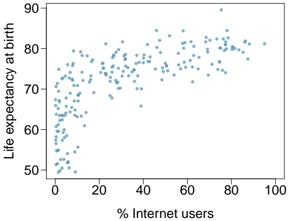

scatter

| % Internet users | Life expectancy at birth |
| --- | --- |
| ~1 | ~50 |
| ~2 | ~51 |
| ~3 | ~52 |
| ~4 | ~53 |
| ~5 | ~54 |
| ~6 | ~55 |
| ~7 | ~56 |
| ~8 | ~57 |
| ~9 | ~58 |
| ~10 | ~59 |
| ~11 | ~60 |
| ~12 | ~61 |
| ~13 | ~62 |
| ~14 | ~63 |
| ~15 | ~64 |
| ~16 | ~65 |
| ~17 | ~66 |
| ~18 | ~67 |
| ~19 | ~68 |
| ~20 | ~69 |
| ~21 | ~70 |
| ~22 | ~71 |
| ~23 | ~72 |
| ~24 | ~73 |
| ~25 | ~74 |
| ~26 | ~75 |
| ~27 | ~76 |
| ~28 | ~77 |
| ~29 | ~78 |
| ~30 | ~79 |
| ~31 | ~80 |
| ~32 | ~81 |
| ~33 | ~82 |
| ~34 | ~83 |
| ~35 | ~84 |
| ~36 | ~85 |
| ~37 | ~86 |
| ~38 | ~87 |
| ~39 | ~88 |
| ~40 | ~89 |
| ~41 | ~90 |
| ~42 | ~91 |
| ~43 | ~92 |
| ~44 | ~93 |
| ~45 | ~94 |
| ~46 | ~95 |
| ~47 | ~96 |
| ~48 | ~97 |
| ~49 | ~98 |
| ~50 | ~99 |
| ~51 | ~100 |

**1.18 Stressed out.** A study that surveyed a random sample of otherwise healthy high school students found that they are more likely to get muscle cramps when they are stressed. The study also noted that students drink more coffee and sleep less when they are stressed.

(a) What type of study is this?
(b) Can this study be used to conclude a causal relationship between increased stress and muscle cramps?
(c) State possible confounding variables that might explain the observed relationship between increased stress and muscle cramps.

**1.19 Evaluate sampling methods.** A university wants to assess how many hours of sleep students are getting per night. For each proposed method below, discuss whether the method is reasonable or not.

(a) Survey a simple random sample of 500 students.
(b) Stratify students by their field of study, then sample 10% of students from each stratum.
(c) Cluster students by their class year (e.g. freshmen in one cluster, sophomores in one cluster, etc.), then randomly sample three clusters and survey all students in those clusters.

**1.20 City council survey.** A city council has requested a household survey be conducted in a suburban area of their city. The area is broken into many distinct and unique neighborhoods, some including large homes, some with only apartments, and others a diverse mixture of housing structures. Identify the sampling methods described below, and comment on whether or not you think they would be effective in this setting.

(a) Randomly sample 50 households from the city.
(b) Divide the city into neighborhoods, and sample 20 households from each neighborhood.
(c) Divide the city into neighborhoods, randomly sample 10 neighborhoods, and sample all households from those neighborhoods.
(d) Divide the city into neighborhoods, randomly sample 10 neighborhoods, and then randomly sample 20 households from those neighborhoods.
(e) Sample the 200 households closest to the city council offices.

77CIA Factbook, [Country Comparisons, 2014](http://www.openintro.org/redirect.php?go=textbook-cia_factbook&referrer=biostat1_pdf).

---

1.9. EXERCISES

81

**1.21 Flawed reasoning.** Identify the flaw(s) in reasoning in the following scenarios. Explain what the individuals in the study should have done differently if they wanted to make such conclusions.

(a) Students at an elementary school are given a questionnaire that they are asked to return after their parents have completed it. One of the questions asked is, “Do you find that your work schedule makes it difficult for you to spend time with your kids after school?" Of the parents who replied, 85% said “no". Based on these results, the school officials conclude that a great majority of the parents have no difficulty spending time with their kids after school.
(b) A survey is conducted on a simple random sample of 1,000 women who recently gave birth, asking them about whether or not they smoked during pregnancy. A follow-up survey asking if the children have respiratory problems is conducted 3 years later, however, only 567 of these women are reached at the same address. The researcher reports that these 567 women are representative of all mothers.
(c) An orthopedist administers a questionnaire to 30 of his patients who do not have any joint problems and finds that 20 of them regularly go running. He concludes that running decreases the risk of joint problems.

**1.22 Reading the paper.** Below are excerpts from two articles published in the NY Times:

(a) An article titled Risks: Smokers Found More Prone to Dementia states the following:78

“Researchers analyzed data from 23,123 health plan members who participated in a voluntary exam and health behavior survey from 1978 to 1985, when they were 50-60 years old. 23 years later, about 25% of the group had dementia, including 1,136 with Alzheimer’s disease and 416 with vascular dementia. After adjusting for other factors, the researchers concluded that pack-a-day smokers were 37% more likely than nonsmokers to develop dementia, and the risks went up with increased smoking; 44% for one to two packs a day; and twice the risk for more than two packs."

Based on this study, can it be concluded that smoking causes dementia later in life? Explain your reasoning.

(b) Another article titled The School Bully Is Sleepy states the following:79

“The University of Michigan study, collected survey data from parents on each child’s sleep habits and asked both parents and teachers to assess behavioral concerns. About a third of the students studied were identified by parents or teachers as having problems with disruptive behavior or bullying. The researchers found that children who had behavioral issues and those who were identified as bullies were twice as likely to have shown symptoms of sleep disorders."

A friend of yours who read the article says, “The study shows that sleep disorders lead to bullying in school children." Is this statement justified? If not, how best can you describe the conclusion that can be drawn from this study?

**1.23 Alcohol consumption and STIs.** An observational study published last year in The American Journal of Preventive Medicine investigated the effects of an increased alcohol sales tax in Maryland on the rates of gonorrhea and chlamydia.80 After a tax increase from 6% to 9% in 2011, the statewide gonorrhea rate declined by 24%, the equivalent of 1,600 cases per year. In a statement to the New York Times, the lead author of the paper was quoted saying, "Policy makers should consider raising liquor taxes if they’re looking for ways to prevent sexually transmitted infections. In the year and a half following the alcohol tax rise in Maryland, this prevented 2,400 cases of gonorrhea and saved half a million dollars in health care costs." Explain whether the lead author’s statement is accurate.

<small>78R.C. Rabin. “[Risks: Smokers Found More Prone to Dementia](http://www.openintro.org/redirect.php?go=textbook-nytimes_smoking_dementia&referrer=biostat1_pdf)”. In: New York Times (2010).</small>

<small>79T. Parker-Pope. “[The School Bully Is Sleepy](http://www.openintro.org/redirect.php?go=textbook-school_bully_sleepy_2011&referrer=biostat1_pdf)”. In: New York Times (2011).</small>

<small>80S. Staras, et al., 2015. Maryland Alcohol Sales Tax and Sexually Transmitted Infections. The American Journal of Preventive Medicine 50: e73-e80.</small>

---

82

CHAPTER 1. INTRODUCTION TO DATA

**1.24 Income and education in US counties.** The scatterplot below shows the relationship between per capita income (in thousands of dollars) and percent of population with a bachelor’s degree in 3,143 counties in the US in 2010.

(a) What are the explanatory and response variables?
(b) Describe the relationship between the two variables. Make sure to discuss unusual observations, if any.
(c) Can we conclude that having a bachelor’s degree increases one’s income?

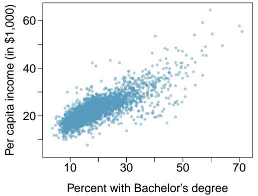

scatter

| Percent with Bachelor's degree (range) | Per capita income (in $1,000) (range) |
| --- | --- |
| 5~70 | 10~65 |

**1.25 Eat better, feel better.** In a public health study on the effects of consumption of fruits and vegetables on psychological well-being in young adults, participants were randomly assigned to three groups: (1) diet-asusual, (2) an ecological momentary intervention involving text message reminders to increase their fruits and vegetable consumption plus a voucher to purchase them, or (3) a fruit and vegetable intervention in which participants were given two additional daily servings of fresh fruits and vegetables to consume on top of their normal diet. Participants were asked to take a nightly survey on their smartphones. Participants were student volunteers at the University of Otago, New Zealand. At the end of the 14-day study, only participants in the third group showed improvements to their psychological well-being across the 14-days relative to the other groups.81

(a) What type of study is this?
(b) Identify the explanatory and response variables.
(c) Comment on whether the results of the study can be generalized to the population.
(d) Comment on whether the results of the study can be used to establish causal relationships.
(e) A newspaper article reporting on the study states, “The results of this study provide proof that giving young adults fresh fruits and vegetables to eat can have psychological benefits, even over a brief period of time.” How would you suggest revising this statement so that it can be supported by the study?

## 1.9.4 Numerical data

**1.26 Means and SDs.** For each part, compare distributions (1) and (2) based on their means and standard deviations. You do not need to calculate these statistics; simply state how the means and the standard deviations compare. Make sure to explain your reasoning. Hint: It may be useful to sketch dot plots of the distributions.

(a) (1) 3, 5, 5, 5, 8, 11, 11, 11, 13
(2) 3, 5, 5, 5, 8, 11, 11, 11, 20

(c) (1) 0, 2, 4, 6, 8, 10
(2) 20, 22, 24, 26, 28, 30

(b) (1) -20, 0, 0, 0, 15, 25, 30, 30
(2) -40, 0, 0, 0, 15, 25, 30, 30

(d) (1) 100, 200, 300, 400, 500
(2) 0, 50, 300, 550, 600

<small>81Tamlin S Conner et al. “Let them eat fruit! The effect of fruit and vegetable consumption on psychological well-being in young adults: A randomized controlled trial”. In: PloS one 12.2 (2017), e0171206.</small>

---

1.9. EXERCISES

83

**1.27 Medians and IQRs.** For each part, compare distributions (1) and (2) based on their medians and IQRs. You do not need to calculate these statistics; simply state how the medians and IQRs compare. Make sure to explain your reasoning.

(a) (1) 3, 5, 6, 7, 9

(2) 3, 5, 6, 7, 20

(c) (1) 1, 2, 3, 4, 5

(2) 6, 7, 8, 9, 10

(b) (1) 3, 5, 6, 7, 9

(2) 3, 5, 8, 7, 9

(d) (1) 0, 10, 50, 60, 100

(2) 0, 100, 500, 600, 1000

**1.28 Mix-and-match.** Describe the distribution in the histograms below and match them to the box plots.

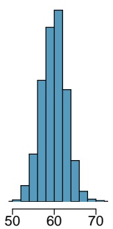

histogram

| Bin Range | Frequency |
| --- | --- |
| ~50.5 ~51.5 | ~1 |
| ~51.5 ~52.5 | ~3 |
| ~52.5 ~53.5 | ~8 |
| ~53.5 ~54.5 | ~14 |
| ~54.5 ~55.5 | ~22 |
| ~55.5 ~56.5 | ~30 |
| ~56.5 ~57.5 | ~36 |
| ~57.5 ~58.5 | ~42 |
| ~58.5 ~59.5 | ~38 |
| ~59.5 ~60.5 | ~22 |
| ~60.5 ~61.5 | ~10 |
| ~61.5 ~62.5 | ~4 |
| ~62.5 ~63.5 | ~1 |
| ~63.5 ~64.5 | ~1 |

(a)

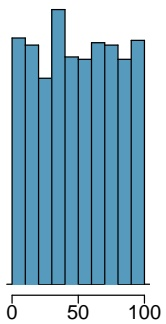

histogram

| X | Value |
| --- | --- |
| ~5 | ~6.2 |
| ~15 | ~5.8 |
| ~25 | ~3.5 |
| ~35 | ~9.2 |
| ~45 | ~4.8 |
| ~55 | ~4.7 |
| ~65 | ~6.0 |
| ~75 | ~5.8 |
| ~85 | ~4.8 |
| ~95 | ~6.2 |

(b)

histogram

| Bin Range | Frequency |
| --- | --- |
| 0~0.5 | ~1 |
| 0.5~1.0 | ~9 |
| 1.0~1.5 | ~10 |
| 1.5~2.0 | ~6 |
| 2.0~2.5 | ~3 |
| 2.5~3.0 | ~2 |
| 3.0~3.5 | ~1 |
| 3.5~4.0 | ~0.5 |
| 4.0~4.5 | ~0.2 |
| 4.5~5.0 | ~0.1 |
| 5.0~5.5 | ~0.1 |
| 5.5~6.0 | ~0.1 |
| 6.0~6.5 | ~0.1 |
| 6.5~7.0 | ~0.1 |

(c)

boxplot

| Metric | Value |
| --- | --- |
| Q1 | ~0.9 |
| Q2 (Median) | ~1.3 |
| Q3 | ~2.0 |
| Minimum | ~0.1 |
| Maximum (Outlier) | >7.0 |

(1)

boxplot

| Metric | Value |
| --- | --- |
| Q1 | ~58 |
| Q2 (Median) | 60 |
| Q3 | ~62 |
| Minimum | ~52 |
| Maximum (outlier) | ~71 |

(2)

boxplot

| Metric | Value |
| --- | --- |
| Minimum (Whisker) | 0 |
| Q1 | ~25 |
| Q2 (Median) | 50 |
| Q3 | ~75 |
| Maximum (Whisker) | 100 |

(3)

**1.29 Air quality.** Daily air quality is measured by the air quality index (AQI) reported by the Environmental Protection Agency. This index reports the pollution level and what associated health effects might be a concern. The index is calculated for five major air pollutants regulated by the Clean Air Act and takes values from 0 to 300, where a higher value indicates lower air quality. AQI was reported for a sample of 91 days in 2011 in Durham, NC. The relative frequency histogram below shows the distribution of the AQI values on these days.82

(a) Based on the histogram, describe the distribution of daily AQI.
(b) Estimate the median AQI value of this sample.
(c) Would you expect the mean AQI value of this sample to be higher or lower than the median? Explain your reasoning.

histogram

| Bin Range | Frequency |
| --- | --- |
| 5~10 | ~0.02 |
| 10~15 | ~0.055 |
| 15~20 | 0.2 |
| 20~25 | ~0.065 |
| 25~30 | 0.2 |
| 30~35 | ~0.155 |
| 35~40 | ~0.065 |
| 40~45 | ~0.045 |
| 45~50 | ~0.065 |
| 50~55 | ~0.075 |
| 55~60 | ~0.035 |
| 60~65 | ~0.02 |

Daily AQI

82US Environmental Protection Agency, [AirData, 2011.](http://www.openintro.org/redirect.php?go=textbook-airdata_2011&referrer=biostat1_pdf)

---

84

CHAPTER 1. INTRODUCTION TO DATA

**1.30 Nursing home residents.** Since states with larger numbers of elderly residents would naturally have more nursing home residents, the number of nursing home residents in a state is often adjusted for the number of people 65 years of age or order (65+). That adjustment is usually given as the number of nursing home residents age 65+ per 1,000 members of the population age 65+. For example, a hypothetical state with 200 nursing home residents age 65+ and 50,000 people age 65+ would have the same adjusted number of residents as a state with 400 residents and a total age 65+ population of 100,000 residents: 4 residents per 1,000.

Use the two plots below to answer the following questions. Both plots show the distribution of the number of nursing home residents per 1,000 members of the population 65+ (in each state).

(a) Is the distribution of adjusted number of nursing home residents symmetric or skewed? Are there any states that could be considered outliers?
(b) Which plot is more informative: the histogram or the boxplot? Explain your answer.
(c) What factors might influence the substantial amount of variability among different states? This question cannot be answered from the data; speculate using what you know about the demographics of the United States.

**1.31 Income at the coffee shop.** The first histogram below shows the distribution of the yearly incomes of 40 patrons at a college coffee shop. Suppose two new people walk into the coffee shop: one making \$225,000 and the other \$250,000. The second histogram shows the new income distribution. Summary statistics are also provided.

histogram

| Bin Range | Frequency |
| --- | --- |
| 60000~61250 | ~1 |
| 61250~62500 | ~0.5 |
| 62500~63750 | ~2 |
| 63750~65000 | ~2.5 |
| 65000~66250 | ~3.5 |
| 66250~67500 | ~2.5 |
| 67500~68750 | ~2.5 |
| 68750~70000 | ~1 |
| 70000~71250 | ~0.5 |

(1)

|  | (1) | (2) |
| --- | --- | --- |
| n | 40 | 42 |
| Min. | 60,680 | 60,680 |
| 1st Qu. | 63,620 | 63,710 |
| Median | 65,240 | 65,350 |
| Mean | 65,090 | 73,300 |
| 3rd Qu. | 66,160 | 66,540 |
| Max. | 69,890 | 250,000 |
| SD | 2,122 | 37,321 |

histogram

| Bin (Range) | Frequency |
| --- | --- |
| ~60000 ~61000 | ~1 |
| ~61000 ~62000 | ~3 |
| ~62000 ~63000 | ~4 |
| ~63000 ~64000 | ~5 |
| ~64000 ~65000 | ~4 |
| ~65000 ~66000 | ~1 |
| ~220000 ~225000 | ~1 |
| ~250000 ~255000 | ~1 |

(2)

(a) Would the mean or the median best represent what we might think of as a typical income for the 42 patrons at this coffee shop? What does this say about the robustness of the two measures?
(b) Would the standard deviation or the IQR best represent the amount of variability in the incomes of the 42 patrons at this coffee shop? What does this say about the robustness of the two measures?

**1.32 Midrange.** The midrange of a distribution is defined as the average of the maximum and the minimum of that distribution. Is this statistic robust to outliers and extreme skew? Explain your reasoning.

---

1.9. EXERCISES

85

## 1.9.5 Categorical data

**1.33 Flossing habits.** Suppose that an anonymous questionnaire is given to patients at a dentist’s office once they arrive for an appointment. One of the questions asks "How often do you floss?", and four answer options are provided: a) at least twice a day, b) at least once a day, c) a few times a week, and d) a few times a month. At the end of a week, the answers are tabulated: 31 individuals chose answer a), 55 chose b), 39 chose c), and 12 chose d).

(a) Describe how these data could be numerically and graphically summarized.
(b) Assess whether the results of this survey can be generalized to provide information about flossing habits in the general population.

**1.34 Views on immigration.** 910 randomly sampled registered voters from Tampa, FL were asked if they thought workers who have illegally entered the US should be (i) allowed to keep their jobs and apply for US citizenship, (ii) allowed to keep their jobs as temporary guest workers but not allowed to apply for US citizenship, or (iii) lose their jobs and have to leave the country. The results of the survey by political ideology are shown below.83

<table><tr><td rowspan="7">Response</td><td rowspan="2"></td><td colspan="3">Political ideology</td><td rowspan="2">Total</td></tr><tr><td>Conservative</td><td>Moderate</td><td>Liberal</td></tr><tr><td>(i) Apply for citizenship</td><td>57</td><td>120</td><td>101</td><td>278</td></tr><tr><td>(ii) Guest worker</td><td>121</td><td>113</td><td>28</td><td>262</td></tr><tr><td>(iii) Leave the country</td><td>179</td><td>126</td><td>45</td><td>350</td></tr><tr><td>(iv) Not sure</td><td>15</td><td>4</td><td>1</td><td>20</td></tr><tr><td>Total</td><td>372</td><td>363</td><td>175</td><td>910</td></tr></table>

(a) What percent of these Tampa, FL voters identify themselves as conservatives?
(b) What percent of these Tampa, FL voters are in favor of the citizenship option?
(c) What percent of these Tampa, FL voters identify themselves as conservatives and are in favor of the citizenship option?
(d) What percent of these Tampa, FL voters who identify themselves as conservatives are also in favor of the citizenship option? What percent of moderates share this view? What percent of liberals share this view?

## 1.9.6 Relationships between two variables

**1.35 Mammal life spans.** Data were collected on life spans (in years) and gestation lengths (in days) for 62 mammals. A scatterplot of life span versus length of gestation is shown below.84

(a) Does there seem to be an association between length of gestation and life span? If so, what type of association? Explain your reasoning.
(b) What type of an association would you expect to see if the axes of the plot were reversed, i.e. if we plotted length of gestation versus life span?

scatter

| Gestation (days) | Life Span (years) |
| --- | --- |
| ~20 | ~50 |
| ~30 | ~18 |
| ~40 | ~19 |
| ~50 | ~17 |
| ~60 | ~28 |
| ~70 | ~15 |
| ~80 | ~12 |
| ~90 | ~24 |
| ~100 | ~28 |
| ~110 | ~12 |
| ~120 | ~8 |
| ~130 | ~8 |
| ~140 | ~28 |
| ~150 | ~20 |
| ~160 | ~20 |
| ~170 | ~28 |
| ~180 | ~25 |
| ~200 | ~8 |
| ~210 | ~8 |
| ~220 | ~25 |
| ~230 | ~50 |
| ~250 | ~40 |
| ~270 | 100 |
| ~300 | ~30 |
| ~330 | ~42 |
| ~350 | ~46 |
| ~380 | ~40 |
| ~400 | ~30 |
| ~410 | ~28 |
| ~450 | 25 |
| ~630 | 70 |
| ~650 | 40 |

<small>83SurveyUSA, [News Poll #18927](http://www.openintro.org/redirect.php?go=textbook-SurveyUSA_18927&referrer=biostat1_pdf), data collected Jan 27-29, 2012.</small>

<small>84T. Allison and D.V. Cicchetti. “[Sleep in mammals: ecological and constitutional correlates](http://www.openintro.org/redirect.php?go=textbook-mammal_sleep_1975&referrer=biostat1_pdf)”. In: Arch. Hydrobiol 75 (1975), p. 442.</small>

---

86

CHAPTER 1. INTRODUCTION TO DATA

## 1.36 Associations. Indicate which of the plots show a

(a) positive association
(b) negative association
(c) no association

Also determine if the positive and negative associations are linear or nonlinear. Each part may refer to more than one plot.

scatter

| X (range) | Y (range) |
| --- | --- |
| 0~100 | 0~100 |

(1)

scatter

| X (range) | Y (range) |
| --- | --- |
| 0~100 | 0~100 |

(2)

scatter

| X (range) | Y (range) |
| --- | --- |
| 0~100 | 0~100 |

(3)

scatter

| X (range) | Y (range) |
| --- | --- |
| 0~100 | 0~100 |

(4)

**1.37 Adolescent fertility.** Data are available on the number of children born to women aged 15-19 from 189 countries in the world for the years 1997, 2000, 2002, 2005, and 2006. The data are defined using a scaling similar to that used for the nursing home data in Exercise 1.30. The values for the annual adolescent fertility rates represent the number of live births among women aged 15-19 per 1,000 female members of the population of that age.

boxplot

| Year | Q1 | Q2 (Median) | Q3 | IQR |
| --- | --- | --- | --- | --- |
| 1997 | ~25 | ~52 | ~94 | ~79 |
| 2000 | ~23 | ~46 | ~89 | ~66 |
| 2002 | ~20 | ~43 | ~85 | ~65 |
| 2005 | ~19 | ~41 | ~79 | ~60 |
| 2006 | ~18 | ~40 | ~76 | ~68 |

(a) In 2006, the standard deviation of the distribution of adolescent fertility is 75.73. Write a sentence explaining the $7 5 ^ { t h }$ percentile in the context of this data.
(b) For the years 2000-2006, data are not available for Iraq. Why might those observations be missing? Would the five-number summary have been affected very much if the values had been available?
(c) From the side-by-side boxplots shown above, describe how the distribution of fertility rates changes over time. Is there a trend?

---

1.9. EXERCISES

87

**1.38 Smoking and stenosis.** Researchers collected data from an observational study to investigate the association between smoking status and the presence of aortic stenosis, a narrowing of the aorta that impedes blood flow to the body.

<table><tr><td rowspan="5">Disease Status</td><td rowspan="2"></td><td colspan="2">Smoking Status</td><td rowspan="2">Total</td></tr><tr><td>Non-smoker</td><td>Smoker</td></tr><tr><td>Absent</td><td>67</td><td>43</td><td>110</td></tr><tr><td>Present</td><td>54</td><td>51</td><td>105</td></tr><tr><td>Total</td><td>121</td><td>94</td><td>215</td></tr></table>

(a) What percentage of the 215 participants were both smokers and had aortic stenosis? This percentage is one component of the joint distribution of smoking and stenosis; what are the other three numbers of the joint distribution?
(b) Among the smokers, what proportion have aortic stenosis? This number is a component of the conditional distribution of stenosis for the two categories of smokers. What proportion of non-smokers have aortic stenosis?
(c) In this context, relative risk is the ratio of the proportion of smokers with stenosis to the proportion of non-smokers with stenosis. Relative risks greater than 1 indicate that smokers are at a higher risk for aortic stenosis than non-smokers; relative risks of 1.2 or higher are generally considered cause for alarm. Calculate the relative risk for the 215 participants, comparing smokers to non-smokers. Does there seem to be evidence that smoking is associated with an increased probability of stenosis?

**1.39 Anger and cardiovascular health.** Trait anger is defined as a relatively stable personality trait that is manifested in the frequency, intensity, and duration of feelings associated with anger. People with high trait anger have rage and fury more often, more intensely, and with long-laster episodes than people with low trait anger. It is thought that people with high trait anger might be particularly susceptible to coronary heart disease; 12,986 participants were recruited for a study examining this hypothesis. Participants were followed for five years. The following table shows data for the participants identified as having normal blood pressure (normotensives).

<table><tr><td rowspan="5">CHD Event</td><td rowspan="2"></td><td colspan="3">Trait Anger Score</td><td rowspan="2">Total</td></tr><tr><td>Low</td><td>Moderate</td><td>High</td></tr><tr><td>Yes</td><td>53</td><td>110</td><td>27</td><td>190</td></tr><tr><td>No</td><td>3057</td><td>4704</td><td>606</td><td>8284</td></tr><tr><td>Total</td><td>3110</td><td>4731</td><td>633</td><td>8474</td></tr></table>

(a) What percentage of participants have moderate anger scores?
(b) What percentage of individuals who experienced a CHD event have moderate anger scores?
(c) What percentage of participants with high trait anger scores experienced a CHD event (i.e., heart attack)?
(d) What percentage of participants with low trait anger scores experienced a CHD event?
(e) Are individuals with high trait anger more likely to experience a CHD event than individuals with low trait anger? Calculate the relative risk of a CHD event for individuals with high trait anger compared to low trait anger.
(f) Researchers also collected data on various participant traits, such as level of blood cholesterol (measured in mg/dL). What graphical summary might be useful for examining how blood cholesterol level differs between anger groups?

## 1.9.7 Exploratory data analysis

Since exploratory data analysis relies heavily on the use of computation, refer to the labs for exercises related to this section, which are free and may be found at [**openintro.org/book/biostat**](http://www.openintro.org/redirect.php?go=biostat&referrer=biostat1_pdf).
