# 2 Probability

原始 PDF 第 88–137 页。

## Chapter 2

## Probability

**2.1 Defining probability**
**2.2 Conditional probability**
**2.3 Extended example**
**2.4 Notes**
**2.5 Exercises**

---

89

What are the chances that a woman with an abnormal mammogram has breast cancer? What is the probability that a woman with an abnormal mammogram has breast cancer, given that she is in her 40’s? What is the likelihood that out of 100 women who undergo a mammogram and test positive for breast cancer, at least one of the women has received a false positive result?

These questions use the language of probability to express statements about outcomes that may or may not occur. More specifically, probability is used to quantify the level of uncertainty about each outcome. Like all mathematical tools, probability becomes easier to understand and work with once important concepts and terminology have been formalized.

This chapter introduces that formalization, using two types of examples. One set of examples uses settings familiar to most people – rolling dice or picking cards from a deck. The other set of examples draws from medicine, biology, and public health, reflecting the contexts and language specific to those fields. The approaches to solving these two types of problems are surprisingly similar, and in both cases, seemingly difficult problems can be solved in a series of reliable steps.

For labs, slides, and other resources, please visit

[**www.openintro.org/book/biostat**](http://www.openintro.org/redirect.php?go=biostat&referrer=biostat1_pdf)

---

90

CHAPTER 2. PROBABILITY

## 2.1 Defining probability

## 2.1.1 Some examples

The rules of probability can easily be modeled with classic scenarios, such as flipping coins or rolling dice. When a coin is flipped, there are only two possible outcomes, heads or tails. With a fair coin, each outcome is equally likely; thus, the chance of flipping heads is 1/2, and likewise for tails. The following examples deal with rolling a die or multiple dice; a die is a cube with six faces numbered 1, 2, 3, 4, 5, and 6.

## EXAMPLE 2.1

What is the chance of getting 1 when rolling a die?

If the die is fair, then there must be an equal chance of rolling a 1 as any other possible number. Since there are six outcomes, the chance must be 1-in-6 or, equivalently, 1/6.

## EXAMPLE 2.2

What is the chance of not rolling a 2?

Not rolling a 2 is the same as getting a 1, 3, 4, 5, or 6, which makes up five of the six equally likely outcomes and has probability 5/6.

## EXAMPLE 2.3

Consider rolling two fair dice. What is the chance of getting two 1s?

If $1 / 6 ^ { t h }$ of the time the first die is a 1 and $1 / 6 ^ { t h }$ of those times the second die is also a 1, then the chance that both dice are 1 is (1/6)(1/6) or 1/36.

Probability can also be used to model less artificial contexts, such as to predict the inheritance of genetic disease. Cystic fibrosis (CF) is a life-threatening genetic disorder caused by mutations in the CFTR gene located on chromosome 7. Defective copies of CFTR can result in the reduced quantity and function of the CFTR protein, which leads to the buildup of thick mucus in the lungs and pancreas.1 CF is an autosomal recessive disorder; an individual only develops CF if they have inherited two affected copies of CFTR. Individuals with one normal (wild-type) copy and one defective (mutated) copy are known as carriers; they do not develop CF, but may pass the diseasecausing mutation onto their offspring.

<small>1The CFTR protein is responsible for transporting sodium and chloride ions across cell membranes.</small>

---

2.1. DEFINING PROBABILITY

91

## EXAMPLE 2.4

Suppose that both members of a couple are CF carriers. What is the probability that a child of this couple will be affected by CF? Assume that a parent has an equal chance of passing either gene copy (i.e., allele) to a child.

Solution 1: Enumerate all of the possible outcomes and exploit the fact that the outcomes are equally likely, as in Example 2.1. Figure 2.1 shows the four possible genotypes for a child of these parents. The paternal chromosome is in blue and the maternal chromosome in green, while chromosomes with the wild-type and mutated versions of CFTR are marked with + and −, respectively. The child is only affected if they have genotype (−/−), with two mutated copies of CFTR. Each of the four outcomes occurs with equal likelihood, so the child will be affected with probability 1-in-4, or 1/4. It is important to recognize that the child being an unaffected carrier (+/−) consists of two distinct outcomes, not one.

Solution 2: Calculate the proportion of outcomes that produce an affected child, as in Example 2.3. During reproduction, one parent will pass along an affected copy half of the time. When the child receives an affected allele from one parent, half of the those times, they will also receive an affected allele from the other parent. Thus, the proportion of times the child will have two affected copies is $( 1 / 2 ) \times ( 1 / 2 ) = 1 / 4$

flowchart

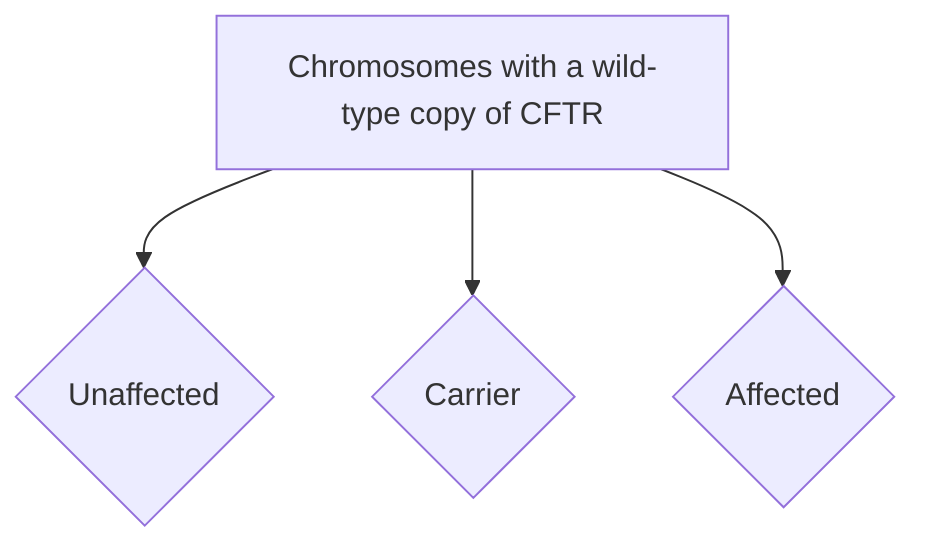

Figure 2.1: Pattern of CF inheritance for a child of two unaffected carriers

E

---

92

CHAPTER 2. PROBABILITY

## GUIDED PRACTICE 2.5

Suppose the father has CF and the mother is an unaffected carrier. What is the probability that their child will be affected by the disease?2

## 2.1.2 Probability

Probability is used to assign a level of uncertainty to the outcomes of phenomena that either happen randomly (e.g. rolling dice, inheriting of disease alleles), or appear random because of a lack of understanding about exactly how the phenomenon occurs (e.g. a woman in her 40’s developing breast cancer). Modeling these complex phenomena as random can be useful, and in either case, the interpretation of probability is the same: the chance that some event will occur.

Mathematicians and philosophers have struggled for centuries to arrive at a clear statement of how probability is defined, or what it means. The most common definition is used in this text.

## PROBABILITY

The **probability** of an outcome is the proportion of times the outcome would occur if the random phenomenon could be observed an infinite number of times.

This definition of probability can be illustrated by simulation. Suppose a die is rolled many times. Let ${ \hat { p } } _ { n }$ be the proportion of outcomes that are 1 after the first n rolls. As the number of rolls increases, ${ \hat { p } } _ { n }$ will converge to the probability of rolling a 1, $p = 1 / 6$ . Figure 2.2 shows this convergence for 100,000 die rolls. The tendency of ${ \hat { p } } _ { n }$ to stabilize around p is described by the **Law of Large Numbers**. The behavior shown in Figure 2.2 matches most people’s intuition about probability, but proving mathematically that the behavior is always true is surprisingly difficult and beyond the level of this text.

line

| n (number of rolls) | ⟨p_n⟩ |
| --- | --- |
| 1 | 0.0 |
| ~3 | 0.0 |
| ~4 | ~0.25 |
| ~6 | ~0.33 |
| ~8 | ~0.25 |
| ~10 | ~0.33 |
| ~20 | ~0.14 |
| ~30 | ~0.20 |
| ~50 | ~0.13 |
| ~80 | ~0.21 |
| ~100 | ~0.15 |
| ~200 | ~0.19 |
| ~500 | ~0.18 |
| ~1,000 | ~0.17 |
| ~10,000 | ~0.17 |
| ~100,000 | ~0.17 |

Figure 2.2: The fraction of die rolls that are 1 at each stage in a simulation. The proportion tends to get closer to the probability $1 / 6 \approx 0 . 1 6 7$ as the number of rolls increases.

Occasionally the proportion veers off from the probability and appear to defy the Law of Large Numbers, as ${ \hat { p } } _ { n }$ does many times in Figure 2.2. However, the likelihood of these large deviations becomes smaller as the number of rolls increases.

<small>2Since the father has CF, he must have two affected copies; he will always pass along a defective copy of the gene. Since the mother will pass along a defective copy half of the time, the child will be affected half of the time, or with probability (1) × (1/2) = 1/2.</small>

---

2.1. DEFINING PROBABILITY

93

## LAW OF LARGE NUMBERS

As more observations are collected, the proportion ${ \hat { p } } _ { n }$ of occurrences with a particular outcome converges to the probability p of that outcome.

Probability is defined as a proportion, and it always takes values between 0 and 1 (inclusively). It may also be expressed as a percentage between 0% and 100%. The probability of rolling a 1, p, can also be written as P (rolling a 1).

This notation can be further abbreviated. For instance, if it is clear that the process is “rolling a die”, P (rolling a 1) can be written as P (1). There also exists a notation for an event itself; the event A of rolling a 1 can be written as $A = \{ { \mathrm { r o l l i n g ~ a ~ } } 1 \}$ , with associated probability P (A).

P (A)

Probability of outcome A

## 2.1.3 Disjoint or mutually exclusive outcomes

Two outcomes are **disjoint** or **mutually exclusive** if they cannot both happen at the same time. When rolling a die, the outcomes 1 and 2 are disjoint since they cannot both occur. However, the outcomes 1 and “rolling an odd number” are not disjoint since both occur if the outcome of the roll is a 1.3

What is the probability of rolling a 1 or a 2? When rolling a die, the outcomes 1 and 2 are disjoint. The probability that one of these outcomes will occur is computed by adding their separate probabilities:

$$
P (1 \text {or} 2) = P (1) + P (2) = 1 / 6 + 1 / 6 = 1 / 3.
$$

What about the probability of rolling a 1, 2, 3, 4, 5, or 6? Here again, all of the outcomes are disjoint, so add the individual probabilities:

$$
\begin{array}{l} P (1 \text {or} 2 \text {or} 3 \text {or} 4 \text {or} 5 \text {or} 6) \\ = P (1) + P (2) + P (3) + P (4) + P (5) + P (6) \\ = 1 / 6 + 1 / 6 + 1 / 6 + 1 / 6 + 1 / 6 + 1 / 6 = 1. \\ \end{array}
$$

## ADDITION RULE OF DISJOINT OUTCOMES

If $A _ { 1 }$ and $A _ { 2 }$ represent two disjoint outcomes, then the probability that either one of them occurs is given by

$$
P (A _ {1} \text {or} A _ {2}) = P (A _ {1}) + P (A _ {2}).
$$

If there are k disjoint outcomes $A _ { 1 } ,   . . . ,   A _ { k }$ then the probability that either one of these outcomes will occur is

$$
P (A _ {1}) + P (A _ {2}) + \dots + P (A _ {k}). \tag {2.6}
$$

<small>3The terms disjoint and mutually exclusive are equivalent and interchangeable.</small>

---

94

CHAPTER 2. PROBABILITY

## GUIDED PRACTICE 2.7

Consider the CF example. Is the event that two carriers of CF have a child that is also a carrier represented by mutually exclusive outcomes? Calculate the probability of this event.4

Probability problems often deal with sets or collections of outcomes. Let A represent the event in which a die roll results in 1 or 2 and B represent the event that the die roll is a 4 or a 6. We write A as the set of outcomes {1, 2} and $B = \{ 4 ,   6 \}$ . These sets are commonly called **events**. Because A and B have no elements in common, they are disjoint events. A and B are represented in Figure 2.3.

text_image

EVENT A
EVENT D
EVENT B

Figure 2.3: Three events, A, B, and D, consist of outcomes from rolling a die. A and B are disjoint since they do not have any outcomes in common.

The Addition Rule applies to both disjoint outcomes and disjoint events. The probability that one of the disjoint events A or B occurs is the sum of the separate probabilities:

$$
P (A \text {or} B) = P (A) + P (B) = 1 / 3 + 1 / 3 = 2 / 3.
$$

## GUIDED PRACTICE 2.8

(a) Verify the probability of event A, P (A), is 1/3 using the Addition Rule. (b) Do the same for event $B . ^ { 5 }$

## GUIDED PRACTICE 2.9

(a) Using Figure 2.3 as a reference, which outcomes are represented by event D? (b) Are events B and D disjoint? (c) Are events A and D disjoint?6

<small>4Yes, there are two mutually exclusive outcomes for which a child of two carriers can also be a carrier - a child can either receive an affected copy of CFT R from the mother and a normal copy from the father, or vice versa (since each parent can only contribute one allele). Thus, the probability that a child will be a carrier is 1/4 + 1/4 = 1/2.</small>

<small>5(a) P (A) = P (1 or 2) = P (1) + P (2) = 16 +16 =26 =13 . (b) Similarly, P (B) = 1/3.</small>

<small>6(a) Outcomes 2 and 3. (b) Yes, events B and D are disjoint because they share no outcomes. (c) The events A and D share an outcome in common, 2, and so are not disjoint.</small>

---

2.1. DEFINING PROBABILITY

95

## GUIDED PRACTICE 2.10

In Guided Practice 2.9, you confirmed B and D from Figure 2.3 are disjoint. Compute the probability that event B or event D occurs.7

## 2.1.4 Probabilities when events are not disjoint

**Venn diagrams** are useful when outcomes can be categorized as “in” or “out” for two or three variables, attributes, or random processes. The Venn diagram in Figure 2.5 uses one oval to represent diamonds and another to represent face cards (the cards labeled jacks, queens, and kings); if a card is both a diamond and a face card, it falls into the intersection of the ovals.

text_image

2♣ 3♣ 4♣ 5♣ 6♣ 7♣ 8♣ 9♣ 10♣ J♣ Q♣ K♣ A♣
2◇ 3◇ 4◇ 5◇ 6◇ 7◇ 8◇ 9◇ 10◇ J◇ Q◇ K◇ A◇
2♥ 3♥ 4♥ 5♥ 6♥ 7♥ 8♥ 9♥ 10♥ J♥ Q♥ K♥ A♥
2♠ 3♠ 4♠ 5♠ 6♠ 7♠ 8♠ 9♠ 10♠ J♠ Q♠ K♠ A♠

Figure 2.4: A regular deck of 52 cards is split into four suits: ♣ (club), ♦ (diamond), ♥ (heart), ♠ (spade). Each suit has 13 labeled cards: 2, 3, ..., 10, J (jack), Q (queen), K (king), and A (ace). Thus, each card is a unique combination of a suit and a label, e.g. 4♥ and J♣.

funnel

| Region | Value |
| --- | --- |
| Diamonds | 13 / 52 = 0.2500 |
| Face Cards | 12 / 52 = 0.2308 |
| Diamond & Face Cards | 10 / 52 = 0.1923 |
| Diamond & Face Cards | 9 / 52 = 0.1731 |
| Face Cards & Diamond & Face Cards | 9 / 52 = 0.1731 |

Figure 2.5: A Venn diagram for diamonds and face cards.

## GUIDED PRACTICE 2.11

(a) What is the probability that a randomly selected card is a diamond? (b) What is the probability that a randomly selected card is a face card?8

<small>7Since B and D are disjoint events, use the Addition Rule: P (B or D) = P (B) + P (D) = 3 =23 .</small>

<small>8(a) There are 52 cards and 13 diamonds. If the cards are thoroughly shuffled, each card has an equal chance of being drawn, so the probability that a randomly selected card is a diamond is P (♦) = 13= 0.250. (b) Likewise, there are 12 face</small>

---

96

CHAPTER 2. PROBABILITY

Let A represent the event that a randomly selected card is a diamond and B represent the event that it is a face card. Events A and B are not disjoint – the cards J♦, Q♦, and K♦ fall into both categories.

As a result, adding the probabilities of the two events together is not sufficient to calculate P (A or B):

$$
P (A) + P (B) = P (\diamond) + P (\text {face card}) = 1 2 / 5 2 + 1 3 / 5 2.
$$

Instead, a small modification is necessary. The three cards that are in both events were counted twice. To correct the double counting, subtract the probability that both events occur:

$$
\begin{array}{l} P (A \text {or} B) = P (\text {face card or} \diamond) \\ = \quad P (\text {face card}) + P (\diamondsuit) - P (\text {face card and} \diamondsuit) \tag {2.12} \\ = 1 3 / 5 2 + 1 2 / 5 2 - 3 / 5 2 \\ = \quad 2 2 / 5 2 = 1 1 / 2 6. \\ \end{array}
$$

Equation (2.12) is an example of the **General Addition Rule**.

## GENERAL ADDITION RULE

If A and B are any two events, disjoint or not, then the probability that at least one of them will occur is

$$
P (A \text {or} B) = P (A) + P (B) - P (A \text {and} B), \tag {2.13}
$$

where P (A and B) is the probability that both events occur.

Note that in the language of statistics, "or" is inclusive such that A or B occurs means A, B, or both A and B occur.

## GUIDED PRACTICE 2.14

(a) If A and B are disjoint, describe why this implies P (A and B) = 0. (b) Using part (a), verify that the General Addition Rule simplifies to the Addition Rule for disjoint events if A and B are disjoint.9

## GUIDED PRACTICE 2.15

Human immunodeficiency virus (HIV) and tuberculosis (TB) affect substantial proportions of the population in certain areas of the developing world. Individuals sometimes are co-infected (i.e., have both diseases). Children of HIV-infected mothers may have HIV and TB can spread from one family member to another. In a mother-child pair, let A = {the mother has HIV}, B = {the mother has TB}, C = {the child has HIV}, D = {the child has TB}. Write out the definitions of the events A or B, A and B, A and C, A or D.10

G

G

<small>9(a) If A and B are disjoint, A and B can never occur simultaneously. (b) If A and B are disjoint, then the last term of Equation (2.13) is 0 (see part (a)) and we are left with the Addition Rule for disjoint events.</small>

<small>10Events A or B: the mother has HIV, the mother has TB, or the mother has both HIV and TB. Events A and B: the mother has both HIV and TB. Events A and C: The mother has HIV and the child has HIV. A or D: The mother has HIV, the child has TB, or the mother has HIV and the child has TB.</small>

---

2.1. DEFINING PROBABILITY

97

## 2.1.5 Probability distributions

A **probability distribution** consists of all disjoint outcomes and their associated probabilities. Figure 2.6 shows the probability distribution for the sum of two dice.

| Dice sum | 2 | 3 | 4 | 5 | 6 | 7 | 8 | 9 | 10 | 11 | 12 |
| --- | --- | --- | --- | --- | --- | --- | --- | --- | --- | --- | --- |
| Probability | $\frac{1}{36}$ | $\frac{2}{36}$ | $\frac{3}{36}$ | $\frac{4}{36}$ | $\frac{5}{36}$ | $\frac{6}{36}$ | $\frac{5}{36}$ | $\frac{4}{36}$ | $\frac{3}{36}$ | $\frac{2}{36}$ | $\frac{1}{36}$ |

Figure 2.6: Probability distribution for the sum of two dice.

## RULES FOR A PROBABILITY DISTRIBUTION

A probability distribution is a list of all possible outcomes and their associated probabilities that satisfies three rules:

1. The outcomes listed must be disjoint.
2. Each probability must be between 0 and 1.
3. The probabilities must total to 1.

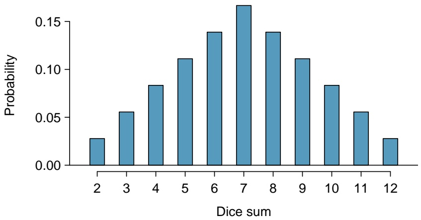

bar

| Dice sum | Probability |
| --- | --- |
| 2 | ~0.03 |
| 3 | ~0.055 |
| 4 | ~0.085 |
| 5 | ~0.11 |
| 6 | ~0.14 |
| 7 | ~0.17 |
| 8 | ~0.14 |
| 9 | ~0.11 |
| 10 | ~0.085 |
| 11 | ~0.055 |
| 12 | ~0.03 |

Figure 2.7: The probability distribution of the sum of two dice.

Probability distributions can be summarized in a bar plot. The probability distribution for the sum of two dice is shown in Figure 2.7, with the bar heights representing the probabilities of outcomes.

Figure 2.8 shows a bar plot of the birth weight data for 3,999,386 live births in the United States in 2010, for which total counts have been converted to proportions. Since birth weight trends do not change much between years, it is valid to consider the plot as a representation of the probability distribution of birth weights for upcoming years, such as 2017. The data are available as part of the US CDC National Vital Statistics System.11

The graph shows that while most babies born weighed between 2000 and 5000 grams (2 to 5 kg), there were both small (less than 1000 grams) and large (greater than 5000 grams) babies. Pediatricians consider birth weights between 2.5 and 5 kg as normal.12 A probability distribution gives a sense of which outcomes can be considered unusual (i.e., outcomes with low probability).

<small>11<a href="http://205.207.175.93/vitalstats/ReportFolders/reportFolders.aspx">http://205.207.175.93/vitalstats/ReportFolders/reportFolders.aspx</a></small>

<small>12<a href="https://www.nlm.nih.gov/medlineplus/birthweight.html">https://www.nlm.nih.gov/medlineplus/birthweight.html</a></small>

---

98

CHAPTER 2. PROBABILITY

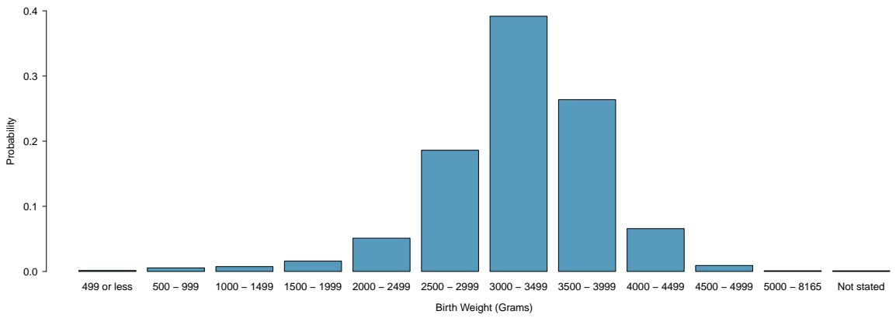

histogram

| Birth Weight (Grams) | Probability |
| --- | --- |
| 499 or less | ~0.001 |
| 500 – 999 | ~0.005 |
| 1000 – 1499 | ~0.008 |
| 1500 – 1999 | ~0.017 |
| 2000 – 2499 | ~0.052 |
| 2500 – 2999 | ~0.187 |
| 3000 – 3499 | ~0.392 |
| 3500 – 3999 | ~0.265 |
| 4000 – 4499 | ~0.067 |
| 4500 – 4999 | ~0.011 |
| 5000 – 8165 | ~0.001 |
| Not stated | ~0.001 |

Figure 2.8: Distribution of birth weights (in grams) of babies born in the US in 2010.

## Continuous probability distributions

Probability distributions for events that take on a finite number of possible outcomes, such as the sum of two dice rolls, are referred to as **discrete probability distributions**.

Consider how the probability distribution for adult heights in the US might best be represented. Unlike the sum of two dice rolls, height can occupy any value over a continuous range. Thus, height has a **continuous probability distribution**, which is specified by a **probability density function** rather than a table; Figure 2.9 shows a histogram of the height for 3 million US adults from the mid-1990’s, with an overlaid density curve.13

Just as in the discrete case, the probabilities of all possible outcomes must still sum to 1; the total area under a probability density function equals 1.

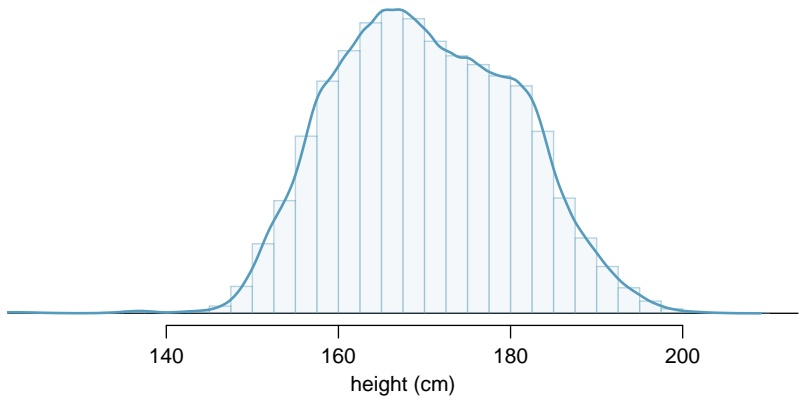

histogram

| Bin (cm) | Frequency |
| --- | --- |
| 135~140 | ~0.02 |
| 140~145 | ~0.05 |
| 145~150 | ~0.15 |
| 150~155 | ~0.45 |
| 155~160 | ~0.85 |
| 160~165 | ~1.15 |
| 165~170 | ~1.25 |
| 170~175 | ~1.15 |
| 175~180 | ~0.95 |
| 180~185 | ~0.75 |
| 185~190 | ~0.45 |
| 190~195 | ~0.20 |
| 195~200 | ~0.08 |

Figure 2.9: The continuous probability distribution of heights for US adults.

<small>13This sample can be considered a simple random sample from the US population. It relies on the USDA Food Commodity Intake Database.</small>

---

2.1. DEFINING PROBABILITY

99

## EXAMPLE 2.16

Estimate the probability that a randomly selected adult from the US population has height between 180 and 185 centimeters. In Figure 2.10(a), the two bins between 180 and 185 centimeters have counts of 195,307 and 156,239 people.

Find the proportion of the histogram’s area that falls in the range 180 cm and 185: add the heights of the bins in the range and divide by the sample size:

$$
\frac {1 9 5 , 3 0 7 + 1 5 6 , 2 3 9}{3 , 0 0 0 , 0 0 0} = 0. 1 1 7 2.
$$

The probability can be calculated precisely with the use of computing software, by finding the area of the shaded region under the curve between 180 and 185:

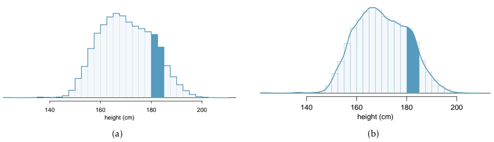

Figure 2.10: (a) A histogram with bin sizes of 2.5 cm, with bars between 180 and 185 cm shaded. (b) Density for heights in the US adult population with the area between 180 and 185 cm shaded.

## EXAMPLE 2.17

What is the probability that a randomly selected person is **exactly** 180 cm? Assume that height can be measured perfectly.

This probability is zero. A person might be close to 180 cm, but not exactly 180 cm tall. This also coheres with the definition of probability as an area under the density curve; there is no area captured between 180 cm and 180 cm.

## GUIDED PRACTICE 2.18

Suppose a person’s height is rounded to the nearest centimeter. Is there a chance that a random person’s **measured** height will be 180 cm?14

E

E

G

<small>14This has positive probability. Anyone between 179.5 cm and 180.5 cm will have a measured height of 180 cm. This a more realistic scenario to encounter in practice versus Example 2.17.</small>

---

100

CHAPTER 2. PROBABILITY

## 2.1.6 Complement of an event

S Sample space Ac Complement of outcome A

Rolling a die produces a value in the set $\{ 1 ,   2 ,   3 ,   4 ,   5 ,   6 \}$ . This set of all possible outcomes is called the **sample space** (S) for rolling a die.

Let $D = \{ 2 ,   3 \}$ represent the event that the outcome of a die roll is 2 or 3. The **complement** of D represents all outcomes in the sample space that are not in $D ,$ which is denoted by $D ^ { c } = \{ 1 ,   4 ,   5 ,$ $6 \}$ . That is, $D ^ { c }$ is the set of all possible outcomes not already included in D. Figure 2.11 shows the relationship between $D , D ^ { c }$ , and the sample space S.

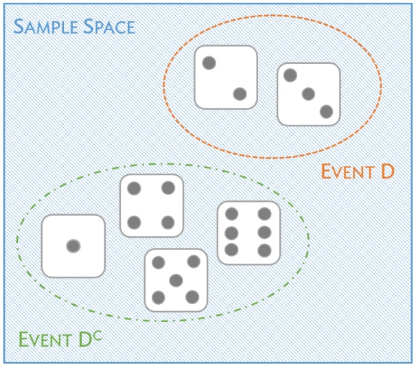

text_image

SAMPLE SPACE
EVENT D
EVENT Dᶜ

Figure 2.11: Event $D = \{ 2 ,   3 \}$ and its complement, $D ^ { c } = \{ 1 ,   4 ,   5 ,   6 \}$ . S represents the sample space, which is the set of all possible events.

## GUIDED PRACTICE 2.19

(a) Compute P (Dc) = P (rolling a 1, 4, 5, or 6). (b) What is $P ( D ) + P ( D ^ { c } ) ? ^ { 1 5 }$

## GUIDED PRACTICE 2.20

Events $A = \{ 1 ,   2 \}$ and $B = \{ 4 ,   6 \}$ are shown in Figure 2.3 on page 94. (a) Write out what $A ^ { c }$ and $B ^ { c }$ represent. (b) Compute $P ( A ^ { c } )$ and $P ( B ^ { c } )$ . (c) Compute $P ( A ) + P ( A ^ { c } )$ and $P ( B ) + P ( B ^ { c } )$ 16

A complement of an event A is constructed to have two very important properties: every possible outcome not in A is in $A ^ { c } ,$ and A and $A ^ { c }$ are disjoint. If every possible outcome not in A is in $A ^ { c } ,$ , this implies that

$$
P (A \text {or} A ^ {c}) = 1. \tag {2.21}
$$

Then, by Addition Rule for disjoint events,

$$
P (A \text {or} A ^ {c}) = P (A) + P (A ^ {c}). \tag {2.22}
$$

Combining Equations (2.21) and (2.22) yields a useful relationship between the probability of an event and its complement.

<small>$^ { 1 5 } ( \mathtt { a } )$ The outcomes are disjoint and each has probability 1/6, so the total probability is $4 / 6 = 2 / 3 .$ (b) We can also see that $P(D)=\frac{1}{6}+\frac{1}{6}=1/3$ . Since D and $D ^ { c }$ are disjoint, $P ( D ) + P ( D ^ { c } ) = 1$</small>

<small>16Brief solutions: (a) $A ^ { c } = \{ 3 ,   4 ,   5 ,   6 \}$ and $B ^ { c } = \{ 1 ,   2 ,   3 ,   5 \}$ (b) Noting that each outcome is disjoint, add the individual outcome probabilities to get $P ( A ^ { c } ) = 2 / 3$ and $P ( B ^ { c } ) = 2 / 3 .$ (c) A and $\check { A } ^ { c }$ are disjoint, and the same is true of B and $B ^ { c } .$ Therefore, $P(A)+P(A^{c})=1\mathrm{~and~}P(B)+P(B^{c})=1$</small>

---

2.1. DEFINING PROBABILITY

101

## COMPLEMENT

The complement of event A is denoted $A ^ { c } ,$ and $A ^ { c }$ represents all outcomes not in A. A and $A ^ { c }$ are mathematically related:

$$
P (A) + P (A ^ {c}) = 1, \quad \text {i.e.} \quad P (A) = 1 - P (A ^ {c}). \tag {2.23}
$$

In simple examples, computing either A or $A ^ { c }$ is feasible in a few steps. However, as problems grow in complexity, using the relationship between an event and its complement can be a useful strategy.

## GUIDED PRACTICE 2.24

Let A represent the event of selecting an adult from the US population with height between 180 and 185 cm, as calculated in Example 2.16. What is $P ( A ^ { c } ) ? ^ { 1 7 }$

## GUIDED PRACTICE 2.25

Let A represent the event in which two dice are rolled and their total is less than 12. (a) What does the event $A ^ { c }$ represent? (b) Determine $P ( A ^ { c } )$ from Figure 2.6 on page 97. (c) Determine $P ( A )$ 18

## GUIDED PRACTICE 2.26

Consider again the probabilities from Figure 2.6 and rolling two dice. Find the following probabilities: (a) The sum of the dice is not 6. (b) The sum is at least 4. That is, determine the probability of the event $B = \{ 4 ,   5 ,   . . . ,   1 2 \}$ . (c) The sum is no more than 10. That is, determine the probability of the event $D = \{ 2 ,   3 ,   . . . ,   1 \emptyset \} .$ 19

## 2.1.7 Independence

Just as variables and observations can be independent, random phenomena can also be independent. Two processes are **independent** if knowing the outcome of one provides no information about the outcome of the other. For instance, flipping a coin and rolling a die are two independent processes – knowing that the coin lands heads up does not help determine the outcome of the die roll. On the other hand, stock prices usually move up or down together, so they are not independent.

<small>17P (Ac) = 1 − P (A) = 1 − 0.1157 = 0.8843.</small>

<small>18(a) The complement of A: when the total is equal to 12. (b) P (Ac) = 1/36. (c) Use the probability of the complement from part (b), P (Ac) = 1/36, and Equation (2.23): P (less than 12) = 1 − P (12) = 1 − 1/36 = 35/36.</small>

<small>19(a) First find P (6) = 5/36, then use the complement: P (not 6) = 1 − P (6) = 31/36.</small>

<small>(b) First find the complement, which requires much less effort: P (2 or 3) = 1/36 + 2/36 = 1/12. Then calculate P (B) = 1 − P (Bc) = 1 − 1/12 = 11/12.</small>

<small>(c) As before, finding the complement is the more direct way to determine P (D). First find P (Dc) = P (11 or 12) = 2/36 + 1/36 = 1/12. Then calculate P (D) = 1 − P (Dc) = 11/12.</small>

---

102

CHAPTER 2. PROBABILITY

Example 2.3 provides a basic example of two independent processes: rolling two dice. What is the probability that both will be 1? Suppose one of the dice is blue and the other green. If the outcome of the blue die is a 1, it provides no information about the outcome of the green die. This question was first encountered in Example 2.3: $1 / 6 ^ { t h }$ of the time the blue die is a 1, and $1 / 6 ^ { t h }$ of those times the green die will also be 1. This is illustrated in Figure 2.12. Because the rolls are independent, the probabilities of the corresponding outcomes can be multiplied to obtain the final answer: ${ \big ( } 1 / 6 { \big ) } { \big ( } 1 / 6 { \big ) } = 1 / 3 6$ . This can be generalized to many independent processes.

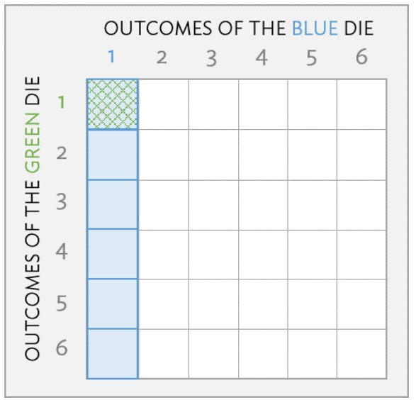

bar

| Category | Outcomes of the Green Die |
| --- | --- |
| 1 | 1 |
| 2 | 1 |
| 3 | 1 |
| 4 | 1 |
| 5 | 1 |
| 6 | 1 |

Figure 2.12: $1 / 6 ^ { t h }$ of the time, the first roll is a 1. Then $1 / 6 ^ { t h }$ of those times, the second roll will also be a 1.

Complicated probability problems, such as those that arise in biology or medicine, are often solved with the simple ideas used in the dice example. For instance, independence was used implicitly in the second solution to Example 2.4, when calculating the probability that two carriers will have an affected child with cystic fibrosis. Genes are typically passed along from the mother and father independently. This allows for the assumption that, on average, half of the offspring who receive a mutated gene copy from the mother will also receive a mutated copy from the father.

## GUIDED PRACTICE 2.27

What if there were also a red die independent of the other two? What is the probability of rolling the three dice and getting all $1 s _ { * } ^ { 2 0 }$

## GUIDED PRACTICE 2.28

Three US adults are randomly selected. The probability the height of a single adult is between 180 and 185 cm is 0.1157.21

(a) What is the probability that all three are between 180 and 185 cm tall?
(b) What is the probability that none are between 180 and 185 cm tall?

<small>20The same logic applies from Example 2.3. If 1/36th of the time the blue and green dice are both 1, then 1/6th of those times the red die will also be 1, so multiply:</small>

<small>P (blue = 1 and green = 1 and red = 1) = P (blue = 1)P (green = 1)P (red = 1)</small>

<small>= (1/6)(1/6)(1/6) = 1/216.</small>

<small>21Brief answers: (a) 0.1157 × 0.1157 × 0.1157 = 0.0015. (b) (1 − 0.1157)3 = 0.692.</small>

G

G

---

2.1. DEFINING PROBABILITY

103

## MULTIPLICATION RULE FOR INDEPENDENT PROCESSES

If A and B represent events from two different and independent processes, then the probability that both A and B occur is given by:

$$
P (A \text {and} B) = P (A) P (B). \tag {2.29}
$$

Similarly, if there are $k$ events $A _ { 1 } ,   . . . ,   A _ { k }$ from k independent processes, then the probability they all occur is

$$
P (A _ {1}) P (A _ {2}) \dots P (A _ {k}).
$$

## EXAMPLE 2.30

**Mandatory drug testing.** Mandatory drug testing in the workplace is common practice for certain professions, such as air traffic controllers and transportation workers. A false positive in a drug screening test occurs when the test incorrectly indicates that a screened person is an illegal drug user. Suppose a mandatory drug test has a false positive rate of 1.2% (i.e., has probability 0.012 of indicating that an employee is using illegal drugs when that is not the case). Given 150 employees who are in reality drug free, what is the probability that at least one will (falsely) test positive? Assume that the outcome of one drug test has no effect on the others.

First, note that the complement of at least 1 person testing positive is that no one tests positive (i.e., all employees test negative). The multiplication rule can then be used to calculate the probability of 150 negative tests.

$$
\begin{array}{l} P (\text {At least 1"} +") = P (1 \text {or} 2 \text {or} 3 \dots \text {or} 1 5 0 \text {are"} +") \\ = 1 - P (\text {None are"} +") \\ = 1 - P (1 5 0 \text { are }" -") \\ = 1 - P ({" -"}) ^ {1 5 0} \\ = 1 - (0. 9 8 8) ^ {1 5 0} = 1 - 0. 1 6 = 0. 8 4. \\ \end{array}
$$

Even when using a test with a small probability of a false positive, the company is more than 80% likely to incorrectly claim at least one employee is an illegal drug user!

## GUIDED PRACTICE 2.31

Because of the high likelihood of at least one false positive in company wide drug screening programs, an individual with a positive test is almost always re-tested with a different screening test: one that is more expensive than the first, but has a lower false positive probability. Suppose the second test has a false positive rate of 0.8%. What is the probability that an employee who is not using illegal drugs will test positive on both tests?22

E

G

<small>22The outcomes of the two tests are independent of one another; P (A and B) = P (A) × P (B), where events A and B are the results of the two tests. The probability of a false positive with the first test is 0.012 and 0.008 with the second. Thus, the probability of an employee who is not using illegal drugs testing positive on both tests is 0.012 × 0.008 = 9.6 × 10−5</small>

---

104

CHAPTER 2. PROBABILITY

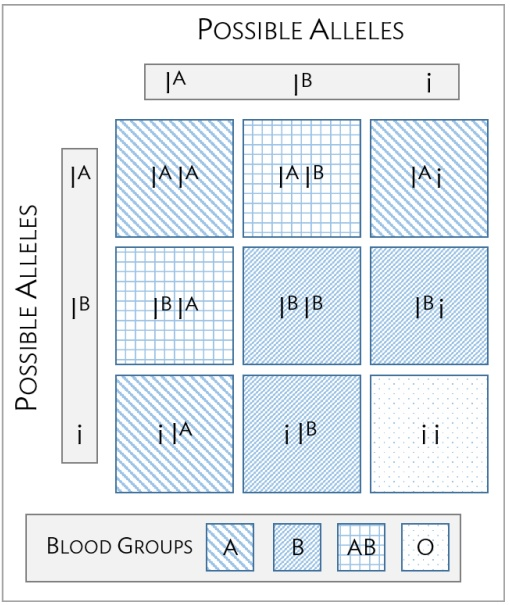

Figure 2.13: Inheritance of ABO blood groups.

## EXAMPLE 2.32

**ABO blood groups.** There are four different common blood types (A, B, AB, and O), which are determined by the presence of certain antigens located on cell surfaces. Antigens are substances used by the immune system to recognize self versus non-self; if the immune system encounters antigens not normally found on the body’s own cells, it will attack the foreign cells. When patients receive blood transfusions, it is critical that the antigens of transfused cells match those of the patient’s, or else an immune system response will be triggered.

The ABO blood group system consists of four different blood groups, which describe whether an individual’s red blood cells carry the A antigen, B antigen, both, or neither. The ABO gene has three alleles: $I ^ { A } ,   I ^ { B } ,$ , and i. The i allele is recessive to both $I ^ { A }$ and $I ^ { B } ,$ , and does not produce antigens; thus, an individual with genotype $I ^ { A } i$ is blood group A and an individual with genotype $I ^ { B } i$ is blood group B. The $I ^ { A }$ and $I ^ { B }$ alleles are codominant, such that individuals of $I ^ { A } I ^ { B }$ genotype are AB. Individuals homozygous for the i allele are known as blood group $\mathrm { O } ,$ with neither A nor B antigens.

Suppose that both members of a couple have Group AB blood.

a) What is the probability that a child of this couple will have Group A blood?
b) What is the probability that they have two children with Group A blood?

<small>a) An individual with Group AB blood is genotype $I ^ { A } I ^ { B }$ . Two $I ^ { A } I ^ { B }$ parents can produce children with genotypes $I ^ { A } I ^ { B } , \; I ^ { A } I ^ { A } , \; \mathrm { o r } ~ I ^ { B } I ^ { B }$ . Of these possibilities, only children with genotype $I ^ { A } I ^ { A }$ have Group A blood. Each parent has 0.5 probability of passing down their $I ^ { A }$ allele. Thus, the probability that a child of this couple will have Group A blood is P(parent 1 passes down $I ^ { A }$ allele) × P(parent 2 passes down $I ^ { A } { \mathrm { ~ a l l e l e } } ) = 0 . 5 \times 0 . 5 = 0 . 2 5$</small>

<small>b) Inheritance of alleles is independent between children. Thus, the probability of two children having Group A blood equals P(child 1 has Group A blood) × P(child 2 has group A blood). The probability of a child of this couple having Group A blood was previously calculated as 0.25. The answer is given by 0.25 × 0.25 = 0.0625.</small>

E

---

2.1. DEFINING PROBABILITY

105

The previous examples in this section have used independence to solve probability problems. The definition of independence can also be used to check whether two events are independent – two events A and B are independent if they satisfy Equation (2.29).

## EXAMPLE 2.33

Is the event of drawing a heart from a deck of cards independent of drawing an ace?

The probability the card is a heart is $1 / 4   \left( 1 3 / 5 2   =   1 / 4 \right)$ and the probability that it is an ace is $1 / 1 3 \; \left( 4 / 5 2 = 1 / 1 3 \right)$ . The probability that the card is the ace of hearts (A♥) is 1/52. Check whether Equation 2.29 is satisfied:

$$
P (\heartsuit) P (\mathsf {A}) = \bigg (\frac {1}{4} \bigg) \bigg (\frac {1}{1 3} \bigg) = \frac {1}{5 2} = P (\heartsuit \text {and} \mathsf {A}).
$$

Since the equation holds, the event that the card is a heart and the event that the card is an ace are independent events.

## EXAMPLE 2.34

In the general population, about 15% of adults between 25 and 40 years of age are hypertensive. Suppose that among males of this age, hypertension occurs about 18% of the time. Is hypertension independent of sex?

Assume that the population is 50% male, 50% female; it is given in the problem that hypertension occurs about 15% of the time in adults between ages 25 and 40.

$$
P (\text {hypertension}) \times P (\text {male}) = (0. 1 5) (0. 5 0) = 0. 0 7 5 \neq 0. 1 8.
$$

Equation 2.29 is not satisfied, therefore hypertension is not independent of sex. In other words, knowing whether an individual is male or female is informative as to whether they are hypertensive. If hypertension and sex were independent, then we would expect hypertension to occur at an equal rate in males as in females.

E

E

---

106

CHAPTER 2. PROBABILITY

## 2.2 Conditional probability

While it is difficult to obtain precise estimates, the US CDC estimated that in 2012, approximately 29.1 million Americans had type 2 diabetes – about 9.3% of the population.23 A health care practitioner seeing a new patient would expect a 9.3% chance that the patient might have diabetes.

However, this is only the case if nothing is known about the patient. The prevalence of type 2 diabetes varies with age. Between the ages of 20 and 44, only about 4% of the population have diabetes, but almost 27% of people age 65 and older have the disease. Knowing the age of a patient provides information about the chance of diabetes; age and diabetes status are not independent. While the probability of diabetes in a randomly chosen member of the population is 0.093, the conditional probability of diabetes in a person known to be 65 or older is 0.27.

Conditional probability is used to characterize how the probability of an outcome varies with the knowledge of another factor or condition, and is closely related to the concepts of marginal and joint probabilities.

## 2.2.1 Marginal and joint probabilities

Figures 2.14 and 2.15 provide additional information about the relationship between diabetes prevalence and age.24 Figure 2.14 is a contingency table for the entire US population in 2012; the values in the table are in thousands (to make the table more readable).

|  | Diabetes | No Diabetes | Sum |
| --- | --- | --- | --- |
| Less than 20 years | 200 | 86,664 | 86,864 |
| 20 to 44 years | 4,300 | 98,724 | 103,024 |
| 45 to 64 years | 13,400 | 68,526 | 81,926 |
| Greater than 64 years | 11,200 | 30,306 | 41,506 |
| Sum | 29,100 | 284,220 | 313,320 |

Figure 2.14: Contingency table showing type 2 diabetes status and age group, in thousands.

In the first row, for instance, Figure 2.14 shows that in the entire population of approximately 313,320,000 people, approximately 200,000 individuals were in the less than 20 years age group and diagnosed with diabetes – about 0.1%. The table also indicates that among the approximately 86,864,000 individuals less than 20 years of age, only 200,000 suffered from type 2 diabetes, approximately 0.2%. The distinction between these two statements is small but important. The first provides information about the size of the group with type 2 diabetes population that is less than 20 years of age, relative to the entire population. In contrast, the second statement is about the size of the diabetes population within the less than 20 years of age group, relative to the size of that age group.

<small>2321 million of these cases are diagnosed, while the CDC predicts that 8.1 million cases are undiagnosed; that is, approximately 8.1 million people are living with diabetes, but they (and their physicians) are unaware that they have the condition.</small>

<small>24Because the CDC provides only approximate numbers for diabetes prevalence, the numbers in the table are approximations of actual population counts.</small>

---

2.2. CONDITIONAL PROBABILITY

107

## GUIDED PRACTICE 2.35

What fraction of the US population are 45 to 64 years of age and have diabetes? What fraction of the population age 45 to 64 have diabetes?25

The entries in Figure 2.15 show the proportions of the population in each of the eight categories defined by diabetes status and age, obtained by dividing each value in the cells of Figure 2.14 by the total population size.

|  | Diabetes | No Diabetes | Sum |
| --- | --- | --- | --- |
| Less than 20 years | 0.001 | 0.277 | 0.277 |
| 20 to 44 years | 0.014 | 0.315 | 0.329 |
| 45 to 64 years | 0.043 | 0.219 | 0.261 |
| Greater than 64 years | 0.036 | 0.097 | 0.132 |
| Sum | 0.093 | 0.907 | 1.000 |

Figure 2.15: Probability table summarizing diabetes status and age group.

If these proportions are interpreted as probabilities for randomly chosen individuals from the population, the value 0.014 in the first column of the second row implies that the probability of selecting someone at random who has diabetes and whose age is between 20 and 44 is 0.014, or 1.4%. The entries in the eight main table cells (i.e., excluding the values in the margins) are **joint probabilities**, which specify the probability of two events happening at the same time – in this case, diabetes and a particular age group. In probability notation, this joint probability can be expressed as 0.014 = P (diabetes and age 20 to 44).26

The values in the last row and column of the table are the sums of the corresponding rows or columns. The sum of the of the probabilities of the disjoint events (diabetes, age 20 to 44) and (no diabetes, age 20 to 44), 0.329, is the probability of being in the age group 20 to 44. The row and column sums are **marginal probabilities**; they are probabilities about only one type of event, such as age. For example, the sum of the first column (0.093) is the marginal probability of a member of the population having diabetes.

## MARGINAL AND JOINT PROBABILITIES

A marginal probability is a probability only related to a single event or process, such as P (A). A joint probability is the probability that two or more events or processes occur jointly, such as P (A and B).

## GUIDED PRACTICE 2.36

What is the interpretation of the value 0.907 in the last row of the table? And of the value 0.097 directly above it?27

<small>25The first value is given by the intersection of "45 - 64 years of age" and "diabetes", divided by the total population number: 13,400,000/313,320,000 = 0.043. The second value is given by dividing 13,400,000 by 81,926,000, the number of individuals in that age group: 13,400,000/81,926,000 = 0.164.</small>

<small>26Alternatively, this is commonly written as as P (diabetes, age 20 to 44), with a comma replacing “and”.</small>

<small>27The value 0.907 in the last row indicates the total proportion of individuals in the population who do not have diabetes. The value 0.097 indicates the joint probability of not having diabetes and being in the greater than 64 years age group.</small>

---

108

CHAPTER 2. PROBABILITY

## 2.2.2 Defining conditional probability

The probability that a randomly selected individual from the US has diabetes is 0.093, the sum of the first column in Figure 2.15. How does that probability change if it is known that the individual’s age is 64 or greater?

The conditional probability can be calculated from Figure 2.14, which shows that 11,200,000 of the 41,506,000 people in that age group have diabetes, so the likelihood that someone from that age group has diabetes is:

$$
\frac {1 1 , 2 0 0 , 0 0 0}{4 1 , 5 0 6 , 0 0 0} = 0. 2 7,
$$

or 27%. The additional information about a patient’s age allows for a more accurate estimate of the probability of diabetes.

Similarly, the conditional probability can be calculated from the joint and marginal proportions in Figure 2.15. Consider the main difference between the conditional probability versus the joint and marginal probabilities. Both the joint probability and marginal probabilities are proba bilities relative to the entire population. However, the conditional probability is the probability of having diabetes, relative only to the segment of the population greater than the age of 64.

Intuitively, the denominator in the calculation of a conditional probability must account for the fact that only a segment of the population is being considered, rather than the entire population. The conditional probability of diabetes given age 64 or older is simply the joint probability of having diabetes and being greater than 64 years of age divided by the marginal probability of being in that age group:

$$
\begin{array}{l} \frac {\text {prop. of population with diabetes, age 64 or greater}}{\text {prop. of population greater than age 64}} = \frac {1 1 , 2 0 0 , 0 0 0 / 3 1 3 , 3 2 0 , 0 0 0}{4 1 , 5 0 6 , 0 0 0 / 3 1 3 , 3 2 0 , 0 0 0} \\ = \frac {0 . 0 3 6}{0 . 1 3 2} \\ = 0. 2 7 0. \\ \end{array}
$$

This leads to the mathematical definition of conditional probability.

## CONDITIONAL PROBABILITY

The conditional probability of an event A given an event or condition B is:

$$
P (A | B) = \frac {P (A \text {and} B)}{P (B)}. \tag {2.37}
$$

## GUIDED PRACTICE 2.38

Calculate the probability that a randomly selected person has diabetes, given that their age is between 45 and 64.28

<small>28Let A be the event a person has diabetes, and B the event that their age is between 45 and 64. Use the information in P (A and B) 0.043 Figure 2.15 to calculate P (A|B). P (A|B) = = 0.165. P (B) 0.261</small>

---

2.2. CONDITIONAL PROBABILITY

109

## GUIDED PRACTICE 2.39

Calculate the probability that a randomly selected person is between 45 and 64 years old, given that the person has diabetes.29

Conditional probabilities have similar properties to regular (unconditional) probabilities.

## SUM OF CONDITIONAL PROBABILITIES

Let $A _ { 1 } , . . . , A _ { k }$ represent all the disjoint outcomes for a variable or process. Then if B is an event, possibly for another variable or process, we have:

$$
P (A _ {1} | B) + \dots + P (A _ {k} | B) = 1.
$$

The rule for complements also holds when an event and its complement are conditioned on the same information:

$$
P (A | B) = 1 - P (A ^ {c} | B).
$$

## GUIDED PRACTICE 2.40

Calculate the probability a randomly selected person is older than 20 years of age, given that the person has diabetes.30

<small>29Again, let A be the event a person has diabetes, and B the event that their age is between 45 and 64. Find P (B|A). P (B|A) = P (A and B)= 0.043= 0.462. P (A) 0.093</small>

<small>30Let A be the event that a person has diabetes, and B be the event that their age is less than 20 years. The desired probability is P (Bc|A) = 1 − P (B|A) = 1 −0.001. = 0.989. 0 093</small>

---

110

CHAPTER 2. PROBABILITY

## 2.2.3 General multiplication rule

Section 2.1.7 introduced the Multiplication Rule for independent processes. Here, the **General Multiplication Rule** is introduced for events that might not be independent.

## GENERAL MULTIPLICATION RULE

If A and B represent two outcomes or events, then

$$
P (A \text {   and   } B) = P (A | B) P (B).
$$

It is useful to think of A as the outcome of interest and B as the condition.

This General Multiplication Rule is simply a rearrangement of the definition for conditional probability in Equation (2.37) on page 108.

## EXAMPLE 2.41

Suppose that among male adults between 25 and 40 years of age, hypertension occurs about 18% of the time. Assume that the population is 50% male, 50% female. What is the probability of randomly selecting a male with hypertension from the population of individuals 25-40 years of age?

Let A be the event that a person has hypertension, and B the event that they are a male adult between 25 and 40 years of age. P (A|B), the probability of hypertension given male sex, is 0.18. Thus, P (A and $B ) = ( 0 . 1 8 ) ( 0 . 5 0 ) = 0 . 0 9$

## 2.2.4 Independence and conditional probability

If two events are independent, knowing the outcome of one should provide no information about the other.

## EXAMPLE 2.42

Let X and Y represent the outcomes of rolling two dice. Use the formula for conditional probability to compute $P ( Y = 1 \mid X = 1 )$ . What is $P ( Y = 1 ) ?$ Is this different from $P ( Y = 1 \mid X = 1 ) ?$

$$
\frac {P (Y = 1 \text {and} X = 1)}{P (X = 1)} = \frac {1 / 3 6}{1 / 6} = 1 / 6.
$$

The probability $P ( Y = 1 ) = 1 / 6$ is the same as the conditional probability. The probability that $Y = 1$ was unchanged by knowledge about $X ,$ since the events $X$ and Y are independent.

E

E

---

2.2. CONDITIONAL PROBABILITY

111

Using the Multiplication Rule for independent events allows for a mathematical illustration of why the condition information has no influence in Example 2.42:

$$
\begin{array}{l} P (Y = 1 \mid X = 1) = \frac {P (Y = 1 \text {and} X = 1)}{P (X = 1)} \\ = \frac {P (Y = 1) P (X = 1)}{P (X = 1)} \\ = \quad P (Y = 1). \\ \end{array}
$$

This is a specific instance of the more general result that if two events A and B are independent, $P ( A | B ) = P ( A )$ as long as $P ( B ) > 0$ :

$$
\begin{array}{l} P (A | B) = \frac {P (A \text { and } B)}{P (B)} \\ = \frac {P (A) P (B)}{P (B)} \\ = P (A). \\ \end{array}
$$

G

## GUIDED PRACTICE 2.43

In the US population, about 45% of people are blood group O. Suppose that 40% of Asian people living in the US are blood group O, and that the Asian population in the United States is approximately 4%. Do these data suggest that blood group is independent of ethnicity?31

## 2.2.5 Bayes’ Theorem

This chapter began with a straightforward question – what are the chances that a woman with an abnormal (i.e., positive) mammogram has breast cancer? For a clinician, this question can be rephrased as the conditional probability that a woman has breast cancer, given that her mammogram is abnormal. This conditional probability is called the **positive predictive value** (PPV) of a mammogram. More concisely, if $A = \{ \mathbf { a }$ woman has breast cancer}, and $B = \left\{ \begin{aligned} { \mathfrak { a } } \end{aligned} \right.$ mammogram is positive}, the PPV of a mammogram is $P ( A | B )$

The characteristics of a mammogram (and other diagnostic tests) are given with the reverse conditional probabilities—the probability that the mammogram correctly returns a positive result if a woman has breast cancer, as well as the probability that the mammogram correctly returns a negative result if a woman does not have breast cancer. These are the probabilities $P ( B | A )$ and $P ( B ^ { c } | A ^ { c } )$ , respectively.

Given the probabilities $P ( B | A )$ and $P ( B ^ { c } | A ^ { c } )$ , as well as the marginal probability of disease $P ( A ) ,$ , how can the positive predictive value $P ( A | B )$ be calculated?

There are several possible strategies for approaching this type of problem—1) constructing tree diagrams, 2) using a purely algebraic approach using Bayes’ Theorem, and 3) creating contingency tables based on calculating conditional probabilities from a large, hypothetical population.

<small>31Let A represent blood group O, and B represent Asian ethnicity. Since P (A|B) = 0.40 does not equal P (A) = 0.45, the two events are not independent. Blood group does not seem to be independent of ethnicity.</small>

---

112

CHAPTER 2. PROBABILITY

## EXAMPLE 2.44

In Canada, about 0.35% of women over 40 will develop breast cancer in any given year. A common screening test for cancer is the mammogram, but it is not perfect. In about 11% of patients with breast cancer, the test gives a **false negative**: it indicates a woman does not have breast cancer when she does have breast cancer. Similarly, the test gives a **false positive** in 7% of patients who do not have breast cancer: it indicates these patients have breast cancer when they actually do not.32If a randomly selected woman over 40 is tested for breast cancer using a mammogram and the test is positive – that is, the test suggests the woman has cancer – what is the probability she has breast cancer?

Read on in the text for three solutions to this example.

## Example 2.44 Solution 1. Tree Diagram.

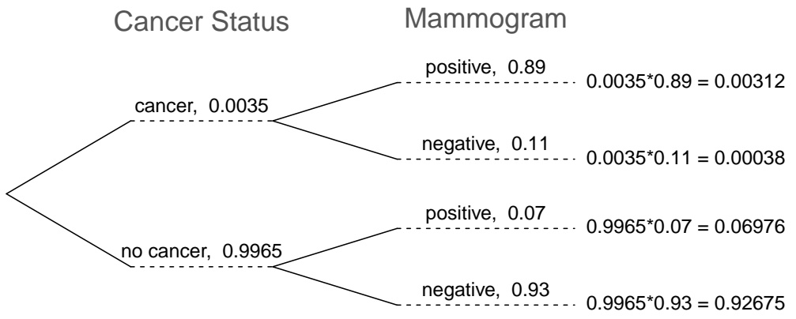

funnel

| Cancer Status | Mammogram | P-value |
| --- | --- | --- |
| cancer | positive | 0.89 |
| cancer | negative | 0.11 |
| no cancer | positive | 0.07 |
| no cancer | negative | 0.93 |

Figure 2.16: A tree diagram for breast cancer screening.

A **tree diagram** is a tool to organize outcomes and probabilities around the structure of data, and is especially useful when two or more processes occur in a sequence, with each process conditioned on its predecessors.

In Figure 2.16, the primary branches split the population by cancer status, and show the marginal probabilities 0.0035 and 0.9965 of having cancer or not, respectively. The secondary branches are conditioned on the primary branch and show conditional probabilities; for example, the top branch is the probability that a mammogram is positive given that an individual has cancer. The problem provides enough information to compute the probability of testing positive if breast cancer is present, since this probability is the complement of the probability of a false negative: $1 - 0 . 1 1 = 0 . 8 9$

Joint probabilities can be constructed at the end of each branch by multiplying the numbers from right to left, such as the probability that a woman tests positive given that she has breast cancer (abbreviated as BC), times the probability she has breast cancer:

$$
\begin{array}{l} P (\mathrm{BC} \text {and mammogram} ^ {+}) = P (\mathrm{mammogram} ^ {+} \mid \mathrm{BC}) \times P (\mathrm{BC}) \\ = (0. 8 9) (0. 0 0 3 5) = 0. 0 0 3 1 2. \\ \end{array}
$$

<small>32The probabilities reported here were obtained using studies reported at [www.breastcancer.org](http://www.openintro.org/redirect.php?go=textbook-breastCancerDotOrg_20090831b&referrer=biostat1_pdf) and [www.ncbi.nlm.nih.gov/pmc/articles/PMC1173421](http://www.openintro.org/redirect.php?go=textbook-ncbi_nih_breast_cancer&referrer=biostat1_pdf).</small>

---

2.2. CONDITIONAL PROBABILITY

113

Using the tree diagram allows for the information in the problem to be mapped out in a way that makes it easier to calculate the desired conditional probability. In this case, the diagram makes it clear that there are two scenarios in which someone can test positive: either testing positive when having breast cancer or by testing positive in the absence of breast cancer. To find the probability that a woman has breast cancer given that she tests positive, apply the conditional probability formula: divide the probability of testing positive when having breast cancer by the probability of testing positive.

The probability of a positive test result is the sum of the two corresponding scenarios:

$$
\begin{array}{l} P (\text {mammogram} ^ {+}) = P (\text {mammogram} ^ {+} \text {and has BC}) + P (\text {mammogram} ^ {+} \text {and no BC}) \\ = [ P (\text {mammogram} ^ {+} \mid \text {has BC}) \times P (\text {has BC}) ] + [ P (\text {mammogram} ^ {+} \mid \text {no BC}) \times P (\text {no BC}) ] \\ = (0. 0 0 3 5) (0. 8 9) + (0. 9 9 6 5) (0. 0 7) = 0. 0 7 2 8 8. \\ \end{array}
$$

Thus, if the mammogram screening is positive for a patient, the probability that the patient has breast cancer is given by:

$$
\begin{array}{l} P (\text {has BC} \mid \text {mammogram} ^ {+}) = \frac {P (\text {has BC and mammogram} ^ {+})}{P (\text {mammogram} ^ {+})} \\ = \frac {0 . 0 0 3 1 2}{0 . 0 7 2 8 8} \approx 0. 0 4 2 8. \\ \end{array}
$$

Even with a positive mammogram, there is still only a 4% chance of breast cancer! It may seem surprising that even when the false negative and false positive probabilities of the test are small (0.11 and 0.07, respectively), the conditional probability of disease given a positive test could also be so small. In this population, the probability that a woman does not have breast cancer is high $\left(1 - 0.0035 = 0.9965\right)$ , which results in a relatively high number of false positives in comparison to true positives.

Calculating probabilities for diagnostic tests is done so often in medicine that the topic has some specialized terminology. The **sensitivity** of a test is the probability of a positive test result when disease is present, such as a positive mammogram when a patient has breast cancer. The **specificity** of a test is the probability of a negative test result when disease is absent.33 The probability of disease in a population is referred to as the **prevalence**. With specificity and sensitivity information for a particular test, along with disease prevalence, the **positive predictive value** (PPV) can be calculated: the probability that disease is present when a test result is positive. Similarly, the **negative predictive value** is the probability that disease is absent when test results are negative. These terms are used for nearly all diagnostic tests used to screen for diseases.

## GUIDED PRACTICE 2.45

Identify the prevalence, sensitivity, specificity, and PPV from the scenario in Example $2 . 4 4 . ^ { 3 4 }$ 4

<small>33The sensitivity and specificity are, respectively, the probability of a true positive test result and the probability of a true negative test result.</small>

<small>34The prevalence of breast cancer is 0.0035. The sensitivity is the probability of a positive test result when disease is present, which is the complement of a false negative: 1 − 0.11 = 0.89. The specificity is the probability of a negative test result when disease is absent, which is the complement of a false positive: 1 − 0.07 = 0.93. The PPV is 0.04, the probability of breast cancer given a positive mammogram.</small>

---

114

CHAPTER 2. PROBABILITY

## Example 2.44 Solution 2. Bayes’ Rule.

The process used to solve the problem via the tree diagram can be condensed into a single algebraic expression by substituting the original probability expressions into the numerator and denominator:

$$
\begin{array}{l} P (\text {has BC} \mid \text {mammogram} ^ {+}) = \frac {P (\text {has BC and mammogram} ^ {+})}{P (\text {mammogram} ^ {+})} \\ = \frac {P (\text {mammogram} ^ {+} \mid \text {has BC}) \times P (\text {has BC})}{\left[ P (\text {mammogram} ^ {+} \mid \text {has BC}) \times P (\text {has BC}) \right] + \left[ P (\text {mammogram} ^ {+} \mid \text {no BC}) \times P (\text {no BC}) \right]}. \\ \end{array}
$$

The expression can also be written in terms of diagnostic testing language, where $D = \{ { \tt h a s ~ d i s e a s e } \} ,$ $D ^ { c } = \{ \mathbf { d o e s }$ not have disease}, $T ^ { + } =$ {positive test result}, and $T ^ { - } = \{ \mathrm { { \tt n e g a t i v e } }$ test result}.

$$
\begin{array}{l} P (D | T ^ {+}) = \frac {P (D \text { and } T ^ {+})}{P (T ^ {+})} \\ = \frac {P (T ^ {+} | D) \times P (D)}{[ P (T ^ {+} | D) \times P (D) ] + [ P (T ^ {+} | D ^ {c}) \times P (D ^ {c}) ]} \\ \mathrm{PPV} = \frac {\text {sensitivity} \times \text {prevalence}}{\left[ \text {sensitivity} \times \text {prevalence} \right] + \left[ (1 - \text {specificity}) \times (1 - \text {prevalence}) \right]}\left. \right. \\ \end{array}
$$

The generalization of this formula is known as Bayes’ Theorem or Bayes’ Rule.

## BAYES’ THEOREM

Consider the following conditional probability for variable 1 and variable 2:

$$
P (\text { outcome   } A _ {1} \text {   of   variable   1   |   outcome   } B \text {   of   variable   2 }).
$$

Bayes’ Theorem states that this conditional probability can be identified as the following fraction:

$$
\frac {P (B | A _ {1}) P (A _ {1})}{P (B | A _ {1}) P (A _ {1}) + P (B | A _ {2}) P (A _ {2}) + \cdots + P (B | A _ {k}) P (A _ {k})}, \tag {2.46}
$$

where $A _ { 2 } , A _ { 3 } , . . . ,$ and $A _ { k }$ represent all other possible outcomes of the first variable.

The numerator identifies the probability of getting both $A _ { 1 }$ and B. The denominator is the marginal probability of getting B. This bottom component of the fraction describes the adding of probabilities from the different ways to get B.

To apply Bayes’ Theorem correctly, there are two preparatory steps:

(1) First identify the marginal probabilities of each possible outcome of the first variable: $P ( A _ { 1 } )$ $P ( A _ { 2 } ) , . . . , P ( A _ { k } )$
(2) Then identify the probability of the outcome B, conditioned on each possible scenario for the first variable: $P ( B | A _ { 1 } ) , P ( B | A _ { 2 } ) , . . . , P ( B | A _ { k } )$

Once these probabilities are identified, they can be applied directly within the formula.

---

2.2. CONDITIONAL PROBABILITY

115

## Example 2.44 Solution 3. Contingency Table.

The positive predictive value (PPV) of a diagnostic test can be calculated by constructing a two-way contingency table for a large, hypothetical population and calculating conditional probabilities by conditioning on rows or columns. Using a large enough hypothetical population results in an empirical estimate of PPV that is very close to the exact value obtained via using the previously discussed approaches.

Begin by constructing an empty $2 \times 2$ table, with the possible outcomes of the diagnostic test as the rows, and the possible disease statuses as the columns (Figure 2.17). Include cells for the row and column sums.

Choose a large number N, for the hypothetical population size. Typically, N of 100,000 is sufficient for an accurate estimate.

|  | Breast Cancer Present | Breast Cancer Absent | Sum |
| --- | --- | --- | --- |
| Mammogram Positive | - | - | - |
| Mammogram Negative | - | - | - |
| Sum | - | - | 100,000 |

Figure 2.17: A 2 × 2 table for the mammogram example, with hypothetical population size N of 100,000.

Continue populating the table, using the provided information about the prevalence of breast cancer in this population (0.35%), the chance of a false negative mammogram (11%), and the chance of a false positive (7%):

1. Calculate the two column totals (the number of women with and without breast cancer) from P (BC), the disease prevalence:

$$
N \times P (\mathrm{BC}) = 1 0 0, 0 0 0 \times . 0 0 3 5 = 3 5 0 \text {   women   with   BC   }
$$

$$
N \times [ 1 - P (\mathrm{BC}) ] = 1 0 0, 0 0 0 \times [ 1 -. 0 0 3 5 ] = 9 9, 6 5 0 \text {   women   without   BC   }
$$

Alternatively, the number of women without breast cancer can be calculated by subtracting the number of women with breast cancer from N.

2. Calculate the two numbers in the first column: the number of women who have breast cancer and tested either negative (false negative) or positive (true positive).

$$
\text {women with} \mathrm{BC} \times P (\text {false"} -") = 3 5 0 \times . 1 1 = 3 8. 5 \text {false"} -" \text {results}
$$

$$
\text {women with} \mathrm{BC} \times [ 1 - P (\text {false"} -") ] = 3 5 0 \times [ 1 -. 1 1 ] = 3 1 1. 5 \text {true"} +" \text {results}
$$

3. Calculate the two numbers in the second column: the number of women who do not have breast cancer and tested either positive (false positive) or negative (true negative).

$$
\text {women without BC} \times P (\text {false"} +") = 9 9, 6 5 0 \times . 0 7 = 6, 9 7 5. 5 \text {false"} +" \text {results}
$$

$$
\text {women without BC} \times [ 1 - P (\text {false"} +") ] = 9 9, 6 5 0 \times [ 1 -. 0 7 ] = 9 2, 6 7 4. 5 \text {true}" -" results
$$

4. Complete the table by calculating the two row totals: the number of positive and negative mammograms out of 100,000.

$$
(\text {true}" +" \text {results}) + (\text {false}" +" \text {results}) = 3 1 1. 5 + 6, 9 7 5. 5 = 7, 2 8 7" +" \text {mammograms}
$$

$$
(\text {true}" -" \text {results}) + (\text {false}" -" \text {results}) = 3 8. 5 + 9 2, 6 7 4. 5 = 9 2, 7 1 3" -" \text {mammograms}
$$

---

116

CHAPTER 2. PROBABILITY

5. Finally, calculate the PPV of the mammogram by using the ratio of the number of true positives to the total number of positive mammograms. This estimate is more than accurate enough, with the calculated value differing only in the third decimal place from the exact calculation,

$$
\frac {\text {true}" +" results"}{"+" mammograms} = \frac {3 1 1 . 5}{7 , 2 8 7} = 0. 0 4 2 7.
$$

|  | Breast Cancer Present | Breast Cancer Absent | Sum |
| --- | --- | --- | --- |
| Mammogram Positive | 311.5 | 6,975.5 | 7,287 |
| Mammogram Negative | 38.5 | 92,674.5 | 92,713 |
| Sum | 350 | 99,650 | 100,000 |

Figure 2.18: Completed table for the mammogram example. The table shows again why the PPV of the mammogram is low: almost 7,300 women will have a positive mammogram result in this hypothetical population, but only \~312 of those women actually have breast cancer.

## GUIDED PRACTICE 2.47

Some congenital disorders are caused by errors that occur during cell division, resulting in the presence of additional chromosome copies. Trisomy 21 occurs in approximately 1 out of 800 births. Cell-free fetal DNA (cfDNA) testing is one commonly used way to screen fetuses for trisomy 21. The test sensitivity is 0.98 and the specificity is 0.995. Calculate the PPV and NPV of the test.35

$$
\begin{array}{c} \overline {{^ {3 5} \mathrm{PPV}}} = \frac {P (T ^ {+} | D) \times P (D)}{[ P (T ^ {+} | D) \times P (D) ] + [ P (T ^ {+} | D ^ {c}) \times P (D ^ {c}) ]} = \frac {(0 . 9 8) (1 / 8 0 0)}{(0 . 9 8) (1 / 8 0 0) + (1 - 0 . 9 9 5) (7 9 9 / 8 0 0)} = 0. 1 9 7. \\ \mathrm{NPV} = \frac {P (T ^ {-} | D ^ {c}) \times P (D ^ {c})}{[ P (T ^ {-} | D) \times P (D) ] + [ P (T ^ {-} | D ^ {c}) \times P (D ^ {c}) ]} = \frac {(0 . 9 9 5) (7 9 9 / 8 0 0)}{(1 - 0 . 9 8) (1 / 8 0 0) + (0 . 9 9 5) (7 9 9 / 8 0 0)} = 0. 9 9 9 9 7 5. \end{array}
$$

---

2.3. EXTENDED EXAMPLE

117

## 2.3 Extended example: cat genetics

So far, the principles of probability have only been illustrated with short examples. In a more complex setting, it can be surprisingly difficult to accurately translate a problem scenario into the language of probability. This section demonstrates how the rules of probability can be applied to work through a relatively sophisticated conditioning problem.

## Problem statement

The gene that controls white coat color in cats, KIT , is known to be responsible for multiple phenotypes such as deafness and blue eye color. A dominant allele W at one location in the gene has complete penetrance for white coat color; all cats with the W allele have white coats. There is incomplete penetrance for blue eyes and deafness; not all white cats will have blue eyes and not all white cats will be deaf. However, deafness and blue eye color are strongly linked, such that white cats with blue eyes are much more likely to be deaf. The variation in penetrance for eye color and deafness may be due to other genes as well as environmental factors.

Suppose that 30% of white cats have one blue eye, while 10% of white cats have two blue eyes. About 73% of white cats with two blue eyes are deaf and 40% of white cats with one blue eye are deaf. Only 19% of white cats with other eye colors are deaf.

a) Calculate the prevalence of deafness among white cats.
b) Given that a white cat is deaf, what is the probability that it has two blue eyes?
c) Suppose that deaf, white cats have an increased chance of being blind, but that the prevalence of blindness differs according to eye color. While deaf, white cats with two blue eyes or two non-blue eyes have probability 0.20 of developing blindness, deaf and white cats with one blue eye have probability 0.40 of developing blindness. White cats that are not deaf have probability 0.10 of developing blindness, regardless of their eye color.
i. What is the prevalence of blindness among deaf, white cats?
ii. What is the prevalence of blindness among white cats?
iii. Given that a cat is white and blind, what is the probability that it has two blue eyes?

## Defining notation

Before beginning any calculations, it is essential to clearly define any notation that will be used. For this problem, there are several events of interest: deafness, number of blue eyes (either 0, 1, or 2), and blindness.

– Let D represent the event that a white cat is deaf.
– Let B0 = {zero blue eyes}, $B _ { 1 } = \{ \mathrm { o n e \; b l u e \; e y e } \} ,$ and $B _ { 2 } = \{ \mathrm { t w o ~ b l u e ~ e y e s } \}$
– Let L represent the event that a white cat is blind.

Note that since all cats mentioned in the problem are white, it is not necessary to define whiteness as an event; white cats represent the sample space.

---

118

CHAPTER 2. PROBABILITY

## Part a) Deafness

The prevalence of deafness among white cats is the proportion of white cats that are deaf; i.e., the probability of deafness among white cats. In the notation of probability, this question asks for the value of $P ( D )$

## EXAMPLE 2.48

The following information has been given in the problem. Re-write the information using the notation defined earlier.

Suppose that 30% of white cats have one blue eye, while 10% of white cats have two blue eyes. About 73% of white cats with two blue eyes are deaf and 40% of white cats with one blue eye are deaf. Only 19% of white cats with other eye colors are deaf.

The first sentence provides information about the prevalence of white cats with one blue eye and white cats with two blue eyes: $P ( B _ { 1 } ) = 0 . 3 0$ and $P ( B _ { 2 } ) = 0 . 1 0 .$ . The only other possible eye color combination is zero blue eyes (i.e., two non-blue eyes); i.e., since $P(B_{0}) + P(B_{1}) + P(B_{2}) = 1,   P(B_{0}) =$ $1 - P ( B _ { 1 } ) - P ( B _ { 2 } ) = 0 . 6 0$ . 60% of white cats have two non-blue eyes.

While it is not difficult to recognize that the second and third sentences provide information about deafness in relation to eye color, it can be easy to miss that these probabilities are conditional probabilities. A close reading should focus on the language—"About 73% of white cats with two blue eyes are deaf...": i.e., out of the white cats that have two blue eyes, 73% are deaf. Thus, these are probabilities of deafness conditioned on eye color. From these sentences, $P ( D | B _ { 2 } ) = 0 . 7 3 ,$ $P ( D | B _ { 1 } ) = 0 . 4 0 ,$ , and $P ( D | B _ { 0 } ) = 0 . 1 9 .$

Consider that there are three possible ways to partition the event $D ,$ that a white cat is deaf: a cat could be deaf and have two blue eyes, be deaf and have one blue eye (and one non-blue eye), or be deaf and have two non-blue eyes. Thus, by the addition rule of disjoint outcomes:

$$
P (D) = P (D \text {and} B _ {2}) + P (D \text {and} B _ {1}) + P (D \text {and} B _ {0}).
$$

Although the joint probabilities of being deaf and having particular eye colors are not given in the problem, these can be solved for based on the given information. The definition of conditional probability $P ( A | B )$ relates the joint probability $P ( A$ and B) with the marginal probability $P ( B )$ 36

$$
P (A | B) = \frac {P (A \text { and } B)}{P (B)} \qquad P (A \text { and } B) = P (A | B) P (B).
$$

Thus, the probability P (D) is given by:

$$
\begin{array}{l} P (D) = P (D \text { and } B _ {2}) + P (D \text { and } B _ {1}) + P (D \text { and } B _ {0}) \\ = P (D | B _ {2}) P (B _ {2}) + P (D | B _ {1}) P (B _ {1}) + P (D | B _ {0}) P (B _ {0}) \\ = (0. 7 3) (0. 1 0) + (0. 4 0) (0. 3 0) + (0. 1 9) (0. 6 0) \\ = 0. 3 0 7. \\ \end{array}
$$

The prevalence of deafness among white cats is 0.307.

E

<small>36This rearrangement of the definition of conditional probability, P (A and B) = P (A|B)P (B), is also known as the general multiplication rule.</small>

---

2.3. EXTENDED EXAMPLE

119

## Part b) Deafness and eye color

The probability that a white cat has two blue eyes, given that it is deaf, can be expressed as $P ( B _ { 2 } | D )$

## EXAMPLE 2.49

Using the definition of conditional probability, solve for $P ( B _ { 2 } | D )$

$$
P (B _ {2} | D) = \frac {P (D \text { and } B _ {2})}{P (D)} = \frac {P (D | B _ {2}) P (B _ {2})}{P (D)} = \frac {(0 . 7 3) (0 . 1 0)}{0 . 3 0 7} = 0. 2 3 8.
$$

The probability that a white cat has two blue eyes, given that it is deaf, is 0.238.

It is also possible to think of this as a Bayes’ Rule problem, where there are three possible partitions of the event of deafness, D. In this problem, it is possible to directly solve from the definition of conditional probability since $P ( D )$ was solved for in part a); note that the expanded denominator below matches the earlier work to calculate $P ( D )$

$$
P (B _ {2} | D) = \frac {P (D \text {and} B _ {2})}{P (D)} = \frac {P (D | B _ {2}) P (B _ {2})}{P (D | B _ {2}) P (B _ {2}) + P (D | B _ {1}) P (B _ {1}) + P (D | B _ {0}) P (B _ {0})}.
$$

## Part c) Blindness, deafness, and eye color

## EXAMPLE 2.50

The following information has been given in the problem. Re-write the information using the notation defined earlier.

Suppose that deaf, white cats have an increased chance of being blind, but that the prevalence of blindness differs according to eye color. While deaf, white cats with two blue eyes or two non-blue eyes have probability 0.20 of developing blindness, deaf and white cats with one blue eye have probability 0.40 of developing blindness. White cats that are not deaf have probability 0.10 of developing blindness, regardless of their eye color.

The second sentence gives probabilities of blindness, conditional on eye color and being deaf: $P ( L | B _ { 2 } , D ) = P ( L | B _ { 0 } , D ) = 0 . 2 0 ,$ , and $P ( L | B _ { 1 } , D ) = 0 . 4 0$ . The third sentence gives the probability that a white cat is blind, given that it is not deaf: $P ( L | D ^ { C } ) = 0 . 1 0$

Part i. asks for the prevalence of blindness among deaf, white cats: $P ( L | D )$ . As in part a), the event of blindness given deafness can be partitioned by eye color:

$$
P (L | D) = P (L \text {   and   } B _ {0} | D) + P (L \text {   and   } B _ {1} | D) + P (L \text {   and   } | D).
$$

E

E

---

120

CHAPTER 2. PROBABILITY

## EXAMPLE 2.51

Expand the previous expression using the general multiplication rule, $P ( A$ and $B ) = P ( A | B ) P ( B )$

The general multiplication rule may seem difficult to apply when conditioning is present, but the principle remains the same. Think of the conditioning as a way to restrict the sample space; in this context, conditioning on deafness implies that for this part of the problem, all the cats being considered are deaf (and white).

For instance, consider the first term, P (L and $B _ { 0 } | D )$ , the probability of being blind and having two non-blue eyes, given deafness. How could this be rewritten if the probability were simply P (L and $B _ { 0 } ) _ { \cdot } ^ { 2 }$

$$
P (L \text { and } B _ {0}) = P (L | B _ {0}) P (B _ {0})
$$

Now, recall that for this part of the problem, the sample space is restricted to deaf (and white) cats. Thus, all of the terms in the expansion should include conditioning on deafness:

$$
P (L \text {   and   } B _ {0} | D) = P (L | D, B _ {0}) P (B _ {0} | D).
$$

Thus,

$$
P (L | D) = P (L | D, B _ {0}) P (B _ {0} | D) + P (L | D, B _ {1}) P (B _ {1} | D) + P (L | D, B _ {2}) P (B _ {2} | D).
$$

Although $P ( L | D , B _ { 0 } ) , P ( L | D , B _ { 1 } )$ , and $P ( L | D , B _ { 2 } )$ are given from the problem statement, $P ( B _ { 0 } | D )$ $P ( B _ { 1 } | D )$ , and $P ( B _ { 2 } | D )$ are not. However, note that the probability that a white cat has two blue eyes given that it is deaf, $P ( B _ { 2 } | D )$ , was calculated in part b).

## GUIDED PRACTICE 2.52

Calculate $P ( B _ { 0 } | D )$ and $P ( B _ { 1 } | D ) . ^ { 3 7 }$

There is now sufficient information to calculate $P ( L | D )$ ):

$$
\begin{array}{l} P (L | D) = P (L \text { and } B _ {0} | D) + P (L \text { and } B _ {1} | D) + P (L \text { and } B _ {2} | D) \\ = P (L | D, B _ {0}) P (B _ {0} | D) + P (L | D, B _ {1}) P (B _ {1} | D) + P (L | D, B _ {2}) P (B _ {2} | D) \\ = (0. 2 0) (0. 3 7 1) + (0. 4 0) (0. 3 9 1) + (0. 2 0) (0. 2 3 8) \\ = 0. 2 7 8. \\ \end{array}
$$

The prevalence of blindness among deaf, white cats is 0.278.

Part ii. asks for the prevalence of blindness among white cats, $P ( L )$ . Again, partitioning is an effective strategy. Instead of partitioning by eye color, however, partition by deafness.

E

G

37

$$
P (B _ {0} | D) = \frac {P (D \text {and} B _ {0})}{P (D)} = \frac {P (D | B _ {0}) P (B _ {0})}{P (D)} = \frac {(0 . 1 9) (0 . 6 0)}{0 . 3 0 7} = 0. 3 7 1.
$$

$$
P (B _ {1} | D) = \frac {P (D \text { and } B _ {1})}{P (D)} = \frac {P (D | B _ {1}) P (B _ {1})}{P (D)} = \frac {(0 . 4 0) (0 . 3 0)}{0 . 3 0 7} = 0. 3 9 1.
$$

---

2.3. EXTENDED EXAMPLE

121

## EXAMPLE 2.53

Calculate the prevalence of blindness among white cats, $P ( L )$

$$
\begin{array}{l} P (L) = P (L \text { and } D) + P (L \text { and } D ^ {C}) \\ = P (L | D) P (D) + P (L | D ^ {C}) P (D ^ {C}) \\ = (0. 2 7 8) (0. 3 0 7) + (0. 1 0) (1 - 0. 3 0 7) \\ = 0. 1 5 5. \\ \end{array}
$$

$P ( D )$ was calculated in part a), while $P ( L | D )$ was calculated in part c, i. The conditioning probability of blindness given a white cat is not deaf is 0.10, as given in the question statement. By the definition of the complement, $P ( D ^ { C } ) = 1 - P ( D )$

The prevalence of blindness among white cats is 0.155.

Part iii. asks for the probability that a cat has two blue eyes, given that it is white and blind. This probability can be expressed as $P ( B _ { 2 } | L )$ . Recall that since all cats being discussed in the problem are white, it is not necessary to condition on coat color.

Start out with the definition of conditional probability:

$$
P (B _ {2} | L) = \frac {P (B _ {2} \text { and } L)}{P (L)}.
$$

The key to calculating $P ( B _ { 2 } | L )$ relies on recognizing that the event a cat is blind and has two blue eyes can be partitioned by whether or not the cat is also deaf:

$$
P (B _ {2} | L) = \frac {P (B _ {2} \text {and} L \text {and} D) + P (B _ {2} \text {and} L \text {and} D ^ {C})}{P (L)}. \tag {2.54}
$$

## EXAMPLE 2.55

Draw a tree diagram to organize the events involved in this problem. Identify the branches that represent the possible paths for a white cat to both have two blue eyes and be blind.

When drawing a tree diagram, remember that each branch is conditioned on the previous branches. While there are various possible trees, the goal is to construct a tree for which as many of the branches as possible have known probabilities.

The tree for this problem will have three branch points, corresponding to either deafness, blindness, or eye color. The first set of branches contain unconditional probabilities, the second set contains conditional probabilities given one event, and the third set contains conditional probabilities given two events.

Recall that the probabilities $P ( L | D , B _ { 0 } ) , \; P ( L | D , B _ { 1 } )$ , and $P ( L | D , B _ { 2 } )$ were provided in the problem statement. These are the only probabilities conditioned on two events that have previously appeared in the problem, so blindness is the most convenient choice of third branch point.

It is not immediately obvious whether it will be more efficient to start with deafness or eye color, since unconditional and conditional probabilities related to both have appeared in the problem. Figure 2.19 shows two trees, one starting with deafness and the other starting with eye color. The two possible paths for a white cat to both have two blue eyes and be blind are shown in green.

E

E

---

122

CHAPTER 2. PROBABILITY

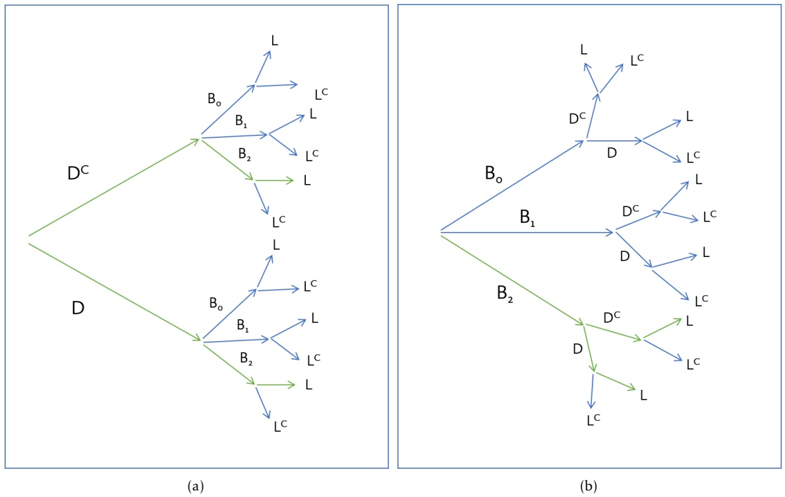

Figure 2.19: In (a), the first branch is based on deafness, while in (b), the first branch is based on eye color.

## EXAMPLE 2.56

Expand Equation 2.54 according to the tree shown in Figure 2.19(a), and solve for $P ( B _ { 2 } | L )$

$$
\begin{array}{l} P (B _ {2} | L) = \frac {P (B _ {2} \text { and } L \text { and } D) + P (B _ {2} \text { and } L \text { and } D ^ {C})}{P (L)} \\ = \frac {P (L | B _ {2} , D) P (B _ {2} | D) P (D) + P (L | B _ {2} , D ^ {C}) P (B _ {2} | D ^ {C}) P (D ^ {C})}{P (L)} \\ = \frac {(0 . 2 0) (0 . 2 3 8) (0 . 3 0 7) + (0 . 1 0) P (B _ {2} | D ^ {C}) P (D ^ {C})}{0 . 1 5 5}. \\ \end{array}
$$

Two of the probabilities have not been calculated previously: $P ( B _ { 2 } | D ^ { C } )$ and $P ( D ^ { C } )$ . From the definition of the complement, $P ( D ^ { C } ) = 1 - P ( D ) = 0 . 6 9 3 ;   P ( D )$ was calculated in part a). To calculate $P ( B _ { 2 } | D ^ { C } )$ , apply the definition of conditional probability as in part b), where $P ( B _ { 2 } | D )$ was calculated:

$$
P (B _ {2} | D ^ {C}) = \frac {P (D ^ {C} \text {and} B _ {2})}{P (D ^ {C})} = \frac {P (D ^ {C} | B _ {2}) (P (B _ {2})}{P (D ^ {C})} = \frac {(1 - 0 . 7 3) (0 . 1 0)}{0 . 6 9 3} = 0. 0 3 9 0.
$$

$$
P (B _ {2} | L) = \frac {(0 . 2 0) (0 . 2 3 8) (0 . 3 0 7) + (0 . 1 0) (0 . 0 3 9 0) (0 . 6 9 3)}{0 . 1 5 5}
$$

$$
= 0. 1 1 2
$$

The probability that a white cat has two blue eyes, given that it is blind, is 0.112.

E

---

2.3. EXTENDED EXAMPLE

123

## GUIDED PRACTICE 2.57

Expand Equation 2.54 according to the tree shown in Figure 2.19(b), and solve for $P ( B _ { 2 } | L ) . ^ { 3 8 }$

A tree diagram is useful for visualizing the different possible ways that a certain set of outcomes can occur. Although conditional probabilities can certainly be calculated without the help of tree diagrams, it is often easy to make errors with a strictly algebraic approach. Once a tree is constructed, it can be used to solve for several probabilities of interest. The following example shows how one of the previous trees can be applied to answer a different question than the one posed in part c), iii.

38

$$
P (B _ {2} | L) = \frac {P (L | B _ {2} , D) P (D | B _ {2}) P (B _ {2}) + P (L | B _ {2} , D ^ {C}) P (D ^ {C} | B _ {2}) P (B _ {2})}{P (L)} = \frac {(0 . 2 0) (0 . 7 3) (0 . 1 0) + (0 . 1 0) (1 - 0 . 7 3) (0 . 1 0)}{0 . 1 5 5} = 0. 1 1 2.
$$

---

124

CHAPTER 2. PROBABILITY

## EXAMPLE 2.58

What is the probability that a white cat has one blue eye and one non-blue eye, given that it is not blind?

Calculate $P ( B _ { 1 } | L ^ { C } )$ . Start with the definition of conditional probability, then expand.

$$
P (B _ {1} | L ^ {C}) = \frac {P (B _ {1} \text {and} L ^ {C})}{P (L ^ {C})} = \frac {P (B _ {1} \text {and} L ^ {C} \text {and} D) + P (B _ {1} \text {and} L ^ {C} \text {and} D ^ {C})}{P (L ^ {C})}.
$$

Figure 2.20 is a reproduction of the earlier tree diagram (Figure 2.19(b)), with yellow arrows showing the two paths of interest.

As before, expand the numerator and fill in the known values.

$$
\begin{array}{l} P (B _ {1} | L ^ {C}) = \frac {P (B _ {1} \text { and } L ^ {C} \text { and } D) + P (B _ {1} \text { and } L ^ {C} \text { and } D ^ {C})}{P (L ^ {C})} \\ = \frac {P (L ^ {C} | D , B _ {1}) P (D | B _ {1}) P (B _ {1}) + P (L ^ {C} | D ^ {C} , B _ {1}) P (D ^ {C} | B _ {1}) P (B _ {1})}{P (L ^ {C})} \\ = \frac {\mathbf {P} (\mathbf {L} ^ {\mathrm{C}} | \mathbf {D} , \mathbf {B _ {1}}) (0 . 4 0) (0 . 3 0) + \mathbf {P} (\mathbf {L} ^ {\mathrm{C}} | \mathbf {D} ^ {\mathrm{C}} , \mathbf {B _ {1}}) \mathbf {P} (\mathbf {D} ^ {\mathrm{C}} | \mathbf {B _ {1}}) (0 . 3 0)}{\mathbf {P} (\mathbf {L} ^ {\mathrm{C}})}. \\ \end{array}
$$

The probabilities in **bold** are not known. Apply the definition of the complement; recall that the rule for complements holds when an event and its complement are conditioned on the same information: $P ( A | B ) = 1 - P ( A ^ { C } | B )$

$$
\begin{array}{l} - P (L ^ {C}) = 1 - P (L) = 1 - 0. 1 5 5 = 0. 8 4 5 \\ - P (D ^ {C} | B _ {1}) = 1 - P (D | B _ {1}) = 1 - 0. 4 0 = 0. 6 0 \\ - P (L ^ {C} | D, B _ {1}) = 1 - P (L | D, B _ {1}) = 1 - 0. 4 0 = 0. 6 0 \\ \end{array}
$$

The definition of the complement can also be applied to calculate $P ( L ^ { C } | D ^ { C } , B _ { 1 } )$ . The problem statement originally specified that white cats that are not deaf have probability 0.10 of developing blindness regardless of eye color: $P ( L | D ^ { C } ) = 0 . 1 0$ . Thus, $P ( L ^ { C } | D ^ { C } , B _ { 1 } ) = P ( L ^ { C } | D ^ { C } )$ . By the definition of the complement, $P ( L ^ { C } | D ^ { C } ) = 1 - P ( L | D ^ { C } ) = 1 - 0 . 1 0 = 0 . 9 0 .$

$$
\begin{array}{l} P (B _ {1} | L ^ {C}) = \frac {P (B _ {1} \text { and } L ^ {C} \text { and } D) + P (B _ {1} \text { and } L ^ {C} \text { and } D ^ {C})}{P (L ^ {C})} \\ = \frac {P (L ^ {C} | D , B _ {1}) P (D | B _ {1}) P (B _ {1}) + P (L ^ {C} | D ^ {C} , B _ {1}) P (D ^ {C} | B _ {1}) P (B _ {1})}{P (L ^ {C})} \\ = \frac {(0 . 6 0) (0 . 4 0) (0 . 3 0) + (0 . 9 0) (0 . 6 0) (0 . 3 0)}{0 . 8 4 5} \\ = 0. 2 7 7. \\ \end{array}
$$

The probability that a white cat has one blue eye and one non-blue eye, given that it is not blind, is 0.277.

E

---

2.3. EXTENDED EXAMPLE

125

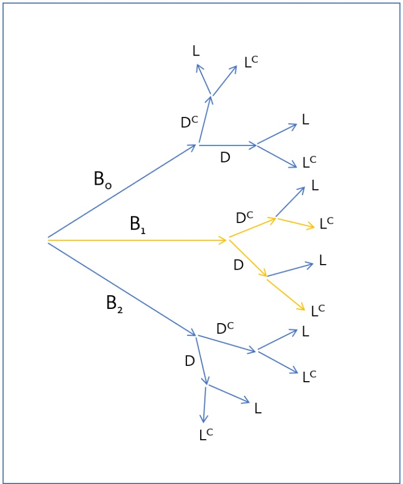

flowchart

This diagram illustrates a hierarchical or branching process with nodes labeled B0, B1, and B2, showing directional relationships between sub-processes (L, Lc) and intermediate states (D).

Figure 2.20: The two possible paths for a white cat to both have one blue eye (and one non-blue eye) and to not be blind are shown in yellow.

---

126

CHAPTER 2. PROBABILITY

## 2.4 Notes

Probability is a powerful framework for quantifying uncertainty and randomness. In particular, conditional probability represents a way to update the uncertainty associated with an event given that specific information has been observed. For example, the probability that a person has a particular disease can be adjusted based on observed information, such as age, sex, or the results of a diagnostic test.

As discussed in the text, there are several possible approaches to solving conditional probability problems, including the use of tree diagrams or contingency tables. It can also be intuitive to use a simulation approach in computing software; refer to the labs for details about this method. Regardless of the specific approach that will be used for calculation, it is always advisable to start any problem by understanding the problem context (i.e., the sample space, given information, probabilities of interest) and reading the problem carefully, in order to avoid mistakes when translating between words and probability notation. A common mistake is to confuse joint and conditional probabilities.

Probability distributions were briefly introduced in Section 2.1.5. This topic will be discussed in greater detail in the next chapter.

Probability forms the foundation for data analysis and statistical inference, since nearly every conclusion to a study should be accompanied by a measure of uncertainty. For example, the publication reporting the results of the LEAP study discussed in Chapter 1 included the probability that the observed results could have been due to chance variation. This aspect of probability will be discussed in later chapters.

The four labs for Chapter 2 cover basic principles of probability, conditional probability, pos itive predictive value of a diagnostic test (via Bayes’ Theorem), and the calculation of probabilities conditional on several events in the context of genetic inheritance. Probabilities can be calculated algebraically, using formulas given in this and other texts, but can also be calculated with simple simulations, since a probability represents a proportion of times an event happens when an experiment is repeated many times. Computers are particularly good at keeping track of events during many replications of an experiment. The labs for this chapter use both algebraic and simulation methods, and are particularly useful for building programming skills with the R language.

In medicine, the positive predictive value of a diagnostic test may be one of the most important applications of probability theory. It is certainly the most common. The positive predictive value of a test is the conditional probability of the presence of a disease or condition, given a positive test for the condition, and is often used when counseling patients about their risk for being diagnosed with a disease in the future. The lab on positive predictive value examines the conditional probability of a trisomy 21 genetic mutation (Down syndrome) given that a test based on cell-free DNA suggests its presence.

---

2.5. EXERCISES

127

## 2.5 Exercises

## 2.5.1 Defining probability

**2.1 True or false.** Determine if the statements below are true or false, and explain your reasoning.

(a) Assume that a couple has an equal chance of having a boy or a girl. If a couple’s previous three children have all been boys, then the chance that their next child is a boy is somewhat less than 50%.
(b) Drawing a face card (jack, queen, or king) and drawing a red card from a full deck of playing cards are mutually exclusive events.
(c) Drawing a face card and drawing an ace from a full deck of playing cards are mutually exclusive events.

**2.2 Dice rolls.** If you roll a pair of fair dice, what is the probability of

(a) getting a sum of 1?
(b) getting a sum of 5?
(c) getting a sum of 12?

**2.3 Colorblindness.** Red-green colorblindness is a commonly inherited form of colorblindness; the gene involved is transmitted on the X chromosome in a recessive manner. If a male inherits an affected X chromosome, he is necessarily colorblind (genotype $X ^ { - } Y )$ . However, a female can only be colorblind if she inherits two defective copies (genotype $X ^ { - } X ^ { - } ) ;$ heterozygous females are not colorblind. Suppose that a couple consists of a genotype $X ^ { + } Y$ male and a genotype $X ^ { + } X ^ { - }$ − female.

(a) What is the probability of the couple producing a colorblind male?
(b) True or false: Among the couple’s offspring, colorblindness and female sex are mutually exclusive events.

**2.4 Diabetes and hypertension.** Diabetes and hypertension are two of the most common diseases in Western, industrialized nations. In the United States, approximately 9% of the population have diabetes, while about 30% of adults have high blood pressure. The two diseases frequently occur together: an estimated 6% of the population have both diabetes and hypertension.

(a) Are having diabetes and having hypertension disjoint?
(b) Draw a Venn diagram summarizing the variables and their associated probabilities.
(c) Let A represent the event of having diabetes, and B the event of having hypertension. Calculate P (A or B).
(d) What percent of Americans have neither hypertension nor diabetes?
(e) Is the event of someone being hypertensive independent of the event that someone has diabetes?

---

128

CHAPTER 2. PROBABILITY

**2.5 Educational attainment by gender.** The table below shows the distribution of education level attained by US residents by gender based on data collected during the 2010 American Community Survey.39

<table><tr><td rowspan="2" colspan="2"></td><td colspan="2">Gender</td></tr><tr><td>Male</td><td>Female</td></tr><tr><td rowspan="8">Highest education attained</td><td>Less than 9th grade</td><td>0.07</td><td>0.13</td></tr><tr><td>9th to 12th grade, no diploma</td><td>0.10</td><td>0.09</td></tr><tr><td>HS graduate (or equivalent)</td><td>0.30</td><td>0.20</td></tr><tr><td>Some college, no degree</td><td>0.22</td><td>0.24</td></tr><tr><td>Associate&#x27;s degree</td><td>0.06</td><td>0.08</td></tr><tr><td>Bachelor&#x27;s degree</td><td>0.16</td><td>0.17</td></tr><tr><td>Graduate or professional degree</td><td>0.09</td><td>0.09</td></tr><tr><td>Total</td><td>1.00</td><td>1.00</td></tr></table>

(a) What is the probability that a randomly chosen individual is a high school graduate? Assume that there is an equal proportion of males and females in the population.
(b) Define Event A as having a graduate or professional degree. Calculate the probability of the complement, Ac.
(c) What is the probability that a randomly chosen man has at least a Bachelor’s degree?
(d) What is the probability that a randomly chosen woman has at least a Bachelor’s degree?
(e) What is the probability that a man and a woman getting married both have at least a Bachelor’s degree? Note any assumptions made – are they reasonable?

**2.6 Poverty and language.** The American Community Survey is an ongoing survey that provides data every year to give communities the current information they need to plan investments and services. The 2010 American Community Survey estimates that 14.6% of Americans live below the poverty line, 20.7% speak a language other than English (foreign language) at home, and 4.2% fall into both categories.40

(a) Are living below the poverty line and speaking a foreign language at home disjoint?
(b) Draw a Venn diagram summarizing the variables and their associated probabilities.
(c) What percent of Americans live below the poverty line and only speak English at home?
(d) What percent of Americans live below the poverty line or speak a foreign language at home?
(e) What percent of Americans live above the poverty line and only speak English at home?
(f) Is the event that someone lives below the poverty line independent of the event that the person speaks a foreign language at home?

**2.7 Urgent care visits.** Urgent care centers are open beyond typical office hours and provide a broader range of services than that of many primary care offices. A study conducted to collect information about urgent care centers in the United States reported that in one week, 15.8% of centers saw 0-149 patients, 33.7% saw 150-299 patients, 28.8% saw 300-449 patients, and 21.7% saw 450 or more patients. Assume that the data can be treated as a probability distribution of patient visits for any given week.

(a) What is the probability that three random urgent care centers in a county all see between 300-449 patients in a week? Note any assumptions made. Are the assumptions reasonable?
(b) What is the probability that ten random urgent care centers throughout a state all see 450 or more patients in a week? Note any assumptions made. Are the assumptions reasonable?
(c) With the information provided, is it possible to compute the probability that one urgent care center sees between 150-299 patients in one week and 300-449 patients in the next week? Explain why or why not.

<small>39U.S. Census Bureau, 2010 American Community Survey 1-Year Estimates, [Educational Attainment](http://www.openintro.org/redirect.php?go=textbook-acs_educational_2010&referrer=biostat1_pdf).</small>

<small>40U.S. Census Bureau, 2010 American Community Survey 1-Year Estimates, [Characteristics of People by Language Spoken at Home](http://www.openintro.org/redirect.php?go=textbook-acs_language_2010&referrer=biostat1_pdf).</small>

---

2.5. EXERCISES

129

**2.8 School absences.** Data collected at elementary schools in DeKalb County, GA suggest that each year roughly 25% of students miss exactly one day of school, 15% miss 2 days, and 28% miss 3 or more days due to sickness.41

(a) What is the probability that a student chosen at random doesn’t miss any days of school due to sickness this year?
(b) What is the probability that a student chosen at random misses no more than one day?
(c) What is the probability that a student chosen at random misses at least one day?
(d) If a parent has two kids at a DeKalb County elementary school, what is the probability that neither kid will miss any school? Note any assumptions made and evaluate how reasonable they are.
(e) If a parent has two kids at a DeKalb County elementary school, what is the probability that both kids will miss some school, i.e. at least one day? Note any assumptions made and evaluate how reasonable they are.

**2.9 Disjoint vs. independent.** In parts (a) and (b), identify whether the events are disjoint, independent, or neither (events cannot be both disjoint and independent).

(a) You and a randomly selected student from your class both earn A’s in this course.
(b) You and your class study partner both earn A’s in this course.
(c) If two events can occur at the same time, must they be dependent?

**2.10 Health coverage, frequencies.** The Behavioral Risk Factor Surveillance System (BRFSS) is an annual telephone survey designed to identify risk factors in the adult population and report emerging health trends. The following table summarizes two variables for the respondents: health status and health coverage, which describes whether each respondent had health insurance.42

Health Status

<table><tr><td colspan="2"></td><td>Excellent</td><td>Very good</td><td>Good</td><td>Fair</td><td>Poor</td><td>Total</td></tr><tr><td rowspan="3">Health Coverage</td><td>No</td><td>459</td><td>727</td><td>854</td><td>385</td><td>99</td><td>2,524</td></tr><tr><td>Yes</td><td>4,198</td><td>6,245</td><td>4,821</td><td>1,634</td><td>578</td><td>17,476</td></tr><tr><td>Total</td><td>4,657</td><td>6,972</td><td>5,675</td><td>2,019</td><td>677</td><td>20,000</td></tr></table>

(a) If one individual is drawn at random, what is the probability that the respondent has excellent health and doesn’t have health coverage?
(b) If one individual is drawn at random, what is the probability that the respondent has excellent health or doesn’t have health coverage?

<small>41S.S. Mizan et al. “[Absence, Extended Absence, and Repeat Tardiness Related to Asthma Status among Elementary School Children](http://www.openintro.org/redirect.php?go=textbook-tardiness_asthma_2011&referrer=biostat1_pdf)”. In: Journal of Asthma 48.3 (2011), pp. 228–234.</small>

<small>42Office of Surveillance, Epidemiology, and Laboratory Services Behavioral Risk Factor Surveillance System, [BRFSS 2010 Survey Data](http://www.openintro.org/redirect.php?go=textbook-BRFSS_2010&referrer=biostat1_pdf).</small>

---

130

CHAPTER 2. PROBABILITY

## 2.5.2 Conditional probability

**2.11 Global warming.** A Pew Research poll asked 1,306 Americans “From what you’ve read and heard, is there solid evidence that the average temperature on earth has been getting warmer over the past few decades, or not?". The table below shows the distribution of responses by party and ideology, where the counts have been replaced with relative frequencies.43

<table><tr><td rowspan="2" colspan="2"></td><td colspan="3">Response</td><td rowspan="2">Total</td></tr><tr><td>Earth is warming</td><td>Not warming</td><td>Don&#x27;t Know Refuse</td></tr><tr><td rowspan="5">Party and Ideology</td><td>Conservative Republican</td><td>0.11</td><td>0.20</td><td>0.02</td><td>0.33</td></tr><tr><td>Mod/Lib Republican</td><td>0.06</td><td>0.06</td><td>0.01</td><td>0.13</td></tr><tr><td>Mod/Cons Democrat</td><td>0.25</td><td>0.07</td><td>0.02</td><td>0.34</td></tr><tr><td>Liberal Democrat</td><td>0.18</td><td>0.01</td><td>0.01</td><td>0.20</td></tr><tr><td>Total</td><td>0.60</td><td>0.34</td><td>0.06</td><td>1.00</td></tr></table>

(a) Are believing that the earth is warming and being a liberal Democrat mutually exclusive?
(b) What is the probability that a randomly chosen respondent believes the earth is warming or is a liberal Democrat?
(c) What is the probability that a randomly chosen respondent believes the earth is warming given that he is a liberal Democrat?
(d) What is the probability that a randomly chosen respondent believes the earth is warming given that he is a conservative Republican?
(e) Does it appear that whether or not a respondent believes the earth is warming is independent of their party and ideology? Explain your reasoning.
(f) What is the probability that a randomly chosen respondent is a moderate/liberal Republican given that he does not believe that the earth is warming?

**2.12 ABO blood groups.** The ABO blood group system consists of four different blood groups, which describe whether an individual’s red blood cells carry the A antigen, B antigen, both, or neither. The ABO gene has three alleles: $I ^ { A } ,   I ^ { B } ,$ , and i. The i allele is recessive to both $I ^ { A }$ and $I ^ { B } ,$ , while the $I ^ { A }$ and $I ^ { B }$ allels are codominant. Individuals homozygous for the i allele are known as blood group O, with neither A nor B antigens.

| Alleles inherited | Blood type |
| --- | --- |
| $I^{A}$ and $I^{A}$ | A |
| $I^{A}$ and $I^{B}$ | AB |
| $I^{A}$ and $i$ | A |
| $I^{B}$ and $I^{B}$ | B |
| $I^{B}$ and $i$ | B |
| $i$ and $i$ | O |

Blood group follows the rules of Mendelian single-gene inheritance – alleles are inherited independently from either parent, with probability 0.5.

(a) Suppose that both members of a couple have Group AB blood. What is the probability that a child of this couple will have Group A blood?
(b) Suppose that one member of a couple is genotype $I ^ { B } i$ and the other is $I ^ { A } i$ . What is the probability that their first child has Type O blood and the next two do not?
(c) Suppose that one member of a couple is genotype $I ^ { B } i$ and the other is $I ^ { A } i .$ Given that one child has Type O blood and two do not, what is the probability of the first child having Type O blood?

<small>43Pew Research Center, [Majority of Republicans No Longer See Evidence of Global Warming](http://www.openintro.org/redirect.php?go=textbook-republicans_global_warming_2010&referrer=biostat1_pdf), data collected on October 27, 2010.</small>

---

2.5. EXERCISES

131

**2.13 Seat belts.** Seat belt use is the most effective way to save lives and reduce injuries in motor vehicle crashes. In a 2014 survey, respondents were asked, "How often do you use seat belts when you drive or ride in a car?". The following table shows the distribution of seat belt usage by sex.

Seat Belt Usage

<table><tr><td rowspan="4">Sex</td><td></td><td>Always</td><td>Nearly always</td><td>Sometimes</td><td>Seldom</td><td>Never</td><td>Total</td></tr><tr><td>Male</td><td>146,018</td><td>19,492</td><td>7,614</td><td>3,145</td><td>4,719</td><td>180,988</td></tr><tr><td>Female</td><td>229,246</td><td>16,695</td><td>5,549</td><td>1,815</td><td>2,675</td><td>255,980</td></tr><tr><td>Total</td><td>375,264</td><td>36,187</td><td>13,163</td><td>4,960</td><td>7,394</td><td>436,968</td></tr></table>

(a) Calculate the marginal probability that a randomly chosen individual always wears seatbelts.
(b) What is the probability that a randomly chosen female always wears seatbelts?
(c) What is the conditional probability of a randomly chosen individual always wearing seatbelts, given that they are female?
(d) What is the conditional probability of a randomly chosen individual always wearing seatbelts, given that they are male?
(e) Calculate the probability that an individual who never wears seatbelts is male.
(f) Does gender seem independent of seat belt usage?

**2.14 Health coverage, relative frequencies.** The Behavioral Risk Factor Surveillance System (BRFSS) is an annual telephone survey designed to identify risk factors in the adult population and report emerging health trends. The following table displays the distribution of health status of respondents to this survey (excellent, very good, good, fair, poor) conditional on whether or not they have health insurance.

Health Status

<table><tr><td colspan="2"></td><td>Excellent</td><td>Very good</td><td>Good</td><td>Fair</td><td>Poor</td><td>Total</td></tr><tr><td rowspan="3">Health Coverage</td><td>No</td><td>0.0230</td><td>0.0364</td><td>0.0427</td><td>0.0192</td><td>0.0050</td><td>0.1262</td></tr><tr><td>Yes</td><td>0.2099</td><td>0.3123</td><td>0.2410</td><td>0.0817</td><td>0.0289</td><td>0.8738</td></tr><tr><td>Total</td><td>0.2329</td><td>0.3486</td><td>0.2838</td><td>0.1009</td><td>0.0338</td><td>1.0000</td></tr></table>

(a) Are being in excellent health and having health coverage mutually exclusive?
(b) What is the probability that a randomly chosen individual has excellent health?
(c) What is the probability that a randomly chosen individual has excellent health given that he has health coverage?
(d) What is the probability that a randomly chosen individual has excellent health given that he doesn’t have health coverage?
(e) Do having excellent health and having health coverage appear to be independent?

**2.15 HIV in Swaziland.** Swaziland has the highest HIV prevalence in the world: 25.9% of this country’s population is infected with HIV.44 The ELISA test is one of the first and most accurate tests for HIV. For those who carry HIV, the ELISA test is 99.7% accurate. For those who do not carry HIV, the test is 92.6% accurate. Calculate the PPV and NPV of the test.

44Source: CIA Factbook, [Country Comparison: HIV/AIDS - Adult Prevalence Rate](http://www.openintro.org/redirect.php?go=textbook-cia_hiv_2012&referrer=biostat1_pdf).

---

132

CHAPTER 2. PROBABILITY

**2.16 Assortative mating.** Assortative mating is a nonrandom mating pattern where individuals with similar genotypes and/or phenotypes mate with one another more frequently than what would be expected under a random mating pattern. Researchers studying this topic collected data on eye colors of 204 Scandinavian men and their female partners. The table below summarizes the results. For simplicity, we only include heterosexual relationships in this exercise.45

<table><tr><td rowspan="2" colspan="2"></td><td colspan="3">Partner (female)</td><td rowspan="2">Total</td></tr><tr><td>Blue</td><td>Brown</td><td>Green</td></tr><tr><td rowspan="4">Self (male)</td><td>Blue</td><td>78</td><td>23</td><td>13</td><td>114</td></tr><tr><td>Brown</td><td>19</td><td>23</td><td>12</td><td>54</td></tr><tr><td>Green</td><td>11</td><td>9</td><td>16</td><td>36</td></tr><tr><td>Total</td><td>108</td><td>55</td><td>41</td><td>204</td></tr></table>

(a) What is the probability that a randomly chosen male respondent or his partner has blue eyes?
(b) What is the probability that a randomly chosen male respondent with blue eyes has a partner with blue eyes?
(c) What is the probability that a randomly chosen male respondent with brown eyes has a partner with blue eyes? What about the probability of a randomly chosen male respondent with green eyes having a partner with blue eyes?
(d) Does it appear that the eye colors of male respondents and their partners are independent? Explain your reasoning.

**2.17 It’s never lupus.** Lupus is a medical phenomenon where antibodies that are supposed to attack foreign cells to prevent infections instead see plasma proteins as foreign bodies, leading to a high risk of blood clotting. It is believed that 2% of the population suffer from this disease. The test is 98% accurate if a person actually has the disease. The test is 74% accurate if a person does not have the disease. There is a line from the Fox television show House that is often used after a patient tests positive for lupus: “It’s never lupus." Do you think there is truth to this statement? Use appropriate probabilities to support your answer.

**2.18 Predisposition for thrombosis.** A genetic test is used to determine if people have a predisposition for thrombosis, which is the formation of a blood clot inside a blood vessel that obstructs the flow of blood through the circulatory system. It is believed that 3% of people actually have this predisposition. The genetic test is 99% accurate if a person actually has the predisposition, meaning that the probability of a positive test result when a person actually has the predisposition is 0.99. The test is 98% accurate if a person does not have the predisposition.

(a) What is the probability that a randomly selected person who tests positive for the predisposition by the test actually has the predisposition?
(b) What is the probability that a randomly selected person who tests negative for the predisposition by the test actually does not have the predisposition?

<small>45B. Laeng et al. “[Why do blue-eyed men prefer women with the same eye color?](http://www.openintro.org/redirect.php?go=textbook-eye_color_pref_2010&referrer=biostat1_pdf)” In: Behavioral Ecology and Sociobiology 61.3 (2007), pp. 371–384.</small>

---

2.5. EXERCISES

133

**2.19 Views on evolution.** A 2013 analysis conducted by the Pew Research Center found that 60% of survey respondents agree with the statement "humans and other living things have evolved over time" while 33% say that "humans and other living things have existed in their present form since the beginning of time" (7% responded "don’t know"). They also found that there are differences among partisan groups in beliefs about evolution. While roughly two-thirds of Democrats (67%) and independents (65%) say that humans and other living things have evolved over time, 48% of Republicans reject the idea of evolution. Suppose that 45% of respondents identified as Democrats, 40% identified as Republicans, and 15% identified as political independents. The survey was conducted among a national sample of 1,983 adults.

(a) Suppose that a person is randomly selected from the population and found to identify as a Democrat. What is the probability that this person does not agree with the idea of evolution?
(b) Suppose that a political independent is randomly selected from the population. What is the probability that this person does not agree with the idea of evolution?
(c) Suppose that a person is randomly selected from the population and found to identify as a Republican. What is the probability that this person agrees with the idea of evolution?
(d) Suppose that a person is randomly selected from the population and found to support the idea of evolution. What is the probability that this person identifies as a Republican?

**2.20 Cystic fibrosis testing.** The prevalence of cystic fibrosis in the United States is approximately 1 in 3,500 births. Various screening strategies for CF exist. One strategy uses dried blood samples to check the levels of immunoreactive trypsogen (IRT); IRT levels are commonly elevated in newborns with CF. The sensitivity of the IRT screen is 87% and the specificity is 99%.

(a) In a hypothetical population of 100,000, how many individuals would be expected to test positive? Of those who test positive, how many would be true positives? Calculate the PPV of IRT.
(b) In order to account for lab error or physiological fluctuations in IRT levels, infants who tested positive on the initial IRT screen are asked to return for another IRT screen at a later time, usually two weeks after the first test. This is referred to as an IRT/IRT screening strategy. Calculate the PPV of IRT/IRT.

**2.21 Mumps.** Mumps is a highly contagious viral infection that most often occurs in children, but can affect adults, particularly if they are living in shared living spaces such as college dormitories. It is most recognizable by the swelling of salivary glands at the side of the face under the ears, but earlier symptoms include headaches, fever, and joint pain. Suppose a college student at a university presents to a physician with symptoms of headaches, fever, and joint pain. Let A = {headaches, fever, and joint pain}, and suppose that the possible disease state of the patient can be partitioned into: B1 = normal, $B _ { 2 } =$ common cold, $B _ { 3 } = \mathrm { \tt m u m p s } .$ From clinical experience, the physician estimates $P ( A | \bar { B } _ { i } ) ;$ $P ( A | B _ { 1 } ) = 0 . 0 0 1 ,   P ( A | B _ { 2 } ) = 0 . 7 0 ,   P ( A | B _ { 3 } ) = 0 . 9 5 .$ The physician, aware that some students have contracted the mumps, then estimates that for students at this university, $P ( B _ { 1 } ) = 0 . 9 5 ,   P ( B _ { 2 } ) = 0 . 0 2 5$ , and $P ( B _ { 3 } ) = 0 . 0 2 5$ . Given the previous symptoms, which of the disease states is most likely?

**2.22 Twins.** About 30% of human twins are identical, and the rest are fraternal. Identical twins are necessarily the same sex – half are males and the other half are females. One-quarter of fraternal twins are both male, one-quarter both female, and one-half are mixes: one male, one female. You have just become a parent of twins and are told they are both girls. Given this information, what is the probability that they are identical?

---

134

CHAPTER 2. PROBABILITY

**2.23 IQ testing.** A psychologist conducts a study on intelligence in which participants are asked to take an IQ test consisting of n questions, each with m choices.

(a) One thing the psychologist must be careful about when analyzing the results is accounting for lucky guesses. Suppose that for a given question a particular participant either knows the answer or guesses. The participant knows the correct answer with probability p, and does not know the answer (and therefore will have to guess) with probability 1 − p. The participant guesses completely randomly. What is the conditional probability that the participant knew the answer to a question, given that they answered it correctly?
(b) About 1 in 1,100 people have IQs over 150. If a subject receives a score of greater than some specified amount, they are considered by the psychologist to have an IQ over 150. But the psychologist’s test is not perfect. Although all individuals with IQ over 150 will definitely receive such a score, individuals with IQs less than 150 can also receive such scores about 0.1% of the time due to lucky guessing. Given that a subject in the study is labeled as having an IQ over 150, what is the probability that they actually have an IQ below 150?

**2.24 Breast cancer and age.** The strongest risk factor for breast cancer is age; as a woman gets older, her risk of developing breast cancer increases. The following table shows the average percentage of American women in each age group who develop breast cancer, according to statistics from the National Cancer Institute. For example, approximately 3.56% of women in their 60’s get breast cancer.

| Age Group | Prevalence |
| --- | --- |
| 30 - 40 | 0.0044 |
| 40 - 50 | 0.0147 |
| 50 - 60 | 0.0238 |
| 60 - 70 | 0.0356 |
| 70 - 80 | 0.0382 |

A mammogram typically identifies a breast cancer about 85% of the time, and is correct 95% of the time when a woman does not have breast cancer.

(a) Calculate the PPV for each age group. Describe any trend(s) you see in the PPV values as prevalence changes. Explain the reason for the trend(s) in language that someone who has not taken a statistics course would understand.
(b) Suppose that two new mammogram imaging technologies have been developed which can improve the PPV associated with mammograms; one improves sensitivity to 99% (but specificity remains at 95%), while the other improves specificity to 99% (while sensitivity remains at 85%). Which technology offers a higher increase in PPV? Explain why.

---

2.5. EXERCISES

135

**2.25 Prostate-specific antigen.** Prostate-specific antigen (PSA) is a protein produced by the cells of the prostate gland. Blood PSA level is often elevated in men with prostate cancer, but a number of benign (not cancerous) conditions can also cause a man’s PSA level to rise. The PSA test for prostate cancer is a laboratory test that measures PSA levels from a blood sample. The test measures the amount of PSA in ng/ml (nanograms per milliliter of blood).

The sensitivity and specificity of the PSA test depend on the cutoff value used to label a PSA level as abnormally high. In the last decade, 4.0 ng/ml has been considered the upper limit of normal, and values 4.1 and higher were used to classify a PSA test as positive. Using this value, the sensitivity of the PSA test is 20% and the specificity is 94%.

The likelihood that a man has undetected prostate cancer depends on his age. This likelihood is also called the prevalence of undetected cancer in the male population. The following table shows the prevalence of undetected prostate cancer by age group.

| Age Group | Prevalence | PPV | NPV |
| --- | --- | --- | --- |
| &lt; 50 years | 0.001 |  |  |
| 50 - 60 years | 0.020 |  |  |
| 61 - 70 years | 0.060 |  |  |
| 71 - 80 years | 0.100 |  |  |

(a) Calculate the missing PPV and NPV values.
(b) Describe any trends you see in the PPV and NPV values.
(c) Explain the reason for the trends in part b), in language that someone who has not taken a statistics course would understand.
(d) The cutoff for a positive test is somewhat controversial. Explain, in your own words, how lowering the cutoff for a positive test from 4.1 ng/ml to 2.5 ng/ml would affect sensitivity and specificity.

---

136

CHAPTER 2. PROBABILITY

## 2.5.3 Extended example

**2.26 Eye color.** One of the earliest models for the genetics of eye color was developed in 1907, and proposed a single-gene inheritance model, for which brown eye color is always dominant over blue eye color. Suppose that in the population, 25% of individuals are homozygous dominant (BB), 50% are heterozygous (Bb), and 25% are homozygous recessive (bb).

(a) Suppose that two parents have brown eyes. What is the probability that their first child has blue eyes?
(b) Does the probability change if it is now known that the paternal grandfather had blue eyes? Justify your answer.
(c) Given that their first child has brown eyes, what is the probability that their second child has blue eyes? Ignore the condition given in part (b).

**2.27 Colorblindness.** The most common form of colorblindness is a recessive, sex-linked hereditary condition caused by a defect on the X chromosome. Females are XX, while males are XY. Individuals inherit one chromosome from each parent, with equal probability; for example, an individual has a 50% chance of inheriting their father’s X chromosome, and a 50% chance of inheriting their father’s Y chromosome. If a male has an X chromosome with the defect, he is colorblind. However, a female with only one defective X chromosome will not be colorblind. Thus, colorblindness is more common in males than females; 7% of males are colorblind but only 0.5% of females are colorblind.

(a) Assume that the X chromosome with the wild-type allele is $X ^ { + }$ and the one with the disease allele is $X ^ { - }$ What is the expected frequency of each possible female genotype: $X ^ { + } X ^ { + } , X ^ { + } X ^ { - }$ , and $X ^ { - } X ^ { - } ?$ What is the expected frequency of each possible male genotype: $X ^ { + } Y$ and $X ^ { - } Y _ { * } ^ { 2 }$
(b) Suppose that two parents are not colorblind. What is the probability that they have a colorblind child?

**2.28 Rapid feathering.** Sex linkage refers to the inheritance pattern that results from a mutation occurring on a gene located on a sex chromosome. A classic example of a sex-linked trait in humans is red-green color blindness; females can only be red-green colorblind if they have two copies of the mutation (one on each X chromosome), while a single copy of the mutation is sufficient to confer colorblindness in males (since males only have one X chromosome).

In birds, females are the heterogametic sex (with sex chromosomes ZW) and males are the homogametic sex (with sex chromosomes ZZ). A commonly known sex-linked trait in domestic chickens is the rapid feath ering trait, which is carried on the Z chromosome. Chickens with the rapid feathering trait grow feathers at a faster rate; this difference is especially pronounced within the first few days from hatching. The wild-type allele $K ^ { - }$ is dominant to the mutant alelle $K ^ { + } ;$ presence of the $K ^ { - }$ allele produces slow feathering. Females can be either genotype $Z ^ { K ^ { + } }$ W or $Z ^ { K ^ { - } } W$ . Males can be either heterozygous $( Z ^ { K ^ { + } } Z ^ { K ^ { - } } )$ , homozygous for slow feathering $( Z ^ { \tilde { K } ^ { - } } Z ^ { K ^ { \dot { - } } } )$ , or homozygous for rapid feathering $( Z ^ { K ^ { + } } Z ^ { K ^ { + } } )$ .

In a population of chickens, 9% of males are rapid feathering and 16% of females are rapid feathering. Suppose that slow feathering chickens are mated. What is the probability that out of their 12 offspring, at least two are rapid feathering?

---

2.5. EXERCISES

137

**2.29 Genetics of Australian cattle dogs.** Australian cattle dogs are known to have a high prevalence of congenital deafness. Deafness in both ears is referred to as bilateral deafness, while deafness in one ear is referred to as unilateral deafness.

Deafness in dogs is associated with the white spotting gene $S$ that controls the expression of coat and eye pigmentation. The dominant allele S produces solid color, while the three recessive alleles contribute to increasing amounts of white in coat pigmentation: Irish spotting $\left( s ^ { i } \right) _ { i }$ , piebald $\left( s ^ { p } \right)$ , and extreme white piebald $\left( s ^ { w } \right)$ . The $s ^ { p }$ and $s ^ { w }$ alleles are responsible for the distinctive Australian cattle dog coat pattern of white hair evenly speckled throughout either a predominantly red or black coat. The dogs are born with white coats, and the speckled pattern develops as they $a \mathbf { g } \mathbf { e }$

While all Australian cattle dogs have some combination of the $s ^ { p }$ and $s ^ { w }$ alleles, the gene displays incomplete penetrance such that individuals show some variation in phenotype despite having the same genotype. Individuals with low penetrance of the alleles tend to have additional patterns on their coat, such as a dark "mask" around one or both eyes (in other words, a unilateral mask or a bilateral mask). High penetrance of the piebald alleles is associated with deafness.

Suppose that 40% of Australian cattle dogs have black coats; these individuals are commonly referred to as "Blue Heelers" as opposed to "Red Heelers". Among Blue Heelers, 35% of individuals have bilateral masks and 25% have unilateral masks. About 50% of Red Heelers exhibit no eye masking and 10% have bilateral masks.

Let M represent the event that an Australian cattle dog has a facial mask, where $M _ { 2 }$ represents a bilateral mask, $M _ { 1 }$ represents a unilateral mask, and $M _ { 0 }$ indicates lack of a mask.

(a) Calculate the probability an Australian cattle dog has a facial mask and a black coat.
(b) Calculate the prevalence of bilateral masks in Australian cattle dogs.
(c) Among Australian cattle dogs with bilateral facial masks, what is the probability of being a Red Heeler?
(d) Unilateral deafness occurs in Red Heelers with probability 0.15, in both dogs that either lack facial mask ing or exhibit a unilateral mask; for both unmasked and unilaterally masked Red Heelers, 60% of dogs are not deaf. The overall prevalence of bilaterally masked Australian cattle dogs with bilateral deafness and red coats is 1.2% and the overall prevalence of bilaterally masked Australian cattle dogs with unilat eral deafness and red coats is 4.5%; these prevalences are the same for Australian cattle dogs with black coats. Among Blue Heelers with either no facial masking or a unilateral mask, the probability of unilateral deafness is 0.05 and the probability of bilateral deafness is 0.01.
Let D represent the event that an Australian cattle dog is deaf $( \mathbf { i . e . } ,$ deaf in at least one ear), where $D _ { 2 }$ represents bilateral deafness and $D _ { 1 }$ represents unilateral deafness.
i. What is the probability that an Australian cattle dog has a bilateral mask, no hearing deficits, and a red coat?
ii. Calculate the proportion of bilaterally masked Blue Heelers without hearing deficits.
iii. Compare the prevalence of deafness between Red Heelers and Blue Heelers.
iv. If a dog is known to have no hearing deficits, what is the probability it is a Blue Heeler?
