# 5 Inference for numerical data

原始 PDF 第 236–289 页。

# Chapter 5

## Inference for numerical data

**5.1 Single-sample inference with the** t**-distribution**
**5.2 Two-sample test for paired data**
**5.3 Two-sample test for independent data**
**5.4 Power calculations for a difference of means**
**5.5 Comparing means with ANOVA**
**5.6 Notes**
**5.7 Exercises**

---

237

Chapter 4 introduced some primary tools of statistical inference—point estimates, interval estimates, and hypothesis tests. This chapter discusses settings where these tools are often used, including the analysis of paired observations and the comparison of two or more independent groups. The chapter also covers the important topic of estimating an appropriate sample size when a study is being de signed. The chapter starts with introducing a new distribution, the t-distribution, which can be used for small sample sizes.

For labs, slides, and other resources, please visit

[**www.openintro.org/book/biostat**](http://www.openintro.org/redirect.php?go=biostat&referrer=biostat1_pdf)

---

238

CHAPTER 5. INFERENCE FOR NUMERICAL DATA

## 5.1 Single-sample inference with the t-distribution

The tools studied in Chapter 4 all made use of the t-statistic from a sample mean,

$$
t = \frac {\overline {{x}} - \mu}{s / \sqrt {n}},
$$

where the parameter $\mu$ is a population mean, x and s are the sample mean and standard deviation, and n is the sample size. Tests and confidence intervals were restricted to samples of at least 30 independent observations from a population where there was no evidence of strong skewness. This allowed for the Central Limit Theorem to be applied, justifying use of the normal distribution to calculate probabilities associated with the t-statistic.

In sample sizes smaller than 30, if the data are approximately symmetric and there are no large outliers, the t-statistic has what is called a t-distribution. When the normal distribution is used as the sampling distribution of the t-statistic, s is essentially being treated as a good replacement for the unknown population standard deviation σ. However, the sample standard deviation $S ,$ as an estimate of $\sigma ,$ has its own inherent variability like x. The t density function adjusts for the variability in s by having more probability in the left and right tails than the normal distribution.

## 5.1.1 The t-distribution

Figure 5.1 shows a t-distribution and normal distribution. Like the standard normal distribution, the t-distribution is unimodal and symmetric about zero. However, the tails of a t-distribution are thicker than for the normal, so observations are more likely to fall beyond two standard deviations from the mean than under the normal distribution.1 While the estimate of the standard error will be less accurate with smaller sample sizes, the thick tails of the t-distribution correct for the variability in s.

violin

| X | Solid Line (Density) | Dotted Line (Density) |
| --- | --- | --- |
| -4 | ~0.05 | ~0.01 |
| -2 | ~0.35 | ~0.45 |
| 0 | ~0.95 | ~1.05 |
| 2 | ~0.35 | ~0.45 |
| 4 | ~0.05 | ~0.01 |

Figure 5.1: Comparison of a t-distribution (solid line) and a normal distribution (dotted line).

The t-distribution can be described as a family of symmetric distributions with a single parameter: degrees of freedom, which equals n − 1. Several t-distributions are shown in Figure 5.2. When there are more degrees of freedom, the t-distribution looks very much like the standard normal distribution. With degrees of freedom of 30 or more, the t-distribution is nearly indistinguishable from the normal distribution. Since the t-statistics in Chapter 4 were associated with sample sizes of at least 30, the degrees of freedom for the corresponding t-distributions were large enough to justify use of the normal distribution to calculate probabilities.

<small>1The standard deviation of the t-distribution is actually a little more than 1. However, it is useful to think of the t-distribution as having a standard deviation of 1 in the context of using it to conduct inference.</small>

---

5.1. SINGLE-SAMPLE INFERENCE WITH THE T -DISTRIBUTION

239

violin

| X | normal | t, df = 8 | t, df = 4 | t, df = 2 | t, df = 1 |
| --- | --- | --- | --- | --- | --- |
| -2 | ~0.05 | ~0.06 | ~0.07 | ~0.08 | ~0.09 |
| 0 | ~0.95 | ~0.92 | ~0.88 | ~0.83 | ~0.78 |
| 2 | ~0.05 | ~0.06 | ~0.07 | ~0.08 | ~0.09 |
| 4 | ~0.01 | ~0.02 | ~0.03 | ~0.04 | ~0.05 |
| 6 | ~0.005 | ~0.01 | ~0.015 | ~0.02 | ~0.025 |
| 8 | ~0.002 | ~0.005 | ~0.01 | ~0.015 | ~0.02 |

Figure 5.2: The larger the degrees of freedom, the more closely the t-distribution resembles the standard normal model.

## DEGREES OF FREEDOM (DF)

The degrees of freedom characterize the shape of the t-distribution. The larger the degrees of freedom, the more closely the distribution approximates the normal model.

Probabilities for the t-distribution can be calculated either by using distribution tables or using statistical software. The use of software has become the preferred method because it is more accurate, allows for complete flexibility in the choice of t-values on the horizontal axis, and is not limited to a small range of degrees of freedom. The remainder of this section illustrates the use of a **t-table**, partially shown in Figure 5.3, in place of the normal probability table. A larger t-table is in Appendix B.2 on page 466. The R labs illustrate the use of software to calculate probabilities for the t-distribution. Readers intending to use software can skip to the next section.

<table><tr><td colspan="2">one tail</td><td>0.100</td><td>0.050</td><td>0.025</td><td>0.010</td><td>0.005</td></tr><tr><td colspan="2">two tails</td><td>0.200</td><td>0.100</td><td>0.050</td><td>0.020</td><td>0.010</td></tr><tr><td rowspan="12">df</td><td>1</td><td>3.08</td><td>6.31</td><td>12.71</td><td>31.82</td><td>63.66</td></tr><tr><td>2</td><td>1.89</td><td>2.92</td><td>4.30</td><td>6.96</td><td>9.92</td></tr><tr><td>3</td><td>1.64</td><td>2.35</td><td>3.18</td><td>4.54</td><td>5.84</td></tr><tr><td> $\vdots$ </td><td> $\vdots$ </td><td> $\vdots$ </td><td> $\vdots$ </td><td> $\vdots$ </td><td></td></tr><tr><td>17</td><td>1.33</td><td>1.74</td><td>2.11</td><td>2.57</td><td>2.90</td></tr><tr><td>18</td><td>1.33</td><td>1.73</td><td>2.10</td><td>2.55</td><td>2.88</td></tr><tr><td>19</td><td>1.33</td><td>1.73</td><td>2.09</td><td>2.54</td><td>2.86</td></tr><tr><td>20</td><td>1.33</td><td>1.72</td><td>2.09</td><td>2.53</td><td>2.85</td></tr><tr><td> $\vdots$ </td><td> $\vdots$ </td><td> $\vdots$ </td><td> $\vdots$ </td><td> $\vdots$ </td><td></td></tr><tr><td>400</td><td>1.28</td><td>1.65</td><td>1.97</td><td>2.34</td><td>2.59</td></tr><tr><td>500</td><td>1.28</td><td>1.65</td><td>1.96</td><td>2.33</td><td>2.59</td></tr><tr><td>∞</td><td>1.28</td><td>1.64</td><td>1.96</td><td>2.33</td><td>2.58</td></tr></table>

Figure 5.3: An abbreviated look at the t-table. Each row represents a different t-distribution. The columns describe the cutoffs for specific tail areas. The row with df = 18 has been highlighted.

Each row in the t-table represents a t-distribution with different degrees of freedom. The columns correspond to tail probabilities. For instance, for a t-distribution with df = 18, row 18 is used (highlighted in Figure 5.3). The value in this row that identifies the cutoff for an upper tail of 5% is found in the column where one tail is 0.050. This cutoff is 1.73. The cutoff for the lower 5% is -1.73; just like the normal distribution, all t-distributions are symmetric. If the area in each tail is 5%, then the area in two tails is 10%; thus, this column can also be described as the column where two tails is 0.100.

---

240

CHAPTER 5. INFERENCE FOR NUMERICAL DATA

## EXAMPLE 5.1

What proportion of the t-distribution with 18 degrees of freedom falls below -2.10?

Just like for a normal probability problem, it is advisable to start by drawing the distribution and shading the area below -2.10, as shown in Figure 5.4. From the table, identify the column containing the absolute value of -2.10; it is the third column. Since this is just the probability in one tail, examine the top line of the table; a one tail area for a value in the third column corresponds to 0.025. About 2.5% of the distribution falls below -2.10.

area

| X | Y |
| --- | --- |
| -4 | ~0.05 |
| -2 | ~0.35 |
| 0 | ~1.0 |
| 2 | ~0.35 |
| 4 | ~0.05 |

Figure 5.4: The t-distribution with 18 degrees of freedom. The area below -2.10 has been shaded.

## EXAMPLE 5.2

A t-distribution with 20 degrees of freedom is shown in the left panel of Figure 5.5. Estimate the proportion of the distribution falling above 1.65 and below -1.65.

Identify the row in the t-table using the degrees of freedom: df − 20. Then, look for 1.65; the value is not listed, and falls between the first and second columns. Since these values bound 1.65, their tail areas will bound the tail area corresponding to 1.65. The two tail area of the first and second columns is between 0.100 and 0.200. Thus, between 10% and 20% of the distribution is more than 1.65 standard deviations from the mean. The precise area can be calculated using statistical software: 0.1146.

area

| X | Y |
| --- | --- |
| -4 | ~0.01 |
| -2 | ~0.05 |
| 0 | ~0.98 |
| 2 | ~0.05 |
| 4 | ~0.01 |

Figure 5.5: The t-distribution with 20 degrees of freedom, with the area further than 1.65 away from 0 shaded.

---

5.1. SINGLE-SAMPLE INFERENCE WITH THE T -DISTRIBUTION

241

## 5.1.2 Using the t-distribution for tests and confidence intervals for a population mean

Chapter 4 provided formulas for tests and confidence intervals for population means in random samples large enough for the t-statistic to have a nearly normal distribution. In samples smaller than 30 from approximately symmetric distributions without large outliers, the t-statistic has a t-distribution with degrees of freedom equal to n − 1. Just like inference in larger samples, inference using the t-distribution also requires that the observations in the sample be independent. Random samples from very large populations always produce independent observations; in smaller populations, observations will be approximately independent as long as the size of the sample is no larger than 10% of the population.

Formulas for tests and intervals using the t−distribution are very similar to those using the normal distribution. For a sample of size n with sample mean x and standard deviation $S ,$ two-sided confidence intervals with confidence coefficient $1 0 0 ( 1 - \alpha ) \%$ have the form

$$
\overline {{x}} \pm t _ {\mathrm{df}} ^ {\star} \times \mathrm{SE},
$$

where SE is the standard error of the sample mean $( s / { \sqrt { n } } )$ and $t _ { \mathrm { d f } } ^ { \star }$ is the point on a t-distribution with $n - 1$ degrees of freedom and area $( 1 - \alpha / 2 )$ to its left.

A one-sided interval with the same confidence coefficient will have the form

$$
\overline {{x}} + t _ {\mathrm{df}} ^ {\star} \times \text {SE (one - sided upper confidence interval), or}
$$

$$
\overline {{x}} - t _ {\mathrm{df}} ^ {\star} \times \text {SE (one - sided lower confidence interval)},
$$

except that in this case $t _ { \mathrm { d f } } ^ { \star }$ is the point on a t-distribution with $n - 1$ degrees of freedom and area $( 1 - \alpha )$ to its left.

With the ability to conveniently calculate $t ^ { \star }$ for any sample size or associated α via computing software, the t-distribution can be used by default over the normal distribution. The rule of thumb that $n > 3 0$ qualifies as a large enough sample size to use the normal distribution dates back to when it was necessary to rely on distribution tables.

---

242

CHAPTER 5. INFERENCE FOR NUMERICAL DATA

## EXAMPLE 5.3

Dolphins are at the top of the oceanic food chain; as a consequence, dangerous substances such as mercury tend to be present in their organs and muscles at high concentrations. In areas where dolphins are regularly consumed, it is important to monitor dolphin mercury levels. This example uses data from a random sample of 19 Risso’s dolphins from the Taiji area in Japan.2 Calculate the 95% confidence interval for average mercury content in Risso’s dolphins from the Taiji area using the data in Figure 5.6.

The observations are a simple random sample consisting of less than 10% of the population, so independence of the observations is reasonable. The summary statistics in Figure 5.6 do not suggest any skew or outliers; all observations are within 2.5 standard deviations of the mean. Based on this evidence, the approximate normality assumption seems reasonable.

Use the t-distribution to calculate the confidence interval:

$$
\begin{array}{l} \overline {{x}} \pm t _ {\mathrm{df}} ^ {\star} \times \mathrm{SE} = \overline {{x}} \pm t _ {1 8} ^ {\star} \times s / \sqrt {n} \\ = 4. 4 \pm 2. 1 0 \times 2. 3 / \sqrt {1 9} \\ = (3. 2 9, 5. 5 1) \mu \mathrm{g/wet} \mathrm{g}. \\ \end{array}
$$

The $t ^ { \star }$ point can be read from the t-table on page 239, in the column with area totaling 0.05 in the two tails (third column) and the row with 18 degrees of freedom. Based on these data, one can be 95% confident the average mercury content of muscles in Risso’s dolphins is between 3.29 and 5.51 µg/wet gram.

Alternatively, the $t ^ { \star }$ point can be calculated in R with the function qt, which returns a value of 2.1009.

| n | $\overline{x}$ | s | minimum | maximum |
| --- | --- | --- | --- | --- |
| 19 | 4.4 | 2.3 | 1.7 | 9.2 |

Figure 5.6: Summary of mercury content in the muscle of 19 Risso’s dolphins from the Taiji area. Measurements are in $\mu \mathrm { g } / \mathrm { w e t }$ g (micrograms of mercury per wet gram of muscle).

E

<small>2Taiji is a significant source of dolphin and whale meat in Japan. Thousands of dolphins pass through the Taiji area annually; assume that these 19 dolphins represent a simple random sample. Data reference: Endo T and Haraguchi K. 2009. High mercury levels in hair samples from residents of Taiji, a Japanese whaling town. Marine Pollution Bulletin 60(5):743-747.</small>

---

5.1. SINGLE-SAMPLE INFERENCE WITH THE T -DISTRIBUTION

243

G

## GUIDED PRACTICE 5.4

The FDA’s webpage provides some data on mercury content of various fish species.3 From a sample of 15 white croaker (Pacific), a sample mean and standard deviation were computed as 0.287 and 0.069 ppm (parts per million), respectively. The 15 observations ranged from 0.18 to 0.41 ppm. Assume that these observations are independent. Based on summary statistics, does the normality assumption seem reasonable? If so, calculate a 90% confidence interval for the average mercury content of white croaker (Pacific).4

## EXAMPLE 5.5

According to the EPA, regulatory action should be taken if fish species are found to have a mercury level of 0.5 ppm or higher. Conduct a formal significance test to evaluate whether the average mercury content of croaker white fish (Pacific) is different from 0.50 ppm. Use α = 0.05.

The FDA regulatory guideline is a ‘one-sided’ statement; fish should not be eaten if the mercury level is larger than a certain value. However, without prior information on whether the mercury in this species tends to be high or low, it is best to do a two-sided test.

State the hypotheses: $H _ { 0 } : \mu = 0 . 5 \; \mathrm { v s } \; H _ { A } : \mu \neq 0 . 5 . \; \mathrm { L e t } \; \alpha = 0 . 0 5 .$

Calculate the t-statistic:

$$
t = \frac {\overline {{x}} - \mu_ {0}}{\mathrm{SE}} = \frac {0 . 2 8 7 - 0 . 5 0}{0 . 0 6 9 / \sqrt {1 5}} = - 1 1. 9 6
$$

The probability that the absolute value of a t-statistic with 14 df is smaller than -11.96 is smaller than 0.01. Thus, $p < 0 . 0 1$ . There is evidence to suggest at the $\alpha = 0 . 0 5$ significance level that the average mercury content of this fish species is lower than 0.50 ppm, since x is less than 0.50.

E

<small>3[www.fda.gov/food/foodborneillnesscontaminants/metals/ucm115644.htm](http://www.openintro.org/redirect.php?go=textbook-fda_mercury_in_fish_2010&referrer=biostat1_pdf)</small>

<small>4There are no obvious outliers; all observations are within 2 standard deviations of the mean. If there is skew, it is not evident. There are no red flags for the normal model based on this (limited) information. x ± t?14 × SE → 0.287 ± 1.76 × 0.0178 → (0.256,0.318). We are 90% confident that the average mercury content of croaker white fish (Pacific) is between 0.256 and 0.318 ppm.</small>

---

244

CHAPTER 5. INFERENCE FOR NUMERICAL DATA

## 5.2 Two-sample test for paired data

In the 2000 Olympics, was the use of a new wetsuit design responsible for an observed increase in swim velocities? In a study designed to investigate this question, twelve competitive swimmers swam 1500 meters at maximal speed, once wearing a wetsuit and once wearing a regular swimsuit.5 The order of wetsuit versus swimsuit was randomized for each of the 12 swimmers. Figure 5.7 shows the average velocity recorded for each swimmer, measured in meters per second $( \mathbf { m } / \mathbf { s } ) .$ 6

|  | swimmer.number | wet.suit.velocity | swim.suit.velocity | velocity.diff |
| --- | --- | --- | --- | --- |
| 1 | 1 | 1.57 | 1.49 | 0.08 |
| 2 | 2 | 1.47 | 1.37 | 0.10 |
| 3 | 3 | 1.42 | 1.35 | 0.07 |
| 4 | 4 | 1.35 | 1.27 | 0.08 |
| 5 | 5 | 1.22 | 1.12 | 0.10 |
| 6 | 6 | 1.75 | 1.64 | 0.11 |
| 7 | 7 | 1.64 | 1.59 | 0.05 |
| 8 | 8 | 1.57 | 1.52 | 0.05 |
| 9 | 9 | 1.56 | 1.50 | 0.06 |
| 10 | 10 | 1.53 | 1.45 | 0.08 |
| 11 | 11 | 1.49 | 1.44 | 0.05 |
| 12 | 12 | 1.51 | 1.41 | 0.10 |

Figure 5.7: Paired Swim Suit Data

The swimsuit velocity data are an example of **paired data**, in which two sets of observations are uniquely paired so that an observation in one set matches an observation in the other; in this case, each swimmer has two measured velocities, one with a wetsuit and one with a swimsuit. A natural measure of the effect of the wetsuit on swim velocity is the difference between the measured maximum velocities (velocity.diff = wet.suit.velocity - swim.suit.velocity). Even though there are two measurements per swimmer, using the difference in velocities as the variable of interest allows for the problem to be approached like those in Section 5.1. Although it was not explicitly noted, the data used in Section 4.3.1 were paired; each respondent had both an actual and desired weight.

Suppose the parameter δ is the population average of the difference in maximum velocities during a 1500m swim if all competitive swimmers recorded swim velocities with each suit type. A hypothesis test can then be conducted with the null hypothesis that the mean population difference in swim velocities between suit types equals 0 (i.e., there is no difference in population average swim velocities), $H _ { 0 } : \delta = 0 ,$ against the alternative that the difference is non-zero, $H _ { A } : \delta \neq 0$

## STATING HYPOTHESES FOR PAIRED DATA

When testing a hypothesis about paired data, compare the groups by testing whether the population mean of the differences between the groups equals 0.

– For a two-sided test, $H _ { 0 } : \delta = 0 ;   H _ { A } : \delta \neq 0 .$ .
– For a one-sided test, either $H _ { 0 } : \delta = 0 ;   H _ { A } : \delta > 0 \mathrm { ~ o r ~ } H _ { 0 } : \delta = 0 ;   H _ { A } : \delta < 0 .$

<small>5De Lucas et. al, The effects of wetsuits on physiological and biomechanical indices during swimming. Journal of Science and Medicine in Sport, 2000; 3(1): 1-8</small>

<small>6The data are available as swim in the oibiostat R package. The data are also used in Lock et. al Statistics, Unlocking the Power of Data, Wiley, 2013.</small>

---

5.2. TWO-SAMPLE TEST FOR PAIRED DATA

245

Some important assumptions are being made. First, it is assumed that the data are a random sample from the population. While the observations are likely independent, it is more difficult to justify that this sample of 12 swimmers is randomly drawn from the entire population of competitive swimmers. Nevertheless, it is often assumed in problems such as these that the participants are reasonably representative of competitive swimmers. Second, it is assumed that the population of differences is normally distributed. This is a small sample, one in which normality would be difficult to confirm. The dot plot for the difference in velocities in Figure 5.8 shows approximate symmetry.

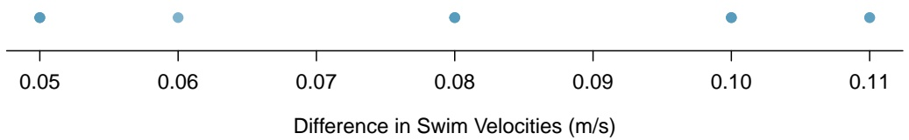

scatter

| Difference in Swim Velocities (m/s) | Value |
| --- | --- |
| 0.05 | ~0.15 |
| 0.06 | ~0.15 |
| 0.08 | ~0.15 |
| 0.10 | ~0.15 |
| 0.11 | ~0.15 |

Figure 5.8: A dot plot of differences in swim velocities.

Let $\overline { { x } } _ { \mathrm { d i f f } }$ denote the sample average of the differences in maximum velocity, $s _ { \mathrm { d i f f } }$ the sample standard deviation of the differences, and n the number of pairs in the dataset. The t-statistic used to test $H _ { 0 }$ vs. $H _ { A }$ is:

$$
\frac {\overline {{x}} _ {\mathrm{diff}} - \delta_ {0}}{s _ {\mathrm{diff}} / \sqrt {n}},
$$

where in this case $\delta _ { 0 } = 0 . ^ { 7 }$

## EXAMPLE 5.6

Using the data in Figure 5.7, conduct a two-sided hypothesis test at $\alpha = 0 . 0 5$ to assess whether there is evidence to suggest that wetsuits have an effect on swim velocities during a 1500m swim.

The hypotheses are $H _ { 0 } : \delta = 0$ and $H _ { A } : \delta \neq 0$ . Let $\alpha = 0 . 0 5$

Calculate the t-statistic:

$$
t = \frac {\overline {{x}} _ {\mathrm{diff}} - \delta_ {0}}{s _ {\mathrm{diff}} / \sqrt {n}} = \frac {0 . 0 7 8 - 0}{0 . 0 2 2 / \sqrt {1 2}} = 1 2. 3 2
$$

The two-sided p-value is

$$
p = P (T <   - 1 2. 3 2) + P (T > 1 2. 3 2),
$$

where t has a t-distribution with $n - 1 = 1 1$ degrees of freedom. The t-table shows that $p < 0 . 0 1$ Software can be used to show that $p = 8 . 9 \times 1 0 ^ { - 8 }$ , a very small value indeed.

The data support the claim that the wetsuits changed swim velocity in a 1500m swim. The observed average increase of 0.078 m/s is significantly different than the null hypothesis of no change, and suggests that swim velocities are higher when swimmers wear wetsuits as opposed to swimsuits.

Calculating confidence intervals for paired data is also based on the differences between the values in each pair; the same approach as for single-sample data can be applied on the differences. For example, a two-sided 95% confidence interval for paired data has the form:

$$
\left(\overline {{x}} _ {\mathrm{diff}} - t _ {d f} ^ {\star} \times \frac {s _ {\mathrm{diff}}}{\sqrt {n}}, \overline {{x}} _ {\mathrm{diff}} + t _ {d f} ^ {\star} \times \frac {s _ {\mathrm{diff}}}{\sqrt {n}}\right),
$$

where $t ^ { \star }$ is the point on a t-distribution with $d f = n - 1$ for n pairs, with area 0.025 to its right.

E

<small>7This value is specified by the null hypothesis of no difference.</small>

---

246

CHAPTER 5. INFERENCE FOR NUMERICAL DATA

## GUIDED PRACTICE 5.7

Using the data in Figure 5.7, calculate a 95% confidence interval for the average difference in swim velocities during a 1500m swim. Is the interval consistent with the results of the hypothesis test?8

The general approach when analyzing paired data is to first calculate the differences between the values in each pair, then use those differences in methods for confidence intervals and tests for a single sample. Any conclusion from an analysis should be stated in terms of the original paired measurements.

<small>8Use the values of xdiff and sdiff as calculated previously: 0.078 and 0.022. The t? value of 2.20 has df = 11 and 0.025 area to the right. The confidence interval is (0.078±0.022) → (0.064, 0.091) m/s. With 95% confidence, δ lies between 0.064 √12 m/s and 0.09 m/s. The interval does not include 0 (no change), which is consistent with the result of the hypothesis test.</small>

---

5.3. TWO-SAMPLE TEST FOR INDEPENDENT DATA

247

## 5.3 Two-sample test for independent data

Does treatment using embryonic stem cells (ESCs) help improve heart function following a heart attack? New and potentially risky treatments are sometimes tested in animals before studies in humans are conducted. In a 2005 paper in Lancet, Menard, et al. describe an experiment in which 18 sheep with induced heart attacks were randomly assigned to receive cell transplants containing either ESCs or inert material.9 Various measures of cardiac function were measured 1 month after the transplant.

This design is typical of an intervention study. The analysis of such an experiment is an example of drawing inference about the difference in two population means, $\mu _ { 1 }   -   \mu _ { 2 }$ , when the data are independent, i.e., not paired. The point estimate of the difference, ${ \overline { { x } } } _ { 1 } - { \overline { { x } } } _ { 2 } ,$ , is used to calculate a t-statistic that is the basis of confidence intervals and tests.

## 5.3.1 Confidence interval for a difference of means

Figure 5.9 contains summary statistics for the 18 sheep.10 Percent change in heart pumping capacity was measured for each sheep. A positive value corresponds to increased pumping capacity, which generally suggests a stronger recovery from the heart attack. Is there evidence for a potential treatment effect of administering stem cells?

|  | n | $\overline{x}$ | s |
| --- | --- | --- | --- |
| ESCs | 9 | 3.50 | 5.17 |
| control | 9 | -4.33 | 2.76 |

Figure 5.9: Summary statistics of the embryonic stem cell study.

<small>9Menard C, et al., Transplantation of cardiac-committed mouse embryonic stem cells to infarcted sheep myocardium: a preclinical 2005; 366:1005-12, doi [https://doi.org/10.1016/S0140-6736(05)67380-1](https://doi.org/10.1016/S0140-6736%2805%2967380-1)</small>

<small>10The data are accessible as the dataset stem.cells in the openintro R package.</small>

---

248

CHAPTER 5. INFERENCE FOR NUMERICAL DATA

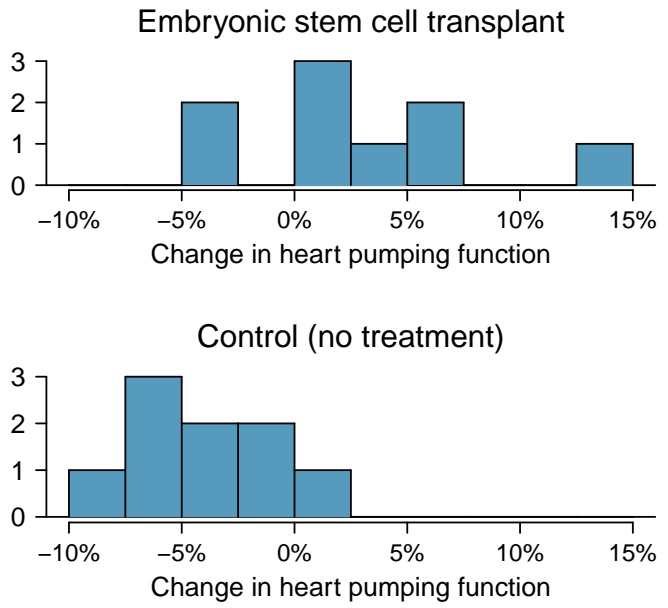

Figure 5.10: Histograms for both the embryonic stem cell group and the control group. Higher values are associated with greater improvement.

Figure 5.10 shows that the distributions of percent change do not have any prominent outliers, which would indicate a deviation from normality; this suggests that each sample mean can be modeled using a t-distribution. Additionally, the sheep in the study are independent of each other, and the sheep between groups are also independent. Thus, the t-distribution can be used to model the difference of the two sample means.

## USING THE t-DISTRIBUTION FOR A DIFFERENCE IN MEANS

The t-distribution can be used for inference when working with the standardized difference of two means if (1) each sample meets the conditions for using the t-distribution and (2) the samples are independent.

A confidence interval for a difference of two means has the same basic structure as previously discussed confidence intervals:

$$
(\overline {{x}} _ {1} - \overline {{x}} _ {2}) \pm t _ {d f} ^ {\star} \times \mathrm{SE}.
$$

The following formula is used to calculate the standard error of $\overline { { x } } _ { 1 } - \overline { { x } } _ { 2 }$ . Since $\sigma$ is typically unknown, the standard error is estimated by using s in place of σ.

$$
S E _ {\overline {{x}} _ {1} - \overline {{x}} _ {2}} = \sqrt {\frac {\sigma_ {1} ^ {2}}{n _ {1}} + \frac {\sigma_ {2} ^ {2}}{n _ {2}}} \approx \sqrt {\frac {s _ {1} ^ {2}}{n _ {1}} + \frac {s _ {2} ^ {2}}{n _ {2}}}.
$$

In this setting, the t-distribution has a somewhat complicated formula for the degrees of freedom that is usually calculated with software.11 An alternative approach uses the smaller of $n _ { 1 } - 1$ and $n _ { 2 } - 1$ as the degrees of freedom.12

<small>11See Section 5.6 for the formula.</small>

<small>12This technique for degrees of freedom is conservative with respect to a Type 1 Error; it is more difficult to reject the null hypothesis using this approach for degrees of freedom.</small>

---

5.3. TWO-SAMPLE TEST FOR INDEPENDENT DATA

249

## DISTRIBUTION OF A DIFFERENCE OF SAMPLE MEANS

The sample difference of two means, ${ \overline { { x } } } _ { 1 } - { \overline { { x } } } _ { 2 } ,$ can be modeled using the t-distribution and the standard error

$$
S E _ {\overline {{x}} _ {1} - \overline {{x}} _ {2}} = \sqrt {\frac {s _ {1} ^ {2}}{n _ {1}} + \frac {s _ {2} ^ {2}}{n _ {2}}} \tag {5.8}
$$

when each sample mean can itself be modeled using a t-distribution and the samples are independent. To calculate the degrees of freedom without using software, use the smaller of $n _ { 1 } - 1 \mathrm { a n d } n _ { 2 } - 1$

## EXAMPLE 5.9

Calculate and interpret a 95% confidence interval for the effect of ESCs on the change in heart pumping capacity of sheep following a heart attack.

The point estimate for the difference is $\overline { { x } } _ { 1 } - \overline { { x } } _ { 2 } = \overline { { x } } _ { \mathrm { e s c } } - \overline { { x } } _ { \mathrm { c o n t r o l } } = 7 . 8 3 .$

The standard error is:

$$
\sqrt {\frac {s _ {1} ^ {2}}{n _ {1}} + \frac {s _ {2} ^ {2}}{n _ {2}}} = \sqrt {\frac {5 . 1 7 ^ {2}}{9} + \frac {2 . 7 6 ^ {2}}{9}} = 1. 9 5.
$$

Since $n _ { 1 } = n _ { 2 } = 9 ,$ , use $df = 8; t_{8}^{\star} = 2.31$ for a 95% confidence interval. Alternatively, computer software can provide more accurate values: $d f = 1 2 . 2 2 5 , t ^ { \star } = 2 . 1 7 4 .$

The confidence interval is given by:

$$
(\overline {{x}} _ {1} - \overline {{x}} _ {2}) \pm t _ {d f} ^ {\star} \times \text {SE} \quad \rightarrow \quad 7. 8 3 \pm 2. 3 1 \times 1. 9 5 \quad \rightarrow \quad (3. 3 8, 1 2. 3 8).
$$

With 95% confidence, the average amount that ESCs improve heart pumping capacity lies between 3.38% to 12.38%.13 The data provide evidence for a treatment effect of administering stem cells.

## 5.3.2 Hypothesis tests for a difference in means

Is there evidence that newborns from mothers who smoke have a different average birth weight than newborns from mothers who do not smoke? The dataset births contains data from a random sample of 150 cases of mothers and their newborns in North Carolina over a year; there are 50 cases in the smoking group and 100 cases in the nonsmoking group.14

|  | fAge | mAge | weeks | weight | sexBaby | smoke |
| --- | --- | --- | --- | --- | --- | --- |
| 1 | NA | 13 | 37 | 5.00 | female | nonsmoker |
| 2 | NA | 14 | 36 | 5.88 | female | nonsmoker |
| 3 | 19 | 15 | 41 | 8.13 | male | smoker |
| $\vdots$ | $\vdots$ | $\vdots$ | $\vdots$ | $\vdots$ | $\vdots$ |  |
| 150 | 45 | 50 | 36 | 9.25 | female | nonsmoker |

Figure 5.11: Four cases from the births dataset.

E

<small>13From software, the confidence interval is (3.58, 12.08).</small>

<small>14This dataset is available in the openintro R package.</small>

---

250

CHAPTER 5. INFERENCE FOR NUMERICAL DATA

## EXAMPLE 5.10

Evaluate whether it is appropriate to apply the t-distribution to the difference in sample means between the two groups.

Since the data come from a simple random sample and consist of less than 10% of all such cases, the observations are independent. While each distribution is strongly skewed, the large sample sizes of 50 and 100 allow for the use of the t-distribution to model each mean separately. Thus, the difference in sample means may be modeled using a t-distribution.

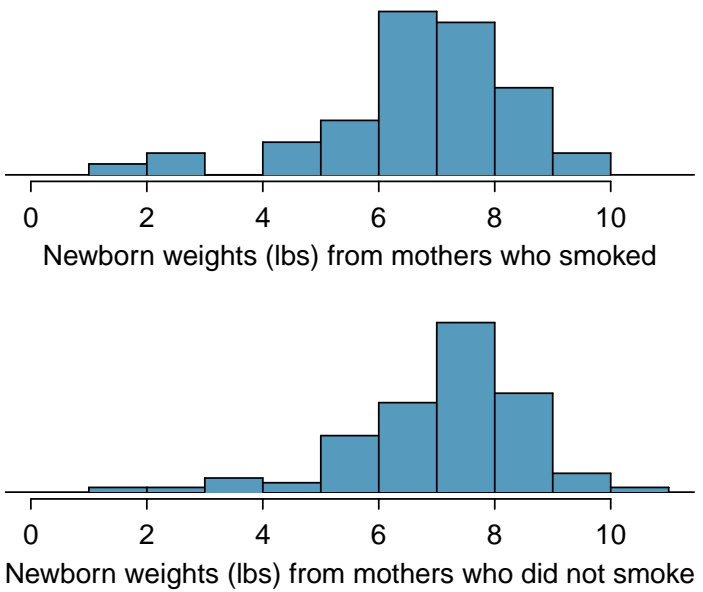

Figure 5.12: The top panel represents birth weights for infants whose mothers smoked. The bottom panel represents the birth weights for infants whose mothers who did not smoke. The distributions exhibit moderate-to-strong and strong skew, respectively.

A hypothesis test can be conducted to evaluate whether there is a relationship between mother’s smoking status and average newborn birth weight. The null hypothesis represents the case of no difference between the groups, $H _ { 0 } : \mu _ { n s } - \mu _ { s } = 0 ,$ , where $\mu _ { n s }$ represents the population mean of newborn birthweight for infants with mothers who did not smoke, and $\mu _ { s }$ represents mean newborn birthweight for infants with mothers who smoked. Under the alternative hypothesis, there is some difference in average newborn birth weight between the groups, $H _ { A } : \mu _ { n s } - \mu _ { s } \neq 0$ . The hypotheses can also be written as $H _ { 0 } : \mu _ { n s } = \mu _ { s }$ and $H _ { A } : \mu _ { n s } \neq \mu _ { s }$

## STATING HYPOTHESES FOR TWO-GROUP DATA

When testing a hypothesis about two independent groups, directly compare the two population means and state hypotheses in terms of $\mu _ { 1 }$ and $\mu _ { 2 }$

– For a two-sided test, $H _ { 0 } : \mu _ { 1 } = \mu _ { 2 } ;   H _ { A } : \mu _ { 1 } \neq \mu _ { 2 } .$
– For a one-sided test, either $H _ { 0 } : \mu _ { 1 } = \mu _ { 2 } ;   H _ { A } : \mu _ { 1 } > \mu _ { 2 } \; \mathrm { o r } \; H _ { 0 } : \mu _ { 1 } = \mu _ { 2 } ;   H _ { A } : \mu _ { 1 } < \mu _ { 2 } .$

---

5.3. TWO-SAMPLE TEST FOR INDEPENDENT DATA

251

In this setting, the formula for a t-statistic is:

$$
t = \frac {(\overline {{x}} _ {1} - \overline {{x}} _ {2}) - (\mu_ {1} - \mu_ {2})}{S E _ {\overline {{x}} _ {1} - \overline {{x}} _ {2}}} = \frac {(\overline {{x}} _ {1} - \overline {{x}} _ {2}) - (\mu_ {1} - \mu_ {2})}{\sqrt {\frac {s _ {1} ^ {2}}{n _ {1}} + \frac {s _ {2} ^ {2}}{n _ {2}}}}.
$$

Under the null hypothesis of no difference between the groups, $H _ { 0 } : \mu _ { 1 } - \mu _ { 2 } = 0 ,$ , the formula simplifies to

$$
t = \frac {(\overline {{x}} _ {1} - \overline {{x}} _ {2})}{\sqrt {\frac {s _ {1} ^ {2}}{n _ {1}} + \frac {s _ {2} ^ {2}}{n _ {2}}}}.
$$

## EXAMPLE 5.11

Using Figure 5.13, conduct a hypothesis test to evaluate whether there is evidence that newborns from mothers who smoke have a different average birth weight than newborns from mothers who do not smoke.

The hypotheses are $H _ { 0 } : \mu _ { 1 } = \mu _ { 2 }$ and $H _ { A } : \mu _ { 1 } \neq \mu _ { 2 } ,$ where $\mu _ { 1 }$ represents the average newborn birth weight for nonsmoking mothers and $\mu _ { 2 }$ represents average newborn birth weight for mothers who smoke. Let $\alpha = 0 . 0 5$

Calculate the t-statistic:

$$
t = \frac {(\overline {{x}} _ {1} - \overline {{x}} _ {2})}{\sqrt {\frac {s _ {1} ^ {2}}{n _ {1}} + \frac {s _ {2} ^ {2}}{n _ {2}}}} = \frac {7 . 1 8 - 6 . 7 8}{\sqrt {\frac {1 . 6 0 ^ {2}}{1 0 0} + \frac {1 . 4 3 ^ {2}}{5 0}}} = 1. 5 4.
$$

Approximate the degrees of freedom as $50 - 1 = 49$ . The t-score of 1.49 falls between the first and second columns in the $d f = 4 9$ row of the t-table, so the two-sided p-value is between 0.10 and 0.20.15

This p-value is larger than the significance value, 0.05, so the null hypothesis is not rejected. There is insufficient evidence to state there is a difference in average birth weight of newborns from North Carolina mothers who did smoke during pregnancy and newborns from North Carolina mothers who did not smoke during pregnancy.

|  | smoker | nonsmoker |
| --- | --- | --- |
| mean | 6.78 | 7.18 |
| st. dev. | 1.43 | 1.60 |
| samp. size | 50 | 100 |

Figure 5.13: Summary statistics for the births dataset.

E

<small>15From R, df = 89.277 and p = 0.138.</small>

---

252

CHAPTER 5. INFERENCE FOR NUMERICAL DATA

## 5.3.3 The paired test vs. independent group test

In the two-sample setting, students often find it difficult to determine whether a paired test or an independent group test should be used. The paired test applies only in situations where there is a natural pairing of observations between groups, such as in the swim data. Pairing can be obvious, such as the two measurements for each swimmer, or more subtle, such as measurements of respiratory function in twins, where one member of the twin pair is treated with an experimental treatment and the other with a control. In the case of two independent groups, there is no natural way to pair observations.

A common error is to overlook pairing in data and assume that two groups are independent. The swimsuit data can be used to illustrate the possible harm in conducting an independent group test rather than a paired test. In Section 5.2, the paired t-test showed a significant difference in the swim velocities between swimmers wearing wetsuits versus regular swimsuits. Suppose the analysis had been conducted without accounting for the fact that the measurements were paired.

The mean and standard deviation for the 12 wet suit velocities are 1.51 and 0.14 (m/sec), respectively, and 1.43 and 0.14 (m/sec) for the 12 swim suit velocities. A two-group test statistic is:

$$
t = \frac {1 . 5 2 - 1 . 4 3}{\sqrt {0 . 1 4 ^ {2} / 1 2 + 0 . 1 4 ^ {2} / 1 2}} = 1. 3 7.
$$

If the degrees of freedom are approximated as $1 1 = 1 2   -   1$ , the two-sided p-value as calculated from software is 0.20. According to this method, the null hypothesis of equal mean velocities for the two suit types would not be rejected.

It is not difficult to show that the numerator of the paired test (the average of the within swimmer differences) and the numerator of the two-group test (the difference of the average times for the two groups) are identical. The values of the test statistics differ because the denominators are different—specifically, the standard errors associated with each statistic are different. For the paired test statistic, the standard error uses the standard deviation of the within pair differences (0.22) and has value $0 . 0 2 2 / \sqrt { 1 2 } = 0 . 0 0 6$ . The two-group test statistic combines the standard deviations for the original measurements and has value $\sqrt { 0 . 1 4 ^ { 2 } / 1 2 + 0 . 1 4 ^ { 2 } / 1 2 } = 0 . 0 6$ . The standard error for the two-group test is 10-fold larger than for the paired test.

This striking difference in the standard errors is caused by the much lower variability of the individual velocity differences compared to the variability of the original measurements. Due to the correlation between swim velocities for a single swimmer, the differences in the two velocity measurements for each swimmer are consistently small, resulting in low variability. Pairing has allowed for increased precision in estimating the difference between groups.

The swim suit data illustrates the importance of context, which distinguishes a statistical problem from a purely mathematical one. While both the paired and two-group tests are numerically feasible to calculate, without an apparent error, the context of the problem dictates that the correct approach is to use a paired test.

## GUIDED PRACTICE 5.12

Propose an experimental design for the embryonic stem cell study in sheep that would have required analysis with a paired t-test.16

G

<small>16The experiment could have been done on pairs of siblings, with one assigned to the treatment group and one assigned to the control group. Alternatively, sheep could be matched up based on particular characteristics relevant to the experiment; for example, sheep could be paired based on similar weight or age. Note that in this study, a design involving two measurements taken on each sheep would be impractical.</small>

---

5.3. TWO-SAMPLE TEST FOR INDEPENDENT DATA

253

## 5.3.4 Case study: discrimination in developmental disability support

Section 1.7.1 presented an analysis of the relationship between age, ethnicity, and amount of expenditures for supporting developmentally disabled residents in the state of California, using the dds.discr dataset. When the variable age is ignored, the expenditures per consumer is larger on average for White non-Hispanics than Hispanics, but Figure 1.53 showed that average differences by ethnicity were much smaller within age cohorts. This section demonstrates the use of t-tests to conduct a more formal analysis of possible differences in expenditure by ethnicity, both overall (i.e., ignoring age) and within age cohorts.

## Comparing expenditures overall

When ignoring age, expenditures within the ethnicity groups Hispanic and White non-Hispanic show substantial right-skewing (Figure 1.45). A transformation is advisable before conducting a t-test. As shown in Figure 5.14, a natural log transformation effectively eliminates skewing.

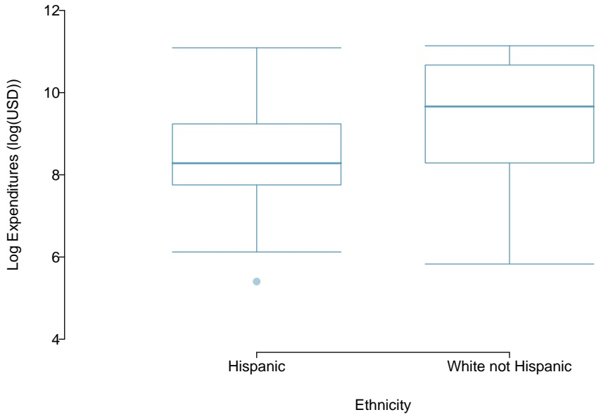

boxplot

| Ethnicity | Q1 | Q2 (Median) | Q3 | Min | Max |
| --- | --- | --- | --- | --- | --- |
| Hispanic | ~7.8 | ~8.3 | ~9.3 | ~6.1 | ~11.1 |
| White not Hispanic | ~8.3 | ~9.7 | ~10.7 | ~5.8 | ~11.2 |

Figure 5.14: A plot of log(expenditures) by ethnicity.

Is there evidence of a difference in mean expenditures by ethnic group? Conduct a t-test of the null hypothesis $H _ { 0 } : \mu _ { 1 } = \mu _ { 2 }$ versus the two-sided alternative $H _ { A } : \mu _ { 1 } \neq \mu _ { 2 }$ , where $\mu _ { 1 }$ is the population mean log expenditure in Hispanics and $\mu _ { 2 }$ is the population mean log expenditure in White non-Hispanics.

|  | Ethnicity | n | $\overline{x}$ | s |
| --- | --- | --- | --- | --- |
| 1 | Hispanic | 376 | 8.56 | 1.17 |
| 2 | White non Hispanic | 401 | 9.47 | 1.35 |

Figure 5.15: Summary statistics for the transformed variable log(expenditures) in the dds.discr data.

The summary statistics required to calculate the t-statistic are shown in Figure 5.15. The t-statistic for the test is

$$
t = \frac {9 . 4 7 - 8 . 5 6}{\sqrt {1 . 3 5 ^ {2} / 4 0 1 + 1 . 1 7 ^ {2} / 3 7 6}} = 1 0. 1.
$$

---

254

CHAPTER 5. INFERENCE FOR NUMERICAL DATA

The degrees of freedom of the test can be approximated as $376 - 1 = 375;$ the p-value can be calculated using a normal approximation. Regardless of whether a t or normal distribution is used, the probability of a test statistic with absolute value larger than 10 is vanishingly small—the p-value is less than 0.001. When ignoring age, there is significant evidence of a difference in mean expenditures between Hispanics and White non-Hispanics. It appears that on average, White non-Hispanics receive a higher amount of developmental disability support from the state of California $\left( \overline { { x } } _ { 1 } < \overline { { x } } _ { 2 } \right)$

However, as indicated in Section 1.7.1, this is a misleading result. The analysis as conducted does not account for the confounding effect of age, which is associated with both expenditures and ethnicity. As individuals age, they typically require more support from the government. In this dataset, White non-Hispanics tend to be older than Hispanics; this difference in age distribution contributes to the apparent difference in expenditures between two groups.

## Comparing expenditures within age cohorts

One way to account for the effect of age is to compare mean expenditures within age cohorts. When comparing individuals of similar ages but different ethnic groups, are the differences in mean expenditures larger than would be expected by chance alone?

Figure 1.52 shows that the age cohort 13-17 is the largest among the Hispanic consumers, while the cohort 22-50 is the largest among White non-Hispanics. This section will examine the evidence against the null hypothesis of no difference in mean expenditures within these two co-horts.

Figure 5.16 shows that within both the age cohorts of 13-17 years and 22-50 years, the distribution of expenditures is reasonably symmetric; there is no need to apply a transformation before conducting a t-test. The skewing evident when age was ignored is due to the differing distributions of age within ethnicities.

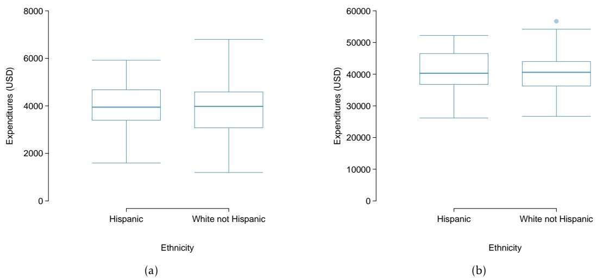

Figure 5.16: (a)A plot of expenditures by ethnicity in the age cohort 13 - 17. (b) A plot of expenditures by ethnicity in the age cohort 22 - 50.

---

5.3. TWO-SAMPLE TEST FOR INDEPENDENT DATA

255

Figure 5.17 contains the summary statistics for computing the test statistic to compare expenditures in the two groups within this age cohort. The test statistic has value t = 0.318, with degrees of freedom 66. The two-sided p-value is 0.75. There is not evidence of a difference between mean expenditures in Hispanics and White non-Hispanics ages 13-17.

|  | Ethnicity | n | $\overline{x}$ | s |
| --- | --- | --- | --- | --- |
| 1 | Hispanic | 103 | 3955.28 | 938.82 |
| 2 | White not Hispanic | 67 | 3904.36 | 1071.02 |

Figure 5.17: Summary statistics for expenditures, Ages 13-17.

The analysis of the age cohort 22 - 50 years shows the same qualitative result. The t-statistic calculated from the summary statistics in Figure 5.18 has value t = 0.659 and p-value 0.51. Just as in the 13-17 age cohort, there is insufficient evidence to reject the null hypothesis of no difference between the means.

|  | Ethnicity | n | $\overline{x}$ | s |
| --- | --- | --- | --- | --- |
| 1 | Hispanic | 43 | 40924.12 | 6467.09 |
| 2 | White not Hispanic | 133 | 40187.62 | 6081.33 |

Figure 5.18: Summary statistics for expenditures, Ages 22 - 50.

The inference-based analyses for these two age cohorts support the conclusions reached through the exploratory approach used in Section 1.7.1—comparing individuals of similar ages shows that there are not large differences between mean expenditures for White non-Hispanics versus Hispanics. An analysis that accounts for age as a confounding variable does not suggest there is evidence of ethnic discrimination in developmental disability support provided by the State of California.

---

256

CHAPTER 5. INFERENCE FOR NUMERICAL DATA

## 5.3.5 Pooled standard deviation estimate

Occasionally, two populations will have standard deviations that are so similar that they can be treated as identical. For example, historical data or a well-understood biological mechanism may justify this strong assumption. In such cases, it can be more precise to use a pooled standard deviation to make inferences about the difference in population means.

The **pooled standard deviation** of two groups uses data from both samples to estimate the common standard deviation and standard error. If there are good reasons to believe that the population standard deviations are equal, an improved estimate of the group variances can be obtained by pooling the data from the two groups:

$$
s _ {\mathrm{pooled}} ^ {2} = \frac {s _ {1} ^ {2} (n _ {1} - 1) + s _ {2} ^ {2} (n _ {2} - 1)}{n _ {1} + n _ {2} - 2},
$$

where $n _ { 1 }$ and $n _ { 2 }$ are the sample sizes, and $s _ { 1 }$ and $s _ { 2 }$ represent the sample standard deviations. In this setting, the t-statistic uses $s _ { \mathrm { p o o l e d } } ^ { 2 }$ in place of $s _ { 1 } ^ { 2 }$ and $s _ { 2 } ^ { 2 }$ in the standard error formula, and the degrees of freedom for the t−statistic is the sum of the degrees of freedom for the two sample variances:

$$
\mathrm{df} = (n _ {1} - 1) + (n _ {2} - 1) = n _ {1} + n _ {2} - 2.
$$

The t-statistic for testing the null hypothesis of no difference between population means becomes

$$
t = \frac {\overline {{x}} _ {1} - \overline {{x}} _ {2}}{s _ {\mathrm{pooled}} \sqrt {\frac {1}{n _ {1}} + \frac {1}{n _ {2}}}}.
$$

The formula for the two-sided confidence interval for the difference in population means is

$$
(\overline {{x}} _ {1} - \overline {{x}} _ {2}) \pm t ^ {\star} \times s _ {\mathrm{pooled}} \sqrt {\frac {1}{n _ {1}} + \frac {1}{n _ {2}}},
$$

where $t ^ { \star }$ is the point on a t-distribution with $n _ { 1 }   +   n _ { 2 }   -   2$ degrees of freedom chosen according to the confidence coefficient.

The benefits of pooling the standard deviation are realized through obtaining a better estimate of the standard deviation for each group and using a larger degrees of freedom parameter for the tdistribution. Both of these changes may permit a more accurate model of the sampling distribution of $\overline { { x } } _ { 1 } - \overline { { x } } _ { 2 }$ , if the standard deviations of the two groups are indeed equal. In most applications, however, it is difficult to verify the assumption of equal population standard deviations, and thus safer to use the methods discussed in Sections 5.3.1 and 5.3.2.

---

5.4. POWER CALCULATIONS FOR A DIFFERENCE OF MEANS

257

## 5.4 Power calculations for a difference of means

Designing a study often involves many complex issues; perhaps the most important statistical issue in study design is the choice of an appropriate sample size. The **power** of a statistical test is the probability that the test will reject the null hypothesis when the alternative hypothesis is true; sample sizes are chosen to make that probability sufficiently large, typically between 80% and 90%.

Two competing considerations arise when choosing a sample size. The sample size should be sufficiently large to allow for important group differences to be detected in a hypothesis test. Practitioners often use the term ‘detecting a difference’ to mean correctly rejecting a null hypothesis, i.e., rejecting a null hypothesis when the alternative is true. If a study is so small that detecting a statistically significant difference is unlikely even when there are potentially important differences, enrolling participants might be unethical, since subjects could potentially be exposed to a dangerous experimental treatment. However, it is also unethical to conduct studies with an overly large sample size, since more participants than necessary would be exposed to an intervention with uncertain value. Additionally, collecting data is typically expensive and time consuming; it would be a waste of valuable resources to design a study with an overly large sample size.

This section begins by illustrating relevant concepts in the context of a hypothetical clinical trial, where the goal is to calculate a sufficient sample size for being 80% likely to detect practically important effects.17 Afterwards, formulas are provided for directly calculating sample size, as well as references to software that can perform the calculations.

## 5.4.1 Reviewing the concepts of a test

## EXAMPLE 5.13

A company would like to run a clinical trial with participants whose systolic blood pressures are between 140 and 180 mmHg. Suppose previously published studies suggest that the standard deviation of patient blood pressures will be about 12 mmHg, with an approximately symmetric distribution.18 What would be the approximate standard error for $\overline { { x } } _ { \mathrm { t r m t } } - \overline { { x } } _ { \mathrm { c t r l } }$ if 100 participants were enrolled in each treatment group?

The standard error is calculated as follows:

$$
S E _ {\overline {{x}} _ {\mathrm{trmt}} - \overline {{x}} _ {\mathrm{ctrl}}} = \sqrt {\frac {s _ {\mathrm{trmt}} ^ {2}}{n _ {\mathrm{trmt}}} + \frac {s _ {\mathrm{ctrl}} ^ {2}}{n _ {\mathrm{ctrl}}}} = \sqrt {\frac {1 2 ^ {2}}{1 0 0} + \frac {1 2 ^ {2}}{1 0 0}} = 1. 7 0.
$$

This may be an imperfect estimate of $S E _ { \overline { { x } } _ { \mathrm { t r m t } } - \overline { { x } } _ { \mathrm { c t r l } } } ,$ , since the standard deviation estimate of 12 mmHg from prior data may not be correct. However, it is sufficient for getting started, and making an assumption like this is often the only available option.

E

<small>17While sample size planning is also important for observational studies, those techniques are not discussed here.</small>

<small>18In many studies like this one, each participant’s blood pressure would be measured at the beginning and end of the study, and the outcome measurement for the study would be the average difference in blood pressure in each of the treatment groups. For this hypothetical study, we assume for simplicity that blood pressure is measured at only the end of the study, and that the randomization ensures that blood pressures at the beginning of the study are equal (on average) between the two groups.</small>

---

258

CHAPTER 5. INFERENCE FOR NUMERICAL DATA

Since the degrees of freedom are greater than 30, the distribution of $\overline { { x } } _ { \mathrm { t r m t } } - \overline { { x } } _ { \mathrm { c t r l } }$ will be approximately normal. Under the null hypothesis, the mean is 0 and the standard deviation is 1.70 (from the standard error).

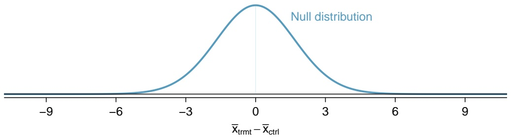

violin

| X | Y |
| --- | --- |
| -9 | ~0 |
| -6 | ~0.05 |
| -3 | ~0.4 |
| 0 | 1 |
| 3 | ~0.4 |
| 6 | ~0.05 |
| 9 | ~0 |

Figure 5.19: Null distribution for the t-statistic in Example 5.14.

## EXAMPLE 5.14

For what values of $\overline { { x } } _ { \mathrm { t r m t } } - \overline { { x } } _ { \mathrm { c t r l } }$ would the null hypothesis be rejected, using $\alpha = 0 . 0 5 ?$

If the observed difference is in the far left or far right tail of the null distribution, there is sufficient evidence to reject the null hypothesis. For $\alpha = 0 . 0 5 ,   H _ { 0 }$ is rejected if the difference is in the lower 2.5% or upper 2.5% tail:

**Lower 2.5%:** For the normal model, this is 1.96 standard errors below 0, so any difference smaller than $-1.96 \times 1.70 = -3.332$ mmHg.

**Upper 2.5%:** For the normal model, this is 1.96 standard errors above 0, so any difference larger than $1 . 9 6 \times 1 . 7 0 = 3 . 3 3 2 \; \mathrm { m m H g } .$

The boundaries of these **rejection regions** are shown below. Note that if the new treatment is effective, mean blood pressure should be lower in the treatment group than in the control group; i.e., the difference should be in the lower tail.

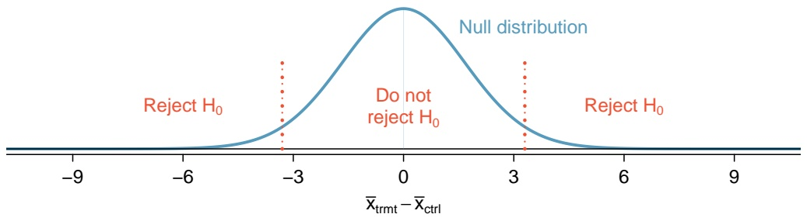

violin

| Region | Description |
| --- | --- |
| Left | Reject H0 |
| Center | Do not reject H0 |
| Right | Reject H0 |

The next step is to perform some hypothetical calculations to determine the probability of rejecting the null hypothesis if the alternative hypothesis were true.

E

---

5.4. POWER CALCULATIONS FOR A DIFFERENCE OF MEANS

259

## 5.4.2 Computing the power for a 2-sample test

If there is a real effect from an intervention, and the effect is large enough to have practical value, the probability of detecting that effect is referred to as the **power**. Power can be computed for different sample sizes or different effect sizes.

There is no easy way to define when an effect size is large enough to be of value; this is not a statistical issue. For example, in a clinical trial, the scientifically significant effect is the incremental value of the intervention that would justify changing current clinical recommendations from an existing intervention to a new one. In such a setting, the effect size is usually determined from long discussions between the research team and study sponsors.

Suppose that for this hypothetical blood pressure medication study, the researchers are interested in detecting any effect on blood pressure that is 3 mmHg or larger than the standard medication. Here, 3 mmHg is the minimum **population e**ff**ect size** of interest.

## EXAMPLE 5.15

Suppose the study proceeded with 100 patients per treatment group and the new drug does reduce average blood pressure by an additional 3 mmHg relative to the standard medication. What is the probability of detecting this effect?

Determine the sampling distribution for $\overline { { x } } _ { \mathrm { t r m t } }   -   \overline { { x } } _ { \mathrm { c t r l } }$ when the true difference is −3 mmHg; this has the same standard deviation of 1.70 as the null distribution, but the mean is shifted 3 units to the left. Then, calculate the fraction of the distribution for $\overline { { x } } _ { \mathrm { t r m t } } - \overline { { x } } _ { \mathrm { c t r l } }$ that falls within the rejection region for the null distribution, as shown in Figure 5.20.

The probability of being in the left side of the rejection region $(x < -3.332)$ can be calculated by converting to a Z-score and using either the normal probability table or statistical software.19

$$
Z = \frac {- 3 . 3 3 2 - (- 3)}{1 . 7} = - 0. 2 0 \quad \rightarrow \quad P (Z \leq - 0. 2 0) = 0. 4 2 0 7.
$$

The power for the test is about 42% when $\mu _ { \mathrm { t r m t } } - \mu _ { \mathrm { c t r l } } = - 3$ mm/Hg and each group has a sample size of 100.

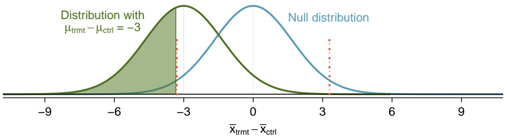

violin

| Category | Distribution with \(\mu_trmt\) - \(\mu_ctrl\) = -3 (Peak) | Null distribution (Peak) |
| --- | --- | --- |
| X-axis range | -9~9 | -3~3 |

Figure 5.20: The rejection regions are outside of the dotted lines. Recall that the boundaries for $\alpha = 0 . 0 5$ were calculated to be ±3.332 mmHg.

E

<small>19The probability of being in the right side of the rejection region is negligible and can be ignored.</small>

---

260

CHAPTER 5. INFERENCE FOR NUMERICAL DATA

## 5.4.3 Determining a proper sample size

The last example demonstrated that with a sample size of 100 in each group, there is a prob ability of about 0.42 of detecting an effect size of 3 mmHg. If the study were conducted with this sample size, even if the new medication reduced blood pressure by 3 mmHg compared to the control group, there is a less than 50% chance of concluding that the medication is beneficial. Studies with low power are often inconclusive, and there are important reasons to avoid such a situation:

– Participants were subjected to a drug for a study that may have little scientific value.
– The company may have invested hundreds of millions of dollars in developing the new drug, and may now be left with uncertainty about its potential.
– Another clinical trial may need to be conducted to obtain a more conclusive answer as to whether the drug does hold any practical value, and that would require substantial time and expense.

To ensure a higher probability of detecting a clinically important effect, a larger sample size should be chosen. What about a study with 500 patients per group?

## GUIDED PRACTICE 5.16

Calculate the power to detect a change of -3 mmHg using a sample size of 500 per group. Recall that the standard deviation of patient blood pressures was expected to be about 12 mmHg.20

(a) Determine the standard error.
(b) Identify the null distribution and rejection regions, as well as the alternative distribution when $\mu _ { t r m t } - \mu _ { c t r l } = - 3 .$
(c) Compute the probability of rejecting the null hypothesis.

With a sample size of 500 per group, the power of the test is much larger than necessary. Not only does this lead to a study that would be overly expensive and time consuming, it also exposes more patients than necessary to the experimental drug.

Sample sizes are generally chosen such that power is around 80%, although in some cases 90% is the target. Other values may be reasonable for a specific context, but 80% and 90% are most commonly chosen as a good balance between high power and limiting the number of patients exposed to a new treatment (as well as reducing experimental costs).

20(a) The standard error will now be $SE = \sqrt{\frac{12^2}{500} + \frac{12^2}{500}} = 0.76.$ (b) The null distribution, rejection boundaries, and alternative distribution are shown below. The rejection regions are the areas outside the two dotted lines at xtrmt − xctrl ± 0.76 × 1.96 = ±1.49.

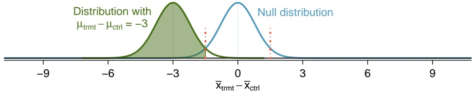

violin

| Category | Distribution with \(\mu_trmt\) - \(\mu_ctrl\) = -3 (Peak) | Null distribution (Peak) |
| --- | --- | --- |
| Peak X-value | ~-3 | 0 |

(c) Compute the Z-score and find the tail area, Z =−1.49−(−3) 0.76 = 1.99 → P (Z ≤ 1.99) = 0.9767, which is the power of the test for a difference of 3 mmHg. With 500 patients per group, the study would be 97.7% likely to detect an effect size of 3 mmHg.

G

---

5.4. POWER CALCULATIONS FOR A DIFFERENCE OF MEANS

261

## EXAMPLE 5.17

Identify the sample size that would lead to a power of 80%.

The Z-score that defines a lower tail area of 0.80 is about $Z = 0 . 8 4 .$ . In other words, 0.84 standard errors from -3, the mean of the alternative distribution.

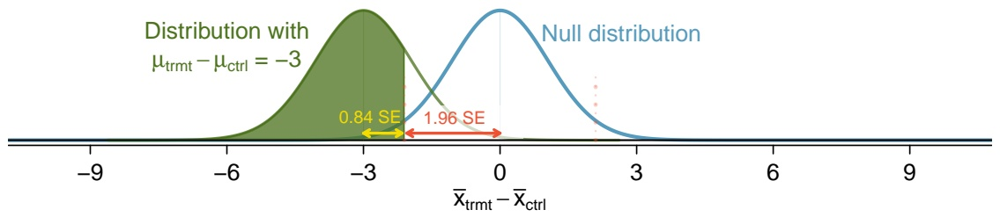

violin

| Metric | Value |
| --- | --- |
| Distribution with \(\mu_trmt\) - \(\mu_ctrl\) | -3 |
| Null distribution (SE) | 1.96 |
| Distribution with \(\mu_trmt\) - \(\mu_ctrl\) | -3 |
| Distribution with \(\mu_trmt\) - \(\mu_ctrl\) (SE) | 0.84 |

For $\alpha = 0 . 0 5 ,$ the rejection region always extends 1.96 standard errors from 0, the center of the null distribution.

The distance between the centers of the null and alternative distributions can be expressed in terms of the standard error:

$$
(0. 8 4 \times S E) + (1. 9 6 \times S E) = 2. 8 \times S E.
$$

This quantity necessarily equals the minimum effect size of interest, 3 mmHg, which is the distance between -3 and 0. It is then possible to solve for n:

$$
\begin{array}{l} 3 = 2. 8 \times S E \\ 3 = 2. 8 \times \sqrt {\frac {1 2 ^ {2}}{n} + \frac {1 2 ^ {2}}{n}} \\ n = \frac {2 . 8 ^ {2}}{3 ^ {2}} \times \left(1 2 ^ {2} + 1 2 ^ {2}\right) = 2 5 0. 8 8 \\ \end{array}
$$

The study should enroll at least 251 patients per group for 80% power. Note that sample size should always be rounded up in order to achieve the desired power. Even if the calculation had yielded a number closer to 250 (e.g., 250.25), the study should still enroll 251 patients per grou, since having 250 patients per group would result in a power lower than 80%.

## GUIDED PRACTICE 5.18

Suppose the targeted power is 90% and $\alpha = 0 . 0 1$ . How many standard errors should separate the centers of the null and alternative distributions, where the alternative distribution is centered at the minimum effect size of interest? Assume the test is two-sided.21

E

G

<small>21Find the Z-score such that 90% of the distribution is below it: Z = 1.28. Next, find the cutoffs for the rejection regions: ±2.58. Thus, the centers of the null and alternative distributions should be about 1.28 + 2.58 = 3.86 standard errors apart.</small>

---

262

CHAPTER 5. INFERENCE FOR NUMERICAL DATA

Figure 5.21 shows the power for sample sizes from 20 participants to $^ { 5 , 0 0 0 }$ participants when $\alpha = 0 . 0 5$ and the true difference is -3 mmHg. While power increases with sample size, having more than 250-300 participants provides little additional value towards detecting an effect.

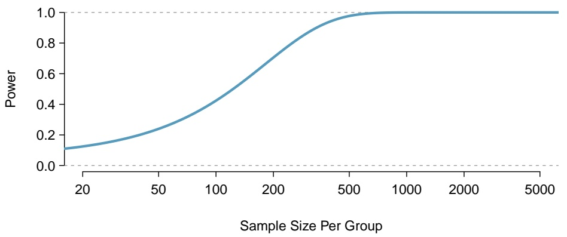

line

| Sample Size Per Group | Power |
| --- | --- |
| 20 | ~0.12 |
| 50 | ~0.25 |
| 100 | ~0.45 |
| 200 | ~0.70 |
| 500 | ~0.98 |
| 1000 | 1.0 |
| 2000 | 1.0 |
| 5000 | 1.0 |

Figure 5.21: The curve shows the power for different sample sizes in the context of the blood pressure example when the true difference is -3.

## 5.4.4 Formulas for power and sample size

The previous sections have illustrated how power and sample size can be calculated from first principles, using the fundamental ideas behind distributions and testing. In practice, power and sample size calculations are so important that statistical software should be the method of choice; there are many commercially available and public domain programs for performing such calculations. However, hand calculations using formulas can provide quick estimates in the early stages of planning a study.

Use the following formula to calculate sample size for comparing two means, assuming each group will have n participants:

$$
n = \frac {(\sigma_ {1} ^ {2} + \sigma_ {2} ^ {2}) (z _ {1 - \alpha / 2} + z _ {1 - \beta}) ^ {2}}{\Delta^ {2}}.
$$

In this formula:

$- ~ \mu _ { 1 } , \mu _ { 2 } , \sigma _ { 1 }$ , and $\sigma _ { 2 }$ are the population means and standard deviations of the two groups.
$\Delta = \mu _ { 1 } - \mu _ { 2 }$ is the minimally important difference that investigators wish to detect.
– The null and alternative hypotheses are $H _ { 0 } : \Delta = 0 \; ( \mathrm { i . e . }$ , no difference between the means) and $H _ { A } : \Delta \neq 0 ,$ i.e., a two-sided alternative.
– The two-sided significance level is $\alpha$ , and $z _ { 1 - \alpha / 2 }$ is the point on a standard normal distribution with area $1 - \alpha / 2$ to its left and $\alpha / 2$ area to its right.
$\beta$ is the probability of incorrectly failing to reject $H _ { 0 }$ for a specified value of $\Delta ;   1 - \beta$ is the power. The value $z _ { 1 - \beta }$ is the point on a standard normal distribution with area $1 - \beta$ to its left.

---

5.4. POWER CALCULATIONS FOR A DIFFERENCE OF MEANS

263

For a study with sample size n per group, where $Z$ is a normal random variable with mean 0 and standard deviation 1, power is given by:

$$
\text {Power} = P \left(Z <   - z _ {1 - \alpha / 2} + \frac {\Delta}{\sqrt {\sigma_ {1} ^ {2} / n + \sigma_ {2} ^ {2} / n}}\right).
$$

These formulas could have been used to do the earlier power and sample size calculations for the hypothetical study of blood pressure lowering medication. To calculate the sample size needed for 80% power in detecting a change of 3 mmHg, $\alpha = 0 . 0 5 ,   1 - \beta = 0 . 8 0 ,   \Delta = 3$ mmHg, and $\sigma _ { 1 } = \sigma _ { 2 } = 1 2$ mmHg. The formula yields a sample size n per group of

$$
n = \frac {(1 2 ^ {2} + 1 2 ^ {2}) (1 . 9 6 + 0 . 8 4) ^ {2}}{(- 3 . 0) ^ {2}} = 2 5 0. 8 8,
$$

which can be rounded up to 251.

The formula for power can be used to verify the sample size of 251:

$$
\begin{array}{l} \text {Power} = P \left(Z <   - 1. 9 6 + \frac {3}{\sqrt {1 2 ^ {2} / 2 5 1 + 1 2 ^ {2} / 2 5 1}}\right) \\ = P (Z <   1. 2 5) \\ = 0. 8 5. \\ \end{array}
$$

The calculated power is slightly larger than 80% because of the rounding to 251.

The sample size calculations done before any data are collected are one of the most critical aspects of conducting a study. If an analysis is done incorrectly, it can be redone once the error is discovered. However, if data were collected for a sample size that is either too large or too small, it can be impossible to correct the error, especially in studies with human subjects. As a result, sample size calculations are nearly always done using software. For two-sample t-tests, the R function power.t.test is both freely available and easy to use.

---

264

CHAPTER 5. INFERENCE FOR NUMERICAL DATA

## 5.5 Comparing means with ANOVA

In some settings, it is useful to compare means across several groups. It might be tempting to do pairwise comparisons between groups; for example, if there are three groups $( A , B , C )$ , why not conduct three separate t-tests (A vs. B, A vs. C, B vs. C)? Conducting multiple tests on the same data increases the rate of Type I error, making it more likely that a difference will be found by chance, even if there is no difference among the population means. Multiple testing is discussed further in Section 5.5.3.

Instead, the methodology behind a t-test can be generalized to a procedure called **analysis of variance (ANOVA)**, which uses a single hypothesis test to assess whether the means across several groups are equal. Strong evidence favoring the alternative hypothesis in ANOVA is described by unusually large differences among the group means.

$H _ { 0 } ;$ The mean outcome is the same across all k groups. In statistical notation, $\mu _ { 1 } = \mu _ { 2 } = \cdots = \mu _ { k }$ where $\mu _ { i }$ represents the mean of the outcome for observations in category i.

$H _ { A } \colon$ At least one mean is different.

There are three conditions on the data that must be checked before performing ANOVA: 1) observations are independent within and across groups, 2) the data within each group are nearly normal, and 3) the variability across the groups is about equal.

## EXAMPLE 5.19

Examine Figure 5.22. Compare groups I, II, and III. Is it possible to visually determine if the differences in the group centers is due to chance or not? Now compare groups IV, V, and VI. Do the differences in these group centers appear to be due to chance?

It is difficult to discern a difference in the centers of groups I, II, and III, because the data within each group are quite variable relative to any differences in the average outcome. However, there appear to be differences in the centers of groups IV, V, and VI. For instance, group V appears to have a higher mean than that of the other two groups. The differences in centers for groups IV, V, and VI are noticeable because those differences are large relative to the variability in the individual observations within each group.

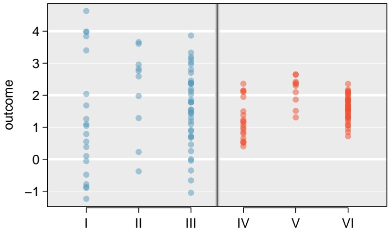

scatter

| Category | Outcome (range) |
| --- | --- |
| I | -1.2~4.6 |
| II | -0.4~3.7 |
| III | -1.1~3.9 |
| IV | 0.4~2.4 |
| V | 1.3~2.7 |
| VI | 0.7~2.4 |

Figure 5.22: Side-by-side dot plot for the outcomes for six groups.

E

---

5.5. COMPARING MEANS WITH ANOVA

265

## 5.5.1 Analysis of variance (ANOVA) and the F-test

The famuss dataset was introduced in Chapter 1, Section 1.2.2. In the FAMuSS study, researchers examined the relationship between muscle strength and genotype at a location on the ACTN3 gene. The measure for muscle strength is percent change in strength in the non-dominant arm (ndrm.ch). Is there a difference in muscle strength across the three genotype categories (CC, CT, TT)?

## GUIDED PRACTICE 5.20

The null hypothesis under consideration is the following: $\mu _ { \mathtt { C C } }   =   \mu _ { \mathtt { C T } }   =   \mu _ { \mathtt { T T } }$ . Write the null and corresponding alternative hypotheses in plain language.22

Figure 5.23 provides summary statistics for each group. A side-by-side boxplot for the change in non-dominant arm strength is shown in Figure 5.24; Figure 5.25 shows the Q-Q plots by each genotype. Notice that the variability appears to be approximately constant across groups; nearly constant variance across groups is an important assumption that must be satisfied for using ANOVA. Based on the Q-Q plots, there is evidence of moderate right skew; the data do not follow a normal distribution very closely, but could be considered to ’loosely’ follow a normal distribution.23 It is reasonable to assume that the observations are independent within and across groups; it is unlikely that participants in the study were related, or that data collection was carried out in a way that one participant’s change in arm strength could influence another’s.

|  | CC | CT | TT |
| --- | --- | --- | --- |
| Sample size ($n_i$) | 173 | 261 | 161 |
| Sample mean ($\bar{x}_i$) | 48.89 | 53.25 | 58.08 |
| Sample SD ($s_i$) | 29.96 | 33.23 | 35.69 |

Figure 5.23: Summary statistics of change in non-dominant arm strength, split by genotype.

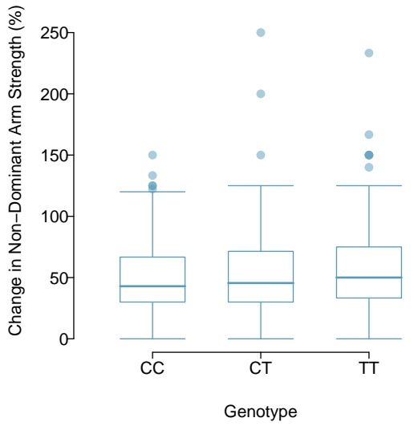

boxplot

| Genotype | Q1 | Q2 (Median) | Q3 | IQR |
| --- | --- | --- | --- | --- |
| CC | ~30 | ~45 | ~68 | ~38 |
| CT | ~30 | ~47 | ~72 | ~32 |
| TT | ~35 | ~51 | ~76 | ~41 |

Figure 5.24: Side-by-side box plot of the change in non-dominant arm strength for 595 participants across three groups.

<small>22H0: The average percent change in non-dominant arm strength is equal across the three genotypes. HA: The average percent change in non-dominant arm strength varies across some (or all) groups.</small>

<small>23In a more advanced course, it can be shown that the ANOVA procedure still holds with deviations from normality when sample sizes are moderately large. Additionally, a more advanced course would discuss appropriate transformations to induce normality.</small>

---

266

CHAPTER 5. INFERENCE FOR NUMERICAL DATA

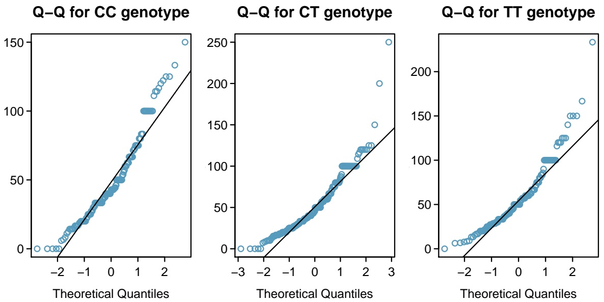

Figure 5.25: Q-Q plots of the change in non-dominant arm strength for 595 participants across three groups.

## EXAMPLE 5.21

The largest difference between the sample means is between the CC and TT groups. Consider again the original hypotheses:

$$
H _ {0}: \mu_ {\mathrm{CC}} = \mu_ {\mathrm{CT}} = \mu_ {\mathrm{TT}}
$$

$H _ { A } \colon$ The average percent change in non-dominant arm strength $( \mu _ { i } )$ varies across some (or all) groups.

Why might it be inappropriate to run the test by simply estimating whether the difference of $\mu _ { \mathrm { C C } }$ and $\mu _ { \mathrm { T T } }$ is statistically significant at a 0.05 significance level?

It is inappropriate to informally examine the data and decide which groups to formally test. This is a form of **data fishing**; choosing the groups with the largest differences for the formal test will lead to an increased chance of incorrectly rejecting the null hypothesis (i.e., an inflation in the Type I error rate). Instead, all the groups should be tested using a single hypothesis test.

Analysis of variance focuses on answering one question: is the variability in the sample means large enough that it seems unlikely to be from chance alone? The variation between groups is referred to as the **mean square between groups (**MSG); the MSG is a measure of how much each group mean varies from the overall mean. Let x represent the mean of outcomes across all groups, where ${ \overline { { x } } } _ { i }$ is the mean of outcomes in a particular group i and $n _ { i }$ is the sample size of group i. The mean square between groups is:

$$
M S G = \frac {1}{k - 1} \sum_ {i = 1} ^ {k} n _ {i} \left(\overline {{x}} _ {i} - \overline {{x}}\right) ^ {2} = \frac {1}{\mathrm{df} _ {G}} S S G,
$$

where SSG is the **sum of squares between groups**, $\textstyle \sum _ { i = 1 } ^ { k } n _ { i }   ( { \overline { { x } } } _ { i } - { \overline { { x } } } ) ^ { 2 }$ , and $\mathbf { d f } _ { G } = k - 1$ is the degrees of freedom associated with the MSG when there are k groups.

E

---

5.5. COMPARING MEANS WITH ANOVA

267

Under the null hypothesis, any observed variation in group means is due to chance and there is no real difference between the groups. In other words, the null hypothesis assumes that the groupings are non-informative, such that all observations can be thought of as belonging to a single group. If this scenario is true, then it is reasonable to expect that the variability between the group means should be equal to the variability observed within a single group. The **mean square error** (MSE) is a pooled variance estimate with associated degrees of freedom $\mathbf { d f } _ { E } = n   -   k$ that provides a measure of variability within the groups. The mean square error is computed as:

$$
M S E = \frac {1}{n - k} \sum_ {i = 1} ^ {k} (n _ {i} - 1) s _ {i} ^ {2} = \frac {1}{\mathrm{df} _ {E}} S S E,
$$

where the SSE is the **sum of squared errors**, $n _ { i }$ is the sample size of group $i ,$ and $s _ { i }$ is the standard deviation of group i.

Under the null hypothesis that all the group means are equal, any differences among the sample means are only due to chance; thus, the MSG and MSE should also be equal. ANOVA is based on comparing the MSG and MSE. The test statistic for ANOVA, the **F-statistic**, is the ratio of the between-group variability to the within-group variability:

$$
F = \frac {M S G}{M S E}. \tag {5.22}
$$

## EXAMPLE 5.23

Calculate the F-statistic for the famuss data summarized in Figure 5.23. The overall mean x across all observations is 53.29.

First, calculate the MSG and MSE.

$$
\begin{array}{l} M S G = \frac {1}{k - 1} \sum_ {i = 1} ^ {k} n _ {i} \left(\bar {x} _ {i} - \bar {x}\right) ^ {2} \\ = \frac {1}{3 - 1} \left[ (1 7 3) (4 8. 8 9 - 5 3. 2 9) ^ {2} + (2 6 1) (5 3. 2 5 - 5 3. 2 9) ^ {2} + (1 6 1) (5 8. 0 8 - 5 3. 2 9) ^ {2} \right] \\ = 3 5 2 1. 6 9 \\ M S E = \frac {1}{n - k} \sum_ {i = 1} ^ {k} (n _ {i} - 1) s _ {i} ^ {2} \\ = \frac {1}{5 9 5 - 3} \left[ (1 7 3 - 1) (2 9. 9 6 ^ {2}) + (2 6 1 - 1) (3 3. 2 3 ^ {2}) + (1 6 1 - 1) (3 5. 6 9 ^ {2}) \right] \\ = 1 0 9 0. 0 2 \\ \end{array}
$$

The F-statistic is the ratio:

$$
\frac {M S G}{M S E} = \frac {3 5 2 1 . 6 9}{1 0 9 0 . 0 2} = 3. 2 3.
$$

E

---

268

CHAPTER 5. INFERENCE FOR NUMERICAL DATA

A p-value can be computed from the F-statistic using an F-distribution, which has two associated parameters: $\mathrm { d f _ { 1 } }$ and $\mathrm { d f } _ { 2 }$ . For the F-statistic in ANOVA, $\mathrm { d f _ { 1 } } = \mathrm { d f } _ { G }$ and $\mathbf { d f } _ { 2 } = \mathbf { d f } _ { E }$ . An F distribution with 2 and 592 degrees of freedom, corresponding to the F-statistic for the genotype and muscle strength hypothesis test, is shown in Figure 5.26.

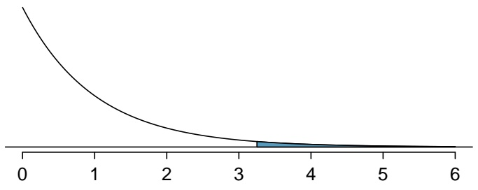

area

| X | Y |
| --- | --- |
| 0 | ~1.0 |
| 1 | ~0.3 |
| 2 | ~0.1 |
| 3 | ~0.05 |
| 4 | ~0.02 |
| 5 | ~0.01 |
| 6 | ~0.005 |

Figure 5.26: An F-distribution with $\mathrm { d f _ { 1 } } = 2$ and $\mathbf { d f } _ { 2 } = 5 9 2$ . The tail area greater than $F = 3 . 2 3$ is shaded.

The larger the observed variability in the sample means (MSG) relative to the within-group variability (MSE), the larger F will be. Larger values of F represent stronger evidence against the null hypothesis. The upper tail of the distribution is used to compute a p-value, which is typically done using statistical software.

## EXAMPLE 5.24

The p-value corresponding to the test statistic is equal to about 0.04. Does this provide strong evidence against the null hypothesis at significance level $\alpha = 0 . 0 5 ?$

The p-value is smaller than 0.05, indicating the evidence is strong enough to reject the null hypothesis at a significance level of 0.05. The data suggest that average change in strength in the non-dominant arm varies by participant genotype.

## THE F-STATISTIC AND THE F-TEST

Analysis of variance (ANOVA) is used to test whether the mean outcome differs across two or more groups. ANOVA uses a test statistic F, which represents a standardized ratio of variability in the sample means relative to the variability within the groups. If $H _ { 0 }$ is true and the model assumptions are satisfied, the statistic F follows an F distribution with parameters $\mathbf { d f } _ { 1 } = k   -   1$ and $\mathbf { d } \mathbf { f } _ { 2 } = n   -   k .$ The upper tail of the F-distribution is used to calculate the p-value.

E

---

5.5. COMPARING MEANS WITH ANOVA

269

## 5.5.2 Reading an ANOVA table from software

The calculations required to perform an ANOVA by hand are tedious and prone to human error. Instead, it is common to use statistical software to calculate the F-statistic and associated p-value. The results of an ANOVA can be summarized in a table similar to that of a regression summary, which will be discussed in Chapters 6 and 7.

Figure 5.27 shows an ANOVA summary to test whether the mean change in non-dominant arm strength varies by genotype. Many of these values should look familiar; in particular, the F-statistic and p-value can be retrieved from the last two columns.

|  | Df | Sum Sq | Mean Sq | F value | Pr(>F) |
| --- | --- | --- | --- | --- | --- |
| famuss$actn3.r577x | 2 | 7043 | 3522 | 3.231 | 0.0402 |
| Residuals | 592 | 645293 | 1090 |  |  |

Figure 5.27: ANOVA summary for testing whether the mean change in non-dominant arm strength varies by genotype at the actn3.r577x location on the ACTN3 gene.

## 5.5.3 Multiple comparisons and controlling Type I Error rate

Rejecting the null hypothesis in an ANOVA analysis only allows for a conclusion that there is evidence for a difference in group means. In order to identify the groups with different means, it is necessary to perform further testing. For example, in the famuss analysis, there are three comparisons to make: CC to CT, CC to TT, and CT to TT. While these comparisons can be made using two sample t-tests, it is important to control the Type I error rate. One of the simplest ways to reduce the overall probability of identifying a significant difference by chance in a multiple comparisons setting is to use the Bonferroni correction procedure.

In the Bonferroni correction procedure, the p-value from a two-sample t-test is compared to a modified significance level, $\alpha ^ { \star } ; \; \alpha ^ { \star } = \alpha / K ,$ , where K is the total number of comparisons being considered. For k groups, $\begin{array} { r } { K   =   \frac { k ( k - 1 ) } { 2 } } \end{array}$ When calculating the t-statistic, use the pooled estimate of standard deviation between groups (which equals ${ \sqrt { M S E } } ) ;$ to calculate the p-value, use a tdistribution with df2. It is typically more convenient to do these calculations using software.

## BONFERRONI CORRECTION

The **Bonferroni correction** suggests that a more stringent significance level is appropriate when conducting multiple tests:

$$
\alpha^ {\star} = \alpha / K
$$

where K is the number of comparisons being considered. For k groups, $\begin{array} { r } { K = \frac { k ( k - 1 ) } { 2 } } \end{array}$ .

---

270

CHAPTER 5. INFERENCE FOR NUMERICAL DATA

## EXAMPLE 5.25

The ANOVA conducted on the famuss dataset showed strong evidence of differences in the mean strength change in the non-dominant arm between the three genotypes. Complete the three possible pairwise comparisons using the Bonferroni correction and report any differences.

Use a modified significance level of $\alpha ^ { \star } = 0 . 0 5 / 3 = 0 . 0 1 6 7$ . The pooled estimate of the standard deviation is ${ \sqrt { M S E } } = { \sqrt { 1 0 9 0 . 0 2 } } = 3 3 . 0 2$

Genotype CC versus Genotype CT:

$$
t = \frac {\overline {{x}} _ {1} - \overline {{x}} _ {2}}{s _ {\text {pooled}} \sqrt {\frac {1}{n _ {1}} + \frac {1}{n _ {2}}}} = \frac {4 8 . 8 9 - 5 3 . 2 5}{3 3 . 0 2 \sqrt {\frac {1}{1 7 3} + \frac {1}{2 6 1}}} = - 1. 3 5.
$$

This results in a p-value of 0.18 on $d f = 5 9 2 .$ . This p-value is larger than $\alpha ^ { \star } = 0 . 0 1 6 7 ,$ so there is not evidence of a difference in the means of genotypes CC and CT.

Genotype CC versus Genotype TT:

$$
t = \frac {\overline {{x}} _ {1} - \overline {{x}} _ {2}}{s _ {\text {pooled}} \sqrt {\frac {1}{n _ {1}} + \frac {1}{n _ {2}}}} = \frac {4 8 . 8 9 - 5 8 . 0 8}{3 3 . 0 2 \sqrt {\frac {1}{1 7 3} + \frac {1}{1 6 1}}} = - 2. 5 4.
$$

This results in a p-value of 0.01 on $d f = 5 9 2$ . This p-value is smaller than $\alpha ^ { \star } = 0 . 0 1 6 7$ , so there is evidence of a difference in the means of genotypes CC and TT.

Genotype CT versus Genotype TT:

$$
t = \frac {\overline {{x}} _ {1} - \overline {{x}} _ {2}}{s _ {\text {pooled}} \sqrt {\frac {1}{n _ {1}} + \frac {1}{n _ {2}}}} = \frac {5 3 . 2 5 - 5 8 . 0 8}{3 3 . 0 2 \sqrt {\frac {1}{2 6 1} + \frac {1}{1 6 1}}} = - 1. 4 6.
$$

This results in a p-value of 0.14 on $d f = 5 9 2 .$ . This p-value is larger than $\alpha ^ { \star } = 0 . 0 1 6 7 ,$ so there is not evidence of a difference in the means of genotypes CT and TT.

In summary, the mean percent strength change in the non-dominant arm for genotype CT individuals is not statistically distinguishable from those of genotype CC and TT individuals. However, there is evidence that mean percent strength change in the non-dominant arm differs between individu als of genotype CC and TT are different.

E

---

5.5. COMPARING MEANS WITH ANOVA

271

## 5.5.4 Reading the results of pairwise t-tests from software

Statistical software can be used to calculate the p-values associated with each possible pairwise comparison of the groups in ANOVA. The results of the pairwise tests are summarized in a table that shows the p-value for each two-group test.

Figure 5.28 shows the p-values from the three possible two-group t-tests comparing change in non-dominant arm strengths between individuals with genotypes CC, CT, and TT. For example, the table indicates that when comparing mean change in non-dominant arm strength between TT and CC individuals, the p-value is 0.01. This coheres with the calculations above, and these unadjusted p-values should be compared to $\alpha ^ { \star } = 0 . 0 1 6 7$

|  | CC | CT |
| --- | --- | --- |
| CT | 0.18 | - |
| TT | 0.01 | 0.14 |

Figure 5.28: Unadjusted p-values for pairwise comparisons testing whether the mean change in non-dominant arm strength varies by genotype at the actn3.r577x location on ACTN3 gene.

The use of statistical software makes it easier to apply corrections for multiple testing, such that it is not necessary to explicitly calculate the value of $\alpha ^ { \star }$ . Figure 5.29 shows the Bonferroniadjusted p-values from the three possible tests. When statistical software applies the Bonferroni correction, the unadjusted p-value is multiplied by $K ,$ the number of comparisons, allowing for the values to be directly compared to α, not $\alpha ^ { \star } ,$ . Comparing an unadjusted p-value to α/K is equivalent to comparing the quantity $( K \times p -  value  )$ to α .

|  | CC | CT |
| --- | --- | --- |
| CT | 0.54 | - |
| TT | 0.03 | 0.43 |

Figure 5.29: Bonferroni-adjusted p-values for pairwise comparisons testing whether the mean change in non-dominant arm strength varies by genotype at the actn3.r577x location on ACTN3 gene.

---

272

CHAPTER 5. INFERENCE FOR NUMERICAL DATA

## 5.6 Notes

The material in this chapter is particularly important. For many applications, t-tests and Analysis of Variance (ANOVA) are an essential part of the core of statistics in medicine and the life sciences. The comparison of two or more groups is often the primary aim of experiments both in the laboratory and in studies with human subjects. More generally, the approaches to interpreting and drawing conclusions from testing demonstrated in this chapter are used throughout the rest of the text and, indeed, in much of statistics.

While it is important to master the details of the techniques of testing for differences in two or more groups, it is even more critical to not lose sight of the fundamental principles behind the tests. A statistically significant difference in group means does not necessarily imply that group membership is the reason for the observed association. A significant association does not neces sarily imply causation, even if it is highly significant; confounding variables may be involved. In most cases, causation can only be inferred in controlled experiments when interventions have been assigned randomly. It is also essential to carefully consider the context of a problem. For instance, students often find the distinction between paired and independent group comparisons confusing; understanding the problem context is the only reliable way to choose the correct approach.

It is generally prudent to use the form of the t-test that does not assume equal standard de viations, but the power calculations described in Section 5.4 assume models with equal standard deviations. The formulas are simpler when standard deviations are equal, and software is more widely available for that case. The differences in sample sizes are usually minor and less important than assumptions about target differences or the values of the standard deviations. If the standard deviations are expected to be very different, then more specialized software for computing sample size and power should be used. The analysis done after the study has been completed should then use the t-test for unequal standard deviations.

Tests for significant differences are sometimes overused in science, with not enough attention paid to estimates and confidence intervals. Confidence intervals for the difference of two population means show a range of underlying differences in means that are consistent with the data, and often lead to insights not possible from only the test statistic and p-value. Wide confidence intervals may show that a non-significant test is the result of high variability in the test statistic, perhaps caused by a sample size that was too small. Conversely, a highly significant p-value may be the result of such a large sample size that the observed differences are not scientifically meaningful; that may be evident from confidence intervals with very narrow width.

---

## 5.6. NOTES

273

Finally, the formula used to approximate degrees of freedom ν for the independent two-group t-test that does not assume equal variance is

$$
\nu = \frac {\left[ (s _ {1} ^ {2} / n _ {1}) + (s _ {2} ^ {2} / n _ {2}) \right] ^ {2}}{\left[ (s _ {1} ^ {2} / n _ {1}) ^ {2} / (n _ {1} - 1) + (s _ {2} ^ {2} / n _ {2}) ^ {2} / (n _ {2} - 1) \right]},
$$

where $n _ { 1 } , s _ { 1 }$ are the sample size and standard deviation for the first sample, and $n _ { 2 } , s _ { 2 }$ are the corresponding values for the second sample. Since ν is routinely provided in the output from statistical software, there is rarely any need to calculate it by hand. The approximate formula $\mathrm{df} = \min(n_1 - 1, n_2 - 1)$ always produces a smaller value for degrees of freedom and hence a larger p-value.

The labs for this chapter are structured around particularly important problems in practice: comparing two groups, such as a treatment and control group (Lab 1); assessing before starting a study whether a sample size is large enough to make it likely that important differences will be detected (Lab 2); comparing more than two groups using analysis of variance (Lab 3); controlling error rates when looking at many comparisons in a dataset (Lab 4); and thinking about hypothesis testing in the larger context of reproducibility (Lab 5). The first four labs provide guidance on how to conduct and interpret specific types of analyses. Students may find the last lab particularly useful in understanding the distinction between a p-value and other probabilities relevant in an inferential setting, such as power.

---

274

CHAPTER 5. INFERENCE FOR NUMERICAL DATA

## 5.7 Exercises

## 5.7.1 Single-sample inference with the t-distribution

**5.1 Identify the critical** t. An independent random sample is selected from an approximately normal population with unknown standard deviation. Find the degrees of freedom and the critical t-value (t?) for the given sample size and confidence level.

(a) n = 6, CL = 90%
(c) n = 29, CL = 95%

**5.2 Find the p-value, Part I.** An independent random sample is selected from an approximately normal population with an unknown standard deviation. Find the p-value for the given sets of alternative hypothesis and test statistic, and determine if the null hypothesis would be rejected at α = 0.05.

(a) $H _ { A } : \mu > \mu _ { 0 } ,   n = 1 1 ,   T = 1 . 9 1$
(c) HA : µ , µ0, n = 7, T = 0.83

**5.3 Cutoff values.** The following are cutoff values for the upper 5% of a t-distribution with either degrees of freedom 10, 50, or 100: 2.23, 1.98, and 2.01. Identify which value belongs to which distribution and explain your reasoning.

**5.4 Find the p-value, Part II.** An independent random sample is selected from an approximately normal population with an unknown standard deviation. Find the p-value for the given sets of alternative hypothesis and test statistic, and determine if the null hypothesis would be rejected at α = 0.01.

(a) HA : µ > 0.5, n = 26, T = 2.485
(b) HA : µ < 3, n = 18, T = 0.5

**5.5 Working backwards, Part I.** A 95% confidence interval for a population mean, µ, is given as (18.985, 21.015). This confidence interval is based on a simple random sample of 36 observations. Calculate the sample mean and standard deviation. Assume that all conditions necessary for inference are satisfied. Use the t-distribution in any calculations.

**5.6 Working backwards, Part II.** A 90% confidence interval for a population mean is (65, 77). The population distribution is approximately normal and the population standard deviation is unknown. This confidence interval is based on a simple random sample of 25 observations. Calculate the sample mean, the margin of error, and the sample standard deviation.

---

5.7. EXERCISES

275

**5.7 Sleep habits of New Yorkers.** New York is known as "the city that never sleeps". A random sample of 25 New Yorkers were asked how much sleep they get per night. Statistical summaries of these data are shown below. Do these data provide strong evidence that New Yorkers sleep less than 8 hours a night on average?

| n | $\bar{x}$ | s | min | max |
| --- | --- | --- | --- | --- |
| 25 | 7.73 | 0.77 | 6.17 | 9.78 |

(a) Write the hypotheses in symbols and in words.
(b) Check conditions, then calculate the test statistic, T , and the associated degrees of freedom.
(c) Find and interpret the p-value in this context. Drawing a picture may be helpful.
(d) What is the conclusion of the hypothesis test?
(e) If you were to construct a 90% confidence interval that corresponded to this hypothesis test, would you expect 8 hours to be in the interval?

**5.8 Heights of adults.** Researchers studying anthropometry collected body girth measurements and skeletal diameter measurements, as well as age, weight, height and gender, for 507 physically active individuals. The histogram below shows the sample distribution of heights in centimeters.24

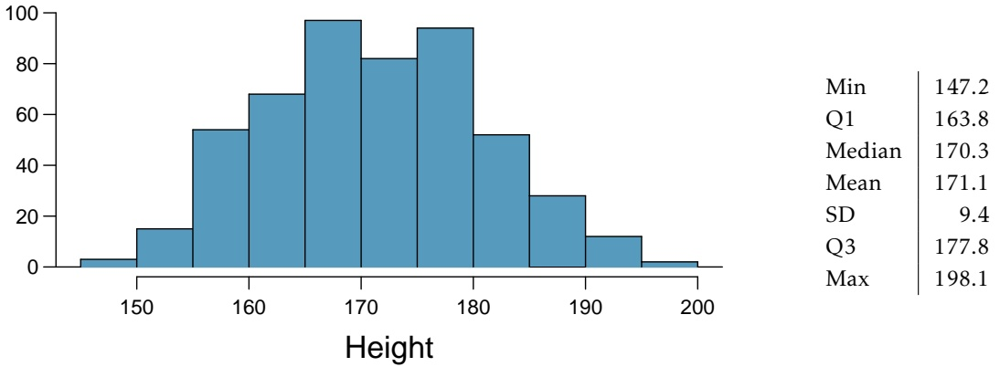

histogram

| Metric | Value |
| --- | --- |
| Min | 147.2 |
| Q1 | 163.8 |
| Median | 170.3 |
| Mean | 171.1 |
| SD | 9.4 |
| Q3 | 177.8 |
| Max | 198.1 |

(a) What is the point estimate for the average height of active individuals? What about the median?
(b) What is the point estimate for the standard deviation of the heights of active individuals? What about the IQR?
(c) Is a person who is 1m 80cm (180 cm) tall considered unusually tall? And is a person who is 1m 55cm (155cm) considered unusually short? Explain your reasoning.
(d) The researchers take another random sample of physically active individuals. Would you expect the mean and the standard deviation of this new sample to be the ones given above? Explain your reasoning.
(e) The sample means obtained are point estimates for the mean height of all active individuals, if the sample of individuals is equivalent to a simple random sample. What measure do we use to quantify the variability of such an estimate? Compute this quantity using the data from the original sample under the condition that the data are a simple random sample.

**5.9 Find the mean.** You are given the following hypotheses:

$$
H _ {0}: \mu = 6 0
$$

$$
H _ {A}: \mu <   6 0
$$

We know that the sample standard deviation is 8 and the sample size is 20. For what sample mean would the p-value be equal to 0.05? Assume that all conditions necessary for inference are satisfied.

<small>24G. Heinz et al. “[Exploring relationships in body dimensions](http://www.openintro.org/redirect.php?go=textbook-body_dim_2003&referrer=biostat1_pdf)”. In: Journal of Statistics Education 11.2 (2003).</small>

---

276

CHAPTER 5. INFERENCE FOR NUMERICAL DATA

**5.10** $t ^ { \star }$ **vs.** $z ^ { \star }$ . For a given confidence level, $t _ { d f } ^ { \star }$ is larger than $z ^ { \star }$ . Explain how $t _ { d f } ^ { * }$ being slightly larger than $z ^ { * }$ affects the width of the confidence interval.
**5.11 Play the piano.** Georgianna claims that in a small city renowned for its music school, the average child takes less than 5 years of piano lessons. We have a random sample of 20 children from the city, with a mean of 4.6 years of piano lessons and a standard deviation of 2.2 years.

(a) Evaluate Georgianna’s claim using a hypothesis test.
(b) Construct a 95% confidence interval for the number of years students in this city take piano lessons, and interpret it in context of the data.
(c) Do your results from the hypothesis test and the confidence interval agree? Explain your reasoning.

**5.12 Auto exhaust and lead exposure.** Researchers interested in lead exposure due to car exhaust sampled the blood of 52 police officers subjected to constant inhalation of automobile exhaust fumes while working traffic enforcement in a primarily urban environment. The blood samples of these officers had an average lead concentration of 124.32 µg/l and a SD of 37.74 µg/l; a previous study of individuals from a nearby suburb, with no history of exposure, found an average blood level concentration of 35 $\mu \mathrm { g } / \mathrm { 1 . } ^ { 2 5 }$

(a) Write down the hypotheses that would be appropriate for testing if the police officers appear to have been exposed to a higher concentration of lead.
(b) Explicitly state and check all conditions necessary for inference on these data.
(c) Test the hypothesis that the downtown police officers have a higher lead exposure than the group in the previous study. Interpret your results in context.
(d) Based on your preceding result, without performing a calculation, would a 99% confidence interval for the average blood concentration level of police officers contain 35 µg/l?
(e) Based on your preceding result, without performing a calculation, would a 99% confidence interval for this difference contain 0? Explain why or why not.

**5.13 Car insurance savings.** A market researcher wants to evaluate car insurance savings at a competing company. Based on past studies he is assuming that the standard deviation of savings is \$100. He wants to collect data such that he can get a margin of error of no more than \$10 at a 95% confidence level. How large of a sample should he collect?

<small>25WI Mortada et al. “Study of lead exposure from automobile exhaust as a risk for nephrotoxicity among traffic policemen.” In: American journal of nephrology 21.4 (2000), pp. 274–279.</small>

---

5.7. EXERCISES

277

## 5.7.2 Two-sample test for paired data

**5.14 Air quality.** Air quality measurements were collected in a random sample of 25 country capitals in 2013, and then again in the same cities in 2014. We would like to use these data to compare average air quality between the two years. Should we use a paired or non-paired test? Explain your reasoning.

**5.15 Paired or not, Part I.** In each of the following scenarios, determine if the data are paired.

(a) Compare pre- (beginning of semester) and post-test (end of semester) scores of students.
(b) Assess gender-related salary gap by comparing salaries of randomly sampled men and women.
(c) Compare artery thicknesses at the beginning of a study and after 2 years of taking Vitamin E for the same group of patients.
(d) Assess effectiveness of a diet regimen by comparing the before and after weights of subjects.

**5.16 Paired or not, Part II.** In each of the following scenarios, determine if the data are paired.

(a) We would like to know if Intel’s stock and Southwest Airlines’ stock have similar rates of return. To find out, we take a random sample of 50 days, and record Intel’s and Southwest’s stock on those same days.
(b) We randomly sample 50 items from Target stores and note the price for each. Then we visit Walmart and collect the price for each of those same 50 items.
(c) A school board would like to determine whether there is a difference in average SAT scores for students at one high school versus another high school in the district. To check, they take a simple random sample of 100 students from each high school.

**5.17 Global warming, Part I.** Let’s consider a limited set of climate data, examining temperature differences in 1948 vs 2018. We sampled 197 locations from the National Oceanic and Atmospheric Administration’s (NOAA) historical data, where the data was available for both years of interest. We want to know: were there more days with temperatures exceeding 90°F in 2018 or in 1948?26 The difference in number of days exceeding 90°F (number of days in 2018 - number of days in 1948) was calculated for each of the 197 locations. The average of these differences was 2.9 days with a standard deviation of 17.2 days. We are interested in determining whether these data provide strong evidence that there were more days in 2018 that exceeded 90°F from NOAA’s weather stations.

(a) Is there a relationship between the observations collected in 1948 and 2018? Or are the observations in the two groups independent? Explain.
(b) Write hypotheses for this research in symbols and in words.
(c) Check the conditions required to complete this test. A histogram of the differences is given to the right.
(d) Calculate the test statistic and find the p-value.
(e) Use α = 0.05 to evaluate the test, and interpret your conclusion in context.
(f) What type of error might we have made? Explain in context what the error means.
(g) Based on the results of this hypothesis test, would you expect a confidence interval for the average difference between the number of days exceeding 90°F from 1948 and 2018 to include 0? Explain your reasoning.

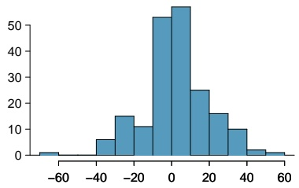

histogram

| Bin (Range) | Frequency |
| --- | --- |
| -70~-65 | ~1 |
| -40~-35 | ~6 |
| -35~-30 | ~15 |
| -30~-25 | ~11 |
| -25~-20 | ~53 |
| -20~-15 | ~57 |
| -15~-10 | ~25 |
| -10~-5 | ~16 |
| -5~0 | ~10 |
| 0~5 | ~2 |
| 5~10 | ~1 |

Differences in Number of Days

26NOAA, [www.ncdc.noaa.gov/cdo-web/datasets](http://www.openintro.org/redirect.php?go=textbook-noaa_1948_2018&referrer=biostat1_pdf), April 24, 2019.

---

278

CHAPTER 5. INFERENCE FOR NUMERICAL DATA

**5.18 High School and Beyond, Part I.** The National Center of Education Statistics conducted a survey of high school seniors, collecting test data on reading, writing, and several other subjects. Here we examine a simple random sample of 200 students from this survey. Side-by-side box plots of reading and writing scores as well as a histogram of the differences in scores are shown below.

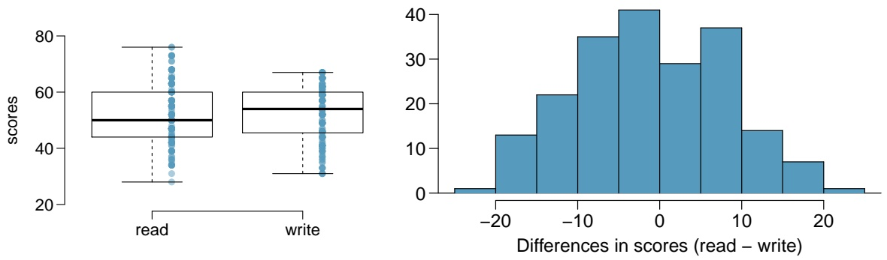

(a) Is there a clear difference in the average reading and writing scores?
(b) Are the reading and writing scores of each student independent of each other?
(c) The average observed difference in scores is $\bar { x } _ { r e a d - w r i t e } = - 0 . 5 4 5 ,$ and the standard deviation of the differences is 8.887 points. Do these data provide convincing evidence of a difference between the average scores on the two exams? Conduct a hypothesis test; interpret your conclusions in context.
(d) Based on the results of this hypothesis test, would you expect a confidence interval for the average difference between the reading and writing scores to include 0? Explain your reasoning.

**5.19 Global warming, Part II.** We considered the change in the number of days exceeding 90°F from 1948 and 2018 at 197 randomly sampled locations from the NOAA database in Exercise 5.17. The mean and standard deviation of the reported differences are 2.9 days and 17.2 days.

(a) Calculate a 90% confidence interval for the average difference between number of days exceeding 90°F between 1948 and 2018. We’ve already checked the conditions for you.
(b) Interpret the interval in context.
(c) Does the confidence interval provide convincing evidence that there were more days exceeding 90°F in 2018 than in 1948 at NOAA stations? Explain.

**5.20 High school and beyond, Part II.** We considered the differences between the reading and writing scores of a random sample of 200 students who took the High School and Beyond Survey in Exercise 5.18. The mean and standard deviation of the differences are $\bar { x } _ { r e a d - w r i t e } = - 0 . 5 4 5$ and 8.887 points.

(a) Calculate a 95% confidence interval for the average difference between the reading and writing scores of all students.
(b) Interpret this interval in context.
(c) Does the confidence interval provide convincing evidence that there is a real difference in the average scores? Explain.

---

5.7. EXERCISES

279

**5.21 Gifted children.** Researchers collected a simple random sample of 36 children who had been identified as gifted in a large city. The following histograms show the distributions of the IQ scores of mothers and fathers of these children. Also provided are some sample statistics.27

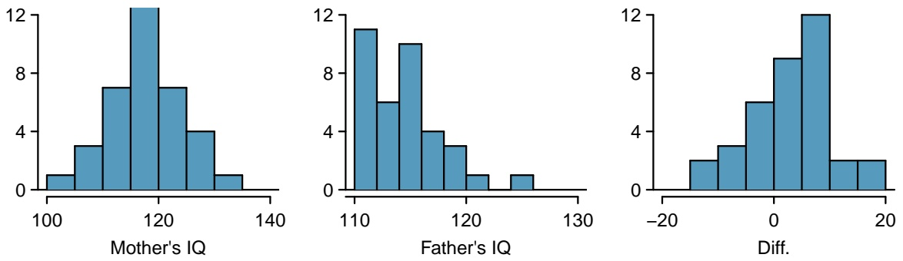

|  | Mother | Father | Diff. |
| --- | --- | --- | --- |
| Mean | 118.2 | 114.8 | 3.4 |
| SD | 6.5 | 3.5 | 7.5 |
| n | 36 | 36 | 36 |

(a) Are the IQs of mothers and the IQs of fathers in this data set related? Explain.
(b) Conduct a hypothesis test to evaluate if the scores are equal on average. Make sure to clearly state your hypotheses, check the relevant conditions, and state your conclusion in the context of the data.

**5.22 DDT exposure.** Suppose that you are interested in determining whether exposure to the organochloride DDT, which has been used extensively as an insecticide for many years, is associated with breast cancer in women. As part of a study that investigated this issue, blood was drawn from a sample of women diagnosed with breast cancer over a six-year period and a sample of healthy control subjects matched to the cancer patients on age, menopausal status, and date of blood donation. Each woman’s blood level of DDE (an important byproduct of DDT in the human body) was measured, and the difference in levels for each patient and her matched control calculated. A sample of 171 such differences has mean $\overline{d} = 2.7    ng/mL$ and standard deviation $s_{d}=15.9    ng/mL$ . Differences were calculated as $D D E _ { c a n c e r } - D D E _ { c o n t r o l }$

(a) Test the null hypothesis that the mean blood levels of DDE are identical for women with breast cancer and for healthy control subjects. What do you conclude?
(b) Would you expect a 95% confidence interval for the true difference in population mean DDE levels to contain the value 0?

**5.23 Blue-green eggshells.** It is hypothesized that the blue-green color of the eggshells of many avian species represents an informational signal as to the health of the female that laid the eggs. To investigate this hypothesis, researchers conducted a study in which birds assigned to the treatment group were provided with supplementary food before and during laying; they predict that if eggshell coloration is related to female health at laying, females given supplementary food will lay more intensely blue-green eggs than control females. Nests were paired according to when nest construction began, and the study examined 16 nest pairs.

(a) The blue-green chroma (BGC) of eggs was measured on the day of laying; BGC refers to the proportion of total reflectance that is in the blue-green region of the spectrum, with a higher value representing a deeper blue-green color. In the food supplemented group, BGC chroma had $\overline { { x } } = 0 . 5 9 4$ and $s = 0 . 0 1 0 ;$ in the control group, BGC chroma had $\overline { { x } } = 0 . 5 8 6$ and $s = 0 . 0 0 9$ . A paired t-test resulted in $t = 2 . 2 8$ and $p = 0 . 0 3 8$ . Interpret the results in the context of the data.

(b) In general, healthier birds are also known to lay heavier eggs. Egg mass was also measured for both groups. In the food supplemented group, egg mass had $\overline { { x } } = 1 . 7 0$ grams and $s = 0 . 1 1$ grams; in the control group, egg mass had $\overline { { x } } = 0 . 5 8 6$ grams and $s = 0 . 0 0 9$ grams. The test statistic from a paired t-test was 2.64 with p-value 0.019. Compute and interpret a 95% confidence interval for δ, the population mean difference in egg mass between the groups.

<small>27F.A. Graybill and H.K. Iyer. Regression Analysis: Concepts and Applications. Duxbury Press, 1994, pp. 511–516.</small>

---

280

CHAPTER 5. INFERENCE FOR NUMERICAL DATA

## 5.7.3 Two-sample test for independent data

**5.24 Diamond prices, Part I.** A diamond’s price is determined by various measures of quality, including carat weight. The price of diamonds increases as carat weight increases. While the difference between the size of a 0.99 carat diamond and a 1 carat diamond is undetectable to the human eye, the price difference can be substantial.28

|  | 0.99 carats | 1 carat |
| --- | --- | --- |
| Mean | $ 44.51 | $ 56.81 |
| SD | $ 13.32 | $ 16.13 |
| n | 23 | 23 |

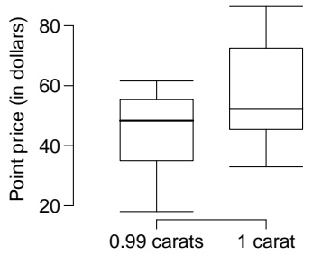

boxplot

| Category | Q1 | Q2 (Median) | Q3 | Min | Max |
| --- | --- | --- | --- | --- | --- |
| 0.99 carats | ~35 | ~48 | ~56 | ~18 | ~62 |
| 1 carat | ~45 | ~53 | ~73 | ~33 | ~87 |

(a) Use the data to assess whether there is a difference between the average standardized prices of 0.99 and 1 carat diamonds.
(b) Construct a 95% confidence interval for the average difference between the standardized prices of 0.99 and 1 carat diamonds.

**5.25 Friday the** $1 3 ^ { \mathrm { t h } }$ **, Part I.** In the early 1990’s, researchers in the UK collected data on traffic flow, number of shoppers, and traffic accident related emergency room admissions on Friday the $1 3 ^ { \mathrm { t h } }$ and the previous Friday, Friday the $6 ^ { \mathrm { t h } }$ . The histograms below show the distribution of number of cars passing by a specific intersection on Friday the $6 ^ { \mathrm { t h } }$ and Friday the $1 3 ^ { \mathrm { t h } }$ for many such date pairs. Also given are some sample statistics, where the difference is the number of cars on the $6 ^ { \mathrm { t h } }$ minus the number of cars on the $1 3 ^ { \mathrm { t h } } ,$ th.29

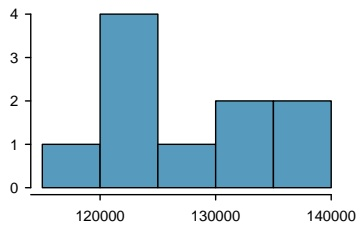

histogram

| Bin Range | Frequency |
| --- | --- |
| <115000 | 1 |
| 115000~120000 | 4 |
| 120000~125000 | 1 |
| 125000~130000 | 2 |
| 130000~135000 | 2 |
| 135000~140000 | 2 |

Friday the 6th

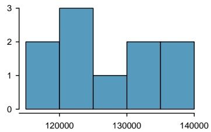

histogram

| Bin Range | Frequency |
| --- | --- |
| <115000 | 2 |
| 115000~120000 | 3 |
| 120000~125000 | 1 |
| 125000~130000 | 2 |
| 130000~135000 | 2 |
| 135000~140000 | 2 |

Friday the 13th

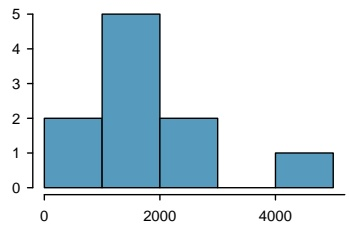

histogram

| Bin Range | Frequency |
| --- | --- |
| 0~1000 | 2 |
| 1000~2000 | 5 |
| 2000~3000 | 2 |
| 4000~5000 | 1 |

Difference

|  | $6^{th}$ | $13^{th}$ | Diff. |
| --- | --- | --- | --- |
| $\bar{x}$ | 128,385 | 126,550 | 1,835 |
| $s$ | 7,259 | 7,664 | 1,176 |
| $n$ | 10 | 10 | 10 |

(a) Are there any underlying structures in these data that should be considered in an analysis? Explain.
(b) What are the hypotheses for evaluating whether the number of people out on Friday the $6 ^ { \mathrm { t h } }$ is different than the number out on Friday the $1 3 ^ { \mathrm { t h } } ?$
(c) Check conditions to carry out the hypothesis test from part (b).
(d) Calculate the test statistic and the p-value.
(e) What is the conclusion of the hypothesis test?
(f) Interpret the p-value in this context.
(g) What type of error might have been made in the conclusion of your test? Explain.

<small>28H. Wickham. [ggplot2: elegant graphics for data analysis](http://www.openintro.org/redirect.php?go=textbook-ggplot2_book&referrer=biostat1_pdf). Springer New York, 2009.</small>

<small>29T.J. Scanlon et al. “[Is Friday the 13th Bad For Your Health?](http://www.openintro.org/redirect.php?go=textbook-Friday13_1993&referrer=biostat1_pdf)” In: BMJ 307 (1993), pp. 1584–1586.</small>

---

5.7. EXERCISES

281

**5.26 Egg volume.** In a study examining 131 collared flycatcher eggs, researchers measured various characteristics in order to study their relationship to egg size (assayed as egg volume, in $m m ^ { 3 } )$ . These characteristics included nestling sex and survival. A single pair of collared flycatchers generally lays around 6 eggs per breeding season; laying order of the eggs was also recorded.

(a) Is there evidence at the $\alpha = 0 . 1 0$ significance level to suggest that egg size differs between male and female chicks? If so, do heavier eggs tend to contain males or females? For male chicks, $\overline { { x } } = 1 6 1 9 . 9 5 ,   s = 1 2 7 . 5 4 ,$ and $n = 8 0$ . For female chicks, $\overline { { x } } = 1 5 8 4 . 2 0 ,   s = 1 0 2 . 5 1$ , and $n = 4 8 .$ . Sex was only recorded for eggs that hatched.
(b) Construct a 95% confidence interval for the difference in egg size between chicks that successfully fledged (developed capacity to $\mathrm { f l y ) }$ and chicks that died in the nest. From the interval, is there evidence of a size difference in eggs between these two groups? For chicks that fledged, $\overline { { x } } = 1 6 0 5 . 8 7 ,   s = 1 2 6 . 3 2$ , and $n = 8 9$ For chicks that died in the nest, $\overline{x}=1606.91,s=103.46,n=42$
(c) Are eggs that are laid first a significantly different size compared to eggs that are laid sixth? For eggs laid first, $\overline { { x } } = 1 5 8 1 . 9 8 ,   s = 1 5 5 . 9 5$ , and $n = 2 2$ . For eggs laid sixth, $\overline { { x } } = 1 6 5 9 . 6 2 ,   s = 1 2 4 . 5 9$ , and $n = 2 0$

**5.27 Friday the** $1 3 ^ { \mathrm { t h } }$ **, Part II.** The Friday the $1 3 ^ { t h }$ study reported in Exercise 5.25 also provides data on traffic accident related emergency room admissions. The distributions of these counts from Friday the $6 ^ { \mathrm { t h } }$ and Friday the $1 3 ^ { \mathrm { t h } }$ are shown below for six such paired dates along with summary statistics. You may assume that conditions for inference are met.

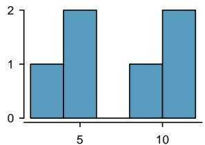

bar

| Category | Value |
| --- | --- |
| 5 | 1 |
| 5 | 2 |
| 10 | 1 |
| 10 | 2 |

Friday the 6th

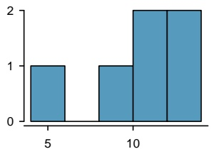

histogram

| Category | Value |
| --- | --- |
| 5 | 1 |
| 10 | 1 |
| 12 | 2 |
| 14 | 2 |

Friday the 13th

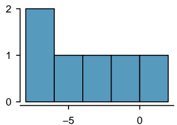

histogram

| Bin Range | Frequency |
| --- | --- |
| -8~-6 | 2 |
| -6~-4 | 1 |
| -4~-2 | 1 |
| -2~0 | 1 |
| 0~2 | 1 |

Difference

|  | $6^{th}$ | $13^{th}$ | diff |
| --- | --- | --- | --- |
| Mean | 7.5 | 10.83 | -3.33 |
| SD | 3.33 | 3.6 | 3.01 |
| n | 6 | 6 | 6 |

(a) Conduct a hypothesis test to evaluate if there is a difference between the average numbers of traffic accident related emergency room admissions between Friday the $6 ^ { \mathrm { t h } }$ and Friday the $1 3 ^ { \mathrm { t h } }$
(b) Calculate a 95% confidence interval for the difference between the average numbers of traffic accident related emergency room admissions between Friday the $6 ^ { \mathrm { t h } }$ and Friday the $1 3 ^ { \mathrm { t h } }$
(c) The conclusion of the original study states, “Friday 13th is unlucky for some. The risk of hospital ad mission as a result of a transport accident may be increased by as much as 52%. Staying at home is recommended.” Do you agree with this statement? Explain your reasoning.

---

282

CHAPTER 5. INFERENCE FOR NUMERICAL DATA

**5.28 Avian influenza, Part I.** In recent years, widespread outbreaks of avian influenza have posed a global threat to both poultry production and human health. One strategy being explored by researchers involves developing chickens that are genetically resistant to infection. In 2011, a team of investigators reported in Science that they had successfully generated transgenic chickens that are resistant to the virus. As a part of assessing whether the genetic modification might be hazardous to the health of the chicks, hatch weights between transgenic chicks and non-transgenic chicks were collected. Does the following data suggest that there <u>is a difference in hatch weights between transgenic and</u> non-transgenic chickens?

|  | transgenic chicks (g) | non-transgenic chicks (g) |
| --- | --- | --- |
| $\bar{x}$ | 45.14 | 44.99 |
| s | 3.32 | 4.57 |
| n | 54 | 54 |

**5.29 Chicken diet and weight, Part I.** Chicken farming is a multi-billion dollar industry, and any methods that increase the growth rate of young chicks can reduce consumer costs while increasing company profits, possibly by millions of dollars. An experiment was conducted to measure and compare the effectiveness of various feed supplements on the growth rate of chickens. Newly hatched chicks were randomly allocated into six groups, and each group was given a different feed supplement. Below are some summary statistics from this data set along with box plots showing the distribution of weights by feed type.30

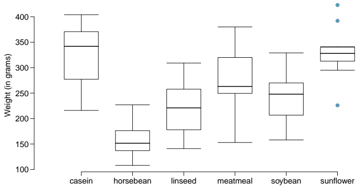

boxplot

| Category | Min | Q1 | Q2 (Median) | Q3 | Max |
| --- | --- | --- | --- | --- | --- |
| casein | ~217 | ~278 | ~342 | ~370 | ~405 |
| horsebean | ~109 | ~139 | ~152 | ~177 | ~227 |
| linseed | ~142 | ~179 | ~222 | ~259 | ~309 |
| meatmeal | ~154 | ~251 | ~264 | ~320 | ~380 |
| soybean | ~159 | ~207 | ~249 | ~270 | ~329 |
| sunflower | ~295 | ~314 | ~328 | ~341 | ~341 |

|  | Mean | SD | n |
| --- | --- | --- | --- |
| casein | 323.58 | 64.43 | 12 |
| horsebean | 160.20 | 38.63 | 10 |
| linseed | 218.75 | 52.24 | 12 |
| meatmeal | 276.91 | 64.90 | 11 |
| soybean | 246.43 | 54.13 | 14 |
| sunflower | 328.92 | 48.84 | 12 |

(a) Describe the distributions of weights of chickens that were fed linseed and horsebean.

(b) Do these data provide strong evidence that the average weights of chickens that were fed linseed and horsebean are different? Use a 5% significance level.

(c) What type of error might we have committed? Explain.

(d) Would your conclusion change if we used $\alpha = 0 . 0 1 ?$

**5.30 Fuel efficiency of manual and automatic cars, Part I.** Each year the US Environmental Protection Agency (EPA) releases fuel economy data on cars manufactured in that year. Below are summary statistics on fuel efficiency (in miles/gallon) from random samples of cars with manual and automatic transmissions manufactured in 2012. Do these data provide strong evidence of a difference between the average fuel efficiency of cars with manual and automatic transmissions in terms of their average city mileage? Assume that conditions for inference are satisfied.31

<table><tr><td></td><td colspan="2">City MPG</td></tr><tr><td></td><td>Automatic</td><td>Manual</td></tr><tr><td>Mean</td><td>16.12</td><td>19.85</td></tr><tr><td>SD</td><td>3.58</td><td>4.51</td></tr><tr><td>n</td><td>26</td><td>26</td></tr></table>

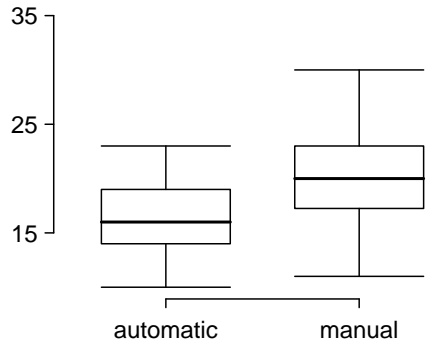

boxplot

| Category | Min | Q1 | Median (Q2) | Q3 | Max |
| --- | --- | --- | --- | --- | --- |
| automatic | ~10 | ~14.5 | ~16 | ~19 | ~23 |
| manual | ~10 | ~17 | ~20 | ~23 | ~30 |

City MPG

<small>30<a href="http://www.openintro.org/redirect.php?go=textbook-feed_and_chicken_weights&amp;referrer=biostat1_pdf">Chicken Weights by Feed Type</a>, from the datasets package in R..</small>

<small>31U.S. Department of Energy, [Fuel Economy Data, 2012 Datafile](http://www.openintro.org/redirect.php?go=textbook-fuel_economy_data_2012&referrer=biostat1_pdf).</small>

---

5.7. EXERCISES

283

**5.31 Chicken diet and weight, Part II.** Casein is a common weight gain supplement for humans. Does it have an effect on chickens? Using data provided in Exercise 5.29, test the hypothesis that the average weight of chickens that were fed casein is different than the average weight of chickens that were fed soybean. If your hypothesis test yields a statistically significant result, discuss whether or not the higher average weight of chickens can be attributed to the casein diet. Assume that conditions for inference are satisfied.

**5.32 Fuel efficiency of manual and automatic cars, Part II.** The table provides summary statistics on highway fuel economy of cars manufactured in 2012 (from Exercise 5.30). Use these statistics to calculate a 98% confidence interval for the difference between average highway mileage of manual and automatic cars, and interpret this interval in the context of the data.32

<table><tr><td></td><td colspan="2">Hwy MPG</td></tr><tr><td></td><td>Automatic</td><td>Manual</td></tr><tr><td>Mean</td><td>22.92</td><td>27.88</td></tr><tr><td>SD</td><td>5.29</td><td>5.01</td></tr><tr><td>n</td><td>26</td><td>26</td></tr></table>

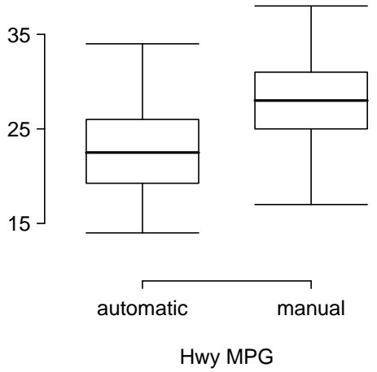

boxplot

| Category | Min | Q1 | Median (Q2) | Q3 | Max |
| --- | --- | --- | --- | --- | --- |
| automatic | ~14.5 | ~19.5 | ~23.5 | ~26 | ~34 |
| manual | ~17 | ~25 | ~28 | ~31 | ~38 |

**5.33 Gaming and distracted eating.** A group of researchers are interested in the possible effects of distracting stimuli during eating, such as an increase or decrease in the amount of food consumption. To test this hypothesis, they monitored food intake for a group of 44 patients who were randomized into two equal groups. The treatment group ate lunch while playing solitaire, and the control group ate lunch without any added distractions. Patients in the treatment group ate 52.1 grams of biscuits, with a standard deviation of 45.1 grams, and patients in the control group ate 27.1 grams of biscuits, with a standard deviation of 26.4 grams. Do these data provide convincing evidence that the average food intake (measured in amount of biscuits consumed) is different for the patients in the treatment group? Assume that conditions for inference are satisfied.33

**5.34 Placebos without deception.** While placebo treatment can influence subjective symptoms, it is typically believed that patient response to placebo requires concealment or deception; in other words, a patient must believe that they are receiving an effective treatment in order to experience the benefits of being treated with an inert substance. Researchers recruited patients suffering from irritable bowel syndrome (IBS) to test whether placebo responses are neutralized by awareness that the treatment is a placebo.

Patients were randomly assigned to either the treatment arm or control arm. Those in the treatment arm were given placebo pills, which were described as "something like sugar pills, which have been shown in rigorous clinical testing to produce significant mind-body self-healing processes". Those in the control arm did not receive treatment. At the end of the study, all participants answered a questionnaire called the IBS Global Improvement Scale (IBS-GIS) which measures whether IBS symptoms have improved; higher scores are indicative of more improvement.

At the end of the study, the 37 participants in the open placebo group had IBS-GIS scores with $\overline { { x } } = 5 . 0$ and $s = 1 . 5 ,$ while the 43 participants in the no treatment group had IBS-GIS scores with $\overline { { x } } = 3 . 9$ and $s = 1 . 3$

Based on an analysis of the data, summarize whether the study demonstrates evidence that placebos administered without deception may be an effective treatment for IBS.

<small>32U.S. Department of Energy, [Fuel Economy Data, 2012 Datafile](http://www.openintro.org/redirect.php?go=textbook-fuel_economy_data_2012&referrer=biostat1_pdf).</small>

<small>33R.E. Oldham-Cooper et al. “[Playing a computer game during lunch affects fullness, memory for lunch, and later snack intake](http://www.openintro.org/redirect.php?go=textbook-playing_computer_games_2011&referrer=biostat1_pdf)”. In: The American Journal of Clinical Nutrition 93.2 (2011), p. 308.</small>

---

284

CHAPTER 5. INFERENCE FOR NUMERICAL DATA

**5.35 Prison isolation experiment, Part I.** Subjects from Central Prison in Raleigh, NC, volunteered for an experiment involving an “isolation” experience. The goal of the experiment was to find a treatment that reduces subjects’ psychopathic deviant T scores. This score measures a person’s need for control or their rebellion against control, and it is part of a commonly used mental health test called the Minnesota Multiphasic Personality Inventory (MMPI) test. The experiment had three treatment groups:

(1) Four hours of sensory restriction plus a 15 minute “therapeutic" tape advising that professional help is available.
(2) Four hours of sensory restriction plus a 15 minute “emotionally neutral” tape on training hunting dogs.
(3) Four hours of sensory restriction but no taped message.

Forty-two subjects were randomly assigned to these treatment groups, and an MMPI test was administered before and after the treatment. Distributions of the differences between pre and post treatment scores (pre - post) are shown below, along with some sample statistics. Use this information to independently test the effectiveness of each treatment. Make sure to clearly state your hypotheses, check conditions, and interpret results in the context of the data.34

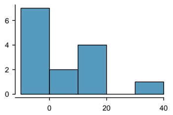

histogram

| Bin Range | Frequency |
| --- | --- |
| -10~0 | 7 |
| 0~10 | 2 |
| 10~20 | 4 |
| 30~40 | 1 |

Treatment 1

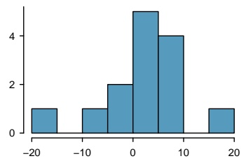

histogram

| Bin Range | Frequency |
| --- | --- |
| -20~-15 | 1 |
| -15~-10 | 0 |
| -10~-5 | 1 |
| -5~0 | 2 |
| 0~5 | 5 |
| 5~10 | 4 |
| 10~15 | 0 |
| 15~20 | 1 |

Treatment 2

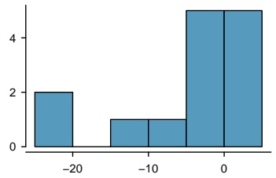

histogram

| Bin Range | Frequency |
| --- | --- |
| -25~-20 | 2 |
| -15~-10 | 1 |
| -10~-5 | 1 |
| -5~0 | 5 |
| 0~5 | 5 |

Treatment 3

|  | Tr 1 | Tr 2 | Tr 3 |
| --- | --- | --- | --- |
| Mean | 6.21 | 2.86 | -3.21 |
| SD | 12.3 | 7.94 | 8.57 |
| n | 14 | 14 | 14 |

## 5.7.4 Power calculations for a difference of means

**5.36 Email outreach efforts.** A medical research group is recruiting people to complete short surveys about their medical history. For example, one survey asks for information on a person’s family history in regards to cancer. Another survey asks about what topics were discussed during the person’s last visit to a hospital. So far, as people sign up, they complete an average of just 4 surveys, and the standard deviation of the number of surveys is about 2.2. The research group wants to try a new interface that they think will encourage new enrollees to complete more surveys, where they will randomize each enrollee to either get the new interface or the current interface. How many new enrollees do they need for each interface to detect an effect size of 0.5 surveys per enrollee, if the desired power level is 80%?

**5.37 Increasing corn yield.** A large farm wants to try out a new type of fertilizer to evaluate whether it will improve the farm’s corn production. The land is broken into plots that produce an average of 1,215 pounds of corn with a standard deviation of 94 pounds per plot. The owner is interested in detecting any average difference of at least 40 pounds per plot. How many plots of land would be needed for the experiment if the desired power level is 90%? Assume each plot of land gets treated with either the current fertilizer or the new fertilizer.

<small>34<a href="http://www.openintro.org/redirect.php?go=textbook-prison_isolation_exp&amp;referrer=biostat1_pdf">Prison isolation experiment, stat.duke.edu/resources/datasets/prison-isolation</a>.</small>

---

5.7. EXERCISES

285

## 5.7.5 Comparing means with ANOVA

**5.38 Fill in the blank.** When doing an ANOVA, you observe large differences in means between groups. Within the ANOVA framework, this would most likely be interpreted as evidence strongly favoring the hypothesis.
**5.39 Chicken diet and weight, Part III.** In Exercises 5.29 and 5.31 we compared the effects of two types of feed at a time. A better analysis would first consider all feed types at once: casein, horsebean, linseed, meat meal, soybean, and sunflower. The ANOVA output below can be used to test for differences between the average weights of chicks on different diets.

|  | Df | Sum Sq | Mean Sq | F value | Pr(>F) |
| --- | --- | --- | --- | --- | --- |
| feed | 5 | 231,129.16 | 46,225.83 | 15.36 | 0.0000 |
| Residuals | 65 | 195,556.02 | 3,008.55 |  |  |

Conduct a hypothesis test to determine if these data provide convincing evidence that the average weight of chicks varies across some (or all) groups. Make sure to check relevant conditions. Figures and summary statistics are shown below.

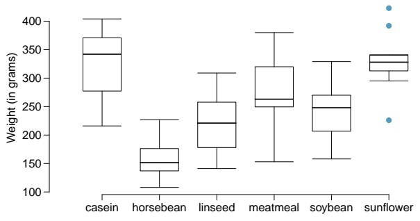

boxplot

| Category | Q1 | Q2 (Median) | Q3 | IQR |
| --- | --- | --- | --- | --- |
| casein | ~278 | ~342 | ~372 | ~104 |
| horsebean | ~138 | ~152 | ~178 | ~40 |
| linseed | ~180 | ~222 | ~258 | ~78 |
| meatmeal | ~250 | ~264 | ~320 | ~70 |
| soybean | ~208 | ~248 | ~270 | ~62 |
| sunflower | ~312 | ~330 | ~342 | ~20 |

|  | Mean | SD | n |
| --- | --- | --- | --- |
| casein | 323.58 | 64.43 | 12 |
| horsebean | 160.20 | 38.63 | 10 |
| linseed | 218.75 | 52.24 | 12 |
| meatmeal | 276.91 | 64.90 | 11 |
| soybean | 246.43 | 54.13 | 14 |
| sunflower | 328.92 | 48.84 | 12 |

**5.40 Teaching descriptive statistics.** A study compared five different methods for teaching descriptive statistics. The five methods were traditional lecture and discussion, programmed textbook instruction, programmed text with lectures, computer instruction, and computer instruction with lectures. 45 students were randomly assigned, 9 to each method. After completing the course, students took a 1-hour exam.

(a) What are the hypotheses for evaluating if the average test scores are different for the different teaching methods?
(b) What are the degrees of freedom associated with the F-test for evaluating these hypotheses?
(c) Suppose the p-value for this test is 0.0168. What is the conclusion?

---

286

CHAPTER 5. INFERENCE FOR NUMERICAL DATA

**5.41 Coffee, depression, and physical activity.** Caffeine is the world’s most widely used stimulant, with approximately 80% consumed in the form of coffee. Participants in a study investigating the relationship between coffee consumption and exercise were asked to report the number of hours they spent per week on moderate (e.g., brisk walking) and vigorous (e.g., strenuous sports and jogging) exercise. Based on these data the researchers estimated the total hours of metabolic equivalent tasks (MET) per week, a value always greater than 0. The table below gives summary statistics of MET for women in this study based on the amount of coffee consumed.35

Caffeinated coffee consumption

|  | ≤ 1 cup/week | 2-6 cups/week | 1 cup/day | 2-3 cups/day | ≥ 4 cups/day | Total |
| --- | --- | --- | --- | --- | --- | --- |
| Mean | 18.7 | 19.6 | 19.3 | 18.9 | 17.5 |  |
| SD | 21.1 | 25.5 | 22.5 | 22.0 | 22.0 |  |
| n | 12,215 | 6,617 | 17,234 | 12,290 | 2,383 | 50,739 |

(a) Write the hypotheses for evaluating if the average physical activity level varies among the different levels of coffee consumption.

(b) Check conditions and describe any assumptions you must make to proceed with the test.

(c) Below is part of the output associated with this test. Fill in the empty cells.

|  | Df | Sum Sq | Mean Sq | F value | Pr(>F) |
| --- | --- | --- | --- | --- | --- |
| coffee |  |  |  |  | 0.0003 |
| Residuals |  | 25,564,819 |  |  |  |
| Total |  | 25,575,327 |  |  |  |

(d) What is the conclusion of the test?

**5.42 Student performance across discussion sections.** A professor who teaches a large introductory statistics class (197 students) with eight discussion sections would like to test if student performance differs by discussion section, where each discussion section has a different teaching assistant. The summary table below shows the average final exam score for each discussion section as well as the standard deviation of scores and the number of students in each section.

|  | Sec 1 | Sec 2 | Sec 3 | Sec 4 | Sec 5 | Sec 6 | Sec 7 | Sec 8 |
| --- | --- | --- | --- | --- | --- | --- | --- | --- |
| $n_i$ | 33 | 19 | 10 | 29 | 33 | 10 | 32 | 31 |
| $\bar{x}_i$ | 92.94 | 91.11 | 91.80 | 92.45 | 89.30 | 88.30 | 90.12 | 93.35 |
| $s_i$ | 4.21 | 5.58 | 3.43 | 5.92 | 9.32 | 7.27 | 6.93 | 4.57 |

The ANOVA output below can be used to test for differences between the average scores from the different discussion sections.

|  | Df | Sum Sq | Mean Sq | F value | Pr(>F) |
| --- | --- | --- | --- | --- | --- |
| section | 7 | 525.01 | 75.00 | 1.87 | 0.0767 |
| Residuals | 189 | 7584.11 | 40.13 |  |  |

Conduct a hypothesis test to determine if these data provide convincing evidence that the average score varies across some (or all) groups. Check conditions and describe any assumptions you must make to proceed with the test.

<small>35M. Lucas et al. “[Coffee, caffeine, and risk of depression among women](http://www.openintro.org/redirect.php?go=textbook-coffee_caffeine_depression_2011&referrer=biostat1_pdf)”. In: Archives of internal medicine 171.17 (2011), p. 1571.</small>

---

5.7. EXERCISES

287

**5.43 GPA and major.** Undergraduate students taking an introductory statistics course at Duke University conducted a survey about GPA and major. The side-by-side box plots show the distribution of GPA among three groups of majors. Also provided is the ANOVA output.

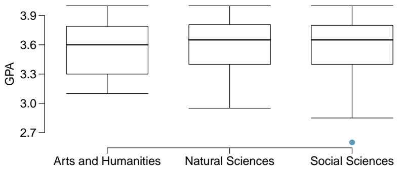

boxplot

| Category | Q1 | Q2 (Median) | Q3 | Min | Max |
| --- | --- | --- | --- | --- | --- |
| Arts and Humanities | ~3.3 | 3.6 | ~3.8 | ~3.1 | ~4.0 |
| Natural Sciences | ~3.4 | ~3.65 | ~3.8 | ~2.95 | ~4.0 |
| Social Sciences | ~3.4 | ~3.65 | ~3.8 | ~2.85 | ~4.0 |

|  | Df | Sum Sq | Mean Sq | F value | Pr(>F) |
| --- | --- | --- | --- | --- | --- |
| major | 2 | 0.03 | 0.015 | 0.185 | 0.8313 |
| Residuals | 195 | 15.77 | 0.081 |  |  |

(a) Write the hypotheses for testing for a difference between average GPA across majors.
(b) What is the conclusion of the hypothesis test?
(c) How many students answered these questions on the survey, i.e. what is the sample size?

**5.44 Work hours and education.** The General Social Survey collects data on demographics, education, and work, among many other characteristics of US residents.36 Using ANOVA, we can consider educational attainment levels for all 1,172 respondents at once. Below are the distributions of hours worked by educational attainment and relevant summary statistics that will be helpful in carrying out this analysis.

Educational attainment

|  | Less than HS | HS | Jr Coll | Bachelor's | Graduate | Total |
| --- | --- | --- | --- | --- | --- | --- |
| Mean | 38.67 | 39.6 | 41.39 | 42.55 | 40.85 | 40.45 |
| SD | 15.81 | 14.97 | 18.1 | 13.62 | 15.51 | 15.17 |
| n | 121 | 546 | 97 | 253 | 155 | 1,172 |

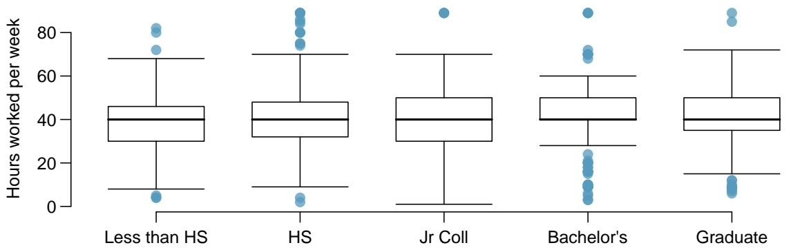

boxplot

| Category | Q1 | Q2 (Median) | Q3 | IQR |
| --- | --- | --- | --- | --- |
| Less than HS | ~30 | 40 | ~46 | ~26 |
| HS | ~32 | 40 | ~48 | ~26 |
| Jr Coll | ~30 | 40 | 50 | ~20 |
| Bachelor's | 40 | 40 | 50 | 20 |
| Graduate | ~35 | 40 | 50 | ~25 |

(a) Write hypotheses for evaluating whether the average number of hours worked varies across the five groups.
(b) Check conditions and describe any assumptions you must make to proceed with the test.
(c) Below is part of the output associated with this test. Fill in the empty cells.

|  | Df | Sum Sq | Mean Sq | F value | Pr(>F) |
| --- | --- | --- | --- | --- | --- |
| degree |  |  | 501.54 |  | 0.0682 |
| Residuals |  | 267,382 |  |  |  |
| Total |  |  |  |  |  |

(d) What is the conclusion of the test?

<small>36National Opinion Research Center, [General Social Survey, 2010](http://www.openintro.org/redirect.php?go=textbook-gss_2010&referrer=biostat1_pdf).</small>

---

288

CHAPTER 5. INFERENCE FOR NUMERICAL DATA

**5.45 True / False: ANOVA, Part I.** Determine if the following statements are true or false in ANOVA, and explain your reasoning for statements you identify as false.

(a) As the number of groups increases, the modified significance level for pairwise tests increases as well.
(b) As the total sample size increases, the degrees of freedom for the residuals increases as well.
(c) The constant variance condition can be somewhat relaxed when the sample sizes are relatively consistent across groups.
(d) The independence assumption can be relaxed when the total sample size is large.

**5.46 Child care hours.** The China Health and Nutrition Survey aims to examine the effects of the health, nutrition, and family planning policies and programs implemented by national and local governments.37 It, for example, collects information on number of hours Chinese parents spend taking care of their children under age 6. The side-by-side box plots below show the distribution of this variable by educational attainment of the parent. Also provided below is the ANOVA output for comparing average hours across educational attainment categories.

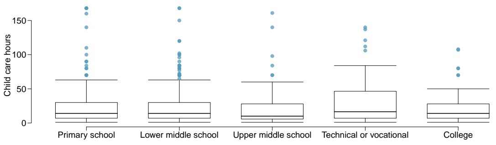

boxplot

| Category | Q1 | Q2 (Median) | Q3 | IQR |
| --- | --- | --- | --- | --- |
| Primary school | ~10 | ~15 | ~30 | ~20 |
| Lower middle school | ~10 | ~15 | ~30 | ~20 |
| Upper middle school | ~10 | ~10 | ~30 | ~20 |
| Technical or vocational | ~10 | ~18 | ~48 | ~38 |
| College | ~10 | ~15 | ~30 | ~20 |

|  | Df | Sum Sq | Mean Sq | F value | Pr(>F) |
| --- | --- | --- | --- | --- | --- |
| education | 4 | 4142.09 | 1035.52 | 1.26 | 0.2846 |
| Residuals | 794 | 653047.83 | 822.48 |  |  |

(a) Write the hypotheses for testing for a difference between the average number of hours spent on child care across educational attainment levels.
(b) What is the conclusion of the hypothesis test?

37UNC Carolina Population Center, [China Health and Nutrition Survey, 2006](http://www.openintro.org/redirect.php?go=textbook-china_health_nut_survey_2006&referrer=biostat1_pdf).

---

5.7. EXERCISES

289

**5.47 Prison isolation experiment, Part II.** Exercise 5.35 introduced an experiment that was conducted with the goal of identifying a treatment that reduces subjects’ psychopathic deviant T scores, where this score measures a person’s need for control or his rebellion against control. In Exercise 5.35 you evaluated the success of each treatment individually. An alternative analysis involves comparing the success of treatments. The relevant ANOVA output is given below.

|  | Df | Sum Sq | Mean Sq | F value | Pr(>F) |
| --- | --- | --- | --- | --- | --- |
| treatment | 2 | 639.48 | 319.74 | 3.33 | 0.0461 |
| Residuals | 39 | 3740.43 | 95.91 |  |  |

$$
s _ {p o o l e d} = 9. 7 9 3 \text {on} d f = 3 9
$$

(a) What are the hypotheses?
(b) What is the conclusion of the test? Use a 5% significance level.
(c) If in part (b) you determined that the test is significant, conduct pairwise tests to determine which groups are different from each other. If you did not reject the null hypothesis in part (b), recheck your answer.

**5.48 True / False: ANOVA, Part II.** Determine if the following statements are true or false, and explain your reasoning for statements you identify as false.

If the null hypothesis that the means of four groups are all the same is rejected using ANOVA at a 5% significance level, then ...

(a) we can then conclude that all the means are different from one another.
(b) the standardized variability between groups is higher than the standardized variability within groups.
(c) the pairwise analysis will identify at least one pair of means that are significantly different.
(d) the appropriate α to be used in pairwise comparisons is 0.05 / 4 = 0.0125 since there are four groups.
