# 6 Simple linear regression

原始 PDF 第 290–329 页。

# Chapter 6

## Simple linear regression

**6.1 Examining scatterplots**
**6.2 Estimating a regression line using least squares**
**6.3 Interpreting a linear model**
**6.4 Statistical inference with regression**
**6.5 Interval estimates with regression**
**6.6 Notes**
**6.7 Exercises**

---

291

The relationship between two numerical variables can be visualized using a scatterplot in the xy-plane. The **predictor** or **explanatory variable** is plotted on the horizontal axis, while the **response variable** is plotted on the vertical axis.1

This chapter explores simple linear regression, a technique for estimating a straight line that best fits data on a scatterplot.2 A line of best fit functions as a linear model that can not only be used for prediction, but also for inference. Linear regression should only be used with data that exhibit linear or approximately linear relationships.

For example, scatterplots in Chapter 1 illustrated the linear relationship be tween height and weight in the NHANES data, with height as a predictor of weight. Adding a best-fitting line to these data using regression techniques would allow for prediction of an individual’s weight based on their height. The linear model could also be used to investigate questions about the population-level relationship be tween height and weight, since the data are a random sample from the population of adults in the United States.

Not all relationships in data are linear. For example, the scatterplot in Fig ure 1.28 of Chapter 1 shows a highly non-linear relationship between between annual per capita income and life expectancy for 165 countries in 2011. Relationships are called **strong relationships** if the pattern of the dependence between the predictor and response variables is clear, even if it is nonlinear as in Figure 1.28. A **weak relationship** is one in which the points in the scatterplot are so diffuse as to make it difficult to discern any relationship. Figure 1.29 in Chapter 1 showed relationships progressing from weak to strong moving from left to right in the top and bottom panels. Each of the relationships shown in the second panels from the left are **moderate relationships**. Finally, changing the scale of measurement of one or both variables, such as changing age from age in years to age in months, simply stretches or compresses one or both axes and does not change the nature of the relationship. If a relationship is linear it will remain so, and with a simple change of scale, a nonlinear relationship will remain nonlinear.

<small>1Sometimes, the predictor variable is referred to as the independent variable, and the response variable referred to as the dependent variable.</small>

<small>2Although the response variable in linear regression is necessarily numerical, the predictor variable can be numerical or categorical.</small>

---

292

The next chapter covers multiple regression, a statistical model used to estimate the relationship between a single numerical response variable and several predictor variables.

十A

For labs, slides, and other resources, please visit

[www.openintro.org/book/biostat](http://www.openintro.org/redirect.php?go=biostat&referrer=biostat1_pdf)

---

6.1. EXAMINING SCATTERPLOTS

293

## 6.1 Examining scatterplots

Various demographic and cardiovascular risk factors were collected as a part of the Prevention of REnal and Vascular END-stage Disease (PREVEND) study, which took place in the Netherlands. The initial study population began as 8,592 participants aged 28-75 years who took a first survey in 1997-1998.3 Participants were followed over time; 6,894 participants took a second survey in 2001-2003, and 5,862 completed the third survey in 2003-2006. In the third survey, measurement of cognitive function was added to the study protocol. Data from 4,095 individuals who completed cognitive testing are in the prevend dataset, available in the R package oibiostat.

As adults age, cognitive function changes over time, largely due to various cerebrovascular and neurodegenerative changes. It is thought that cognitive decline is a long-term process that may start as early as 45 years of age.4 The Ruff Figural Fluency Test (RFFT) is one measure of cognitive function that provides information about cognitive abilities such as planning and the ability to switch between different tasks. The test consists of drawing as many unique designs as possible from a pattern of dots, under timed conditions; scores range from 0 to 175 points (worst and best score, respectively).

RFFT scores for a random sample of 500 individuals are shown in Figure 6.1, plotted against age at enrollment, which is measured in years. The variables Age and RFFT are negatively associated; older participants tend to have lower cognitive function. There is an approximately linear trend observable in the data, which suggests that adding a line could be useful for summarizing the relationship between the two variables.

It is important to avoid adding straight lines to non-linear data, such as in Figure 1.28.

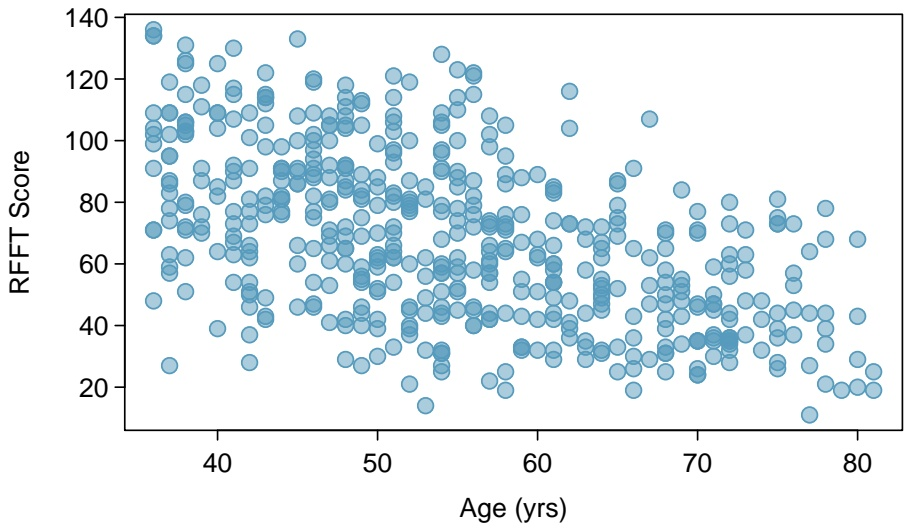

scatter

| Age (yrs) | RFFT Score |
| --- | --- |
| ~36 | ~135 |
| ~37 | ~105 |
| ~38 | ~125 |
| ~40 | ~115 |
| ~42 | ~95 |
| ~45 | ~135 |
| ~48 | ~115 |
| ~50 | ~105 |
| ~52 | ~120 |
| ~55 | ~125 |
| ~58 | ~105 |
| ~60 | ~90 |
| ~62 | ~115 |
| ~65 | ~90 |
| ~68 | ~105 |
| ~70 | ~85 |
| ~72 | ~80 |
| ~75 | ~80 |
| ~78 | ~75 |
| ~80 | ~70 |

Figure 6.1: A scatterplot showing age vs. RFFT. Age is the predictor variable, while RFFT score is the response variable.

<small>3Participants were selected from the city of Groningen on the basis of their urinary albumin excretion; urinary albumin excretion is known to be associated with abnormalities in renal function.</small>

<small>4Joosten H, et al. Cardiovascular risk profile and cognitive function in young, middle-aged, and elderly subjects. Stroke. 2013;44:1543-1549, [https://doi.org/10.1161/STROKEAHA.111.000496](https://doi.org/10.1161/STROKEAHA.111.000496)</small>

---

294

CHAPTER 6. SIMPLE LINEAR REGRESSION

The following conditions should be true in a scatterplot for a line to be considered a reasonable approximation to the relationship in the plot and for the application of the methods of inference discussed later in the chapter:

**1 Linearity.** The data shows a linear trend. If there is a nonlinear trend, an advanced regression method should be applied; such methods are not covered in this text. Occasionally, a transformation of the data will uncover a linear relationship in the transformed scale.
**2 Constant variability.** The variability of the response variable about the line remains roughly constant as the predictor variable changes.
**3 Independent observations.** The (x,y) pairs are independent; i.e., the value of one pair provides no information about other pairs. Be cautious about applying regression to sequential observations in time (**time series** data), such as height measurements taken over the course of several years. Time series data may have a complex underlying structure, and the relationship between the observations should be accounted for in a model.
**4 Residuals that are approximately normally distributed.** This condition can be checked only after a line has been fit to the data and will be explained in Section 6.3.1, where the term residual is defined. In large datasets, it is sufficient for the residuals to be approximately symmetric with only a few outliers. This condition becomes particularly important when inferences are made about the line, as discussed in Section 6.4.

## GUIDED PRACTICE 6.1

Figure 6.2 shows the relationship between clutch.volume and body.size in the frog data. The plot also appears as Figure 1.26 in Chapter 1. Are the first three conditions met for linear regression?5

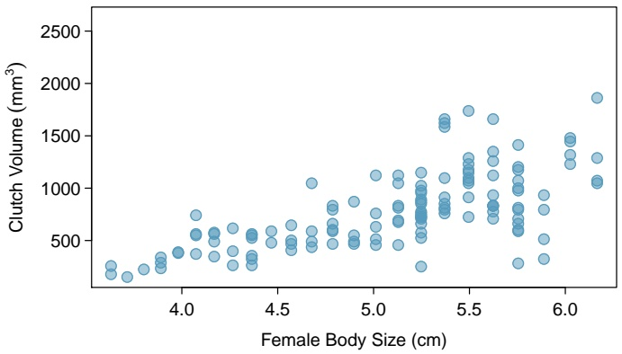

scatter

| Female Body Size (cm) | Clutch Volume \((mm^{3})\) |
| --- | --- |
| ~3.7 | ~250 |
| ~3.7 | ~280 |
| ~3.8 | ~180 |
| ~3.9 | ~250 |
| ~3.9 | ~300 |
| ~4.0 | ~350 |
| ~4.0 | ~400 |
| ~4.1 | ~400 |
| ~4.1 | ~550 |
| ~4.1 | ~750 |
| ~4.2 | ~350 |
| ~4.2 | ~550 |
| ~4.2 | ~600 |
| ~4.3 | ~300 |
| ~4.3 | ~400 |
| ~4.3 | ~600 |
| ~4.4 | ~300 |
| ~4.4 | ~350 |
| ~4.4 | ~600 |
| ~4.5 | ~500 |
| ~4.5 | ~600 |
| ~4.6 | ~450 |
| ~4.6 | ~500 |
| ~4.6 | ~650 |
| ~4.7 | ~450 |
| ~4.7 | ~600 |
| ~4.7 | ~1050 |
| ~4.8 | ~500 |
| ~4.8 | ~650 |
| ~4.8 | ~850 |
| ~4.9 | ~500 |
| ~4.9 | ~600 |
| ~4.9 | ~900 |
| ~5.0 | ~500 |
| ~5.0 | ~750 |
| ~5.0 | ~1150 |
| ~5.1 | ~500 |
| ~5.1 | ~650 |
| ~5.1 | ~850 |
| ~5.1 | ~1150 |
| ~5.2 | ~300 |
| ~5.2 | ~650 |
| ~5.2 | ~850 |
| ~5.2 | ~1150 |
| ~5.3 | ~800 |
| ~5.3 | ~900 |
| ~5.3 | ~1100 |
| ~5.3 | ~1650 |
| ~5.4 | ~750 |
| ~5.4 | ~950 |
| ~5.4 | ~1150 |
| ~5.4 | ~1300 |
| ~5.5 | ~950 |
| ~5.5 | ~1150 |
| ~5.5 | ~1300 |
| ~5.5 | ~1750 |
| ~5.6 | ~750 |
| ~5.6 | ~950 |
| ~5.6 | ~1150 |
| ~5.6 | ~1350 |
| ~5.6 | ~1650 |
| ~5.7 | ~300 |
| ~5.7 | ~650 |
| ~5.7 | ~850 |
| ~5.7 | ~1200 |
| ~5.7 | ~1400 |
| ~5.8 | ~350 |
| ~5.8 | ~650 |
| ~5.8 | ~850 |
| ~5.8 | ~1200 |
| ~5.9 | ~350 |
| ~5.9 | ~800 |
| ~5.9 | ~950 |
| ~6.0 | ~1250 |
| ~6.0 | ~1350 |
| ~6.0 | ~1450 |
| ~6.1 | ~1100 |
| ~6.1 | ~1300 |
| ~6.1 | ~1850 |

Figure 6.2: A plot of clutch.volume versus body.size in the frog data.

<small>5No. While the relationship appears linear and it is reasonable to assume the observations are independent (based on information about the frogs given in Chapter 1), the variability in clutch.volume is noticeably less for smaller values of body.size than for larger values.</small>

---

6.2. ESTIMATING A REGRESSION LINE USING LEAST SQUARES

295

## 6.2 Estimating a regression line using least squares

Figure 6.3 shows the scatterplot of age versus RFFT score, with the **least squares regression line** added to the plot; this line can also be referred to as a **linear model** for the data. An RFFT score can be predicted for a given age from the equation of the regression line:

$$
\widehat {\mathrm{RFFT}} = 1 3 7. 5 5 - 1. 2 6 (\text {age}).
$$

The vertical distance between a point in the scatterplot and the predicted value on the regression line is the **residual** for the observation represented by the point; observations below the line have negative residuals, while observations above the line have positive residuals. The size of a residual is usually discussed in terms of its absolute value; for example, a residual of −13 is considered larger than a residual of 5.

For example, consider the predicted RFFT score for an individual of age 56. According to the linear model, this individual has a predicted score of $1 3 7 . 5 5 0 - 1 . 2 6 1 ( 5 6 ) = 6 6 . 9 3 4$ points. In the data, however, there is a participant of age 56 with an RFFT score of 72; their score is about 5 points higher than predicted by the model (this observation is shown on the plot with $\textbf { a } ^ { \prime \prime } \times \mathbf { \" } )$

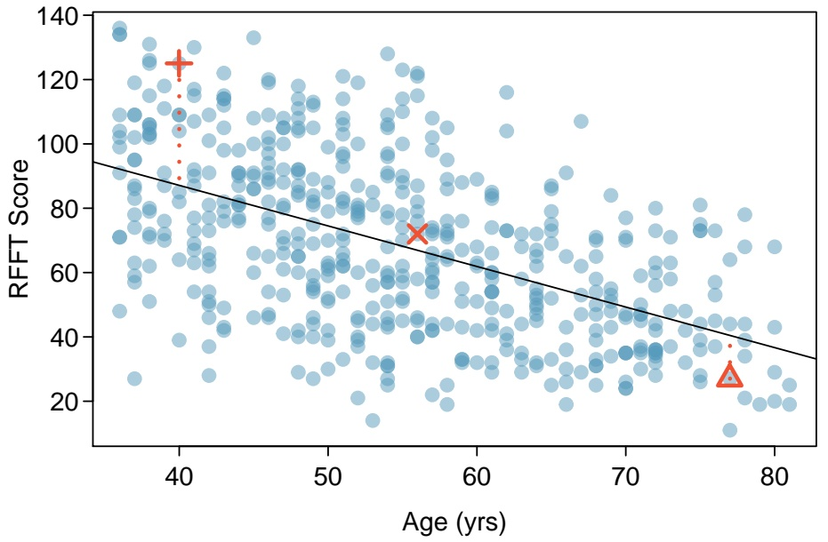

scatter

| Series | Age (yrs) | RFFT Score |
| --- | --- | --- |
| Blue circles | 35~82 | 10~140 |
| Red crosses | ~40 | ~125 |
| Red crosses | ~56 | ~72 |
| Red triangles | ~77 | ~28 |

Figure 6.3: A scatterplot showing age (horizontal axis) vs. RFFT (vertical axis) with the regression line added to the plot. Three observations are marked in the figure; the one marked by a $\text{" }+ \text{" }$ has a large residual of about +38, the one marked by a $\text{" } \times  \text{" }$ has a small residual of about $+ 5 ,$ and the one marked by a $"  \triangle  \text{" }$ has a moderate residual of about -13. The vertical dotted lines extending from the observations to the regression line represent the residuals.

---

296

CHAPTER 6. SIMPLE LINEAR REGRESSION

## RESIDUAL: DIFFERENCE BETWEEN OBSERVED AND EXPECTED

The residual of the $i ^ { t h }$ observation $( x _ { i } , y _ { i } )$ is the difference of the observed response $( y _ { i } )$ and the response predicted based on the model fit $\widehat { ( y _ { i } ) }$ :

$$
e _ {i} = y _ {i} - \widehat {y _ {i}}
$$

The value $\widehat { y _ { i } }$ is calculated by plugging $x _ { i }$ into the model equation.

The **least squares regression line** is the line which minimizes the sum of the squared residuals for all the points in the plot. Let $\hat { y _ { i } }$ be the predicted value for an observation with value $x _ { i }$ for the explanatory variable. The value $e _ { i } = y _ { i } - \hat { y _ { i } }$ is the residual for a data point $( x _ { i } , y _ { i } )$ in a scatterplot with n pairs of points. The least squares line is the line for which

$$
e _ {1} ^ {2} + e _ {2} ^ {2} + \dots + e _ {n} ^ {2} \tag {6.2}
$$

is smallest.

For a general population of ordered pairs $( x , y )$ , the **population regression model** is

$$
y = \beta_ {0} + \beta_ {1} x + \varepsilon .
$$

The term ε is a normally distributed ‘error term’ that has mean $0$ and standard deviation $\sigma .$ Since $E ( \varepsilon ) = 0 ,$ , the model can also be written

$$
E (Y | x) = \beta_ {0} + \beta_ {1} x,
$$

where the notation $E ( Y | x )$ denotes the expected value of $Y$ when the predictor variable has value $x . ^ { 6 }$ For the PREVEND data, the population regression line can be written as

$$
\mathrm{RFFT} = \beta_ {0} + \beta_ {1} (\mathrm{age}) + \varepsilon , \text {or as} E (\mathrm{RFFT} | \mathrm{age}) = \beta_ {0} + \beta_ {1} (\mathrm{age}).
$$

The term $\beta _ { 0 }$ is the vertical intercept for the line (often referred to simply as the intercept) and $\beta _ { 1 }$ is the slope. The notation $b _ { 0 }$ and $b _ { 1 }$ are used to represent the point estimates of the parameters $\beta _ { 0 }$ and $\beta _ { 1 }$ . The point estimates $b _ { 0 }$ and $b _ { 1 }$ are estimated from data; $\beta _ { 0 }$ and $\beta _ { 1 }$ are parameters from the population model for the regression line.

The regression line can be written as $\hat { y } = b _ { 0 } + b _ { 1 } ( x )$ , where $\hat { y }$ represents the predicted value of the response variable. The slope of the least squares line, $b _ { 1 }$ , is estimated by

$$
b _ {1} = \frac {s _ {y}}{s _ {x}} r, \tag {6.3}
$$

where $r$ is the correlation between the two variables, and $s _ { x }$ and $s _ { y }$ are the sample standard deviations of the explanatory and response variables, respectively. The intercept for the regression line is estimated by

$$
b _ {0} = \overline {{y}} - b _ {1} \overline {{x}}. \tag {6.4}
$$

Typically, regression lines are estimated using statistical software.

$b_{0}, b_{1}$
Sample
estimates
of $\beta_{0}, \beta_{1}$

<small>6The error term ε can be thought of as a population parameter for the residuals (e). While ε is a theoretical quantity that refers to the deviation between an observed value and E(Y |x), a residual is calculated as the deviation between an observed value and the prediction from the linear model.</small>

---

6.2. ESTIMATING A REGRESSION LINE USING LEAST SQUARES

297

## EXAMPLE 6.5

From the summary statistics displayed in Figure 6.4 for prevend.samp, calculate the equation of the least-squares regression line for the PREVEND data.

$$
b _ {1} = \frac {s _ {y}}{s _ {x}} r = \frac {2 7 . 4 0}{1 1 . 6 0} (- 0. 5 3 4) = - 1. 2 6
$$

$$
b _ {0} = \overline {{y}} - b _ {1} \overline {{x}} = 6 8. 4 0 - (- 1. 2 6) (5 4. 8 2) = 1 3 7. 5 5.
$$

The results agree with the equation shown at the beginning of this section:

$$
\widehat {\mathrm{RFFT}} = 1 3 7. 5 5 - 1. 2 6 (\text {age}).
$$

|  | Age (yrs) | RFFT score |
| --- | --- | --- |
| mean | $\overline{x} = 54.82$ | $\overline{y} = 68.40$ |
| standard deviation | $s_x = 11.60$ | $s_y = 27.40$ |
|  |  | $r = -0.534$ |

Figure 6.4: Summary statistics for age and RFFT from prevend.samp.

## GUIDED PRACTICE 6.6

Figure 6.5 shows the relationship between height and weight in a sample from the NHANES dataset introduced in Chapter 1. Calculate the equation of the regression line given the summary statistics: $\overline { { x } } = 1 6 8 . 7 8 , \overline { { y } } = 8 3 . 8 3 , s _ { x } = 1 0 . 2 9 , s _ { y } = 2 1 . 0 4 , r = 0 . 4 1 0 . ^ { 7 }$

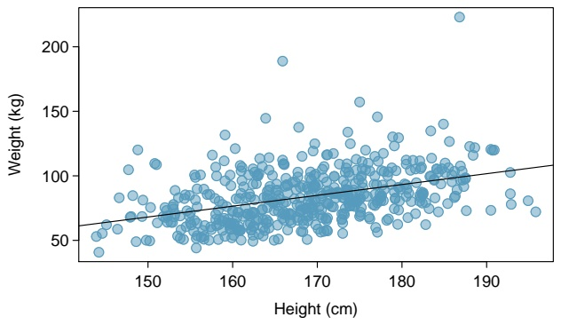

scatter

| Height (cm) | Weight (kg) |
| --- | --- |
| ~145 | ~40 |
| ~146 | ~55 |
| ~147 | ~60 |
| ~148 | ~85 |
| ~149 | ~105 |
| ~150 | ~120 |
| ~151 | ~110 |
| ~152 | ~70 |
| ~153 | ~65 |
| ~154 | ~75 |
| ~155 | ~80 |
| ~156 | ~90 |
| ~157 | ~100 |
| ~158 | ~135 |
| ~159 | ~115 |
| ~160 | ~105 |
| ~161 | ~145 |
| ~162 | ~190 |
| ~163 | ~140 |
| ~164 | ~120 |
| ~165 | ~135 |
| ~166 | ~125 |
| ~167 | ~140 |
| ~168 | ~130 |
| ~169 | ~120 |
| ~170 | ~135 |
| ~171 | ~125 |
| ~172 | ~130 |
| ~173 | ~140 |
| ~174 | ~155 |
| ~175 | ~145 |
| ~176 | ~130 |
| ~177 | ~120 |
| ~178 | ~130 |
| ~179 | ~125 |
| ~180 | ~135 |
| ~181 | ~140 |
| ~182 | ~130 |
| ~183 | ~125 |
| ~184 | ~120 |
| ~185 | ~220 |
| ~186 | ~120 |
| ~187 | ~120 |
| ~188 | ~120 |
| ~189 | ~85 |
| ~190 | ~75 |
| ~191 | ~80 |
| ~192 | ~75 |

Figure 6.5: A plot of Height versus Weight in nhanes.samp.adult.500, with a leastsquares regression line

## GUIDED PRACTICE 6.7

Predict the weight in pounds for an adult who is 5 feet, 11 inches tall. $1\  cm  = .3937$ in; $1 \mathrm { l b } =$ 0.454 kg.8

<small>7The equation of the line is weight ‚ = −57.738+0.839(height), where height is in centimeters and weight is in kilograms. 85 feet, 11 inches equals 71/.3937 = 180.34 centimeters. From the regression equation, the predicted weight is −57.738+ 0.839(180.34) = 93.567 kilograms. In pounds, this weight is 93.567/0.454 = 206.280.</small>

E

G

---

298

CHAPTER 6. SIMPLE LINEAR REGRESSION

## 6.3 Interpreting a linear model

A least squares regression line functions as a statistical model that can be used to estimate the relationship between an explanatory and response variable. While the calculations for constructing a regression line are relatively simple, interpreting the linear model is not always straightforward. In addition to discussing the mathematical interpretation of model parameters, this section also addresses methods for assessing whether a linear model is an appropriate choice, interpreting categorical predictors, and identifying outliers.

The slope parameter of the regression line specifies how much the line rises (positive slope) or declines (negative slope) for one unit of change in the explanatory variable. In the PREVEND data, the line decreases by 1.26 points for every increase of 1 year. However, it is important to clarify that RFFT score tends to decrease as age increases, with average RFFT score decreasing by 1.26 points for each additional year of age. As visible from the scatter of the data around the line, the line does not perfectly predict RFFT score from age; if this were the case, all the data would fall exactly on the line.

When interpreting the slope parameter, it is also necessary to avoid phrasing indicative of a causal relationship, since the line describes an association from data collected in an observational study. From these data, it is not possible to conclude that increased age causes a decline in cognitive function.9

Mathematically, the intercept on the vertical axis is a predicted value on the line when the explanatory variable has value 0. In biological or medical examples, 0 is rarely a meaningful value of the explanatory variable. For example, in the PREVEND data, the linear model predicts a score of 137.55 when age is 0—however, it is nonsensical to predict an RFFT score for a newborn infant.

In fact, least squares lines should never be used to extrapolate values outside the range of observed values. Since the PREVEND data only includes participants between ages 36 and 81, it should not be used to predict RFFT scores for people outside that age range. The nature of a relationship may change for very small or very large values of the explanatory variable; for example, if participants between ages 15 and 25 were studied, a different relationship between age and RFFT scores might be observed. Even making predictions for values of the explanatory variable slightly larger than the minimum or slightly smaller than the maximum can be dangerous, since in many datasets, observations near the minimum or maximum values (of the explanatory variable) are sparse.

Linear models are useful tools for summarizing a relationship between two variables, but it is important to be cautious about making potentially misleading claims based on a regression line. The following subsection discusses two commonly used approaches for examining whether a linear model can reasonably be applied to a dataset.

## 6.3.1 Checking residuals from a linear model

Recall that there are four assumptions that must be met for a linear model to be considered reasonable: linearity, constant variability, independent observations, normally distributed residu als. In the PREVEND data, the relationship between RFFT score and age appears approximately linear, and it is reasonable to assume that the data points are independent. To check the assumptions of constant variability around the line and normality of the residuals, it is helpful to consult residual plots and normal probability plots (Section 3.3.7).10

<small>9Similarly, avoid language such as increased age leads to or produces lower RFFT scores.</small>

<small>10While simple arithmetic can be used to calculate the residuals, the size of most datasets makes hand calculations impractical. The plots here are based on calculations done in R.</small>

---

6.3. INTERPRETING A LINEAR MODEL

299

## Examining patterns in residuals

There are a variety of residual plots used to check the fit of a least squares line. The plots shown in this text are scatterplots in which the residuals are plotted on the vertical axis against predicted values from the model on the horizontal axis. Other residual plots may instead show values of the explanatory variable or the observed response variable on the horizontal axis. When a least squares line fits data very well, the residuals should scatter about the horizontal line $y = 0$ with no apparent pattern.

Figure 6.6 shows three residual plots from simulated data; the plots on the left show data plotted with the least squares regression line, and the plots on the right show residuals on the y axis and predicted values on the x-axis. A linear model is a particularly good fit for the data in the first row, where the residual plot shows random scatter above and below the horizontal line. In the second row, the original data cycles below and above the regression line; this nonlinear pattern is more evident in the residual plot. In the last row, the variability of the residuals is not constant; the residuals are slightly more variable for larger predicted values.

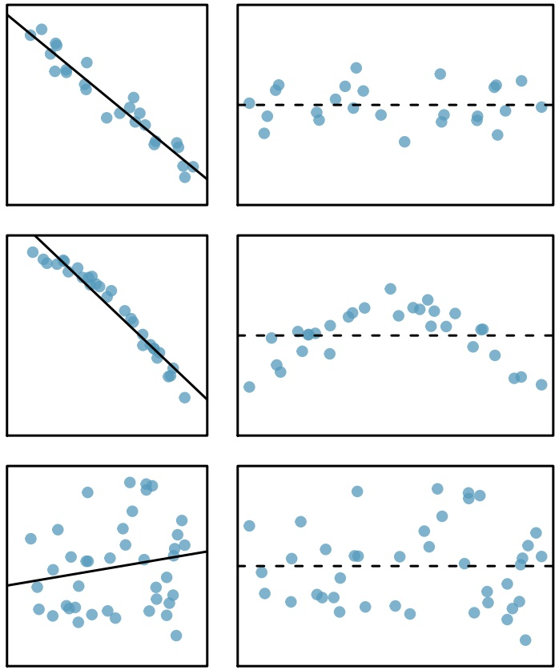

Figure 6.6: Sample data with their best fitting lines (left) and their corresponding residual plots (right).

---

300

CHAPTER 6. SIMPLE LINEAR REGRESSION

Figure 6.7 shows a residual plot from the estimated linear model $\widehat { \mathrm { R F F T } } = 1 3 7 . 5 5 - 1 . 2 6 ( \mathrm { a g e } )$ While the residuals show scatter around the line, there is less variability for lower predicted RFFT scores. A data analyst might still decide to use the linear model, with the knowledge that pre-dictions of high RFFT scores may not be as accurate as for lower scores. Reading a residual plot critically can reveal weaknesses about a linear model that should be taken into account when interpreting model results. More advanced regression methods beyond the scope of this text may be more suitable for these data.

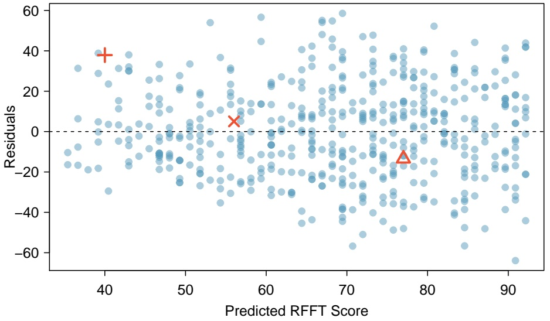

scatter

| Series | Predicted RFFT Score (range) | Residuals (range) |
| --- | --- | --- |
| Blue circles | 35~92 | -65~60 |
| Red cross | ~40 | ~38 |
| Red cross | ~56 | ~5 |
| Red triangle | ~77 | ~-13 |

Figure 6.7: Residual plot for the model in Figure 6.3 using prevend.samp.

## EXAMPLE 6.8

Figure 6.8 shows a residual plot for the model predicting weight from height using the sample of 500 adults from the NHANES data, nhanes.samp.adult.500. Assess whether the constant variability assumption holds for the linear model.

The residuals above the line are more variable, taking on more extreme values than those below the line. Larger than expected residuals imply that there are many large weights that are underpredicted; in other words, the model is less accurate at predicting relatively large weights.

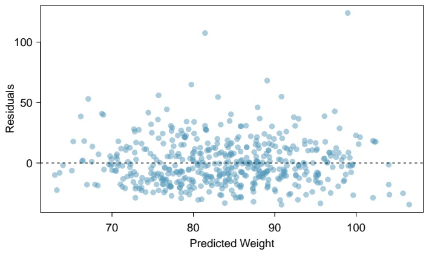

scatter

| Predicted Weight (range) | Residuals (range) |
| --- | --- |
| 65~108 | -30~125 |

Figure 6.8: A residual plot from the linear model for height versus weight in nhanes.samp.adult.500.

E

---

6.3. INTERPRETING A LINEAR MODEL

301

## Checking normality of the residuals

The normal probability plot, introduced in Section 3.3.7, is best suited for checking normality of the residuals, since normality can be difficult to assess using histograms alone. Figure 6.9 shows both the histogram and normal probability plot of the residuals after fitting a least squares regression to the age versus RFFT data.

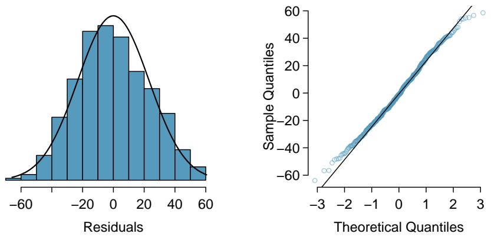

Figure 6.9: A histogram and normal probability plot of the residuals from the linear model for RFFT versus Age in prevend.samp.

The normal probability plot shows that the residuals are nearly normally distributed, with only slight deviations from normality in the left and right tails.

## GUIDED PRACTICE 6.9

Figure 6.10 shows a histogram and normal probability plot for the linear model to predict weight from height in nhanes.samp.adult.500. Evaluate the normality of the residuals.11

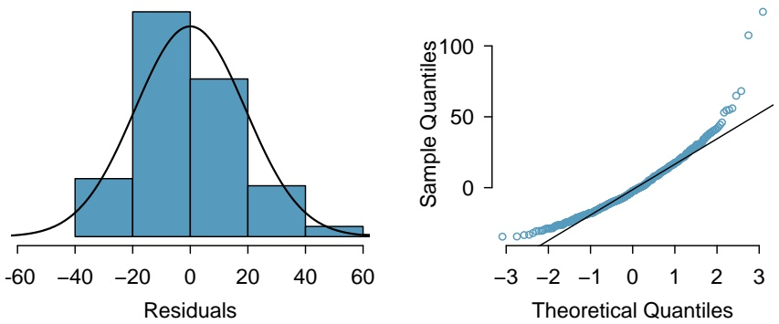

Figure 6.10: A histogram and normal probability plot of the residuals from the linear model for height versus weight in nhanes.samp.adult.500.

<small>11The data are roughly normal, but there are deviations from normality in the tails, particularly the upper tail. There are some relatively large observations, which is evident from the residual plot shown in Figure 6.8.</small>

G

---

302

CHAPTER 6. SIMPLE LINEAR REGRESSION

## 6.3.2 Using $R ^ { 2 }$ to describe the strength of a fit

The correlation coefficient r measures the strength of the linear relationship between two variables. However, it is more common to measure the strength of a linear fit using $r ^ { 2 } ,$ which is commonly written as $R ^ { 2 }$ in the context of regression.12

The quantity $R ^ { 2 }$ describes the amount of variation in the response that is explained by the least squares line. While $R ^ { 2 }$ can be easily calculated by simply squaring the correlation coefficient, it is easier to understand the interpretation of $R ^ { 2 }$ by using an alternative formula:

$$
R ^ {2} = \frac {\text { variance   of   predicted   } y \text {-values}}{\text { variance   of   observed   } y \text {-values}}.
$$

It is possible to show that $R ^ { 2 }$ can also be written

$$
R ^ {2} = \frac {s _ {y} ^ {2} - s _ {\mathrm{residuals}} ^ {2}}{s _ {y} ^ {2}}.
$$

In the linear model predicting RFFT scores from age, the predicted values on the least squares line are the values of RFFT that are ’explained’ by the linear model. The variability of the residuals about the line represents the remaining variability after the prediction; i.e., the variability unexplained by the model. For example, if a linear model perfectly captured all the data, then the variance of the predicted y-values would be equal to the variance of the observed y-values, resulting in $R ^ { 2 } = 1$ . In the linear model for $\widehat { R F F T }$ , the proportion of variability explained is

$$
R ^ {2} = \frac {s _ {R F F T} ^ {2} - s _ {\mathrm{residuals}} ^ {2}}{s _ {R F F T} ^ {2}} = \frac {7 5 0 . 5 2 - 5 3 6 . 6 2}{7 5 0 . 5 2} = \frac {2 1 3 . 9 0}{7 5 0 . 5 2} = 0. 2 8 5,
$$

about 29%. This is equal to the square of the correlation coefficient, $r ^ { 2 } = - 0 . 5 3 4 ^ { 2 } = 0 . 2 8 5$

Since $R ^ { 2 }$ in simple linear regression is simply the square of the correlation coefficient between the predictor and the response, it does not add a new tool to regression. It becomes much more useful in models with several predictors, where it has the same interpretation as the proportion of variability explained by a model but is no longer the square of any one of the correlation coefficients between the individual responses and the predictor. Those models are discussed in Chapter 7.

## GUIDED PRACTICE 6.10

In the NHANES data, the variance of Weight is 442.53 $\mathrm { k g } ^ { 2 }$ and the variance of the residuals is 368.1. What proportion of the variability in the data is explained by the model?13

## GUIDED PRACTICE 6.11

If a linear model has a very strong negative relationship with a correlation of -0.97, how much of the variation in the response is explained by the explanatory variable?14

G

G

<small>12In software output, R2is usually labeled R-squared.</small>

<small>13About 16.8%: s2weight = 442.53−368.1 . 442.53 = 0.168 74 43 442.53</small>

<small>14About R2 = (−0.97)2 = 0.94 or 94% of the variation is explained by the linear model.</small>

---

6.3. INTERPRETING A LINEAR MODEL

303

## 6.3.3 Categorical predictors with two levels

Although the response variable in linear regression is necessarily numerical, the predictor variable may be either numerical or categorical. This section explores the association between a country’s infant mortality rate and whether or not 50% of the population has access to adequate sanitation facilities.

The World Development Indicators (WDI) is a database of country-level variables (i.e., indicators) recording outcomes for a variety of topics, including economics, health, mortality, fertility, and education.15 The dataset wdi.2011 contains a subset of variables on 165 countries from the year $2 0 1 1 . ^ { 1 6 }$ The infant mortality rate in a country is recorded as the number of deaths in the first year of life per 1,000 live births. Access to sanitation is recorded as the percentage of the population with adequate disposal facilities for human waste. Due to the availability of death certificates, infant mortality is measured reasonably accurately throughout the world. However, it is more difficult to obtain precise measurements of the percentage of a population with access to adequate sanitation facilities; instead, considering whether half the population has such access may be a more reliable measure. The analysis presented here is based on 163 of the 165 countries; the values for access to sanitation are missing for New Zealand and Turkmenistan.

Figure 6.11(a) shows that infant mortality rates are highly right-skewed, with a relatively small number of countries having high infant mortality rates. In 13 countries, infant mortality rates are higher than 70 deaths per thousand live births. Figure 6.11(b) shows infant mortality after a log transformation; the following analysis will use the more nearly symmetric transformed version of inf.mortality.

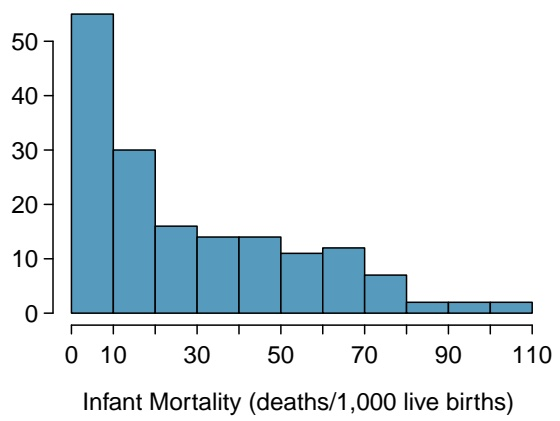

histogram

| Infant Mortality (deaths/1,000 live births) | Frequency |
| --- | --- |
| 0~10 | ~55 |
| 10~20 | 30 |
| 20~30 | ~16 |
| 30~40 | ~14 |
| 40~50 | ~14 |
| 50~60 | ~11 |
| 60~70 | ~12 |
| 70~80 | ~7 |
| 80~90 | ~2 |
| 90~100 | ~2 |
| 100~110 | ~2 |

(a)

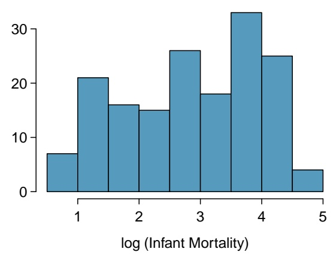

histogram

| Bin (log scale) | Frequency |
| --- | --- |
| 0.5~1.0 | ~7 |
| 1.0~1.5 | ~21 |
| 1.5~2.0 | ~16 |
| 2.0~2.5 | ~15 |
| 2.5~3.0 | ~26 |
| 3.0~3.5 | ~18 |
| 3.5~4.0 | ~33 |
| 4.0~4.5 | ~25 |
| 4.5~5.0 | ~4 |

(b)

Figure 6.11: (a) Histogram of infant mortality, measured in deaths per 1,000 live births in the first year of life. (b) Histogram of the log-transformed infant mortality.

<small>15<a href="http://data.worldbank.org/data-catalog/world-development-indicators">http://data.worldbank.org/data-catalog/world-development-indicators</a></small>

<small>16The data were collected by a Harvard undergraduate in the Statistics department, and are accessible via the oibiostat package.</small>

---

304

CHAPTER 6. SIMPLE LINEAR REGRESSION

Figure 6.12 shows a scatterplot of log(inf.mortality) against the categorical variable for sanitation access, coded 1 if at least 50% of the population has access to adequate sanitation, and 0 otherwise. Since there are only two values of the predictor, the values of infant mortality are stacked above the two predictor values 0 and 1.17

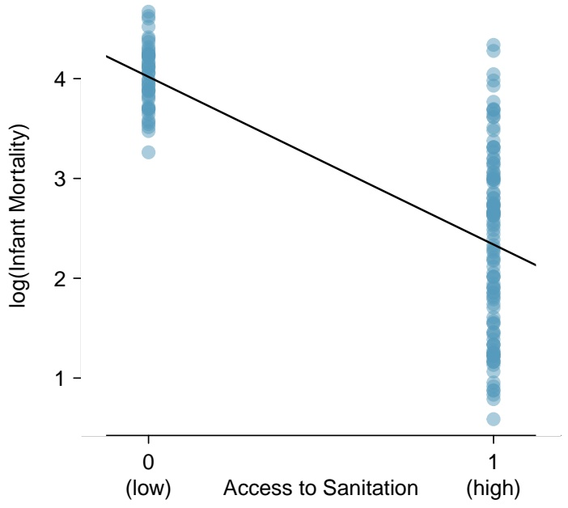

scatter

| Access to Sanitation | log(Infant Mortality) (range) |
| --- | --- |
| 0 (low) | ~3.3 ~4.7 |
| 1 (high) | ~0.6 ~4.4 |

Figure 6.12: Country-level infant mortality rates, divided into low access $( x = 0 )$ and high access (x = 1) to sanitation. The least squares regression line is also shown.

The least squares regression line has the form

$$
\log (\text {inf. mortality}) = b _ {0} + b _ {1} (\text {sanit.access}). \tag {6.12}
$$

The estimated least squares regression line has intercept and slope parameters of 4.018 and -1.681, respectively. While the scatterplot appears unlike those for two numerical variables, the interpretation of the parameters remains unchanged. The slope, -1.681, is the estimated change in the logarithm of infant mortality when the categorical predictor changes from low access to sanitation facilities to high access. The intercept term 4.018 is the estimated log infant mortality for the set of countries where less than 50% of the population has access to adequate sanitation facilities (sanit.access = 0).

<small>17Typically, side-by-side boxplots are used to display the relationship between a numerical variable and a categorical variable. In a regression context, it can be useful to use a scatterplot instead, in order to see the variability around the regression line.</small>

---

6.3. INTERPRETING A LINEAR MODEL

305

Using the model in Equation 6.12, the prediction equation can be written

$$
\widehat {\log (\text {inf.mortality})} = 4. 0 1 8 - 1. 6 8 1 (\text {sanit.access}).
$$

Exponentiating both sides of the equation yields

$$
\widehat {\text {inf.mortality}} = e ^ {4. 0 1 8 - 1. 6 8 1 (\text {sanit.access})}.
$$

When sanit.access = 0, the equation simplifies to $e ^ { 4 . 0 1 8 } = 5 5 . 5 9 0$ deaths among 1,000 live births; this is the estimated infant mortality rate in the countries with low access to sanitation facilities. When sanit.access = 1, the estimated infant mortality rate is $e ^ { 4 . 0 1 8 - 1 . 6 8 1 { \mathrm { ( 1 ) } } } = e ^ { 2 . 3 3 7 } = 1 0 . 3 5 0$ deaths per 1,000 live births. The infant mortality rate drops by a factor of 0.186; i.e., the mortality rate in the high access countries is approximately 20% of that in the low access countries.18

## EXAMPLE 6.13

Check the assumptions of constant variability around the regression line and normality of the residuals in the model for the relationship between the transformed infant mortality variable and access to sanitation variable. Residual plots are shown in Figure 6.13.

While the normal probability plot does show that the residuals are approximately normally dis tributed, the residual plot reveals that variability is far from constant around the two predictors. Another method for assessing the relationship between the two groups is advisable; this is discussed further in Section 6.4.

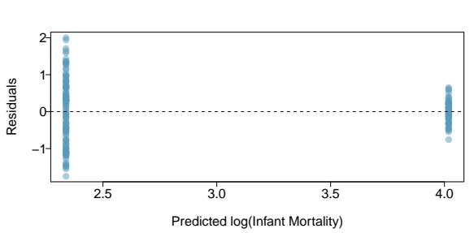

scatter

| Series | Predicted log(Infant Mortality) (range) | Residuals (range) |
| --- | --- | --- |
| Cluster 1 | ~2.25 ~2.35 | -1.7~2.0 |
| Cluster 2 | ~4.0 ~4.1 | -0.8~0.7 |

(a)

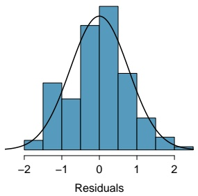

histogram

| Bin (Residuals) | Frequency |
| --- | --- |
| -2.0~-1.8 | ~0.5 |
| -1.8~-1.6 | ~1.5 |
| -1.6~-1.4 | ~3.5 |
| -1.4~-1.2 | ~2.5 |
| -1.2~-1.0 | ~4.5 |
| -1.0~-0.8 | ~6.5 |
| -0.8~-0.6 | ~7.5 |
| -0.6~-0.4 | ~9.5 |
| -0.4~-0.2 | ~8.5 |
| -0.2~0.0 | ~6.5 |
| 0.0~0.2 | ~3.5 |
| 0.2~0.4 | ~2.5 |
| 0.4~0.6 | ~1.5 |
| 0.6~0.8 | ~0.5 |
| 0.8~1.0 | ~0.2 |

(b)

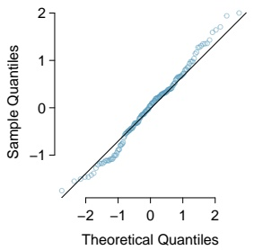

qq

| Theoretical Quantiles | Sample Quantiles |
| --- | --- |
| ~-2.5 | ~-1.6 |
| ~-2.4 | ~-1.5 |
| ~-2.3 | ~-1.4 |
| ~-2.2 | ~-1.3 |
| ~-2.1 | ~-1.2 |
| ~-2.0 | ~-1.1 |
| ~-1.9 | ~-1.0 |
| ~-1.8 | ~-0.9 |
| ~-1.7 | ~-0.8 |
| ~-1.6 | ~-0.7 |
| ~-1.5 | ~-0.6 |
| ~-1.4 | ~-0.5 |
| ~-1.3 | ~-0.4 |
| ~-1.2 | ~-0.3 |
| ~-1.1 | ~-0.2 |
| ~-1.0 | ~-0.1 |
| ~-0.9 | 0.0 |
| ~-0.8 | 0.1 |
| ~-0.7 | 0.2 |
| ~-0.6 | 0.3 |
| ~-0.5 | 0.4 |
| ~-0.4 | 0.5 |
| ~-0.3 | 0.6 |
| ~-0.2 | 0.7 |
| ~-0.1 | 0.8 |
| 0.0 | 0.9 |
| 0.1 | 1.0 |
| 0.2 | 1.1 |
| 0.3 | 1.2 |
| 0.4 | 1.3 |
| 0.5 | 1.4 |
| 0.6 | 1.5 |
| 0.7 | 1.6 |
| 0.8 | 1.7 |
| 0.9 | 1.8 |
| 1.0 | 1.9 |
| 1.1 | 2.0 |

Figure 6.13: (a) Residual plot of log(inf.mortality) and sanit.access. (b) Histogram and normal probability plot of the residuals.

## 6.3.4 Outliers in regression

Depending on their position, data points in a scatterplot have varying degrees of contribution to the estimated parameters of a regression line. Points that are at particularly low or high values of the predictor (x) variable are said to have **high leverage**, and have a large influence on the estimated intercept and slope of the regression line; observations with x values closer to the center of the distribution of x do not have a large effect on the slope.

E

<small>18When examining event rates in public health, associations are typically measured using rate ratios rather than rate differences.</small>

---

306

CHAPTER 6. SIMPLE LINEAR REGRESSION

A data point in a scatterplot is considered an **outlier in regression** if its value for the response (y) variable does not follow the general linear trend in the data. Outliers that sit at extreme values of the predictor variable (i.e., have high leverage) have the potential to contribute disproportionately to the estimated parameters of a regression line. If an observation does have a strong effect on the estimates of the line, such that estimates change substantially when the point is omitted, the observation is **influential**. These terms are formally defined in advanced regression courses.

This section examines the relationship between infant mortality and number of doctors, using data for each state and the District of Columbia.19 Infant mortality is measured as the number of infant deaths in the first year of life per 1,000 live births, and number of doctors is recorded as number of doctors per 100,000 members of the population. Figure 6.14 shows scatterplots with infant mortality on the y-axis and number of doctors on the x-axis.

One point in Figure 6.14(a), marked in red, is clearly distant from the main cluster of points. This point corresponds to the District of Columbia, where there were approximately 807.2 doctors per 100,000 members of the population, and the infant mortality rate was 11.3 per 1,000 live births. Since 807.2 is a high value for the predictor variable, this observation has high leverage. It is also an outlier; the other points exhibit a downward sloping trend as the number of doctors increases, but this point, with an unusually high y-value paired with a high x-value, does not follow the trend.

Figure 6.14(b) illustrates that the DC observation is influential. Not only does the observation simply change the numerical value of the slope parameter, it reverses the direction of the linear trend; the regression line fitted with the complete dataset has a positive slope, but the line re-fitted without the DC observation has a negative slope. The large number of doctors per population is due to the presence of several large medical centers in an area with a population that is much smaller than a typical state.

It seems natural to ask whether or not an influential point should be removed from a dataset, but that may not be the right question. Instead, it is usually more important to assess whether the influential point might be an error in the data, or whether it belongs in the dataset. In this case, the District of Columbia has certain characteristics that may make comparisons with other states inappropriate; this is one argument in favor of excluding the DC observation from the data.

Generally speaking, if an influential point arises from random sampling from a large population and is not a data error, it should be left in the dataset, since it probably represents a small subset of the population from which the data were sampled.

## GUIDED PRACTICE 6.14

Once the influential DC point is removed, assess whether it is appropriate to use linear regression on these data by checking the four assumptions behind least squares regression: linearity, constant variability, independent observations, and approximate normality of the residuals. Refer to the residual plots shown in Figure 6.15.20

G

<small>19Data are from the Statistical Abstract of the United States, published by the US Census Bureau. Data are for 2010, and available as census.2010 in the oibiostat package.</small>

<small>20The scatterplot in Figure 6.14(b) does not show any nonlinear trends. Similarly, Figure 6.15(a) does not indicate any nonlinear trends or noticeable difference in the variability of the residuals, although it does show that there are relatively few observations for low values of predicted infant mortality. From Figure 6.15(b), the residuals are approximately normally distributed. Infant mortality across the states reflects a complex mix of different levels of income, access to health care, and individual state initiatives in health care; these and other state-specific features probably act independently across the states, although there is some dependence from federal influence such as funding for pre-natal care. Overall, independence seems like a reasonable assumption.</small>

---

6.3. INTERPRETING A LINEAR MODEL

307

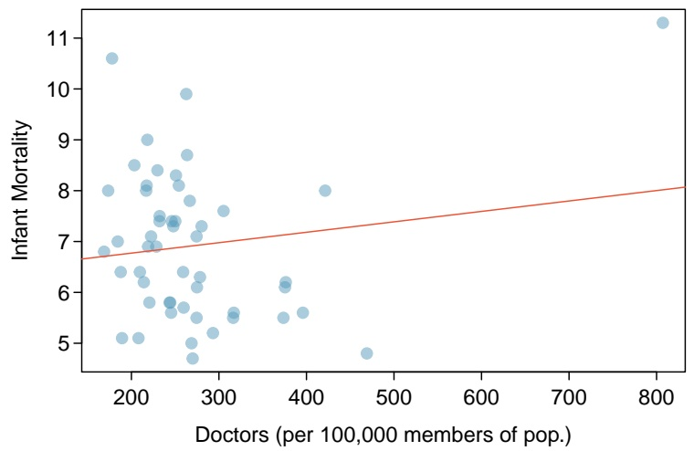

scatter

| Doctors (per 100,000 members of pop.) | Infant Mortality |
| --- | --- |
| ~180 | ~6.8 |
| ~190 | ~10.6 |
| ~200 | ~5.1 |
| ~200 | ~6.4 |
| ~210 | ~7.0 |
| ~210 | ~8.5 |
| ~220 | ~5.1 |
| ~220 | ~6.3 |
| ~220 | ~8.1 |
| ~230 | ~9.0 |
| ~230 | ~8.4 |
| ~240 | ~7.5 |
| ~240 | ~7.4 |
| ~240 | ~6.9 |
| ~250 | ~7.4 |
| ~250 | ~7.3 |
| ~260 | ~9.9 |
| ~260 | ~8.7 |
| ~260 | ~8.2 |
| ~260 | ~7.8 |
| ~260 | ~6.4 |
| ~270 | ~5.8 |
| ~270 | ~5.7 |
| ~270 | ~5.5 |
| ~270 | ~4.7 |
| ~280 | ~6.3 |
| ~280 | ~6.1 |
| ~280 | ~5.5 |
| ~290 | ~7.3 |
| ~300 | ~5.2 |
| ~310 | ~7.6 |
| ~320 | ~5.6 |
| ~380 | ~6.1 |
| ~380 | ~6.2 |
| ~390 | ~5.5 |
| ~400 | ~5.6 |
| ~420 | ~8.0 |
| ~470 | ~4.8 |
| ~810 | ~11.3 |

(a)

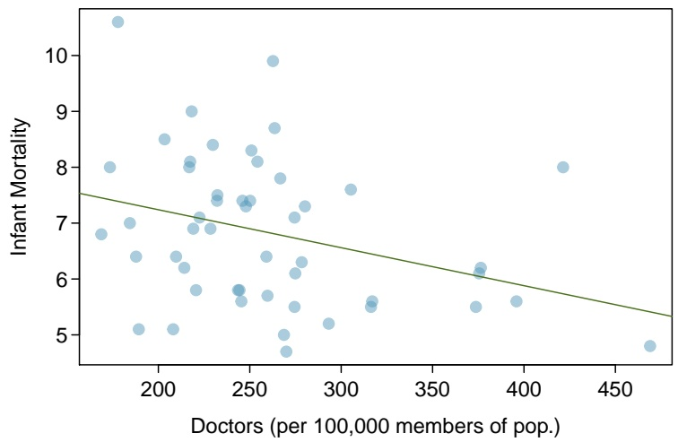

scatter

| Doctors (per 100,000 members of pop.) | Infant Mortality |
| --- | --- |
| ~185 | ~10.6 |
| ~185 | ~8.0 |
| ~190 | ~7.0 |
| ~190 | ~6.4 |
| ~190 | ~5.1 |
| ~205 | ~8.5 |
| ~210 | ~6.4 |
| ~215 | ~9.0 |
| ~215 | ~8.1 |
| ~215 | ~7.1 |
| ~215 | ~6.9 |
| ~220 | ~7.5 |
| ~220 | ~6.9 |
| ~220 | ~5.8 |
| ~230 | ~8.4 |
| ~245 | ~7.4 |
| ~245 | ~7.4 |
| ~245 | ~5.8 |
| ~250 | ~7.4 |
| ~255 | ~8.3 |
| ~260 | ~9.9 |
| ~260 | ~8.7 |
| ~260 | ~7.8 |
| ~265 | ~6.4 |
| ~265 | ~5.7 |
| ~265 | ~5.0 |
| ~265 | ~4.7 |
| ~270 | ~7.1 |
| ~270 | ~6.3 |
| ~270 | ~5.5 |
| ~280 | ~7.3 |
| ~295 | ~5.2 |
| ~305 | ~7.6 |
| ~315 | ~5.6 |
| ~315 | ~5.5 |
| ~375 | ~6.2 |
| ~375 | ~6.1 |
| ~375 | ~5.5 |
| ~395 | ~5.6 |
| ~420 | ~8.0 |
| ~465 | ~4.8 |

(b)

Figure 6.14: (a) Plot including District of Columbia data point. (b) Plot without influential District of Columbia data point.

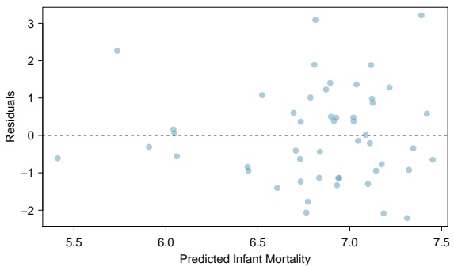

scatter

| Predicted Infant Mortality | Residuals |
| --- | --- |
| ~5.4 | ~-0.6 |
| ~5.7 | ~2.3 |
| ~5.9 | ~-0.3 |
| ~6.0 | ~0.1 |
| ~6.0 | ~-0.5 |
| ~6.4 | ~-0.9 |
| ~6.4 | ~-0.8 |
| ~6.5 | ~1.1 |
| ~6.6 | ~-1.4 |
| ~6.7 | ~0.6 |
| ~6.7 | ~-0.4 |
| ~6.7 | ~-0.6 |
| ~6.7 | ~-1.2 |
| ~6.8 | ~-2.0 |
| ~6.8 | ~-1.9 |
| ~6.8 | ~1.0 |
| ~6.8 | ~1.9 |
| ~6.8 | ~3.1 |
| ~6.9 | ~1.2 |
| ~6.9 | ~1.4 |
| ~6.9 | ~0.5 |
| ~6.9 | ~0.4 |
| ~6.9 | ~-1.1 |
| ~6.9 | ~-1.3 |
| ~7.0 | ~0.5 |
| ~7.0 | ~0.4 |
| ~7.0 | ~-0.2 |
| ~7.0 | ~-1.3 |
| ~7.1 | ~1.4 |
| ~7.1 | ~0.9 |
| ~7.1 | ~0.0 |
| ~7.1 | ~-0.8 |
| ~7.1 | ~-1.3 |
| ~7.1 | ~-2.1 |
| ~7.2 | ~1.9 |
| ~7.2 | ~1.3 |
| ~7.3 | ~-0.9 |
| ~7.3 | ~-2.2 |
| ~7.4 | ~3.2 |
| ~7.4 | ~0.6 |
| ~7.4 | ~-0.6 |

(a)

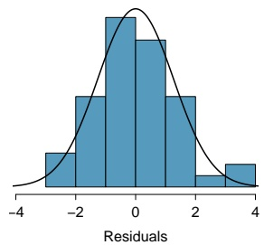

histogram

| Bin (Residuals) | Frequency |
| --- | --- |
| -3.5~-2.5 | ~1 |
| -2.5~-1.5 | ~2 |
| -1.5~-0.5 | ~4 |
| -0.5~0.5 | ~6 |
| 0.5~1.5 | ~4 |
| 1.5~2.5 | ~2 |
| 2.5~3.5 | ~0.5 |
| 3.5~4.5 | ~1 |

(b)

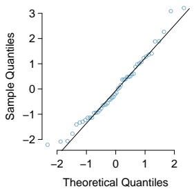

qq

| Theoretical Quantiles | Sample Quantiles |
| --- | --- |
| ~-2.3 | ~-2.2 |
| ~-1.9 | ~-1.9 |
| ~-1.6 | ~-1.4 |
| ~-1.5 | ~-1.3 |
| ~-1.4 | ~-1.2 |
| ~-1.3 | ~-1.1 |
| ~-1.2 | ~-1.0 |
| ~-1.1 | ~-0.9 |
| ~-0.8 | ~-0.7 |
| ~-0.7 | ~-0.6 |
| ~-0.6 | ~-0.5 |
| ~-0.5 | ~-0.4 |
| ~-0.4 | ~-0.3 |
| ~-0.3 | ~-0.2 |
| ~-0.2 | ~-0.1 |
| ~-0.1 | 0.0 |
| 0.0 | 0.1 |
| 0.1 | 0.2 |
| 0.2 | 0.3 |
| 0.3 | 0.4 |
| 0.4 | 0.5 |
| 0.5 | 0.6 |
| 0.6 | 0.7 |
| 0.7 | 0.8 |
| 0.8 | 0.9 |
| 0.9 | 1.0 |
| 1.0 | 1.1 |
| 1.1 | 1.2 |
| 1.2 | 1.3 |
| 1.3 | 1.4 |
| 1.4 | 1.5 |
| 1.5 | 1.6 |
| 1.6 | 1.7 |
| 1.7 | 1.8 |
| 1.8 | 1.9 |
| 1.9 | 2.0 |
| 2.0 | 2.2 |
| 2.1 | 3.1 |
| 2.2 | 3.2 |

Figure 6.15: (a) Residual plot of inf.mortality and doctors. (b) Histogram and normal probability plot of the residuals.

---

308

CHAPTER 6. SIMPLE LINEAR REGRESSION

## 6.4 Statistical inference with regression

The previous sections in this chapter have focused on linear regression as a tool for summarizing trends in data and making predictions. These numerical summaries are analogous to the methods discussed in Chapter 1 for displaying and summarizing data. Regression is also used to make inferences about a population.

The same ideas covered in Chapters 4 and 5 about using data from a sample to draw inferences about population parameters apply with regression. Previously, the goal was to draw inference about the population parameter $\mu ;$ in regression, the population parameter of interest is typically the slope parameter $\beta _ { 1 }$ . Inference about the intercept term is rare, and limited to the few problems where the vertical intercept has scientific meaning.

Inference in regression relies on the population linear model for the relationship between an explanatory variable X and a response variable Y given by

$$
Y = \beta_ {0} + \beta_ {1} X + \varepsilon , \tag {6.15}
$$

where ε is assumed to have a normal distribution with mean 0 and standard deviation $\sigma   \left( \varepsilon   \sim \right.$ $N ( 0 , \sigma ) )$ . This population model specifies that a response Y has value $\beta _ { 0 } + \beta _ { 1 } X$ plus a random term that pushes Y symmetrically above or below the value specified by the line.22

The set of ordered pairs $( x _ { i } , y _ { i } )$ used when fitting a least squares regression line are assumed to have been sampled from a population in which the relationship between the explanatory and response variables follows Equation 6.15. Under this assumption, the slope and intercept values of the least squares regression line, $b _ { 0 }$ and $b _ { 1 } ,$ , are estimates of the population parameters $\beta _ { 0 }$ and $\beta _ { 1 } ; b _ { 0 }$ and $b _ { 1 }$ have sampling distributions, just as $\overline { { X } }$ does when thought of as an estimate of a population mean $\mu .$ A more advanced treatment of regression would demonstrate that the sampling distribution of $b _ { 1 }$ is normal with mean $E ( b _ { 1 } ) = \beta _ { 1 }$ and standard deviation

$$
\sigma_ {b _ {1}} = \frac {\sigma}{\sqrt {\sum (x _ {i} - \overline {{x}}) ^ {2}}}.
$$

The sampling distribution of $b _ { 0 }$ has mean $E ( b _ { 0 } ) = \beta _ { 0 }$ and standard deviation

$$
\sigma_ {b _ {0}} = \sigma \sqrt {\frac {1}{n} + \frac {\overline {{x}} ^ {2}}{\sum (x _ {i} - \overline {{x}}) ^ {2}}}.
$$

In both of these expressions, $\sigma$ is the standard deviation of $\varepsilon .$

Hypothesis tests and confidence intervals for regression parameters have the same basic form as tests and intervals about population means. The test statistic for a null hypothesis $H _ { 0 } : \beta _ { 1 } = \beta _ { 1 } ^ { 0 }$ about a slope parameter is

$$
t = \frac {b _ {1} - \beta_ {1} ^ {0}}{\mathrm{s.e.} (b _ {1})},
$$

where the formula for $\mathsf { s . e . } ( b _ { 1 } )$ is given below. In this setting, t has a t-distribution with $n   -   2$ degrees of freedom, where n is the number of ordered pairs used to estimate the least squares line.

<small>21In some applications of regression, the predictor x is replaced by x∗ = x − x. In that case, the vertical intercept is the value of the line when x∗ = 0, or x = x.</small>

<small>22Since E(ε) = 0, this model can also be written as Y ∼ N(µx), with µx = E(Y ) = β0 + β1X. The term ε is the population model for the observed residuals ei in regression.</small>

---

6.4. STATISTICAL INFERENCE WITH REGRESSION

309

Typically, hypothesis testing in regression involves tests of whether the x and y variables are associated; in other words, whether the slope is significantly different from 0. In these settings, the null hypothesis is that there is no association between the explanatory and response variables, or $H _ { 0 } : \beta _ { 1 } = 0 = \beta _ { 1 } ^ { 0 }$ , in which case

$$
t = \frac {b _ {1}}{\text {s.e.} (b _ {1})}.
$$

The hypothesis is rejected in favor of the two-sided alternative $H _ { A } : \beta _ { 1 } \neq 0$ with significance level α when $| t | \geq t _ { \mathrm { d f } } ^ { \star } ,$ , where $t _ { \mathrm { d f } } ^ { \star }$ is the point on a t-distribution with $n - 2$ degrees of freedom that has $\alpha / 2$ area to its right $( \mathbf { i } . \mathbf { e } . )$ , when $p \leq \alpha )$

A two-sided confidence interval for $\beta _ { 1 }$ is given by

$$
b _ {1} \pm \text {s.e.} (b _ {1}) \times t _ {\mathrm{df}} ^ {\star}.
$$

Tests for one-sided alternatives and one-sided confidence intervals make the usual adjustments to the rejection rule and confidence interval, and $p _ { 1 }$ -values are interpreted just as in Chapters 4 and 5.

## Formulas for calculating standard errors

Statistical software is typically used to obtain t-statistics and p-values for inference with regression, since using the formulas for calculating standard error can be cumbersome.

The standard errors of $b _ { 0 }$ and $b _ { 1 }$ used in confidence intervals and hypothesis tests replace σ with $S ,$ the standard deviation of the residuals from a fitted line. Formally,

$$
s = \sqrt {\frac {\sum e _ {i} ^ {2}}{n - 2}} = \sqrt {\frac {\sum (y _ {i} - \hat {y} _ {i}) ^ {2}}{n - 2}}. \tag {6.16}
$$

The term $s ^ { 2 }$ is often called the mean squared error from the regression, and s the root mean squared error.

The two standard errors are

$$
\text {s.e.} (b _ {1}) = \frac {s}{\sqrt {\sum (x _ {i} - \bar {x}) ^ {2}}} \quad \text {and} \quad \text {s.e.} (b _ {0}) = s \sqrt {\frac {1}{n} + \frac {\bar {x} ^ {2}}{\sum (x _ {i} - \bar {x}) ^ {2}}}.
$$

---

310

CHAPTER 6. SIMPLE LINEAR REGRESSION

## EXAMPLE 6.17

Is there evidence of a significant association between number of doctors per 100,000 members of the population in a state and infant mortality rate?

The numerical output that R returns is shown in Figure 6.16.23

The question implies that the District of Columbia should not be included in the analysis. The assumptions for applying a least squares regression have been verified in Exercise 6.14. Whenever possible, formal inference should be preceded by a check of the assumptions for regression.

The null and alternative hypotheses are $H _ { 0 } : \beta _ { 1 } = 0$ and $H _ { A } : \beta _ { 1 } \neq 0 .$

The estimated slope of the least squares line is -0.0068, with standard error 0.0028. The t-statistic equals -2.40, and the probability that the absolute value of a t-statistic with $50 - 2 = 48$ degrees of freedom is smaller than −2.40 or larger than 2.40 is 0.021.

Since $p = 0 . 0 2 1 < 0 . 0 5 ,$ the data support the alternative hypothesis that the number of physicians is associated with infant mortality at the 0.05 significance level. The sign of the slope implies that the association is negative; states with more doctors tend to have lower rates of infant mortality.

|  | Estimate | Std. Error | t value | Pr(>\|t\|) |
| --- | --- | --- | --- | --- |
| (Intercept) | 8.5991 | 0.7603 | 11.31 | 0.0000 |
| Doctors Per 100,000 | -0.0068 | 0.0028 | -2.40 | 0.0206 |

Figure 6.16: Summary of regression output from R for the model predicting infant mortality from number of doctors, using the census.2010 dataset.

Care should be taken in interpreting the above results. The $R ^ { 2 }$ for the model is 0.107; the model explains only about 10% of the state-to-state variability in infant mortality, which suggests there are several other factors affecting infant mortality that are not accounted for in the model.24 Additionally, an important implicit assumption being made in this example is that data from the year 2010 are representative; in other words, that the relationship between number of physicians and infant mortality is constant over time, and that the data from 2010 can be used to make inference about other years.

Note that it would be incorrect to make claims of causality from these data, such as stating that an additional 100 physicians (per 100,000 residents) would lead to a decrease of 0.68 in the infant mortality rate.

## GUIDED PRACTICE 6.18

Calculate a 95% two-sided confidence interval for the slope parameter $\beta _ { 1 }$ in the state-level infant mortality data.25

E

G

<small>23Other software packages, such as Stata or Minitab, provide similar information but with slightly different labeling.</small>

<small>24Calculations of the R2 value are not shown here.</small>

<small>25The t? value for a t-distribution with 48 degrees of freedom is 2.01, and the standard error of b1 is 0.0028. The 95% confidence interval is −0.0068 ± 2.01(0.0028) = (-0.0124, -0.0012).</small>

---

6.4. STATISTICAL INFERENCE WITH REGRESSION

311

## Connection to two-group hypothesis testing

Conducting a regression analysis with a numerical response variable and a categorical predictor with two levels is analogous to conducting a two-group hypothesis test.

For example, Section 6.3.3 shows a regression model that compares the average infant mortality rate in countries with low access to sanitation facilities versus high access.26 In other words, the purpose of the analysis is to compare mean infant mortality rate between the two groups: countries with low access versus countries with high access. Recall that the slope parameter $b _ { 1 }$ is the difference between the means of log(mortality rate). A test of the null hypothesis $H _ { 0 } : \beta _ { 1 } = 0$ in the context of a categorical predictor with two levels is a test of whether the two means are different, just as for the two-group null hypothesis, $H _ { 0 } : \mu _ { 1 } = \mu _ { 2 }$

When the pooled standard deviation assumption (Section 5.3.5) is used, the t-statistic and p-value from a two-group hypothesis test are equivalent to that returned from a regression model.

Figure 6.17 shows the R output from a regression model in the wdi.2011 data, in which sanit.access = 1 for countries where at least 50% of the population has access to adequate sanitation and 0 otherwise. The abbreviated R output from two-group t-tests are shown in Figure 6.18. The version of the t-test that does not assume equal standard deviations and uses non-integer degrees of freedom is often referred to as the Welch test.

|  | Estimate | Std. Error | t value | Pr(>\|t\|) |
| --- | --- | --- | --- | --- |
| (Intercept) | 4.0184 | 0.1100 | 36.52 | &lt; 0.001 |
| High Access | -1.6806 | 0.1322 | -12.72 | 0.001 |

Figure 6.17: Regression of log(infant mortality) versus sanitation access.

| Test | df | t value | Pr(>\|t\|) |
| --- | --- | --- | --- |
| Two-group t-test | 161 | 12.72 | &lt;0.001 |
| Welch two-group t-test | 155.82 | 17.36 | &lt;0.001 |

Figure 6.18: Results from the independent two-group t-test, under differing assumptions about standard deviations between groups, for mean log(infant mortality) between sanitation access groups.

The sign of the t-statistic differs because for the two-group test, the difference in mean log(infant mortality) was calculated by subtracting the mean in the high access group from the mean in the low access group; in the regression model, the negative sign reflects the reduction in mean log(infant mortality) when changing from low access to high access. Since the t-distribution is symmetric, the two-sided p-value is equal. In this case, p is a small number less than 0.001, as calculated from a t-distribution with 163 − 2 = 161 degrees of freedom (recall that 163 countries are represented in the dataset). The degrees of freedom for the pooled two-group test and linear regression are equivalent.

Example 6.13 showed that the constant variability assumption does not hold for these data. As a result, it might be advisable for a researcher interested in comparing the infant mortality rates between these two groups to conduct a two-group hypothesis test without using the pooled standard deviation assumption. Since this test uses a different formula for calculating the standard error of the difference in means, the t-statistic is different; additionally, the degrees of freedom are not equivalent. In this particular example, there is not a noticeable effect on the p-value.

<small>26Recall that a log transformation was used on the infant mortality rate.</small>

---

312

CHAPTER 6. SIMPLE LINEAR REGRESSION

## 6.5 Interval estimates with regression

Section 6.4 introduced interval estimates for regression parameters, such as the population slope $\beta _ { 1 }$ . An estimated regression line can also be used to construct interval estimates for the regression line itself and to calculate prediction intervals for a new observation.

## 6.5.1 Confidence intervals

As initially discussed in Section 6.2, the estimated regression line for the association between RFFT score and age from the 500 individuals in prevend.samp is

$$
\widehat {\mathrm{RFFT}} = 1 3 7. 5 5 - 1. 2 6 (\text {age}).
$$

Figure 6.19 shows the summary output from R when the regression model is fit. R also provides the value of $R ^ { 2 }$ as 0.285 and the value of s, the estimated standard deviation of the residuals, as 23.2.

<table><tr><td></td><td>Estimate</td><td>Std. Error</td><td>t value</td><td>Pr(&gt;|t|)</td></tr><tr><td>(Intercept)</td><td>137.55</td><td>5.02</td><td>27.42</td><td>0.000</td></tr><tr><td>Age</td><td>-1.26</td><td>0.09</td><td>-14.09</td><td>0.000</td></tr><tr><td colspan="5"> $df = 498$ </td></tr></table>

Figure 6.19: Summary of regression output from R for the model predicting RFFT score from age, using the prevend.samp dataset.

A confidence interval for the slope parameter $\beta _ { 1 }$ is centered at the point estimate $b _ { 1 } ,$ , with a width based on the standard error for the slope. For this model, the 95% confidence interval for age is $-1.26 \pm (1.96)(0.09) = (-1.44, -1.09)$ years.27 With 95% confidence, each additional year of age is associated with between a 1.1 and 1.4 point lower RFFT score.

A confidence interval can also be calculated for a specific point on a least squares line. Consider a specific value of the predictor variable, $x ^ { * } ,$ , such as 60 years of age. At age 60 years, the predicted value of RFFT score is $1 3 7 . 5 5 - 1 . 2 6 { \bigl ( } 6 0 { \bigr ) } = 6 1 . 9 5$ points. The fitted line suggests that individuals from this population who are 60 years of age score, on average, about 62 points on the RFFT. Each point on the estimated regression line represents the predicted average RFFT score for a certain age.

More generally, the population model for a regression line is $E ( Y | x ) = \beta _ { 0 } + \beta _ { 1 } x ,$ and at a value $x ^ { * }$ of the predictor $x ,$ the fitted regression line

$$
\widehat {E (Y | x ^ {*})} = b _ {0} + b _ {1} x ^ {*}
$$

estimates the mean of Y for members of the population with predictor value $x ^ { * }$ .

Thus, each point on a fitted regression line represents a point estimate for $E ( Y | x ^ { * } )$ . The corresponding interval estimate for $E ( Y | x ^ { * } )$ measures the uncertainty in the estimated mean of $Y$ at predictor value $x ^ { * } ,$ , just as how an interval estimate for the population slope $\beta _ { 1 }$ represents the uncertainty around $b _ { 1 }$

<small>27The critical value 1.96 is used here because at degrees of freedom 498, the t-distribution is very close to a normal distribution. From software, t?0.975,df =498 = 1.9647.</small>

---

6.5. INTERVAL ESTIMATES WITH REGRESSION

313

The confidence interval for $E ( Y | x ^ { * } )$ is computed using the standard error of the estimated mean of the regression model at a value of the predictor:

$$
\mathrm{s.e.} (\widehat {E (Y | x ^ {*})}) = \sqrt {s ^ {2} \left(\frac {1}{n} + \frac {(x ^ {*} - \overline {{x}}) ^ {2}}{\sum (x _ {i} - \overline {{x}}) ^ {2}}\right)} = s \sqrt {\frac {1}{n} + \frac {(x ^ {*} - \overline {{x}}) ^ {2}}{\sum (x _ {i} - \overline {{x}}) ^ {2}}}.
$$

In this expression, s is given by Equation 6.16, the usual estimate of $\sigma ,$ the standard deviation of the error term  in the population linear model $Y = \beta _ { 0 } + \beta _ { 1 } X + \epsilon .$

The standard error of an estimated mean in regression is rarely calculated by hand; with all but the smallest datasets, the calculations are long and best left to software. When necessary, it can be calculated from basic features of the data and summary statistics.

Consider computing a 95% confidence interval for $E ( R F F T | a g e = 6 0 )$

– The sample size is $n = 5 0 0$
$- s = 2 3 . 2$ appears in the regression output.
– The sample mean $\overline { { x } }$ of the predictor is $\overline { { a g e } } = 5 4 . 8 \; \mathrm { y e a r s }$
$( x ^ { * } - { \overline { { x } } } ) ^ { 2 }$ is the squared distance between the predictor value of interest and the sample mean of the predictors: $(60 - 54.8)^{2} = 27.04$
– The sum $\textstyle \sum ( x _ { i } - { \overline { { x } } } ) ^ { 2 }$ is the numerator in the calculation of the variance of the predictor, and equals $(n - 1) Var (x) = (499)(134.4445) = 67,088$

Using these values, the standard error of the estimated mean RFFT score at age 60 is

$$
\text {s.e.} (E (\widehat {R F F T | a g e} = 6 0)) = 2 3. 2 \sqrt {\frac {1}{5 0 0} + \frac {2 7 . 0 4}{6 7 , 0 8 8}} = 1. 1 4.
$$

Thus, a 95% confidence interval for the estimated mean is $6 1 . 9 5 \pm ( 1 . 9 6 ) ( 1 . 1 4 )   =   ( 5 9 . 7 2 , 6 4 . 1 8 )$ points. With 95% confidence, the interval (59.72, 64.18) points contains the average RFFT score of a 60-year-old individual.

It is also possible to calculate approximate confidence intervals for the estimated mean at a specific value of a predictor. When $x ^ { * } = { \overline { { x } } } ,$ the second term in the square root will be $0 ,$ and the standard error of the estimated mean at the average value $\overline { { x } }$ will have the simple form $s / { \sqrt { n } } .$ For values close to ${ \overline { { x } } } ,$ approximating the standard error as $s / { \sqrt { n } }$ is often sufficient. In the PREVEND data, 60 years is reasonably close to the average age 54.8 years, and the approximate value of the standard error is $2 3 . 2 / \sqrt { 5 0 0 } = 1 . 0 3$ . For values $x ^ { * }$ that are more distant from the mean, the second term in the square root cannot be reasonably ignored.

The approximate form of the standard error for the mean at a predictor value, $s / { \sqrt { n } } ,$ makes it easier to see that for large $n ,$ the standard error approaches $0 ;$ thus, the confidence interval narrows as sample size increases, allowing the estimates to become more precise. This behavior is identical to the confidence interval for a simple mean, as one would expect. It is possible to show algebraically that the confidence intervals at any value of the predictor become increasingly narrow as the sample size increases.

---

314

CHAPTER 6. SIMPLE LINEAR REGRESSION

## 6.5.2 Prediction intervals

After fitting a regression line, a **prediction interval** is used to estimate a range of values for a new observation of the response variable Y with predictor value $x ^ { * } ;$ that is, an observation not in the data used to estimate the line. The point estimate ${ \widehat { Y | x ^ { * } } } = b _ { 0 } + b _ { 1 } x ^ { * }$ is the same as $\widehat { \overline { { E ( Y | x ^ { * } ) } } }$ , but the corresponding interval estimate is wider than a confidence interval for the mean.

The width of the interval reflects both the uncertainty in the estimate of the mean, $\widehat { \overline { { E ( Y | x ^ { * } ) } } }$ and the inherent variability of the response variable. The standard error for a predicted value $\widehat { Y | x ^ { * } }$ at predictor $x ^ { * }$ is

$$
\text {s.e.} (\widehat {Y | x ^ {*}}) = \sqrt {s ^ {2} + s ^ {2} \left(\frac {1}{n} + \frac {(x ^ {*} - \overline {{x}}) ^ {2}}{\sum (x _ {i} - \overline {{x}}) ^ {2}}\right)} = s \sqrt {1 + \frac {1}{n} + \frac {(x ^ {*} - \overline {{x}}) ^ {2}}{\sum (x _ {i} - \overline {{x}}) ^ {2}}}.
$$

The increased variability when estimating $Y | x ^ { * }$ versus $E ( Y | x ^ { * } )$ is accounted for by the additional $s ^ { 2 }$ term inside the square root.

The standard error for a prediction can also be calculated from summary statistics; the calculation is similar to that for the standard error for a mean. From the values of the summary statistics,

$$
\text {s.e.} (\widehat {R F F T | a g e} = 6 0) = 2 3. 2 \sqrt {1 + \frac {1}{5 0 0} + \frac {2 7 . 0 4}{6 7 , 0 8 8}} = 2 3. 2 3.
$$

The 95% prediction interval is $6 1 . 9 5 \pm ( 1 . 9 6 ) ( 2 3 . 2 3 ) = ( 1 6 . 4 2 , 1 0 7 . 6 8 )$ points. These data and the model suggest that with 95% confidence, a newly selected 60-year-old will score between 16 and 108 points on the RFFT. This interval is wider than the confidence interval for the mean RFFT score (at age 60 years).

Just as with confidence intervals, an approximate prediction interval for a predictor near the average of the predictors can be constructed by considering the case when $x ^ { * } = { \overline { { x } } }$ and the standard error reduces to $s { \sqrt { 1 + 1 / n } }$ . This approximate standard error shows why prediction intervals are wider than confidence intervals and do not become narrower as sample size increases. For large sample sizes, the term $1 / n$ is close to $0 ,$ and the standard error is close to $s ,$ the standard deviation of the residuals about the line. Even when the mean is estimated perfectly, a prediction interval will reflect the variability in the data (specifically, the variability in the response variable).

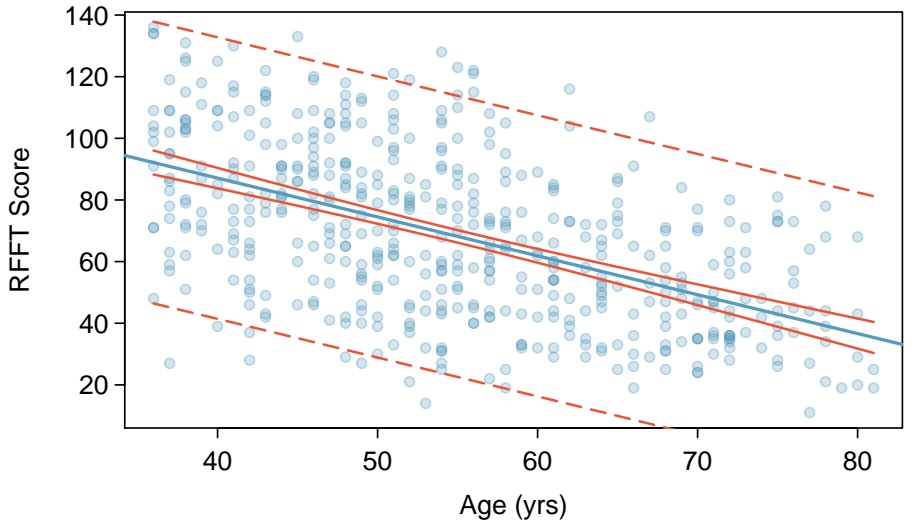

scatter

| Age (yrs) | RFFT Score |
| --- | --- |
| ~35 | ~135 |
| ~36 | ~105 |
| ~37 | ~108 |
| ~38 | ~95 |
| ~39 | ~102 |
| ~40 | ~115 |
| ~41 | ~105 |
| ~42 | ~118 |
| ~43 | ~108 |
| ~44 | ~115 |
| ~45 | ~105 |
| ~46 | ~118 |
| ~47 | ~105 |
| ~48 | ~115 |
| ~49 | ~105 |
| ~50 | ~115 |
| ~51 | ~105 |
| ~52 | ~115 |
| ~53 | ~105 |
| ~54 | ~115 |
| ~55 | ~105 |
| ~56 | ~115 |
| ~57 | ~105 |
| ~58 | ~115 |
| ~59 | ~105 |
| ~60 | ~115 |
| ~61 | ~105 |
| ~62 | ~115 |
| ~63 | ~105 |
| ~64 | ~115 |
| ~65 | ~105 |
| ~66 | ~115 |
| ~67 | ~105 |
| ~68 | ~115 |
| ~69 | ~105 |
| ~70 | ~115 |
| ~71 | ~105 |
| ~72 | ~115 |
| ~73 | ~105 |
| ~74 | ~115 |
| ~75 | ~105 |
| ~76 | ~115 |
| ~77 | ~105 |
| ~78 | ~115 |
| ~79 | ~105 |
| ~80 | ~115 |

Figure 6.20: A scatterplot showing RFFT versus age, with the regression line in blue. The confidence intervals are marked by solid red lines, while the prediction intervals are shown in dashed red lines.

---

6.5. INTERVAL ESTIMATES WITH REGRESSION

315

Figure 6.20 visually demonstrates confidence intervals and prediction intervals in the PRE-VEND example; the regression line is shown in blue, while the 95% confidence intervals and pre-diction intervals for each value of age are shown in red. At any value of age, the width of the interval estimate at that value is represented by the vertical distance between the two red lines. For example, the width of the confidence interval at age 60 years is represented by the distance be tween the points (60, 59.72) and (60, 64.18); the solid red lines pass through the upper and lower confidence bounds calculated in the earlier example. Similarly, the dashed red lines that represent prediction intervals pass through (60, 16.42) and (60, 107.68), the 95% upper and lower bounds for the predicted RFFT score of a 60-year-old.

The plot shows how the confidence intervals are most narrow at the mean age, 54.8 years, and become wider at values of age further from the mean. The prediction intervals are always wider than the confidence intervals. While the mean can be estimated with relative precision along the regression line, prediction intervals reflect the scatter of RFFT scores about the line (which is directly related to the inherent variability of RFFT scores within the study participants). While larger sample sizes can lead to narrower confidence intervals, the width of the prediction intervals will remain essentially unchanged unless the sampling scheme is changed in a way that reduces the variability of the response. A sample of individuals restricted to ages 60 - 70 years, for example, would be expected to have less variable RFFT scores, which would allow for narrower prediction intervals.

The distinction between confidence and prediction intervals is important and often overlooked. A clinical practitioner interested in the expected outcomes of a test generally should rely on confidence intervals for the mean along a regression line. The PREVEND data suggest that 60 year olds will score on average about 62 points on the test, and the average score is between 59.7 points and 62.2 points. When the RFFT is administered to a new 60 year old, however, the likely range of responses will be between 16.4 and 107.7. The prediction interval is wide because the scores on the test are quite variable.

---

316

CHAPTER 6. SIMPLE LINEAR REGRESSION

## 6.6 Notes

This chapter provides only an introduction to simple linear regression; the next chapter, Chapter $^ { 7 , }$ expands on the principles of simple regression to models with more than one predictor variable.

When fitting a simple regression, be sure to visually assess whether the model is appropriate. Nonlinear trends or outliers are often obvious in a scatterplot with the least squares line plotted. If outliers are evident, the data source should be consulted when possible, since outliers may be indicative of errors in data collection. It is also important to consider whether observed outliers belong to the target population of inference, and assess whether the outliers should be included in the analysis.

There are several variants of residual plots used for model diagnostics. The ones shown in Section 6.3.1, which plot the predicted values on the horizontal axis, easily generalize to settings with multiple predictors, since there is always a single predicted value even when there is more than one predictor. If the only model used is a simple regression, plotting residuals against predictor values may make it easier to identify a case with a notable residual. Additionally, data analysts will sometimes plot residuals against case number of the predictor, since runs of large or small residuals may indicate that adjacent cases are correlated.

The $R ^ { 2 }$ statistic is widely used in the social sciences, where the unexplained variability in the data is typically much larger than the variability captured or explained by a model. It is important to be aware of what information $R ^ { 2 }$ does and does not provide. Even though a model may have a low proportion of explained variability, regression coefficients in the model can still be highly statistically significant. The $R ^ { 2 }$ should not be interpreted as a measure of the quality of the fit of the model. It is possible for $R ^ { 2 }$ to be large even when the data do not show a linear relationship.

Linear regression models are often estimated after an investigator has noticed a linear relationship in data, and experienced investigators can often guess correctly that regression coefficients will be significant before calculating a p-value. Unlike with two-sample hypothesis tests, regression models are rarely specified in advance at the design stage. In practice, it is best to be skeptical about a small p-value in a regression setting, and wait to see whether the observed statistically significant relationship can be confirmed in an independent dataset. The issue of model validation and assessing whether results of a regression analysis will generalize to other datasets is often discussed at length in advanced courses.

In more advanced texts, substantial attention is devoted to the subtleties of fitting straight line models. For instance, there are strategies for adjusting an analysis when one or more of the assumptions for regression do not hold. There are also specific methods to numerically assess the leverage or influence that each observation has on a fitted model.

Lab 1 explores the relationship between cognitive function and age in adults by fitting and interpreting a straight line to these variables in the PREVEND dataset, in addition to discussing the statistical model for least squares regression and residual plots used to assess the assumptions for linear regression. The lab is a useful reminder that least squares regression is much more than the mechanics of finding a line that best fits a dataset. Lab 2 uses simulated data to explore the quantity $R ^ { 2 } ,$ . Lab 3 explores the use of binary categorical predictor variables in regression and shows how two-sample t-tests can be calculated using linear regression, in addition to introducing inference in a regression context. Categorical predictor variables are common in medicine and the life sciences.

---

6.7. EXERCISES

317

## 6.7 Exercises

## 6.7.1 Examining scatterplots

**6.1 Identify relationships, Part I.** For each of the six plots, identify the strength of the relationship (e.g. weak, moderate, or strong) in the data and whether fitting a linear model would be reasonable.

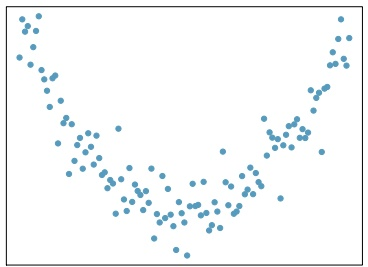

scatter

| X (range) | Y (range) |
| --- | --- |
| 0~100 | 0~100 |

(a)

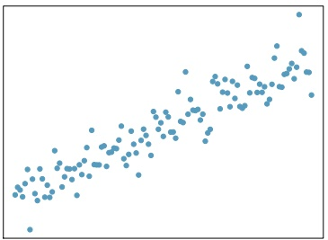

scatter

| X (range) | Y (range) |
| --- | --- |
| 0~100 | 0~100 |

(b)

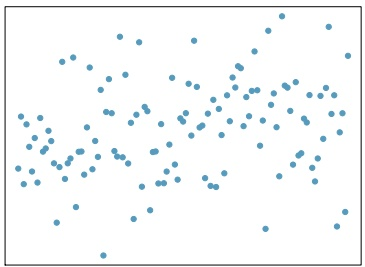

scatter

| X (range) | Y (range) |
| --- | --- |
| 0~100 | 0~100 |

(c)

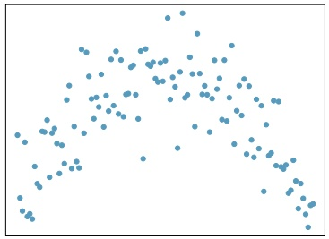

scatter

| X (range) | Y (range) |
| --- | --- |
| 0~100 | 0~100 |

(d)

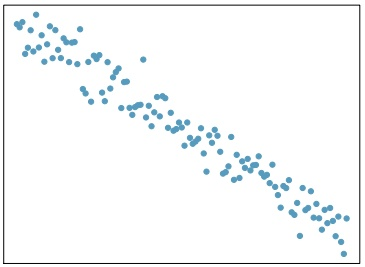

scatter

| X (range) | Y (range) |
| --- | --- |
| 0~100 | 0~100 |

(e)

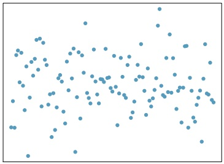

scatter

| X (range) | Y (range) |
| --- | --- |
| 0~100 | 0~100 |

(f)

**6.2 Identify relationships, Part II.** For each of the six plots, identify the strength of the relationship (e.g. weak, moderate, or strong) in the data and whether fitting a linear model would be reasonable.

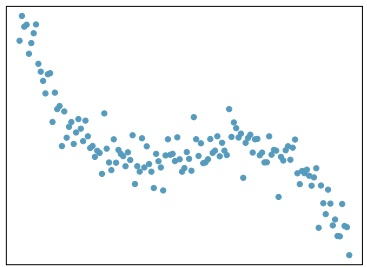

scatter

| X (range) | Y (range) |
| --- | --- |
| 0~100 | 0~100 |

(a)

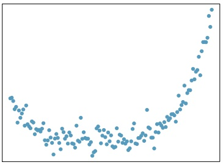

scatter

| X (range) | Y (range) |
| --- | --- |
| 0~100 | 0~100 |

(b)

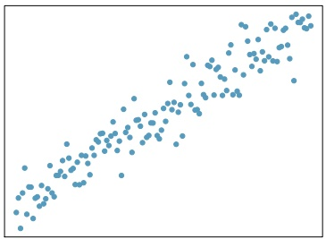

scatter

| X (range) | Y (range) |
| --- | --- |
| 0~100 | 0~100 |

(c)

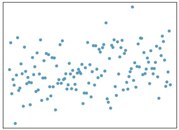

scatter

| X (range) | Y (range) |
| --- | --- |
| 0~100 | 0~100 |

(d)

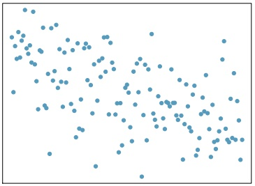

scatter

| X (range) | Y (range) |
| --- | --- |
| 0~100 | 0~100 |

(e)

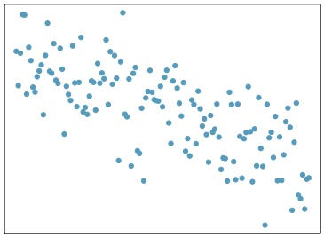

scatter

| X (range) | Y (range) |
| --- | --- |
| 0~100 | 0~100 |

(f)

---

318

CHAPTER 6. SIMPLE LINEAR REGRESSION

## 6.7.2 Estimating a regression line using least squares

**6.3 Body measurements, Part I.** Researchers studying anthropometry collected body girth measurements and skeletal diameter measurements, as well as age, weight, height and gender for 507 physically active individuals.28 The scatterplot below shows the relationship between height and shoulder girth (over deltoid muscles), both measured in centimeters.

(a) Describe the relationship between shoulder girth and height.
(b) How would the relationship change if shoulder girth was measured in inches while the units of height remained in centimeters?

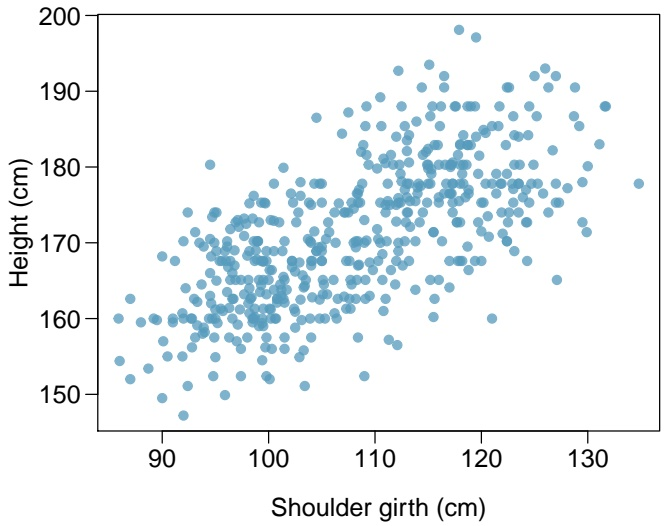

scatter

| Shoulder girth (cm) (range) | Height (cm) (range) |
| --- | --- |
| 85~135 | 147~199 |

**6.4 Body measurements, Part II.** The scatterplot below shows the relationship between weight measured in kilograms and hip girth measured in centimeters from the data described in Exercise 6.3.

(a) Describe the relationship between hip girth and weight.
(b) How would the relationship change if weight was measured in pounds while the units for hip girth remained in centimeters?

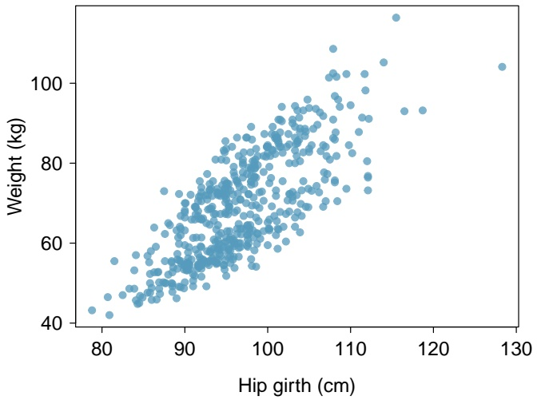

scatter

| Hip girth (cm) (range) | Weight (kg) (range) |
| --- | --- |
| 78~129 | 43~115 |

28G. Heinz et al. “[Exploring relationships in body dimensions](http://www.openintro.org/redirect.php?go=textbook-body_dim_2003&referrer=biostat1_pdf)”. In: Journal of Statistics Education 11.2 (2003).

---

6.7. EXERCISES

319

**6.5 Over-under, Part I.** Suppose we fit a regression line to predict the shelf life of an apple based on its weight. For a particular apple, we predict the shelf life to be 4.6 days. The apple’s residual is -0.6 days. Did we over or under estimate the shelf-life of the apple? Explain your reasoning.
**6.6 Over-under, Part II.** Suppose we fit a regression line to predict the number of incidents of skin cancer per 1,000 people from the number of sunny days in a year. For a particular year, we predict the incidence of skin cancer to be 1.5 per 1,000 people, and the residual for this year is 0.5. Did we over or under estimate the incidence of skin cancer? Explain your reasoning.
**6.7 Murders and poverty, Part I.** The following regression output is for predicting annual murders per million from percentage living in poverty in a random sample of 20 metropolitan areas.

<table><tr><td></td><td>Estimate</td><td>Std. Error</td><td>t value</td><td>Pr(&gt;|t|)</td></tr><tr><td>(Intercept)</td><td>-29.901</td><td>7.789</td><td>-3.839</td><td>0.001</td></tr><tr><td>poverty%</td><td>2.559</td><td>0.390</td><td>6.562</td><td>0.000</td></tr><tr><td>s = 5.512</td><td colspan="2"> $R^2$ = 70.52%</td><td colspan="2"> $R^{2}_{adj}$ = 68.89%</td></tr></table>

(a) Write out the linear model.
(b) Interpret the intercept.
(c) Interpret the slope.
(d) Calculate the correlation coefficient.

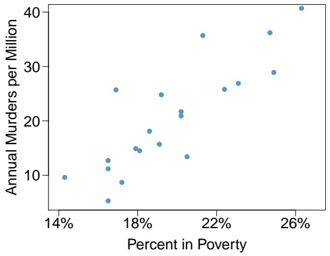

scatter

| Percent in Poverty | Annual Murders per Million |
| --- | --- |
| ~14.2% | ~9.8 |
| ~16.5% | ~5.5 |
| ~16.5% | ~11.2 |
| ~16.5% | ~12.8 |
| ~17.0% | ~8.8 |
| ~17.0% | ~25.8 |
| ~17.8% | ~14.8 |
| ~18.2% | ~14.5 |
| ~18.5% | ~18.2 |
| ~19.0% | ~15.8 |
| ~19.2% | ~24.8 |
| ~20.2% | ~21.0 |
| ~20.2% | ~21.8 |
| ~20.5% | ~13.5 |
| ~21.5% | ~35.8 |
| ~22.5% | ~26.0 |
| ~23.0% | ~27.0 |
| ~24.5% | ~36.2 |
| ~24.8% | ~29.0 |
| ~26.5% | ~40.8 |

**6.8 Cats, Part I.** The following regression output is for predicting the heart weight (in g) of cats from their body weight (in kg). The coefficients are estimated using a dataset of 144 domestic cats.

<table><tr><td></td><td>Estimate</td><td>Std. Error</td><td>t value</td><td>Pr(&gt;|t|)</td></tr><tr><td>(Intercept)</td><td>-0.357</td><td>0.692</td><td>-0.515</td><td>0.607</td></tr><tr><td>body wt</td><td>4.034</td><td>0.250</td><td>16.119</td><td>0.000</td></tr><tr><td>s = 1.452</td><td colspan="2"> $R^2$ = 64.66%</td><td colspan="2"> $R^{2}_{adj}$ = 64.41%</td></tr></table>

(a) Write out the linear model.
(b) Interpret the intercept.
(c) Interpret the slope.
(d) Calculate the correlation coefficient.

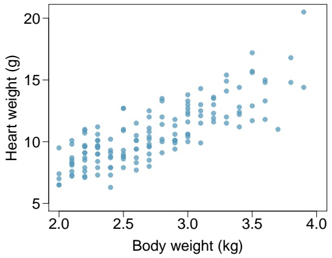

scatter

| Body weight (kg) | Heart weight (g) |
| --- | --- |
| ~2.0 | ~6.5 |
| ~2.0 | ~7.3 |
| ~2.0 | ~9.5 |
| ~2.1 | ~7.2 |
| ~2.1 | ~8.5 |
| ~2.1 | ~8.8 |
| ~2.1 | ~10.0 |
| ~2.2 | ~7.2 |
| ~2.2 | ~8.5 |
| ~2.2 | ~9.5 |
| ~2.2 | ~11.0 |
| ~2.3 | ~7.2 |
| ~2.3 | ~8.5 |
| ~2.3 | ~9.5 |
| ~2.3 | ~10.5 |
| ~2.3 | ~11.2 |
| ~2.4 | ~6.3 |
| ~2.4 | ~7.5 |
| ~2.4 | ~8.5 |
| ~2.4 | ~9.0 |
| ~2.4 | ~10.0 |
| ~2.5 | ~8.0 |
| ~2.5 | ~9.0 |
| ~2.5 | ~11.0 |
| ~2.5 | ~12.8 |
| ~2.6 | ~7.8 |
| ~2.6 | ~8.5 |
| ~2.6 | ~9.5 |
| ~2.6 | ~10.5 |
| ~2.6 | ~11.5 |
| ~2.7 | ~8.0 |
| ~2.7 | ~9.0 |
| ~2.7 | ~10.0 |
| ~2.7 | ~11.0 |
| ~2.7 | ~12.5 |
| ~2.8 | ~9.0 |
| ~2.8 | ~10.0 |
| ~2.8 | ~11.5 |
| ~2.8 | ~13.5 |
| ~2.9 | ~9.5 |
| ~2.9 | ~10.0 |
| ~2.9 | ~11.5 |
| ~3.0 | ~10.0 |
| ~3.0 | ~10.5 |
| ~3.0 | ~11.5 |
| ~3.0 | ~13.5 |
| ~3.1 | ~10.0 |
| ~3.1 | ~11.5 |
| ~3.1 | ~12.5 |
| ~3.1 | ~13.5 |
| ~3.1 | ~14.2 |
| ~3.2 | ~11.5 |
| ~3.2 | ~12.5 |
| ~3.2 | ~13.5 |
| ~3.3 | ~11.5 |
| ~3.3 | ~14.0 |
| ~3.3 | ~14.5 |
| ~3.3 | ~15.5 |
| ~3.4 | ~11.5 |
| ~3.4 | ~12.5 |
| ~3.4 | ~14.5 |
| ~3.4 | ~17.2 |
| ~3.5 | ~11.8 |
| ~3.5 | ~13.0 |
| ~3.5 | ~15.8 |
| ~3.6 | ~11.8 |
| ~3.6 | ~13.5 |
| ~3.6 | ~15.0 |
| ~3.7 | ~11.0 |
| ~3.8 | ~14.8 |
| ~3.8 | ~16.8 |
| ~3.9 | ~14.5 |
| ~3.9 | ~20.5 |

---

320

CHAPTER 6. SIMPLE LINEAR REGRESSION

**6.9 Age and RFFT score, Part I.** A linear model fit to RFFT scores and age for 500 randomly sampled individuals from the PREVEND data has equation $\widehat { R F F T } = 1 3 7 . 5 5 - 1 . 2 6 ( A g e )$

(a) Interpret the slope and intercept values in the context of the data; i.e., explain the linear model in terms that a non-statistician would understand. Comment on whether the intercept value has any interpretive meaning in this setting.
(b) Based on the linear model, how much does RFFT score differ, on average, between an individual who is 60 years old versus an individual who is 50 years old?
(c) According to the linear model, what is the average RFFT score for an individual who is 70 years old?
(d) Examine Figure 6.1. Is it valid to use the linear model to estimate RFFT score for an individual who is 20 years old? Explain your answer.

**6.10 Guppies, Part I.** Guppies are small, brightly colored tropical fish often seen in freshwater fish aquariums. A study was conducted in 147 male guppies to examine the relationship between coloration and heterozygosity; heterozygosity refers to the condition of having different alleles at a given genetic locus. The guppies were randomly sampled from a river in the wild.

In an initial stage of the study, researchers examined whether length and height are linearly associated. The mean length is 1261.21 cm, with standard deviation 95.62 cm. The mean height is 201.75 cm, with standard deviation 20.68. The correlation between length and height is 0.85.

(a) From a visual inspection, does it seem like the line is a reasonable fit for the data?
(b) Write the equation of the regression line for predicting length from height.
(c) Estimate the predicted mean length of a guppy with height 180 cm.

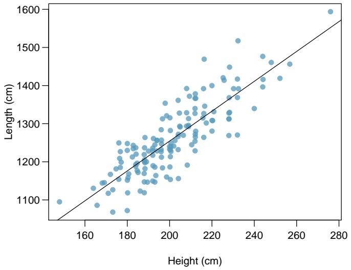

scatter

| Height (cm) | Length (cm) |
| --- | --- |
| ~150 | ~1095 |
| ~163 | ~1130 |
| ~165 | ~1085 |
| ~172 | ~1145 |
| ~173 | ~1120 |
| ~174 | ~1175 |
| ~175 | ~1180 |
| ~176 | ~1200 |
| ~177 | ~1250 |
| ~178 | ~1230 |
| ~179 | ~1240 |
| ~180 | ~1220 |
| ~181 | ~1250 |
| ~182 | ~1230 |
| ~183 | ~1240 |
| ~184 | ~1260 |
| ~185 | ~1250 |
| ~186 | ~1240 |
| ~187 | ~1260 |
| ~188 | ~1250 |
| ~189 | ~1240 |
| ~190 | ~1260 |
| ~191 | ~1250 |
| ~192 | ~1240 |
| ~193 | ~1260 |
| ~194 | ~1250 |
| ~195 | ~1240 |
| ~196 | ~1260 |
| ~197 | ~1250 |
| ~198 | ~1240 |
| ~199 | ~1260 |
| ~200 | ~1250 |
| ~201 | ~1240 |
| ~202 | ~1260 |
| ~203 | ~1250 |
| ~204 | ~1240 |
| ~205 | ~1260 |
| ~206 | ~1250 |
| ~207 | ~1240 |
| ~208 | ~1260 |
| ~209 | ~1250 |
| ~210 | ~1240 |
| ~211 | ~1260 |
| ~212 | ~1250 |
| ~213 | ~1240 |
| ~214 | ~1260 |
| ~215 | ~1250 |
| ~216 | ~1240 |
| ~217 | ~1260 |
| ~218 | ~1250 |
| ~219 | ~1240 |
| ~220 | ~1260 |
| ~221 | ~1250 |
| ~222 | ~1240 |
| ~223 | ~1260 |
| ~224 | ~1250 |
| ~225 | ~1240 |
| ~226 | ~1260 |
| ~227 | ~1250 |
| ~228 | ~1240 |
| ~229 | ~1260 |
| ~230 | ~1250 |
| ~231 | ~1240 |
| ~232 | ~1260 |
| ~233 | ~1250 |
| ~234 | ~1240 |
| ~235 | ~1260 |
| ~236 | ~1250 |
| ~237 | ~1240 |
| ~238 | ~1260 |
| ~239 | ~1250 |
| ~240 | ~1240 |
| ~241 | ~1260 |
| ~242 | ~1250 |
| ~243 | ~1240 |
| ~244 | ~1260 |
| ~245 | ~1250 |
| ~246 | ~1240 |
| ~247 | ~1260 |
| ~248 | ~1250 |
| ~249 | ~1240 |
| ~250 | ~1260 |
| ~251 | ~1250 |
| ~252 | ~1240 |
| ~253 | ~1260 |
| ~254 | ~1250 |
| ~255 | ~1240 |
| ~256 | ~1260 |
| ~257 | ~1250 |
| ~258 | ~1240 |
| ~259 | ~1260 |
| ~260 | ~1250 |
| ~261 | ~1240 |
| ~262 | ~1260 |
| ~263 | ~1250 |
| ~264 | ~1240 |
| ~265 | ~1260 |
| ~266 | ~1250 |
| ~267 | ~1240 |
| ~268 | ~1260 |
| ~269 | ~1250 |
| ~270 | ~1240 |
| ~271 | ~1260 |
| ~272 | ~1250 |
| ~273 | ~1240 |
| ~274 | ~1260 |
| ~275 | 1600 |

---

6.7. EXERCISES

321

## 6.7.3 Interpreting a linear model

**6.11 Visualize the residuals.** The scatterplots shown below each have a superimposed regression line. If we were to construct a residual plot (residuals versus x) for each, describe what those plots would look like.

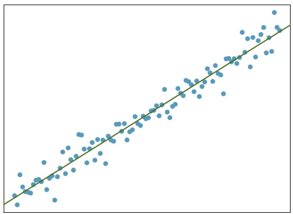

scatter

| X (range) | Y (range) |
| --- | --- |
| 0~100 | 0~100 |

(a)

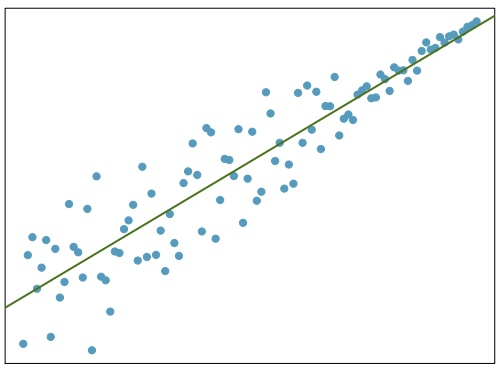

scatter

| X (range) | Y (range) |
| --- | --- |
| 0~100 | 0~100 |

(b)

**6.12 Trends in the residuals.** Shown below are two plots of residuals remaining after fitting a linear model to two different sets of data. Describe important features and determine if a linear model would be appropriate for these data. Explain your reasoning.

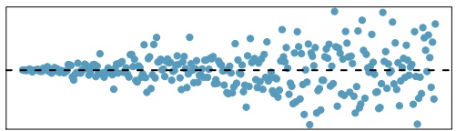

scatter

| Series | X (range) | Y (range) |
| --- | --- | --- |
| Data Points | 0~100 | -5~10 |

(a)

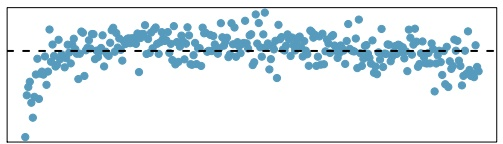

scatter

| Series | X (range) | Y (range) |
| --- | --- | --- |
| Data Points | 0~100 | -5~8 |

(b)

**6.13 Guppies, Part II.** Exercise 6.10 showed a plot of length versus height for 147 male guppies with a least squares regression line.

(a) Identify two points that have relatively high leverage and discuss whether these points seem to be particularly influential.
(b) Based on the plot, comment on whether it is appropriate to use $R ^ { 2 }$ as a metric for describing the strength of the model fit.
(c) The $R ^ { 2 }$ for this model is 0.718. Interpret this value in the context of the data.

---

322

CHAPTER 6. SIMPLE LINEAR REGRESSION

**6.14 Nutrition at Starbucks, Part I.** The scatterplot below shows the relationship between the number of calories and amount of carbohydrates (in grams) Starbucks food menu items contain.29 Since Starbucks only lists the number of calories on the display items, we are interested in predicting the amount of carbs a menu item has based on its calorie content.

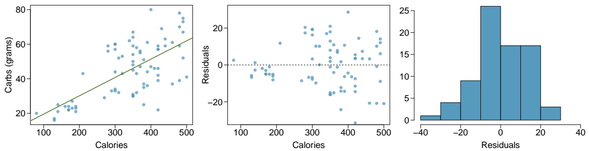

(a) Describe the relationship between number of calories and amount of carbohydrates (in grams) that Starbucks food menu items contain.
(b) In this scenario, what are the explanatory and response variables?
(c) Why might we want to fit a regression line to these data?
(d) Do these data meet the conditions required for fitting a least squares line?

**6.15 Nutrition at Starbucks, Part II.** Exercise 6.14 introduced a data set on nutrition information on Starbucks food menu items. Based on the scatterplot and the residual plot provided, describe the relationship between the protein content and calories of these menu items, and determine if a simple linear model is appropriate to predict amount of protein from the number of calories.

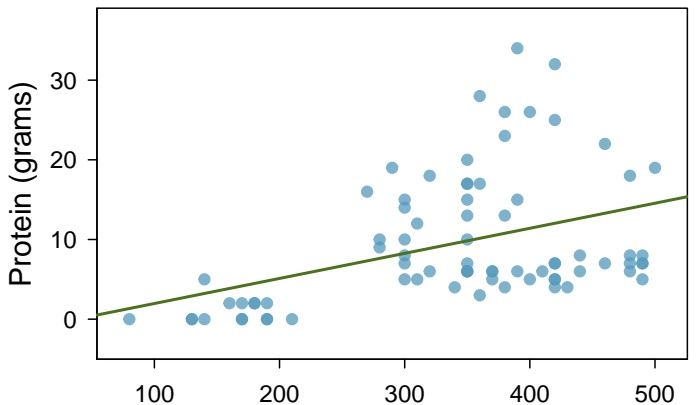

scatter

| X | Protein (grams) |
| --- | --- |
| ~80 | 0 |
| ~130 | 0 |
| ~140 | 5 |
| ~160 | 2 |
| ~170 | 2 |
| ~180 | 2 |
| ~190 | 0 |
| ~210 | 0 |
| ~270 | 16 |
| ~280 | 10 |
| ~290 | 19 |
| ~300 | 15 |
| ~300 | 14 |
| ~300 | 12 |
| ~300 | 8 |
| ~300 | 5 |
| ~310 | 6 |
| ~320 | 18 |
| ~340 | 4 |
| ~350 | 20 |
| ~350 | 17 |
| ~350 | 15 |
| ~350 | 13 |
| ~350 | 7 |
| ~350 | 6 |
| ~360 | 28 |
| ~360 | 17 |
| ~360 | 17 |
| ~360 | 13 |
| ~360 | 7 |
| ~360 | 4 |
| ~370 | 23 |
| ~370 | 15 |
| ~380 | 34 |
| ~380 | 26 |
| ~380 | 26 |
| ~390 | 13 |
| ~400 | 6 |
| ~410 | 6 |
| ~420 | 7 |
| ~420 | 5 |
| ~420 | 4 |
| ~430 | 8 |
| ~440 | 7 |
| ~460 | 22 |
| ~480 | 18 |
| ~490 | 8 |
| ~490 | 8 |
| ~490 | 7 |
| ~490 | 5 |
| ~500 | 19 |

Calories

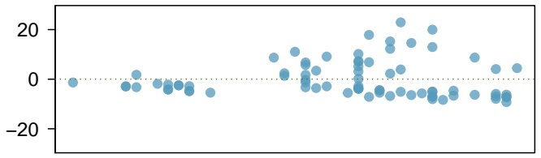

scatter

| X (range) | Y (range) |
| --- | --- |
| ~0 ~35 | ~-8 ~24 |

29Source: Starbucks.com, collected on March 10, 2011, [www.starbucks.com/menu/nutrition](http://www.openintro.org/redirect.php?go=textbook-starbucks_com_menu_nutrition&referrer=biostat1_pdf).

---

6.7. EXERCISES

323

**6.16 Body measurements, Part III.** Exercise 6.3 introduces data on shoulder girth and height of a group of individuals. The mean shoulder girth is 107.20 cm with a standard deviation of 10.37 cm. The mean height is 171.14 cm with a standard deviation of 9.41 cm. The correlation between height and shoulder girth is 0.67.

(a) Write the equation of the regression line for predicting height.
(b) Interpret the slope and the intercept in this context.
(c) Calculate $R ^ { 2 }$ of the regression line for predicting height from shoulder girth, and interpret it in the context of the application.
(d) A randomly selected student from your class has a shoulder girth of 100 cm. Predict the height of this student using the model.
(e) The student from part (d) is 160 cm tall. Calculate the residual, and explain what this residual means.
(f) A one year old has a shoulder girth of 56 cm. Would it be appropriate to use this linear model to predict the height of this child?

**6.17 Outliers, Part I.** Identify the outliers in the scatterplots shown below, and determine what type of outliers they are. Explain your reasoning.

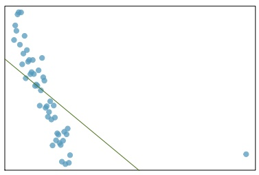

scatter

| X (range) | Y (range) |
| --- | --- |
| 0~100 | 0~100 |

(a)

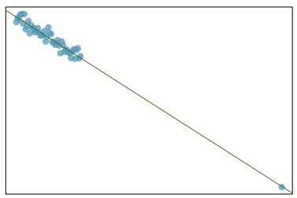

scatter

| X (range) | Y (range) |
| --- | --- |
| 0~100 | 0~100 |

(b)

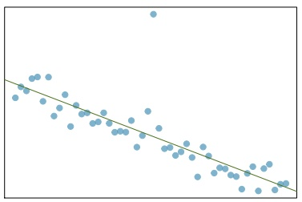

scatter

| X (range) | Y (range) |
| --- | --- |
| 0~100 | 0~100 |

(c)

**6.18 Outliers, Part II.** Identify the outliers in the scatterplots shown below and determine what type of outliers they are. Explain your reasoning.

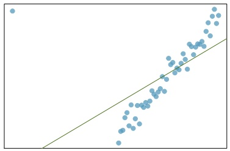

scatter

| X (range) | Y (range) |
| --- | --- |
| 0~100 | 0~100 |

(a)

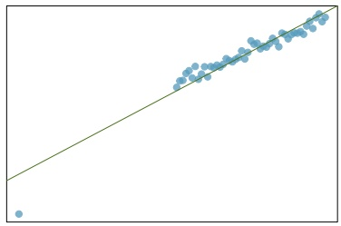

scatter

| X (range) | Y (range) |
| --- | --- |
| ~0.1 ~0.95 | ~0.1 ~0.95 |

(b)

scatter

| X (range) | Y (range) |
| --- | --- |
| 0~100 | 0~100 |

(c)

---

324

CHAPTER 6. SIMPLE LINEAR REGRESSION

**6.19 Guppies, Part III.** The residual plots below are for the linear model fit in Exercise 6.10 predicting length from height for 147 male guppies.

(a) From a plot of residual values versus predicted values, are the assumptions of linearity and constant variability satisfied? Explain your answer.
(b) Is it reasonable to assume that the observations were independent, based on the description of the study? Explain your answer.
(c) Are the residuals approximately normally distributed? Explain your answer.

**6.20 Guppies, Part IV.** Multilocus heterozygosity (MLH) is reflective of genetic quality; according to sexual selection research, it is thought that sexual ornamentation functions as a visual indicator of fitness. By selecting males with features such as bright coloration, females can improve the chances of reproductive success.

Male guppies are covered in a mixture of colored spots; orange coloration is consistently preferred by females. Heterozygosity was assessed by genotyping 9 loci and calculating the proportion of loci that are heterozygous. The research question of interest is whether MLH and orange color are linearly associated.

(a) Based on the plot of MLH versus relative orange area, describe the nature of the association in language accessible to a general audience.
(b) Comment on whether the assumptions of linearity and constant variability are reasonably met.
(c) Comment on whether the residuals are approximately normally distributed.

---

6.7. EXERCISES

325

**6.21 Diamond prices, Part II.** Exercise 5.24 introduced data on the price of diamonds based on whether a diamond is 0.99 carats or 1 carat. Based on the summary statistics, write an estimated model equation pre-dicting price from a binary indicator of carat weight. Be sure to clearly define the variables used in the model.

|  | 0.99 carats | 1 carat |
| --- | --- | --- |
| Mean | $ 44.51 | $ 56.81 |
| SD | $ 13.32 | $ 16.13 |
| n | 23 | 23 |

**6.22 Avian influenza, Part II.** Exercise 5.28 introduced data from an analysis investigating whether hatch weights between transgenic and non-transgenic chicks differ.

|  | transgenic chicks (g) | non-transgenic chicks (g) |
| --- | --- | --- |
| $\bar{x}$ | 45.14 | 44.99 |
| s | 3.32 | 4.57 |
| n | 54 | 54 |

(a) Write an estimated least squares regression line for a model predicting hatch weight from chick type, where non-transgenic chicks are the reference group; i.e., the group for which the binary predictor takes on value 0.
(b) Write an estimated least squares regression line for a model predicting hatch weight from chick type, where transgenic chicks are the reference group.

---

326

CHAPTER 6. SIMPLE LINEAR REGRESSION

## 6.7.4 Statistical inference with regression

**6.23 Body measurements, Part IV.** The scatterplot and least squares summary below show the relationship between weight measured in kilograms and height measured in centimeters of 507 physically active individ uals.

scatter

| Height (cm) (range) | Weight (kg) (range) |
| --- | --- |
| 145~200 | 40~115 |

|  | Estimate | Std. Error | t value | Pr(>\|t\|) |
| --- | --- | --- | --- | --- |
| (Intercept) | -105.0113 | 7.5394 | -13.93 | 0.0000 |
| height | 1.0176 | 0.0440 | 23.13 | 0.0000 |

(a) Describe the relationship between height and weight.
(b) Write the equation of the regression line. Interpret the slope and intercept in context.
(c) Do the data provide strong evidence that an increase in height is associated with an increase in weight? State the null and alternative hypotheses, report the p-value, and state your conclusion.
(d) The correlation coefficient for height and weight is 0.72. Calculate $R ^ { 2 }$ and interpret it in context.

**6.24 Beer and blood alcohol content.** Many people believe that gender, weight, drinking habits, and many other factors are much more important in predicting blood alcohol content (BAC) than simply considering the number of drinks a person consumed. Here we examine data from sixteen student volunteers at Ohio State University who each drank a randomly assigned number of cans of beer. These students were evenly divided between men and women, and they differed in weight and drinking habits. Thirty minutes later, a police officer measured their blood alcohol content (BAC) in grams of alcohol per deciliter of blood.30 The scatterplot and regression table summarize the findings.

scatter

| Cans of beer | BAC (grams / deciliter) |
| --- | --- |
| 1 | ~0.015 |
| 2 | ~0.03 |
| 3 | ~0.02 |
| 3 | ~0.04 |
| 3 | ~0.07 |
| 4 | ~0.05 |
| 4 | ~0.07 |
| 5 | ~0.05 |
| 5 | ~0.06 |
| 5 | ~0.085 |
| 5 | ~0.10 |
| 6 | ~0.10 |
| 7 | ~0.09 |
| 7 | ~0.095 |
| 8 | ~0.12 |
| 9 | ~0.19 |

|  | Estimate | Std. Error | t value | Pr(>\|t\|) |
| --- | --- | --- | --- | --- |
| (Intercept) | -0.0127 | 0.0126 | -1.00 | 0.3320 |
| beers | 0.0180 | 0.0024 | 7.48 | 0.0000 |

(a) Describe the relationship between the number of cans of beer and BAC.
(b) Write the equation of the regression line. Interpret the slope and intercept in context.
(c) Do the data provide strong evidence that drinking more cans of beer is associated with an increase in blood alcohol? State the null and alternative hypotheses, report the p-value, and state your conclusion.
(d) The correlation coefficient for number of cans of beer and BAC is 0.89. Calculate $R ^ { 2 }$ and interpret it in context.
(e) Suppose we visit a bar, ask people how many drinks they have had, and also take their BAC. Do you think the relationship between number of drinks and BAC would be as strong as the relationship found in the Ohio State study?

<small>30J. Malkevitch and L.M. Lesser. For All Practical Purposes: Mathematical Literacy in Today’s World. WH Freeman & Co, 2008.</small>

---

6.7. EXERCISES

327

**6.25 Husbands and wives, Part I.** The scatterplot below summarizes husbands’ and wives’ heights in a random sample of 170 married couples in Britain, where both partners’ ages are below 65 years. Summary output of the least squares fit for predicting wife’s height from husband’s height is also provided in the table.

scatter

| Husband's height (inches) | Wife's height (inches) |
| --- | --- |
| ~61.5 | ~62.3 |
| ~62.0 | ~64.7 |
| ~62.5 | ~60.3 |
| ~62.8 | ~61.9 |
| ~63.0 | ~59.5 |
| ~63.5 | ~56.0 |
| ~64.0 | ~65.0 |
| ~64.2 | ~64.2 |
| ~64.5 | ~62.2 |
| ~64.8 | ~60.0 |
| ~65.0 | ~66.7 |
| ~65.2 | ~63.8 |
| ~65.5 | ~69.4 |
| ~65.8 | ~63.8 |
| ~66.0 | ~63.5 |
| ~66.2 | ~63.8 |
| ~66.5 | ~63.8 |
| ~66.8 | ~63.8 |
| ~67.0 | ~63.8 |
| ~67.2 | ~63.8 |
| ~67.5 | ~63.8 |
| ~67.8 | ~63.8 |
| ~68.0 | ~63.8 |
| ~68.2 | ~63.8 |
| ~68.5 | ~63.8 |
| ~68.8 | ~63.8 |
| ~69.0 | ~63.8 |
| ~69.2 | ~63.8 |
| ~69.5 | ~63.8 |
| ~69.8 | ~63.8 |
| ~70.0 | ~63.8 |
| ~70.2 | ~63.8 |
| ~70.5 | ~63.8 |
| ~70.8 | ~63.8 |
| ~71.0 | ~63.8 |
| ~71.2 | ~63.8 |
| ~71.5 | ~63.8 |
| ~71.8 | ~63.8 |
| ~72.0 | ~63.8 |
| ~72.2 | ~63.8 |
| ~72.5 | ~63.8 |
| ~72.8 | ~63.8 |
| ~73.0 | ~63.8 |
| ~73.2 | ~63.8 |
| ~73.5 | ~63.8 |
| ~73.8 | ~63.8 |
| ~74.0 | ~63.8 |
| ~74.2 | ~63.8 |
| ~74.5 | ~63.8 |
| ~74.8 | ~63.8 |
| ~75.0 | ~63.8 |

|  | Estimate | Std. Error | t value | Pr(>\|t\|) |
| --- | --- | --- | --- | --- |
| (Intercept) | 43.5755 | 4.6842 | 9.30 | 0.0000 |
| height_husband | 0.2863 | 0.0686 | 4.17 | 0.0000 |

(a) Is there strong evidence that taller men marry taller women? State the hypotheses and include any information used to conduct the test.
(b) Write the equation of the regression line for predicting wife’s height from husband’s height.
(c) Interpret the slope and intercept in the context of the application.
(d) Given that $R ^ { 2 } = 0 . 0 9$ , what is the correlation of heights in this data set?
(e) You meet a married man from Britain who is $5 ^ { \prime } 9 ^ { \prime \prime }$ (69 inches). What would you predict his wife’s height to be? How reliable is this prediction?
(f) You meet another married man from Britain who is $6 ^ { \prime } 7 ^ { \prime \prime }$ (79 inches). Would it be wise to use the same linear model to predict his wife’s height? Why or why not?
(g) Is there statistically significant evidence of an association between husband height and wife height based on these data? Explain your answer.
(h) Would you expect a 95% confidence interval for husband height to contain 0? Explain your answer.

**6.26 Helmets and lunches.** The scatterplot shows the relationship between socioeconomic status measured as the percentage of children in a neighborhood receiving reduced-fee lunches at school (lunch) and the percentage of bike riders in the neighborhood wearing helmets (helmet). The average percentage of children receiving reduced-fee lunches is 30.8% with a standard deviation of 26.7% and the average percentage of bike riders wearing helmets is 38.8% with a standard deviation of 16.9%.

(a) If the $R ^ { 2 }$ for the least-squares regression line for these data is 72%, what is the correlation between lunch and helmet?
(b) Calculate the slope and intercept for the least-squares regression line for these data.
(c) Interpret the intercept of the least-squares regression line in the context of the application.
(d) Interpret the slope of the least-squares regression line in the context of the application.
(e) What would the value of the residual be for a neighborhood where 40% of the children receive reduced-fee lunches and 40% of the bike riders wear helmets? Interpret the meaning of this residual in the context of the application.

scatter

| Rate of Receiving a Reduced-Fee Lunch (%) | Rate of Wearing a Helmet (%) |
| --- | --- |
| ~2 | ~58 |
| ~3 | ~34 |
| ~12 | ~55 |
| ~12 | ~36 |
| ~20 | ~23 |
| ~20 | ~33 |
| ~26 | ~39 |
| ~26 | ~43 |
| ~50 | ~22 |
| ~51 | ~21 |
| ~73 | ~6 |
| ~82 | ~4 |

---

328

CHAPTER 6. SIMPLE LINEAR REGRESSION

**6.27 Husbands and wives, Part II.** Exercise 6.25 presents a scatterplot displaying the relationship between husbands’ and wives’ ages in a random sample of 170 married couples in Britain, where both partners’ ages are below 65 years. Given below is summary output of the least squares fit for predicting wife’s age from husband’s age.

scatter

| Husband's age (in years) | Wife's age (in years) |
| --- | --- |
| ~20 | ~18 |
| ~20 | ~22 |
| ~21 | ~21 |
| ~23 | ~24 |
| ~24 | ~25 |
| ~25 | ~26 |
| ~26 | ~27 |
| ~27 | ~28 |
| ~28 | ~29 |
| ~29 | ~30 |
| ~30 | ~31 |
| ~31 | ~32 |
| ~32 | ~33 |
| ~33 | ~34 |
| ~34 | ~35 |
| ~35 | ~36 |
| ~36 | ~37 |
| ~37 | ~38 |
| ~38 | ~39 |
| ~39 | ~40 |
| ~40 | ~41 |
| ~41 | ~42 |
| ~42 | ~43 |
| ~43 | ~44 |
| ~44 | ~45 |
| ~45 | ~46 |
| ~46 | ~47 |
| ~47 | ~48 |
| ~48 | ~49 |
| ~49 | ~50 |
| ~50 | ~51 |
| ~51 | ~52 |
| ~52 | ~53 |
| ~53 | ~54 |
| ~54 | ~55 |
| ~55 | ~56 |
| ~56 | ~57 |
| ~57 | ~58 |
| ~58 | ~59 |
| ~59 | ~60 |
| ~60 | ~61 |
| ~61 | ~62 |
| ~62 | ~63 |
| ~63 | ~64 |
| ~64 | ~65 |

<table><tr><td></td><td>Estimate</td><td>Std. Error</td><td>t value</td><td>Pr(&gt;|t|)</td></tr><tr><td>(Intercept)</td><td>1.5740</td><td>1.1501</td><td>1.37</td><td>0.1730</td></tr><tr><td>age_husband</td><td>0.9112</td><td>0.0259</td><td>35.25</td><td>0.0000</td></tr><tr><td colspan="4"></td><td> $df = 168$ </td></tr></table>

(a) We might wonder, is the age difference between husbands and wives consistent across ages? If this were the case, then the slope parameter would be $\beta _ { 1 } = 1$ . Use the information above to evaluate if there is strong evidence that the difference in husband and wife ages differs for different ages.
(b) Write the equation of the regression line for predicting wife’s age from husband’s age.
(c) Interpret the slope and intercept in context.
(d) Given that $R ^ { 2 } = 0 . 8 8 ,$ , what is the correlation of ages in this data set?
(e) You meet a married man from Britain who is 55 years old. What would you predict his wife’s age to be? How reliable is this prediction?
(f) You meet another married man from Britain who is 85 years old. Would it be wise to use the same linear model to predict his wife’s age? Explain.

**6.28 Guppies, Part V.** Exercise 6.20 introduced a linear model for predicting relative orange area from proportion of loci that are heterozygous (MLH). Relative orange area refers to the percentage of the body that is orange (rather than a different color).

<table><tr><td></td><td>Estimate</td><td>Std. Error</td><td>t value</td><td>Pr(&gt;|t|)</td></tr><tr><td>(Intercept)</td><td>0.037</td><td>0.010</td><td>3.68</td><td>0.0033</td></tr><tr><td>MLH</td><td>0.051</td><td>0.018</td><td>2.77</td><td>0.0063</td></tr><tr><td colspan="5"> $df = 145$ </td></tr></table>

(a) Write the estimated model equation.
(b) What is the predicted mean relative orange area for a guppy that is heterozygous at 8 out of 9 loci?
(c) Based on the linear model, how much does mean relative orange area differ between a guppy that is heterozygous at 2 loci versus 4 loci (out of 9 total)?
(d) Conduct a hypothesis test to determine whether relative orange area is significantly associated with MLH. Do the results suggest that more elaborate sexual ornaments are associated with increased heterozygosity? Explain.
(e) Compute and interpret a 95% confidence interval for the slope parameter $\beta _ { 1 }$

---

6.7. EXERCISES

329

**6.29 Age and RFFT score, Part II.** The following regression output is for predicting RFFT score of 500 randomly sampled individuals from the PREVEND data based on age (years).

<table><tr><td></td><td>Estimate</td><td>Std. Error</td><td>t value</td><td>Pr(&gt;|t|)</td></tr><tr><td>(Intercept)</td><td>137.55</td><td>5.02</td><td>27.42</td><td>0.000</td></tr><tr><td>Age</td><td>-1.26</td><td>0.09</td><td>-14.09</td><td>0.000</td></tr><tr><td colspan="5"> $df = 498$ </td></tr></table>

(a) Do these data provide statistically significant evidence at the $\alpha = 0 . 0 1$ significance level that age is associated with RFFT score? State the null and alternative hypotheses, report the relevant p-value, and state your conclusion.
(b) Compute and interpret a 99% confidence interval for the population slope.

**6.30 Avian influenza, Part III.** Exercise 5.28 introduced data from an analysis investigating whether hatch weights between transgenic and non-transgenic chicks differ. Based on the results from conducting the twogroup test, explain whether the 95% confidence interval for the $\beta _ { 1 }$ parameter in a model predicting hatch weight from a group indicator would contain 0.

## 6.7.5 Interval estimates with regression

**6.31 Husbands and wives, Part III.** Exercise 6.27 introduces data from a random sample of 170 married couples in Britain, where both partners’ ages are below 65 years, and fits a model predicting wife’s age from husband’s age. Wife’s age has a mean of 40.68 years, with standard deviation 11.41 years. Husband’s age has a mean of 42.92 years, with standard deviation 11.76 years. From software, the residual standard error is $s = 3 . 9 5 .$

(a) Use the summary statistics to calculate a 95% confidence interval for the average age of wives whose husbands are 55 years old.
(b) You meet a married man from Britain who is 55 years old. Predict his wife’s age and give a 95% prediction interval for her age.
(c) Repeat parts (a) and (b) using the approximate formulas for the appropriate standard errors.

**6.32 Guppies, Part VI.** The relationship between length and height for 147 male guppies was introduced in Exercise 6.10, which used the summary statistics to calculate the equation of the least squares line for length as a function of height and estimate the mean length of an adult male guppy with height 180 cm. The estimated residual standard error from this model is s = 50.93.

(a) Use the summary statistics given in Exercise 6.10 to construct a 95% confidence interval for the estimated mean length when height is 180 cm.
(b) Use a prediction interval based on the summary statistics to estimate the lengths for a new 180 cm guppy that would be more than two standard deviations above and below the estimated mean.
(c) Use the approximate formulas for the standard error for a mean and for a prediction to recalculate the intervals in parts (a) and (b).
