# 8 Inference for categorical data

原始 PDF 第 386–467 页。

# Chapter 8

## Inference for categorical data

**8.1 Inference for a single proportion**
**8.2 Inference for the difference of two proportions**
**8.3 Inference for two or more groups**
**8.4 Chi-square tests for the fit of a distribution**
**8.5 Outcome-based sampling: case-control studies**
**8.6 Notes**
**8.7 Exercises**

---

387

Previous chapters discussed methods of inference for numerical data; in this chapter, those methods are extended to categorical data, such as binomial proportions or data in two-way tables. While various details of the methods may change, such as the calculations for a test statistic or the distributions used to find a p-value, the core ideas and principles behind inference remain the same.

Categorical data arise frequently in medical research because disease outcomes and patient characteristics are often recorded in natural categories such as types of treatment received, whether or not disease advanced to a later stage, or whether or not a patient responded initially to a treatment. In the simplest settings, a binary outcome (yes/no, success/failure, etc) is recorded for a single group of participants, in hopes of learning more about the population from which the participants were drawn. The binomial distribution is often used for the statistical model in this setting, and inference about the binomial probability of success provides information about a population proportion p. In more complex settings, participant characteristics are recorded in a categorical variable with two or more levels, and the outcome or response variable itself has two or more levels. In these instances, data are usually summarized in two-way tables with two or more rows and two or more columns.

As with all methods of inference, it is important to understand how the data were collected and whether the data may be viewed as a random sample from a well-identified population, at least approximately. This issue is at least as important as the formulas for test statistics and confidence intervals, and is often overlooked.

Be careful about the notation in this chapter—since p is the standard notation for a population proportion and for a probability, p does double duty in this chapter as a population parameter and significance level.

For labs, slides, and other resources, please visit

[www.openintro.org/book/biostat](http://www.openintro.org/redirect.php?go=biostat&referrer=biostat1_pdf)

---

388

CHAPTER 8. INFERENCE FOR CATEGORICAL DATA

## 8.1 Inference for a single proportion

Advanced melanoma is an aggressive form of skin cancer that until recently was almost uniformly fatal. In rare instances, a patient’s melanoma stopped progressing or disappeared altogether when the patient’s immune system successfully mounted a response to the cancer. Those observations led to research into therapies that might trigger an immune response in cancer. Some of the most notable successes have been in melanoma, particularly with two new therapies, nivolumab and ipilimumab.1

A 2013 report in the New England Journal of Medicine by Wolchok et al. reported the results of a study in which patients were treated with both nivolumab and ipilimumab.2 Fifty-three patients were given the new regimens concurrently, and the response to therapy could be evaluated in 52 of the 53. Of the 52 evaluable patients, 21 (40%) experienced a response according to commonly accepted criteria. In previous studies, the proportion of patients responding to one of these agents was 30% or less. How might one compare the new data to past results?

The data from this study are binomial data, with success defined as a response to therapy. Suppose the number of patients who respond in a study like this is represented by the random variable $X ,$ where X is binomial with parameters n (the number of trials, where each trial is rep resented by a patient) and $p$ (the unknown population proportion of response). From formulas discussed in Chapter 3, the mean of X is np and the standard deviation of $X$ is $\sqrt { n p ( 1 - p ) }$

Inference about $p$ is based on the sample proportion $\hat { p } ,$ where $\hat { p } = X / n$ . In this case, $\hat { p } = 2 1 / 5 2 =$ 0.404. If the sample proportion is nearly normally distributed, the normal approximation to the binomial distribution can be used to conduct inference; this method is commonly used. When X does not have an approximately normal distribution, exact inference can based on the binomial distribution for X. Both the normal approximation and exact methods are covered in this chapter.

## 8.1.1 Inference using the normal approximation

A **sample proportion** can be described as a sample mean. If each success in the melanoma data is represented as a 1 and each failure as a 0, then the sample proportion is the mean of the 52 numerical outcomes:

$$
\hat {p} = \frac {0 + 1 + 1 + \cdots + 0}{5 2} = 0. 4 0 4.
$$

The distribution of $\hat { p }$ is nearly normal when the distribution of successes and failures is not too strongly skewed.

<small>1The -mab suffix in these therapies stands for monoclonal antibody, a therapeutic agent made by identical immune cells that are all clones of a unique parent cell from a patient.</small>

<small>2N Engl J Med 2013;369:122-33. DOI: 10.1056/NEJMoa1302369</small>

---

8.1. INFERENCE FOR A SINGLE PROPORTION

389

## CONDITIONS FOR THE SAMPLING DISTRIBUTION OF $\hat { p }$ BEING NEARLY NORMAL

The sampling distribution for ${ \hat { p } } ,$ calculated from a sample of size n from a population with a success proportion $p ,$ is nearly normal when

1. the sample observations are independent and
2. at least 10 successes and 10 failures are expected in the sample, i.e. $n p \geq 1 0$ and $n ( 1   -   p ) \geq$ 10. This is called the **success-failure condition**.

If these conditions are met, then the sampling distribution of $\hat { p }$ is approximately normal with mean $p$ and standard error

$$
S E _ {\hat {p}} = \sqrt {\frac {p (1 - p)}{n}}. \tag {8.1}
$$

$\hat{p}$ sample proportion

p
population
proportion

When conducting inference, the population proportion $p$ is unknown. Thus, to construct a confidence interval, the sample proportion $\hat { p }$ can be substituted for $p$ to check the success-failure condition and compute the standard error. In a hypothesis test, $p _ { 0 }$ is substituted for $p .$

## Confidence intervals for a proportion

When using the normal approximation to the sampling distribution of $\hat { p } ,$ a confidence interval for a proportion has the same structure as a confidence interval for a mean; it is centered at the point estimate, with a margin of error calculated from the standard error and appropriate $z ^ { \star }$ value. The formula for a 95% confidence interval is

$$
\hat {p} \pm 1. 9 6 \sqrt {\frac {\hat {p} (1 - \hat {p})}{n}}.
$$

## EXAMPLE 8.2

Using the normal approximation, construct an approximate 95% confidence interval for the response probability for patients with advanced melanoma who were administered the combination of nivolumab and ipilimumab.

The independence and success-failure assumptions should be checked first. Since the outcome of one patient is unlikely to influence that of other patients, the observations are independent. The success-failure condition is satisfied since $n { \hat { p } } = ( 5 2 ) ( . 4 0 4 ) = 2 1 > 1 0$ and $n { \hat { p } } ( 1 - { \hat { p } } ) = ( 5 2 ) ( . 5 9 6 ) =$ $3 1 > 1 0$

The point estimate for the response probability, based on a sample of siz<u>e</u> $n = 5 2 ,$ , is $\hat { p } = 0 . 4 0 4$ <u>. For</u> a 95% confidence interval, $z ^ { \star } = 1 . 9 6$ . The standard error is estimated as: $\begin{array} { r } { \sqrt { \frac { \hat { p } \left( 1 - \hat { p } \right) } { n } } = \sqrt { \frac { \left( 0 . 4 0 4 \right) \left( 1 - 0 . 4 0 4 \right) } { 5 2 } } = } \end{array}$ 0.068. The confidence interval is

$$
0. 4 0 4 \pm 1. 9 6 (0. 0 6 8) \rightarrow (0. 2 7, 0. 5 4)
$$

The approximate 95% confidence interval for $p ,$ the population response probability of melanoma patients to the combination of these new drugs, is (0.27, 0.54) or (27%, 54%).

E

---

390

CHAPTER 8. INFERENCE FOR CATEGORICAL DATA

G

## GUIDED PRACTICE 8.3

In New York City on October 23rd, 2014, a doctor who had recently been treating Ebola patients in Guinea went to the hospital with a slight fever and was subsequently diagnosed with Ebola. Soon after, a survey conducted by the Marist Poll, an organization with a carefully designed methodology for drawing random samples from identified populations, found that 82% of New Yorkers favored a "mandatory 21-day quarantine for anyone who has come in contact with an Ebola patient."3 a) Verify that the sampling distribution of $\hat { p }$ is nearly normal. b) Construct a 95% confidence interval for $p ,$ the proportion of New York adults who supported a quarantine for anyone who has come into contact with an Ebola patient.4

Did the participants in the melanoma trial constitute a random sample? Patients who participate in clinical trials are unlikely to be a random sample of patients with the disease under study since the patients or their physicians must be aware of the trial, and patients must be well enough to travel to a major medical center and be willing to receive an experimental therapy that may have serious side effects.

Investigators in the melanoma trial were aware that the observed proportion of patients responding in a clinical trial may be different than the hypothetical response probability in the population of patients with advanced melanoma. Study teams try to minimize these systematic differences by following strict specifications for deciding whether patients are eligible for a study. However, there is no guarantee that the results observed in a sample will be replicated in the general population.

Small, initial studies in which there is no control group, like the one described here, are early steps in exploring the value of a new therapy and are used to justify further study of a treatment when the results are substantially different than expected. The largest observed response rate in previous trials of 30% was close to the lower bound of the confidence interval from the study (27%, 54%), so the results were considered adequate justification for continued research on this treatment.

## Hypothesis testing for a proportion

Just as with inference for population means, confidence intervals for population proportions can be used when deciding whether to reject a null hypothesis. It is useful in most settings, however, to calculate the p-value for a test as a measure of the strength of the evidence contradicting the null hypothesis.

When using the normal approximation for the distribution of $\hat { p }$ to conduct a hypothesis test, one should always verify that $\hat { p }$ is nearly normal under $H _ { 0 }$ by checking the independence and success-failure conditions. Since a hypothesis test is based on the distribution of the test statistic under the null hypothesis, the success-failure condition is checked using the null proportion $p _ { 0 } ,$ not the estimate ${ \hat { p } } .$

According to the normal approximation to the binomial distribution, the number of successes in n trials is normally distributed with mean $n p _ { 0 }$ and standard deviation $\sqrt { n p ( 1 - p _ { 0 } ) }$ . This approximation is valid when $n p _ { 0 }$ and $n ( 1 - p _ { 0 } )$ are both at least $1 0 . ^ { 5 }$

<small>3[Poll ID NY141026 on maristpoll.marist.edu](http://www.openintro.org/redirect.php?go=textbook-maristpoll_ebola_201410&referrer=biostat1_pdf).</small>

<small>4a) The poll is based on a simple random sample and consists of fewer than 10% of the adult population of New York, which makes independence a reasonable assumption. The success-failure condition is satisfied since, 1042(0.82) > 5 and 1042(1 − 0.82) > 5. b) 0.82 ± 1.96q 0.82(1−0.82)1042 → (0.796,0.844).</small>

<small>5The normal approximation to the binomial distribution was discussed in Section 3.2 of Chapter 3.</small>

---

8.1. INFERENCE FOR A SINGLE PROPORTION

391

Under the null hypothesis, the sample proportion $\hat { p } = X / n$ is approximately distributed as

$$
N \left(p _ {0}, \sqrt {\frac {p _ {0} (1 - p _ {0})}{n}}\right).
$$

The test statistic z for the null hypothesis $H _ { 0 } : p = p _ { 0 }$ based on a sample of size n is

$$
\begin{array}{l} z = \frac {\text { point   estimate - null   value }}{S E} \\ = \frac {\hat {p} - p _ {0}}{\sqrt {\frac {(p _ {0}) (1 - p _ {0})}{n}}}. \\ \end{array}
$$

## EXAMPLE 8.4

Suppose that out of a cohort of 120 patients with stage 1 lung cancer at the Dana-Farber Cancer Institute (DFCI) treated with a new surgical approach, 80 of the patients survive at least 5 years, and suppose that National Cancer Institute statistics indicate that the 5-year survival probability for stage 1 lung cancer patients nationally is 0.60. Do the data collected from 120 patients support the claim that the DFCI population treated with this new form of surgery has a different 5-year survival probability than the national population? Let $\alpha = 0 . 1 0 ,$ , since this is an early study of the new surgery.

Test the hypothesis $H _ { 0 } : p = 0 . 6 0$ versus the alternative, $H _ { A } : p \neq 0 . 6 0 ,$ , using $\alpha = 0 . 1 0 .$ . If we assume that the outcome of one patient at DFCI does not influence the outcome of other patients, the independence condition is met, and the success-failure condition is satisfied since $(120)(0.60)=$ $8 0 > 5$ and $(120)(1 - 0.60) = 40 > 5.$ The test statistic is the z-score of the point estimate:

$$
z = \frac {\text {point estimate - null value}}{S E} = \frac {0 . 6 7 - 0 . 6 0}{\sqrt {\frac {(0 . 6 0) (1 - 0 . 6 0)}{1 2 0}}} = 1. 5 7.
$$

The p-value is the probability that a standard normal variable is larger than 1.57 or smaller than $-1.57,   P(|Z| > 1.57) = 0.12$ ; since the p-value is greater than 0.10, there is insufficient evidence to reject $H _ { 0 }$ in favor of $H _ { A }$ . There is not convincing evidence that the survival probability at DFCI differs from the national survival probability. Had a more traditional 0.05 significance level been used, the data would be even less convincing.

## EXAMPLE 8.5

Using the data from the study in advanced melanoma, use the normal approximation to the sampling distribution of $\hat { p }$ to test the null hypothesis that the response probability to the novel combined therapy is 30% against a one-sided alternative that the response proportion is greater than 30%. Let $\alpha = 0 . 1 0$

The test statistic has value

$$
z = (0. 4 0 4 - 0. 3 0) / \sqrt {(0 . 3 0) (0 . 7 0) / 5 2} = 1. 6 4.
$$

The one-sided p-value is $P(Z \geq 1.64) = 0.05;$ there is sufficient evidence to reject the null hypothesis at $\alpha   =   0 . 1 0 .$ . This is an example of where a two-sided test and a one-sided test yield different conclusions.

E

E

---

392

CHAPTER 8. INFERENCE FOR CATEGORICAL DATA

## GUIDED PRACTICE 8.6

One of the questions on the National Health and Nutrition Examination Survey (introduced in Chapter 5) asked participants whether they participated in moderate or vigorous intensity sports, fitness, or recreational activities. In a random sample of 135 adults, 76 answered "Yes" to the question. Based on this evidence, are a majority of American adults physically active?6

## 8.1.2 Inference using exact methods

When the normal approximation to the distribution of pˆ may not be accurate, inference is based on exact binomial probabilities. Calculating confidence intervals and p-values based on the binomial distribution can be done by hand, with tables of the binomial distribution, or (more easily and accurately) with statistical software. The logic behind computing a p-value is discussed here, but the formulas for a confidence interval are complicated and are not shown.

The p-value for a hypothesis test corresponds to the sum of the probabilities of all events that are as or more extreme than the sample result. Let X be a binomial random variable with parameters n and $p _ { 0 } ,$ where $\hat { p } = x / n$ and x is the observed number of events. If $\hat { p } \leq p _ { 0 } ,$ , then the one-tail probability equals $P ( X \leq x ) ; { \mathrm { ~ i f ~ } } { \hat { p } } > p _ { 0 } ,$ , then the one-tail probability equals $P ( X \geq x )$ . These probabilities are calculated using the approaches from Chapter 3. Two-tailed probabilities are calculated by doubling the appropriate one-tailed value.

## EXAMPLE 8.7

In 2009, the FDA Oncology Drug Advisory Committee (ODAC) recommended that the drug Avastin be approved for use in glioblastoma, a form of brain cancer. Tumor shrinkage after taking a drug is called a response; out of 85 patients, 24 exhibited a response. Historically, response probabilities for brain cancer drugs were approximately 0.05, or about 5%. Assess whether there is evidence that the response probability for Avastin is different from previous drugs.

$$
H _ {0}: p = 0. 0 5; H _ {A}: p \neq 0. 0 5. \text {Let} \alpha = 0. 0 5.
$$

The independence condition is satisfied, but the success-failure condition is not, since $n p _ { 0 } =$ $( 8 5 ) ( 0 . 0 5 )   =   4 . 2 5   <   5 ,$ so this is a setting where exact binomial probabilities should be used to calculate a $p -$ value.

The sample proportion $\hat { p }$ equals $x / n = 2 4 / 8 5 = 0 . 2 8 .$ . Since $\hat { p } \geq p _ { 0 }$ , calculate the two-sided p-value from $2 \times P ( X \geq 2 4 )$ , where X ∼ Binom(85,0.05).

Calculating the p-value is best done in software; the R command pbinom returns a value of 5.3486× $1 0 ^ { - 1 2 } .$ 7

The p-value is highly significant and suggests that the response probability for Avastin is higher than for previous brain cancer drugs. The FDA staff considered this evidence sufficiently strong to justify approval for the use of the drug, even though the FDA normally requires evidence from two independently conducted randomized trials.

<small>6The observations are independent. Check success-failure: np0 = n(1 − p0) = 135(0.5) > 10. H0 : p = 0.5; HA : p > 0.5. 0.56−0.50 Calculate the z-score: z = = 1.39. The p-value is 0.08. Since the p-value is larger than 0.05, there is insufficient 0.5(1−0.5) 135</small>

<small>evidence to reject H0; there is not convincing evidence that a majority of Americans are physically active, although the data suggest that may be the case.</small>

<small>72\*pbinom(q = 23, size = 85, p = 0.05, lower.tail = FALSE)</small>

---

8.1. INFERENCE FOR A SINGLE PROPORTION

393

## GUIDED PRACTICE 8.8

Medical consultants assist patients with all aspects of an organ donation surgery, with the goal of reducing the possibility of complications during the medical procedure and recovery. To attract customers, one consultant noted that while the usual proportion of complications in liver donation surgeries in the United States is about 10%, only 3 out of her 62 clients experienced complications with liver donor surgeries. Is there evidence to suggest that the proportion of complications in her patients is lower than the national average?

## 8.1.3 Choosing a sample size when estimating a proportion

Whenever possible, a sample size for a study should be estimated before data collection be gins. Section 5.4 explored the calculation of sample sizes that allow a hypothesis test comparing two groups to have adequate power. When estimating a proportion, preliminary sample size calculations are often done to estimate a sample size large enough to make the **margin of error** m in a confidence interval sufficiently small for the interval to be useful. Recall that the margin of error m is the term that is added to and subtracted from the point estimate. Statistically, this means estimating a sample size n so that the sample proportion is within some margin of error m of the actual proportion with a certain level of confidence. When the normal approximation is used for a binomial proportion, a sample size sufficiently large to have a margin of error of m will satisfy

$$
m = (z ^ {\star}) (\mathrm{s.e.} (\hat {p})) = z ^ {\star} \sqrt {\frac {(p) (1 - p)}{n}}.
$$

Algebra can be used to show that the above equation implies

$$
n = \frac {(z ^ {\star}) ^ {2} (p) (1 - p)}{m ^ {2}}.
$$

In some settings a preliminary estimate for p can be used to calculate n. When no estimate is available, calculus can be used to show that $p ( 1 - p )$ has its largest value when $p = 0 . 5 0 ,$ , and that conservative value for $p$ is often used to ensure that n is sufficiently large regardless of the value of the unknown population proportion $p .$ In that case, n satisfies

$$
n \geq \frac {(z ^ {\star}) ^ {2} (0 . 5 0) (1 - 0 . 5 0)}{m ^ {2}} = \frac {(z ^ {\star}) ^ {2}}{4 m ^ {2}}.
$$

G

<small>8Assume that the 62 patients in her dataset may be viewed as a random sample from patients receiving a donated liver. The sample proportion pˆ = 3/62 = 0.048. Under the null hypothesis, the expected number of complications is 62(0.10) = 6.2, so the normal approximation may not be accurate and it is best to use exact binomial probabilities. Since pˆ ≤ p0, find the pvalue by calculating P (X ≤ 3) when X has a binomial distribution with parameters n = 62, p = 0.10: P (X ≤ 3) = 0.121. There is not sufficient evidence to suggest that the proportion of complications among her patients is lower than the national average.</small>

---

394

CHAPTER 8. INFERENCE FOR CATEGORICAL DATA

E

## EXAMPLE 8.9

Donor organs for organ transplant are scarce. Studies are conducted to explore whether the pop ulation of eligible organs can be expanded. Suppose a research team is studying the possibility of transplanting lungs from hepatitis C positive individuals; recipients can be treated with one of the new drugs that cures hepatitis C. Preliminary studies in organ transplant are often designed to estimate the probability of a successful organ graft 6 months after the transplant. How large should a study be so that the 95% confidence interval for the probability of a successful graft at 6 months is no wider than 20%?

A confidence interval no wider than 20% has a margin of error of 10%, or 0.10. Using the conservative value p = 0.50,

$$
n = \frac {(1 . 9 6) ^ {2}}{(4) (0 . 1 0 ^ {2})} = 9 6. 0 4.
$$

Sample sizes are always rounded up, so the study should have 97 patients.

Since the study will likely yield a value $\hat { p }$ different from 0.50, the final margin of error will be smaller than ±0.10.

When the confidence coefficient is 95%, 1.96 can replaced by 2 and the sample size formula reduces to

$$
n = 1 / m ^ {2}.
$$

This remarkably simple formula is often used by practitioners for a quick estimate of sample size.

G

## GUIDED PRACTICE 8.10

A 2015 estimate of Congress’ approval rating was 19%.9 Using this estimate, how large should an additional survey be to produce a margin of error of 0.04 with 95% confidence?10

<small>9[www.gallup.com/poll/183128/five-months-gop-congress-approval-remains-low.aspx](http://www.openintro.org/redirect.php?go=textbook-congress_at_19_in_May2015&referrer=biostat1_pdf)</small>

<small>10Apply the formula</small>

<small>p(1 − p) 0.19(1 − 0.19) 1.96 ×r ≈ 1.96 ×r ≤ 0.04 → n ≥ 369.5. n n</small>

<small>A sample size of 370 or more would be reasonable.</small>

---

8.2. INFERENCE FOR THE DIFFERENCE OF TWO PROPORTIONS

395

## 8.2 Inference for the difference of two proportions

Just as inference can be done for the difference of two population means, conclusions can also be drawn about the difference of two population proportions: $p _ { 1 } - p _ { 2 }$

## 8.2.1 Sampling distribution of the difference of two proportions

The normal model can be applied to $\hat { p } _ { 1 } - \hat { p } _ { 2 }$ if the sampling distribution for each sample proportion is nearly normal and if the samples are independent random samples from the relevant populations.

## CONDITIONS FOR THE SAMPLING DISTRIBUTION OF $\hat { P } _ { 1 } - \hat { P } _ { 2 }$ TO BE APPROXIMATELY NORMAL

The difference $\hat { p } _ { 1 } - \hat { p } _ { 2 }$ tends to follow a normal model when

– each of the two samples are random samples from a population,
– the two samples are independent of each other, and
each sample proportion follows (approximately) a normal model. This condition is satisfied when $n _ { 1 } p _ { 1 } , n _ { 1 } \big ( 1 - p _ { 1 } \big ) , n _ { 2 } p _ { 2 }$ and $n _ { 2 } ( 1 - p _ { 2 } )$ are all $\geq 1 0$

The standard error of the difference in sample proportions is

$$
S E _ {\hat {p} _ {1} - \hat {p} _ {2}} = \sqrt {S E _ {\hat {p} _ {1}} ^ {2} + S E _ {\hat {p} _ {2}} ^ {2}} = \sqrt {\frac {p _ {1} (1 - p _ {1})}{n _ {1}} + \frac {p _ {2} (1 - p _ {2})}{n _ {2}}}, \tag {8.11}
$$

where $p _ { 1 }$ and $p _ { 2 }$ are the population proportions, and $n _ { 1 }$ and $n _ { 2 }$ are the two sample sizes.

---

396

CHAPTER 8. INFERENCE FOR CATEGORICAL DATA

## 8.2.2 Confidence intervals for $p _ { 1 } - p _ { 2 }$

When calculating confidence intervals for a difference of two proportions using the normal approximation to the binomial, the two sample proportions are used to verify the success-failure condition and to compute the standard error.

## EXAMPLE 8.12

The way a question is phrased can influence a person’s response. For example, Pew Research Center conducted a survey with the following question:11

As you may know, by 2014 nearly all Americans will be required to have health insurance. [People who do not buy insurance will pay a penalty] while [People who cannot afford it will receive financial help from the government]. Do you approve or disapprove of this policy?

For each randomly sampled respondent, the statements in brackets were randomized: either they were kept in the order given above, or the order of the two statements was reversed. Figure 8.1 shows the results of this experiment. Calculate and interpret a 90% confidence interval of the difference in the probability of approval of the policy.

First the conditions for the use of a normal model must be verified. The Pew Research Center uses sampling methods that produce random samples of the US population (at least approximately) and because each group was a simple random sample from less than 10% of the population, the observations are independent, both within the samples and between the samples. The success-failure condition also holds for each sample, so the normal model can be used for confidence intervals for the difference in approval proportions. The point estimate of the difference in support, where $\hat { p } _ { 1 }$ corresponds to the original ordering and $\hat { p } _ { 2 }$ to the reversed ordering:

$$
\hat {p} _ {1} - \hat {p} _ {2} = 0. 4 7 - 0. 3 4 = 0. 1 3.
$$

The standard error can be computed from Equation (8.11) using the sample proportions:

$$
S E \approx \sqrt {\frac {0 . 4 7 (1 - 0 . 4 7)}{7 7 1} + \frac {0 . 3 4 (1 - 0 . 3 4)}{7 3 2}} = 0. 0 2 5.
$$

For a 90% confidence interval, $z ^ { \star } = 1 . 6 5 ;$

$$
\text {point estimate} \pm z ^ {\star} \times S E \quad \rightarrow \quad 0. 1 3 \pm 1. 6 5 \times 0. 0 2 5 \quad \rightarrow \quad (0. 0 9, 0. 1 7).
$$

With 90% confidence, the proportion approving the 2010 health care law ranged between 9% and 17% depending on the phrasing of the question. The Pew Research Center interpreted this modestly large difference as an indication that for most of the public, opinions were still fluid on the health insurance mandate. The law eventually passed as the Affordable Health Care Act (ACA).

|  | Sample size ($n_i$) | Approve (%) | Disapprove (%) | Other |
| --- | --- | --- | --- | --- |
| Original ordering | 771 | 47 | 49 | 3 |
| Reversed ordering | 732 | 34 | 63 | 3 |

Figure 8.1: Results for a Pew Research Center poll where the ordering of two statements in a question regarding healthcare were randomized.

<small>11<a href="http://www.openintro.org/redirect.php?go=textbook-health_care_bill_2012&amp;referrer=biostat1_pdf">www.people-press.org/2012/03/26/public-remains-split-on-health-care-bill-opposed-to-mandate</a>. Sample sizes for each polling group are approximate.</small>

E

---

8.2. INFERENCE FOR THE DIFFERENCE OF TWO PROPORTIONS

397

## 8.2.3 Hypothesis testing for $p _ { 1 } - p _ { 2 }$

Hypothesis tests for $p _ { 1 }   -   p _ { 2 }$ are usually testing the null hypothesis of no difference between $p _ { 1 }$ and $p _ { 2 } ;$ i.e. $H _ { 0 } : p _ { 1 } - p _ { 2 } = 0$ <u>. Under the nul</u>l hypothesis, $\hat { p } _ { 1 }   -   \hat { p } _ { 2 }$ is normally distributed with mean 0 and standard deviation $\sqrt { p ( 1 - p ) ( \textstyle { \frac { 1 } { n _ { 1 } } } + { \frac { 1 } { n _ { 2 } } } ) }$ , where under the null hypothesis $p = p _ { 1 } = p _ { 2 }$

Since $p$ is unknown, an estimate is used to compute the standard error of $\hat { p } _ { 1 } - \hat { p } _ { 2 } ; \; p$ can be estimated by $\hat { p } ,$ the weighted average of the sample proportions $\hat { p } _ { 1 }$ and ${ \hat { p } } _ { 2 } ;$

$$
\hat {p} = \frac {n _ {1} \hat {p} _ {1} + n _ {2} \hat {p} _ {2}}{n _ {1} + n _ {2}} = \frac {x _ {1} + x _ {2}}{n _ {1} + n _ {2}},
$$

where $x _ { 1 }$ is the number of observed events in the first sample and $x _ { 2 }$ is the number of observed events in the second sample. This pooled proportion $\hat { p }$ is also used to check the success-failure condition.

The test statistic $z$ for testing $H _ { 0 } : p _ { 1 } = p _ { 2 }$ versus $H _ { A } : p _ { 1 } \neq p _ { 2 }$ equals:

$$
z = \frac {\hat {p} _ {1} - \hat {p} _ {2}}{\sqrt {\hat {p} (1 - \hat {p}) \left(\frac {1}{n _ {1}} + \frac {1}{n _ {2}}\right)}}.
$$

---

398

CHAPTER 8. INFERENCE FOR CATEGORICAL DATA

## EXAMPLE 8.13

The use of screening mammograms for breast cancer has been controversial for decades because the overall benefit on breast cancer mortality is uncertain. Several large randomized studies have been conducted in an attempt to estimate the effect of mammogram screening. A 30-year study to investigate the effectiveness of mammograms versus a standard non-mammogram breast cancer exam was conducted in Canada with 89,835 female participants.12 During a 5-year screening period, each woman was randomized to either receive annual mammograms or standard physical exams for breast cancer. During the 25 years following the screening period, each woman was screened for breast cancer according to the standard of care at her health care center.

At the end of the 25 year follow-up period, 1,005 women died from breast cancer. The results by intervention are summarized in Figure 8.2.

Assess whether the normal model can be used to analyze the study results.

Since the participants were randomly assigned to each group, the groups can be treated as inde pendent, and it is reasonable to assume independence of patients within each group. Participants in randomized studies are rarely random samples from a population, but the investigators in the Canadian trial recruited participants using a general publicity campaign, by sending personal invitation letters to women identified from general population lists, and through contacting family doctors. In this study, the participants can reasonably be thought of as a random sample.

The pooled proportion $\hat { p }$ is

$$
\hat {p} = \frac {x _ {1} + x _ {2}}{n _ {1} + n _ {2}} = \frac {5 0 0 + 5 0 5}{5 0 0 + 4 4 , 4 2 5 + 5 0 5 + 4 4 , 4 0 5} = 0. 0 1 1 2.
$$

Checking the success-failure condition for each group:

$$
\hat {p} \times n _ {m g m} = 0. 0 1 1 2 \times 4 4, 9 2 5 = 5 0 3
$$

$$
(1 - \hat {p}) \times n _ {m g m} = 0. 9 8 8 8 \times 4 4, 9 2 5 = 4 4, 4 2 2
$$

$$
\hat {p} \times n _ {c t r l} = 0. 0 1 1 2 \times 4 4, 9 1 0 = 5 0 3
$$

$$
(1 - \hat {p}) \times n _ {c t r l} = 0. 9 8 8 8 \times 4 4, 9 1 0 = 4 4, 4 0 7
$$

All values are at least 10.

The normal model can be used to analyze the study results.

<table><tr><td rowspan="2"></td><td colspan="2">Death from breast cancer?</td></tr><tr><td>Yes</td><td>No</td></tr><tr><td>Mammogram</td><td>500</td><td>44,425</td></tr><tr><td>Control</td><td>505</td><td>44,405</td></tr></table>

Figure 8.2: Summary results for the mammogram study.

E

12<a href="http://www.openintro.org/redirect.php?go=textbook-90k_mammogram_study_2014&amp;referrer=biostat1_pdf">Miller AB. 2014. Twenty five year follow-up for breast cancer incidence and mortality of the Canadian National Breast Screening Study: randomised screening trial. BMJ 2014;348:g366 doi: 10.1136/bmj.g366</a>

---

8.2. INFERENCE FOR THE DIFFERENCE OF TWO PROPORTIONS

399

## EXAMPLE 8.14

Do the results from the study provide convincing evidence of a difference in the proportion of breast cancer deaths between women who had annual mammograms during the screening period versus women who received annual screening with physical exams?

The null hypothesis is that the probability of a breast cancer death is the same for the women in the two groups. If group 1 represents the mammogram group and group 2 the control group, $H _ { 0 } : p _ { 1 } = p _ { 2 }$ and $H _ { A } : p _ { 1 } \neq p _ { 2 }$ . Let $\alpha = 0 . 0 5$

Calculate the test statistic z:

$$
z = \frac {0 . 0 1 1 1 3 - 0 . 0 1 1 2 5}{\sqrt {(0 . 0 1 1 2) (1 - 0 . 0 1 1 2) \left(\frac {1}{4 4 , 9 2 5} + \frac {1}{4 4 , 9 1 0}\right)}} = - 0. 1 7.
$$

The two-sided p-value is $P | Z | \geq 0 . 1 7 = 0 . 8 6 5 0 ,$ , which is greater than 0.05. There is insufficient evidence to reject the null hypothesis; the observed difference in breast cancer death rates is reasonably explained by chance.

Evaluating medical treatments typically requires accounting for additional evidence that cannot be evaluated from a statistical test. For example, if mammograms are much more expensive than a standard screening and do not offer clear benefits, there is reason to recommend standard screenings over mammograms. This study also found that a higher proportion of diagnosed breast cancer cases in the mammogram screening arm (3250 in the mammogram group vs 3133 in the physical exam group), despite the nearly equal number of breast cancer deaths. The investigators inferred that mammograms may cause over-diagnosis of breast cancer, a phenomenon in which a breast cancer diagnosed with mammogram and subsequent biopsy may never become symptomatic. The possibility of over-diagnosis is one of the reasons mammogram screening remains controversial.

E

---

400

CHAPTER 8. INFERENCE FOR CATEGORICAL DATA

## EXAMPLE 8.15

Calculate a 95% confidence interval for the difference in proportions of deaths from breast cancer from the Canadian study.

The independence and random sampling conditions have already been discussed. The success failure condition should be checked for each sample, since this is not a hypothesis testing context (i.e., there is no null hypothesis). For the mammogram group, $\hat { p } _ { 1 } = 0 . 0 1 1 1 3 ;   n _ { 1 } \hat { p } _ { 1 } = ( 0 . 1 1 1 3 ) ( 4 4 , 9 2 5 ) =$ 500 and $n _ { 1 } \big ( 1 - \hat { p } _ { 1 } \big ) = 3 9 , 9 2 5$ . It is easy to show that the success failure condition is holds for the control group as well.

The point estimate for the difference in the probability of death is

$$
\hat {p} _ {1} - \hat {p} _ {2} = 0. 0 1 1 1 3 - 0. 0 1 1 2 5 = - 0. 0 0 0 1 2,
$$

or 0.012%.

The standard error for the estimated difference uses the individual estimates of the probability of a death:

$$
S E \approx \sqrt {\frac {0 . 0 1 1 1 3 (1 - 0 . 0 1 1 1 3)}{4 4 , 9 2 5} + \frac {0 . 0 1 1 2 5 (1 - 0 . 0 1 1 2 5)}{4 4 , 9 1 0}} = 0. 0 0 0 7.
$$

The 95% confidence interval is given by

$$
- 0. 0 0 0 1 2 \pm (1. 9 6) (0. 0 0 0 7) = (- 0. 0 0 1 5, 0. 0 0 1 3).
$$

With 95% confidence, the difference in the probability of death is between -0.15% and 0.13%. As expected from the large p-value, the confidence interval contains the null value 0.

E

---

8.3. INFERENCE FOR TWO OR MORE GROUPS

401

## 8.3 Inference for two or more groups

The comparison of the proportion of breast cancer deaths between the two groups can also be approached using a two-way contingency table, which contains counts for combinations of outcomes for two variables. The results for the mammogram study in this format are shown in Figure 8.3.

Previously, the main question of interest was stated as, "Is there evidence of a difference in the proportion of breast cancer deaths between the two screening groups?" If the probability of a death from breast cancer does not depend the method of screening, then screening method and outcome are independent. Thus, the question can be re-phrased: "Is there evidence that screening method is associated with outcome?"

Hypothesis testing in a two-way table assesses whether the two variables of interest are associated (i.e., not independent). The approach can be applied to settings with two or more groups and for responses that have two or more categories. The observed number of counts in each table cell are compared to the number of **expected counts**, where the expected counts are calculated under the assumption that the null hypothesis of no association is true. A $\chi ^ { 2 }$ test of significance is based on the differences between observed and expected values in the cells.

| Death from BC | Yes | No | Total |
| --- | --- | --- | --- |
| Mammogram | 500 | 44,425 | 44,925 |
| Control | 505 | 44,405 | 44,910 |
| Total | 1,005 | 88,830 | 89,835 |

Figure 8.3: Results of the mammogram study, as a contingency table with marginal totals.

G

## GUIDED PRACTICE 8.16

Formulate hypotheses for a contingency-table approach to analyzing the mammogram data.13

## 8.3.1 Expected counts

If type of breast cancer screening had no effect on outcome in the mammogram data, what would the expected results be?

Recall that if two events A and B are independent, then $P(A \cap B) = P(A)P(B)$ . Let A represent assignment to the mammogram group and B the event of death from breast cancer. Under independence, the number of individuals out of 89,835 that are expected to be in the mammogram screening group and die from breast cancer equals:

$$
(8 9, 8 3 5) P (A) P (B) = (8 9, 8 3 5) \bigg (\frac {4 4 , 9 2 5}{8 9 , 8 3 5} \bigg) \bigg (\frac {1 , 0 0 5}{8 9 , 8 3 5} \bigg) = 5 0 2. 6.
$$

Note that the quantities 44,925 and 1,005 are the row and column totals corresponding to the upper left cell of Figure 8.3, and 89,835 is the total number n of observations in the table. A general formula for computing expected counts for any cell can be written from the marginal totals and the total number of observations.

<small>13H0: There is no association between type of breast cancer screening and death from breast cancer. HA: There is an association between type of breast cancer screening and death from breast cancer.</small>

---

402

CHAPTER 8. INFERENCE FOR CATEGORICAL DATA

## COMPUTING EXPECTED COUNTS IN A TWO-WAY TABLE

To calculate the expected count for the $i ^ { t h }$ row and $j ^ { t h }$ column, compute

$$
\text {Expected Count} _ {\text {row} i, \text {col} j} = \frac {(\text {row} i \text {total}) \times (\text {column} j \text {total})}{\text {table total}}.
$$

## EXAMPLE 8.17

Calculate expected counts for the data in Figure 8.3.

$$
\begin{array}{l} E _ {1, 1} = \frac {4 4 , 9 2 5 \times 1 , 0 0 5}{8 9 , 8 3 5} = 5 0 2. 6 \quad E _ {1, 2} = \frac {4 4 , 9 2 5 \times 8 8 , 8 3 0}{8 9 , 8 3 5} = 4 4, 4 2 2. 4 \\ E _ {2, 1} = \frac {2 , 9 2 2 \times 1 , 0 0 5}{8 9 , 8 3 5} = 5 0 2. 4 \quad E _ {2, 2} = \frac {7 , 0 7 8 \times 8 8 , 8 3 0}{8 9 , 8 3 5} = 4 4, 4 0 7. 6 \\ \end{array}
$$

| Death from BC | Yes | No | Total |
| --- | --- | --- | --- |
| Mammogram | 500 (502.6) | 44,425 (44,422.4) | 44,925 |
| Control | 505 (502.4) | 44,405 (44,407.6) | 44,910 |
| Total | 1,005 | 88,830 | 89,835 |

Figure 8.4: Results of the mammogram study, with (expected counts). The expected counts should also sum to the row and column totals; this can be a useful check for accuracy.

## EXAMPLE 8.18

If a newborn is $\mathrm { H W ^ { + } }$ , should he or she be treated with nevirapine (NVP) or a more expensive drug, lopinarvir (LPV)? In this setting, success means preventing virologic failure; i.e., growth of the virus. A randomized study was conducted to assess whether there is an association between treatment and outcome.14 Of the 147 children administered NVP, about 41% experienced virologic failure; of the 140 children administered LPV, about 19% experienced virologic failure. Construct a table of observed counts and a table of expected counts.

Convert the proportions to count data: 41% of 147 is approximately 60, and 19% of 140 is approximately 27. The observed results are given in Figure 8.5.

Calculate the expected counts for each cell:

$$
\begin{array}{l} E _ {1, 1} = \frac {8 7 \times 1 4 7}{2 8 7} = 4 4. 6 \quad E _ {1, 2} = \frac {8 7 \times 1 4 0}{2 8 7} = 4 2. 4 \\ E _ {2, 1} = \frac {2 0 0 \times 1 4 7}{2 8 7} = 1 0 2. 4 \quad E _ {2, 2} = \frac {2 0 0 \times 1 4 0}{2 8 7} = 9 7. 6 \\ \end{array}
$$

The expected counts are summarized in Figure 8.6.

E

E

14Violari A, et al. N Engl J Med 2012; 366:2380-2389 DOI: 10.1056/NEJMoa1113249

---

8.3. INFERENCE FOR TWO OR MORE GROUPS

403

|  | NVP | LPV | Total |
| --- | --- | --- | --- |
| Virologic Failure | 60 | 27 | 87 |
| Stable Disease | 87 | 113 | 200 |
| Total | 147 | 140 | 287 |

Figure 8.5: Observed counts for the HIV study.

|  | NVP | LPV | Total |
| --- | --- | --- | --- |
| Virologic Failure | 44.6 | 42.4 | 87 |
| Stable Disease | 102.4 | 97.6 | 200 |
| Total | 147 | 140 | 287 |

Figure 8.6: Expected counts for the HIV study.

## 8.3.2 The $\chi ^ { 2 }$ test statistic

Previously, test statistics have been constructed by calculating the difference between a point estimate and a null value, then dividing by the standard error of the point estimate to standardize the difference. The $\chi ^ { 2 }$ statistic is based on a different idea. In each cell of a table, the difference observed - expected is a measure of the discrepancy between what was observed in the data and what should have been observed under the null hypothesis of no association. If the row and column variables are highly associated, that difference will be large. Two adjustments are made to the differences before the final statistic is calculated. First, since both positive and negative differences suggest a lack of independence, the differences are squared to remove the effect of the sign. Second, cells with larger counts may have larger discrepancies by chance alone, so the squared differences in each cell are scaled by the number expected in the cell under the hypothesis of independence. The final $\chi ^ { 2 }$ statistic is the sum of these standardized squared differences, where the sum has one term for each cell in the table.

The $\chi ^ { 2 }$ test statistic is calculated as:

$$
\chi^ {2} = \sum_ {\text {all cells}} \frac {(\text {observed - expected}) ^ {2}}{\text {expected}}.
$$

The theory behind the $\chi ^ { 2 }$ test and its sampling distribution relies on the same normal approximation to the binomial distribution that was introduced earlier. The cases in the dataset must be independent and each expected cell count should be at least 10. The second condition can be relaxed in tables with more than 4 cells.

χ2 chi-square test statistic

## CONDITIONS FOR THE $\chi ^ { 2 }$ TEST

Two conditions that must be checked before performing a $\chi ^ { 2 }$ test:

**Independence.** Each case that contributes a count to the table must be independent of all the other cases in the table.

**Sample size.** Each expected cell count must be greater than or equal to 10. For tables larger than 2 × 2, it is appropriate to use the test if no more than 1/5 of the expected counts are less than 5, and all expected counts are greater than 1.

---

404

CHAPTER 8. INFERENCE FOR CATEGORICAL DATA

## EXAMPLE 8.19

For the mammogram data, check the conditions for the $\chi ^ { 2 }$ test and calculate the $\chi ^ { 2 }$ test statistic.

Independence is a reasonable assumption, since individuals have been randomized to either the treatment or control group. Each expected cell count is greater than 10.

$$
\begin{array}{l} \chi^ {2} = \sum_ {\text {all cells}} \frac {(\text {observed - expected}) ^ {2}}{\text {expected}} \\ = \frac {(5 0 0 - 5 0 2 . 6) ^ {2}}{5 0 2 . 6} + \frac {(4 4 , 4 2 5 - 4 4 , 4 2 2 . 4) ^ {2}}{4 4 , 4 2 2 . 4} + \frac {(5 0 5 - 5 0 2 . 4) ^ {2}}{5 0 2 . 4} + \frac {(4 4 , 4 0 5 - 4 4 , 4 0 7 . 6) ^ {2}}{4 4 , 4 0 7 . 6} \\ = 0. 0 2. \\ \end{array}
$$

## GUIDED PRACTICE 8.20

For the HIV data, check the conditions for the $\chi ^ { 2 }$ test and calculate the $\chi ^ { 2 }$ test statistic.15

## 8.3.3 Calculating p-values for a $\chi ^ { 2 }$ distribution

The **chi-square distribution** is often used with data and statistics that are positive and rightskewed. The distribution is characterized by a single parameter, the degrees of freedom. Figure 8.7 demonstrates three general properties of chi-square distributions as the degrees of freedom increases: the distribution becomes more symmetric, the center moves to the right, and the variability increases.

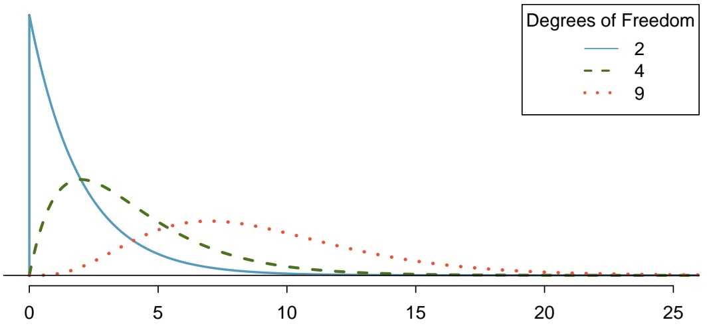

line

| X | Degrees of Freedom::2 | Degrees of Freedom::4 | Degrees of Freedom::9 |
| --- | --- | --- | --- |
| 0 | ~1.0 | 0 | 0 |
| 5 | ~0.1 | ~0.3 | ~0.2 |
| 10 | ~0.0 | ~0.05 | ~0.2 |
| 15 | ~0.0 | ~0.0 | ~0.1 |
| 20 | ~0.0 | ~0.0 | ~0.05 |
| 25 | ~0.0 | ~0.0 | ~0.0 |

Figure 8.7: Three chi-square distributions with varying degrees of freedom.

<small>15Independence holds, since this is a randomized study. The expected counts are greater than 10. $\chi^{2}=\frac{(60-44.6)^{2}}{44.6}+$ (27−42.4)2 (87−102.4)2 (113−97.6)2 42.4 102.4 97.6 = 14.7.</small>

---

8.3. INFERENCE FOR TWO OR MORE GROUPS

405

The $\chi ^ { 2 }$ statistic from a contingency table has a sampling distribution that approximately follows a $\chi ^ { 2 }$ distribution with degrees of freedom $d f = { \big ( } r - 1 { \big ) } { \big ( } c - 1 { \big ) }$ , where r is the number of rows and c is the number of columns. Either statistical software or a table can be used to calculate $p -$ values from the $\chi ^ { 2 }$ distribution. The **chi-square table** is partially shown in Figure 8.8, and a more complete table is presented in Appendix B.3 on page 468. This table is very similar to the t-table: each row provides values for distributions with different degrees of freedom, and a cut-off value is provided for specified tail areas. One important difference from the t-table is that the $\chi ^ { 2 }$ table only provides upper tail values.

<table><tr><td colspan="2">Upper tail</td><td>0.3</td><td>0.2</td><td>0.1</td><td>0.05</td><td>0.02</td><td>0.01</td><td>0.005</td><td>0.001</td></tr><tr><td rowspan="5">df</td><td>1</td><td>1.07</td><td>1.64</td><td>2.71</td><td>3.84</td><td>5.41</td><td>6.63</td><td>7.88</td><td>10.83</td></tr><tr><td>2</td><td>2.41</td><td>3.22</td><td>4.61</td><td>5.99</td><td>7.82</td><td>9.21</td><td>10.60</td><td>13.82</td></tr><tr><td>3</td><td>3.66</td><td>4.64</td><td>6.25</td><td>7.81</td><td>9.84</td><td>11.34</td><td>12.84</td><td>16.27</td></tr><tr><td>4</td><td>4.88</td><td>5.99</td><td>7.78</td><td>9.49</td><td>11.67</td><td>13.28</td><td>14.86</td><td>18.47</td></tr><tr><td>5</td><td>6.06</td><td>7.29</td><td>9.24</td><td>11.07</td><td>13.39</td><td>15.09</td><td>16.75</td><td>20.52</td></tr><tr><td rowspan="2"></td><td>6</td><td>7.23</td><td>8.56</td><td>10.64</td><td>12.59</td><td>15.03</td><td>16.81</td><td>18.55</td><td>22.46</td></tr><tr><td>7</td><td>8.38</td><td>9.80</td><td>12.02</td><td>14.07</td><td>16.62</td><td>18.48</td><td>20.28</td><td>24.32</td></tr></table>

Figure 8.8: A section of the chi-square table. A complete table is in Appendix B.3 on page 468.

## EXAMPLE 8.21

Calculate an approximate p-value for the mammogram data, given that the $\chi ^ { 2 }$ statistic equals 0.02. Assess whether the data provides convincing evidence of an association between screening group and breast cancer death.

The degrees of freedom in a $2 \times 2$ table is 1, so refer to the values in the first column of the probability table. The value 0.02 is less than 1.07, so the p-value is greater than 0.3. The data do not provide convincing evidence of an association between screening group and breast cancer death. This supports the conclusions from Example 8.14, where the p-value was calculated to be 0.8650 and is visualized in Figure 8.9.

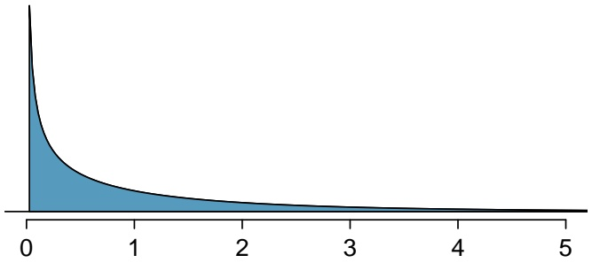

area

| X | Y |
| --- | --- |
| 0 | >1.0 |
| 1 | ~0.2 |
| 2 | ~0.1 |
| 3 | ~0.05 |
| 4 | ~0.02 |
| 5 | ~0.01 |

Figure 8.9: The p-value for the mammogram data is shaded on the $\chi ^ { 2 }$ distribution with $d f = 1$ .The shaded area is to the right of $\mathtt { x } = 0 . 0 2$

## GUIDED PRACTICE 8.22

Calculate an approximate p-value for the HIV data. Assess whether the data provides convincing evidence of an association between treatment and outcome at the $\alpha = 0 . 0 1$ significance level.16

E

G

<small>$^ { 1 6 } \mathrm { T h e } \; \chi ^ { 2 }$ statistic is 14.7. For degrees of freedom 1, the tail area beyond 14.7 is smaller than 0.001. There is evidence to suggest that treatment is not independent of outcome.</small>

---

406

CHAPTER 8. INFERENCE FOR CATEGORICAL DATA

## 8.3.4 Interpreting the results of a $\chi ^ { 2 }$ test

If the p-value from a $\chi ^ { 2 }$ test is small enough to provide evidence to reject the null hypothe sis of no association, it is important to explore the results further to understand direction of the observed association. This is done by examining the residuals, the standardized differences of the observed - expected, for each cell. Instead of using squared differences, the residuals are based on the differences themselves, and the standardizing or scaling factor is pexpected. Calculating residuals can be particularly helpful for understanding the results from large tables.

For each cell in a table, the residual equals:

$$
\frac {\text {observed - expected}}{\sqrt {\text {expected}}}.
$$

Residuals with a large magnitude contribute the most to the $\chi ^ { 2 }$ statistic. If a residual is positive, the observed value is greater than the expected value, and vice versa for a negative residual.

---

8.3. INFERENCE FOR TWO OR MORE GROUPS

407

## EXAMPLE 8.23

In the FAMuSS study introduced in Chapter 1, researchers measured a variety of demographic and genetic characteristics for about 1,300 participants, including data on race and genotype at a specific locus on the ACTN3 gene (Figure 8.10). Is there evidence of an association between genotype and race?

First, check the assumptions for applying a $\chi ^ { 2 }$ test. It is reasonable to assume independence, since it is unlikely that any participants were related to each other. None of the expected counts, as shown in Figure 8.11, are less than 5.

$H _ { 0 } ;$ Race and genotype are independent.

$H _ { A } \colon$ Race and genotype are not independent.

Let $\alpha = 0 . 0 5 .$

Calculate the $\chi ^ { 2 }$ statistic:

$$
\begin{array}{l} \chi^ {2} = \sum_ {\text {all cells}} \frac {(\text {observed} - \text {expected}) ^ {2}}{\text {expected}} \\ = \frac {(1 6 - 7 . 8 5) ^ {2}}{7 . 8 5} + \frac {(6 - 1 1 . 8 4) ^ {2}}{1 1 . 8 4} + \dots + \frac {(5 - 6 . 2 2) ^ {2}}{6 . 2 2} \\ = 1 9. 4. \\ \end{array}
$$

Calculate the p-value: for a table with 3 rows and 5 columns, the $\chi ^ { 2 }$ statistic is distributed with $(3 - 1)(5 - 1) = 8$ degrees of freedom. From the table, a $\chi ^ { 2 }$ value of 19.4 corresponds to a tail area between 0.01 and 0.02. Thus, there is sufficient evidence to reject the null hypothesis of independence between race and genotype.

The p-value can be obtained using the R function pchisq (pchisq(19.4, df = 8, lower.tail = FALSE)), which returns a value of 0.012861.

To further explore the differences in genotype distribution between races, calculate residuals for each cell (Figure 8.12). The largest residuals are in the first row; there are many more African Americans with the CC genotype than expected under independence, and fewer with the CT genotype than expected. The residuals in the second row indicate a similar trend for Asians, but with a less pronounced difference. These results suggest further directions for research; a future study could enroll a larger number of African American and Asian participants to examine whether the observed trend holds with a more representative sample. Geneticists might also be interested in exploring whether this genetic difference between populations has an observable phenotypic effect.

|  | CC | CT | TT | Sum |
| --- | --- | --- | --- | --- |
| African American | 16 | 6 | 5 | 27 |
| Asian | 21 | 18 | 16 | 55 |
| Caucasian | 125 | 216 | 126 | 467 |
| Hispanic | 4 | 10 | 9 | 23 |
| Other | 7 | 11 | 5 | 23 |
| Sum | 173 | 261 | 161 | 595 |

Figure 8.10: Observed counts for race and genotype data from the FAMuSS study.

E

---

408

CHAPTER 8. INFERENCE FOR CATEGORICAL DATA

|  | CC | CT | TT | Sum |
| --- | --- | --- | --- | --- |
| African Am | 7.85 | 11.84 | 7.31 | 27.00 |
| Asian | 15.99 | 24.13 | 14.88 | 55.00 |
| Caucasian | 135.78 | 204.85 | 126.36 | 467.00 |
| Hispanic | 6.69 | 10.09 | 6.22 | 23.00 |
| Other | 6.69 | 10.09 | 6.22 | 23.00 |
| Sum | 173.00 | 261.00 | 161.00 | 595.00 |

Figure 8.11: Expected counts for race and genotype data from the FAMuSS study.

|  | CC | CT | TT | Sum |
| --- | --- | --- | --- | --- |
| African Am | 2.91 | -1.70 | -0.85 | 0.00 |
| Asian | 1.25 | -1.25 | 0.29 | 0.00 |
| Caucasian | -0.93 | 0.78 | -0.03 | 0.00 |
| Hispanic | -1.04 | -0.03 | 1.11 | 0.00 |
| Other | 0.12 | 0.29 | -0.49 | 0.00 |
| Sum | 0.00 | 0.00 | 0.00 | 0.00 |

Figure 8.12: Residuals for race and genotype data from the FAMuSS study.

## EXAMPLE 8.24

In Guided Practice 8.22, the p-value was found to be smaller than 0.001, suggesting that treatment is not independent of outcome. Does the evidence suggest that infants should be given nevirapine or lopinarvir?

In a $2 \times 2$ table, it is relatively easy to directly compare observed and expected counts. For nevirapine, more infants than expected experienced virologic failure $( 60 > 44.6 ) ,$ , while fewer than expected reached a stable disease state $( 8 7 < 1 0 2 . 4 )$ . For lopinarvir, fewer infants than expected experienced virologic failure $(27 < 42.4)$ , and more infants than expected reached a stable disease state $( 113>97.6 )$ (Figure 8.13). The outcomes for infants on lopinarvir are better than for those on nevirapine; combined with the results of the significance test, the data suggest that lopinarvir is associated with better treatment outcomes.

|  | NVP | LPV | Total |
| --- | --- | --- | --- |
| Virologic Failure | 60 44.6 | 27 42.4 | 87 |
| Stable Disease | 87 102.4 | 113 97.6 | 200 |
| Total | 147 | 140 | 287 |

Figure 8.13: Observed and (expected) counts for the HIV study.

E

G

## GUIDED PRACTICE 8.25

Confirm the conclusions reached in Example 8.24 by analyzing the residuals.17

<small>$^{17}R_{1,1}=\frac{(44.6{-}60)}{\sqrt{44.6}}=2.31;\;R_{1,2}=\frac{(42.4{-}27)}{\sqrt{27}}=-2.37;\;R_{2,1}=\frac{(87{-}102.4)}{\sqrt{102.4}}=-1.53;\;R_{2,2}=\frac{(113{-}97.6)}{\sqrt{97.6}}=1.56.$ The positive residuals for the upper left and lower right cells indicate that more infants than expected experienced virologic failure on NVP and stable disease on LPV; vice versa for the upper right and lower left cells. The larger magnitude of the residuals for the two NVP cells indicates that most of the discrepancy between observed and expected counts is for outcomes related to NVP.</small>

---

8.3. INFERENCE FOR TWO OR MORE GROUPS

409

## GUIDED PRACTICE 8.26

Chapter 1 started with the discussion of a study examining whether exposure to peanut products reduce the rate of a child developing peanut allergies. Children were randomized either to the peanut avoidance or the peanut consumption group; at 5 years of age, each child was tested for peanut allergy using an oral food challenge (OFC). The results of the OFC are reproduced in Fig ure 8.14; failing the food challenge indicates an allergic reaction. Assess whether there is evidence for exposure to peanut allergy reducing the chance of developing peanut allergies.18

|  | FAIL OFC | PASS OFC | Sum |
| --- | --- | --- | --- |
| Peanut Avoidance | 36 | 227 | 263 |
| Peanut Consumption | 5 | 262 | 267 |
| Sum | 41 | 489 | 530 |

Figure 8.14: LEAP Study Results.

## 8.3.5 Fisher’s exact test

If sample sizes are too small, the $\chi ^ { 2 }$ distribution does not yield accurate p-values for assessing independence of the row and column variables in a table. When expected counts in a table are less than 10, **Fisher’s exact test** is often used to calculate exact levels of significance. This test is usually applied to 2 × 2 tables. It can be applied to larger tables, but the logic behind the test is complex and the calculations involved are computationally intensive, so this section covers only $2   \times   2$ tables.

Clostridium difficile is a bacterium that causes inflammation of the colon. Antibiotic treatment is typically not effective, particularly for patients who experience multiple recurrences of infection. Infusion of feces from healthy donors has been reported as an effective treatment for recurrent infection. A randomized trial was conducted to compare the efficacy of donor-feces infusion versus vancomycin, the antibiotic typically prescribed to treat C. difficile infection. The results of the trial are shown in Figure 8.15.19 A brief calculation shows that all of the expected cell counts are less than 10, so the $\chi ^ { 2 }$ test should not be used as a test for association.

Under the null hypothesis, the probabilities of cure in the fecal infusion and vancomycin groups are equal; i.e., individuals in one group are just as likely to be cured as individuals in the other group. Suppose the probability that an individual is cured, given that he or she was assigned to the fecal infusion group, is $p _ { 1 }$ and the probability an individual is cured in the vancomycin group is $p _ { 2 }$ . Researchers were interested in testing the null hypothesis H0: $p _ { 1 } = p _ { 2 }$

|  | Cured | Uncured | Sum |
| --- | --- | --- | --- |
| Fecal Infusion | 13 | 3 | 16 |
| Vancomycin | 4 | 9 | 13 |
| Sum | 17 | 12 | 29 |

Figure 8.15: Fecal Infusion Study Results.

<small>18The assumptions for conducting a χ2test are satisfied. Calculate a χ2test statistic: 24.29. The associated p-value is 8.3×10−7. There is evidence to suggest that treatment group is not independent of outcome. Specifically, a residual analysis shows that in the peanut avoidance group, more children than expected failed the OFC; in the peanut consumption group, more children than expected passed the OFC.</small>

<small>19These results correspond to the number of patients cured after the first infusion of donor feces and the number of patients cured in the vancomycin-alone group.</small>

G

---

410

CHAPTER 8. INFERENCE FOR CATEGORICAL DATA

The p-value is the probability of observing results as or more extreme than those observed in the study under the assumption that the null hypothesis is true. Previously discussed methods for significance testing have relied on calculating a test statistic associated with a defined sampling distribution, then obtaining p-values from tail areas on the distribution. Fisher’s exact test uses a similar approach, but introduces a new sampling distribution.

The p-value for Fisher’s exact test is calculated by adding together the individual conditional probabilities of obtaining each table that is as or more extreme than the one observed, under the null hypothesis and given that the marginal totals are considered fixed.

– When the row and column totals are held constant, the value of any one cell in the table determines the rest of the entries. For example, if the marginal sums in Figure 8.15 are known, along with the value in one cell (e.g., the upper right equals 3), it is possible to calculate the values in the other three cells. Thus, when marginal totals are considered fixed, each table represents a unique set of results.
– Extreme tables are those which contradict the null hypothesis of $p _ { 1 } = p _ { 2 }$ . In the fecal infusion group, under the null hypothesis of no difference in the population proportion cured, one would expect $\textstyle { \frac { 1 6 \times 1 7 } { 2 9 } } = 9 . 3 8$ cured individuals. The 13 observed cured individuals is extreme in the direction of more being cured than expected under the null hypothesis. An extreme result in the other direction would be, for instance, 1 cured patient in the fecal infusion group and 16 in the vancomycin group.

## EXAMPLE 8.27

Of the 17 patients cured, 13 were in the fecal infusion group and 4 were in the vancomycin group. Assume that the marginal totals are fixed (i.e., 17 patients were cured, 12 were uncured, and 16 patients were in the fecal infusion group, while 13 were in the vancomycin group). Enumerate all possible sets of results that are more extreme than what was observed, in the same direction.

The observed results show a case of $\hat { p } _ { 1 } > \hat { p } _ { 2 } ;$ results that are more extreme consist of cases where more than 13 cured patients were in the fecal infusion group. Under the assumption that the total number of cured patients is constant at 17 and that only 16 patients were assigned to the fecal infusion group (out of 29 patients total), more extreme results are represented by cases where 14, 15, or 16 cured patients were in the fecal infusion group. The following tables illustrate the unique combinations of values for the 4 table cells corresponding to those extreme results.

<table><tr><td></td><td>Cured</td><td>Uncured</td><td>Sum</td></tr><tr><td>Fecal Infusion</td><td>14</td><td>2</td><td>16</td></tr><tr><td>Vancomycin</td><td>3</td><td>10</td><td>13</td></tr><tr><td>Sum</td><td>17</td><td>12</td><td>29</td></tr><tr><td colspan="4"></td></tr><tr><td></td><td>Cured</td><td>Uncured</td><td>Sum</td></tr><tr><td>Fecal Infusion</td><td>15</td><td>1</td><td>16</td></tr><tr><td>Vancomycin</td><td>2</td><td>11</td><td>13</td></tr><tr><td>Sum</td><td>17</td><td>12</td><td>29</td></tr><tr><td colspan="4"></td></tr><tr><td></td><td>Cured</td><td>Uncured</td><td>Sum</td></tr><tr><td>Fecal Infusion</td><td>16</td><td>0</td><td>16</td></tr><tr><td>Vancomycin</td><td>1</td><td>12</td><td>13</td></tr><tr><td>Sum</td><td>17</td><td>12</td><td>29</td></tr></table>

E

---

8.3. INFERENCE FOR TWO OR MORE GROUPS

411

## Calculating a one-sided p-value

Suppose that researchers were interested in testing the null hypothesis against the one-sided alternative, $H _ { A } : p _ { 1 } > p _ { 2 }$ . To calculate the one-sided p-value, sum the probabilities of each table representing results as or more extreme than those observed; specifically, sum the probabilities of observing Figure 8.15 and the tables in Example 8.27.

|  | Cured | Uncured | Sum |
| --- | --- | --- | --- |
| Fecal Infusion | a | b | a+b |
| Vancomycin | c | d | c+d |
| Sum | a+c | b+d | n |

Figure 8.16: General Layout of Data in Fecal Infusion Study.

The probability of observing a table with cells $a , b , c , d$ given fixed marginal totals $a + b ,   c + d ,$ $a + c ,$ and $b + d$ follows the hypergeometric distribution. The hypergeometric distribution was introduced in Section 3.5.3.

$$
P (a, b, c, d) = \mathrm{HGeom} (a + b, c + d, a + c) = \frac {\binom {a + b} {a} \binom {c + d} {c}}{\binom {n} {a + c}} = \frac {(a + b) ! (c + d) ! (a + c) ! (b + d) !}{a ! b ! c ! d ! n !}.
$$

## EXAMPLE 8.28

Calculate the probability of observing Figure 8.15, assuming the margin totals are fixed.

$$
P (1 3, 3, 4, 9) = \frac {\binom {1 6} {1 3} \binom {1 3} {4}}{\binom {2 9} {1 7}} = \frac {1 6 ! 1 3 ! 1 7 ! 1 2 !}{1 3 ! 3 ! 4 ! 9 ! 2 9 !} = 7. 7 1 \times 1 0 ^ {- 3}.
$$

The value 0.0077 represents the probability of observing 13 cured patients out of 16 individuals in the fecal infusion group and 1 cured in the vancomycin group, given that there are a total of 29 patients and 17 were cured overall.

E

---

412

CHAPTER 8. INFERENCE FOR CATEGORICAL DATA

## EXAMPLE 8.29

Evaluate the statistical significance of the observed data in Figure 8.15 using the one-sided alternative $H _ { A } : p _ { 1 } > p _ { 2 }$

Calculate the probability of the tables from Example 8.27. Generally, the formula for these tables is

$$
P (a, b, c, d) = \frac {\binom {a + b} {a} \binom {c + d} {c}}{\binom {n} {a + c}} = \frac {\binom {1 6} {a} \binom {1 3} {c}}{\binom {2 9} {1 7}},
$$

since the marginal totals from Figure 8.15 are fixed. The value a ranges from 14, 15, 16, while c ranges from 3, 2, 1.

$$
P (1 4, 2, 3, 1 0) = \frac {\binom {1 6} {1 4} \binom {1 3} {3}}{\binom {2 9} {1 7}} = 6. 6 1 \times 1 0 ^ {- 4}
$$

$$
P (1 5, 1, 2, 1 1) = \frac {\binom {1 6} {1 5} \binom {1 3} {2}}{\binom {2 9} {1 7}} = 2. 4 0 \times 1 0 ^ {- 5}
$$

$$
P (1 6, 0, 1, 1 2) = \frac {\binom {1 6} {1 6} \binom {1 3} {1}}{\binom {2 9} {1 7}} = 2. 5 1 \times 1 0 ^ {- 7}
$$

The probability of the observed table is $7 . 7 1 \times 1 0 ^ { - 3 }$ , as calculated in the previous example.

The one-sided p-value is the sum of these table probabilities: $( 7 . 7 1 \times 1 0 ^ { - 3 } ) + ( 6 . 6 1 \times 1 0 ^ { - 4 } ) + ( 2 . 4 0 \times$ $1 0 ^ { - 5 } ) + ( 2 . 5 1 \times 1 0 ^ { - 7 } ) = 0 . 0 0 8 4$

The results are significant at the $\alpha = 0 . 0 5$ significance level. There is evidence to support the one sided alternative that the proportion of cured patients in the fecal infusion group is higher than the proportion of cured patients in the vancomycin group. However, it is important to note that two-sided alternatives are the standard in medical literature. Conducting a two-sided test would be especially desirable when evaluating a treatment which lacks randomized trials supporting its efficacy, such as donor-feces infusion.

## Calculating a two-sided p-value

There are various methods for calculating a two-sided p-value in the Fisher’s exact test setting. When the test is calculated by hand, the most common way to calculate a two-sided p-value is to double the smaller of the one-sided p-values. One other common method used by various statisti cal computing packages such as R is to classify "more extreme" tables as all tables with probabilities less than that of the observed table, in both directions. The two-sided p-value is the sum of proba bilities for the qualifying tables. That approach is illustrated in the next example.

E

---

8.3. INFERENCE FOR TWO OR MORE GROUPS

413

## EXAMPLE 8.30

Evaluate the statistical significance of the observed data in Figure 8.15 using the two-sided alternative $H _ { A } : p _ { 1 } \neq p _ { 2 }$

Identify tables that are more extreme in the other direction of the observed result, i.e. where the proportion of cured patients in the vancomycin group are higher than in the fecal infusion group. Start with the most extreme cases and calculate probabilities until a table has a p-value higher than $7 . 7 1 \times 1 0 ^ { - 3 }$ , the probability of the observed table.

The most extreme result in the $\hat { p } _ { 1 } < \hat { p } _ { 2 }$ direction would be if all patients in the vancomycin group were cured; then 13 of the cured patients would be in the vancomycin group and 4 would be in the fecal transplant group. This table has probability $3 . 5 \times 1 0 ^ { - 5 }$

|  | Cured | Uncured | Sum |
| --- | --- | --- | --- |
| Fecal Infusion | 4 | 12 | 16 |
| Vancomycin | 13 | 0 | 13 |
| Sum | 17 | 12 | 29 |

Continue enumerating tables by decreasing the number of cured patients in the vancomycin group. The table with 5 cured patients in the fecal infusion group has probability $1 . 0 9 \times 1 0 ^ { - 3 }$

|  | Cured | Uncured | Sum |
| --- | --- | --- | --- |
| Fecal Infusion | 5 | 11 | 16 |
| Vancomycin | 12 | 1 | 13 |
| Sum | 17 | 12 | 29 |

The table with 6 cured patients in the fecal infusion group has probability 0.012. This value is greater than $7 . 7 1 \times 1 0 ^ { - 3 }$ , so it will not be part of the sum to calculate the two-sided p-value.

|  | Cured | Uncured | Sum |
| --- | --- | --- | --- |
| Fecal Infusion | 6 | 10 | 16 |
| Vancomycin | 11 | 2 | 13 |
| Sum | 17 | 12 | 29 |

As calculated in the previous example, the one-sided p-value is 0.0084. Thus, the two-sided p-value for these data equals $0 . 0 0 8 4 + ( 3 . 5 \times 1 0 ^ { - 5 } ) + ( 1 . 0 9 \times 1 0 ^ { - 3 } ) = 0 . 0 0 9 5$ . The results are significant at the $\alpha = 0 . 0 1$ significance level, and there is evidence to support the efficacy of donor-feces infusion as a treatment for recurrent C. difficile infection.

E

---

414

CHAPTER 8. INFERENCE FOR CATEGORICAL DATA

## 8.4 Chi-square tests for the fit of a distribution

The $\chi ^ { 2 }$ test can also be used to examine the appropriateness of hypothesized distribution for a dataset, most commonly when a set of observations falls naturally into categories as in the examples discussed in this section. As with testing in the two-way table setting, expected counts are calculated based on the assumption that the hypothesized distribution is correct, and the statistic is based on the discrepancies between observed and expected counts. The $\chi ^ { 2 }$ sampling distribution for the test statistic is reasonably accurate when each expected count is at least 5 and follows a $\chi ^ { 2 }$ distribution with k − 1 degrees of freedom, where k is the number of categories. Some guidelines recommend that no more than 1/5 of the cells have expected counts less than 5, but the stricter requirement that all cells have expected counts greater than 5 is safer.

When used in this setting, the $\chi ^ { 2 }$ test is often called a **‘goodness-of-fit’ test**, a term that is often misunderstood. Small p-values of the test suggest evidence that a hypothesized distribution is not a good model, but non-significant p-values do not imply that the hypothesized distribution is the best model for the data, or even a good one. In the logic of hypothesis testing, failure to reject a null hypothesis cannot be viewed as evidence that the null hypothesis is true.

## EXAMPLE 8.31

The participants in the FAMuSS study were volunteers at a university, and so did not come from a random sample of the US population. The participants may not be representative of the general United States population. The $\chi ^ { 2 }$ test can be used to test the null hypothesis that the participants are racially representative of the general population. Figure 8.17 shows the number observed by racial category in FAMuSS and the proportions of the US population in each of those categories.20

Under the null hypothesis, the sample proportions should equal the population proportions. For example, since African Americans are 0.128 of the general proportion, (0.128)(595) = 76.16 African Americans would be expected in the sample. The rest of the expected counts are shown in Fig ure 8.18.

Since each expected count is greater than or equal to 5, the $\chi ^ { 2 }$ distribution can be used to calculate a p-value for the test.

$$
\begin{array}{l} \chi^ {2} = \sum_ {\text {all cells}} \frac {(\text {observed - expected}) ^ {2}}{\text {expected}} \\ = \frac {(2 7 - 7 6 . 1 6) ^ {2}}{7 6 . 1 6} + \frac {(5 5 - 5 . 9 5) ^ {2}}{5 . 9 5} + \frac {(4 6 7 - 4 7 8 . 3 8) ^ {2}}{4 7 8 . 3 8} + \frac {(4 6 - 3 4 . 5 1) ^ {2}}{3 4 . 5 1} \\ = 4 4 0. 1 8. \\ \end{array}
$$

There are 3 degrees of freedom, since k = 4. The $\chi ^ { 2 }$ statistic is extremely large, and the associated tail area is smaller than 0.001. There is more than sufficient evidence to reject the null hypothesis that the sample is representative of the general population. A comparison of the observed and expected values (or the residuals) indicates that the largest discrepancy is with the over-representation of Asian participants.

E

<small>20The US Census Bureau considers Hispanic as a classification separate from race, on the basis that Hispanic individuals can be any race. In order to facilitate the comparison with the FAMuSS data, participants identified as "Hispanic" have been merged with the "Other" category.</small>

---

8.4. CHI-SQUARE TESTS FOR THE FIT OF A DISTRIBUTION

415

| Race | African American | Asian | Caucasian | Other | Total |
| --- | --- | --- | --- | --- | --- |
| FAMuSS | 27 | 55 | 467 | 46 | 595 |
| US Census | 0.128 | 0.01 | 0.804 | 0.058 | 1.00 |

Figure 8.17: Representation by race in the FAMuSS study versus the general population.

| Race | African American | Asian | Caucasian | Other | Total |
| --- | --- | --- | --- | --- | --- |
| Observed | 27 | 55 | 467 | 46 | 595 |
| Expected | 76.16 | 5.95 | 478.38 | 34.51 | 595 |

Figure 8.18: Actual and expected counts in the FAMuSS data.

## EXAMPLE 8.32

According to Mendelian genetics, alleles segregate independently; if an individual is heterozygous for a gene and has alleles A and B, then the alleles have an equal chance of being passed to an offspring. Under this framework, if two individuals with genotype AB mate, then their offspring are expected to exhibit a 1:2:1 genotypic ratio; 25% of the offspring will be AA, 50% will be AB, and 50% will be BB. The term "segregation distortion" refers to a deviation from expected Mendelian frequencies.

At a specific gene locus in the plant Arabidopsis thaliana, researchers have observed 84 AA indi viduals, 233 AB individuals, and 134 BB individuals. Is there evidence of segregation disorder at this locus? Conduct the test at $\alpha = 0 . 0 0 0 1$ to account for multiple testing, since the original study examined approximately 250 locations across the genome.

The Mendelian proportions are 25%, 50%, and 25%. Thus, the expected counts in a group of 451 individuals are: 112.75 AA, 225.50 AB, and 112.75 BB. No expected count is less than 5.

$$
\begin{array}{l} \chi^ {2} = \sum_ {\text {all cells}} \frac {(\text {observed} - \text {expected}) ^ {2}}{\text {expected}} \\ = \frac {(8 4 - 1 1 2 . 7 5) ^ {2}}{1 1 2 . 7 5} + \frac {(2 3 3 - 2 2 5 . 5 0) ^ {2}}{2 2 5 . 5 0} + \frac {(1 3 4 - 1 1 2 . 7 5) ^ {2}}{1 1 2 . 7 5} \\ = 1 1. 5 9. \\ \end{array}
$$

There are 2 degrees of freedom, since k = 3. The p-value is between 0.005 and 0.001, which is greater than $\alpha = 0 . 0 0 0 1$ . There is insufficient evidence to reject the null hypothesis that the offspring ratios correspond to expected Mendelian frequencies; i.e., there is not evidence of segregation distortion at this locus.

E

---

416

CHAPTER 8. INFERENCE FOR CATEGORICAL DATA

## 8.5 Outcome-based sampling: case-control studies

## 8.5.1 Introduction

The techniques so far in this chapter have often relied on the assumption that the data were collected using random sampling from a population. When cases come from a random sample, the sample proportion of observations with a particular outcome should accurately estimate the population proportion, given that the sample size is large enough. When studying rare outcomes, however, moderate sized samples may contain few or none of the outcomes. Persistent pulmonary hypertension of the newborn (PPHN) is a dangerous condition in which the blood vessels in the lungs of a newborn do not relax immediately after birth, leading to inadequate oxygenation. The condition is rare, occurring in about 1.9 per 1,000 live births, so it is difficult to study using random sampling. In the early 2000s, anecdotal evidence began to accumulate that the risk of the condi tion might be increased if the mother of the newborn had been taking a particular medication for depression, a selective serotonin reuptake inhibitor (SSRI) during the third trimester of pregnancy or even as early as during week 20 of the pregnancy.

One design for studying the issue would enroll two cohorts of women, one in which women were taking SSRIs for depression and one in which they were not. However, if the chance of PPHN was 1.9/1,000 in newborns of a control cohort of 1,000 women, then the probability of observing no cases of PPHN is about 0.15. If the probability of PPHN is elevated among infants born to women taking SSRIs, such as to 3.0/1,000, the chance of observing no cases among 1,000 women is approximately 0.05. Precise measures of the probability of PPHN occurring would require very large cohorts.

An alternative design for studies like this reverses the sampling scheme so that the two cohorts are determined by outcome, rather than exposure; a cohort with the condition and a cohort without the condition are sampled, then exposure to a possible cause is recorded. To apply this design for studying PPHN, a registry of live births could be used to sort births by presence or absence of PPHN. The number in each group in which the mother had been taking SSRIs could then be recorded (based on medical records). Such a design would have the advantage of sufficient numbers of cases with and without PPHN, but it has other limitations which will be discussed later in this section. Traditionally, these studies have been called case-control studies because of the original sampling of individuals with and without a condition. More generally, it is an example of outcomedependent sampling.

---

8.5. OUTCOME-BASED SAMPLING: CASE-CONTROL STUDIES

417

## 8.5.2 $\chi ^ { 2 }$ tests of association in case-control studies

In 2006, Chambers, et. al reported a case-control study examining the association of SSRI use and persistent pulmonary hypertension in newborns.21 The study team enrolled 337 women whose infants suffered from PPHN and 836 women with similar characteristics but whose infants did not have PPHN. Among the women whose infants had PPHN, 14 had taken an SSRI after week 20 of the pregnancy. In the cohort of women whose infants did not have PPHN, 6 had been taking the medication after week 20. In the subset of women who had been taking an SSRI, the infants are considered ‘exposed’ to the medication. The data from the study are summarized in Figure 8.19.

| PPHN present | Yes | No | Total |
| --- | --- | --- | --- |
| SSRI exposed | 14 | 6 | 20 |
| SSRI unexposed | 323 | 830 | 1153 |
| Total | 337 | 836 | 1173 |

Figure 8.19: SSRI exposure vs observed number of PPHN cases in newborns.

The sample of women participating in the study are clearly not a random sample drawn from women who had recently given birth; they were identified according to the disease status of their infants. In this sample, the proportion of newborns with PPHN $\left( 337/1173 = 28.7\% \right)$ is much higher than the disease prevalence in the general population.

Even so, the concept of independence between rows and columns under a null hypothesis of no association still holds. If SSRI use had no effect on the occurrence of PPHN, then the proportions of mothers taking SSRIs among the PPHN and non-PPHN infants should be about the same. In other words, the null hypothesis of equal SSRI use among mothers with/without PPHN affected infants is the hypothesis of no association between SSRI use and PPHN. The test of independence can be conducted using the approach introduced earlier in the chapter.

The expected counts shown in Figure 8.20 suggest that the p-value from a $\chi ^ { 2 }$ test may not be accurate; under the null hypothesis, the expected number of PPHN cases in the SSRI exposed group is less than 10.

| PPHN present | Yes | No | Total |
| --- | --- | --- | --- |
| SSRI exposed | 5.80 | 14.20 | 20 |
| SSRI unexposed | 331.20 | 811.80 | 1153 |
| Total | 337 | 836 | 1173 |

Figure 8.20: SSRI exposure vs expected number of PPHN cases in newborn.

The p-value from Fisher’s exact test is < 0.001 (0.00014, to be precise), so the evidence is strong that SSRI exposure and PPHN are associated. Fisher’s exact test is often used in studies of rare conditions or exposures since one or more expected cell counts are typically less than 10.

21N Engl J Med 2006;354:579-87.

---

418

CHAPTER 8. INFERENCE FOR CATEGORICAL DATA

## 8.5.3 Estimates of association in case-control studies

For data in a $2 \times 2$ table, correct point estimates of association depend on the mechanism used to gather the data. In the example of a clinical trial of nevirapine versus lopinarvir discussed in Section 8.3.1, the population proportion of children who would experience virologic failure after treatment with one of the drugs can be estimated by the observed proportion of virologic failures while on that drug. For nevirapine, the proportion of children with virologic failure is $60/147 =$ 0.41, while for lopinarvir the proportion is $2 7 / 1 4 0 = 0 . 1 9$ . The difference in outcome between the two groups can be summarized by the difference in these proportions. The proportion experiencing virologic failure when treated with nevirapine was 0.12 larger in nevirapine $(0.41 - 0.29)$ , so if the two drugs were to be used in a large population, approximately 12% more children treated with nevirapine would experience virologic failure as compared to lopinarvir. The confidence intervals discussed in Section 8.2.2 can be used to express the uncertainty in this estimate.

Since the proportion of virologic failures can be estimated from the trial data, the relative risk of virologic failure can also be used to estimate the association between treatment and virologic failure. Relative risk is the ratio of two proportions, and was introduced in Section 1.6.2. The relative risk of virologic failure with nevirapine versus lopinarvir is $0 . 4 1 / 0 . 1 9 = 2 . 1 6 .$ . Children treated with nevirapine are estimated to be more than twice as likely to experience virologic failure.

Statistically, the population parameter for the relative risk in the study of $\mathrm { H W ^ { + } }$ is a ratio of conditional probabilities:

$$
\frac {P (\text {virologic failure} | \text {treatment with nevirapine})}{P (\text {virologic failure} | \text {treatment with lopinarvir})}.
$$

In a study like the PPHN case-control study, the natural population parameter of interest would be the relative risk of PPHN for infants exposed to an SSRI during after week 20 of gesta tion compared to those who were not exposed. However, in the design of this study, participating mothers were sampled and grouped according to whether their infants did or did not suffer from PPHN, rather than assigned to either SSRI exposure or non-exposure. Relative risk of PPHN from exposure to SSRI cannot be estimated from the data because it is not possible to estimate P (PPHN|SSRI exposure) and $P ( \mathrm { P P H N } | \mathrm { n o } )$ SSRI exposure). In case-control studies, association is estimated using **odds** and **odds ratios** rather than relative risk.

The **odds** of SSRI exposure among the cases are given by the fraction

$$
\mathrm{odds} _ {\text {cases}} = \frac {P (\text {SSRI exposure|PPHN})}{P (\text {no SSRI exposure|PPHN})} = \frac {1 4 / 3 3 7}{3 2 3 / 3 3 7} = \frac {1 4}{3 2 3}.
$$

The odds of SSRI exposure among the controls are given by the fraction

$$
\text { odds } _ {\text { controls }} = \frac {P (\text { SSRI   exposure } | \text { no   PPHN })}{P (\text { no   SSRI   exposure } | \text { no   PPHN })} = \frac {6 / 8 3 6}{8 3 0 / 8 3 6} = \frac {6}{8 3 0}.
$$

The ratio of the odds, the odds ratio, compares the odds of exposure among the cases to the odds of exposure among the controls:

$$
O R _ {\text {exposure, cases vs. controls}} = \frac {\text {odds} _ {\text {cases}}}{\text {odds} _ {\text {controls}}} = \frac {1 4 / 3 2 3}{6 / 8 3 0} = \frac {(1 4) (8 3 0)}{(3 2 3) (6)} = 6. 0 0.
$$

---

8.5. OUTCOME-BASED SAMPLING: CASE-CONTROL STUDIES

419

A population odds ratio of, for example, 1.5, implies that the odds of exposure in cases are 50% larger than the odds of exposure in controls. For this study, the odds ratio of 6.00 implies that the odds of SSRI exposure in infants with PPHN are 6 times as large as the odds of exposure in infants without PPHN. Epidemiologists describe this odds ratio as the odds of exposure given presence of PPHN compared to the odds of exposure given absence of PPHN. An OR greater than 1 suggests that the exposure may be a risk factor for the disease or condition under study. Epidemiologists also use the term **relative odds** as a synonym for odds ratio.

Surprisingly, the odds ratio of exposure comparing cases to controls is equivalent to the odds ratio of disease comparing exposed to unexposed.22 With a specific example, it is easy to see how the fraction for the odds ratios are numerically equivalent:

$$
O R _ {\text {disease, exposed versus unexposed}} = \frac {\mathrm{odds} _ {\text {exposed}}}{\mathrm{odds} _ {\text {unexposed}}} = \frac {1 4 / 6}{3 2 3 / 8 3 0} = \frac {(1 4) (8 3 0)}{(6) (3 2 3)} = 6. 0 0.
$$

Despite the apparently restrictive nature of the case-control sampling design, the odds ratio of interest, the odds ratio for disease given exposure, can be estimated from case-control data.

Epidemiologists rely on one additional result, called the rare disease assumption. When a disease is rare, the odds ratio for the disease given exposure is approximately equal to the relative risk of the disease given exposure. These identities are the reason case-control studies are widely used in settings in which a disease is rare: it allows for the relative risk of disease given exposure to be estimated, even if the study design is based on sampling cases and controls then measuring exposure.

In a general 2×2 table of exposure versus disease status (Figure 8.21) the odds ratio for disease given exposure status is the ad/bc.

| Disease Status | Present | Absent | Total |
| --- | --- | --- | --- |
| Exposed | a | b | a+b |
| Unexposed | c | d | c+d |
| Total | a+c | b+d | n |

Figure 8.21: Exposure vs Disease Status.

In the PPHN case-control data, the odds ratio for PPHN given SSRI exposure status is (14)(830)/(6)(323) = 6.00. Because PPHN is a rare condition, the risk of PPHN among infants exposed to an SSRI is estimated to be approximately 6 times that of the risk among unexposed infants. Infants exposed to an SSRI are 600% more likely to suffer from PPHN.

It can be shown that the p-value used in a test of no association (between exposure and disease) is also the p-value for a test of the null hypothesis that the odds ratio is 1.

<small>22This result can be shown through Bayes’ rule.</small>

---

420

CHAPTER 8. INFERENCE FOR CATEGORICAL DATA

## 8.6 Notes

Two-way tables are often used to summarize data from medical research studies, and entire texts have been written about methods of analysis for these tables. This chapter covers only the most basic of those methods.

Until recently, Fisher’s exact test could only be calculated for 2×2 tables with small cell counts. Research has produced faster algorithms for enumerating tables and calculating p-values, and the computational power of recent desktop and laptop computers now make it possible to calculate the Fisher test on nearly any $2 \times 2$ table. There are also versions of the test that can be calculated on tables with more than 2 rows and/or columns. The practical result for data analysts is that the sample size condition for the validity of the $\chi ^ { 2 }$ test can be made more restrictive. This chapter recommends using the $\chi ^ { 2 }$ test only when cell counts in a $2 \times 2$ table are greater than 10; some approaches recommend cell counts larger than 10.

For many years, introductory textbooks recommended using a modified version of the $\chi ^ { 2 }$ test, called the Fisher-Yates test, which adjusted the value of the statistic in small sample sizes to increase the accuracy of the $\chi ^ { 2 }$ sampling distribution in calculating p-values. The Fisher-Yates version of the test is no longer used as often because of the widespread availability of the Fisher test.

The Fisher test is not without controversy, at least in the theoretical literature. Conditioning on the row and column totals allows the calculation of a p-value from the hypergeometric distribution, but in principle restricts inference to the set of tables with the same row and column values. In practice, this is less serious than it may seem. For tables of moderate size, the p-values from the $\chi ^ { 2 }$ and Fisher tests are nearly identical and for tables with small counts, the Fisher test guarantees that the Type I error will be no larger than the specified value of $\alpha .$ In small sample sizes, some statisticians argue that the Fisher-Yates correction is preferable to the Fisher test because of the discrete nature of the hypergeometric distribution. In small tables, for example, an observed p-value of 0.04 may be the largest value that is less than 0.05, such that the Type I error of the test in that situation is 0.04, not 0.05.

Section 8.5.3 does not show the derivation that the odds ratio estimated from a case-control is the same as that from a cohort study. It is long and algebraically more complex than other derivations shown in the text, but it is a direct application of Bayes’ rule, applied to each term in the fraction that defines population odds ratio.

The two labs for this chapter examine methods of inference for the success probability in binomial data then generalizes inference for binomial proportions to two-way contingency tables. Lab 2 also discusses measures of association in two-by-two tables. The datasets in the labs are similar to datasets that arise frequently in medical statistics. Lab 1 assesses the evidence for a treatment effect in a single uncontrolled trial of a new drug for melanoma and whether outcomes in stage 1 lung cancer are different among patients treated at Dana-Farber Cancer Institute compared to population based statistics. In Lab 2, students analyze a dataset from a published clinical trial examining the benefit of using a more expensive but potentially more effective drug to treat HIV-positive infants.

---

8.7. EXERCISES

421

## 8.7 Exercises

## 8.7.1 Inference for a single proportion

**8.1 Vegetarian college students.** Suppose that 8% of college students are vegetarians. Determine if the following statements are true or false, and explain your reasoning.

(a) The distribution of the sample proportions of vegetarians in random samples of size 60 is approximately normal since $n \geq 3 0$
(b) The distribution of the sample proportions of vegetarian college students in random samples of size 50 is right skewed.
(c) A random sample of 125 college students where 12% are vegetarians would be considered unusual.
(d) A random sample of 250 college students where 12% are vegetarians would be considered unusual.
(e) The standard error would be reduced by one-half if we increased the sample size from 125 to 250.

**8.2 Young Americans, Part I.** About 77% of young adults think they can achieve the American dream. Determine if the following statements are true or false, and explain your reasoning.23

(a) The distribution of sample proportions of young Americans who think they can achieve the American dream in samples of size 20 is left skewed.
(b) The distribution of sample proportions of young Americans who think they can achieve the American dream in random samples of size 40 is approximately normal since $n \geq 3 0$
(c) A random sample of 60 young Americans where 85% think they can achieve the American dream would be considered unusual.
(d) A random sample of 120 young Americans where 85% think they can achieve the American dream would be considered unusual.

**8.3 Gender equality.** The General Social Survey asked a random sample of 1,390 Americans the following question: “On the whole, do you think it should or should not be the government’s responsibility to promote equality between men and women?” 82% of the respondents said it “should be”. At a 95% confidence level, this sample has 2% margin of error. Based on this information, determine if the following statements are true or false, and explain your reasoning. 24

(a) We are 95% confident that between 80% and 84% of Americans in this sample think it’s the government’s responsibility to promote equality between men and women.
(b) We are 95% confident that between 80% and 84% of all Americans think it’s the government’s responsibility to promote equality between men and women.
(c) If we considered many random samples of 1,390 Americans, and we calculated 95% confidence intervals for each, 95% of these intervals would include the true population proportion of Americans who think it’s the government’s responsibility to promote equality between men and women.
(d) In order to decrease the margin of error to 1%, we would need to quadruple (multiply by 4) the sample size.
(e) Based on this confidence interval, there is sufficient evidence to conclude that a majority of Americans think it’s the government’s responsibility to promote equality between men and women.

<small>23A. Vaughn. “[Poll finds young adults optimistic, but not about money](http://www.openintro.org/redirect.php?go=textbook-young_americans_2011&referrer=biostat1_pdf)”. In: Los Angeles Times (2011).</small>

<small>24National Opinion Research Center, [General Social Survey, 2018](http://www.openintro.org/redirect.php?go=textbook-gss-data&referrer=biostat1_pdf).</small>

---

422

CHAPTER 8. INFERENCE FOR CATEGORICAL DATA

**8.4 Elderly drivers.** The Marist Poll published a report stating that 66% of adults nationally think licensed drivers should be required to retake their road test once they reach 65 years of age. It was also reported that interviews were conducted on 1,018 American adults, and that the margin of error was 3% using a 95% confidence level.25

(a) Verify the margin of error reported by The Marist Poll.
(b) Based on a 95% confidence interval, does the poll provide convincing evidence that more than 70% of the population think that licensed drivers should be required to retake their road test once they turn 65?

**8.5 Fireworks on July 4**<strong>th</strong>**.** A local news outlet reported that 56% of 600 randomly sampled Kansas residents planned to set off fireworks on July 4th. Determine the margin of error for the 56% point estimate using a 95% confidence level.26

**8.6 Life rating in Greece.** Greece has faced a severe economic crisis since the end of 2009. A Gallup poll surveyed 1,000 randomly sampled Greeks in 2011 and found that 25% of them said they would rate their lives poorly enough to be considered “suffering”.27

(a) Describe the population parameter of interest. What is the value of the point estimate of this parameter?
(b) Check if the conditions required for constructing a confidence interval based on these data are met.
(c) Construct a 95% confidence interval for the proportion of Greeks who are “suffering".
(d) Without doing any calculations, describe what would happen to the confidence interval if we decided to use a higher confidence level.
(e) Without doing any calculations, describe what would happen to the confidence interval if we used a larger sample.

**8.7 Study abroad.** A survey on 1,509 high school seniors who took the SAT and who completed an optional web survey shows that 55% of high school seniors are fairly certain that they will participate in a study abroad program in college.28

(a) Is this sample a representative sample from the population of all high school seniors in the US? Explain your reasoning.
(b) Let’s suppose the conditions for inference are met. Even if your answer to part (a) indicated that this approach would not be reliable, this analysis may still be interesting to carry out (though not report). Construct a 90% confidence interval for the proportion of high school seniors (of those who took the SAT) who are fairly certain they will participate in a study abroad program in college, and interpret this interval in context.
(c) What does “90% confidence" mean?
(d) Based on this interval, would it be appropriate to claim that the majority of high school seniors are fairly certain that they will participate in a study abroad program in college?

<small>25Marist Poll, [Road Rules: Re-Testing Drivers at Age 65?](http://www.openintro.org/redirect.php?go=textbook-drivers_at_65_2011&referrer=biostat1_pdf), March 4, 2011.</small>

<small>26Survey USA, [News Poll #19333](http://www.openintro.org/redirect.php?go=textbook-SurveyUSA_19333&referrer=biostat1_pdf), data collected on June 27, 2012.</small>

<small>27Gallup World, [More Than One in 10 “Suffering" Worldwide](http://www.openintro.org/redirect.php?go=textbook-1_in_10_suffering_2011&referrer=biostat1_pdf), data collected throughout 2011.</small>

<small>28studentPOLL, [College-Bound Students’ Interests in Study Abroad and Other International Learning Activities](http://www.openintro.org/redirect.php?go=textbook-Interests_in_Study_Abroad_2008&referrer=biostat1_pdf), January 2008.</small>

---

8.7. EXERCISES

423

**8.8 Legalization of marijuana, Part I.** The General Social Survey asked 1,578 US residents: “Do you think the use of marijuana should be made legal, or not?” 61% of the respondents said it should be made legal.29

(a) Is 61% a sample statistic or a population parameter? Explain.
(b) Construct a 95% confidence interval for the proportion of US residents who think marijuana should be made legal, and interpret it in the context of the data.
(c) A critic points out that this 95% confidence interval is only accurate if the statistic follows a normal distribution, or if the normal model is a good approximation. Is this true for these data? Explain.
(d) A news piece on this survey’s findings states, “Majority of Americans think marijuana should be legalized.” Based on your confidence interval, is this news piece’s statement justified?

**8.9 National Health Plan, Part I.** A Kaiser Family Foundation poll for US adults in 2019 found that 79% of Democrats, 55% of Independents, and 24% of Republicans supported a generic “National Health Plan”. There were 347 Democrats, 298 Republicans, and 617 Independents surveyed.30

(a) A political pundit on TV claims that a majority of Independents support a National Health Plan. Do these data provide strong evidence to support this type of statement?
(b) Would you expect a confidence interval for the proportion of Independents who oppose the public option plan to include 0.5? Explain.

**8.10 Legalize Marijuana, Part II.** As discussed in Exercise 8.8, the General Social Survey reported a sample where about 61% of US residents thought marijuana should be made legal. If we wanted to limit the margin of error of a 95% confidence interval to 2%, about how many Americans would we need to survey?

**8.11 National Health Plan, Part II.** Exercise 8.9 presents the results of a poll evaluating support for a generic “National Health Plan” in the US in 2019, reporting that 55% of Independents are supportive. If we wanted to estimate this number to within 1% with 90% confidence, what would be an appropriate sample size?

**8.12 Acetaminophen and liver damage.** It is believed that large doses of acetaminophen (the active ingredient in over the counter pain relievers like Tylenol) may cause damage to the liver. A researcher wants to conduct a study to estimate the proportion of acetaminophen users who have liver damage. For participating in this study, he will pay each subject \$20 and provide a free medical consultation if the patient has liver damage.

(a) If he wants to limit the margin of error of his 98% confidence interval to 2%, what is the minimum amount of money he needs to set aside to pay his subjects?
(b) The amount you calculated in part (a) is substantially over his budget so he decides to use fewer subjects. How will this affect the width of his confidence interval?

**8.13 College smokers.** We are interested in estimating the proportion of students at a university who smoke. Out of a random sample of 200 students from this university, 40 students smoke.

(a) Calculate a 95% confidence interval for the proportion of students at this university who smoke, and interpret this interval in context. (Reminder: Check conditions.)
(b) If we wanted the margin of error to be no larger than 2% at a 95% confidence level for the proportion of students who smoke, how big of a sample would we need?

<small>29National Opinion Research Center, [General Social Survey, 2018](http://www.openintro.org/redirect.php?go=textbook-gss-data&referrer=biostat1_pdf).</small>

<small>30Kaiser Family Foundation, [The Public On Next Steps For The ACA And Proposals To Expand Coverage](http://www.openintro.org/redirect.php?go=textbook-kff_nat_health_plan_2019&referrer=biostat1_pdf), data collected between Jan 9-14, 2019.</small>

---

424

CHAPTER 8. INFERENCE FOR CATEGORICAL DATA

**8.14 2010 Healthcare Law.** On June 28, 2012 the U.S. Supreme Court upheld the much debated 2010 healthcare law, declaring it constitutional. A Gallup poll released the day after this decision indicates that 46% of 1,012 Americans agree with this decision. At a 95% confidence level, this sample has a 3% margin of error. Based on this information, determine if the following statements are true or false, and explain your reasoning.31

(a) We are 95% confident that between 43% and 49% of Americans in this sample support the decision of the U.S. Supreme Court on the 2010 healthcare law.
(b) We are 95% confident that between 43% and 49% of Americans support the decision of the U.S. Supreme Court on the 2010 healthcare law.
(c) If we considered many random samples of 1,012 Americans, and we calculated the sample proportions of those who support the decision of the U.S. Supreme Court, 95% of those sample proportions will be between 43% and 49%.
(d) The margin of error at a 90% confidence level would be higher than 3%.

**8.15 Oral contraceptive use, Part I.** In a study of 100 randomly sampled 18 year-old women in an inner city neighborhood, 15 reported that they were taking birth control pills.

(a) Can the normal approximation to the binomial distribution be used to calculate a confidence interval for proportion of women using birth control pills in this neighborhood? Explain your answer.
(b) Compute an approximate 95% confidence interval for the population proportion of women age 18 in this neighborhood taking birth control pills.
(c) Does the interval from part (b) support the claim that, for the young women in this neighborhood, the percentage who use birth control is not significantly different from the national average of 5%? Justify your answer.

**8.16 Oral contraceptive use, Part II.** Suppose that the study were repeated in a different inner city neighborhood and that out of 50 randomly sampled 18-year-old women, 6 reported that they were taking birth control pills. The researchers would like to assess the evidence that the proportion of 18-year-old women using birth control pills in this neighborhood is greater than the national average of 5%.

(a) Can the normal approximation to the binomial distribution be used to conduct a hypothesis test of the null hypothesis that the proportion of women using birth control pills in this neighborhood is equal to 0.05? Explain your answer.
(b) State the hypotheses for the analysis of interest and compute the p-value.
(c) Interpret the results from part (b) in the context of the data.

31Gallup, [Americans Issue Split Decision on Healthcare Ruling](http://www.openintro.org/redirect.php?go=textbook-healthcare_split_2012&referrer=biostat1_pdf), data collected June 28, 2012.

---

8.7. EXERCISES

425

## 8.7.2 Inference for the difference of two proportions

**8.17 Social experiment, Part I.** A “social experiment" conducted by a TV program questioned what people do when they see a very obviously bruised woman getting picked on by her boyfriend. On two different occasions at the same restaurant, the same couple was depicted. In one scenario the woman was dressed “provocatively” and in the other scenario the woman was dressed “conservatively”. The table below shows how many restaurant diners were present under each scenario, and whether or not they intervened.

<table><tr><td rowspan="5">Intervene</td><td rowspan="2"></td><td colspan="2">Scenario</td><td rowspan="2">Total</td></tr><tr><td>Provocative</td><td>Conservative</td></tr><tr><td>Yes</td><td>5</td><td>15</td><td>20</td></tr><tr><td>No</td><td>15</td><td>10</td><td>25</td></tr><tr><td>Total</td><td>20</td><td>25</td><td>45</td></tr></table>

Explain why the sampling distribution of the difference between the proportions of interventions under provocative and conservative scenarios does not follow an approximately normal distribution.

**8.18 Heart transplant success.** The Stanford University Heart Transplant Study was conducted to determine whether an experimental heart transplant program increased lifespan. Each patient entering the program was officially designated a heart transplant candidate, meaning that he was gravely ill and might benefit from a new heart. Patients were randomly assigned into treatment and control groups. Patients in the treatment group received a transplant, and those in the control group did not. The table below displays how many patients survived and died in each group.32

|  | control | treatment |
| --- | --- | --- |
| alive | 4 | 24 |
| dead | 30 | 45 |

Suppose we are interested in estimating the difference in survival rate between the control and treatment groups using a confidence interval. Explain why we cannot construct such an interval using the normal approximation. What might go wrong if we constructed the confidence interval despite this problem?

**8.19 National Health Plan, Part III.** Exercise 8.9 presents the results of a poll evaluating support for a generically branded “National Health Plan” in the United States. 79% of 347 Democrats and 55% of 617 Independents support a National Health Plan.

(a) Calculate a 95% confidence interval for the difference between the proportion of Democrats and Independents who support a National Health Plan $( p _ { D } - p _ { I } )$ , and interpret it in this context. We have already checked conditions for you.
(b) True or false: If we had picked a random Democrat and a random Independent at the time of this poll, it is more likely that the Democrat would support the National Health Plan than the Independent.

**8.20 Sleep deprivation, CA vs. OR, Part I.** According to a report on sleep deprivation by the Centers for Disease Control and Prevention, the proportion of California residents who reported insufficient rest or sleep during each of the preceding 30 days is 8.0%, while this proportion is 8.8% for Oregon residents. These data are based on simple random samples of 11,545 California and 4,691 Oregon residents. Calculate a 95% confidence interval for the difference between the proportions of Californians and Oregonians who are sleep deprived and interpret it in context of the data.33

<small>32B. Turnbull et al. “[Survivorship of Heart Transplant Data](http://www.openintro.org/redirect.php?go=textbook-heart_transplant_1974&referrer=biostat1_pdf)”. In: Journal of the American Statistical Association 69 (1974), pp. 74–80.</small>

<small>33CDC, [Perceived Insufficient Rest or Sleep Among Adults — United States, 2008](http://www.openintro.org/redirect.php?go=textbook-Perceived_Insufficient_Rest_or_Sleep_Among_Adults&referrer=biostat1_pdf).</small>

---

426

CHAPTER 8. INFERENCE FOR CATEGORICAL DATA

**8.21 Remdesivir in COVID-19.** Remdesivir is an antiviral drug previously tested in animal models infected with coronaviruses like SARS and MERS. As of May 2020, remdesivir has temporary approval from the FDA for use in severely ill COVID-10 patients. A randomized controlled trial conducted in China enrolled 236 patients with severe COVID-19; 158 were assigned to receive remdesivir and 78 to receive a placebo. In the remdesivir group, 103 patients showed clinical improvement; in the placebo group, 45 patients showed clinical improvement.

(a) Conduct a formal comparison of the clinical improvement rates and summarize your findings.
(b) Report and interpret an appropriate confidence interval.

**8.22 Sleep deprivation, CA vs. OR, Part II.** Exercise 8.20 provides data on sleep deprivation rates of Californians and Oregonians. The proportion of California residents who reported insufficient rest or sleep during each of the preceding 30 days is 8.0%, while this proportion is 8.8% for Oregon residents. These data are based on simple random samples of 11,545 California and 4,691 Oregon residents.

(a) Conduct a hypothesis test to determine if these data provide strong evidence the rate of sleep deprivation is different for the two states. (Reminder: Check conditions)
(b) It is possible the conclusion of the test in part (a) is incorrect. If this is the case, what type of error was made?

**8.23 Gender and color preference.** A study asked 1,924 male and 3,666 female undergraduate college students their favorite color. A 95% confidence interval for the difference between the proportions of males and females whose favorite color is black $( p _ { m a l e } - p _ { f e m a l e } )$ was calculated to be (0.02, 0.06). Based on this information, determine if the following statements are true or false, and explain your reasoning for each statement you identify as false.34

(a) We are 95% confident that the true proportion of males whose favorite color is black is 2% lower to 6% higher than the true proportion of females whose favorite color is black.
(b) We are 95% confident that the true proportion of males whose favorite color is black is 2% to 6% higher than the true proportion of females whose favorite color is black.
(c) 95% of random samples will produce 95% confidence intervals that include the true difference between the population proportions of males and females whose favorite color is black.
(d) We can conclude that there is a significant difference between the proportions of males and females whose favorite color is black and that the difference between the two sample proportions is too large to plausibly be due to chance.
(e) The 95% confidence interval for $( p _ { f e m a l e }   -   p _ { m a l e } )$ cannot be calculated with only the information given in this exercise.

34L Ellis and C Ficek. “[Color preferences according to gender and sexual orientation](http://www.openintro.org/redirect.php?go=textbook-color_pref_2001&referrer=biostat1_pdf)”. In: Personality and Individual Differences 31.8 (2001), pp. 1375–1379.

---

8.7. EXERCISES

427

**8.24 Prenatal vitamins and Autism.** Researchers studying the link between prenatal vitamin use and autism surveyed the mothers of a random sample of children aged 24 - 60 months with autism and conducted another separate random sample for children with typical development. The table below shows the number of mothers in each group who did and did not use prenatal vitamins during the three months before pregnancy (periconceptional period).35

<table><tr><td rowspan="2" colspan="2"></td><td colspan="2">Autism</td><td rowspan="2">Total</td></tr><tr><td>Autism</td><td>Typical development</td></tr><tr><td rowspan="3">Periconceptional prenatal vitamin</td><td>No vitamin</td><td>111</td><td>70</td><td>181</td></tr><tr><td>Vitamin</td><td>143</td><td>159</td><td>302</td></tr><tr><td>Total</td><td>254</td><td>229</td><td>483</td></tr></table>

(a) State appropriate hypotheses to test for independence of use of prenatal vitamins during the three months before pregnancy and autism.
(b) Complete the hypothesis test and state an appropriate conclusion. (Reminder: Verify any necessary conditions for the test.)
(c) A New York Times article reporting on this study was titled “Prenatal Vitamins May Ward Off Autism". Do you find the title of this article to be appropriate? Explain your answer. Additionally, propose an alternative title.36

**8.25 Sleep deprived transportation workers.** The National Sleep Foundation conducted a survey on the sleep habits of randomly sampled transportation workers and a control sample of non-transportation workers. The results of the survey are shown below.37

Transportation Professionals

|  | Control | Pilots | Truck Drivers | Train Operators | Bus/Taxi/Limo Drivers |
| --- | --- | --- | --- | --- | --- |
| Less than 6 hours of sleep | 35 | 19 | 35 | 29 | 21 |
| 6 to 8 hours of sleep | 193 | 132 | 117 | 119 | 131 |
| More than 8 hours | 64 | 51 | 51 | 32 | 58 |
| Total | 292 | 202 | 203 | 180 | 210 |

Conduct a hypothesis test to evaluate if these data provide evidence of a difference between the proportions of truck drivers and non-transportation workers (the control group) who get less than 6 hours of sleep per day, i.e. are considered sleep deprived.

**8.26 An apple a day keeps the doctor away.** A physical education teacher at a high school wanting to increase awareness on issues of nutrition and health asked her students at the beginning of the semester whether they believed the expression “an apple a day keeps the doctor away”, and 40% of the students responded yes. Throughout the semester she started each class with a brief discussion of a study highlighting positive effects of eating more fruits and vegetables. She conducted the same apple-a-day survey at the end of the semester, and this time 60% of the students responded yes. Can she used a two-proportion method from this section for this analysis? Explain your reasoning.

<small>35R.J. Schmidt et al. “[Prenatal vitamins, one-carbon metabolism gene variants, and risk for autism](http://www.openintro.org/redirect.php?go=textbook-prenatal_vitamins_autism_2011&referrer=biostat1_pdf)”. In: Epidemiology 22.4 (2011), p. 476.</small>

<small>36R.C. Rabin. “[Patterns: Prenatal Vitamins May Ward Off Autism](http://www.openintro.org/redirect.php?go=textbook-nytimes_prenatal_vitamins_autism_2011&referrer=biostat1_pdf)”. In: New York Times (2011).</small>

<small>37National Sleep Foundation, [2012 Sleep in America Poll: Transportation Workers’ Sleep](http://www.openintro.org/redirect.php?go=textbook-trans_workers_sleep_2012&referrer=biostat1_pdf), 2012.</small>

---

428

CHAPTER 8. INFERENCE FOR CATEGORICAL DATA

## 8.7.3 Inference for two or more groups

**8.27 True or false, Part I.** Determine if the statements below are true or false. For each false statement, suggest an alternative wording to make it a true statement.

(a) The chi-square distribution, just like the normal distribution, has two parameters, mean and standard deviation.
(b) The chi-square distribution is always right skewed, regardless of the value of the degrees of freedom parameter.
(c) The chi-square statistic is always positive.
(d) As the degrees of freedom increases, the shape of the chi-square distribution becomes more skewed.

**8.28 True or false, Part II.** Determine if the statements below are true or false. For each false statement, suggest an alternative wording to make it a true statement.

(a) As the degrees of freedom increases, the mean of the chi-square distribution increases.
(b) If you found $\chi ^ { 2 } = 1 0$ with $d f = 5$ you would fail to reject $H _ { 0 }$ at the 5% significance level.
(c) When finding the p-value of a chi-square test, we always shade the tail areas in both tails.
(d) As the degrees of freedom increases, the variability of the chi-square distribution decreases.

**8.29 Quitters.** Does being part of a support group affect the ability of people to quit smoking? A county health department enrolled 300 smokers in a randomized experiment. 150 participants were assigned to a group that used a nicotine patch and met weekly with a support group; the other 150 received the patch and did not meet with a support group. At the end of the study, 40 of the participants in the patch plus support group had quit smoking while only 30 smokers had quit in the other group.

(a) Create a two-way table presenting the results of this study.
(b) Answer each of the following questions under the null hypothesis that being part of a support group does not affect the ability of people to quit smoking, and indicate whether the expected values are higher or lower than the observed values.

i. How many subjects in the “patch + support" group would you expect to quit?

ii. How many subjects in the “patch only" group would you expect to not quit?

**8.30 Parasitic worm.** Lymphatic filariasis is a disease caused by a parasitic worm. Complications of the disease can lead to extreme swelling and other complications. Here we consider results from a randomized experiment that compared three different drug treatment options to clear people of the this parasite, which people are working to eliminate entirely. The results for the second year of the study are given below:38

|  | Clear at Year 2 | Not Clear at Year 2 |
| --- | --- | --- |
| Three drugs | 52 | 2 |
| Two drugs | 31 | 24 |
| Two drugs annually | 42 | 14 |

(a) Set up hypotheses for evaluating whether there is any difference in the performance of the treatments, and also check conditions.

(b) Statistical software was used to run a chi-square test, which output:

$$
X ^ {2} = 2 3. 7
$$

$$
d f = 2
$$

$$
\mathrm{p-value} = 7. 2 \mathrm{e-6}
$$

Use these results to evaluate the hypotheses from part (a), and provide a conclusion in the context of the problem.

<small>38Christopher King et al. “[A Trial of a Triple-Drug Treatment for Lymphatic Filariasis](http://www.openintro.org/redirect.php?go=textbook-King_Suamani_2018&referrer=biostat1_pdf)”. In: New England Journal of Medicine 379 (2018), pp. 1801–1810.</small>

---

8.7. EXERCISES

429

**8.31 PREVEND, Part IV.** In the PREVEND data, researchers measured various features of study participants, including data on statin use and highest level of education attained. A two-way table of education level and statin use is shown below.

|  | Primary | LowerSec | UpperSec | Univ | Sum |
| --- | --- | --- | --- | --- | --- |
| NonUser | 31 | 111 | 107 | 136 | 385 |
| User | 20 | 46 | 27 | 22 | 115 |
| Sum | 51 | 157 | 134 | 158 | 500 |

(a) Set up hypotheses for evaluating whether there is an association between statin use and educational level.
(b) Check assumptions required for an analysis of these data.
(c) Statistical software was used to conduct a $\chi ^ { 2 }$ test: the test statistic is 19.054, with p-value 0.0027. Summarize the conclusions in context of the data, and be sure to comment on the direction of association.

**8.32 Diabetes and unemployment.** A Gallup poll surveyed Americans about their employment status and whether or not they have diabetes. The survey results indicate that 1.5% of the 47,774 employed (full or part time) and 2.5% of the 5,855 unemployed 18-29 year olds have diabetes.39

(a) Create a two-way table presenting the results of this study.
(b) State appropriate hypotheses to test for difference in proportions of diabetes between employed and unemployed Americans.
(c) The sample difference is about 1%. If we completed the hypothesis test, we would find that the p-value is very small (about 0), meaning the difference is statistically significant. Use this result to explain the difference between statistically significant and practically significant findings.

**8.33 TB Treatment.** Tuberculosis (TB) is an infectious disease caused by the Mycobacterium tuberculosis bac teria. Active TB can be cured by adhering to a treatment regimen of several drugs for 6-9 months. A major bar rier to eliminating TB worldwide is failure to adhere to treatment; this is known as defaulting from treatment. A study was conducted in Thailand to identify factors associated with default from treatment. The study results indicate that out of 54 diabetic participants, 0 defaulted from treatment; out of 1,180 non-diabetic participants, 54 defaulted from treatment. Participants were recruited at health centers upon diagnosis of TB.

(a) Create a two-way table presenting the results of this study.
(b) State appropriate hypotheses to test for difference in proportions of treatment default between diabetics and non-diabetics.
(c) Check assumptions. You may use a less stringent version of the success-failure condition: the expected number of successes per group should be greater than or equal to 5 (rather than 10).
(d) Formally test whether the proportion of patients who default from treatment differs between diabetics and non-diabetics. Summarize your findings.

<small>39Gallup Wellbeing, [Employed Americans in Better Health Than the Unemployed](http://www.openintro.org/redirect.php?go=textbook-employed_americans_in_better_health_2012&referrer=biostat1_pdf), data collected Jan. 2, 2011 - May 21, 2012.</small>

---

430

CHAPTER 8. INFERENCE FOR CATEGORICAL DATA

**8.34 Coffee and Depression.** Researchers conducted a study investigating the relationship between caffeinated coffee consumption and risk of depression in women. They collected data on 50,739 women free of depression symptoms at the start of the study in the year 1996, and these women were followed through 2006. The researchers used questionnaires to collect data on caffeinated coffee consumption, asked each individual about physician- diagnosed depression, and also asked about the use of antidepressants. The table below shows the distribution of incidences of depression by amount of caffeinated coffee consumption.40

Caffeinated coffee consumption

<table><tr><td colspan="2"></td><td>≤1 cup/week</td><td>2-6 cups/week</td><td>1 cup/day</td><td>2-3 cups/day</td><td>≥4 cups/day</td><td>Total</td></tr><tr><td rowspan="3">Clinical depression</td><td>Yes</td><td>670</td><td>373</td><td>905</td><td>564</td><td>95</td><td>2,607</td></tr><tr><td>No</td><td>11,545</td><td>6,244</td><td>16,329</td><td>11,726</td><td>2,288</td><td>48,132</td></tr><tr><td>Total</td><td>12,215</td><td>6,617</td><td>17,234</td><td>12,290</td><td>2,383</td><td>50,739</td></tr></table>

(a) What type of test is appropriate for evaluating if there is an association between coffee intake and depression?
(b) Write the hypotheses for the test you identified in part (a).
(c) Calculate the overall proportion of women who do and do not suffer from depression.
(d) Identify the expected count for the highlighted cell, and calculate the contribution of this cell to the test statistic.
(e) The test statistic is $\chi ^ { 2 } = 2 0 . 9 3$ . What is the p-value?
(f) What is the conclusion of the hypothesis test?
(g) One of the authors of this study was quoted on the NYTimes as saying it was “too early to recommend that women load up on extra coffee" based on just this study.41 Do you agree with this statement? Explain your reasoning.

**8.35 Mosquito nets and malaria.** This problem examines a hypothetical prospective study about an important problem in the developing world: the use of mosquito nets to prevent malaria in children. The nets are typically used to protect children from mosquitoes while sleeping.

Suppose that in a large region of an African country, 100 households with one child are randomized to receive free mosquito nets for the child in the household and 100 households with one child are randomized to a control group where families do not receive the nets.

You are given the following information:

– In the 100 households receiving the nets, 22 children became infected with malaria.
– In the 100 households without the nets, 30 children became infected with malaria.
– The 200 families selected to participate in the study may be regarded as a random sample from the families in the region, so the 100 families in each group may be regarded as random samples from the population.
– Malaria among children is common in this region, with a prevalence of approximately 25%.

(a) Write down the 2 × 2 contingency table that corresponds to the data from the trial, labeling the table clearly and including the row and column totals.
(b) Under the hypothesis of no association between use of a mosquito net and malaria infection, calculate the expected number of infected children among 100 families who did receive a net.
(c) The $\chi ^ { 2 }$ statistic for this 2 × 2 table is 1.66. Use this information to conduct a test of the null hypothesis of no effect of the use of a mosquito net on malaria infection in children.
(d) Compute and interpret the estimated relative risk of malaria infection, comparing the households without a net to those with a net.

<small>40M. Lucas et al. “[Coffee, caffeine, and risk of depression among women](http://www.openintro.org/redirect.php?go=textbook-coffee_caffeine_depression_2011&referrer=biostat1_pdf)”. In: Archives of internal medicine 171.17 (2011), p. 1571.</small>

<small>41A. O’Connor. “[Coffee Drinking Linked to Less Depression in Women](http://www.openintro.org/redirect.php?go=textbook-coffee_depression_2011&referrer=biostat1_pdf)”. In: New York Times (2011).</small>

---

8.7. EXERCISES

431

**8.36 Health care fraud.** Most errors in billing insurance providers for health care services involve honest mistakes by patients, physicians, or others involved in the health care system. However, fraud is a serious problem. The National Health Care Anti-Fraud Association estimates that approximately \$68 billion is lost to health care fraud each year. Often when fraud is suspected, an audit of randomly selected billings is conducted. The selected claims are reviewed by experts and each claim is classified as allowed or not allowed. The claims not allowed are considered to be potentially fraudulent.

In general, the distribution of claims is highly skewed such that the majority of claims filed are small claims and only a few are large claims. Since simple random sampling would likely be overwhelmed by small claims, claims chosen for auditing are sampled in a stratified way: a set number of claims are sampled from each category of claim size: small, medium, and large. Here are data from an audit that used stratified sampling from three strata based on the claim size (i.e., monetary amount of the claim).

| Stratum | Sampled Claims | Not Allowed |
| --- | --- | --- |
| Small | 100 | 10 |
| Medium | 50 | 17 |
| Large | 20 | 4 |

(a) Can these data be used to estimate the proportion of large claims for which fraud might be expected?
(b) Can these data be used to estimate the proportion of possibly fraudulent claims that are large claims?
(c) Construct a 2 × 3 contingency table of counts for these data and include the marginal totals, with the rows being the classification of claims and the columns being the size of the claim.
(d) Calculate the expected number of claims that would not be allowed among the large claims, under the hypothesis of no association of between size of claim and the claim not being allowed.
(e) Is the use of the chi-square statistic justified for these data?
(f) A chi-square test of no association between size of claim and whether it was allowed has value 12.93. How many degrees of freedom does the chi-square statistic have and what is the p-value for a test of no association?
(g) Compute the $\chi ^ { 2 }$ residuals. Based on the residuals, interpret the findings in the context of the data.

**8.37 Anxiety.** Psychologists conducted an experiment to investigate the effect of anxiety on a person’s desire to be alone or in the company of others (Schacter 1959; Lehmann 1975). A group of 30 individuals were randomly assigned into two groups; one group was designated the "high anxiety" group and the other the "low anxiety" group. Those in the high-anxiety group were told that in the "upcoming experiment", they would be subjected to painful electric shocks, while those in the low-anxiety group were told that the shocks would be mild and painless.42 All individuals were informed that there would be a 10 minute wait before the experiment began, and that they could choose whether to wait alone or with other participants.

The following table summarizes the results:

|  | Wait Together | Wait Alone | Sum |
| --- | --- | --- | --- |
| High-Anxiety | 12 | 5 | 17 |
| Low-Anxiety | 4 | 9 | 13 |
| Sum | 16 | 14 | 30 |

(a) Under the null hypothesis of no association, what are the expected cell counts?
(b) Under the assumption that the marginal totals are fixed and the null hypothesis is true, what is the probability of the observed set of results?
(c) Enumerate the tables that are more extreme than what was observed, in the same direction.
(d) Conduct a formal test of association for the results and summarize your findings. Let $\alpha = 0 . 0 5$

<small>42Individuals were not actually subjected to electric shocks of any kind</small>

---

432

CHAPTER 8. INFERENCE FOR CATEGORICAL DATA

**8.38 Salt intake and CVD.** Suppose we are interested in investigating the relationship between high salt intake and death from cardiovascular disease (CVD). One possible study design is to identify a group of highand low-salt users then follow them over time to compare the relative frequency of CVD death in the two groups. In contrast, a less expensive study design is to look at death records, identify CVD deaths from non-CVD deaths, collect information about the dietary habits of the deceased, then compare salt intake between individuals who died of CVD versus those who died of other causes. This design is called a retrospective design.

Suppose a retrospective study is done in a specific county of Massachusetts; data are collected on men ages 50-54 who died over a 1-month period. Of 35 men who died from CVD, 5 had a diet with high salt intake before they died, while of the 25 men who died from other causes, 2 had a diet with high salt intake. These data are summarized in the following table.

|  | CVD Death | Non-CVD Death | Total |
| --- | --- | --- | --- |
| High Salt Diet | 5 | 2 | 7 |
| Low Salt Diet | 30 | 23 | 53 |
| Total | 35 | 25 | 60 |

(a) Under the null hypothesis of no association, what are the expected cell counts?
(b) Of the 35 CVD deaths, 5 were in the high salt diet group and 30 were in the low salt diet group. Under the assumption that the marginal totals are fixed, enumerate all possible sets of results (i.e., the table counts) that are more extreme than what was observed, in the same direction.
(c) Calculate the probability of observing each set of results from part (b).
(d) Evaluate the statistical significance of the observed data with a two-sided alternative. Let α = 0.05. Summarize your results.

## 8.7.4 Chi-square tests for the fit of a distribution

**8.39 Open source textbook.** A professor using an open source introductory statistics book predicts that 60% of the students will purchase a hard copy of the book, 25% will print it out from the web, and 15% will read it online. At the end of the semester he asks his students to complete a survey where they indicate what format of the book they used. Of the 126 students, 71 said they bought a hard copy of the book, 30 said they printed it out from the web, and 25 said they read it online.

(a) State the hypotheses for testing if the professor’s predictions were inaccurate.
(b) How many students did the professor expect to buy the book, print the book, and read the book exclusively online?
(c) This is an appropriate setting for a chi-square test. List the conditions required for a test and verify they are satisfied.
(d) Calculate the chi-squared statistic, the degrees of freedom associated with it, and the p-value.
(e) Based on the p-value calculated in part (d), what is the conclusion of the hypothesis test? Interpret your conclusion in this context.

**8.40 Barking Deer.** Microhabitat factors associated with foraging sites of barking deer in Hainan Island, China were examined. In this region, woods make up 4.8% of the land, cultivated grass plots make up 14.7%, and deciduous forests make up 39.6%. Of the 426 sites where the deer forage, 4 were categorized as woods, 16 as cultivated grass plots, and 61 as deciduous forests. The table below summarizes these data.43

| woods | cultivated grassplot | deciduous forests | other | total |
| --- | --- | --- | --- | --- |
| 4 | 16 | 61 | 345 | 426 |

(a) Write the hypotheses for testing if barking deer prefer to forage in certain habitats over others.
(b) Check if the assumptions and conditions required for testing these hypotheses are reasonably met.
(c) Do these data provide convincing evidence that barking deer prefer to forage in certain habitats over others? Conduct an analysis and summarize your findings.

<small>43Liwei Teng et al. “Forage and bed sites characteristics of Indian muntjac (Muntiacus muntjak) in Hainan Island, China”. In: Ecological Research 19.6 (2004), pp. 675–681.</small>

---

8.7. EXERCISES

433

## 8.7.5 Outcome-based sampling: case-control studies

**8.41 CVD and Diabetes.** An investigator asked for the records of patients diagnosed with diabetes in his practice, then sampled 20 patients with cardiovascular disease (CVD) and 80 patients without CVD. For the sampled patients, he then recorded whether or not the age of onset of diabetes was at age 50 or younger. Of the 40 patients whose age of onset of diabetes was 50 years of age or earlier, 15 had cardiovascular disease. In the remaining 60 patients, 5 had cardiovascular disease.

(a) Write the contingency table that summarizes the result of this study.
(b) What is the relative odds of cardiovascular disease, comparing the older patients to those less than 50 years old at onset of diabetes?
(c) Interpret the relative odds of cardiovascular disease and comment on whether the relative odds cohere with what you might expect.
(d) In statistical terms, state the null hypothesis of no association between the presence of cardiovascular disease and age of onset of diabetes.
(e) What test can be used to test the null hypothesis? Are the assumptions for the test reasonably satisfied?
(f) The value of the chi-square test statistic for this table is 11. Identify the logical flaw in the following statement: "In this retrospective study of cardiovascular disease and diabetes, our study has demonstrated statistically significant evidence that diabetes increases the risk of cardiovascular disease."

**8.42 Blood thinners.** Cardiopulmonary resuscitation (CPR) is a procedure commonly used on individuals suffering a heart attack when other emergency resources are not available. This procedure is helpful in maintaining some blood circulation, but the chest compressions involved can also cause internal injuries. Internal bleeding and other injuries complicate additional treatment efforts following arrival at a hospital. For instance, while blood thinners may be used to help release a clot that is causing a heart attack, the blood thinner would have negative repercussions on any internal injuries.

This problem uses data from a study in which patients who underwent CPR for a heart attack and were subsequently admitted to a hospital. These patients were randomly divided into a treatment group where they received a blood thinner or the control group where they did not receive the blood thinner. The outcome variable of interest was whether the patients survived for at least 24 hours.

The study results are shown in the table below:

|  | Treatment | Control | Total |
| --- | --- | --- | --- |
| Survived | 14 | 11 | 25 |
| Died | 26 | 39 | 65 |
| Total | 40 | 50 | 90 |

(a) For this table, calculate the odds ratio for survival, comparing treatment to control, and the relative risk of survival, comparing treatment to control.
(b) What is the interpretation of each of these two statistics?
(c) In this study, which of the two summary statistics in part (a) is the better description of the treatment effect? Why?

---

434

CHAPTER 8. INFERENCE FOR CATEGORICAL DATA

**8.43 CNS disorder.** Suppose an investigator has studied the possible association between the use of a weight loss drug and a rare central nervous system (CNS) disorder. He samples from a group of volunteers with and without the disorder, and records whether they have used the weight loss drug. The data are summarized in the following table:

<table><tr><td></td><td colspan="2">Drug Use</td></tr><tr><td>CNS disorder</td><td>Yes</td><td>No</td></tr><tr><td>Yes</td><td>10</td><td>2000</td></tr><tr><td>No</td><td>7</td><td>4000</td></tr></table>

(a) Can these data be used to estimate the probability of a CNS disorder for someone taking the weight loss drug?
(b) For this study, what is an appropriate measure of association between the weight-loss drug and the presence of CNS disorder?
(c) Calculate the measure of association specified in part (b).
(d) Interpret the calculation from part (c).
(e) What test of significance is the best choice for analyzing the hypothesis of no association for these data?

**8.44 Asthma risk.** Asthma is a chronic lung disease characterized as hypersensitivity to a variety of stimuli, such as tobacco smoke, mold, and pollen. The prevalence of asthma has been increasing in recent decades, especially in children. Some studies suggest that children who either live in a farm environment or have pets become less likely to develop asthma later in life, due to early exposure to elevated amounts of microorganisms. A large study was conducted in Norway to investigate the association between early exposure to animals and subsequent risk for asthma.

Using data from national registers, researchers identified 11,585 children known to have asthma at age 6 years out of the 276,281 children born in Norway between January 1, 2006 and December 31, 2009. Children whose parents were registered as "animal producers and related workers" during the child’s first year of life were defined as being exposed to farm animals. Of the 958 children exposed to farm animals, 19 had an asthma diagnosis at age 6.

(a) Do these data support previous findings that living in a farm environment is associated with lower risk of childhood asthma? Conduct a formal analysis and summarize your findings. Be sure to check any necessary assumptions.
(b) Is the relative risk an appropriate measure of association for these data? Briefly explain your answer.
(c) In language accessible to someone who has not taken a statistics course, explain whether these results represent evidence that exposure to farm animals reduces the risk of developing asthma. Limit your answer to no more than seven sentences.

**8.45 Tea consumption and carcinoma.** In a study examining the association between green tea consump tion and esophageal carcinoma, researchers recruited 300 patients with carcinoma and 571 without carcinoma and administered a questionnaire about tea drinking habits. Out of the 47 individuals who reported that they regularly drink green tea, 17 had carcinoma. Out of the 824 individuals who reported they never drink green tea, 283 had carcinoma.

(a) Analyze the data to assess evidence for an association between green tea consumption and esophageal carcinoma from these data. Summarize your results.
(b) Report and interpret an appropriate measure of association.

---

435

# Appendix A

# End of chapter exercise solutions

## 1 Introduction to data

**1.1** (a) Treatment: 10/43 = 0.23 → 23%.

(b) Control: $2/46 = 0.04 \rightarrow 4\%.$ . (c) A higher percentage of patients in the treatment group were pain free 24 hours after receiving acupuncture. (d) It is possible that the observed difference between the two group percentages is due to chance.

**1.3** (a) “Is there an association between air pollution exposure and preterm births?" (b) 143,196 births in Southern California between 1989 and 1993. (c) Measurements of carbon monoxide, nitrogen dioxide, ozone, and particulate matter less than $1 0 \mu g / m ^ { 3 } \left( \mathrm { P M } _ { 1 0 } \right)$ collected at air-quality-monitoring stations as well as length of gestation. Continuous numerical variables.

**1.5** (a) “Does explicitly telling children not to cheat affect their likelihood to cheat?". (b) 160 children between the ages of 5 and 15. (c) Four variables: (1) age (numerical, continuous), (2) sex (categorical), (3) whether they were an only child or not (categorical), (4) whether they cheated or not (categorical).

**1.7** (a) Control: the group of 16 female birds that received no treatment. Treatment: the group of 16 female birds that were given supplementary diets.

(b) "Does egg coloration indicate the health of female collared flycatchers?"

(c) Darkness of blue color in female birds’ eggs. Continuous numerical variable.

**1.9** (a) Each row represents a participant.

(b) The response variable is colon cancer stage. The explanatory variables are the abundance levels of the five bacterial species.

(c) Colon cancer stage: ordinal categorical variable. Abundance levels of bacterial species: continuous numerical variable.

**1.11** (a) The population of interest consists of babies born in Southern California. The sample consists of the 143,196 babies born between 1989 and 1993 in Southern California.

(b) Assuming that the sample is representative of the population of interest, the results of the study can be generalized to the population. The findings cannot be used to establish causal relationships because the study was an observational study, not an experiment.

**1.13** (a) The population of interest consists of asthma patients who rely on medication for asthma treatment. The sample consists of the 600 asthma patients ages 18-69 who participated in the study.

(b) The sample may not be representative of the population because study participants were recruited, an example of a convenience sample. Thus, the results of the study may not be generalizable to the population. The findings can be used to establish causal relationships because the study is an experiment conducted with control, randomization, and a reasonably large sample size.

---

436

APPENDIX A. END OF CHAPTER EXERCISE SOLUTIONS

## 1.15 (a) Experiment.

(b) The experimental group consists of the chicks that received vitamin supplements. The control group consists of the chicks that did not receive vitamin supplements.
(c) Randomization ensures that there are not systematic differences between the control and treatment groups. Even if chicks may vary in ways that affect body mass and corticosterone levels, random allocation essentially evens out such differences, on average, between the two groups. This is essential for a causal interpretation of the results to be valid.

## 1.17 (a) Observational study.

(b) Answers may vary. One possible confounding variable is the wealth of a country. A wealthy country’s citizens tend to have a higher life expectancy due to a higher quality of life, and the country tends to have a higher percentage of internet users because there is enough money for the required infrastructure and citizens can afford computers. Wealth of a country is associated with both estimated life expectancy and percentage of internet users. Omitting the confounder from the analysis distorts the relationship between the two variables, such that there may seem to be a direct relationship when there is not.

**1.19** (a) Simple random sampling is reasonable if 500 students is a large enough sample size relative to the total student population of the university.
(b) Since student habits may vary by field of study, stratifying by field of study would be a reasonable decision.
(c) Students in the same class year may have more similar habits. Since clusters should be diverse with respect to the outcome of interest, this would not be a good approach.

**1.21** (a) Non-responders may have a different response to this question, e.g. parents who returned the surveys likely don’t have difficulty spending time with their children.

(b) It is unlikely that the women who were reached at the same address 3 years later are a random sample. These missing responders are probably renters (as opposed to homeowners) which means that they might be in a lower socio-economic class than the respondents.
(c) This is an observational study, not an experiment, so it is not advisable to draw conclusions about causal relationships. The relationship may be in the other direction; i.e., that these people go running precisely be cause they do not have joint problems. Additionally, the data are not even sufficient to provide evidence of an association between running and joint problems because data have only been collected from individuals who go running regularly. Instead, a sample of individuals should be collected that includes both people who do and do not regularly go running; the number of individuals in each group with joint problems can then be compared for evidence of an association.

**1.23** The lead author’s statements are not accurate because he or she drew conclusions about causation (that increased alcohol sales taxes lower rates of sexually transmitted infections) from an observational study. In addition, although the study observed that there was a decline in gonorrhea rate, the lead author generalized the observation to all sexually transmitted infections.

**1.25** (a) Randomized controlled experiment. (b) Explanatory: treatment group (categorical, with 3 levels). Response variable: Psychological well-being. (c) No, because the participants were volunteers. (d) Yes, because it was an experiment. (e) The statement should say “evidence” instead of “proof”.

---

437

**1.27** (a) The two distributions have the same median since they have the same middle number when ordered from least to greatest. Distribution 2 has a higher IQR because its first and third quartiles are farther apart than in Distribution 2.

(b) Distribution 2 has a higher median since it has a higher middle number when ordered from least to greatest. Distribution 2 has a higher IQR because its first and third quartiles are farther apart than in Distribution 1.
(c) Distribution 2 has a higher median since all values in this distribution are higher than in Distribution 1. The two distributions have the same IQR since the distance between the first and third quartiles in each dis tribution is the same.
(d) Distribution 2 has a higher median since most values in this distribution are higher than those in Distribution 1. Distribution 2 has a higher IQR because its first and third quartiles are farther apart than those of Distribution 1.

**1.29** (a) The distribution is bimodal, with peaks between 15-20 and 25-30. Values range from 0 to 65.

(b) The median AQI is about 30.

(c) I would expect the mean to be higher than the median, since there is some right skewing.

**1.31** (a) The median is a much better measure of the typical amount earned by these 42 people. The mean is much higher than the income of 40 of the 42 people. This is because the mean is an arithmetic average and gets affected by the two extreme observations. The median does not get effected as much since it is robust to outliers. (b) The IQR is a much better measure of variability in the amounts earned by nearly all of the 42 people. The standard deviation gets affected greatly by the two high salaries, but the IQR is robust to these extreme observations.

**1.33** (a) These data are categorical. They can be summarized numerically in either a frequency table or relative frequency table, and summarized graphically in a bar plot of either counts or proportions.

(b) The results of these studies cannot be generalized to the larger population. Individuals taking the survey represent a specific subset of the population that are conscious about dental health, since they are at the dentist’s office for an appointment. Additionally, there may be response bias; even though the surveys are anonymous, it is likely that respondents will feel some pressure to give a "correct" answer in such a setting, and claim to floss more often than they actually do.

**1.35** (a) Yes, there seems to be a positive association between lifespan and length of gestation. Generally, as gestation increases, so does life span.

(b) Positive association. Reversal of the plot axes does not change the nature of an association.

**1.37** (a) 75% of the countries have an adolescent fertility rate less than or equal to 75.73 births per 1,000 adolescents.

(b) It is likely that the observations are missing due to the Iraq War and general instability in the region during this time period. It is unlikely that the five-number summary would have been affected very much, even if the values were extreme; the median and IQR are robust estimates, and the dataset is relatively large, with data from 188 other countries.

(c) The median and IQR decreases each year, with Q1 and Q3 also decreasing.

**1.39** (a) $4 { , } 3 7 1 / 8 { , } 4 7 4 = 0 . 5 6 \rightarrow 5 6 \%$

(b) $110/190=0.58\rightarrow58\%$

(c) $27/633=0.04\to4\%$

(d) $53/3  ,  110 = 0.02 \rightarrow 2\%$

(e) Relative risk: $\textstyle { \frac { 2 7 / 6 3 3 } { 5 3 / 3 , 1 1 0 } } = 2 . 5 0$ . Yes, since the relative risk is greater than 1. A relative risk of 2.50 indicates that individuals with high trait anger are 2.5 times more likely to experience a CHD event than individuals with low trait anger.

(f) Side-by-side boxplots, since blood cholesterol level is a numerical variable and anger group is categorical.

---

438

APPENDIX A. END OF CHAPTER EXERCISE SOLUTIONS

## 2 Probability

## 2.1 (a) False. These are independent trials.

(b) False. There are red face cards.
(c) True. A card cannot be both a face card and an ace.

## 2.3 $( a ) { \frac { 1 } { 4 } } .$

Solution 1: A colorblind male has genotype $X ^ { - } Y$ . He must have inherited $X ^ { - }$ from his mother (probability of $\frac { 1 } { 2 } )$ and Y from his father (probability of $\frac { 1 } { 2 } )$ . Since these are two independent events, the probability of both occuring is $( { \textstyle { \frac { 1 } { 2 } } } ) ( { \textstyle { \frac { 1 } { 2 } } } ) = { \textstyle { \frac { 1 } { 4 } } }$

Solution 2: Determine the possibilities using a Punnett square. There are 4 equally likely possibilities, one of which is a colorblind male. Thus, the probability is ${ \frac { 1 } { 4 } } .$

|  | $X^{+}$ | Y |
| --- | --- | --- |
| $X^{+}$ | $X^{+}X^{+}$ | $X^{+}Y$ |
| $X^{-}$ | $X^{+}X^{-}$ | $X^{-}Y$ |

(b) True. An offspring of this couple cannot be both female and colorblind.

**2.5** (a) 0.25. Let H represent the event of being a high school graduate and F represent the event of being a woman. $P ( H ) = P ( H$ and $W ) + P ( H$ and $W ^ { C } ) = P ( H | W ) P ( W ) + P ( H | W ^ { C } ) P ( W ^ { C } ) = ( 0 . 2 0 ) ( 0 . 5 0 ) + ( 0 . 3 0 ) ( 0 . 5 0 ) = ( 0 . 0 0 ) ( 0 . 0 0 ) = ( 0 . 0 0 ) ( 0 . 0 0 ) = ( 0 . 0 0 ) ( 0 . 0 0 )$ 0.25.

(b) $0 . 9 1 . ( A ^ { C } ) = P ( A ^ { C }$ and $W )   +   P ( A ^ { C }$ and $W ^ { C } ) = ( 1 - 0 . 0 9 ) + ( 1 - 0 . 0 9 ) = 0 . 9 1$
(c) 0.25. Let X represent the event of having at least a Bachelor’s degree, where B represents the event of attaining at most a Bachelor’s degree and G the event of attaining at most a graduate or professional degree. $P ( X | W ^ { C } ) = P ( B | W ^ { C } ) + P ( G | W ^ { C } ) = 0 . 1 6 + 0 . 0 9 = 0 . 2 5$
(d) 0.26. P (X|W ) = P (B|W ) + P (G|W ) = 0.17 + 0.09 = 0.26.
(e) 0.065. Let $X _ { W }$ be the event that a woman has at least a Bachelor’s degree, and $X _ { M }$ be the event that a man has at least a Bachelor’s degree. Assuming that the education levels of the husband and wife are independent, $P ( X _ { W }$ and $X _ { M } ) = P ( X _ { W } ) \times P ( X _ { M } ) = ( 0 . 2 5 ) ( 0 . 2 6 ) = 0 . 0 6 5$ . This assumption is probably not reasonable, because people tend to marry someone with a comparable level of education.

**2.7** (a) Let C represent the event that one urgent care center sees 300-449 patients in a week. Assuming that the number of patient visits are independent between urgent care centers in a given county for a given week, the probability that three random urgent care centers see 300-449 patients in a week is $[ P ( C ) ] ^ { 3 } = ( 0 . 2 8 8 ) ^ { 3 } =$ 0.024. This assumption is not reasonable because a county is a small area with relatively few urgent care centers; if one urgent care center takes in more patients than usual during a given week, so might other urgent care centers in the same county (e.g., this could occur during flu season).

(b) $2 . 3 2 \times 1 0 ^ { - 7 }$ . Let D represent the event that one urgent care center sees 450 or more patients in a week. Assuming independence, the probability that 10 urgent care centers throughout a state all see 450 or more patients in a week is $[ P ( D ) ] ^ { 1 0 } = ( 0 . 2 1 7 ) ^ { 1 0 } = 2 . 3 2 \times 1 0 ^ { - 7 }$ . This assumption is reasonable because a state is a large area that contains many urgent care centers; the number of patients one urgent care center takes in is likely independent of the number of patients another urgent care center in the state takes in.
(c) No, it is not possible, because it is not reasonable to assume that the patient visits for a given week are independent of those for the following week.

**2.9** (a) If the class is not graded on a curve, they are independent. If graded on a curve, then neither independent nor disjoint – unless the instructor will only give one A, which is a situation we will ignore in parts (b) and (c). (b) They are probably not independent: if you study together, your study habits would be related, which suggests your course performances are also related. (c) No. See the answer to part (a) when the course is not graded on a curve. More generally: if two things are unrelated (independent), then one occurring does not preclude the other from occurring.

---

439

**2.11** $0.60 + 0.20 - 0.18 = 0.62$

(b) 0.18/0.20 = 0.90
(c) 0.11/0.33 = 0.33

(d) No, because the answers to parts (c) and (d) are not equal. If global warming belief were independent of political party, then among liberal Democrats and conservative Republicans, there would be equal proportions of people who believe the earth is warming.

(e) 0.06/0.34 = 0.18

**2.13** (a) $3 7 5 , 2 6 4 / 4 3 6 , 9 6 8 = 0 . 8 5 9$

(b) 229,246/255,980 = 0.896
(c) 0.896. This is equivalent to (b).
(d) $1 4 6 , 0 1 8 / 1 8 0 , 9 8 8 = 0 . 8 0 7$
(e) 4,719/7,394 = 0.638
(f) No, because the answers to (c) and (d) are not equal. If gender and seat belt usage were independent, then among males and females, there would be the same proportion of people who always wear seat belts.

**2.15** The PPV is 0.8248. The NPV is 0.9728.

$$
P (D | T ^ {+}) = \frac {P (T ^ {+} | D) P (D)}{P (T ^ {+} | D) P (D) + P (T ^ {+} | D ^ {C}) P (D ^ {C})} = \frac {(0 . 9 9 7) (0 . 0 2 5 9)}{(0 . 9 9 7) (0 . 0 2 5 9) + (1 - 0 . 9 2 6) (1 - 0 . 2 5 9)} = 0. 8 2 4 8.
$$

$$
P (D ^ {C} | T ^ {-}) = \frac {P (T ^ {-} | D ^ {C}) P (D ^ {C})}{P (T ^ {-} | D ^ {C}) P (D ^ {C}) + P (T ^ {-} | D) P (D)} = \frac {(0 . 9 2 6) (1 - 0 . 2 5 9)}{(0 . 9 2 6) (1 - 0 . 2 5 9) + (1 - 0 . 9 9 7) (0 . 2 5 9)} = 0. 9 7 2 8.
$$

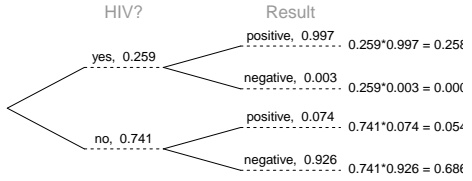

funnel

| Category | Group | Probability | Result |
| --- | --- | --- | --- |
| yes | Positive | 0.259 | 0.259*0.997 = 0.258 |
| yes | Negative | 0.259 | 0.259*0.003 = 0.000 |
| no | Positive | 0.741 | 0.741*0.074 = 0.054 |
| no | Negative | 0.741 | 0.741*0.926 = 0.686 |

**2.17** 0.0714. Even when a patient tests positive for lupus, there is only a 7.14% chance that he actually has

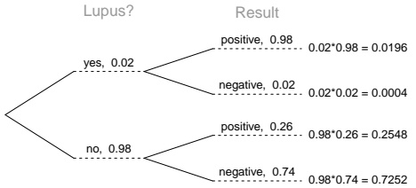

funnel

| Group | Outcome | Probability | p-value | p-value |
| --- | --- | --- | --- | --- |
| Lupus? | yes | 0.02 | 0.02*0.98 | 0.0196 |
| Lupus? | yes | 0.02 | 0.02*0.98 | 0.0196 |
| Lupus? | yes | 0.02 | 0.02*0.98 | 0.0196 |
| Lupus? | yes | 0.02 | 0.02*0.98 | 0.0196 |
| LupUS? | no | 0.98 | 0.98*0.74 | 0.7252 |
| LupUS? | no | 0.98 | 0.98*0.74 | 0.7252 |
| LupUS? | no | 0.98 | 0.98*0.74 | 0.7252 |
| LupUS? | no | 0.98 | 0.98*0.74 | 0.7252 |
| Lupus? | no | 0.98 | 0.98*0.74 | 0.7252 |
| LupUS? | no | 0.98 | 0.98*0.74 | 0.7252 |
| LupUS? | no | 0.98 | 0.98*0.74 | 0.7252 |

lupus. House may be right.

**2.19** (a) Let E represent the event of agreeing with the idea of evolution and D be the event of being a Democrat. From the problem statement, $P(E|D)=0.67.\ P(E^{C}|D)=1-P(E|D)=1-0.67=0.33.$
(b) Let I represent the event of being an independent. $P ( E | I ) = 0 . 6 5 ,$ as stated in the problem.
(c) Let R represent the event of being a Republican. $P ( E | R ) = 1 - P ( E ^ { C } | R ) = 1 - 0 . 4 8 = 0 . 5 2 .$
(d) 0.35. $\bar{P(R|E)}=\frac{P(E  and  R)}{P(E)}=\frac{P(R)P(E|R)}{P(E)}=\frac{0.40(0.52)}{0.60}=0.35.$
**2.21** Mumps is the most likely disease state, since $P ( B _ { 3 } | A ) = 0 . 5 6 3 , \; P ( B _ { 1 } | A ) = 0 . 0 2 3 , \; \mathrm { a n d } \; P ( B _ { 2 } | A ) = . 4 1 5 .$

$$
P (B _ {i} | A) = \frac {P (A | B _ {i}) P (B _ {i})}{P (A)}. P (A) = P (A \text {and} B _ {1}) + P (A \text {and} B _ {2}) + P (A \text {and} B _ {3}) = P (A | B _ {1}) P (B _ {1}) + P (A | B _ {2}) P (B _ {2}) + P (A | B _ {3}) P (B _ {3}).
$$

**2.23** (a) Let A be the event of knowing the answer and B be the event of answering it correctly. Assume that if a participant knows the correct answer, they answer correctly with probability 1: $P ( B | A ) = 1$ . If they guess randomly, they have 1 out of m chances to answer correctly, thus $\begin{array} { r } { P ( B | A ^ { C } ) = 1 / m . \quad P ( A | B ) = \frac { 1 \cdot p } { ( 1 \cdot p ) + ( \frac { 1 } { m } \cdot ( 1 - p ) ) } = } \end{array}$ $\frac { p } { p + \frac { 1 - p } { m } }$

(b) 0.524. Let A be the event of having an IQ over 150 and B be the event of receiving a score indicating an IQ over 150. From the problem statement, $P ( B | A ) = 1$ and $\begin{array} { r } { P ( B | A ^ { C } ) = 0 . 0 0 1 . P ( A ^ { C } | B ) = \frac { 0 . 0 0 1 \cdot ( 1 - \frac { 1 } { 1 . 1 0 0 } ) } { ( 1 \cdot ( \frac { 1 } { 1 . 1 0 0 } ) ) + ( 0 . 0 0 1 \cdot ( 1 - \frac { 1 } { 1 . 1 0 0 } ) ) } = } \end{array}$ 0.524.

---

440

APPENDIX A. END OF CHAPTER EXERCISE SOLUTIONS

**2.25** (a) In descending order on the table, the PPV for each age group is 0.003, 0.064, 0.175, 0.270; the NPV for each age group is 0.999, 0.983, 0.948, 0.914.
(b) As prevalence of prostate cancer increases by age group, PPV also increases. However, with rising prevalence, NPV decreases.
(c) The probability that a man has prostate cancer, given a positive test, necessarily increases as the overall probability of having prostate cancer increases. If more men have the disease, the chance of a positive test result being a true positive increases (and the chances of the result being a false positive decreases). The decreasing NPV values follow similar logic: if more men have the disease, the chance of a negative test being a true negative decreases (and the chances of the result being a false negative increases).
(d) Lowering the cutoff for a positive test would result in more men testing positive, since men with PSA values 2.5 ng/ml to 4.1 ng/ml were not previously classified as testing positive. Since the sensitivity of a test is the proportion who test positive among those who have disease, and the number with disease does not change, the proportion will increase, except in the rare and unlikely situation where the additional positive tests are among only men without the disease.
**2.27** (a) Frequency of $X ^ { + } X ^ { + } ;$ : 0.863. Frequency of $X ^ { + } X ^ { - } \colon 0 . 1 3 2$ . Frequency of $X ^ { - } X ^ { - } \colon 0 . 0 0 5 .$ Frequency of $X ^ { - } Y { : } 0 . 0 7$ . Frequency of $X ^ { + } Y { : } 0 . 9 3$ . From frequency of $X ^ { - } X ^ { - }$ , frequency of X− allele is $\sqrt{0.005}=0.071;$ thus, frequency of $X ^ { + }$ allele is $1 - 0 . 0 7 1 = 0 . 9 2 9$ . Frequency of $X ^ { + } Y$ is $1 - 0 . 0 9 3 = 0 . 0 7$
(b) 0.033. Let A be the event that two parents are not colorblind, and B represent the event of having a colorblind child. On the tree, × represents a mating between two genotypes. $P ( B | A ) = [ P ( X ^ { + } X ^ { + } \times X ^ { + } Y | A )$ $P(B|X^{+}X^{+}\times X^{+}Y)]+[P(X^{+}X^{-}\times X^{+}Y|A)\cdot P(B|X^{+}X^{-}\times X^{+}Y)]=(0.867)(0)+(0.133)(1/4)=0.033.$

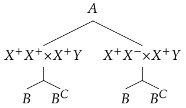

flowchart

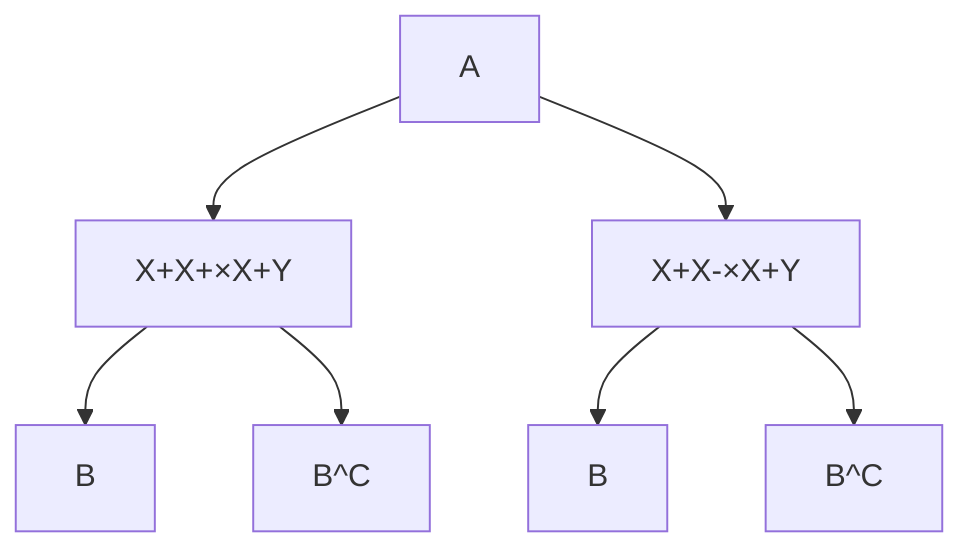

**2.29** (a) Calculate $P ( M \cap B )$ , the probability a dog has a facial mask and a black coat. Note that the event M consists of having either a unilateral mask or a bilateral mask.

$$
\begin{array}{l} P (M \cap B) = P (M _ {1} \cap B) + P (M _ {2} \cap B) \\ = P (M _ {1} | B) P (B) + P (M _ {2} | B) P (B) \\ = (0. 2 5) (0. 4 0) + (0. 3 5) (0. 4 0) \\ = 0. 2 4 \\ \end{array}
$$

The probability an Australian cattle dog has a facial mask and a black coat is 0.31.

(b) Calculate $P ( M _ { 2 } )$ , the prevalence of bilateral masks. The event of having a bilateral mask can be partitioned into either having a bilateral mask and a red coat or having a bilateral mask and a black coat.

$$
\begin{array}{l} P (M _ {2}) = P (R \cap M _ {2}) + P (B \cap M _ {2}) \\ = P (M _ {2} | R) P (R) + P (M _ {2} | B) P (B) \\ = (0. 1 0) (0. 6 0) + (0. 3 5) (0. 4 0) \\ = 0. 2 0 \\ \end{array}
$$

The prevalence of bilateral masks in Australian cattle dogs is 0.20.

(c) Calculate $P ( \overline { { R } } | M _ { 2 } ) ,$ , the probability of having a red coat given having a bilateral mask. Apply the definition of conditional probability.

---

441

$$
\begin{array}{l} P (R | M _ {2}) = \frac {P (R \cap M _ {2})}{P (M _ {2})} \\ = \frac {P (M _ {2} | R) P (R)}{P (M _ {2})} \\ = \frac {(0 . 1 0) (0 . 6 0)}{0 . 2 0} \\ = 0. 3 0 \\ \end{array}
$$

The probability of being a Red Heeler among Australian cattle dogs with bilateral facial masks is 0.30. (d) The following new information has been introduced:

i. Calculate $P ( M _ { 2 } \cap D ^ { C } \cap R )$

$$
\begin{array}{l} P (M _ {2} \cap D ^ {C} \cap R) = P (D ^ {C} | M _ {2}, R) P (M _ {2} | R) P (R) \\ = P (D ^ {C} | M _ {2}, R) (0. 1 0) (0. 6 0) \\ \end{array}
$$

To calculate $P ( D ^ { C } | M _ { 2 } , R )$ , first calculate $P ( D _ { 1 } | M _ { 2 } , R )$ and $P ( D _ { 2 } | M _ { 2 } , R )$ from the joint probabilities given in the problem, then apply the complement rule.

$$
P (D _ {1} | M _ {2}, R) = \frac {P (M _ {2} \cap D _ {1} \cap R)}{P (M _ {2} \cap R)} = \frac {0 . 0 4 5}{(0 . 1 0) (0 . 6 0)} = 0. 7 5
$$

$$
P (D _ {2} | M _ {2}, R) = \frac {P (M _ {2} \cap D _ {2} \cap R)}{P (M _ {2} \cap R)} = \frac {0 . 0 1 2}{(0 . 1 0) (0 . 6 0)} = 0. 2 0
$$

Back to the original question...

$$
\begin{array}{l} P (M _ {2} \cap D ^ {C} \cap R) = P (D ^ {C} | M _ {2}, R) P (M _ {2} | R) P (R) \\ = P (D ^ {C} | M _ {2}, R) (0. 1 0) (0. 6 0) \\ = [ 1 - (0. 7 5 + 0. 2 0) ] (0. 1 0) (0. 6 0) \\ = (0. 0 5) (0. 1 0) (0. 6 0) \\ = 0. 0 0 3 \\ \end{array}
$$

The probability that an Australian cattle dog has a bilateral mask, no hearing deficits, and a red coat is 0.003.

ii. Calculate $P ( D ^ { C } | M _ { 2 } , B )$ ).

$$
\begin{array}{l} P (D ^ {C} | M _ {2}, B) = 1 - \left[ P (D _ {1} | M _ {2}, B) + P (D _ {2} | M _ {2}, B) \right] \\ = 1 - \left[ \frac {P (D _ {1} \cap M _ {2} \cap B)}{P (M _ {2} \cap B)} + \frac {P (D _ {2} \cap M _ {2} \cap B)}{P (M _ {2} \cap B)} \right] \\ = 1 - \left[ \frac {0 . 0 4 5}{P (M _ {2} | B) P (B)} + \frac {0 . 0 1 2}{P (M _ {2} | B) P (B)} \right] \\ = 1 - \left[ \frac {0 . 0 4 5}{(0 . 3 5) (0 . 4 0)} + \frac {0 . 0 1 2}{(0 . 3 5) (0 . 4 0)} \right] \\ = 0. 5 9 3 \\ \end{array}
$$

The proportion of bilaterally masked Blue Heelers without hearing deficits is 0.593. iii. Calculate $P ( D | R )$ and $P ( D | \bar { B } )$

---

442

APPENDIX A. END OF CHAPTER EXERCISE SOLUTIONS

$$
\begin{array}{l} P (D | R) = P (D \cap M _ {0} | R) + P (D \cap M _ {1} | R) + P (D \cap M _ {2} | R) \\ = [ 1 - P (D ^ {C} | R, M _ {0}) ] (P (M _ {0} | R) + [ 1 - P (D ^ {C} | R, M _ {1}) ] (P (M _ {1} | R) + [ 1 - P (D ^ {C} | M _ {2}, R) ] (P (M _ {2} | R)) \\ = (1 - 0. 6 0) (0. 5 0) + (1 - 0. 6 0) (0. 4 0) + (1 - 0. 0 5) (0. 1 0) \\ = 0. 4 5 5 \\ \end{array}
$$

$$
\begin{array}{l} P (D | B) = P (D \cap M _ {0} | B) + P (D \cap M _ {1} | B) + P (D \cap M _ {2} | B) \\ = [ P (D _ {1} | B, M _ {0}) + P (D _ {2} | B, M _ {0}) ] (P (M _ {0} | B) + [ P (D _ {1} | B, M _ {0}) + P (D _ {2} | B, M _ {0}) ] (P (M _ {1} | B) \\ + [ 1 - P (D ^ {C} | M _ {2}, B) ] (P (M _ {2} | B) \\ = (0. 0 5 + 0. 0 1) (0. 4 0) + (0. 0 5 + 0. 0 1) (0. 2 5) + (1 - 0. 5 9 3) (0. 3 5) \\ = 0. 1 8 1 \\ \end{array}
$$

The prevalence of deafness among Red Heelers is higher, at 0.455 versus 0.181 in Blue Heelers. iv. Calculate $P ( B | D ^ { C } )$ .

$$
\begin{array}{l} P (B | D ^ {C}) = \frac {P (B \cap D ^ {C})}{P (D ^ {C})} \\ = \frac {P (D ^ {C} | B) P (B)}{P (D ^ {C} \cap B) + P (D ^ {C} \cap R)} \\ = \frac {[ 1 - P (D | B) ] P (B)}{[ 1 - P (D | B) ] P (B) + [ 1 - P (D | R) ] P (R)} \\ = \frac {(1 - 0 . 1 8 1) (0 . 4 0)}{(1 - 0 . 1 8 1) (0 . 4 0) + (1 - 0 . 4 5 5) (0 . 6 0)} \\ = 0. 5 0 \\ \end{array}
$$

The probability that a dog is a Blue Heeler given that it is known to have no hearing deficits is 0.50.

## 3 Distributions of random variables

**3.1** (a) 13. (b) No, these 27 students are not a random sample from the university’s student population. For example, it might be argued that the proportion of smokers among students who go to the gym at 9 am on a Saturday morning would be lower than the proportion of smokers in the university as a whole.

**3.3** (a) The probability of drawing three hearts equals $( 1 3 / 5 2 ) ( 1 2 / 5 1 ) ( 1 1 / 5 0 ) = 0 . 0 1 2 9$ , and the probability of drawing three black cards equals $( 2 6 / 5 2 ) ( 2 5 / 5 1 ) ( 2 4 / 5 0 ) = 0 . 1 1 7 6 ;$ thus, the probability of any other draw is $1 - 0.0129 - 0.1176 = 0.8694. E(X) = 0.0129(50) + 0.1176(25) + 0.8694(0) = 3.589. Var(X) = 0.0129(50 - 3.589)^2 +$ $0.1176(25 - 3.589)^{2} + 0.8694(0 - 3.589)^{2} = 93.007. SD(X) = \sqrt{Var(X)} = 9.644.$

(b) Let Y represent the net profit/loss, where $Y = X - 5. E(Y) = E(X - 5) = E(X) - 5 = -1.412$ . Standard deviation does not change from a shift of the distribution; $SD(Y)=SD(X)=9.644.$

(c) It is not advantageous to play, since the expected winnings are lower than \$5.

**3.5** (a) 215 eggs. Let X represent the number of eggs laid by one gull. $E ( X ) = 0 . 2 5 ( 1 ) + 0 . 4 0 ( 2 ) + 0 . 3 0 ( 3 ) +$ $0.05(4)=2.15.E(100X)=100E(X)=215.$

(b) 85.29 eggs. $Var(X)=0.25(1-2.15)^{2}+0.40(2-2.15)^{2}+0.30(3-2.15)^{2}+0.05(4-2.15)^{2}=0.7275.Var(100X)=$ $1 0 0 ^ { 2 } V a r ( X ) = 7 2 7 5 \rightarrow { \sqrt { 7 2 7 5 } } = 8 5 . 2 9 .$

---

443

**3.7** (a) Binomial conditions are met: (1) Independent trials: In a random sample across the US, it is reasonable to assume that whether or not one 18-20 year old has consumed alcohol does not depend on whether or not another one has. (2) Fixed number of trials: $n = 1 0 . \; ( 3 )$ Only two outcomes at each trial: Consumed or did not consume alcohol. (4) Probability of a success is the same for each trial: $p = 0 . 6 9 7$

(b) Let X be the number of 18-20 year olds who have consumed alcohol; $X \sim \mathrm{Bin}(10,0.697). P(X = 6) = 0.203$ (c) Let Y be the number of 18-20 year olds who have not consumed alcohol; $Y \sim \mathrm{Bin}(10,1 - 0.697). P(Y = 4) =$ $P ( X = 6 ) = 0 . 2 0 3 .$
(d) $X \sim \mathrm { B i n } ( 5 , 0 . 6 9 7 ) . P ( X \leq 2 ) = 0 . 1 6 7 .$
(e) $X \sim \operatorname { B i n } ( 5 , 0 . 6 9 7 ) . P ( X \geq 1 ) = 1 - P ( X = 0 ) = 0 . 9 9 7 .$

**3.9** (a) $\begin{array} { r } { \mu 3 4 . 8 5 ,   \sigma = 3 . 2 5   ( \mathrm { b } )   Z = \frac { 4 5 - 3 4 . 8 5 } { 3 . 2 5 } = 3 . 1 2 . } \end{array}$ 45 is more than 3 standard deviations away from the mean, we can assume that it is an unusual observation. Therefore yes, we would be surprised. (c) Using the normal approximation, 0.0009. With 0.5 correction, 0.0015.

**3.11** (a) Both O+ and O- individuals can donate blood to a Type O+ patient; $n = 1 5 ,   p = 0 . 4 5 .     \mu = n p = 6 . 7 5$ $\sigma = { \sqrt { n p { \big ( } 1 - p { \big ) } } } = 1 . 9 3$

(b) Only O- individuals can donate blood to a Type O- patient; $n = 15,   p = 0.08.   P(X \geq 3) = 0.113$

**3.13** 0.132. Let X be the number of IV drug users who contract Hepatitis C within a month; $X \sim \mathrm { B i n } ( 5 , 0 . 3 0 )$ $P ( X = 3 ) = 0 . 1 3 2$
**3.15** (a) Let X represent the number of infected stocks in the sample; $X \sim \mathrm{Bin}(250, 0.30). P(X = 60) = 0.006$

(b) $P ( X \leq 6 0 ) = 0 . 0 2 1$

(c) $P ( X \geq 8 0 ) = 0 . 7 3 5$

(D) 40% of 250 is 100. $P ( X \leq 1 0 0 ) = 0 . 9 9 7$ . Yes, this seems reasonable; it is essentially guaranteed that within a sample of 250, no more than 40% will be infected.

**3.17** (a) $(200)(0.12)=24$ cases of hyponatremia are expected during the marathon.

(b) Let X represent the number of cases of hyponatremia during the marathon. $P(X > 30) = 0.082$

**3.19** (a) 8.85%. (b) 6.94%. (c) 58.86%. (d) 4.56%.

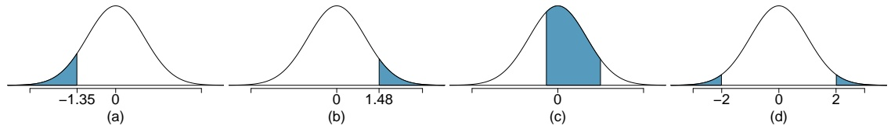

**3.21** (a) 0.005. (b) 0.911. (c) 0.954. (d) 1.036. (e) -0.842
**3.23** (a) Verbal: $N ( \mu = 1 5 1 , \sigma = 7 )$ , Quant: $N ( \mu = 1 5 3 , \sigma = 7 . 6 7 )$ . $Z _ { V R } = 1 . 2 9 ,   Z _ { Q R } = 0 . 5 2$ . She did better on the Verbal Reasoning section since her $\scriptstyle \mathrm { Z - S C o r e }$ on that section was higher.

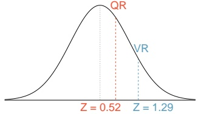

violin

| Metric | Value |
| --- | --- |
| QR | — |
| VR | — |
| Z | 0.52 |
| Z | 1.29 |

(b) $P e r c _ { V R } = 0 . 9 0 0 7 \approx 9 0 \% ,   P e r c _ { Q R } = 0 . 6 9 9 0 \approx 7 0 \% . \quad 1 0 0 \% - 9 0 \% = 1 0 \%$ did better than her on VR, and $100\% - 70\% = 30\%$ did better than her on QR.
(c) 159. (d) 147.

**3.25** (a) 0.115. (b) The coldest 10% of days are colder than $7 0 . 5 9 ^ { \circ } \mathrm { F } .$
**3.27** (a) 0.023. (b) 72.66 mg/dL.

---

444

APPENDIX A. END OF CHAPTER EXERCISE SOLUTIONS

**3.29** (a) 82.4%. (b) About 38 years of age.
**3.31** (a) n = 50, and $p=0.70.\ \mu=np=35.\ \sigma=\sqrt{np(1-p)}=3.24.$

(b) Both np and $n ( 1   -   p )$ are greater than 10. Thus, it is valid to approximate the distribution as $X \sim N ( 3 5 , 3 . 2 4 )$ where X is the number of 18-20 year olds who have consumed alcohol. $P ( X \geq 4 5 ) = 0 . 0 0 1$

**3.33** Let X represent the number of students who accept the offer; $X \sim \mathtt { B i n } ( 2 5 0 0 , 0 . 7 0 )$ . This distribution can be approximated by a N(1750,22.91). The approximate probability that the school does not have enough dorm room spots equals $P ( X \geq 1 , 7 8 6 ) = 0 . 0 6$
**3.35** The data appear to follow a normal distribution, since the points closely follow the line on the normal probability plot. There are some small deviations, but this is to be expected for such a small sample size.

**3.37** (a) $P ( X = 2 ) = { \frac { \exp ^ { - 2 } ( 2 ^ { 2 } ) } { 2 ! } } = 0 . 2 7 1$ . (b) $P(X \leq 2) = P(X = 0) + P(X = 1) + P(X = 2) = 0.677. (c) P(X \geq 3) =$ $1 - P ( X \leq 2 ) = 0 . 3 2 3 .$
**3.39** (a) $\mu = \lambda = 75,   \sigma = \sqrt{\lambda} = 8.66.   (b)   Z = -1.73$ . Since 60 is within 2 standard deviations of the mean, it would not generally be considered unusual. Note that we often use this rule of thumb even when the normal model does not apply. (c) Using Poisson with $\lambda = 75 : 0.0402$
**3.41** (a) The expected number of cases of osteosarcoma in NYC in a given year is 11.2. (b) Let X represent the number of osteosarcoma cases diagnosed. The probability that 15 or more cases will be diagnosed in a given year is the quantity $P(X \geq 15) = 1 - P(X < 15) = 1 - P(X \leq 14) = 0.161$ . (c) First, calculate λB given that $n = 4 5 0 , 0 0 0$ for Brooklyn: 3.6. The probability of observing 10 or more cases in Brooklyn in a given year is the quantity $P(X_{B} \geq 10) = 1 - P(X_{B} < 10) = 1 - P(X_{B} \leq 9) = 0.004$ . (d) No, he is not correct. The probability calculated in c) deals only with Brooklyn: the probability that there are 10 or more cases in Brooklyn for a single year. It does not say anything about cases in other boroughs. If we assume independence between boroughs, the probability that the official is referring to is:

P (X = 0 in other boroughs) × P (X ≥ 10 in Brooklyn).

There is no reason to expect that $P ( X = 0$ in other boroughs) should equal 1, so this probability is differ ent from the one in part c). (e) o, this probability is not equal to the probability calculated in part c). Over five years, there are five opportunities for the event of 10 or more cases in Brooklyn in a single year to occur. Let Y represent the event that in a single year, 10 or more cases of osteosarcoma are observed in Brooklyn. If we assume independence between years, then Y follows a binomial distribution with $n = 5$ and p of success as caculated in part c); $P ( Y = 1 ) = 0 . 0 2 0$

**3.43** (a) λ for a population of 2,000,000 male births is 400. The probability of at most 380 newborn males with hemophilia is $P ( X \leq 3 8 0 )$ , where $X \sim \mathrm{Poisson(400)} : 0.165.$

(b) $P ( X \geq 4 5 0 ) = 0 . 0 0 7 5 .$
(c) The number of male births is $^ { ( 1 / 2 ) ( 1 , 5 0 0 , 0 0 0 ) } = 7 5 0 { , } 0 0 0$ . The rate λ for one year is 150. Over 5 years, the rate λ is 750. The expected number of hemophilia births over 5 years is 750 and the standard deviation is ${ \sqrt { 7 5 0 } } = 2 7 . 3 9$

**3.45** (a) On average, 2 women would need to be sampled in order to select a married woman $\left( \mu = 1 / p = \right.$ 2.123), with standard deviation 1.544 $\begin{array} { r } { ( \sigma = \sqrt { \frac { ( 1 - p ) } { p ^ { 2 } } } ) } \end{array}$ .

(b) $\mu = 3 . 3 3 . \sigma = 2 . 7 9 .$
(c) Decreasing the probability increases both the mean and the standard deviation.

**3.47** (a) Let X represent the number of stocks that must be sampled to find an infected stock; $X \sim \mathrm { G e o m } ( 0 . 3 0 )$ $P ( X \leq 5 ) = 0 . 8 3 2$

(b) $P ( X \leq 6 ) = 0 . 8 8 2 .$
(c) $P(X \geq 3) = 1 - P(X \leq 2) = 0.49.$

---

445

**3.49** (a) $0.875^{2} \times 0.125 = 0.096. (b) \mu = 8, \sigma = 7.48.$

**3.51** (a) $0 . 0 8 0 4 . \; ( \mathsf { b } ) \; 0 . 0 3 2 2 . \; ( \mathsf { c } ) \; 0 . 0 1 9 3 .$

**3.53** (a) 0.102, geometric with $p = 1 9 9 4 / 1 4 , 6 0 4 = 0 . 1 3 7$

(b) 0.854, binomial with $n = 1 0 ,   p = 0 . 1 3 7 .$

(c) 0.109, binomial with $n   =   1 0 ,   p   =   0 . 1 3 7$

(d) The mean and standard deviation of a negative binomial random variable with r = 4 and $p = 0 . 1 3 7$ are 29.30 and 13.61, respectively.

**3.55** (a) $\mu = 2 . 0 5 ;   \sigma ^ { 2 } = 1 . 7 7$

(b) Let X represent the number of soapy-taste detectors; $X \sim \mathrm { H G e o m } ( 1 9 9 4 , 1 4 6 0 4 - 1 9 9 4 , 1 5 ) . \quad P ( X = 4 ) =$ 0.09435.

(c) $P ( X \leq 2 ) = 0 . 6 6 3 .$

(d) 0.09437, from the binomial distribution. With a large sample size, sampling with replacement is highly unlikely to result in any particular individual being sampled again. In this case, the hypergeometric and binomial distributions will produce equal probabilities.

**3.57** (a) The marginal distributions for X is obtained by summing across the two rows, and for Y by summing the columns. The marginal probabilities for X = 0 and X = 1 are 0.60 and 0.40, and for Y = −1 and Y = 1 are both $0 . 5 0 ; \mathrm { i . e . , } p _ { X } ( 0 ) = 0 . 6 0 , p _ { X } ( 1 ) = 0 . 4 0 , p _ { Y } ( - 1 ) = p _ { Y } ( 1 ) = 0 . 5 0 \; \mathrm { ( b ) }$ The mean and variance of X are calculated using the formulas in Section 3.1.2 and 3.1.3 and are

$$
\mu_ {X} = (0) (0. 6 0) + (1) (0. 4 0) = 0. 4 0
$$

$$
\sigma_ {X} ^ {2} = (0 - 0. 4 0) ^ {2} (0. 6 0) + (1 - 0. 4 0) ^ {2} (0. 4 0) = 0. 2 4
$$

The standard deviation of X is $\sqrt{0.24} = 0.49.$ The two standardized values of X are obtained by subtracting the mean of X from each value and dividing by the standard deviation. The two standardized values are -0.82 and 1.23. (d) The correlation between X and Y adds the 4 products of the standardized values, weighted by the values in the joint distribution:

$$
\rho_ {X, Y} = (- 0. 8 2) (- 1) (0. 2 0) + (- 0. 8 3) (1) (0. 4 0) + (1. 2 3) (- 1) (0. 3 0) + (1. 2 3) (1) (0. 1 0) = -. 4 1
$$

(e) No. The correlation between X and Y is not zero.

**3.59** (a) Sum over the margins to calculate the marginal distributions.

$$
p _ {Y} (- 1) = 0. 2 5 \quad p _ {Y} (0) = 0. 2 0 \quad p _ {Y} (1) = 0. 5 5
$$

$$
p _ {X} (- 1) = 0. 4 5 \quad p _ {X} (0) = 0. 2 0 \quad p _ {X} (1) = 0. 3 5
$$

(b) The expected value of X is calculated as follows:

$$
E (X) = \sum_ {i} x _ {i} P (X = x _ {i}) = (- 1) (0. 4 5) + (0) (0. 2 0) + (1) (0. 3 5) = - 0. 1 0
$$

(c) The variance of Y is calculated by first calculating E(Y ), then using that in the formula for a variance of a random variable.

$$
E (Y) = \sum_ {i} y _ {i} P (Y = y _ {i}) = (- 1) (0. 2 5) + (0) (0. 2 0) + (1) (0. 5 5) = 0. 3 0
$$

$$
\mathrm{Var} (Y) = \sum_ {i} (y _ {i} - E (Y)) ^ {2} P (Y = y _ {i}) = (- 1 - 0. 3 0) ^ {2} (0. 2 5) + (0 - 0. 3 0) ^ {2} (0. 2 0) + (1 - 0. 3 0) ^ {2} (0. 5 5) = 0. 7 1
$$

---

446

APPENDIX A. END OF CHAPTER EXERCISE SOLUTIONS

**3.61** (a) No. The new marginal distributions for the costs for the two members of the couple are shown in the following table. The values and the marginal distribution for the partner’s cost do not change, so the expected value and standard deviation will not change. The previous values for the mean and standard deviation were \$980 and \$9.80.

<table><tr><td></td><td colspan="3">Partner Costs, Y</td></tr><tr><td>Employee costs, X</td><td>$968</td><td>$988</td><td>Marg. Dist., X</td></tr><tr><td>$968</td><td>0.18</td><td>0.12</td><td>0.30</td></tr><tr><td>$1,008</td><td>0.15</td><td>0.25</td><td>0.40</td></tr><tr><td>$1,028</td><td>0.07</td><td>0.23</td><td>0.30</td></tr><tr><td>Marg. Dist., Y</td><td>0.40</td><td>0.60</td><td>1.00</td></tr></table>

(b) The expected value and standard deviation of the employee’s costs are calculated as in Example 3.6, but using the new marginal distribution. The new values for the mean and standard deviation are \$1,002 and \$23.75. (c) The expected total cost is \$1, ${ 0 0 2 + \S 9 8 0 = \S 1 , 9 8 2 } .$ (d) The calculation correlation depends on the standardized costs for each member of the couple and the joint probabilities. The new standardized values for the employee costs are -1.43, 0.25, and 1.09; the corresponding values for the partner are -1.22 and 0.82. The correlation is the weighted sum of the 6 products, weighted by the joint probabilities: $\rho _ { X , Y } = 0 . 2 9 .$ . (e) The new variance for the total cost will be $( 2 3 . 8 0 ) ^ { 2 } + ( 9 . 8 0 ) ^ { 2 } + ( 2 ) ( 2 3 . 8 ) ( 9 . 8 0 ) ( 0 . 2 9 ) = 7 9 6 . 0 0$ The new standard deviation is ${ \sqrt { 7 9 6 . 0 0 } } = \S 2 8 . 2 1$

## 4 Foundations for inference

**4.1** $(a) \; \overline{x} = 0.6052.$

(b) $s = 0 . 0 1 3 1$
(c) $\begin{array} { r } { Z _ { 0 . 6 3 } = \frac { 0 . 6 3 - 0 . 6 0 5 2 } { 0 . 0 1 3 1 } = 1 . 8 9 3 } \end{array}$ . No, this level of BGC is within 2 SD of the mean.
(d) The standard error of the sample mean is given by $\frac{s}{\sqrt{n}} = \frac{0.0131}{\sqrt{70}} = 0.00157$

**4.3** (a) This is the sampling distribution of the sample mean.

(b) The sampling distribution will be normal and symmetric, centered around the theoretical population mean µ of the number of eggs laid by this hen species during a breeding period.
(c) The variability of the distribution is the standard error of the sample mean: $\frac{s}{\sqrt{n}}=\frac{18.2}{\sqrt{45}}=2.71$
(d) The variability of the new distribution will be greater than the variability of the original distribution. Conceptually, a smaller sample is less informative, which leads to a more uncertain estimate. This can be shown concretely with a calculation: $\textstyle { \frac { 1 8 . 2 } { \sqrt { 1 0 } } } = 5 . 7 6$ is larger than 2.71.

**4.5** (a) We are 95% confident that the mean number of hours that U.S. residents have to relax or pursue activities that they enjoy is between 3.53 and 3.83 hours.

(b) A larger margin of error with the same sample occurs with a higher confidence level (i.e., larger critical value).
(c) The margin of error of the new 95% confidence interval will be smaller, since a larger sample size results in a smaller standard error. (d) A 90% confidence interval will be smaller than the original 95% interval, since the critical value is smaller and results in a smaller margin of error. The interval will provide a more precise estimate, but have an associated lower confidence of capturing µ.

---

447

**4.7** (a) False. Provided the data distribution is not very strongly skewed $\left( n = 6 4 \right.$ in this sample, so we can be slightly lenient with the skew), the distribution of the sample mean will be nearly normal, allowing for the normal approximation.
(b) False. Inference is made on the population parameter, not the point estimate. The point estimate is always in the confidence interval.
(c) True.
(d) False. The confidence interval is not about a sample mean.
(e) False. A wider interval is required to be more confident about capturing the parameter.
(f) True. The margin of error is half the width of the interval, and the sample mean is the midpoint of the interval.
(g) False. To halve the margin of error requires sampling $2 ^ { 2 } = 4$ times the number of people in the initial sample.

**4.9** (a) i. False. There is a 5% chance that any 95% confidence interval does not contain the true population mean days out of the past 30 days that U.S. adults experienced poor mental health. ii. False. The population parameter $\mu$ is either inside or outside the interval; there is no probability associated with whether the fixed value $\mu$ is in a certain calculated interval. The randomness is associated with the interval (and the method for calculating $\mathbf { i } \mathbf { t } ) ,$ not the parameter $\mu .$ Thus, it would not be reasonable to say there is a 95% chance that the particular interval (3.40, 4.24) contains $\mu ;$ this interpretation is coherent with the statement in part iii. of this question. iii. True. This is the definition of what it means to be 95% confident. iv. True. The interval corresponds to a two-sided test, with $H _ { 0 } : \mu = 4 . 5$ days and $H _ { A } : \mu \neq 4 . 5$ days and $\alpha = 1 - 0 . 9 5 = 0 . 0 5$ . Since µ0 of 4.5 days is outside the interval, the sample provides sufficient evidence to reject the null hypothesis and accept the alternative hypothesis. $\mathbf { v } ,$ False. We can only be confident that 95% of the time, the entire interval calculated contains $\mu .$ It is not possible to make this statement about x or any other point within the interval. vi. False. The confidence interval is a statement about the population parameter $\mu ,$ the mean days out of the past 30 days that all US adults experienced poor mental health. The sample mean $\overline { { x } }$ is a known quantity. (b) The 90% confidence interval will be smaller than the 95% confidence interval. If we are less confident that an interval contains $\mu ,$ this implies that the interval is less wide; if we are more confident, the interval is wider. Think about a theoretical "100%" confidence interval—to be 100% confident of capturing $\mu ,$ then the range must be all possible numbers that $\mu$ could be. (c) (3.47, 4.17) days

**4.11** (a) The null hypothesis is that New Yorkers sleep an average of 8 hours of night $\left( H _ { 0 } : \mu = 8 \right.$ hours). The alternative hypothesis is that New Yorkers sleep less than 8 hours a night on average $( H _ { A } : \mu < 8$ hours).
(b) The null hypothesis is employees spend on average 15 minutes on non-business activities in a day $( H _ { 0 }$ $\mu = 1 5$ minutes). The alternative hypothesis is that employees spend on average more than 15 minutes on non-business activities in a day $( H _ { A } : \mu   >   1 5$ minutes).
**4.13** Hypotheses are always made about the population parameter $\mu ,$ not the sample mean ${ \overline { { x } } } .$ The correct value of $\mu _ { 0 }$ is 10 hours, as based on the previous evidence; both hypotheses should include $\mu _ { 0 }$ . The correct hypotheses are $H _ { 0 } : \mu = 1 0$ hours and $H _ { A } : \mu   >   1 0$ hours.
**4.15** (a) This claim is not supported by the confidence interval. 3 hours corresponds to a time of 180 minutes; there is evidence that the average waiting time is lower than 3 hours.
(b) 2.2 hours corresponds to 132 minutes, which is within the interval. It is plausible that $\mu$ is 132 minutes, since we are 95% confident that the interval (128 minutes, 147 minutes) contains the average wait time.
(c) Yes, the claim would be supported based on a 99% interval, since the 99% interval is wider than the 95% interval.
**4.17** $H _ { 0 } : \mu = 1 3 0$ grams, $H _ { A } : \mu \neq 1 3 0$ grams. Test the hypothesis by calculating the test statistic: $\begin{array} { r l } { t = \frac { \overline { { x } } - \mu _ { 0 } } { s / \sqrt { n } } = } \end{array}$ $\textstyle { \frac { 1 3 0 - 1 3 4 } { 1 7 / s q r t { 3 5 } } } = 1 . 3 9$ . This results in a $: p \cdot$ -value of 0.17. There is insufficient evidence to reject the null hypothesis. There is no evidence that the nutrition label does not provide an accurate measure of calories.

---

448

APPENDIX A. END OF CHAPTER EXERCISE SOLUTIONS

**4.19** (a) The 95% confidence interval is $3 , 1 5 0 \pm ( 1 . 9 6 \times 2 5 0 / { \sqrt { 5 0 } } ) = ( 3 0 8 0 . 7 , 3 2 1 9 . 3 )$ grams.
(b) She will conduct a test of the null against the two-sided alternative $H _ { A } : \mu \neq 3 2 5 0$ grams. Calculate the test statistic: $\begin{array} { r } { t = \frac { \overline { { x } } - \mu _ { 0 } } { s / \sqrt { n } } = \frac { 3 1 5 0 - 3 2 5 0 } { 2 5 0 / \sqrt { 5 0 } } = - 2 . 8 3 } \end{array}$ . The $p _ { 1 }$ -value is 0.007. There is sufficient evidence to reject the null hypothesis and conclude that the mean birthweight of babies from inner-city teaching hospitals is lower than 3,260 grams.
**4.21** (a) H0: Anti-depressants do not help symptoms of fibromyalgia. $H _ { A } \colon$ Anti- depressants do treat symptoms of fibromyalgia. (b) Concluding that anti-depressants work for the treatment of fibromyalgia symptoms when they actually do not. (c) Concluding that anti-depressants do not work for the treatment of fibromyalgia symptoms when they actually do. (d) If she makes a Type 1 error, she will continue taking medication that does not actually treat her disorder. If she makes a Type 2 error, she will stop taking medication that could treat her disorder.
**4.23** (a) The standard error is larger under scenario I; standard error is larger for smaller values of n.

(b) The margin of error is larger under scenario I; to be more confidence of capturing the population parameter requires a larger confidence interval.

(c) The p-value from a Z-statistic only depends on the value of the Z-statistic; the value is equal under the scenarios.

(d) The probability of making a Type II error and falsely rejecting the alternative is higher under scenario I; it is easier to reject the alternative with a high α.

## 5 Inference for numerical data

**5.1** (a) $d f = 6 - 1 = 5 , t _ { 5 } ^ { \star } = 2 . 0 2$ (column with two tails of 0.10, row with $d f   =   5 )$ . (b) $df = 21 - 1 = 20$ $t _ { 2 0 } ^ { \star } = 2 . 5 3$ (column with two tails of 0.02, row with $df = 20).\ (c)\ df = 28,   t_{28}^{\star} = 2.05.\ (d)\ df = 11,   t_{11}^{\star} = 3.11$
**5.3** On a z-distribution, the cutoff value for the upper 5% of values is 1.96. A t-distribution has wider tails than a normal distribution but approaches the shape of a standard normal as degrees of freedom increases. Thus, 1.98 corresponds to the cutoff for a t-distribution with 100 degrees of freedom, 2.01 the cutoff for 50 degrees of freedom, and 2.23 the cutoff for 10 degrees of freedom.
**5.5** The mean is the midpoint: $\bar { x } = 2 0$ . Identify the margin of error: $M E = 1 . 0 1 5 ,$ , then use $t _ { 3 5 } ^ { \star } = 2 . 0 3$ and $S E = s / { \sqrt { n } }$ in the formula for margin of error to identify $s = 3$
**5.7** (a) $H _ { 0 } \colon \mu = 8$ (New Yorkers sleep 8 hrs per night on average.) $H _ { A } \colon \mu \neq 8$ (New Yorkers sleep less or more than 8 hrs per night on average.) (b) Independence: The sample is random. The min/max suggest there are no concerning outliers. $T = - 1 . 7 5 . d f = 2 5 - 1 = 2 4 .$ (c) $\mathrm{p-value} = 0.093$ . If in fact the true population mean of the amount New Yorkers sleep per night was 8 hours, the probability of getting a random sample of 25 New Yorkers where the average amount of sleep is 7.73 hours per night or less (or 8.27 hours or more) is 0.093. (d) Since p-value $> 0 . 0 5 ,$ , do not reject $H _ { 0 }$ . The data do not provide strong evidence that New Yorkers sleep more or less than 8 hours per night on average. (e) No, since the p-value is smaller than $1 - 0 . 9 0 = 0 . 1 0$
**5.9** T is either -2.09 or 2.09. Then x¯ is one of the following:

$$
- 2. 0 9 = \frac {\bar {x} - 6 0}{\frac {8}{\sqrt {2 0}}} \rightarrow \bar {x} = 5 6. 2 6
$$

$$
2. 0 9 = \frac {\bar {x} - 6 0}{\frac {8}{\sqrt {2 0}}} \rightarrow \bar {x} = 6 3. 7 4
$$

---

449

**5.11** (a) We will conduct a 1-sample t-test. $H _ { 0 } \colon \mu = 5 . H _ { A } \colon \mu \neq 5$ . We’ll use $\alpha = 0 . 0 5$ . This is a random sample, so the observations are independent. To proceed, we assume the distribution of years of piano lessons is approximately normal. $SE = 2.2/\sqrt{20} = 0.4919$ . The test statistic is $T = (4.6 - 5)/SE = -0.81. df = 20 - 1 = 19.$ The one-tail area is about 0.21, so the p-value is about 0.42, which is bigger than $\alpha = 0 . 0 5$ and we do not reject $H _ { 0 } .$ . That is, we do not have sufficiently strong evidence to reject the notion that the average is 5 years. (b) Using $S E = 0 . 4 9 1 9$ and $t _ { d f = 1 9 } ^ { \star } = 2 . 0 9 3$ , the confidence interval is (3.57, 5.63). We are 95% confident that the average number of years a child takes piano lessons in this city is 3.57 to 5.63 years. (c) They agree, since we did not reject the null hypothesis and the null value of 5 was in the t-interval.

**5.13** If the sample is large, then the margin of error will be about $1 . 9 6 \times 1 0 0 / \sqrt { n }$ . We want this value to be less than 10, which leads to $n \geq 3 8 4 . 1 6 ,$ meaning we need a sample size of at least 385 (round up for sample size calculations!).

**5.15** (a) Since it’s the same students at the beginning and the end of the semester, there is a pairing between the datasets; for a given student their beginning and end of semester grades are dependent. (b) Since the subjects were sampled randomly, each observation in the men’s group does not have a special correspondence with exactly one observation in the other (women’s) group. (c) Since it’s the same subjects at the beginning and the end of the study, there is a pairing between the datasets; for a subject their beginning and end of semester artery thickness are dependent. (d) Since it’s the same subjects at the beginning and the end of the study, there is a pairing between the datasets; for a subject their beginning and end of semester weights are dependent.

**5.17** (a) For each observation in one data set, there is exactly one specially corresponding observation in the other data set for the same geographic location. The data are paired. (b) $H _ { 0 } : \mu _ { \mathrm { d i f f } } = 0$ (There is no difference in average number of days exceeding $9 0 ^ { \circ } \mathrm { F }$ in 1948 and 2018 for NOAA stations.) $H _ { A } : \mu _ { \mathrm { d i f f } } \neq 0$ (There is a difference.) (c) Locations were randomly sampled, so independence is reasonable. The sample size is at least 30, so we’re just looking for particularly extreme outliers: none are present (the observation off left in the histogram would be considered a clear outlier, but not a particularly extreme one). Therefore, the conditions are satisfied. (d) $\begin{array} { r } { S E = 1 7 . 2 / \sqrt { 1 9 7 } = 1 . 2 3 . T = \frac { 2 . 9 - 0 } { 1 . 2 3 } = 2 . 3 6 } \end{array}$ with degrees of freedom $df = 197 - 1 = 196$ . This leads to a one-tail area of 0.0096 and a p-value of about 0.019. (e) Since the p-value is less than 0.05, we reject $H _ { 0 }$ . The data provide strong evidence that NOAA stations observed more $9 0 ^ { \circ } \mathrm { F }$ days in 2018 than in 1948. (f) Type 1 Error, since we may have incorrectly rejected $H _ { 0 }$ . This error would mean that NOAA stations did not actually observe a decrease, but the sample we took just so happened to make it appear that this was the case. (g) No, since we rejected $H _ { 0 } ,$ , which had a null value of 0.

**5.19** (a) $S E = 1 . 2 3$ and $t ^ { \star } = 1 . 6 5 . ~ 2 . 9 \pm 1 . 6 5 \times 1 . 2 3 \rightarrow ( 0 . 8 7 , 4 . 9 3 )$

(b) We are 90% confident that there was an increase of 0.87 to 4.93 in the average number of days that hit 90°F in 2018 relative to 1948 for NOAA stations.

(c) Yes, since the interval lies entirely above 0.

**5.21** (a) Each of the 36 mothers is related to exactly one of the 36 fathers (and vice-versa), so there is a special correspondence between the mothers and fathers. (b) $H _ { 0 } : \mu _ { d i f f } = 0 . H _ { A } : \mu _ { d i f f } \neq 0$ . Independence: random sample from less than 10% of population. Sample size of at least 30. The skew of the differences is, at worst, slight. $Z = 2.72 \rightarrow  p-value  = 0.0066$ . Since p-value $< 0 . 0 5 ,$ , reject $H _ { 0 }$ . The data provide strong evidence that the average IQ scores of mothers and fathers of gifted children are different, and the data indicate that mothers scores are higher than fathers’ scores for the parents of gifted children.

---

450

APPENDIX A. END OF CHAPTER EXERCISE SOLUTIONS

**5.23** (a) Since $p < 0 . 0 5$ , there is statistically significant evidence that the population difference in BGC is not 0. Since the observed mean BGC is higher in the food supplemented group, these data suggest that food supplemented birds have higher BGC on average than birds that are not food supplemented. (b) The 95% confidence interval is $\begin{array} { r } { \overline { { d } } \pm t ^ { \star } \frac { s _ { d } } { \sqrt { n } } } \end{array}$ . Since the mean of the differences is equal to the difference of the means, $\overline{d}=1.70-0.586=1.114$ . The test statistic is $\begin{array} { r } { t   =   \frac { \overline { { d } } } { s _ { d } / \sqrt { n } } } \end{array}$ , so the standard error $( s _ { d } / \sqrt { n } )$ can be solved for: $s _ { d } / \sqrt { n } = \overline { { d } } / t = 1 . 1 1 4 / 2 . 6 4 = 0 . 4 2 2$ . The critical t-value for a 95% confidence interval on a t-distribution with $1 6 { - } 1 = 1 5$ degrees of freedom is 2.13. Thus, the 95% confidence interval is $1 . 1 1 4 { \pm } ( 2 . 1 3 { \times } 0 . 4 2 2 ) \rightarrow ( 0 . 2 1 5 , 2 . 0 1 )$ grams. With 95% confidence, the interval (0.215, 2.01) grams contains the population mean difference in egg mass between food supplemented birds and non supplemented birds.

**5.25** (a) These data are paired. For example, the Friday the 13th in say, September 1991, would probably be more similar to the Friday the 6th in September 1991 than to Friday the 6th in another month or year.

(b) Let $\mu _ { d i f f }   = \mu _ { s i x t h } - \mu _ { t h i r t e e n t h }$ $H _ { 0 } : \mu _ { d i f f }   = 0 . H _ { A } : \mu _ { d i f f }   \neq 0 .$

(c) Independence: The months selected are not random. However, if we think these dates are roughly equiv alent to a simple random sample of all such Friday 6th/13th date pairs, then independence is reasonable. To proceed, we must make this strong assumption, though we should note this assumption in any reported results. Normality: With fewer than 10 observations, we would need to see clear outliers to be concerned. There is a borderline outlier on the right of the histogram of the differences, so we would want to report this in formal analysis results.

(d) $T = 4 . 9 3$ for $df = 10 - 1 = 9 \rightarrow  p-value  = 0.001$

(e) Since p-value $< 0 . 0 5$ , reject $H _ { 0 }$ . The data provide strong evidence that the average number of cars at the intersection is higher on Friday the $6 ^ { \mathrm { t h } }$ than on Friday the $1 3 ^ { \mathrm { t h } }$ . (We should exercise caution about generalizing the interpretation to all intersections or roads.)

(f) If the average number of cars passing the intersection actually was the same on Friday the $6 ^ { \mathrm { t h } }$ and $1 3 ^ { t h }$ then the probability that we would observe a test statistic so far from zero is less than 0.01.

(g) We might have made a Type 1 Error, i.e. incorrectly rejected the null hypothesis.

**5.27** (a) $H _ { 0 } : \mu _ { d i f f } = 0 . \quad H _ { A } : \mu _ { d i f f } \neq 0 . \quad T = - 2 . 7 1 . \quad d f = 5 .$ $\mathrm{p-value} = 0.042$ . Since p-value $< 0 . 0 5$ , reject $H _ { 0 } .$ . The data provide strong evidence that the average number of traffic accident related emergency room admissions are different between Friday the $6 ^ { \mathrm { t h } }$ and Friday the $1 3 ^ { \mathrm { t h } }$ . Furthermore, the data indicate that the direction of that difference is that accidents are lower on Friday the $6 ^ { t h }$ relative to Friday the $1 3 ^ { \mathrm { t h } }$

(b) (-6.49, -0.17).

(c) This is an observational study, not an experiment, so we cannot so easily infer a causal intervention implied by this statement. It is true that there is a difference. However, for example, this does not mean that a responsible adult going out on Friday the $1 3 ^ { t h }$ has a higher chance of harm than on any other night.

**5.29** (a) Chicken fed linseed weighed an average of 218.75 grams while those fed horsebean weighed an average of 160.20 grams. Both distributions are relatively symmetric with no apparent outliers. There is more variability in the weights of chicken fed linseed. (b) $H _ { 0 } : \mu _ { l s } = \mu _ { h b } . H _ { A } : \mu _ { l s } \neq \mu _ { h b }$ . We leave the conditions to you to consider. $T = 3 . 0 2 ,   d f = m i n ( 1 1 , 9 ) = 9 \rightarrow 0 . 0 1 < \mathbf { p } \mathbf { \cdot v a l u e } < 0 . 0 2 .$ Since p-value $< 0 . 0 5 ,$ , reject $H _ { 0 }$ . The data provide strong evidence that there is a significant difference between the average weights of chickens that were fed linseed and horsebean. (c) Type 1 Error, since we rejected $H _ { 0 } . ~ ( \mathbf { d } )$ Yes, since p-value $> 0 . 0 1$ , we would have failed to reject $H _ { 0 }$

---

451

**5.31** $H _ { 0 } : \mu _ { C } = \mu _ { S } .   H _ { A } : \mu _ { C } \neq \mu _ { S } .   T = 3 . 2 7 ,   d f = 1 1   \rightarrow \mathtt { p - v a l u e } < 0 . 0 1$ . Since p-value $< 0 . 0 5 ,$ , reject $H _ { 0 } .$ The data provide strong evidence that the average weight of chickens that were fed casein is different than the average weight of chickens that were fed soybean (with weights from casein being higher). Since this is a randomized experiment, the observed difference can be attributed to the diet.
**5.33** $H _ { 0 } : \mu _ { T } = \mu _ { C } . H _ { A } : \mu _ { T } \neq \mu _ { C } . T = 2 . 2 4 ,   d f = 2 1   \rightarrow 0 . 0 2 < \mathtt { p - } \mathtt { v a l u e } < 0 . 0 5 .$ Since p-value $< 0 . 0 5 ,$ , reject $H _ { 0 }$ . The data provide strong evidence that the average food consumption by the patients in the treatment and control groups are different. Furthermore, the data indicate patients in the distracted eating (treatment) group consume more food than patients in the control group.
**5.35** Let $\mu _ { d i f f } = \mu _ { p r e } - \mu _ { p o s t } . H _ { 0 } : \mu _ { d i f f } = 0 :$ Treatment has no effect. $H _ { A } : \mu _ { d i f f } \neq 0 :$ Treatment has an effect on P.D.T. scores, either positive or negative. Conditions: The subjects are randomly assigned to treatments, so independence within and between groups is satisfied. All three sample sizes are smaller than 30, so we look for clear outliers. There is a borderline outlier in the first treatment group. Since it is borderline, we will proceed, but we should report this caveat with any results. For all three groups: $df = 13.\ T_{1} = 1.89 \rightarrow$ p-value $= 0 . 0 8 1 ,   T _ { 2 } = 1 . 3 5 \rightarrow \mathrm { p - v a l u e } = 0 . 2 0 0 ) ,   T _ { 3 } = - 1 . 4 0 \rightarrow ( \mathrm { p - v a l u e } = 0 . 1 8 5 )$ . We do not reject the null hypothesis for any of these groups. As earlier noted, there is some uncertainty about if the method applied is reasonable for the first group.
**5.37** Difference we care about: 40. Single tail of 90%: 1.28 <u>× SE. Rej</u>ection region bounds: ±1 $. 9 6 \times S E$ (if 5% significance level). Setting $3 . 2 4   \times   S E = 4 0$ , subbing in $SE = \sqrt{\frac{94^2}{n} + \frac{94^2}{n}}$ , and solving for the sample size n gives 116 plots of land for each fertilizer.
**5.39** $H _ { 0 } \colon \mu _ { 1 } = \mu _ { 2 } = \cdots = \mu _ { 6 } . ~ H _ { A } \colon$ The average weight varies across some (or all) groups. Independence: Chicks are randomly assigned to feed types (presumably kept separate from one another), therefore independence of observations is reasonable. Approx. normal: the distributions of weights within each feed type appear to be fairly symmetric. Constant variance: Based on the side-by-side box plots, the constant variance assumption appears to be reasonable. There are differences in the actual computed standard deviations, but these might be due to chance as these are quite small samples. $F _ { 5 , 6 5 } = 1 5 . 3 6$ and the p-value is approximately 0. With such a small p-value, we reject $H _ { 0 } .$ . The data provide convincing evidence that the average weight of chicks varies across some (or all) feed supplement groups.
**5.41** (a) $H _ { 0 } ;$ The population mean of MET for each group is equal to the others. $H _ { A } \colon$ At least one pair of means is different. (b) Independence: We don’t have any information on how the data were collected, so we cannot assess independence. To proceed, we must assume the subjects in each group are independent. In practice, we would inquire for more details. Normality: The data are bound below by zero and the standard deviations are larger than the means, indicating very strong skew. However, since the sample sizes are extremely large, even extreme skew is acceptable. Constant variance: This condition is sufficiently met, as the standard deviations are reasonably consistent across groups. (c) See below, with the last column omitted:

|  | Df | Sum Sq | Mean Sq | F value |
| --- | --- | --- | --- | --- |
| coffee | 4 | 10508 | 2627 | 5.2 |
| Residuals | 50734 | 25564819 | 504 |  |
| Total | 50738 | 25575327 |  |  |

(d) Since p-value is very small, reject $H _ { 0 }$ . The data provide convincing evidence that the average MET differs between at least one pair of groups.

**5.43** (a) $H _ { 0 } ;$ Average GPA is the same for all majors. $H _ { A } \colon$ At least one pair of means are different. (b) Since $\mathrm{p-value} > 0.05$ , fail to reject $H _ { 0 }$ . The data do not provide convincing evidence of a difference between the average GPAs across three groups of majors. (c) The total degrees of freedom is $1 9 5 + 2 = 1 9 7$ , so the sample size is $1 9 7 + 1 = 1 9 8$

---

452

APPENDIX A. END OF CHAPTER EXERCISE SOLUTIONS

**5.45** (a) False. As the number of groups increases, so does the number of comparisons and hence the modified significance level decreases. (b) True. (c) True. (d) False. We need observations to be independent regardless of sample size.
**5.47** (a) $H _ { 0 } ;$ Average score difference is the same for all treatments. $H _ { A } ;$ At least one pair of means are different. (b) We should check conditions. If we look back to the earlier exercise, we will see that the patients were randomized, so independence is satisfied. There are some minor concerns about skew, especially with the third group, though this may be acceptable. The standard deviations across the groups are reasonably similar. Since the p-value is less than 0.05, reject H0. The data provide convincing evidence of a difference between the average reduction in score among treatments. (c) We determined that at least two means are different in part (b), so we now conduct $K = 3 \times 2 / 2 = 3$ pairwise t-tests that each use $\alpha = 0 . 0 5 / 3 = 0 . 0 1 6 7$ for a significance level. Use the following hypotheses for each pairwise test. $H _ { 0 } ;$ The two means are equal. $H _ { A } ;$ The two means are different. The sample sizes are equal and we use the pooled SD, so we can compute $S E = 3 . 7$ with the pooled $d f = 3 9$ . The p-value for Trmt 1 vs. Trmt 3 is the only one under 0.05: $\mathrm{p-value} = 0.035$ (or 0.024 if using $s _ { p o o l e d }$ in place of $s _ { 1 }$ and $s _ { 3 }$ , though this won’t affect the final conclusion). The p-value is larger than $0 . 0 5 / 3 = 1 . 6 7$ , so we do not have strong evidence to conclude that it is this particular pair of groups that are different. That is, we cannot identify if which particular pair of groups are actually different, even though we’ve rejected the notion that they are all the same!

## 6 Simple linear regression

**6.1** (a) Strong relationship, but a straight line would not fit the data. (b) Strong relationship, and a linear fit would be reasonable. (c) Weak relationship, and trying a linear fit would be reasonable. (d) Moderate relationship, but a straight line would not fit the data. (e) Strong relationship, and a linear fit would be reasonable. (f) Weak relationship, and trying a linear fit would be reasonable.
**6.3** (a) There is a moderate, positive, and linear relationship between shoulder girth and height. (b) Changing the units, even if just for one of the variables, will not change the form, direction or strength of the relationship between the two variables.
**6.5** Over-estimate. Since the residual is calculated as observed − predicted, a negative residual means that the predicted value is higher than the observed value.
**6.7** (a) $\widehat{under}=-29.901+2.559\times powerty\%.$ (b) Expected murder rate in metropolitan areas with no poverty is -29. 901 per million. This is obviously not a meaningful value, it just serves to adjust the height of the regression line. (c) For each additional percentage increase in poverty, we expect murders per million to be higher on average by 2.559. (e) ${ \sqrt { 0 . 7 0 5 2 } } = 0 . 8 3 9 8$
**6.9** (a) The slope of -1.26 indicates that on average, an increase in age of 1 year is associated with a lower RFFT score by 1.26 points. The intercept of 137.55 represents the predicted mean RFFT score for an individual of age 0 years; this does not have interpretive meaning since the RFFT cannot be reasonably administered to a newborn. (b) RFFT score differs on average by $1 0 ( - 1 . 2 6 ) = 1 2 . 6$ points between an individual who is 60 years old versus 50 years old, with the older individual having the lower score. (c) According to the model, average RFFT score for a 70-year-old is $137.55 - 1.26(70) = 49.3$ points. (d) No, it is not valid to use the linear model to estimate RFFT score for a 20-year-old. As indicated in the plot, data are only available for individuals as young as about 40 years old.
**6.11** (a) The residual plot will show randomly distributed residuals around 0. The variance is also approximately constant. (b) The residuals will show a fan shape, with higher variability for smaller x. There will also be many points on the right above the line. There is trouble with the model being fit here.

---

453

**6.13** (a) The points with the lowest and highest values for height have relatively high leverage. They do not seem particularly influential because they are not outliers; the one with a low x-value has a low y-value and the one with a high x-value has a high y-value, which follows the positive trend visible in the data. (b) Yes, since the data show a linear trend, it is appropriate to use $R ^ { 2 }$ as a metric for describing the strength of the model fit. (c) Height explains about 72% of the observed variability in length.

**6.15** There is an upwards trend. However, the variability is higher for higher calorie counts, and it looks like there might be two clusters of observations above and below the line on the right, so we should be cautious about fitting a linear model to these data.

**6.17** (a) There is an outlier in the bottom right. Since it is far from the center of the data, it is a point with high leverage. It is also an influential point since, without that observation, the regression line would have a very different slope.

(b) There is an outlier in the bottom right. Since it is far from the center of the data, it is a point with high leverage. However, it does not appear to be affecting the line much, so it is not an influential point.

(c) The observation is in the center of the data (in the x-axis direction), so this point does not have high leverage. This means the point won’t have much effect on the slope of the line and so is not an influential point.

**6.19** (a) Linearity is satisfied; the data scatter about the horizontal line with no apparent pattern. The variability seems constant across the predicted length values. (b) The fish were randomly sampled from a river, so without additional details about the life cycle of the fish, it seems reasonable to assume the height and length of any one fish does not provide information about the height and length of another fish. This could be vio lated, if, for example, the fish in a river tend to be closely related and height and length are highly heritable. (c) The residuals are approximately normally distributed, with some small deviations from normality in the tails. There are more outliers in both tails than expected under a normal distribution.

**6.21** One possible equation is $\widehat { p r i c e }   =   4 4 . 5 1 + 1 2 . 3 ( c a r a t _ { 1 . 0 0 } )$ , where the explanatory variable is a binary variable taking on value 1 if the diamond is 1 carat.

**6.23** (a) The relationship is positive, moderate-to-strong, and linear. There are a few outliers but no points that appear to be influential.

(b) weight ‚ = −105.0113 + 1.0176 × height.

Slope: For each additional centimeter in height, the model predicts the average weight to be 1.0176 additional kilograms (about 2.2 pounds).

Intercept: People who are 0 centimeters tall are expected to weigh - 105.0113 kilograms. This is obviously not possible. Here, the y- intercept serves only to adjust the height of the line and is meaningless by itself.

$( \mathsf { c } ) \; H _ { 0 } \colon$ The true slope coefficient of height is zero $\left( \beta _ { 1 } = 0 \right)$

$H _ { A } ;$ The true slope coefficient of height is different than zero $\left( \beta _ { 1 } \neq 0 \right)$

The p-value for the two-sided alternative hypothesis $\left( \beta _ { 1 } \neq 0 \right)$ is incredibly small, so we reject $H _ { 0 }$ . The data provide convincing evidence that height and weight are positively correlated. The true slope parameter is indeed greater than 0.

(d) $R ^ { 2 }   =   0 . 7 2 ^ { 2 }   =   0 . 5 2$ . Approximately 52% of the variability in weight can be explained by the height of individuals.

---

454

APPENDIX A. END OF CHAPTER EXERCISE SOLUTIONS

**6.25** (a) H0: $\beta _ { 1 } = 0 . H _ { A } { : } \beta _ { 1 } \neq 0$ . The p-value, as reported in the table, is incredibly small and is smaller than 0.05, so we reject $H _ { 0 }$ . The data provide convincing evidence that wives’ and husbands’ heights are positively correlated.

(b) $\widehat { h e i g h t } _ { W } = 4 3 . 5 7 5 5 + 0 . 2 8 6 3 \times h e i g h t _ { H }$
(c) Slope: For each additional inch in husband’s height, the average wife’s height is expected to be an additional 0.2863 inches on average. Intercept: Men who are 0 inches tall are expected to have wives who are, on average, 43.5755 inches tall. The intercept here is meaningless, and it serves only to adjust the height of the line.
(d) The slope is positive, so r must also be positive. $r = { \sqrt { 0 . 0 9 } } = 0 . 3 0$
(e) 63.33. Since $R ^ { 2 }$ is low, the prediction based on this regression model is not very reliable.
(f) No, we should avoid extrapolating.
(g) Yes, the p-value for the slope parameter is less than $\alpha = 0 . 0 5$ . There is sufficient evidence to accept the alternative hypothesis, $H _ { A } : \beta _ { 1 } \neq 0$ . These data suggest that wife height and husband height are positively associated at the population level.
(h) No, a 95% confidence interval for $\beta _ { 1 }$ would not be expected to contain the null value 0, since the p-value is less than 0.05.

**6.27** (a) The point estimate and standard error are $b _ { 1 }   =   0 . 9 1 1 2$ and $SE   =   0.0259$ We can compute a Tscore: $T = ( 0 . 9 1 1 2 - 1 ) / 0 . 0 2 5 9 = - 3 . 4 3$ . Using $d f = 1 6 8$ , the p-value is about 0.001, which is less than $\alpha =$ 0.05. That is, the data provide strong evidence that the average difference between husbands’ and wives ages has actually changed over time. (b) $\widehat { a g e } _ { W } = 1 . 5 7 4 0 + 0 . 9 1 1 2 \times a g e _ { H }$ . (c) Slope: For each additional year in husband’s age, the model predicts an additional 0.9112 years in wife’s age. This means that wives’ ages tend to be lower for later ages, suggesting the average gap of husband and wife age is larger for older people. Intercept: Men who are 0 years old are expected to have wives who are on average 1.5740 years old. The intercept here is meaningless and serves only to adjust the height of the line. (d) $R = { \sqrt { 0 . 8 8 } } = 0 . 9 4$ . The regression of wives’ ages on husbands’ ages has a positive slope, so the correlation coefficient will be positive. (e) $\widehat { a g e } _ { W } = 1 . 5 7 4 0 + 0 . 9 1 1 2 \times 5 5 = 5 1 . 6 9$ Since $R ^ { 2 }$ is pretty high, the prediction based on this regression model is reliable. (f) No, we shouldn’t use the same model to predict an 85 year old man’s wife’s age. This would require extrapolation. The scatterplot from an earlier exercise shows that husbands in this data set are approximately 20 to 65 years old. The regression model may not be reasonable outside of this range.

**6.29** (a) Yes, since $p < 0 . 0 1$ $H _ { 0 } : \beta _ { 1 } = 0 ,   H _ { A } : \beta _ { 1 } \neq 0$ , where $\beta _ { 1 }$ represents the population average change in RFFT score associated with a change in 1 year of age. There is statistically significant evidence that age is negatively associated with RFFT score. (b) With 99% confidence, the interval (-1.49, -1.03) points contains the population average difference in RFFT score between individuals who differ in age by 1 year; the older individual is predicted to have a lower RFFT score.

**6.31** (a) First, compute the standard error: s.e $\begin{array} { r } { \bot ( E ( a g e _ { w i f e } | \overline { { a g e _ { h u s b a n d } } } = 5 5 ) )   =   3 . 9 5 \sqrt { \frac { 1 } { 1 7 0 } + \frac { ( 5 5 - 4 2 . 9 2 ) ^ { 2 } } { ( 1 7 0 - 1 ) 1 1 . 7 6 ^ { 2 } } }   =   } \end{array}$ 0.435. The critical value is $t _ { 0 . 9 7 5 , d f = 1 6 9 } ^ { \star } = 1 . 9 7$ . Thus, the 95% confidence interval is $51.69 \pm (1.97)(0.435)=$ (50.83, 52.55) years. (b) First, compute the standard error: s.e. $\begin{array} { r } { \iota ( a g e _ { w i f e } | \overline { { a g e _ { h u s b a n d } } } = 5 5 ) = 3 . 9 5 \sqrt { 1 + \frac { 1 } { 1 7 0 } + \frac { ( 5 5 - 4 2 . 9 2 ) ^ { 2 } } { ( 1 7 0 - 1 ) 1 1 . 7 6 ^ { 2 } } } = } \end{array}$ 3.97. The 95% prediction interval is $5 1 . 6 9 \pm ( 1 . 9 7 ) ( 3 . 9 7 ) = ( 4 3 . 8 5 , 5 9 . 5 4 )$ years. (c) For the approximate 95% confidence interval, use $s / { \sqrt { n } } = 3 . 9 5 / { \sqrt { 1 7 0 } } = 0 . 3 0 3$ as the approximate standard error: (51.09,52.29) years. For the approximate 95% prediction interval, use $s { \sqrt { 1 + 1 / n } } = 3 . 9 5 { \sqrt { 1 + 1 / 1 7 0 } } = 4 . 2 5$ as the approximate standard error: (43.30, 60.09) years.

---

455

## 7 Multiple linear regression

**7.1** Although the use of statins appeared to be associated with lower RFFT score when no adjustment was made for possible confounders, statin use is not significantly associated with RFFT score in a model that adjusts for age. After adjusting for age, the estimated difference in mean RFFT score between statin users and non-users is 0.85 points; there is a 74% chance of observing such a difference if there is no difference between mean RFFT score in the population of statin users and non-users.

**7.3** (a) baby\_ $\widehat { \mathit { L w e i g h t } } = 1 2 3 . 5 7 - 8 . 9 6 ( s m o k e ) - 1 . 9 8 ( p a r i t y )$ (b) A child born to a mother who smokes has a birth weight about 9 ounces less, on average, than one born to a mother who does not smoke, holding birth order constant. A child who is the first born has birth weight about 2 ounces less, on average, than one who is not first born, when comparing children whose mothers were either both smokers or both nonsmokers. The intercept represents the predicted mean birth weight for a child whose mother is not a smoker and who was not the first born. (c) The estimated difference in mean birth weight for two infants born to non-smoking mothers, where one is first born and the other is not, is -1.98. (d) This is the same value as in part (c). (e) $1 2 3 . 5 7 - 8 . 9 6 ( 0 ) - 1 . 9 8 ( 1 ) = 1 2 1 . 5 9$ ounces.

**7.5** (a) $\overline{buy_{-}weight}=-80.41+0.44\times gestation-3.33\times parity-0.01\times age+1.15\times height+0.05\times weight-$ 8.40 × smoke. (b) $\beta _ { g e s t a t i o n } \colon$ The model predicts a 0.44 ounce increase in the birth weight of the baby for each additional day of pregnancy, all else held constant. $\beta _ { a g e } \cdotp$ The model predicts a 0.01 ounce decrease in the birth weight of the baby for each additional year in mother’s age, all else held constant. (c) Parity might be correlated with one of the other variables in the model, which complicates model estimation. (d) baby $\widetilde { \phantom { } _ { - } w e i g h t } = 1 2 0 . 5 8$ $e = 120 - 120.58 = -0.58$ . The model over-predicts this baby’s birth weight. (e) $R ^ { 2 } = 0 . 2 5 0 4 . R _ { a d j } ^ { 2 } = 0 . 2 4 6 8$

**7.7** Nearly normal residuals: With so many observations in the data set, we look for particularly extreme outliers in the histogram and do not see any. Variability of residuals: The scatterplot of the residuals versus the fitted values does not show any overall structure. However, values that have very low or very high fitted values appear to also have somewhat larger outliers. In addition, the residuals do appear to have constant variability between the two parity and smoking status groups, though these items are relatively minor.

Independent residuals: The scatterplot of residuals versus the order of data collection shows a random scatter, suggesting that there is no apparent structures related to the order the data were collected.

Linear relationships between the response variable and numerical explanatory variables: The residuals vs. height and weight of mother are randomly distributed around 0. The residuals vs. length of gestation plot also does not show any clear or strong remaining structures, with the possible exception of very short or long gestations. The rest of the residuals do appear to be randomly distributed around 0.

All concerns raised here are relatively mild. There are some outliers, but there is so much data that the influence of such observations will be minor.

**7.9** (b) True. (c) False. This would only be the case if the data was from an experiment and $x _ { 1 }$ was one of the variables set by the researchers. (Multiple regression can be useful for forming hypotheses about causal relationships, but it offers zero guarantees.) (d) False. We should check normality like we would for inference for a single mean: we look for particularly extreme outliers $\mathrm { i f } ~ n \geq 3 0 ~ \mathrm { o r }$ for clear outliers if $n < 3 0$

---

456

APPENDIX A. END OF CHAPTER EXERCISE SOLUTIONS

**7.11** (a) (-0.32, 0.16). We are 95% confident that male students on average have GPAs 0.32 points lower to 0.16 points higher than females when controlling for the other variables in the model. (b) Yes, since the p-value is larger than 0.05 in all cases (not including the intercept).
**7.13** (a) $\widehat { e g g s . l a i d } = - 1 7 . 8 8 + 4 . 2 8 ( w o l b a c h i a ) + 0 . 2 7 2 ( t i b i a )$ (b) An increase in Wolbachia density of one unit is associated with on average 4.28 more eggs laid over a lifetime, assuming body size is held constant. (c) In a multiple regression model adjusting for body size as a potential confounder, increase in Wolbachia density was significantly positively associated with realized fitness, measured as the number of eggs laid over a female’s full lifetime $( p = 0 . 0 0 2 )$ . These data are consistent with the scientific hypothesis that Wolbachia is beneficial for its host in nature. (d) (1.85, 7.05) eggs (e) As a group, the predictors Wolbachia density and tibia length are useful for predicting the number of eggs laid over a lifetime.
**7.15** (a) Since the difference is taken in the direction (pre - post), a positive value for trt.effect indicates that the post-intervention score is lower than the pre-intervention score, which represents efficacy of the intervention. A negative value would represent a patient’s deviant T scores increasing after the intervention. (b) Let Y be the change in MMPI score for a participant in this study, $X _ { n e u t r a l }$ a variable with value 1 for participants assigned to the neutral tape and 0 otherwise, and $X _ { t h e r a p e u t i c }$ a variable with value 1 for participants in the emotional neutral group and 0 otherwise. The population-level equation is $E(Y) =$ $\beta _ { 0 } + \beta _ { n e u t r a l } X _ { n e u t r a l } + \beta _ { t h e r a p e u t i c } X _ { t h e r a p e u t i c } .$ For these data, the estimated model equation is $\widehat { y } = - 3 . 2 1 +$ $6 . 0 7 X _ { n e u t r a l } + 9 . 4 3 X _ { t h e r a p e u t i c } .$ (c) The predicted difference scores $\widehat { y }$ for a patient receiving the neutral tape will be $\widehat { y } = b _ { 0 } + b _ { n e u t r a l } X _ { n e u t r a l } + b _ { t h e r a p e u t i c } X _ { t h e r a p e u t i c } = - 3 . 2 1 + 6 . 0 7 + 0 = 2 . 8 6 .$ (d) Yes. The intercept is the average of the score difference for the group that did not hear a taped message. (e) The two slopes represent the change in average MMPI score difference from the average for the group that did not receive a tape. The Absent category is the reference group. (f) The $p \mathbf { - v }$ alue for the intercept corresponds to a test of the null hypothesis that the average difference score was 0 in the group that did not hear a taped message. The slope p-values correspond to tests of the null hypotheses of (on average) no change in difference scores between the intervention with no tape and each of the other two interventions.
**7.17** (a) Let pre and post denote the pre- and post-intervention scores, respectively. The estimated equation for the model is $\widehat { p o s t } = 2 8 . 4 1 + 0 . 6 6 ( p r e ) - 5 . 7 3 X _ { n e u t r a l } - 9 . 7 5 X _ { t h e r a p e u t i c } .$ (b) Since the coefficient of the pre intervention score is positive, post-intervention scores tend to increase as the pre-intervention score increases. (c) Yes. The t-statistic for the coefficient of pre is 4.05 and is statistically significant. (d) In this model, treatment is a factor variable with three levels and the intervention with no tape is the baseline treatment that does not appear in the model. For a participant with ${ \mathsf { p r e } } = 7 0$ and no tape, the predicted value of post is $2 8 . 4 1 + 0 . 6 6 ( 7 3 ) - 5 . 7 3 ( 1 ) = 7 0 . 8 6$ (e) For a given value of ${ \mathsf { p r e } } ,$ the coefficient of treatmentNeutral is the predicted change in post between an participant without a tape and one with the emotionally neutral tape. The model implies that post will be 5.7 points lower with the emotionally neutral tape. The evidence for a treatment effect of the emotionally neutral tape is weak; the coefficient is not statistically significant at $\alpha = 0 . 0 5$

---

457

**7.19** (a) $\widehat { p o s t } = - 1 7 . 5 8 { + } 1 . 2 8 ( p r e ) { + } 6 7 . 7 5 ( n e u t r a l ) { \cdot }$ +64.42(therapeutic)−0.99(pre×neutral)−1.01(pre×therapeutic)
(b) The coefficient for pre is the predicted increase in post score associated with a 1 unit increase in pre-score for individuals in the absent arm, while the coefficients of the interaction terms for neutral and therapeutic represent the difference in association between pre and post scores for individuals in those groups. For example, an individual in the neutral group is expected to have a $1.28 - 0.99 = 0.29$ point increase in post score, on average, per 1 point increase in pre-score. The coefficients of the slopes for neutral and therapeutic are differences in intercept values relative to the intercept for the model, which is for the baseline group (absent).
(c) Absent: $\widehat { p o s t } = - 1 7 . 5 8 + 1 . 2 8 ( p r e )$ Neutral: $\widehat{post} = -17.58 + 67.75 + 1.28(pre) - 0.99(pre) = 50.17 + 0.29(pre)$
Therapeutic: $\widehat{post} = -17.58 + 64.42 + 1.28(pre) - 1.01(pre) = 46.84 + 0.27(pre)$ (d) These data suggest there is a statistically significant difference in association between pre- and post-intervention scores by treatment group relative to the group that did not receive any treatment. The coefficients of both interaction terms are statistically significant at $\alpha = 0 . 0 5$ . Since the slopes are smaller than the slope for the treatment absent group, the data demonstrate that individuals in either treatment group show less increase in MMPI score than occurs when no treatment is applied.

**7.21** (a) $\widehat { R F F T } = 1 4 0 . 2 0 - 1 3 . 9 7 ( S t a t i n ) - 1 . 3 1 ( A g e ) + 0 . 2 5 ( S t a t i n \times A g e )   ( \mathrm { b } )$ The model intercept represents the predicted mean RFFT score for a statin non-user of age 0 years; the intercept does not have a meaningful interpretation. The slope coefficient for age represents the predicted change in RFFT score for a statin non-user; for non-users, a one year increase in age is associated with a 1.32 decrease in RFFT score. The slope coefficient for statin use represents the difference in intercept between the regression line for users and the regression line for non-users; the intercept for users is -13.97 points lower than that of non-users. The interaction term coefficient represents the difference in the magnitude of association between RFFT score and age between users and non-users; in users, the slope coefficient representing predicted change in RFFT score per 1 year change in age is higher by 0.25 points. (c) No, there is not evidence that the association between RFFT score and age differs by statin use. The p-value of the interaction coefficient is 0.32, which is higher than $\alpha = 0 . 0 5$
**7.23** Age should be the first variable removed from the model. It has the highest p-value, and its removal results in an adjusted $R ^ { 2 }$ of 0.255, which is higher than the current adjusted $R ^ { 2 }$
**7.25** (a) The strongest predictor of birth weight appears to be gestational age; these two variables show a strong positive association. Both parity and smoker status show a slight association with gestational age; the first born child tends to be a lower birth weight and children from mothers who smoke tend to have lower birth weight. While there does not appear to be an association between birth weight and age of the mother, there may be a slight positive association between both birth weight and height and birth weight and weight. All predictor variables with exception of age seem potentially useful for inclusion in an initial model. (b) Height and weight appear to be positively associated.
**7.27** (a) The F-statistic for the model corresponds to a test of $H _ { 0 } : \beta _ { n e u t r a l } = \beta _ { t h e r a p e u t i c } = 0 .$ . (b) The intercept coefficient is the estimated mean difference score for the no intervention group, and the estimated mean difference score for the other two groups can be calculated by adding each of the slope estimates to the intercept. (c) Under the null hypothesis that the two slope coefficients are $0 ,$ all three interventions would have the same mean difference in MMPI scores. This is the same as the null hypothesis for an ANOVA with three groups $\left( H _ { 0 } : \mu _ { 1 } = \mu _ { 2 } = \mu _ { 3 } \right)$ , which states that all three population means are the same. (d) The assumptions for multiple regression and ANOVA are outlined in Sections 7.3.1 and 5.5, respectively. The assumptions for the two models are the same, though they may be phrased differently. The first assumption in multiple regression is linear change of the mean response variable when one predictor changes and the others do not change. Since each of the two predictor variables in this model can only change from 0 to 1, this assumption is simply that the means in the three groups are possibly different, which is true in ANOVA. The second assumption in regression is that the variance of the residuals is approximately constant. Since the predicted response for an intervention group is its mean, the constant variance assumption in regression is the equivalent assumption in ANOVA that the three groups have approximately constant variance. Both models assume that the observations are independent and that the residuals follow a normal distribution. This is a very long way of saying that the two models are identical!

---

458

APPENDIX A. END OF CHAPTER EXERCISE SOLUTIONS

## 8 Inference for categorical data

**8.1** (a) False. Doesn’t satisfy success-failure condition. (b) True. The success-failure condition is not satisfied. In most samples we would expect $\hat { p }$ to be close to 0.08, the true population proportion. While $\hat { p }$ can be much above 0.08, it is bound below by $0 ,$ suggesting it would take on a right skewed shape. Plotting the sampling distribution would confirm this suspicion. (c) False. $S E _ { \hat { p } } = 0 . 0 2 4 3 ,$ , and $\hat { p } = 0 . 1 2$ is only $\frac{0.12{-}0.08}{0.0243}=1.65$ SEs away from the mean, which would not be considered unusual. (d) True. $\hat { p } = 0 . 1 2 \mathrm { ~ i s ~ } 2 . 3 2$ standard errors away from the mean, which is often considered unusual. (e) False. Decreases the SE by a factor of $1 / \sqrt { 2 }$
**8.3** (a) False. A confidence interval is constructed to estimate the population proportion, not the sample proportion. (b) True. 95% CI: $82\%~\pm~2\%$ . (c) True. By the definition of the confidence level. (d) True. Quadrupling the sample size decreases the SE and ME by a factor of $1 / { \sqrt { 4 } } .$ (e) True. The 95% CI is entirely above 50%.
**8.5** <u>With</u> a random sample, independence is satisfied. The success-failure condition is also satisfied. $M E =$ $z^{\star} \sqrt{\frac{\hat{p}(1 - \hat{p})}{n}} = 1.96 \sqrt{\frac{0.56 \times 0.44}{600}} = 0.0397 \approx 4\%$
**8.7** (a) No. The sample only represents students who took the SAT, and this was also an online survey. (b) (0.5289, 0.5711). We are 90% confident that 53% to 57% of high school seniors who took the SAT are fairly certain that they will participate in a study abroad program in college. (c) 90% of such random samples would produce a 90% confidence interval that includes the true proportion. (d) Yes. The interval lies entirely above 50%.
**8.9** (a) We want to check for a majority (or minority), so we use the following hypotheses:

$$
H _ {0}: p = 0. 5
$$

$$
H _ {A}: p \neq 0. 5
$$

We have a sample proportion of $\hat { p } = 0 . 5 5$ and a sample size of $n = 6 1 7$ independents.

Since this is a random sample, independence is satisfied. The success-failure condition is also satisfied: 617 × 0.5 and $6 1 7 { \times } ( 1 { - } 0 . 5 )$ are both at least 10 (we use the null proportion $p _ { 0 } = 0 . 5$ for this check in a one-proportion hypothesis test).

Therefore, we can model $\hat { p }$ using a normal distribution with a standard error of

$$
S E = \sqrt {\frac {p (1 - p)}{n}} = 0. 0 2
$$

(We use the null proportion $p _ { 0 }   =   0 . 5$ to compute the standard error for a one-proportion hypothesis test.) Next, we compute the test statistic:

$$
Z = \frac {0 . 5 5 - 0 . 5}{0 . 0 2} = 2. 5
$$

This yields a one-tail area of 0.0062, and a p-value of $2 \times 0 . 0 0 6 2 = 0 . 0 1 2 4$

Because the p-value is smaller than 0.05, we reject the null hypothesis. We have strong evidence that the support is different from 0.5, and since the data provide a point estimate above 0.5, we have strong evidence to support this claim by the TV pundit.

(b) No. Generally we expect a hypothesis test and a confidence interval to align, so we would expect the confidence interval to show a range of plausible values entirely above 0.5. However, if the confidence level is misaligned (e.g. a 99% confidence level and a $\alpha = 0 . 0 5$ significance level), then this is no longer generally true.

---

459

**8.11** Since a sample proportion $\left( \hat { p }   =   0 . 5 5 \right)$ is available, we use th<u>is for</u> the sample size calculations. The margin of error for a 90% confidence interval is $\begin{array} { r } { 1 . 6 5 \times S E = 1 . 6 5 \times \sqrt { \frac { p \left( 1 - p \right) } { n } } } \end{array}$ . We want this to be less than 0.01, where we use $\hat { p }$ in place of $p ;$

$$
\begin{array}{l} 1. 6 5 \times \sqrt {\frac {0 . 5 5 (1 - 0 . 5 5)}{n}} \leq 0. 0 1 \\ 1. 6 5 ^ {2} \frac {0 . 5 5 (1 - 0 . 5 5)}{0 . 0 1 ^ {2}} \leq n \\ \end{array}
$$

From this, we get that n must be at least 6739.

**8.13** (a) $H _ { 0 }   :   p   =   0 . 5 .   H _ { A }   :   p   \neq   0 . 5$ . Independence (random sample) is satisfied, as is the success-failure conditions (using $p _ { 0 } = 0 . 5$ , we expect 40 successes and 40 failures). $Z = 2 . 9 1$ → the one tail area is 0.0018, so the p-value is 0.0036. Since the p-value $< 0 . 0 5$ , we reject the null hypothesis. Since we rejected $H _ { 0 }$ and the point estimate suggests people are better than random guessing, we can conclude the rate of correctly identifying a soda for these people is significantly better than just by random guessing. (b) If in fact people cannot tell the difference between diet and regular soda and they were randomly guessing, the probability of getting a random sample of 80 people where 53 or more identify a soda correctly (or 53 or more identify a soda incorrectly) would be 0.0036.

**8.15** (a) Yes, it is reasonable to use the normal approximation to the binomial distribution. The sample observations are independent and the expected numbers of successes and failures are greater than 10: $n { \hat { p } }   =   ( 1 0 0 ) ( . 1 5 )   =   1 5$ and $n ( 1 - { \hat { p } } ) = ( 1 0 0 ) ( 0 . 8 5 ) = 8 5$ . (b) An approximate 95% confidence interval is $\hat { p } \pm$ $\begin{array} { r } { 1 . 9 6 \sqrt { \frac { \hat { p } \left( 1 - \hat { p } \right) } { n } } \rightarrow ( 0 . 0 8 , 0 . 2 2 ) } \end{array}$ . (c) The interval does not support the claim. Since the interval does not contain 0.05, there is statistically significant evidence at $\alpha = 0 . 0 5$ that the proportion of young women in the neighborhood who use birth control is different than 0.05. The interval is above 0.05, which is indicative of evidence that more than 5% of young women in the neighborhood use birth control.

**8.17** This is not a randomized experiment, and it is unclear whether people would be affected by the behavior of their peers. That is, independence may not hold. Additionally, there are only 5 interventions under the provocative scenario, so the success-failure condition does not hold. Even if we consider a hypothesis test where we pool the proportions, the success-failure condition will not be satisfied. Since one condition is questionable and the other is not satisfied, the difference in sample proportions will not follow a nearly normal distribution.

**8.19** (a) Standard error:

$$
S E = \sqrt {\frac {0 . 7 9 (1 - 0 . 7 9)}{3 4 7} + \frac {0 . 5 5 (1 - 0 . 5 5)}{6 1 7}} = 0. 0 3
$$

Using $z ^ { \star } = 1 . 9 6$ , we get:

$$
0. 7 9 - 0. 5 5 \pm 1. 9 6 \times 0. 0 3 \rightarrow (0. 1 8 1, 0. 2 9 9)
$$

We are 95% confident that the proportion of Democrats who support the plan is 18.1% to 29.9% higher than the proportion of Independents who support the plan. (b) True.

---

460

APPENDIX A. END OF CHAPTER EXERCISE SOLUTIONS

**8.21** (a) Test $H _ { 0 } : p _ { 1 } = p _ { 2 }$ against $H _ { A } : p _ { 1 } \neq p _ { 2 }$ , where $p _ { 1 }$ represents the population proportion of clinical improvement in COVID-19 patients treated with remdesivir and $p _ { 2 }$ represents the population proportion of clinical improvement in COVID-19 patients treated with placebo. Let $\alpha = 0 . 0 5$ . The $p \cdot$ value is 0.328, which is greater than $\alpha ;$ there is insufficient evidence to reject the null hypothesis of no difference. Even though the proportion of patients who experienced clinical improvement about 7% higher in the remdesivir group, this difference is not extreme enough to represent sufficient evidence that remdesivir is more effective than placebo. (b) The 95% confidence interval is (-0.067, 0.217); with 95% confidence, this interval captures the difference in population proportion of clinical mortality between COVID-19 patients treated with remdesivir and those treated with placebo. The interval contains 0, which is consistent with no statistically significant evidence of a difference. The interval reflects the lack of precision around the effect estimate that is characteristic of an insufficiently large sample size.
**8.23** (a) False. The entire confidence interval is above 0. (b) True. (c) True. (d) True. (e) False. It is simply the negated and reordered values: (-0.06,-0.02).
8.25 Subscript C means control group. Subscript T means truck drivers. $H _ { 0 } : p _ { C } = p _ { T } . H _ { A } : p _ { C } \neq p _ { T }$ Independence is satisfied (random samples), as is the success-failure condition, which we would check using the pooled proportion $\left( \hat { p } _ { p o o l } = 7 0 / 4 9 5 = 0 . 1 4 1 \right)$ . Z = −1.65 → p-value = 0.0989. Since the p-value is high (default to alpha = 0.05), we fail to reject $H _ { 0 } .$ . The data do not provide strong evidence that the rates of sleep deprivation are different for non-transportation workers and truck drivers.
**8.27** (a) False. The chi-square distribution has one parameter called degrees of freedom. (b) True. (c) True. (d) False. As the degrees of freedom increases, the shape of the chi-square distribution becomes more symmetric.
**8.29** (a) Two-way table:

<table><tr><td rowspan="2">Treatment</td><td colspan="2">Quit</td><td rowspan="2">Total</td></tr><tr><td>Yes</td><td>No</td></tr><tr><td>Patch + support group</td><td>40</td><td>110</td><td>150</td></tr><tr><td>Only patch</td><td>30</td><td>120</td><td>150</td></tr><tr><td>Total</td><td>70</td><td>230</td><td>300</td></tr></table>

(b-i) $E_{row_{1},col_{1}} = \frac{(row\ 1\ total) \times (col\ 1\ total)}{table\ total} = 35$ . This is lower than the observed value.
(b-ii) $E_{row_{2},col_{2}} = \frac{(row_{2}total) \times (col_{2}total)}{label total} = 115$ . This is lower than the observed value.

**8.31** (a) $H _ { 0 } ;$ There is no association between statin use and educational level. $H _ { A } ;$ : There is an association between statin use and educational level

(b) It is reasonable to assume the counts are independent. The smallest expected value in the table is 39.27, so the success-failure condition is reasonably met. (c) There is statistically significant evidence at $\alpha = 0 . 0 5$ of an association between educational level and statin use. Individuals with a higher educational level are less likely to be statin users.

**8.33** (a)

|  | No Default | Default | Sum |
| --- | --- | --- | --- |
| Non-Diabetic | 1053 | 127 | 1180 |
| Diabetic | 54 | 0 | 54 |
| Sum | 1107 | 127 | 1234 |

(b) $H _ { 0 } : p _ { 1 } = p _ { 2 }$ versus $H _ { A } : p _ { 1 } \neq p _ { 2 }$ , where $p _ { 1 }$ represents the population proportion of treatment default in diabetics and $p _ { 2 }$ represents the population proportion of treatment default in non-diabetics. (c) It is reasonable to assume the counts are independent. The smallest expected value is 5.56, which is not smaller than 5. (d) The $\chi ^ { 2 }$ test statistic is 5.37, with 1 degree of freedom. The p-value of the test statistic is 0.02. There is sufficient evidence to conclude that the proportion of treatment default is higher in non-diabetics than in diabetics.

---

461

## 8.35 (a) One possible $2 \times 2$ contingency table:

<table><tr><td></td><td colspan="2">Mosquito Nets</td><td></td></tr><tr><td></td><td>No</td><td>Yes</td><td>Total</td></tr><tr><td>Malaria</td><td>30</td><td>22</td><td>52</td></tr><tr><td>No Malaria</td><td>70</td><td>78</td><td>148</td></tr><tr><td>Total</td><td>100</td><td>100</td><td>200</td></tr></table>

(b) Expected number of infected children among 100 families who did receive a net: $\frac { 5 2 \times 1 0 0 } { 2 0 0 } = 2 6 .$
(c) The null hypothesis is $H _ { 0 }$ : Using a mosquito net and being infected with malaria are not associated. The alternative is $H _ { A }$ : using a net and being infected with malaria are associated. The $\chi ^ { 2 }$ statistic (1.66) has 1 degree of freedom and the table A3 can be used to show that $p > 0 . 1 0$ . There is not statistically significant evidence of an association between malaria infection and use of a net in children.
(d) Because this is a prospective study, the relative risk can be calculated directly from the table. Let pNo Nets be the probability that a child without a net will be infected with malaria: $\hat { p } _ { \mathrm { N o \; N e t s } } = \frac { 3 0 } { 1 0 0 } = 0 . 3 0 .$ Let $p _ { \mathrm { N e t s } }$ be the probability that a child with a net will be infected with malaria: $\hat { p } _ { \mathrm { N e t s } } = \frac { 2 2 } { 1 0 0 } = 0 . 2 2$ . The estimated relative risk: $\widehat { R R } = \frac { \hat { p } _ { \mathrm { N o   N e t s } } } { \hat { p } _ { \mathrm { N e t s } } } = \frac { 0 . 3 0 } { 0 . 2 2 } = 1 . 3 6$ . The risk of malaria infection for children in the control group is 36% higher than risk for children in the treatment group.

**8.37** (a) Under the null hypothesis of no association, the expected cell counts are 9.07 and 7.93 in the wait together and wait alone groups, respectively, for those considered "high anxiety" and 6.93 and 6.07 in the wait together and wait alone groups, respectively, for those considered "low anxiety". (b) Use the hypergeometric distribution with parameters $N = 3 0 ,   m = 1 6 ,$ and $n = 1 7 ;$ calculate $P ( X = 1 2 )$ . Consider the "successes" to be the individuals who wait together, and the "number sampled" to be the people randomized to the highanxiety group. The probability of the observed set of results, assuming the marginal totals are fixed and the null hypothesis is true, is 0.0304. (c) More individuals than expected in the high-anxiety group were observed to wait together; thus, tables that are more extreme in the same direction also consist of those where more people in the high-anxiety group wait together than observed. These are tables in which 13, 14, 15, or 16 individuals in the high-anxiety group wait together.

|  | Wait Together | Wait Alone | Sum |
| --- | --- | --- | --- |
| High-Anxiety | 13 | 4 | 17 |
| Low-Anxiety | 3 | 10 | 13 |
| Sum | 16 | 14 | 30 |

|  | Wait Together | Wait Alone | Sum |
| --- | --- | --- | --- |
| High-Anxiety | 14 | 3 | 17 |
| Low-Anxiety | 2 | 11 | 13 |
| Sum | 16 | 14 | 30 |

|  | Wait Together | Wait Alone | Sum |
| --- | --- | --- | --- |
| High-Anxiety | 15 | 2 | 17 |
| Low-Anxiety | 1 | 12 | 13 |
| Sum | 16 | 14 | 30 |

|  | Wait Together | Wait Alone | Sum |
| --- | --- | --- | --- |
| High-Anxiety | 16 | 1 | 17 |
| Low-Anxiety | 0 | 13 | 13 |
| Sum | 16 | 14 | 30 |

(d) Let $p _ { 1 }$ represent the population proportion of individuals waiting together in the high-anxiety group and $p _ { 2 }$ represent the population proportion of individuals waiting together in the low-anxiety group. Test $H _ { 0 } : p _ { 1 } = p _ { 2 }$ against $H _ { A } : p _ { 1 } \neq p _ { 2 }$ . Let $\alpha = 0 . 0 5$ . The two-sided p-value is 0.063. There is insufficient evidence to reject the null hypothesis; the data do not suggest there is an association between high anxiety and a person’s desire to be in the company of others.

---

462

APPENDIX A. END OF CHAPTER EXERCISE SOLUTIONS

**8.39** (a) $H _ { 0 } ;$ The distribution of the format of the book used by the students follows the professor’s predic tions. $H _ { A } \colon$ The distribution of the format of the book used by the students does not follow the professor’s predictions. (b) $E_{hard\ copy} = 126 \times 0.60 = 75.6. E_{print} = 126 \times 0.25 = 31.5. E_{online} = 126 \times 0.15 = 18.9.$ (c) Independence: The sample is not random. However, if the professor has reason to believe that the proportions are stable from one term to the next and students are not affecting each other’s study habits, independence is probably reasonable. Sample size: All expected counts are at least 5. (d) $\chi^{2}=2.32, df=2,  p-value =0.313.$ (e) Since the p-value is large, we fail to reject $H _ { 0 } .$ The data do not provide strong evidence indicating the professor’s predictions were statistically inaccurate.

**8.41** (a)

|  | CVD | No CVD |
| --- | --- | --- |
| Age Onset ≤ 50 Years | 15 | 25 |
| Age Onset > 50 Years | 5 | 55 |

(b) The odds of CVD for patients older than 50 years when diagnosed with diabetes is $5 / 5 5 = 0 . 0 9$ . The odds of CVD for the patients younger than 50 years at diabetes onset is $1 5 / 2 5 = 0 . 6 0$ . The relative odds (or odds ratio, OR) is $0.09/0.60=0.15$
(c) The odds of CVD for someone with late onset diabetes is less than 1/5 that of people with earlier onset diabetes. This can be explained by the fact that people with diabetes tend to build up plaque in their arteries; with early onset diabetes, plaque has longer time to accumulate, eventually causing CVD.
(d) $H _ { 0 } : O R = 1$
(e) The chi-square test can be used to test $H _ { 0 }$ as long as the conditions for the test have been met. The observations are likely independent; knowing one person’s age of diabetes onset and CVD status is unlikely to provide information about another person’s age of diabetes onset and CVD status. Under $H _ { 0 } ,$ the expected cell count for the lower left cell is ${ \big ( } 6 0 { \big ) } { \big ( } 2 0 { \big ) } / 1 0 0 = 1 2$ , which is bigger than $5 ;$ all other expected cell counts will be larger.
(f) Since the study is not a randomized experiment, it cannot demonstrate causality. It may be the case, for example, that CVD presence causes earlier onset of diabetes. The study only demonstrates an association between cardiovascular disease and diabetes.

**8.43** (a) No. This is an example of outcome dependent sampling. Subjects were first identified according to presence or absence of the CNS disorder, then queried about use of the drug. It is only possible to estimate the probability that someone had used the drug, given they either did or did not have a CNS disorder.

(b) The appropriate measure of association is the odds ratio.
(c) The easiest way of calculating the OR for the table is the cross-product of the diagonal elements of the table: $[ ( 1 0 ) ( 4 0 0 0 ) ] / [ ( 2 0 0 0 ) ( 7 ) ] = 2 . 8 6$ . Using the definition, it can be calculated as:

$$
\hat {O R} = \frac {\frac {\hat {P} (\text {CNS} | \text {Usage})}{1 - \hat {P} (\text {CNS} | \text {Usage})}}{\frac {\hat {P} (\text {CNS} | \text {No Usage)}}{1 - \hat {P} (\text {CNS} | \text {No Usage})}} = \frac {a d}{b c} = \frac {(1 0) (4 0 0 0)}{(2 0 0 0) (7)} = 2. 8 6
$$

(d) The odds ratio has the interpretation of the relative odds of presence of a CNS disorder, comparing people who have used the weight loss drug to those who have not. People who have used the weight loss drug have odds of CNS that are almost three times as large as those for people who have not used the drug.
(e) Fisher’s exact test is better than the chi-square test. The independence assumption is met, but the expected cell count corresponding the presence of a CNS disorder and the use of the drug is 5.68, so not all the expected cell counts are less than 10.

**8.45** (a) The p-value is 0.92; there is insufficient evidence to reject the null hypothesis of no association. These data are plausible with the null hypothesis that green tea consumption is independent of esophageal carcinoma. (b) Since the study uses outcome-dependent sampling, the odds ratio should be used as a measure of association rather than relative risk. The odds ratio of esophageal carcinoma, comparing green tea drinkers to non-drinkers, is 1.08; the odds of carcinoma for those who regularly drink green tea are 8% larger than the odds for those who never drink green tea.

---

463

# Appendix B

# Distribution tables

## B.1 Normal Probability Table

The area to the left of Z represents the percentile of the observation. The normal probability table always lists percentiles.

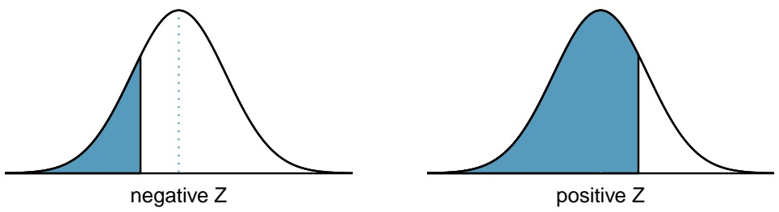

To find the area to the right, calculate 1 minus the area to the left.

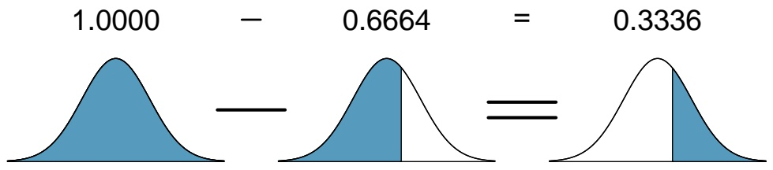

violin

| Metric | Value |
| --- | --- |
| Base Value | 1.0000 |
| Normalized Mean (Left) | 0.6664 |
| Normalized Mean (Right) | 0.3336 |

For additional details about working with the normal distribution and the normal probability table, see Section 3.3, which starts on page 152.

---

464

APPENDIX B. DISTRIBUTION TABLES

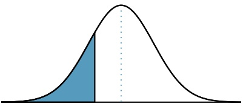

violin

| Region | Description |
| --- | --- |
| Shaded Area | Left side (left to right) |

negative Z

<table><tr><td colspan="10">Second decimal place of Z</td><td rowspan="2">Z</td></tr><tr><td>0.09</td><td>0.08</td><td>0.07</td><td>0.06</td><td>0.05</td><td>0.04</td><td>0.03</td><td>0.02</td><td>0.01</td><td>0.00</td></tr><tr><td>0.0002</td><td>0.0003</td><td>0.0003</td><td>0.0003</td><td>0.0003</td><td>0.0003</td><td>0.0003</td><td>0.0003</td><td>0.0003</td><td>0.0003</td><td>-3.4</td></tr><tr><td>0.0003</td><td>0.0004</td><td>0.0004</td><td>0.0004</td><td>0.0004</td><td>0.0004</td><td>0.0004</td><td>0.0005</td><td>0.0005</td><td>0.0005</td><td>-3.3</td></tr><tr><td>0.0005</td><td>0.0005</td><td>0.0005</td><td>0.0006</td><td>0.0006</td><td>0.0006</td><td>0.0006</td><td>0.0006</td><td>0.0007</td><td>0.0007</td><td>-3.2</td></tr><tr><td>0.0007</td><td>0.0007</td><td>0.0008</td><td>0.0008</td><td>0.0008</td><td>0.0008</td><td>0.0009</td><td>0.0009</td><td>0.0009</td><td>0.0010</td><td>-3.1</td></tr><tr><td>0.0010</td><td>0.0010</td><td>0.0011</td><td>0.0011</td><td>0.0011</td><td>0.0012</td><td>0.0012</td><td>0.0013</td><td>0.0013</td><td>0.0013</td><td>-3.0</td></tr><tr><td>0.0014</td><td>0.0014</td><td>0.0015</td><td>0.0015</td><td>0.0016</td><td>0.0016</td><td>0.0017</td><td>0.0018</td><td>0.0018</td><td>0.0019</td><td>-2.9</td></tr><tr><td>0.0019</td><td>0.0020</td><td>0.0021</td><td>0.0021</td><td>0.0022</td><td>0.0023</td><td>0.0023</td><td>0.0024</td><td>0.0025</td><td>0.0026</td><td>-2.8</td></tr><tr><td>0.0026</td><td>0.0027</td><td>0.0028</td><td>0.0029</td><td>0.0030</td><td>0.0031</td><td>0.0032</td><td>0.0033</td><td>0.0034</td><td>0.0035</td><td>-2.7</td></tr><tr><td>0.0036</td><td>0.0037</td><td>0.0038</td><td>0.0039</td><td>0.0040</td><td>0.0041</td><td>0.0043</td><td>0.0044</td><td>0.0045</td><td>0.0047</td><td>-2.6</td></tr><tr><td>0.0048</td><td>0.0049</td><td>0.0051</td><td>0.0052</td><td>0.0054</td><td>0.0055</td><td>0.0057</td><td>0.0059</td><td>0.0060</td><td>0.0062</td><td>-2.5</td></tr><tr><td>0.0064</td><td>0.0066</td><td>0.0068</td><td>0.0069</td><td>0.0071</td><td>0.0073</td><td>0.0075</td><td>0.0078</td><td>0.0080</td><td>0.0082</td><td>-2.4</td></tr><tr><td>0.0084</td><td>0.0087</td><td>0.0089</td><td>0.0091</td><td>0.0094</td><td>0.0096</td><td>0.0099</td><td>0.0102</td><td>0.0104</td><td>0.0107</td><td>-2.3</td></tr><tr><td>0.0110</td><td>0.0113</td><td>0.0116</td><td>0.0119</td><td>0.0122</td><td>0.0125</td><td>0.0129</td><td>0.0132</td><td>0.0136</td><td>0.0139</td><td>-2.2</td></tr><tr><td>0.0143</td><td>0.0146</td><td>0.0150</td><td>0.0154</td><td>0.0158</td><td>0.0162</td><td>0.0166</td><td>0.0170</td><td>0.0174</td><td>0.0179</td><td>-2.1</td></tr><tr><td>0.0183</td><td>0.0188</td><td>0.0192</td><td>0.0197</td><td>0.0202</td><td>0.0207</td><td>0.0212</td><td>0.0217</td><td>0.0222</td><td>0.0228</td><td>-2.0</td></tr><tr><td>0.0233</td><td>0.0239</td><td>0.0244</td><td>0.0250</td><td>0.0256</td><td>0.0262</td><td>0.0268</td><td>0.0274</td><td>0.0281</td><td>0.0287</td><td>-1.9</td></tr><tr><td>0.0294</td><td>0.0301</td><td>0.0307</td><td>0.0314</td><td>0.0322</td><td>0.0329</td><td>0.0336</td><td>0.0344</td><td>0.0351</td><td>0.0359</td><td>-1.8</td></tr><tr><td>0.0367</td><td>0.0375</td><td>0.0384</td><td>0.0392</td><td>0.0401</td><td>0.0409</td><td>0.0418</td><td>0.0427</td><td>0.0436</td><td>0.0446</td><td>-1.7</td></tr><tr><td>0.0455</td><td>0.0465</td><td>0.0475</td><td>0.0485</td><td>0.0495</td><td>0.0505</td><td>0.0516</td><td>0.0526</td><td>0.0537</td><td>0.0548</td><td>-1.6</td></tr><tr><td>0.0559</td><td>0.0571</td><td>0.0582</td><td>0.0594</td><td>0.0606</td><td>0.0618</td><td>0.0630</td><td>0.0643</td><td>0.0655</td><td>0.0668</td><td>-1.5</td></tr><tr><td>0.0681</td><td>0.0694</td><td>0.0708</td><td>0.0721</td><td>0.0735</td><td>0.0749</td><td>0.0764</td><td>0.0778</td><td>0.0793</td><td>0.0808</td><td>-1.4</td></tr><tr><td>0.0823</td><td>0.0838</td><td>0.0853</td><td>0.0869</td><td>0.0885</td><td>0.0901</td><td>0.0918</td><td>0.0934</td><td>0.0951</td><td>0.0968</td><td>-1.3</td></tr><tr><td>0.0985</td><td>0.1003</td><td>0.1020</td><td>0.1038</td><td>0.1056</td><td>0.1075</td><td>0.1093</td><td>0.1112</td><td>0.1131</td><td>0.1151</td><td>-1.2</td></tr><tr><td>0.1170</td><td>0.1190</td><td>0.1210</td><td>0.1230</td><td>0.1251</td><td>0.1271</td><td>0.1292</td><td>0.1314</td><td>0.1335</td><td>0.1357</td><td>-1.1</td></tr><tr><td>0.1379</td><td>0.1401</td><td>0.1423</td><td>0.1446</td><td>0.1469</td><td>0.1492</td><td>0.1515</td><td>0.1539</td><td>0.1562</td><td>0.1587</td><td>-1.0</td></tr><tr><td>0.1611</td><td>0.1635</td><td>0.1660</td><td>0.1685</td><td>0.1711</td><td>0.1736</td><td>0.1762</td><td>0.1788</td><td>0.1814</td><td>0.1841</td><td>-0.9</td></tr><tr><td>0.1867</td><td>0.1894</td><td>0.1922</td><td>0.1949</td><td>0.1977</td><td>0.2005</td><td>0.2033</td><td>0.2061</td><td>0.2090</td><td>0.2119</td><td>-0.8</td></tr><tr><td>0.2148</td><td>0.2177</td><td>0.2206</td><td>0.2236</td><td>0.2266</td><td>0.2296</td><td>0.2327</td><td>0.2358</td><td>0.2389</td><td>0.2420</td><td>-0.7</td></tr><tr><td>0.2451</td><td>0.2483</td><td>0.2514</td><td>0.2546</td><td>0.2578</td><td>0.2611</td><td>0.2643</td><td>0.2676</td><td>0.2709</td><td>0.2743</td><td>-0.6</td></tr><tr><td>0.2776</td><td>0.2810</td><td>0.2843</td><td>0.2877</td><td>0.2912</td><td>0.2946</td><td>0.2981</td><td>0.3015</td><td>0.3050</td><td>0.3085</td><td>-0.5</td></tr><tr><td>0.3121</td><td>0.3156</td><td>0.3192</td><td>0.3228</td><td>0.3264</td><td>0.3300</td><td>0.3336</td><td>0.3372</td><td>0.3409</td><td>0.3446</td><td>-0.4</td></tr><tr><td>0.3483</td><td>0.3520</td><td>0.3557</td><td>0.3594</td><td>0.3632</td><td>0.3669</td><td>0.3707</td><td>0.3745</td><td>0.3783</td><td>0.3821</td><td>-0.3</td></tr><tr><td>0.3859</td><td>0.3897</td><td>0.3936</td><td>0.3974</td><td>0.4013</td><td>0.4052</td><td>0.4090</td><td>0.4129</td><td>0.4168</td><td>0.4207</td><td>-0.2</td></tr><tr><td>0.4247</td><td>0.4286</td><td>0.4325</td><td>0.4364</td><td>0.4404</td><td>0.4443</td><td>0.4483</td><td>0.4522</td><td>0.4562</td><td>0.4602</td><td>-0.1</td></tr><tr><td>0.4641</td><td>0.4681</td><td>0.4721</td><td>0.4761</td><td>0.4801</td><td>0.4840</td><td>0.4880</td><td>0.4920</td><td>0.4960</td><td>0.5000</td><td>-0.0</td></tr></table>

∗For Z ≤ −3.50, the probability is less than or equal to 0.0002.

---

465

natural_image

Area under a normal distribution curve with a shaded blue region, no text or symbols present

positive Z

<table><tr><td rowspan="2">Z</td><td colspan="10">Second decimal place of Z</td></tr><tr><td>0.00</td><td>0.01</td><td>0.02</td><td>0.03</td><td>0.04</td><td>0.05</td><td>0.06</td><td>0.07</td><td>0.08</td><td>0.09</td></tr><tr><td>0.0</td><td>0.5000</td><td>0.5040</td><td>0.5080</td><td>0.5120</td><td>0.5160</td><td>0.5199</td><td>0.5239</td><td>0.5279</td><td>0.5319</td><td>0.5359</td></tr><tr><td>0.1</td><td>0.5398</td><td>0.5438</td><td>0.5478</td><td>0.5517</td><td>0.5557</td><td>0.5596</td><td>0.5636</td><td>0.5675</td><td>0.5714</td><td>0.5753</td></tr><tr><td>0.2</td><td>0.5793</td><td>0.5832</td><td>0.5871</td><td>0.5910</td><td>0.5948</td><td>0.5987</td><td>0.6026</td><td>0.6064</td><td>0.6103</td><td>0.6141</td></tr><tr><td>0.3</td><td>0.6179</td><td>0.6217</td><td>0.6255</td><td>0.6293</td><td>0.6331</td><td>0.6368</td><td>0.6406</td><td>0.6443</td><td>0.6480</td><td>0.6517</td></tr><tr><td>0.4</td><td>0.6554</td><td>0.6591</td><td>0.6628</td><td>0.6664</td><td>0.6700</td><td>0.6736</td><td>0.6772</td><td>0.6808</td><td>0.6844</td><td>0.6879</td></tr><tr><td>0.5</td><td>0.6915</td><td>0.6950</td><td>0.6985</td><td>0.7019</td><td>0.7054</td><td>0.7088</td><td>0.7123</td><td>0.7157</td><td>0.7190</td><td>0.7224</td></tr><tr><td>0.6</td><td>0.7257</td><td>0.7291</td><td>0.7324</td><td>0.7357</td><td>0.7389</td><td>0.7422</td><td>0.7454</td><td>0.7486</td><td>0.7517</td><td>0.7549</td></tr><tr><td>0.7</td><td>0.7580</td><td>0.7611</td><td>0.7642</td><td>0.7673</td><td>0.7704</td><td>0.7734</td><td>0.7764</td><td>0.7794</td><td>0.7823</td><td>0.7852</td></tr><tr><td>0.8</td><td>0.7881</td><td>0.7910</td><td>0.7939</td><td>0.7967</td><td>0.7995</td><td>0.8023</td><td>0.8051</td><td>0.8078</td><td>0.8106</td><td>0.8133</td></tr><tr><td>0.9</td><td>0.8159</td><td>0.8186</td><td>0.8212</td><td>0.8238</td><td>0.8264</td><td>0.8289</td><td>0.8315</td><td>0.8340</td><td>0.8365</td><td>0.8389</td></tr><tr><td>1.0</td><td>0.8413</td><td>0.8438</td><td>0.8461</td><td>0.8485</td><td>0.8508</td><td>0.8531</td><td>0.8554</td><td>0.8577</td><td>0.8599</td><td>0.8621</td></tr><tr><td>1.1</td><td>0.8643</td><td>0.8665</td><td>0.8686</td><td>0.8708</td><td>0.8729</td><td>0.8749</td><td>0.8770</td><td>0.8790</td><td>0.8810</td><td>0.8830</td></tr><tr><td>1.2</td><td>0.8849</td><td>0.8869</td><td>0.8888</td><td>0.8907</td><td>0.8925</td><td>0.8944</td><td>0.8962</td><td>0.8980</td><td>0.8997</td><td>0.9015</td></tr><tr><td>1.3</td><td>0.9032</td><td>0.9049</td><td>0.9066</td><td>0.9082</td><td>0.9099</td><td>0.9115</td><td>0.9131</td><td>0.9147</td><td>0.9162</td><td>0.9177</td></tr><tr><td>1.4</td><td>0.9192</td><td>0.9207</td><td>0.9222</td><td>0.9236</td><td>0.9251</td><td>0.9265</td><td>0.9279</td><td>0.9292</td><td>0.9306</td><td>0.9319</td></tr><tr><td>1.5</td><td>0.9332</td><td>0.9345</td><td>0.9357</td><td>0.9370</td><td>0.9382</td><td>0.9394</td><td>0.9406</td><td>0.9418</td><td>0.9429</td><td>0.9441</td></tr><tr><td>1.6</td><td>0.9452</td><td>0.9463</td><td>0.9474</td><td>0.9484</td><td>0.9495</td><td>0.9505</td><td>0.9515</td><td>0.9525</td><td>0.9535</td><td>0.9545</td></tr><tr><td>1.7</td><td>0.9554</td><td>0.9564</td><td>0.9573</td><td>0.9582</td><td>0.9591</td><td>0.9599</td><td>0.9608</td><td>0.9616</td><td>0.9625</td><td>0.9633</td></tr><tr><td>1.8</td><td>0.9641</td><td>0.9649</td><td>0.9656</td><td>0.9664</td><td>0.9671</td><td>0.9678</td><td>0.9686</td><td>0.9693</td><td>0.9699</td><td>0.9706</td></tr><tr><td>1.9</td><td>0.9713</td><td>0.9719</td><td>0.9726</td><td>0.9732</td><td>0.9738</td><td>0.9744</td><td>0.9750</td><td>0.9756</td><td>0.9761</td><td>0.9767</td></tr><tr><td>2.0</td><td>0.9772</td><td>0.9778</td><td>0.9783</td><td>0.9788</td><td>0.9793</td><td>0.9798</td><td>0.9803</td><td>0.9808</td><td>0.9812</td><td>0.9817</td></tr><tr><td>2.1</td><td>0.9821</td><td>0.9826</td><td>0.9830</td><td>0.9834</td><td>0.9838</td><td>0.9842</td><td>0.9846</td><td>0.9850</td><td>0.9854</td><td>0.9857</td></tr><tr><td>2.2</td><td>0.9861</td><td>0.9864</td><td>0.9868</td><td>0.9871</td><td>0.9875</td><td>0.9878</td><td>0.9881</td><td>0.9884</td><td>0.9887</td><td>0.9890</td></tr><tr><td>2.3</td><td>0.9893</td><td>0.9896</td><td>0.9898</td><td>0.9901</td><td>0.9904</td><td>0.9906</td><td>0.9909</td><td>0.9911</td><td>0.9913</td><td>0.9916</td></tr><tr><td>2.4</td><td>0.9918</td><td>0.9920</td><td>0.9922</td><td>0.9925</td><td>0.9927</td><td>0.9929</td><td>0.9931</td><td>0.9932</td><td>0.9934</td><td>0.9936</td></tr><tr><td>2.5</td><td>0.9938</td><td>0.9940</td><td>0.9941</td><td>0.9943</td><td>0.9945</td><td>0.9946</td><td>0.9948</td><td>0.9949</td><td>0.9951</td><td>0.9952</td></tr><tr><td>2.6</td><td>0.9953</td><td>0.9955</td><td>0.9956</td><td>0.9957</td><td>0.9959</td><td>0.9960</td><td>0.9961</td><td>0.9962</td><td>0.9963</td><td>0.9964</td></tr><tr><td>2.7</td><td>0.9965</td><td>0.9966</td><td>0.9967</td><td>0.9968</td><td>0.9969</td><td>0.9970</td><td>0.9971</td><td>0.9972</td><td>0.9973</td><td>0.9974</td></tr><tr><td>2.8</td><td>0.9974</td><td>0.9975</td><td>0.9976</td><td>0.9977</td><td>0.9977</td><td>0.9978</td><td>0.9979</td><td>0.9979</td><td>0.9980</td><td>0.9981</td></tr><tr><td>2.9</td><td>0.9981</td><td>0.9982</td><td>0.9982</td><td>0.9983</td><td>0.9984</td><td>0.9984</td><td>0.9985</td><td>0.9985</td><td>0.9986</td><td>0.9986</td></tr><tr><td>3.0</td><td>0.9987</td><td>0.9987</td><td>0.9987</td><td>0.9988</td><td>0.9988</td><td>0.9989</td><td>0.9989</td><td>0.9989</td><td>0.9990</td><td>0.9990</td></tr><tr><td>3.1</td><td>0.9990</td><td>0.9991</td><td>0.9991</td><td>0.9991</td><td>0.9992</td><td>0.9992</td><td>0.9992</td><td>0.9992</td><td>0.9993</td><td>0.9993</td></tr><tr><td>3.2</td><td>0.9993</td><td>0.9993</td><td>0.9994</td><td>0.9994</td><td>0.9994</td><td>0.9994</td><td>0.9994</td><td>0.9995</td><td>0.9995</td><td>0.9995</td></tr><tr><td>3.3</td><td>0.9995</td><td>0.9995</td><td>0.9995</td><td>0.9996</td><td>0.9996</td><td>0.9996</td><td>0.9996</td><td>0.9996</td><td>0.9996</td><td>0.9997</td></tr><tr><td>3.4</td><td>0.9997</td><td>0.9997</td><td>0.9997</td><td>0.9997</td><td>0.9997</td><td>0.9997</td><td>0.9997</td><td>0.9997</td><td>0.9997</td><td>0.9998</td></tr></table>

∗For Z ≥ 3.50, the probability is greater than or equal to 0.9998.

---

466

APPENDIX B. DISTRIBUTION TABLES

## B.2 t-Probability Table

Figure B.1: Tails for the t-distribution.

<table><tr><td colspan="2">one tailtwo tails</td><td>0.1000.200</td><td>0.0500.100</td><td>0.0250.050</td><td>0.0100.020</td><td>0.0050.010</td></tr><tr><td rowspan="5">df</td><td>1</td><td>3.08</td><td>6.31</td><td>12.71</td><td>31.82</td><td>63.66</td></tr><tr><td>2</td><td>1.89</td><td>2.92</td><td>4.30</td><td>6.96</td><td>9.92</td></tr><tr><td>3</td><td>1.64</td><td>2.35</td><td>3.18</td><td>4.54</td><td>5.84</td></tr><tr><td>4</td><td>1.53</td><td>2.13</td><td>2.78</td><td>3.75</td><td>4.60</td></tr><tr><td>5</td><td>1.48</td><td>2.02</td><td>2.57</td><td>3.36</td><td>4.03</td></tr><tr><td rowspan="5"></td><td>6</td><td>1.44</td><td>1.94</td><td>2.45</td><td>3.14</td><td>3.71</td></tr><tr><td>7</td><td>1.41</td><td>1.89</td><td>2.36</td><td>3.00</td><td>3.50</td></tr><tr><td>8</td><td>1.40</td><td>1.86</td><td>2.31</td><td>2.90</td><td>3.36</td></tr><tr><td>9</td><td>1.38</td><td>1.83</td><td>2.26</td><td>2.82</td><td>3.25</td></tr><tr><td>10</td><td>1.37</td><td>1.81</td><td>2.23</td><td>2.76</td><td>3.17</td></tr><tr><td rowspan="5"></td><td>11</td><td>1.36</td><td>1.80</td><td>2.20</td><td>2.72</td><td>3.11</td></tr><tr><td>12</td><td>1.36</td><td>1.78</td><td>2.18</td><td>2.68</td><td>3.05</td></tr><tr><td>13</td><td>1.35</td><td>1.77</td><td>2.16</td><td>2.65</td><td>3.01</td></tr><tr><td>14</td><td>1.35</td><td>1.76</td><td>2.14</td><td>2.62</td><td>2.98</td></tr><tr><td>15</td><td>1.34</td><td>1.75</td><td>2.13</td><td>2.60</td><td>2.95</td></tr><tr><td rowspan="5"></td><td>16</td><td>1.34</td><td>1.75</td><td>2.12</td><td>2.58</td><td>2.92</td></tr><tr><td>17</td><td>1.33</td><td>1.74</td><td>2.11</td><td>2.57</td><td>2.90</td></tr><tr><td>18</td><td>1.33</td><td>1.73</td><td>2.10</td><td>2.55</td><td>2.88</td></tr><tr><td>19</td><td>1.33</td><td>1.73</td><td>2.09</td><td>2.54</td><td>2.86</td></tr><tr><td>20</td><td>1.33</td><td>1.72</td><td>2.09</td><td>2.53</td><td>2.85</td></tr><tr><td rowspan="5"></td><td>21</td><td>1.32</td><td>1.72</td><td>2.08</td><td>2.52</td><td>2.83</td></tr><tr><td>22</td><td>1.32</td><td>1.72</td><td>2.07</td><td>2.51</td><td>2.82</td></tr><tr><td>23</td><td>1.32</td><td>1.71</td><td>2.07</td><td>2.50</td><td>2.81</td></tr><tr><td>24</td><td>1.32</td><td>1.71</td><td>2.06</td><td>2.49</td><td>2.80</td></tr><tr><td>25</td><td>1.32</td><td>1.71</td><td>2.06</td><td>2.49</td><td>2.79</td></tr><tr><td rowspan="5"></td><td>26</td><td>1.31</td><td>1.71</td><td>2.06</td><td>2.48</td><td>2.78</td></tr><tr><td>27</td><td>1.31</td><td>1.70</td><td>2.05</td><td>2.47</td><td>2.77</td></tr><tr><td>28</td><td>1.31</td><td>1.70</td><td>2.05</td><td>2.47</td><td>2.76</td></tr><tr><td>29</td><td>1.31</td><td>1.70</td><td>2.05</td><td>2.46</td><td>2.76</td></tr><tr><td>30</td><td>1.31</td><td>1.70</td><td>2.04</td><td>2.46</td><td>2.75</td></tr></table>

---

467

<table><tr><td rowspan="2" colspan="2">one tail two tails</td><td>0.100</td><td>0.050</td><td>0.025</td><td>0.010</td><td>0.005</td></tr><tr><td>0.200</td><td>0.100</td><td>0.050</td><td>0.020</td><td>0.010</td></tr><tr><td rowspan="5">df</td><td>31</td><td>1.31</td><td>1.70</td><td>2.04</td><td>2.45</td><td>2.74</td></tr><tr><td>32</td><td>1.31</td><td>1.69</td><td>2.04</td><td>2.45</td><td>2.74</td></tr><tr><td>33</td><td>1.31</td><td>1.69</td><td>2.03</td><td>2.44</td><td>2.73</td></tr><tr><td>34</td><td>1.31</td><td>1.69</td><td>2.03</td><td>2.44</td><td>2.73</td></tr><tr><td>35</td><td>1.31</td><td>1.69</td><td>2.03</td><td>2.44</td><td>2.72</td></tr><tr><td rowspan="5"></td><td>36</td><td>1.31</td><td>1.69</td><td>2.03</td><td>2.43</td><td>2.72</td></tr><tr><td>37</td><td>1.30</td><td>1.69</td><td>2.03</td><td>2.43</td><td>2.72</td></tr><tr><td>38</td><td>1.30</td><td>1.69</td><td>2.02</td><td>2.43</td><td>2.71</td></tr><tr><td>39</td><td>1.30</td><td>1.68</td><td>2.02</td><td>2.43</td><td>2.71</td></tr><tr><td>40</td><td>1.30</td><td>1.68</td><td>2.02</td><td>2.42</td><td>2.70</td></tr><tr><td rowspan="5"></td><td>41</td><td>1.30</td><td>1.68</td><td>2.02</td><td>2.42</td><td>2.70</td></tr><tr><td>42</td><td>1.30</td><td>1.68</td><td>2.02</td><td>2.42</td><td>2.70</td></tr><tr><td>43</td><td>1.30</td><td>1.68</td><td>2.02</td><td>2.42</td><td>2.70</td></tr><tr><td>44</td><td>1.30</td><td>1.68</td><td>2.02</td><td>2.41</td><td>2.69</td></tr><tr><td>45</td><td>1.30</td><td>1.68</td><td>2.01</td><td>2.41</td><td>2.69</td></tr><tr><td rowspan="5"></td><td>46</td><td>1.30</td><td>1.68</td><td>2.01</td><td>2.41</td><td>2.69</td></tr><tr><td>47</td><td>1.30</td><td>1.68</td><td>2.01</td><td>2.41</td><td>2.68</td></tr><tr><td>48</td><td>1.30</td><td>1.68</td><td>2.01</td><td>2.41</td><td>2.68</td></tr><tr><td>49</td><td>1.30</td><td>1.68</td><td>2.01</td><td>2.40</td><td>2.68</td></tr><tr><td>50</td><td>1.30</td><td>1.68</td><td>2.01</td><td>2.40</td><td>2.68</td></tr><tr><td rowspan="5"></td><td>60</td><td>1.30</td><td>1.67</td><td>2.00</td><td>2.39</td><td>2.66</td></tr><tr><td>70</td><td>1.29</td><td>1.67</td><td>1.99</td><td>2.38</td><td>2.65</td></tr><tr><td>80</td><td>1.29</td><td>1.66</td><td>1.99</td><td>2.37</td><td>2.64</td></tr><tr><td>90</td><td>1.29</td><td>1.66</td><td>1.99</td><td>2.37</td><td>2.63</td></tr><tr><td>100</td><td>1.29</td><td>1.66</td><td>1.98</td><td>2.36</td><td>2.63</td></tr><tr><td rowspan="5"></td><td>150</td><td>1.29</td><td>1.66</td><td>1.98</td><td>2.35</td><td>2.61</td></tr><tr><td>200</td><td>1.29</td><td>1.65</td><td>1.97</td><td>2.35</td><td>2.60</td></tr><tr><td>300</td><td>1.28</td><td>1.65</td><td>1.97</td><td>2.34</td><td>2.59</td></tr><tr><td>400</td><td>1.28</td><td>1.65</td><td>1.97</td><td>2.34</td><td>2.59</td></tr><tr><td>500</td><td>1.28</td><td>1.65</td><td>1.96</td><td>2.33</td><td>2.59</td></tr><tr><td></td><td>∞</td><td>1.28</td><td>1.65</td><td>1.96</td><td>2.33</td><td>2.58</td></tr></table>
