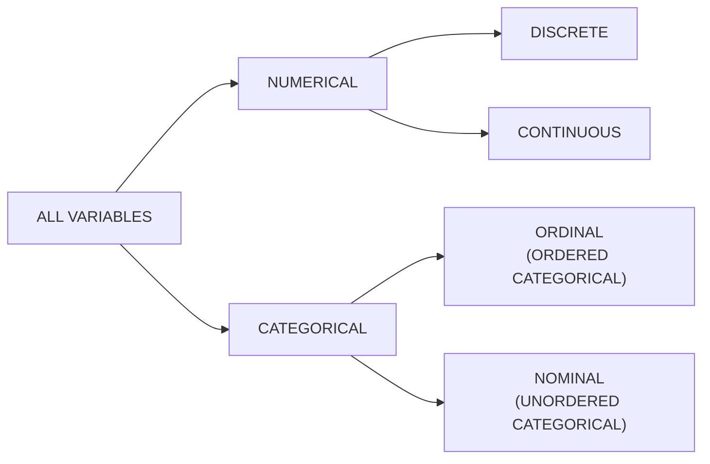

# Introductory Statistics for the Life and Biomedical Sciences

First Edition

Julie Vu

Preceptor in Statistics

Harvard University

David Harrington

Professor of Biostatistics (Emeritus)

Harvard T.H. Chan School of Public Health

Dana-Farber Cancer Institute

A tablet-friendly version of this PDF where margins have been minimized

Copyright © 2020. First Edition.

Version date: August 8th, 2021.

This textbook and its supplements, including slides and labs, may be downloaded for free at [**openintro.org/book/biostat**](http://www.openintro.org/redirect.php?go=biostat&referrer=biostat1_pdf).

This textbook is a derivative of OpenIntro Statistics 3rd Edition by Diez, Barr, and Çetinkaya Rundel, and it is available under a Creative Commons Attribution-ShareAlike 3.0 Unported United States license. License details are available at the Creative Commons website:

[**creativecommons.org**](http://www.openintro.org/redirect.php?go=creativecommons_org&referrer=biostat1_pdf).

Source files for this book may be found on Github at [**github.com/OI-Biostat/oi\_biostat\_text**](http://www.openintro.org/redirect.php?go=biostat_source&referrer=biostat1_pdf).

## Table of Contents

## 1 Introduction to data 10

1.1 Case study . . . . 12
1.2 Data basics . . . . . . . . . . 14
1.3 Data collection principles . . . . . . . 18
1.4 Numerical data . . . . 30
1.5 Categorical data . . . . 37
1.6 Relationships between two variables . . 38
1.7 Exploratory data analysis . . . . . . 50
1.8 Notes . . . . . . . . 74
1.9 Exercises . . . . . . . . . . . 75

## 2 Probability 88

2.1 Defining probability . . . . . 90
2.2 Conditional probability . . . . . . . . 106
2.3 Extended example . . . . . . . 117
2.4 Notes . . . . . . . . . . 126
2.5 Exercises . . . . . . . . . 127

## 3 Distributions of random variables 138

3.1 Random variables . . . . 140
3.2 Binomial distribution . . . . . . . . 147
3.3 Normal distribution . . . . . . . 152
3.4 Poisson distribution . . . . . . . 168
3.5 Distributions related to Bernoulli trials . . . . 170
3.6 Distributions for pairs of random variables . . 177
3.7 Notes . . . . . . . 184
3.8 Exercises . . . . . . 185

## 4 Foundations for inference 198

4.1 Variability in estimates . . . . . . . 201
4.2 Confidence intervals . . . . 205
4.3 Hypothesis testing . . . . . . . 212
4.4 Notes . . . . . . . . 225
4.5 Exercises . . . . . . 227

## 5 Inference for numerical data 236

5.1 Single-sample inference with the t-distribution . . . 238
5.2 Two-sample test for paired data . . . . 244
5.3 Two-sample test for independent data . . 247
5.4 Power calculations for a difference of means . . . 257
5.5 Comparing means with ANOVA . . . . 264
5.6 Notes . . . . . . 272
5.7 Exercises . . . . . . . . . 274

## 6 Simple linear regression 290

6.1 Examining scatterplots . . . . 293
6.2 Estimating a regression line using least squares . . . 295
6.3 Interpreting a linear model . . . . . . 298
6.4 Statistical inference with regression . . . . 308
6.5 Interval estimates with regression . . . . . 312
6.6 Notes . . . . . . . . 316
6.7 Exercises . . . . . . . . . . . 317

## 7 Multiple linear regression 330

7.1 Introduction to multiple linear regression . . . . 332
7.2 Simple versus multiple regression . . . . 334
7.3 Evaluating the fit of a multiple regression model . . . . 338
7.4 The general multiple linear regression model . . 342
7.5 Categorical predictors with several levels . . . . . 347
7.6 Reanalyzing the PREVEND data . . . . . 350
7.7 Interaction in regression . . 352
7.8 Model selection for explanatory models . . 358
7.9 The connection between ANOVA and regression . . 368
7.10 Notes . . . . . . . 370
7.11 Exercises . . . . . . . . . . 372

## 8 Inference for categorical data 386

8.1 Inference for a single proportion . . . . . . 388
8.2 Inference for the difference of two proportions . . 395
8.3 Inference for two or more groups . . . . 401
8.4 Chi-square tests for the fit of a distribution . . . 414
8.5 Outcome-based sampling: case-control studies . . 416
8.6 Notes . . . . . 420
8.7 Exercises . . . . . . 421

**A End of chapter exercise solutions 435**
**B Distribution tables 463**

**Index 469**

# Foreword

The past year has been challenging for the health sciences in ways that we could not have imagined when we started writing 5 years ago. The rapid spread of the SARS coronavirus (SARS-CoV-2) worldwide has upended the scientific research process and highlighted the need for maintaining a balance between speed and reliability. Major medical journals have dramatically increased the pace of publication; the urgency of the situation necessitates that data and research findings be made available as quickly as possible to inform public policy and clinical practice. Yet it remains essential that studies undergo rigorous review; the retraction of two high-profile coronavirus studies1, 2 sparked widespread concerns about data integrity, reproducibility, and the editorial process.

In parallel, deepening public awareness of structural racism has caused a re-examination of the role of race in published studies in health and medicine. A recent review of algorithms used to direct treatment in areas such as cardiology, obstetrics and oncology uncovered examples of race used in ways that may lead to substandard care for people of color.3 The SARS-CoV-2 pandemic has reminded us once again that marginalized populations are disproportionately at risk for bad health outcomes. Data on 17 million patients in England4suggest that Blacks and South Asians have a death rate that is approximately 50% higher than white members of the population.

Understanding the SARS coronavirus and tackling racial disparities in health outcomes are but two of the many areas in which Biostatistics will play an important role in the coming decades. Much of that work will be done by those now beginning their study of Biostatistics. We hope this book provides an accessible point of entry for students planning to begin work in biology, medicine, or public health. While the material presented in this book is essential for understanding the foundations of the discipline, we advise readers to remember that a mastery of technical details is secondary to choosing important scientific questions, examining data without bias, and reporting results that transparently display the strengths and weaknesses of a study.

<small>1Mandeep R. Mehra et al. “Retraction: Cardiovascular Disease, Drug Therapy, and Mortality in Covid-19. N Engl J Med. DOI: 10.1056/NEJMoa2007621.” In: New England Journal of Medicine 382.26 (2020), pp. 2582–2582. doi: [10.1056/ NEJMc2021225](https://doi.org/10.1056/NEJMc2021225).</small>

<small>2Mandeep R Mehra et al. “RETRACTED:Hydroxychloroquine or chloroquine with or without a macrolide for treatment of COVID-19: a multinational registry analysis”. In: The Lancet (2020). doi: [https://doi.org/10.1016/S0140- 6736(20) 31180-6](https://doi.org/https://doi.org/10.1016/S0140-6736%2820%2931180-6).</small>

<small>3Darshali A. Vyas et al. “Hidden in Plain Sight — Reconsidering the Use of Race Correction in Clinical Algorithms”. In: New England Journal of Medicine (2020). doi: [10.1056/NEJMms2004740](https://doi.org/10.1056/NEJMms2004740).</small>

<small>4Elizabeth J. Williamson et al. “OpenSAFELY: factors associated with COVID-19 death in 17 million patients”. In: Nature (2020). issn: 1476-4687.</small>

# Preface

This text introduces statistics and its applications in the life sciences and biomedical research. It is based on the freely available OpenIntro Statistics, and, like OpenIntro, it may be downloaded at no cost.5In writing Introduction to Statistics for the Life and Biomedical Sciences, we have added substantial new material, but also retained some examples and exercises from OpenIntro that illustrate important ideas even if they do not relate directly to medicine or the life sciences. Because of its link to the original OpenIntro project, this text is often referred to as OpenIntro Biostatistics in the supplementary materials.

This text is intended for undergraduate and graduate students interested in careers in biology or medicine, and may also be profitably read by students of public health or medicine. It covers many of the traditional introductory topics in statistics, in addition to discussing some newer methods being used in molecular biology.

Statistics has become an integral part of research in medicine and biology, and the tools for summarizing data and drawing inferences from data are essential both for understanding the outcomes of studies and for incorporating measures of uncertainty into that understanding. An introductory text in statistics for students who will work in medicine, public health, or the life sciences should be more than simply the usual introduction, supplemented with an occasional example from biology or medical science. By drawing the majority of examples and exercises in this text from published data, we hope to convey the value of statistics in medical and biological research. In cases where examples draw on important material in biology or medicine, the problem statement contains the necessary background information.

Computing is an essential part of the practice of statistics. Nearly everyone entering the biomedical sciences will need to interpret the results of analyses conducted in software; many will also need to be capable of conducting such analyses. The text and associated materials separate those two activities to allow students and instructors to emphasize either or both skills. The text discusses the important features of figures and tables used to support an interpretation, rather than the process of generating such material from data. This allows students whose main focus is understanding statistical concepts not to be distracted by the details of a particular software package. In our experience, however, we have found that many students enter a research setting after only a single course in statistics. These students benefit from a practical introduction to data analysis that incorporates the use of a statistical computing language. The‘ self-paced learning labs associated with the text provide such an introduction; these are described in more detail later in this preface. The datasets used in this book are available via the R openintro package available on CRAN6 and the R oibiostat package available via [GitHub](https://github.com/OI-Biostat/oi_biostat_data).

<small>5PDF available at [https://www.openintro.org/book/biostat/](https://www.openintro.org/book/biostat/) and source available at [https://github.com/OI-Biostat/oi\_biostat\_text](https://github.com/OI-Biostat/oi_biostat_text).</small>

<small>6Diez DM, Barr CD, Çetinkaya-Rundel M. 2012. openintro: OpenIntro data sets and supplement functions. [http://cran.r-project.org/web/packages/openintro](http://cran.r-project.org/web/packages/openintro).</small>

## Textbook overview

The chapters of this book are as follows:

**1. Introduction to data.** Data structures, basic data collection principles, numerical and graphical summaries, and exploratory data analysis.
**2. Probability.** The basic principles of probability.
**3. Distributions of random variables.** Introduction to random variables, distributions of discrete and continuous random variables, and distributions for pairs of random variables.
**4. Foundations for inference.** General ideas for statistical inference in the context of estimating a population mean.
**5. Inference for numerical data.** Inference for one-sample and two-sample means with the t-distribution, power calculations for a difference of means, and ANOVA.
**6. Simple linear regression.** An introduction to linear regression with a single explanatory variable, evaluating model assumptions, and inference in a regression context.
**7. Multiple linear regression.** General multiple regression model, categorical predictors with more than two values, interaction, and model selection.
**8. Inference for categorical data.** Inference for single proportions, inference for two or more groups, and outcome-based sampling.

## Examples, exercises, and appendices

Examples in the text help with an understanding of how to apply methods:

## EXAMPLE 0.1

This is an example. When a question is asked here, where can the answer be found?

The answer can be found here, in the solution section of the example.

When we think the reader would benefit from working out the solution to an example, we frame it as Guided Practice.

## GUIDED PRACTICE 0.2

The reader may check or learn the answer to any Guided Practice problem by reviewing the full solution in a footnote.

There are exercises at the end of each chapter that are useful for practice or homework assignments. Solutions to odd numbered problems can be found in Appendix A. Readers will notice that there are fewer end of chapter exercises in the last three chapters. The more complicated methods, such as multiple regression, do not always lend themselves to hand calculation, and computing is increasingly important both to gain practical experience with these methods and to explore complex datasets. For students more interested in concepts than computing, however, we have included useful end of chapter exercises that emphasize the interpretation of output from statistical software.

Probability tables for the normal, t, and chi-square distributions are in Appendix B, and PDF copies of these tables are also available from [**openintro.org**](http://www.openintro.org) for anyone to download, print, share, or modify. The labs and the text also illustrate the use of simple R commands to calculate probabilities from common distributions.

<small>7Guided Practice problems are intended to stretch your thinking, and you can check yourself by reviewing the footnote solution for any Guided Practice.</small>

## Self-paced learning labs

The labs associated with the text can be downloaded from github.com/OI-Biostat/oi\_biostat labs. They provide guidance on conducting data analysis and visualization with the R statistical language and the computing environment RStudio, while building understanding of statistical concepts. The labs begin from first principles and require no previous experience with statistical software. Both R and RStudio are freely available for all major computing operating systems, and the Unit 0 labs (00\_getting\_started) provide information on downloading and installing them. Information on downloading and installing the packages may also be found at [**openintro.org**](http://www.openintro.org).

The labs for each chapter all have the same structure. Each lab consists of a set of three documents: a handout with the problem statements, a template to be used for working through the lab, and a solution set with the problem solutions. The handout and solution set are most easily read in PDF format (although Rmd files are also provided), while the template is an Rmd file that can be loaded into RStudio. Each chapter of labs is accompanied by a set of "Lab Notes", which provides a reference guide of all new R functions discussed in the labs.

Learning is best done, of course, if a student attempts the lab exercises before reading the solutions. The "Lab Notes" may be a useful resource to refer to while working through problems.

## OpenIntro, online resources, and getting involved

OpenIntro is an organization focused on developing free and affordable education materials. The first project, OpenIntro Statistics, is intended for introductory statistics courses at the high school through university levels. Other projects examine the use of randomization methods for learning about statistics and conducting analyses (Introductory Statistics with Randomization and Simulation) and advanced statistics that may be taught at the high school level (Advanced High School Statistics).

We encourage anyone learning or teaching statistics to visit **openintro.org** and get involved by using the many online resources, which are all free, or by creating new material. Students can test their knowledge with practice quizzes, or try an application of concepts learned in each chapter using real data and the free statistical software R. Teachers can download the source for course materials, labs, slides, datasets, R figures, or create their own custom quizzes and problem sets for students to take on the website. Everyone is also welcome to download the book’s source files to create a custom version of this textbook or to simply share a PDF copy with a friend or on a website. All of these products are free, and anyone is welcome to use these online tools and resources with or without this textbook as a companion.

## Acknowledgements

The OpenIntro project would not have been possible without the dedication of many people, including the authors of OpenIntro Statistics, the [OpenIntro team](http://www.openintro.org/redirect.php?go=textbook-openintro_about&referrer=biostat1_pdf) and the many faculty, students, and readers who commented on all the editions of OpenIntro Statistics.

This text has benefited from feedback from Andrea Foulkes, Raji Balasubramanian, Curry Hilton, Michael Parzen, Kevin Rader, and the many excellent teaching fellows at Harvard College who assisted in courses using the book. The cover design was provided by Pierre Baduel.

## Chapter 1

## Introduction to data

**1.1 Case study**
**1.2 Data basics**
**1.3 Data collection principles**
**1.4 Numerical data**
**1.5 Categorical data**
**1.6 Relationships between two variables**
**1.7 Exploratory data analysis**
**1.8 Notes**
**1.9 Exercises**

Making observations and recording **data** form the backbone of empirical research, and represent the beginning of a systematic approach to investigating scientific questions. As a discipline, statistics focuses on addressing the following three questions in a rigorous and efficient manner: How can data best be collected? How should data be analyzed? What can be inferred from data?

This chapter provides a brief discussion on the principles of data collection, and introduces basic methods for summarizing and exploring data.

For labs, slides, and other resources, please visit

[**www.openintro.org/book/biostat**](http://www.openintro.org/redirect.php?go=biostat&referrer=biostat1_pdf)

## 1.1 Case study: preventing peanut allergies

The proportion of young children in Western countries with peanut allergies has doubled in the last 10 years. Previous research suggests that exposing infants to peanut-based foods, rather than excluding such foods from their diets, may be an effective strategy for preventing the development of peanut allergies. The "Learning Early about Peanut Allergy" (LEAP) study was conducted to investigate whether early exposure to peanut products reduces the probability that a child will develop peanut allergies.

The study team enrolled children in the United Kingdom between 2006 and 2009, selecting 640 infants with eczema, egg allergy, or both. Each child was randomly assigned to either the peanut consumption (treatment) group or the peanut avoidance (control) group. Children in the treatment group were fed at least 6 grams of peanut protein daily until 5 years of age, while children in the control group avoided consuming peanut protein until 5 years of age.

At 5 years of age, each child was tested for peanut allergy using an oral food challenge (OFC): 5 grams of peanut protein in a single dose. A child was recorded as passing the oral food challenge if no allergic reaction was detected, and failing the oral food challenge if an allergic reaction occurred. These children had previously been tested for peanut allergy through a skin test, conducted at the time of study entry; the main analysis presented in the paper was based on data from 530 children with an earlier negative skin test.2

Individual-level data from the study are shown in Figure 1.1 for 5 of the 530 children—each row represents a participant and shows the participant’s study ID number, treatment group assignment, and OFC outcome.3

| participant.ID | treatment.group | overall.V60.outcome |
| --- | --- | --- |
| LEAP_100522 | Peanut Consumption | PASS OFC |
| LEAP_103358 | Peanut Consumption | PASS OFC |
| LEAP_105069 | Peanut Avoidance | PASS OFC |
| LEAP_994047 | Peanut Avoidance | PASS OFC |
| LEAP_997608 | Peanut Consumption | PASS OFC |

Figure 1.1: Individual-level LEAP results, for five children.

The data can be organized in the form of a two-way summary table; Figure 1.2 shows the results categorized by treatment group and OFC outcome.

|  | FAIL OFC | PASS OFC | Sum |
| --- | --- | --- | --- |
| Peanut Avoidance | 36 | 227 | 263 |
| Peanut Consumption | 5 | 262 | 267 |
| Sum | 41 | 489 | 530 |

Figure 1.2: Summary of LEAP results, organized by treatment group (either peanut avoidance or consumption) and result of the oral food challenge at 5 years of age (either pass or fail).

<small>1Du Toit, George, et al. Randomized trial of peanut consumption in infants at risk for peanut allergy. New England Journal of Medicine 372.9 (2015): 803-813.</small>

<small>2Although a total of 542 children had an earlier negative skin test, data collection did not occur for 12 children.</small>

<small>3The data are available as LEAP in the R package oibiostat.</small>

The summary table makes it easier to identify patterns in the data. Recall that the question of interest is whether children in the peanut consumption group are more or less likely to develop peanut allergies than those in the peanut avoidance group. In the avoidance group, the proportion of children failing the OFC is $3 6 / 2 6 3 = 0 . 1 3 7$ (13.7%); in the consumption group, the proportion of children failing the OFC is $5 / 2 6 7 = 0 . 0 1 9$ (1.9%). Figure 1.3 shows a graphical method of displaying the study results, using either the number of individuals per category from Figure 1.2 or the proportion of individuals with a specific OFC outcome in a group.

Figure 1.3: (a) A bar plot displaying the number of individuals who failed or passed the OFC in each treatment group. (b) A bar plot displaying the proportions of individuals in each group that failed or passed the OFC.

The proportion of participants failing the OFC is 11.8% higher in the peanut avoidance group than the peanut consumption group. Another way to summarize the data is to compute the ratio of the two proportions $\left( 0.137 / 0.019 = 7.31 \right)$ , and conclude that the proportion of participants failing the OFC in the avoidance group is more than 7 times as large as in the consumption group; i.e., the risk of failing the OFC was more than 7 times as great for participants in the avoidance group relative to the consumption group.

Based on the results of the study, it seems that early exposure to peanut products may be an effective strategy for reducing the chances of developing peanut allergies later in life. It is important to note that this study was conducted in the United Kingdom at a single site of pediatric care; it is not clear that these results can be generalized to other countries or cultures.

The results also raise an important statistical issue: does the study provide definitive evidence that peanut consumption is beneficial? In other words, is the 11.8% difference between the two groups larger than one would expect by chance variation alone? The material on inference in later chapters will provide the statistical tools to evaluate this question.

## 1.2 Data basics

Effective organization and description of data is a first step in most analyses. This section introduces a structure for organizing data and basic terminology used to describe data.

## 1.2.1 Observations, variables, and data matrices

In evolutionary biology, parental investment refers to the amount of time, energy, or other resources devoted towards raising offspring. This section introduces the frog dataset, which originates from a 2013 study about maternal investment in a frog species.4 Reproduction is a costly process for female frogs, necessitating a trade-off between individual egg size and total number of eggs produced. Researchers were interested in investigating how maternal investment varies with altitude and collected measurements on egg clutches found at breeding ponds across 11 study sites; for 5 sites, the body size of individual female frogs was also recorded.

|  | altitude | latitude | egg.size | clutch.size | clutch.volume | body.size |
| --- | --- | --- | --- | --- | --- | --- |
| 1 | 3,462.00 | 34.82 | 1.95 | 181.97 | 177.83 | 3.63 |
| 2 | 3,462.00 | 34.82 | 1.95 | 269.15 | 257.04 | 3.63 |
| 3 | 3,462.00 | 34.82 | 1.95 | 158.49 | 151.36 | 3.72 |
| 150 | 2,597.00 | 34.05 | 2.24 | 537.03 | 776.25 | NA |

Figure 1.4: Data matrix for the frog dataset.

Figure 1.4 displays rows 1, 2, 3, and 150 of the data from the 431 clutches observed as part of the study.5 Each row in the table corresponds to a single clutch, indicating where the clutch was collected (altitude and latitude), egg.size, clutch.size, clutch.volume, and body.size of the mother when available. "NA" corresponds to a missing value, indicating that information on an individual female was not collected for that particular clutch. The recorded characteristics are referred to as **variables**; in this table, each column represents a variable.

| variable | description |
| --- | --- |
| altitude | Altitude of the study site in meters above sea level |
| latitude | Latitude of the study site measured in degrees |
| egg.size | Average diameter of an individual egg to the 0.01 mm |
| clutch.size | Estimated number of eggs in clutch |
| clutch.volume | Volume of egg clutch in $mm^{3}$ |
| body.size | Length of mother frog in cm |

Figure 1.5: Variables and their descriptions for the frog dataset.

It is important to check the definitions of variables, as they are not always obvious. For example, why has clutch.size not been recorded as whole numbers? For a given clutch, researchers counted approximately 5 grams’ worth of eggs and then estimated the total number of eggs based on the mass of the entire clutch. Definitions of the variables are given in Figure 1.5.6

<small>4Chen, W., et al. Maternal investment increases with altitude in a frog on the Tibetan Plateau. Journal of evolutionary biology 26.12 (2013): 2710-2715.</small>

<small>5The frog dataset is available in the R package oibiostat.</small>

<small>6The data discussed here are in the original scale; in the published paper, some values have undergone a natural log transformation.</small>

The data in Figure 1.4 are organized as a **data matrix**. Each row of a data matrix corresponds to an observational unit, and each column corresponds to a variable. A piece of the data matrix for the LEAP study introduced in Section 1.1 is shown in Figure 1.1; the rows are study participants and three variables are shown for each participant. Data matrices are a convenient way to record and store data. If the data are collected for another individual, another row can easily be added; similarly, another column can be added for a new variable.

## 1.2.2 Types of variables

The Functional polymorphisms Associated with human Muscle Size and Strength study (FA-MuSS) measured a variety of demographic, phenotypic, and genetic characteristics for about 1,300 participants.7 Data from the study have been used in a number of subsequent studies,8such as one examining the relationship between muscle strength and genotype at a location on the ACTN3 gene.9

The famuss dataset is a subset of the data for 595 participants.10 Four rows of the famuss dataset are shown in Figure 1.6, and the variables are described in Figure 1.7.

|  | sex | age | race | height | weight | actn3.r577x | ndrm.ch |
| --- | --- | --- | --- | --- | --- | --- | --- |
| 1 | Female | 27 | Caucasian | 65.0 | 199.0 | CC | 40.0 |
| 2 | Male | 36 | Caucasian | 71.7 | 189.0 | CT | 25.0 |
| 3 | Female | 24 | Caucasian | 65.0 | 134.0 | CT | 40.0 |
| 595 | Female | 30 | Caucasian | 64.0 | 134.0 | CC | 43.8 |

Figure 1.6: Four rows from the famuss data matrix.

| variable | description |
| --- | --- |
| sex | Sex of the participant |
| age | Age in years |
| race | Race, recorded as African Am (African American), Caucasian, Asian, Hispanic or Other |
| height | Height in inches |
| weight | Weight in pounds |
| actn3.r577x | Genotype at the location r577x in the ACTN3 gene. |
| ndrm.ch | Percent change in strength in the non-dominant arm, comparing strength after to before training |

Figure 1.7: Variables and their descriptions for the famuss dataset.

The variables age, height, weight, and ndrm.ch are **numerical variables**. They take on numerical values, and it is reasonable to add, subtract, or take averages with these values. In contrast, a variable reporting telephone numbers would not be classified as numerical, since sums, differences, and averages in this context have no meaning. Age measured in years is said to be **discrete**, since it can only take on numerical values with jumps; i.e., positive integer values. Percent change in strength in the non-dominant arm (ndrm.ch) is **continuous**, and can take on any value within a specified range.

<small>7Thompson PD, Moyna M, Seip, R, et al., 2004. Functional Polymorphisms Associated with Human Muscle Size and Strength. Medicine and Science in Sports and Exercise 36:1132 - 1139.</small>

<small>8Pescatello L, et al. Highlights from the functional single nucleotide polymorphisms associated with human muscle size and strength or FAMuSS study, BioMed Research International 2013.</small>

<small>9Clarkson P, et al., Journal of Applied Physiology 99: 154-163, 2005.</small>

<small>10The subset is from Foulkes, Andrea S. Applied statistical genetics with R: for population-based association studies. Springer Science & Business Media, 2009. The full version of the data is available at [http://people.umass.edu/foulkes/asg/data.html](http://people.umass.edu/foulkes/asg/data.html).</small>

flowchart

Figure 1.8: Breakdown of variables into their respective types.

The variables sex, race, and actn3.r577x are **categorical variables**, which take on values that are names or labels. The possible values of a categorical variable are called the variable’s **levels**.11 For example, the levels of actn3.r577x are the three possible genotypes at this particular locus: CC, CT, or TT. Categorical variables without a natural ordering are called **nominal categorical variables**; sex, race, and actn3.r577x are all nominal categorical variables. Categorical variables with levels that have a natural ordering are referred to as **ordinal categorical variables**. For example, age of the participants grouped into 5-year intervals (15-20, 21-25, 26-30, etc.) is an ordinal categorical variable.

## EXAMPLE 1.1

Classify the variables in the frog dataset: altitude, latitude, egg.size, clutch.size, clutch.volume, and body.size.

The variables egg.size, clutch.size, clutch.volume, and body.size are continuous numerical variables, and can take on all positive values.

In the context of this study, the variables altitude and latitude are best described as categorical variables, since the numerical values of the variables correspond to the 11 specific study sites where data were collected. Researchers were interested in exploring the relationship between altitude and maternal investment; it would be reasonable to consider altitude an ordinal categorical variable.

## GUIDED PRACTICE 1.2

Characterize the variables treatment.group and overall.V60.outcome from the LEAP study (discussed in Section 1.1).12

## GUIDED PRACTICE 1.3

Suppose that on a given day, a research assistant collected data on the first 20 individuals visiting a walk-in clinic: age (measured as less than 21, 21 - 65, and greater than 65 years of age), sex, height, weight, and reason for the visit. Classify each of the variables.13

<small>11Categorical variables are sometimes called factor variables.</small>

<small>12These variables measure non-numerical quantities, and thus are categorical variables with two levels.</small>

<small>13Height and weight are continuous numerical variables. Age as measured by the research assistant is ordinal categorical. Sex and the reason for the visit are nominal categorical variables.</small>