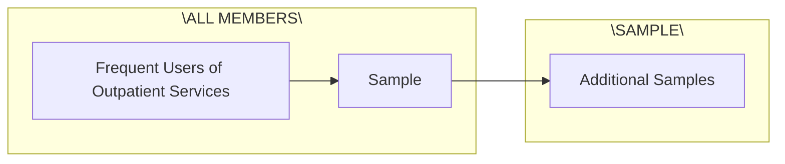
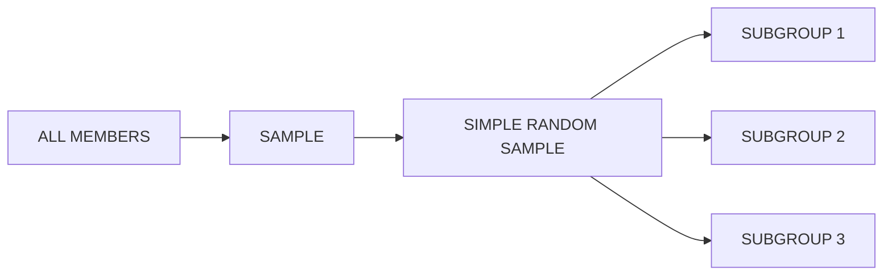
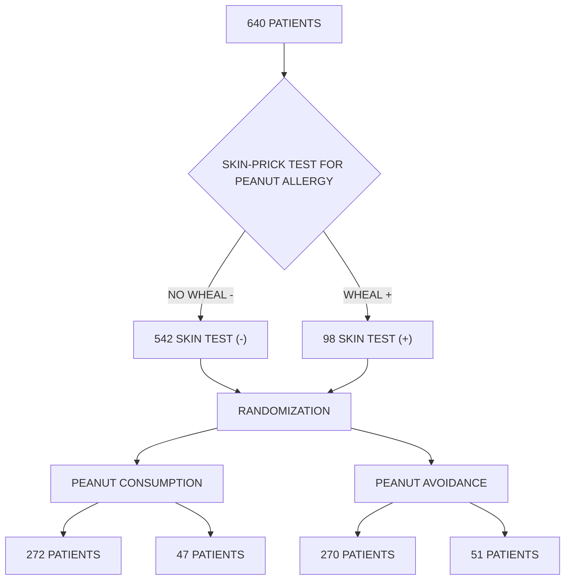
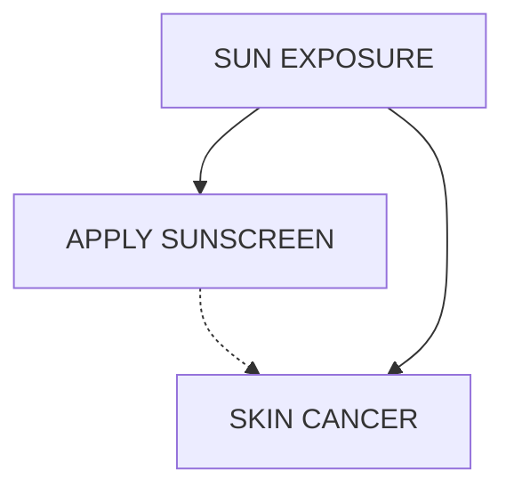

## 1.2.3 Relationships between variables

Many studies are motivated by a researcher examining how two or more variables are related. For example, do the values of one variable increase as the values of another decrease? Do the values of one variable tend to differ by the levels of another variable?

One study used the famuss data to investigate whether ACTN3 genotype at a particular lo cation (residue 577) is associated with change in muscle strength. The ACTN3 gene codes for a protein involved in muscle function. A common mutation in the gene at a specific location changes the cytosine (C) nucleotide to a thymine (T) nucleotide; individuals with the TT genotype are unable to produce any ACTN3 protein.

Researchers hypothesized that genotype at this location might influence muscle function. As a measure of muscle function, they recorded the percent change in non-dominant arm strength after strength training; this variable, ndrm.ch, is the **response variable** in the study. A response variable is defined by the particular research question a study seeks to address, and measures the outcome of interest in the study. A study will typically examine whether the values of a response variable differ as values of an **explanatory variable** change, and if so, how the two variables are related. A given study may examine several explanatory variables for a single response variable.14 The explanatory variable examined in relation to ndrm.ch in the study is actn3.r557x, ACTN3 genotype at location 577.

## EXAMPLE 1.4

In the maternal investment study conducted on frogs, researchers collected measurements on egg clutches and female frogs at 11 study sites, located at differing altitudes, in order to investigate how maternal investment varies with altitude. Identify the response and explanatory variables in the study.

The variables egg.size, clutch.size, and clutch.volume are response variables indicative of maternal investment.

The explanatory variable examined in the study is altitude.

While latitude is an environmental factor that might potentially influence features of the egg clutches, it is not a variable of interest in this particular study.

Female body size (body.size) is neither an explanatory nor response variable.

## GUIDED PRACTICE 1.5

Refer to the variables from the famuss dataset described in Figure 1.7 to formulate a question about the relationships between these variables, and identify the response and explanatory variables in the context of the question.15

<small>14Response variables are sometimes called dependent variables and explanatory variables are often called independent variables or predictors.</small>

<small>15Two sample questions: (1) Does change in participant arm strength after training seem associated with race? The response variable is ndrm.ch and the explanatory variable is race. (2) Do male participants appear to respond differently to strength training than females? The response variable is ndrm.ch and the explanatory variable is sex.</small>

## 1.3 Data collection principles

The first step in research is to identify questions to investigate. A clearly articulated research question is essential for selecting subjects to be studied, identifying relevant variables, and determining how data should be collected.

## 1.3.1 Populations and samples

Consider the following research questions:

1. Do bluefin tuna from the Atlantic Ocean have particularly high levels of mercury, such that they are unsafe for human consumption?
2. For infants predisposed to developing a peanut allergy, is there evidence that introducing peanut products early in life is an effective strategy for reducing the risk of developing a peanut allergy?
3. Does a recently developed drug designed to treat glioblastoma, a form of brain cancer, appear more effective at inducing tumor shrinkage than the drug currently on the market?

Each of these questions refers to a specific target **population**. For example, in the first question, the target population consists of all bluefin tuna from the Atlantic Ocean; each individual bluefin tuna represents a case. It is almost always either too expensive or logistically impossible to collect data for every case in a population. As a result, nearly all research is based on information obtained about a sample from the population. A **sample** represents a small fraction of the population. Researchers interested in evaluating the mercury content of bluefin tuna from the Atlantic Ocean could collect a sample of 500 bluefin tuna (or some other quantity), measure the mercury content, and use the observed information to formulate an answer to the research question.

## GUIDED PRACTICE 1.6

Identify the target populations for the remaining two research questions.16

<small>16In Question 2, the target population consists of infants predisposed to developing a peanut allergy. In Question 3, the target population consists of patients with glioblastoma.</small>

## 1.3.2 Anecdotal evidence

Anecdotal evidence typically refers to unusual observations that are easily recalled because of their striking characteristics. Physicians may be more likely to remember the characteristics of a single patient with an unusually good response to a drug instead of the many patients who did not respond. The dangers of drawing general conclusions from anecdotal information are obvious; no single observation should be used to draw conclusions about a population.

While it is incorrect to generalize from individual observations, unusual observations can sometimes be valuable. E.C. Heyde was a general practitioner from Vancouver who noticed that a few of his elderly patients with aortic-valve stenosis (an abnormal narrowing) caused by an accumulation of calcium had also suffered massive gastrointestinal bleeding. In 1958, he published his observation.17 Further research led to the identification of the underlying cause of the association, now called Heyde’s Syndrome.18

An anecdotal observation can never be the basis for a conclusion, but may well inspire the design of a more systematic study that could be definitive.

<small>17Heyde EC. Gastrointestinal bleeding in aortic stenosis. N Engl J Med 1958;259:196.</small>

<small>18Greenstein RJ, McElhinney AJ, Reuben D, Greenstein AJ. Co-lonic vascular ectasias and aortic stenosis: coincidence or causal relationship? Am J Surg 1986;151:347-51.</small>

## 1.3.3 Sampling from a population

Sampling from a population, when done correctly, provides reliable information about the characteristics of a large population. The US Centers for Disease Control (US CDC) conducts sev eral surveys to obtain information about the US population, including the Behavior Risk Factor Surveillance System (BRFSS).19 The BRFSS was established in 1984 to collect data about healthrelated risk behaviors, and now collects data from more than 400,000 telephone interviews conducted each year. Data from a recent BRFSS survey are used in Chapter 4. The CDC conducts similar surveys for diabetes, health care access, and immunization. Likewise, the World Health Organization (WHO) conducts the World Health Survey in partnership with approximately 70 countries to learn about the health of adult populations and the health systems in those countries.20

The general principle of sampling is straightforward: a sample from a population is useful for learning about a population only when the sample is **representative** of the population. In other words, the characteristics of the sample should correspond to the characteristics of the population.

Suppose that the quality improvement team at an integrated health care system, such as Harvard Pilgrim Health Care, is interested in learning about how members of the health plan perceive the quality of the services offered under the plan. A common pitfall in conducting a survey is to use a **convenience sample**, in which individuals who are easily accessible are more likely to be included in the sample than other individuals. If a sample were collected by approaching plan members visiting an outpatient clinic during a particular week, the sample would fail to enroll generally healthy members who typically do not use outpatient services or schedule routine physical examinations; this method would produce an unrepresentative sample (Figure 1.9).

flowchart

Figure 1.9: Instead of sampling from all members equally, approaching members visiting a clinic during a particular week disproportionately selects members who frequently use outpatient services.

Random sampling is the best way to ensure that a sample reflects a population. In a **simple random sample**, each member of a population has the same chance of being sampled. One way to achieve a simple random sample of the health plan members is to randomly select a certain number of names from the complete membership roster, and contact those individuals for an interview (Figure 1.10).

<small>19<a href="https://www.cdc.gov/brfss/index.html">https://www.cdc.gov/brfss/index.html</a></small>

<small>20<a href="http://www.who.int/healthinfo/survey/en/">http://www.who.int/healthinfo/survey/en/</a></small>

flowchart

Figure 1.10: Five members are randomly selected from the population to be interviewed.

Even when a simple random sample is taken, it is not guaranteed that the sample is representative of the population. If the **non-response** rate for a survey is high, that may be indicative of a biased sample. Perhaps a majority of participants did not respond to the survey because only a certain group within the population is being reached; for example, if questions assume that participants are fluent in English, then a high non-response rate would be expected if the population largely consists of individuals who are not fluent in English (Figure 1.11). Such **non-response bias** can skew results; generalizing from an unrepresentative sample may likely lead to incorrect conclusions about a population.

flowchart

Figure 1.11: Surveys may only reach a certain group within the population, which leads to non-response bias. For example, a survey written in English may only result in responses from health plan members fluent in English.

## GUIDED PRACTICE 1.7

It is increasingly common for health care facilities to follow-up a patient visit with an email providing a link to a website where patients can rate their experience. Typically, less than 50% of patients visit the website. If half of those who respond indicate a negative experience, do you think that this implies that at least 25% of patient visits are unsatisfactory?21

<small>21It is unlikely that the patients who respond constitute a representative sample from the larger population of patients. This is not a random sample, because individuals are selecting themselves into a group, and it is unclear that each person has an equal chance of answering the survey. If our experience is any guide, dissatisfied people are more likely to respond to these informal surveys than satisfied patients.</small>

## 1.3.4 Sampling methods

Almost all statistical methods are based on the notion of implied randomness. If data are not sampled from a population at random, these statistical methods – calculating estimates and errors associated with estimates – are not reliable. Four random sampling methods are discussed in this section: simple, stratified, cluster, and multistage sampling.

In a **simple random sample**, each case in the population has an equal chance of being included in the sample (Figure 1.12). Under simple random sampling, each case is sampled independently of the other cases; i.e., knowing that a certain case is included in the sample provides no information about which other cases have also been sampled.

In **stratified sampling**, the population is first divided into groups called **strata** before cases are selected within each stratum (typically through simple random sampling) (Figure 1.12). The strata are chosen such that similar cases are grouped together. Stratified sampling is especially useful when the cases in each stratum are very similar with respect to the outcome of interest, but cases between strata might be quite different.

Suppose that the health care provider has facilities in different cities. If the range of services offered differ by city, but all locations in a given city will offer similar services, it would be effective for the quality improvement team to use stratified sampling to identify participants for their study, where each city represents a stratum and plan members are randomly sampled from each city.

Figure 1.12: Examples of simple random and stratified sampling. In the top panel, simple random sampling is used to randomly select 18 cases (circled orange dots) out of the total population (all dots). The bottom panel illustrates stratified sampling: cases are grouped into six strata, then simple random sampling is employed within each stratum.

In a **cluster sample**, the population is first divided into many groups, called **clusters**. Then, a fixed number of clusters is sampled and all observations from each of those clusters are included in the sample (Figure 1.13). A **multistage sample** is similar to a cluster sample, but rather than keeping all observations in each cluster, a random sample is collected within each selected cluster (Figure 1.13).

Unlike with stratified sampling, cluster and multistage sampling are most helpful when there is high case-to-case variability within a cluster, but the clusters themselves are similar to one another. For example, if neighborhoods in a city represent clusters, cluster and multistage sampling work best when the population within each neighborhood is very diverse, but neighborhoods are relatively similar.

Applying stratified, cluster, or multistage sampling can often be more economical than only drawing random samples. However, analysis of data collected using such methods is more complicated than when using data from a simple random sample; this text will only discuss analysis methods for simple random samples.

## EXAMPLE 1.8

Suppose researchers are interested in estimating the malaria rate in a densely tropical portion of rural Indonesia. There are 30 villages in the area, each more or less similar to the others. The goal is to test 150 individuals for malaria. Evaluate which sampling method should be employed.

A simple random sample would likely draw individuals from all 30 villages, which could make data collection extremely expensive. Stratified sampling is not advisable, since there is not enough information to determine how strata of similar individuals could be built. However, cluster sampling or multistage sampling are both reasonable options. For example, with multistage sampling, half of the villages could be randomly selected, and then 10 people selected from each village. This strategy is more efficient than a simple random sample, and can still provide a sample representative of the population of interest.

## 1.3.5 Introducing experiments and observational studies

The two primary types of study designs used to collect data are experiments and observational studies.

In an **experiment**, researchers directly influence how data arise, such as by assigning groups of individuals to different treatments and assessing how the outcome varies across treatment groups. The LEAP study is an example of an experiment with two groups, an experimental group that received the intervention (peanut consumption) and a control group that received a standard approach (peanut avoidance). In studies assessing effectiveness of a new drug, individuals in the control group typically receive a **placebo**, an inert substance with the appearance of the experimental intervention. The study is designed such that on average, the only difference between the individuals in the treatment groups is whether or not they consumed peanut protein. This allows for observed differences in experimental outcome to be directly attributed to the intervention and constitute evidence of a causal relationship between intervention and outcome.

In an **observational study**, researchers merely observe and record data, without interfering with how the data arise. For example, to investigate why certain diseases develop, researchers might collect data by conducting surveys, reviewing medical records, or following a **cohort** of many similar individuals. Observational studies can provide evidence of an association between variables, but cannot by themselves show a causal connection. However, there are many instances where randomized experiments are unethical, such as to explore whether lead exposure in young children is associated with cognitive impairment.

Figure 1.13: Examples of cluster and multistage sampling. The top panel illustrates cluster sampling: data are binned into nine clusters, three of which are sampled, and all observations within these clusters are sampled. The bottom panel illustrates multistage sampling, which differs from cluster sampling in that only a subset from each of the three selected clusters are sampled.

## 1.3.6 Experiments

Experimental design is based on three principles: control, randomization, and replication.

**Control.** When selecting participants for a study, researchers work to **control** for extraneous variables and choose a sample of participants that is representative of the population of interest. For example, participation in a study might be restricted to individuals who have a condition that suggests they may benefit from the intervention being tested. Infants enrolled in the LEAP study were required to be between 4 and 11 months of age, with severe eczema and/or allergies to eggs.

**Randomization.** Randomly assigning patients to treatment groups ensures that groups are balanced with respect to both variables that can and cannot be controlled. For example, randomization in the LEAP study ensures that the proportion of males to females is approximately the same in both groups. Additionally, perhaps some infants were more susceptible to peanut allergy because of an undetected genetic condition; under randomization, it is reasonable to assume that such infants were present in equal numbers in both groups. Randomization allows differences in outcome between the groups to be reasonably attributed to the treatment rather than inherent variability in patient characteristics, since the treatment represents the only systematic difference between the two groups.

In situations where researchers suspect that variables other than the intervention may influence the response, individuals can be first grouped into **blocks** according to a certain attribute and then randomized to treatment group within each block; this technique is referred to as **blocking** or **stratification**. The team behind the LEAP study stratified infants into two cohorts based on whether or not the child developed a red, swollen mark (a wheal) after a skin test at the time of enrollment; afterwards, infants were randomized between peanut consumption and avoidance groups. Figure 1.14 illustrates the blocking scheme used in the study.

**Replication.** The results of a study conducted on a larger number of cases are generally more reliable than smaller studies; observations made from a large sample are more likely to be representative of the population of interest. In a single study, **replication** is accomplished by collecting a sufficiently large sample. The LEAP study randomized a total of 640 infants.

Randomized experiments are an essential tool in research. The US Food and Drug Adminis tration typically requires that a new drug can only be marketed after two independently conducted randomized trials confirm its safety and efficacy; the European Medicines Agency has a similar policy. Large randomized experiments in medicine have provided the basis for major public health initiatives. In 1954, approximately 750,000 children participated in a randomized study comparing polio vaccine with a placebo.22 In the United States, the results of the study quickly led to the widespread and successful use of the vaccine for polio prevention.

flowchart

Figure 1.14: A simplified schematic of the blocking scheme used in the LEAP study, depicting 640 patients that underwent randomization. Patients are first divided into blocks based on response to the initial skin test, then each block is randomized between the avoidance and consumption groups. This strategy ensures an even representation of patients in each group who had positive and negative skin tests.

## 1.3.7 Observational studies

In observational studies, researchers simply observe selected potential explanatory and response variables. Participants who differ in important explanatory variables may also differ in other ways that influence response; as a result, it is not advisable to make causal conclusions about the relationship between explanatory and response variables based on observational data. For example, while observational studies of obesity have shown that obese individuals tend to die sooner than individuals with normal weight, it would be misleading to conclude that obesity causes shorter life expectancy. Instead, underlying factors are probably involved; obese individuals typically exhibit other health behaviors that influence life expectancy, such as reduced exercise or unhealthy diet.

Suppose that an observational study tracked sunscreen use and incidence of skin cancer, and found that the more sunscreen a person uses, the more likely they are to have skin cancer. These results do not mean that sunscreen causes skin cancer. One important piece of missing information is sun exposure – if someone is often exposed to sun, they are both more likely to use sunscreen and to contract skin cancer. Sun exposure is a **confounding variable**: a variable associated with both the explanatory and response variables.23 There is no guarantee that all confounding variables can be examined or measured; as a result, it is not advisable to draw causal conclusions from observational studies.

flowchart

Confounding is not limited to observational studies. For example, consider a randomized study comparing two treatments (varenicline and buproprion) against a placebo as therapies for aiding smoking cessation.24 At the beginning of the study, participants were randomized into groups: 352 to varenicline, 329 to buproprion, and 344 to placebo. Not all participants successfully completed the assigned therapy: 259, 225, and 215 patients in each group did so, respectively. If an analysis were based only on the participants who completed therapy, this could introduce confounding; it is possible that there are underlying differences between individuals who complete the therapy and those who do not. Including all randomized participants in the final analysis maintains the original randomization scheme and controls for differences between the groups.25

## GUIDED PRACTICE 1.9

As stated in Example 1.4, female body size (body.size) in the parental investment study is neither an explanatory nor a response variable. Previous research has shown that larger females tend to produce larger eggs and egg clutches; however, large body size can be costly at high altitudes. Discuss a possible reason for why the study team chose to measure female body size when it is not directly related to their main research question.26

<small>23Also called a lurking variable, confounding factor, or a confounder.</small>

<small>24Jorenby, Douglas E., et al. "Efficacy of varenicline, an α4β2 nicotinic acetylcholine receptor partial agonist, vs placebo or sustained-release bupropion for smoking cessation: a randomized controlled trial." JAMA 296.1 (2006): 56-63.</small>

<small>25This strategy, commonly used for analyzing clinical trial data, is referred to as an intention-to-treat analysis.</small>

<small>26Female body size is a potential confounding variable, since it may be associated with both the explanatory variable (altitude) and response variables (measures of maternal investment). If the study team observes, for example, that clutch size tends to decrease at higher altitudes, they should check whether the apparent association is not simply due to frogs at higher altitudes having smaller body size and thus, laying smaller clutches.</small>

Observational studies may reveal interesting patterns or associations that can be further in vestigated with follow-up experiments. Several observational studies based on dietary data from different countries showed a strong association between dietary fat and breast cancer in women. These observations led to the launch of the Women’s Health Initiative (WHI), a large randomized trial sponsored by the US National Institutes of Health (NIH). In the WHI, women were randomized to standard versus low fat diets, and the previously observed association was not confirmed.

Observational studies can be either prospective or retrospective. A **prospective study** identifies participants and collects information at scheduled times or as events unfold. For example, in the Nurses’ Health Study, researchers recruited registered nurses beginning in 1976 and collected data through administering biennial surveys; data from the study have been used to investigate risk factors for major chronic diseases in women.27 **Retrospective studies** collect data after events have taken place, such as from medical records. Some datasets may contain both retrospectively- and prospectively-collected variables. The Cancer Care Outcomes Research and Surveillance Consortium (CanCORS) enrolled participants with lung or colorectal cancer, collected information about diagnosis, treatment, and previous health behavior, but also maintained contact with participants to gather data about long-term outcomes.28

<small>27<a href="http://www.openintro.org/redirect.php?go=textbook-channing_nurse_study&amp;referrer=biostat1_pdf">www.channing.harvard.edu/nhs</a></small>

<small>28Ayanian, John Z., et al. "Understanding cancer treatment and outcomes: the cancer care outcomes research and surveillance consortium." Journal of Clinical Oncology 22.15 (2004): 2992-2996</small>

## 1.4 Numerical data

This section discusses techniques for exploring and summarizing numerical variables, using the frog data from the parental investment study introduced in Section 1.2.

## 1.4.1 Measures of center: mean and median

The **mean**, sometimes called the average, is a measure of center for a **distribution** of data. To find the average clutch volume for the observed egg clutches, add all the clutch volumes and divide by the total number of clutches.29

$$
\overline {{x}} = \frac {1 7 7 . 8 + 2 5 7 . 0 + \cdots + 9 3 3 . 3}{4 3 1} = 8 8 2. 5 \mathrm{mm} ^ {3}.
$$

The sample mean is often labeled ${ \overline { { x } } } ,$ to distinguish it from $\mu ,$ the mean of the entire population from which the sample is drawn. The letter x is being used as a generic placeholder for the variable of interest, clutch.volume.

## MEAN

The sample mean of a numerical variable is the sum of the values of all observations divided by the number of observations:

$$
\overline {{x}} = \frac {x _ {1} + x _ {2} + \cdots + x _ {n}}{n}, \tag {1.10}
$$

where $x_{1},x_{2},\cdots,x_{n}$ represent the n observed values.

The **median** is another measure of center; it is the middle number in a distribution after the values have been ordered from smallest to largest. If the distribution contains an even number of observations, the median is the average of the middle two observations. There are 431 clutches in the dataset, so the median is the clutch volume of the $2 1 6 ^ { t h }$ observation in the sorted values of clutch.volume: 831.8 mm3.

<small>29For computational convenience, the volumes are rounded to the first decimal.</small>

## 1.4.2 Measures of spread: standard deviation and interquartile range

The spread of a distribution refers to how similar or varied the values in the distribution are to each other; i.e., whether the values are tightly clustered or spread over a wide range.

The standard deviation for a set of data describes the typical distance between an observation and the mean. The distance of a single observation from the mean is its **deviation**. Below are the deviations for the $1 ^ { s t } ,   2 ^ { n d } ,   3 ^ { r d }$ , and $4 3 1 ^ { s t }$ observations in the clutch.volume variable.

$$
\begin{array}{l} x _ {1} - \overline {{x}} = 1 7 7. 8 - 8 8 2. 5 = - 7 0 4. 7 \\ x _ {2} - \overline {{x}} = 2 5 7. 0 - 8 8 2. 5 = - 6 2 5. 5 \\ x _ {3} - \overline {{x}} = 1 5 1. 4 - 8 8 2. 5 = - 7 3 1. 1 \\ x _ {4 3 1} - \overline {{x}} = 9 3 3. 2 - 8 8 2. 5 = 5 0. 7 \\ \end{array}
$$

..

The sample **variance**, the average of the squares of these deviations, is denoted by $s ^ { 2 } ;$

$s ^ { 2 }$ sample variance

$$
\begin{array}{l} s ^ {2} = \frac {(- 7 0 4 . 7) ^ {2} + (- 6 2 5 . 5) ^ {2} + (- 7 3 1 . 1) ^ {2} + \cdots + (5 0 . 7) ^ {2}}{4 3 1 - 1} \\ = \frac {4 9 6 , 6 0 2 . 0 9 + 3 9 1 , 2 5 0 . 2 5 + 5 3 4 , 5 0 7 . 2 1 + \cdots + 2 5 7 0 . 4 9}{4 3 0} \\ = 1 4 3, 6 8 0. 9. \\ \end{array}
$$

The denominator is n − 1 rather than n; this mathematical nuance accounts for the fact that sample mean has been used to estimate the population mean in the calculation. Details on the statistical theory can be found in more advanced texts.

The sample **standard deviation** s is the square root of the variance:

$$
s = \sqrt {1 4 3 , 6 8 0 . 9} = 3 7 9. 0 5 \mathrm{mm} ^ {3}.
$$

Like the mean, the population values for variance and standard deviation are denoted by Greek letters: $\sigma ^ { 2 }$ for the variance and σ for the standard deviation.

## STANDARD DEVIATION

The sample standard deviation of a numerical variable is computed as the square root of the variance, which is the sum of squared deviations divided by the number of observations minus 1.

$$
s = \sqrt {\frac {(x _ {1} - \overline {{x}}) ^ {2} + (x _ {2} - \overline {{x}}) ^ {2} + \cdots + (x _ {n} - \overline {{x}}) ^ {2}}{n - 1}}, \tag {1.11}
$$

where $x_{1},x_{2},\cdots,x_{n}$ represent the n observed values.

s sample standard deviation $\sigma ^ { 2 }$ population variance

σ population standard deviation

Variability can also be measured using the **interquartile range** (IQR). The IQR for a distribution is the difference between the first and third quartiles: $Q _ { 3 } - Q _ { 1 }$ . The first quartile $( Q _ { 1 } )$ is equivalent to the $2 5 ^ { t h }$ percentile; i.e., 25% of the data fall below this value. The third quartile $( Q _ { 3 } )$ is equivalent to the $7 5 ^ { t h }$ percentile. By definition, the median represents the second quartile, with half the values falling below it and half falling above. The IQR for clutch.volume is $1096.0 - 609.6 = 486.4    mm ^3$

Measures of center and spread are ways to summarize a distribution numerically. Using numerical summaries allows for a distribution to be efficiently described with only a few numbers.30 For example, the calculations for clutch.volume indicate that the typical egg clutch has volume of about 880 $\mathrm { m m } ^ { 3 } ]$ , while the middle 50% of egg clutches have volumes between approximately $6 0 0 \; \mathrm { { m m } } ^ { 3 }$ and 1100.0 mm3.

## 1.4.3 Robust estimates

Figure 1.15 shows the values of clutch.volume as points on a single axis. There are a few values that seem extreme relative to the other observations: the four largest values, which appear distinct from the rest of the distribution. How do these extreme values affect the value of the numerical summaries?

scatter

| Clutch Volumes (range) | Value (range) |
| --- | --- |
| 100~2700 | 0~2700 |

Figure 1.15: Dot plot of clutch volumes from the frog data.

Figure 1.16 shows the summary statistics calculated under two scenarios, one with and one without the four largest observations. For these data, the median does not change, while the IQR differs by only about 6 $\mathrm { i   m m ^ { 3 } }$ . In contrast, the mean and standard deviation are much more affected, particularly the standard deviation.

<table><tr><td rowspan="2">scenario</td><td colspan="2">robust</td><td colspan="2">not robust</td></tr><tr><td>median</td><td>IQR</td><td> $\bar{x}$ </td><td>s</td></tr><tr><td>original data (with extreme observations)</td><td>831.8</td><td>486.9</td><td>882.5</td><td>379.1</td></tr><tr><td>data without four largest observations</td><td>831.8</td><td>493.9</td><td>867.9</td><td>349.2</td></tr></table>

Figure 1.16: A comparison of how the median, IQR, mean (x), and standard deviation (s) change when extreme observations are present.

The median and IQR are referred to as **robust estimates** because extreme observations have little effect on their values. For distributions that contain extreme values, the median and IQR will provide a more accurate sense of the center and spread than the mean and standard deviation.

<small>30Numerical summaries are also known as summary statistics.</small>