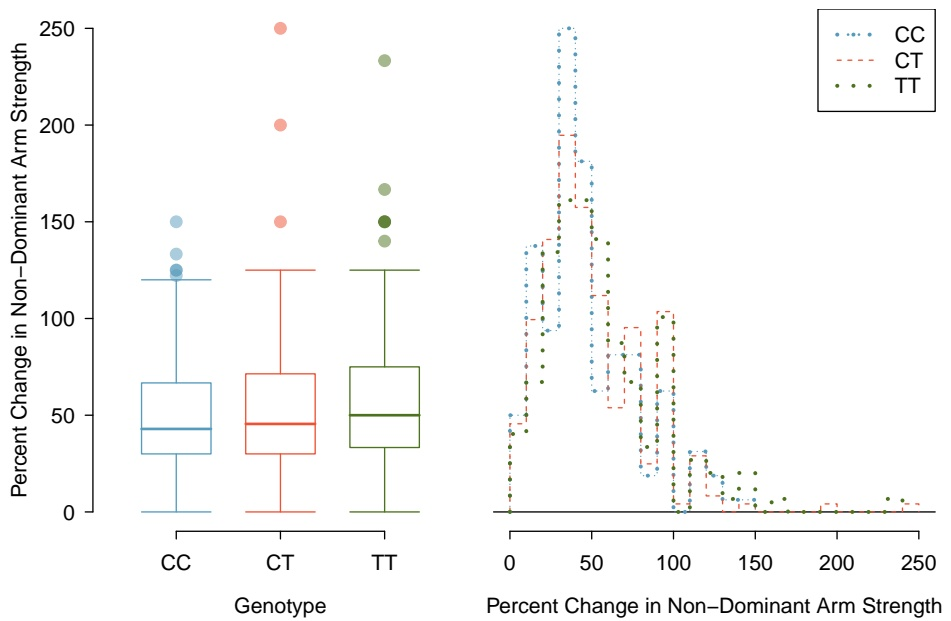

Figure 1.39: Side-by-side boxplot and hollow histograms for ndrm.ch, split by levels of actn3.r577x.

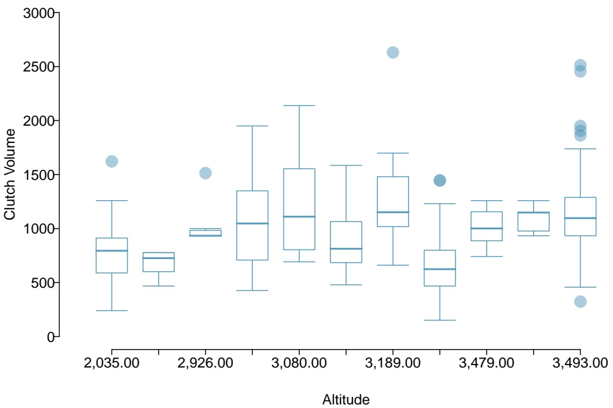

boxplot

| Altitude | Q1 | Q2 (Median) | Q3 | IQR |
| --- | --- | --- | --- | --- |
| 2,035.00 | ~600 | ~800 | ~900 | ~300 |
| 2,926.00 | ~600 | ~750 | ~800 | ~200 |
| 3,080.00 | ~700 | ~1050 | ~1350 | ~650 |
| 3,189.00 | ~800 | ~1100 | ~1550 | ~750 |
| 3,479.00 | ~650 | ~1150 | ~1480 | ~830 |
| 3,493.00 | ~950 | ~1100 | ~1300 | ~450 |

Figure 1.40: Side-by-side boxplot comparing the distribution of clutch.volume for different altitudes.

## 1.7 Exploratory data analysis

The simple techniques for summarizing and visualizing data that have been introduced in this chapter may not seem especially powerful, but when applied in practice, they can be instrumental for gaining insight into the interesting features of a dataset. This section provides three examples of data-driven research questions that can be investigated through exploratory data analysis.

## 1.7.1 Case study: discrimination in developmental disability support

In the United States, individuals with developmental disabilities typically receive services and support from state governments. The State of California allocates funds to developmentally disabled residents through the California Department of Developmental Services (DDS); individuals receiving DDS funds are referred to as ’consumers’. The dataset dds.discr represents a sample of 1,000 DDS consumers (out of a total population of approximately 250,000), and includes information about age, gender, ethnicity, and the amount of financial support per consumer provided by the DDS.49 Figure 1.41 shows the first five rows of the dataset, and the variables are described in Figure 1.42.

A team of researchers examined the mean annual expenditures on consumers by ethnicity, and found that the mean annual expenditures on Hispanic consumers was approximately onethird of the mean expenditures on White non-Hispanic consumers. As a result, an allegation of ethnic discrimination was brought against the California DDS.

Does this finding represent sufficient evidence of ethnic discrimination, or might there be more to the story? This section will illustrate the process behind conducting an exploratory analysis that not only investigates the relationship between two variables of interest, but also considers whether other variables might be influencing that relationship.

|  | id | age.cohort | age | gender | expenditures | ethnicity |
| --- | --- | --- | --- | --- | --- | --- |
| 1 | 10210 | 13-17 | 17 | Female | 2113 | White not Hispanic |
| 2 | 10409 | 22-50 | 37 | Male | 41924 | White not Hispanic |
| 3 | 10486 | 0-5 | 3 | Male | 1454 | Hispanic |
| 4 | 10538 | 18-21 | 19 | Female | 6400 | Hispanic |
| 5 | 10568 | 13-17 | 13 | Male | 4412 | White not Hispanic |

Figure 1.41: Five rows from the dds.discr data matrix.

| variable | description |
| --- | --- |
| id | Unique identification code for each resident |
| age.cohort | Age as sorted into six groups, 0-5 years, 6-12 years, 13-17 years, 18-21 years, 22-50 years, and 51+ years |
| age | Age, measured in years |
| gender | Gender, either Female or Male |
| expenditures | Amount of expenditures spent by the State on an individual annually, measured in USD |
| ethnicity | Ethnic group, recorded as either American Indian, Asian, Black, Hispanic, Multi Race, Native Hawaiian, Other, or White Not Hispanic |

Figure 1.42: Variables and their descriptions for the dds.discr dataset.

<small>49The dataset is based on actual attributes of consumers, but has been altered to maintain consumer privacy.</small>

## Distributions of single variables

To begin understanding a dataset, start by examining the distributions of single variables using numerical and graphical summaries. This process is essential for developing a sense of context; in this case, examining variables individually addresses questions such as "What is the range of annual expenditures?", "Do consumers tend to be older or younger?", and "Are there more consumers from one ethnic group versus another?".

Figure 1.43 illustrates the right skew of expenditures, indicating that for the majority of consumers, expenditures are relatively low; most are within the \$0 - \$5,000 range. There are some consumers for which expenditures are much higher, such as within the \$60,000 - \$80,000 range. Precise numerical summaries can be calculated using statistical software: the quartiles for expenditures are \$2,899, \$7,026, and \$37,710.

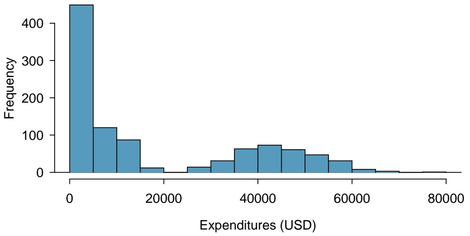

histogram

| Expenditures (USD) (range) | Frequency |
| --- | --- |
| 0~5000 | ~450 |
| 5000~10000 | ~120 |
| 10000~15000 | ~90 |
| 15000~20000 | ~15 |
| 20000~25000 | ~5 |
| 25000~30000 | ~15 |
| 30000~35000 | ~35 |
| 35000~40000 | ~65 |
| 40000~45000 | ~75 |
| 45000~50000 | ~65 |
| 50000~55000 | ~50 |
| 55000~60000 | ~35 |
| 60000~65000 | ~15 |
| 65000~70000 | ~5 |
| 70000~75000 | ~2 |
| 75000~80000 | ~2 |

Figure 1.43: A histogram of expenditures.

A consumer’s age is directly recorded as the variable age; in the age.cohort variable, con sumers are assigned to one of six age cohorts. The cohorts are indicative of particular life phases. In the first three cohorts, consumers are still living with their parents as they move through preschool age, elementary/middle school age, and high school age. In the 18-21 cohort, consumers are transitioning from their parents’ homes to living on their own or in supportive group homes. From ages 22-50, individuals are mostly no longer living with their parents but may still receive some support from family. In the 51+ cohort, consumers often have no living parents and typically require the most amount of support.

Figure 1.44 reveals the right-skewing of age. Most consumers are younger than 30. The plot in Figure 1.44(b) graphically shows the number of individuals in each age cohort. There are approximately 200 individuals in each of the middle four cohorts, while there are about 100 individuals in the other two cohorts.

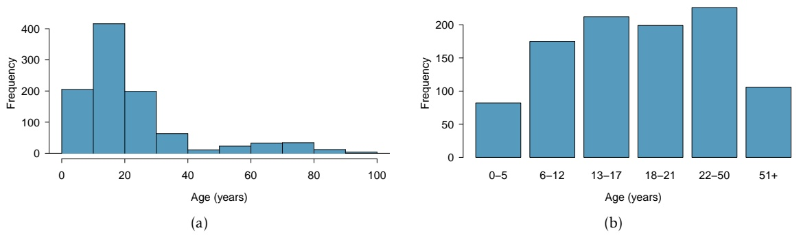

Figure 1.44: (a) Histogram of age. (b) Plot of age.cohort.

There are eight ethnic groups represented in dds.discr. The two largest groups, Hispanic and White non-Hispanic, together represent about 80% of the consumers.

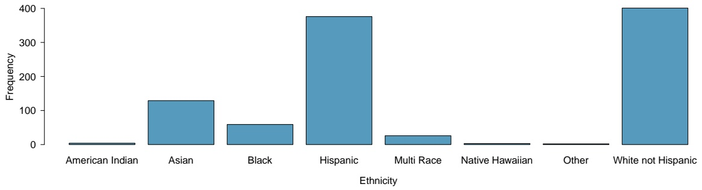

bar

| Ethnicity | Frequency |
| --- | --- |
| American Indian | ~5 |
| Asian | ~130 |
| Black | ~60 |
| Hispanic | ~380 |
| Multi Race | ~30 |
| Native Hawaiian | ~5 |
| Other | ~5 |
| White not Hispanic | 400 |

Figure 1.45: A plot of ethnicity.

## GUIDED PRACTICE 1.27

Using Figure 1.46, does gender appear to be balanced in the dds.discr dataset?50

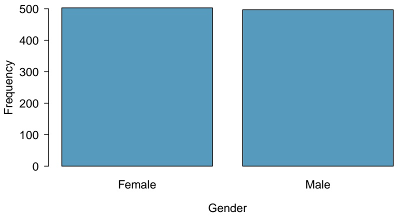

Figure 1.46: A plot of gender.

<small>50Yes, approximately half of the individuals are female and half are male.</small>

## Relationships between two variables

After examining variables individually, explore how variables are related to each other. While there exist methods for summarizing more than two variables simultaneously, focusing on two variables at a time can be surprisingly effective for making sense of a dataset. It is useful to begin by inves tigating the relationships between the primary response variable of interest and the exploratory variables. In this case study, the response variable is expenditures, the amount of funds the DDS allocates annually to each consumer. How does expenditures vary by age, ethnicity, and gender?

Figure 1.47 shows a side-by-side boxplot of expenditures by age cohort. There is a clear upward trend, in which older individuals tend to receive more DDS funds. This reflects the underlying context of the data. The purpose of providing funds to developmentally disabled individuals is to help them maintain a quality of life similar to those without disabilities; as individuals age, it is expected their financial needs will increase. Some of the observed variation in expenditures can be attributed to the fact that the dataset includes a wide range of ages. If the data included only individuals in one cohort, such as the 22-50 cohort, the distribution of expenditures would be less variable, and range between \$30,000 and \$60,000 instead of from \$0 and \$80,000.

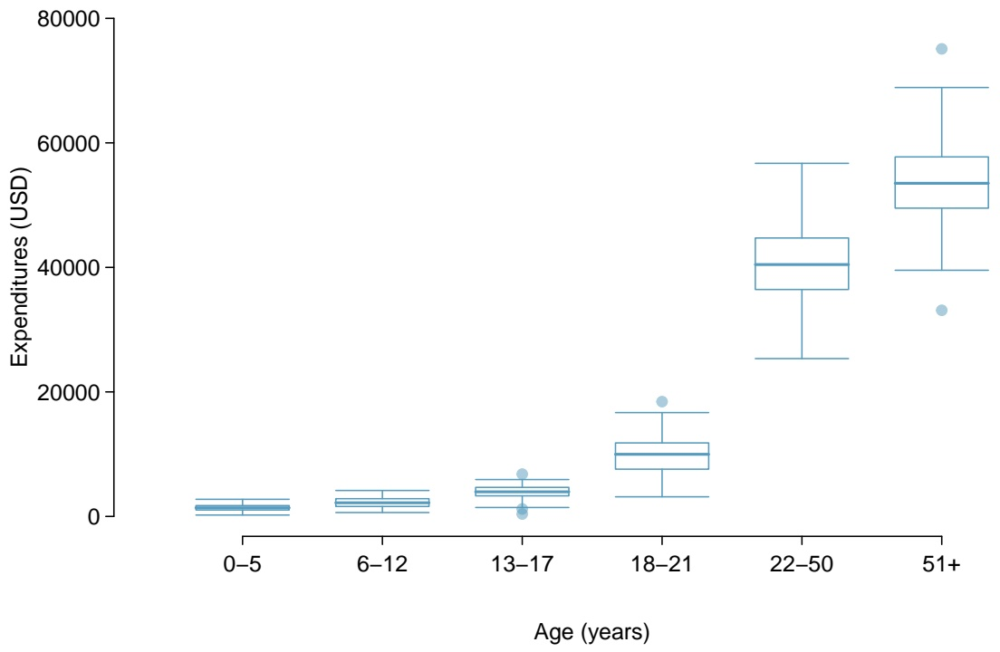

boxplot

| Age (years) | Q1 | Q2 (Median) | Q3 | IQR |
| --- | --- | --- | --- | --- |
| 0–5 | ~1000 | ~1500 | ~2000 | ~1000 |
| 6–12 | ~1500 | ~2500 | ~3000 | ~1500 |
| 13–17 | ~3000 | ~4000 | ~5000 | ~2000 |
| 18–21 | ~7500 | ~10000 | ~12000 | ~4500 |
| 22–50 | ~36500 | ~40500 | ~45000 | ~9500 |
| 51+ | ~49500 | ~53500 | ~58000 | ~9500 |

Figure 1.47: A plot of expenditures by age.cohort.

How does the distribution of expenditures vary by ethnic group? Does there seem to be a difference in the amount of funding that a person receives, on average, between different ethnicities? A side-by-side boxplot of expenditures by ethnicity (Figure 1.48) reveals that the distribution of expenditures is quite different between ethnic groups. For example, there is very little variation in expenditures for the Multi Race, Native Hawaiian, and Other groups. Additionally, the median expenditures are not the same between groups; the medians for American Indian and Native Hawaiian individuals are about \$40,000, as compared to medians of approximately \$10,000 for Asian and Black consumers.

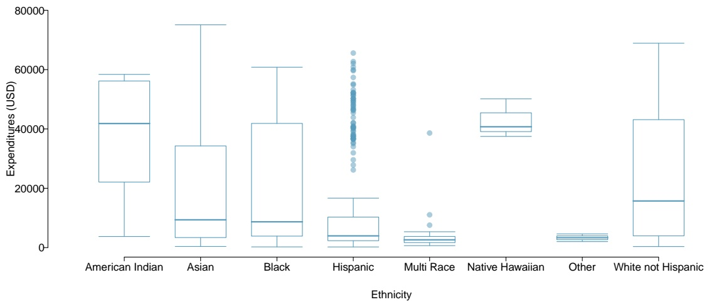

boxplot

| Ethnicity | Q1 | Q2 (Median) | Q3 | IQR |
| --- | --- | --- | --- | --- |
| American Indian | ~22000 | ~42000 | ~56000 | ~34000 |
| Asian | ~3000 | ~9000 | ~34000 | ~31000 |
| Black | ~3000 | ~8000 | ~42000 | ~39000 |
| Hispanic | ~3000 | ~4000 | ~11000 | ~8000 |
| Multi Race | ~1500 | ~2500 | ~4500 | ~3000 |
| Native Hawaiian | ~38000 | ~41000 | ~46000 | ~8000 |
| Other | ~2500 | ~3500 | ~4500 | ~2000 |
| White not Hispanic | ~4000 | ~16000 | ~43000 | ~47000 |

Figure 1.48: A plot of expenditures by ethnicity.

The trend visible in Figure 1.48 seems potentially indicative of ethnic discrimination. Before proceeding with the analysis, however, it is important to take into account the fact that two of the groups, Hispanic and White non-Hispanic, comprise the majority of the data; some ethnic groups represent less than 10% of the observations (Figure 1.45). For ethnic groups with relatively small sample sizes, it is possible that the observed samples are not representative of the larger populations. The rest of this analysis will focus on comparing how expenditures varies between the two largest groups, White non-Hispanic and Hispanic.

## GUIDED PRACTICE 1.28

Using Figure 1.49, do annual expenditures seem to vary by gender?51

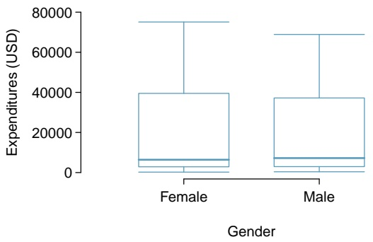

boxplot

| Gender | Q1 | Q2 (Median) | Q3 | Min | Max |
| --- | --- | --- | --- | --- | --- |
| Female | ~4000 | ~7000 | 40000 | ~1000 | ~76000 |
| Male | ~4000 | ~8000 | ~38000 | ~1000 | ~69000 |

Figure 1.49: A plot of expenditures by gender.

<small>51No, the distribution of expenditures within males and females is very similar; both are right skewed, with approximately equal median and interquartile range.</small>

Figure 1.50 compares the distribution of expenditures between Hispanic and White non-Hispanic consumers. Most Hispanic consumers receive between about \$0 to \$20,000 from the California DDS; individuals receiving amounts higher than this are upper outliers. However, for White non-Hispanic consumers, median expenditures is at \$20,000, and the middle 50% of consumers receive between \$5,000 and \$40,000. The precise summary statistics can be calculated from computing software, as shown in the corresponding R lab. The mean expenditures for Hispanic consumers is \$11,066, while the mean expenditures for White non-Hispanic consumers is over twice as large at \$24,698. On average, a Hispanic consumer receives less financial support from the California DDS than a White non-Hispanic consumer. Does this represent evidence of discrimination?

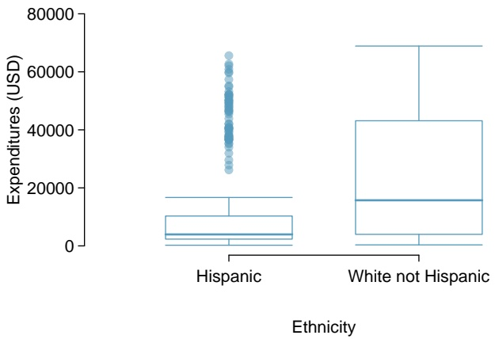

boxplot

| Ethnicity | Q1 | Q2 (Median) | Q3 | IQR |
| --- | --- | --- | --- | --- |
| Hispanic | ~2000 | ~4000 | ~10000 | ~8000 |
| White not Hispanic | ~4000 | ~16000 | ~43000 | ~47000 |

Figure 1.50: A plot of expenditures by ethnicity, showing only Hispanics and White Non-Hispanics.

Recall that expenditures is strongly associated with age—older individuals tend to receive more financial support. Is there also an association between age and ethnicity, for these two ethnic groups? When using data to investigate a question, it is important to explore not only how explanatory variables are related to the response variable(s), but also how explanatory variables influence each other.

Figures 1.51 and 1.52 show the distribution of age within Hispanics and White non-Hispanics. Hispanics tend to be younger, with most Hispanic consumers falling into the 6-12, 13-17, and 18-21 age cohorts. In contrast, White non-Hispanics tend to be older; most consumers in this group are in the 22-50 age cohort, and relatively more White non-Hispanic consumers are in the 51+ age cohort as compared to Hispanics.

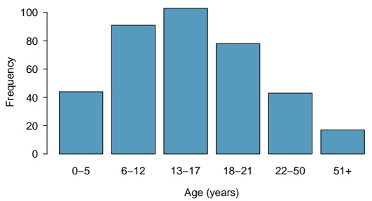

bar

| Age (years) | Frequency |
| --- | --- |
| 0–5 | ~44 |
| 6–12 | ~91 |
| 13–17 | ~103 |
| 18–21 | ~78 |
| 22–50 | ~43 |
| 51+ | ~17 |

(a)

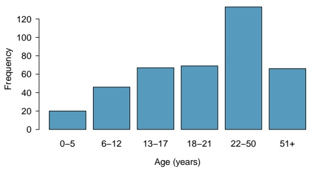

bar

| Age (years) | Frequency |
| --- | --- |
| 0–5 | ~20 |
| 6–12 | ~46 |
| 13–17 | ~67 |
| 18–21 | ~69 |
| 22–50 | ~132 |
| 51+ | ~66 |

(b)

Figure 1.51: (a) Plot of age.cohort within Hispanics. (b) Plot of age.cohort within White non-Hispanics.

| Age Cohort | Hispanic | White Non-Hispanic |
| --- | --- | --- |
| 0-5 | 44/376 = 12% | 20/401 = 5% |
| 6-12 | 91/376 = 24% | 46/401 = 11% |
| 13-17 | 103/376 = 27% | 67/401 = 17% |
| 18-21 | 78/376 = 21% | 69/401 = 17% |
| 22-50 | 43/376 = 11% | 133/401 = 33% |
| 51+ | 17/376 = 5% | 66/401 = 16% |
| Sum | 376/376 = 100% | 401/401 = 100% |

Figure 1.52: Consumers by ethnicity and age cohort, shown both as counts and proportions.

Recall that a confounding variable is a variable that is associated with the response variable and the explanatory variable under consideration; confounding was initially introduced in the context of sunscreen use and incidence of skin cancer, where sun exposure is a confounder. In this setting, age is a confounder for the relationship between expenditures and ethnicity. Just as it would be incorrect to claim that sunscreen causes skin cancer, it is essential here to recognize that there is more to the story than the apparent association between expenditures and ethnicity.

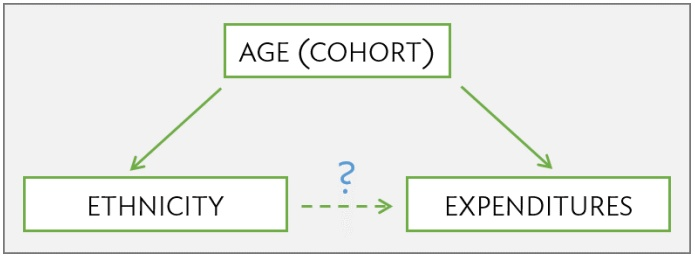

flowchart

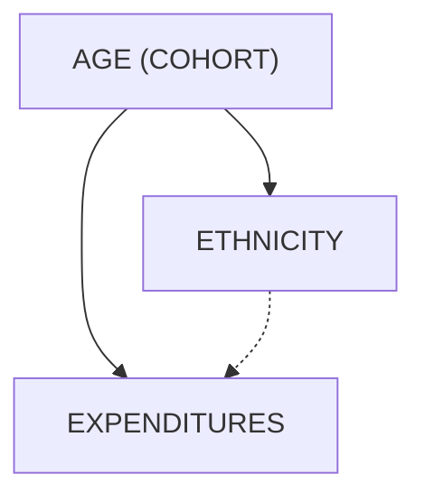

For a closer look at the relationship between age, ethnicity, and expenditures, subset the data further to compare how expenditures differs by ethnicity within each age cohort. If age is indeed the primary source of the observed variation in expenditures, then there should be little difference in average expenditures between individuals in different ethnic groups but the same age cohort.

Figure 1.53 shows the average expenditures within each age cohort, for Hispanics versus White non-Hispanics. The last column contains the difference between the two averages (calculated as White Non-Hispanics average - Hispanics average).

| Age Cohort | Hispanics | White non-Hispanics | Difference |
| --- | --- | --- | --- |
| 0-5 | 1,393 | 1,367 | -26 |
| 6-12 | 2,312 | 2,052 | -260 |
| 13-17 | 3,955 | 3,904 | -51 |
| 18-21 | 9,960 | 10,133 | 173 |
| 22-50 | 40,924 | 40,188 | -736 |
| 51+ | 55,585 | 52,670 | -2915 |
| Average | 11,066 | 24,698 | 13,632 |

Figure 1.53: Average expenditures by ethnicity and age cohort, in USD (\$). For all age cohorts except 18-21 years, average expenditures for White non-Hispanics is lower than for Hispanics.

When expenditures is compared within age cohorts, there are not large differences between mean expenditures for White non-Hispanics versus Hispanics. Comparing individuals of similar ages reveals that the association between ethnicity and expenditures is not nearly as strong as it seemed from the initial comparison of overall averages.

Instead, it is the difference in age distributions of the two populations that is driving the observed discrepancy in expenditures. The overall average of expenditures for the Hispanic consumers is lower because the population of Hispanic consumers is relatively young compared to the population of White non-Hispanic consumers, and the amount of expenditures for younger consumers tends to be lower than for older consumers. Based on an exploratory analysis that accounts for age as a confounding variable, there does not seem to be evidence of ethnic discrimination.

Identifying confounding variables is essential for understanding data. Confounders are often context-specific; for example, age is not necessarily a confounder for the relationship between ethnicity and expenditures in a different population. Additionally, it is rarely immediately obvious which variables in a dataset are confounders; looking for confounding variables is an integral part of exploring a dataset.

Chapter 7 introduces multiple linear regression, a method that can directly summarize the relationship between ethnicity, expenditures, and age, in addition to the tools for evaluating whether the observed discrepancies within age cohorts are greater than would be expected by chance variation alone.

## Simpson’s paradox

These data represent an extreme example of confounding known as **Simpson’s paradox**, in which an association observed in several groups may disappear or reverse direction once the groups are combined. In other words, an association between two variables X and Y may disappear or reverse direction once data are partitioned into subpopulations based on a third variable Z (i.e., a confounding variable).

Figure 1.53 shows how mean expenditures is higher for Hispanics than White non-Hispanics in all age cohorts except one. Yet, once all the data are aggregated, the average expenditures for White non-Hispanics is over twice as large as the average for Hispanics. The paradox can be explored from a mathematical perspective by using weighted averages, where the average expenditure for each cohort is weighted by the proportion of the population in that cohort.

## EXAMPLE 1.29

Using the proportions in Figure 1.52 and the average expenditures for each cohort in Figure 1.53, calculate the overall weighted average expenditures for Hispanics and for White non-Hispanics.52

For Hispanics:

$$
1, 3 9 3 (. 1 2) + 2, 3 1 2 (. 2 4) + 3, 9 5 5 (. 2 7) + 9, 9 6 0 (. 2 1) + 4 0, 9 2 4 (. 1 1) + 5 5, 5 8 5 (. 0 5) = \$ 1 1, 1 6 2.
$$

For White non-Hispanics:

$$
1, 3 6 7 (0. 0 5) + 2, 0 5 2 (. 1 1) + 3, 9 0 4 (. 1 7) + 1 0, 1 3 3 (. 1 7) + 4 0, 1 8 8 (. 3 3) + 5 2, 7 6 0 (. 1 6) = \$ 2 4, 3 8 4.
$$

The weights for the youngest four cohorts, which have lower expenditures, are higher for the Hispanic population than the White non-Hispanic population; additionally, the weights for the oldest two cohorts, which have higher expenditures, are higher for the White non-Hispanic population. This leads to overall average expenditures for the White non-Hispanics being higher than for Hispanics.

<small>52Due to rounding, the overall averages calculated via this method will not exactly equal \$11,066 and \$24,698.</small>

## 1.7.2 Case study: molecular cancer classification

The genetic code stored in DNA contains the necessary information for producing the proteins that ultimately determine an organism’s observable traits (phenotype). Although nearly every cell in an organism contains the same genes, cells may exhibit different patterns of gene expression. Not only can genes be switched on or off in certain tissues, but they can also be expressed at varying levels. These variations in gene expression underlie the wide range of physical, biochemical, and developmental differences that characterize specific cells and tissues.

Originally, scientists were limited to monitoring the expression of only a single gene at a time. The development of microarray technology in the 1990’s made it possible to examine the expression of thousands of genes simultaneously. While newer genomic technologies have started to replace microarrays for gene expression studies, microarrays continue to remain clinically relevant as a tool for genetic diagnosis. For example, a 2002 study examined the effectiveness of gene expression profiling as a tool for predicting disease outcome in breast cancer patients, reporting that the expression data from 70 genes constituted a more powerful predictor of survival than standard systems based on clinical criteria.53

This section introduces the principles behind DNA microarrays and discusses the 1999 Golub leukemia study, which represents one of the earliest applications of microarray technology for diagnostic purposes.

## DNA microarrays

Microarray technology is based on hybridization, a basic property of nucleic acids in which complementary nucleotide sequences specifically bind together. Each microarray consists of a glass or silicon slide dotted with a grid of short (25-40 base pairs long), single-stranded DNA fragments, known as probes. The probes in a single spot are present in millions of copies, and optimized to uniquely correspond to a gene.

To measure the gene expression profile of a sample, mRNA is extracted from the sample and converted into complementary-DNA (cDNA). The cDNA is then labeled with a fluorescent dye and added to a microarray. When cDNA from the sample encounters complementary DNA probes, the two strands will hybridize, allowing the cDNA to adhere to specific spots on the slide. Once the chip is illuminated (to activate the fluorescence) and scanned, the intensity of fluorescence detected at each spot corresponds to the amount of bound cDNA.

Microarrays are commonly used to compare gene expression between an experimental sample and a reference sample. Suppose that the reference sample is taken from healthy cells and the experimental sample from cancer cells. First, the cDNA from the samples are differentially labeled, such as green dye for the healthy cells and red dye for the cancer cells. The samples are then mixed together and allowed to bind to the slide. If the expression of a particular gene is higher in the experimental sample than in the reference sample, then the corresponding spot on the microarray will appear red. In contrast, the spot will appear green if expression in the experimental sample is lower than in the reference sample. Equal expression levels result in a yellow spot, while no expression in either sample shows as a black dot. The fluorescence intensity data provide a relative measure of gene expression, showing which genes on the chip seem to be more or less active in relation to each other.

The raw data produced by a microarray is messy, due to factors such as imperfections during chip manufacturing or unpredictable probe behavior. It is also possible for inaccuracies to be introduced from cDNA binding to probes that are not precise sequence matches; this nonspe cific binding will contribute to observed intensity, but not reflect the expression level of a gene. Methods to improve microarray accuracy by reducing the frequency of nonspecific binding include using longer probes or multiple probes per gene that correspond to different regions of the gene sequence.54 The Affymetrix company developed a different strategy involving the use of probe pairs; one set of probes are a perfect match to the gene sequence (PM probes), while the mismatch probes contain a single base difference in the middle of the sequence (MM probes). The MM probes act as a control for any cDNA that exhibit nonspecific binding; subtracting the MM probe intensity from the PM intensity (PM - MM) provides a more accurate measure of fluorescence produced by specific hybridization.

Considerable research has been done to develop methods for pre-processing microarray data to adjust for various errors and produce data that can be analyzed. When analyzing "cleaned" data from any experiment, it is important to be aware that the reliability of any conclusions drawn from the data depends, to a large extent, on the care that has been taken in collecting and processing the data.

## Golub leukemia study

Accurate cancer classification is critical for determining an appropriate course of therapy. The chemotherapy regimens for acute leukemias differs based on whether the leukemia affects bloodforming cells (acute myeloid leukemia, AML) or white blood cells (acute lymphoblastic leukemia, ALL). At the time of the Golub study, no single diagnostic test was sufficient for distinguishing between AML and ALL. To investigate whether gene expression profiling could be a tool for classifying acute leukemia type, Golub and co-authors used Affymetrix DNA microarrays to measure the expression level of 7,129 genes from children known to have either AML or ALL.55

The original data (after some initial pre-processing) are available from the Broad Institute.56 The version of the data presented in this text have undergone further processing; the expression levels have been normalized to adjust for the variability between the separate arrays used for each sampled individual.57 Figure 1.54 describes the variables in the first six columns of the Golub data. The last 7,129 columns of the dataset contain the expression data for the genes examined in the study; each column is named after the probe corresponding to a specific gene.

| variable | description |
| --- | --- |
| Samples | Sample number; unique to each patient. |
| BM.PB | Type of patient material. BM for bone marrow; PB for peripheral blood. |
| Gender | F for female, M for male. |
| Source | Hospital where the patient was treated. |
| tissue.mf | Combination of BM.PB and Gender |
| cancer | Leukemia type; aml is acute myeloid leukemia, allB is acute lymphoblastic leukemia with B-cell origin, and allT is acute lymphoblastic leukemia with T-cell origin. |

Figure 1.54: Variables and their descriptions for the patient descriptors in Golub dataset.

<small>54Chou, C.C. et al. Optimization of probe length and the number of probes per gene for optimal microarray analysis of gene expression. Nucleic Acids Research 2004; 32: e99.</small>

<small>55Golub, Todd R., et al. Molecular classification of cancer: class discovery and class prediction by gene expression monitoring. Science 286 (1999): 531-537.</small>

<small>56http://www-genome.wi.mit.edu/mpr/data\_set\_ALL\_AML.html</small>

<small>57John Maindonald, W. John Braun. Data Analysis and Graphics using R: An Example-Based Approach.</small>

Figure 1.55 shows five rows and seven columns from the dataset. Each row corresponds to a patient. These five patients were all treated at the Dana Farber Cancer Institute (DFCI) (Source) for ALL with B-cell origin (cancer), and samples were taken from bone marrow (BM.PB). Four of the patients were female and one was male (Gender). The last row in the table shows the normalized gene expression level for the gene corresponding to the probe AFFX.BioB.5.at.

| Samples | BM.PB | Gender | Source | tissue.mf | cancer | AFFX-BioB-5_at |
| --- | --- | --- | --- | --- | --- | --- |
| 39 | BM | F | DFCI | BM:f | allB | -1363.28 |
| 40 | BM | F | DFCI | BM:f | allB | -796.29 |
| 42 | BM | F | DFCI | BM:f | allB | -679.14 |
| 47 | BM | M | DFCI | BM:m | allB | -1164.40 |
| 48 | BM | F | DFCI | BM:f | allB | -1299.65 |

Figure 1.55: Five rows and seven columns from the Golub data.

The goal of the Golub study was to develop a procedure for distinguishing between AML and ALL based only on the gene expression levels of a patient. There are two major issues to be addressed:

1. Which genes are the most informative for making a prediction? If a gene is differentially expressed between individuals with AML versus ALL, then measuring the expression level of that gene may be informative for diagnosing leukemia type. For example, if a gene tends to be highly expressed in AML individuals, but only expressed at low levels in ALL individuals, it is more likely to be a good predictor of leukemia type than a gene that is expressed at similar levels in both AML and ALL patients.
2. How can leukemia type be predicted from expression data? Suppose that a patient’s expression profile is measured for a group of genes. In an ideal scenario, all the genes measured would exhibit AML-like expression, or ALL-like expression, making a prediction obvious. In reality, however, a patient’s expression profile will not follow an idealized pattern. Some of the genes may have expression levels more typical of AML, while others may suggest ALL. It is necessary to clearly define a strategy for translating raw expression data into a prediction of leukemia type.

Even though the golub dataset is relatively small by modern standards, it is already too large to feasibly analyze without the use of statistical computing software. In this section, conceptual details will be demonstrated with a small version of the dataset (golub.small) that contains only the data for 10 patients and 10 genes. Figure 1.56 shows the cancer type and expression data in golub.small; the expression values have been rounded to the nearest whole number, and the gene probes are labeled A-J for convenience.

| cancer | A | B | C | D | E | F | G | H | I | J |
| --- | --- | --- | --- | --- | --- | --- | --- | --- | --- | --- |
| allB | 39308 | 35232 | 41171 | 35793 | -593 | -1053 | -513 | -537 | 1702 | 1120 |
| allT | 32282 | 41432 | 59329 | 49608 | -123 | -511 | 265 | -272 | 3567 | -489 |
| allB | 47430 | 35569 | 56075 | 42858 | -208 | -712 | 32 | -313 | 433 | 400 |
| allB | 25534 | 16984 | 28057 | 32694 | 89 | -534 | -24 | 195 | 3355 | 990 |
| allB | 35961 | 24192 | 27638 | 22241 | -274 | -632 | -488 | 20 | 2259 | 348 |
| aml | 46178 | 6189 | 12557 | 34485 | -331 | -776 | -551 | -48 | 4074 | -578 |
| aml | 43791 | 33662 | 38380 | 29758 | -47 | 124 | 1118 | 3425 | 7018 | 1133 |
| aml | 53420 | 26109 | 31427 | 23810 | 396 | 108 | 1040 | 1915 | 4095 | -709 |
| aml | 41242 | 37590 | 47326 | 30099 | 15 | -429 | 784 | -532 | 1085 | -1912 |
| aml | 41301 | 49198 | 66026 | 56249 | -418 | -948 | -340 | -905 | 877 | 745 |

Figure 1.56: Leukemia type and expression data from golub.small.

To start understanding how gene expression differs by leukemia type, summarize the data separately for AML patients and for ALL patients, then make comparisons. For example, how does the expression of Gene A differ between individuals with AML versus ALL? Among the 5 individuals with AML, the mean expression for Gene A is 45,186; among the 5 ALL individuals, mean expression for Gene A is 36,103.

Figure 1.57 shows mean expression values for each gene among AML patients and Figure 1.58 among ALL patients.

| AML | A | B | C | D | E | F | G | H | I | J |
| --- | --- | --- | --- | --- | --- | --- | --- | --- | --- | --- |
|  | 46178 | 6189 | 12557 | 34485 | -331 | -776 | -551 | -48 | 4074 | -578 |
|  | 43791 | 33662 | 38380 | 29758 | -47 | 124 | 1118 | 3425 | 7018 | 1133 |
|  | 53420 | 26109 | 31427 | 23810 | 396 | 108 | 1040 | 1915 | 4095 | -709 |
|  | 41242 | 37590 | 47326 | 30099 | 15 | -429 | 784 | -532 | 1085 | -1912 |
|  | 41301 | 49198 | 66026 | 56249 | -418 | -948 | -340 | -905 | 877 | 745 |
| Mean | 45186 | 30550 | 39143 | 34880 | -77 | -384 | 410 | 771 | 3430 | -264 |

Figure 1.57: Expression data for AML patients, where the last row contains mean expression value for each gene among the 5 AML patients. The first five rows are duplicated from the last five rows in Figure 1.56.

| ALL | A | B | C | D | E | F | G | H | I | J |
| --- | --- | --- | --- | --- | --- | --- | --- | --- | --- | --- |
|  | 39308 | 35232 | 41171 | 35793 | -593 | -1053 | -513 | -537 | 1702 | 1120 |
|  | 32282 | 41432 | 59329 | 49608 | -123 | -511 | 265 | -272 | 3567 | -489 |
|  | 47430 | 35569 | 56075 | 42858 | -208 | -712 | 32 | -313 | 433 | 400 |
|  | 25534 | 16984 | 28057 | 32694 | 89 | -534 | -24 | 195 | 3355 | 990 |
|  | 35961 | 24192 | 27638 | 22241 | -274 | -632 | -488 | 20 | 2259 | 348 |
| Mean | 36103 | 30682 | 42454 | 36639 | -222 | -689 | -146 | -181 | 2263 | 474 |

Figure 1.58: Expression data for ALL patients, where the last row contains mean expression value for each gene among the 5 ALL patients. The first five rows are duplicated from the first five rows in Figure 1.56.

## EXAMPLE 1.30

On average, which genes are more highly expressed in AML patients? Which genes are more highly expressed in ALL patients?

For each gene, compare the mean expression value among ALL patients to the mean among AML patients. For example, the difference in mean expression levels for Gene A is

$$
\overline {{x}} _ {A M L} - \overline {{x}} _ {A L L} = 4 5 1 8 6 - 3 6 1 0 3 = 9 0 8 3.
$$

The differences in means for each gene are shown in Figure 1.59. Due to the order of subtraction used, genes with a positive difference value are more highly expressed in AML patients: A, E, F, G, H, and I. Genes B, C, D, and J are more highly expressed in ALL patients.

|  | A | B | C | D | E | F | G | H | I | J |
| --- | --- | --- | --- | --- | --- | --- | --- | --- | --- | --- |
| AML mean | 45186 | 30550 | 39143 | 34880 | -77 | -384 | 410 | 771 | 3430 | -264 |
| ALL mean | 36103 | 30682 | 42454 | 36639 | -222 | -689 | -146 | -181 | 2263 | 474 |
| Difference | 9083 | -132 | -3310 | -1758 | 145 | 304 | 556 | 952 | 1167 | -738 |

Figure 1.59: The difference in mean expression levels by leukemia type for each gene in golub.small.

The most informative genes for predicting leukemia type are ones for which the difference in means seems relatively large, compared to the entire distribution of differences. Figure 1.60 visually displays the distribution of differences; the boxplot indicates that there is one large outlier and one small outlier.

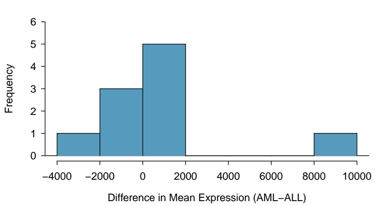

histogram

| Bin (Difference in Mean Expression) | Frequency |
| --- | --- |
| -4000~-2000 | 1 |
| -2000~0 | 3 |
| 0~2000 | 5 |
| 8000~10000 | 1 |

(a)

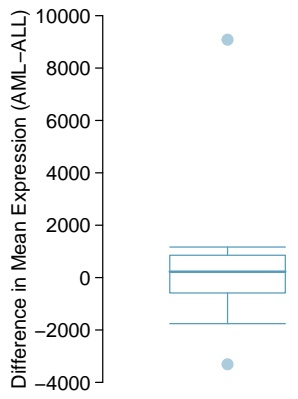

boxplot

| Metric | Value |
| --- | --- |
| Q1 | ~-600 |
| Q2 (Median) | ~300 |
| Q3 | ~900 |
| IQR | ~800 |
| Outliers | ~9100, ~-3300 |

(b)

Figure 1.60: A histogram and boxplot of the differences in mean expression level between AML and ALL in the golub.small data.

It is possible to identify the outliers from simply looking at the list of differences, since the list is short: Genes A and C, with differences of 9,083 and -3,310, respectively.58 It is important to remember that Genes A and C are only outliers out of the specific 10 genes in golub.small, where mean expression has been calculated using data from 10 patients; these genes do not necessarily show outlier levels of expression relative to the complete dataset.

With the use of computing software, the same process of calculating means, differences of means, and identifying outliers can easily be applied to the complete version of the data. Figure 1.61 shows the distribution of differences in mean expression level between AML and ALL patients for all 7,129 genes in the dataset, from 62 patients. The vast majority of genes are expressed at similar levels in AML and ALL patients; most genes have a difference in mean expression within -5,000 to 5,000. However, there are many genes that show extreme differences, as much as higher by 20,000 in AML or lower by 30,000 in ALL. These genes may be useful for differentiating between AML and ALL. The corresponding R lab illustrates the details of using R to identify these genes.59

Note how Figure 1.61 uses data from only 62 patients out of the 72 in the Golub dataset; this subset is called golub.train. The remaining 10 patients have been set aside as a "test" dataset (golub.test). Based on what has been learned about expression patterns from the 62 patients in golub.train, how well can the leukemia type of the 10 patients in golub.test be predicted?60

<small>58For a numerical approach, calculate the outlier boundaries defined by 1.5 × IQR.</small>

<small>59Lab 3, Chapter 1.</small>

<small>60The original analysis used data from 38 patients to identify informative genes, then tested predictions on an independent collection of data from 34 patients.</small>

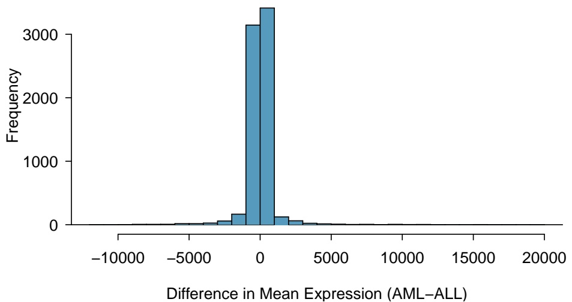

histogram

| Bin (Difference in Mean Expression) | Frequency |
| --- | --- |
| -10000~-9000 | ~10 |
| -9000~-8000 | ~10 |
| -8000~-7000 | ~10 |
| -7000~-6000 | ~20 |
| -6000~-5000 | ~30 |
| -5000~-4000 | ~40 |
| -4000~-3000 | ~60 |
| -3000~-2000 | ~180 |
| -2000~-1000 | ~3150 |
| -1000~0 | ~3450 |
| 0~1000 | ~130 |
| 1000~2000 | ~80 |
| 2000~3000 | ~40 |
| 3000~4000 | ~20 |
| 4000~5000 | ~15 |
| 5000~6000 | ~15 |
| 6000~7000 | ~15 |
| 7000~8000 | ~15 |
| 8000~9000 | ~15 |
| 9000~10000 | ~15 |
| 10000~11000 | ~15 |
| 11000~12000 | ~15 |
| 12000~13000 | ~15 |
| 13000~14000 | ~15 |
| 14000~15000 | ~15 |
| 15000~16000 | ~15 |
| 16000~17000 | ~15 |
| 17000~18000 | ~15 |
| 18000~19000 | ~15 |
| 19000~20000 | ~15 |

(a)

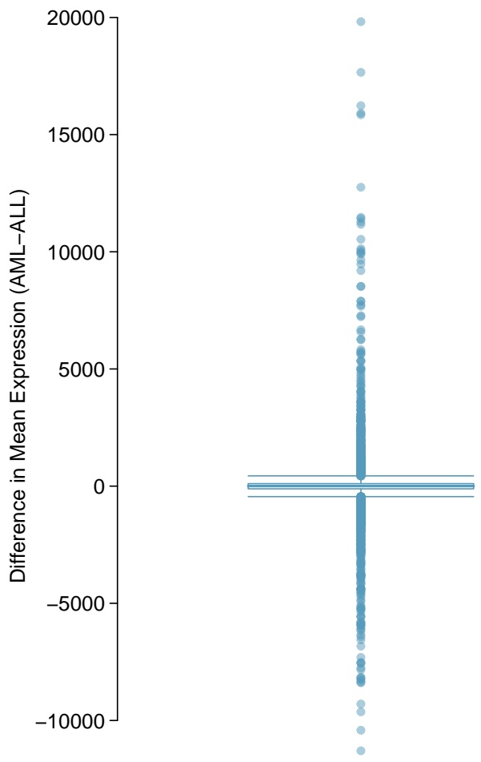

scatter

| Series | Difference in Mean Expression (AML-ALL) (range) |
| --- | --- |
| Data Points | -11500~20000 |

(b)

Figure 1.61: A histogram and boxplot of the differences in mean expression level between AML and ALL, using information from 7,129 genes and $6 2$ patients in the Golub data (golub.train).

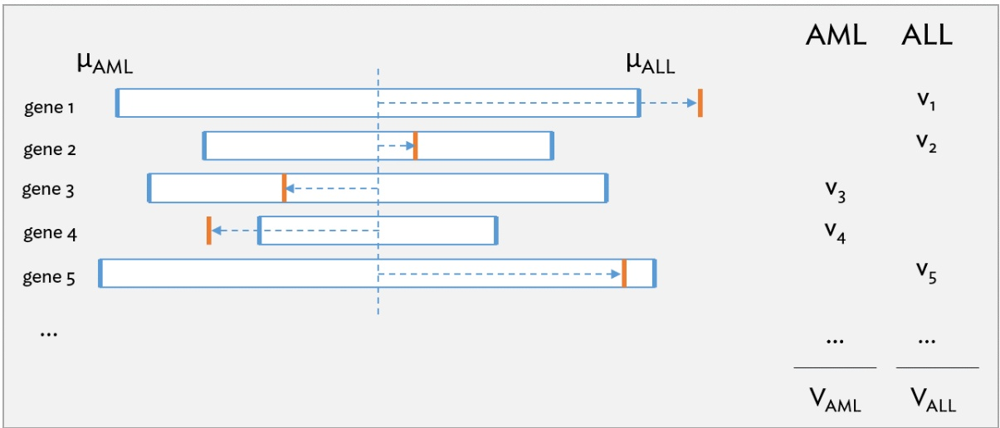

bar

| Gene | \(\mu AML\) Range | \(\mu ALL\) Range | AML | ALL |
| --- | --- | --- | --- | --- |
| gene 1 | ~0.2 ~1.0 | ~0.8 ~1.0 | — | v1 |
| gene 2 | ~0.4 ~0.9 | ~0.6 ~0.9 | — | v2 |
| gene 3 | ~0.3 ~1.0 | ~0.7 ~1.0 | v3 | — |
| gene 4 | ~0.3 ~0.8 | ~0.5 ~0.8 | v4 | — |
| gene 5 | ~0.2 ~1.0 | ~0.8 ~1.0 | — | v5 |
| ... | — | — | ... | ... |
| ... | — | — | VAML | VALL |

Figure 1.62: Schematic of the prediction strategy used by the Golub team, reproduced with modifications from Fig. 1B of the original paper.

Figure 1.62 illustrates the main ideas behind the strategy developed by the Golub team to predict leukemia type from expression data. The vertical orange bars represent the gene expression levels of a patient for each gene, relative to the mean expression for AML patients and ALL patients from the training dataset (vertical blue bars). A gene will "vote" for either AML or ALL, depending on whether the patient’s expression level is closer to $\mu _ { A M L }$ or $\mu _ { A L L }$ . In the example shown, three of the genes are considered to have ALL-like expression, versus the other two that are more AML-like. The votes are also weighted to account for how far an observation is from the midpoint between the two means (horizontal dotted blue line), i.e. the length of the dotted line shows the deviation from the midpoint. For example, the observed expression value for gene 2 is not as strong an indicator of ALL as the expression value for gene 1. The magnitude of the deviations $( v _ { 1 } , v _ { 2 } , \ldots )$ are summed to obtain $V _ { A M L }$ and $V _ { A L L } ,$ and a higher value indicates a prediction of either AML or ALL, respectively.

The published analysis chose to use 50 informative genes; a decision about how many genes to use in a diagnostic panel typically involves considering factors such as the number of genes practical for a clinical setting. For simplicity, a smaller number of genes will be used in the analysis shown here.

Suppose that 10 genes are selected as predictors—the 5 largest outliers and 5 smallest outliers for the difference in mean expression between AML and ALL. Figure 1.63 shows expression data for these 10 genes from the 10 patients in golub.test, while Figure 1.64 contains the mean expression value for each gene among AML and ALL patients in golub.train.