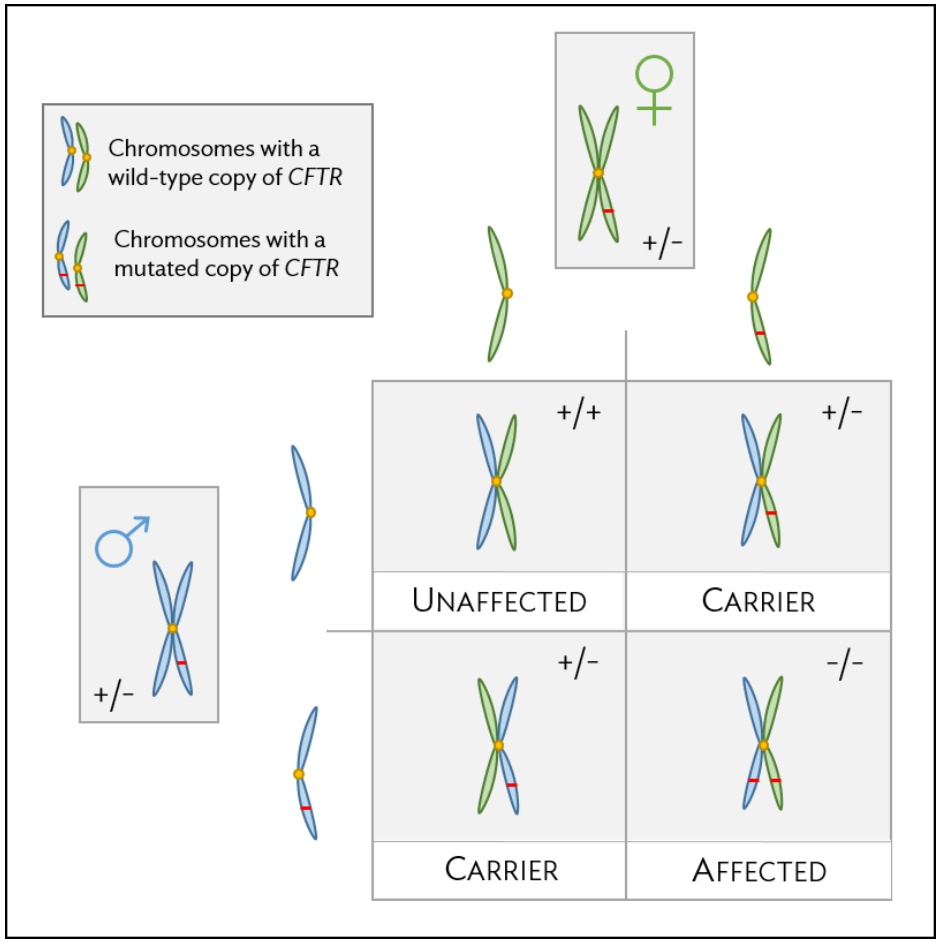
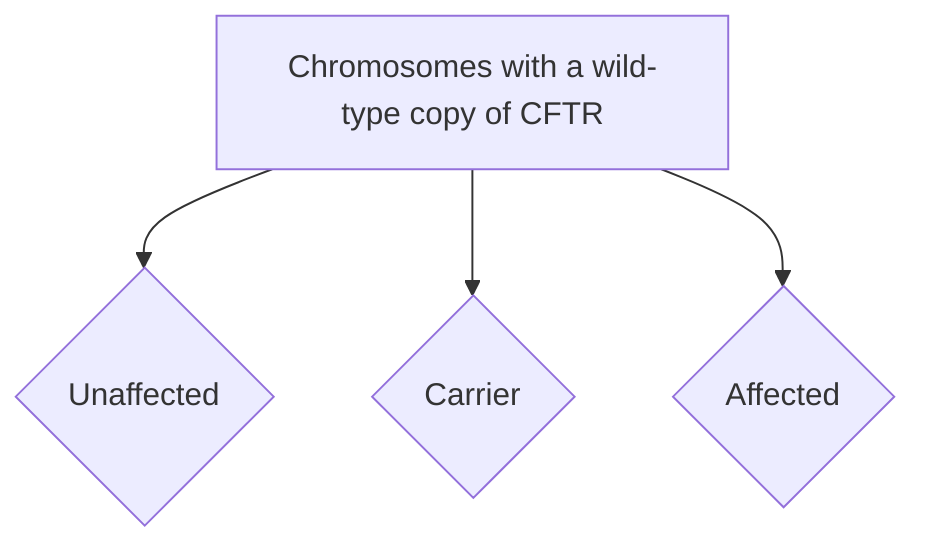
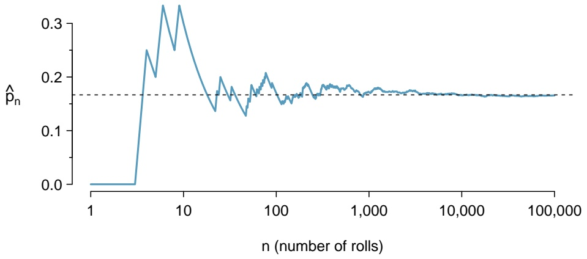
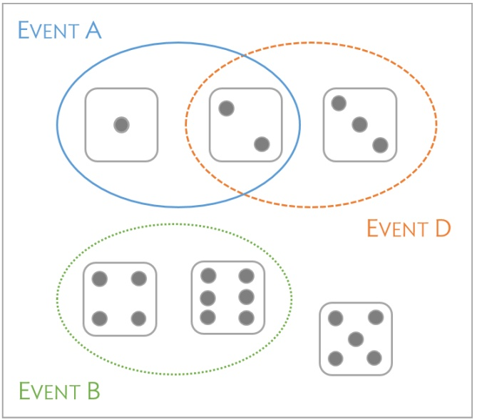
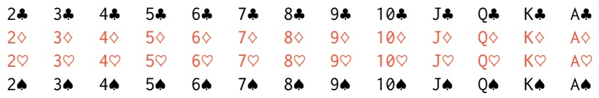
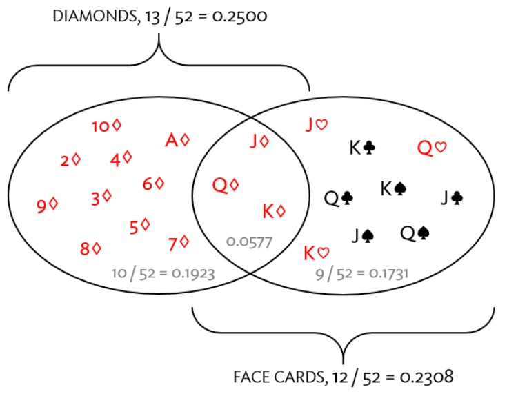

**1.21 Flawed reasoning.** Identify the flaw(s) in reasoning in the following scenarios. Explain what the individuals in the study should have done differently if they wanted to make such conclusions.

(a) Students at an elementary school are given a questionnaire that they are asked to return after their parents have completed it. One of the questions asked is, “Do you find that your work schedule makes it difficult for you to spend time with your kids after school?" Of the parents who replied, 85% said “no". Based on these results, the school officials conclude that a great majority of the parents have no difficulty spending time with their kids after school.
(b) A survey is conducted on a simple random sample of 1,000 women who recently gave birth, asking them about whether or not they smoked during pregnancy. A follow-up survey asking if the children have respiratory problems is conducted 3 years later, however, only 567 of these women are reached at the same address. The researcher reports that these 567 women are representative of all mothers.
(c) An orthopedist administers a questionnaire to 30 of his patients who do not have any joint problems and finds that 20 of them regularly go running. He concludes that running decreases the risk of joint problems.

**1.22 Reading the paper.** Below are excerpts from two articles published in the NY Times:

(a) An article titled Risks: Smokers Found More Prone to Dementia states the following:78

“Researchers analyzed data from 23,123 health plan members who participated in a voluntary exam and health behavior survey from 1978 to 1985, when they were 50-60 years old. 23 years later, about 25% of the group had dementia, including 1,136 with Alzheimer’s disease and 416 with vascular dementia. After adjusting for other factors, the researchers concluded that pack-a-day smokers were 37% more likely than nonsmokers to develop dementia, and the risks went up with increased smoking; 44% for one to two packs a day; and twice the risk for more than two packs."

Based on this study, can it be concluded that smoking causes dementia later in life? Explain your reasoning.

(b) Another article titled The School Bully Is Sleepy states the following:79

“The University of Michigan study, collected survey data from parents on each child’s sleep habits and asked both parents and teachers to assess behavioral concerns. About a third of the students studied were identified by parents or teachers as having problems with disruptive behavior or bullying. The researchers found that children who had behavioral issues and those who were identified as bullies were twice as likely to have shown symptoms of sleep disorders."

A friend of yours who read the article says, “The study shows that sleep disorders lead to bullying in school children." Is this statement justified? If not, how best can you describe the conclusion that can be drawn from this study?

**1.23 Alcohol consumption and STIs.** An observational study published last year in The American Journal of Preventive Medicine investigated the effects of an increased alcohol sales tax in Maryland on the rates of gonorrhea and chlamydia.80 After a tax increase from 6% to 9% in 2011, the statewide gonorrhea rate declined by 24%, the equivalent of 1,600 cases per year. In a statement to the New York Times, the lead author of the paper was quoted saying, "Policy makers should consider raising liquor taxes if they’re looking for ways to prevent sexually transmitted infections. In the year and a half following the alcohol tax rise in Maryland, this prevented 2,400 cases of gonorrhea and saved half a million dollars in health care costs." Explain whether the lead author’s statement is accurate.

<small>78R.C. Rabin. “[Risks: Smokers Found More Prone to Dementia](http://www.openintro.org/redirect.php?go=textbook-nytimes_smoking_dementia&referrer=biostat1_pdf)”. In: New York Times (2010).</small>

<small>79T. Parker-Pope. “[The School Bully Is Sleepy](http://www.openintro.org/redirect.php?go=textbook-school_bully_sleepy_2011&referrer=biostat1_pdf)”. In: New York Times (2011).</small>

<small>80S. Staras, et al., 2015. Maryland Alcohol Sales Tax and Sexually Transmitted Infections. The American Journal of Preventive Medicine 50: e73-e80.</small>

**1.24 Income and education in US counties.** The scatterplot below shows the relationship between per capita income (in thousands of dollars) and percent of population with a bachelor’s degree in 3,143 counties in the US in 2010.

(a) What are the explanatory and response variables?
(b) Describe the relationship between the two variables. Make sure to discuss unusual observations, if any.
(c) Can we conclude that having a bachelor’s degree increases one’s income?

scatter

| Percent with Bachelor's degree (range) | Per capita income (in $1,000) (range) |
| --- | --- |
| 5~70 | 10~65 |

**1.25 Eat better, feel better.** In a public health study on the effects of consumption of fruits and vegetables on psychological well-being in young adults, participants were randomly assigned to three groups: (1) diet-asusual, (2) an ecological momentary intervention involving text message reminders to increase their fruits and vegetable consumption plus a voucher to purchase them, or (3) a fruit and vegetable intervention in which participants were given two additional daily servings of fresh fruits and vegetables to consume on top of their normal diet. Participants were asked to take a nightly survey on their smartphones. Participants were student volunteers at the University of Otago, New Zealand. At the end of the 14-day study, only participants in the third group showed improvements to their psychological well-being across the 14-days relative to the other groups.81

(a) What type of study is this?
(b) Identify the explanatory and response variables.
(c) Comment on whether the results of the study can be generalized to the population.
(d) Comment on whether the results of the study can be used to establish causal relationships.
(e) A newspaper article reporting on the study states, “The results of this study provide proof that giving young adults fresh fruits and vegetables to eat can have psychological benefits, even over a brief period of time.” How would you suggest revising this statement so that it can be supported by the study?

## 1.9.4 Numerical data

**1.26 Means and SDs.** For each part, compare distributions (1) and (2) based on their means and standard deviations. You do not need to calculate these statistics; simply state how the means and the standard deviations compare. Make sure to explain your reasoning. Hint: It may be useful to sketch dot plots of the distributions.

(a) (1) 3, 5, 5, 5, 8, 11, 11, 11, 13
(2) 3, 5, 5, 5, 8, 11, 11, 11, 20

(c) (1) 0, 2, 4, 6, 8, 10
(2) 20, 22, 24, 26, 28, 30

(b) (1) -20, 0, 0, 0, 15, 25, 30, 30
(2) -40, 0, 0, 0, 15, 25, 30, 30

(d) (1) 100, 200, 300, 400, 500
(2) 0, 50, 300, 550, 600

<small>81Tamlin S Conner et al. “Let them eat fruit! The effect of fruit and vegetable consumption on psychological well-being in young adults: A randomized controlled trial”. In: PloS one 12.2 (2017), e0171206.</small>

**1.27 Medians and IQRs.** For each part, compare distributions (1) and (2) based on their medians and IQRs. You do not need to calculate these statistics; simply state how the medians and IQRs compare. Make sure to explain your reasoning.

(a) (1) 3, 5, 6, 7, 9

(2) 3, 5, 6, 7, 20

(c) (1) 1, 2, 3, 4, 5

(2) 6, 7, 8, 9, 10

(b) (1) 3, 5, 6, 7, 9

(2) 3, 5, 8, 7, 9

(d) (1) 0, 10, 50, 60, 100

(2) 0, 100, 500, 600, 1000

**1.28 Mix-and-match.** Describe the distribution in the histograms below and match them to the box plots.

histogram

| Bin Range | Frequency |
| --- | --- |
| ~50.5 ~51.5 | ~1 |
| ~51.5 ~52.5 | ~3 |
| ~52.5 ~53.5 | ~8 |
| ~53.5 ~54.5 | ~14 |
| ~54.5 ~55.5 | ~22 |
| ~55.5 ~56.5 | ~30 |
| ~56.5 ~57.5 | ~36 |
| ~57.5 ~58.5 | ~42 |
| ~58.5 ~59.5 | ~38 |
| ~59.5 ~60.5 | ~22 |
| ~60.5 ~61.5 | ~10 |
| ~61.5 ~62.5 | ~4 |
| ~62.5 ~63.5 | ~1 |
| ~63.5 ~64.5 | ~1 |

(a)

histogram

| X | Value |
| --- | --- |
| ~5 | ~6.2 |
| ~15 | ~5.8 |
| ~25 | ~3.5 |
| ~35 | ~9.2 |
| ~45 | ~4.8 |
| ~55 | ~4.7 |
| ~65 | ~6.0 |
| ~75 | ~5.8 |
| ~85 | ~4.8 |
| ~95 | ~6.2 |

(b)

histogram

| Bin Range | Frequency |
| --- | --- |
| 0~0.5 | ~1 |
| 0.5~1.0 | ~9 |
| 1.0~1.5 | ~10 |
| 1.5~2.0 | ~6 |
| 2.0~2.5 | ~3 |
| 2.5~3.0 | ~2 |
| 3.0~3.5 | ~1 |
| 3.5~4.0 | ~0.5 |
| 4.0~4.5 | ~0.2 |
| 4.5~5.0 | ~0.1 |
| 5.0~5.5 | ~0.1 |
| 5.5~6.0 | ~0.1 |
| 6.0~6.5 | ~0.1 |
| 6.5~7.0 | ~0.1 |

(c)

boxplot

| Metric | Value |
| --- | --- |
| Q1 | ~0.9 |
| Q2 (Median) | ~1.3 |
| Q3 | ~2.0 |
| Minimum | ~0.1 |
| Maximum (Outlier) | >7.0 |

(1)

boxplot

| Metric | Value |
| --- | --- |
| Q1 | ~58 |
| Q2 (Median) | 60 |
| Q3 | ~62 |
| Minimum | ~52 |
| Maximum (outlier) | ~71 |

(2)

boxplot

| Metric | Value |
| --- | --- |
| Minimum (Whisker) | 0 |
| Q1 | ~25 |
| Q2 (Median) | 50 |
| Q3 | ~75 |
| Maximum (Whisker) | 100 |

(3)

**1.29 Air quality.** Daily air quality is measured by the air quality index (AQI) reported by the Environmental Protection Agency. This index reports the pollution level and what associated health effects might be a concern. The index is calculated for five major air pollutants regulated by the Clean Air Act and takes values from 0 to 300, where a higher value indicates lower air quality. AQI was reported for a sample of 91 days in 2011 in Durham, NC. The relative frequency histogram below shows the distribution of the AQI values on these days.82

(a) Based on the histogram, describe the distribution of daily AQI.
(b) Estimate the median AQI value of this sample.
(c) Would you expect the mean AQI value of this sample to be higher or lower than the median? Explain your reasoning.

histogram

| Bin Range | Frequency |
| --- | --- |
| 5~10 | ~0.02 |
| 10~15 | ~0.055 |
| 15~20 | 0.2 |
| 20~25 | ~0.065 |
| 25~30 | 0.2 |
| 30~35 | ~0.155 |
| 35~40 | ~0.065 |
| 40~45 | ~0.045 |
| 45~50 | ~0.065 |
| 50~55 | ~0.075 |
| 55~60 | ~0.035 |
| 60~65 | ~0.02 |

Daily AQI

**1.30 Nursing home residents.** Since states with larger numbers of elderly residents would naturally have more nursing home residents, the number of nursing home residents in a state is often adjusted for the number of people 65 years of age or order (65+). That adjustment is usually given as the number of nursing home residents age 65+ per 1,000 members of the population age 65+. For example, a hypothetical state with 200 nursing home residents age 65+ and 50,000 people age 65+ would have the same adjusted number of residents as a state with 400 residents and a total age 65+ population of 100,000 residents: 4 residents per 1,000.

Use the two plots below to answer the following questions. Both plots show the distribution of the number of nursing home residents per 1,000 members of the population 65+ (in each state).

(a) Is the distribution of adjusted number of nursing home residents symmetric or skewed? Are there any states that could be considered outliers?
(b) Which plot is more informative: the histogram or the boxplot? Explain your answer.
(c) What factors might influence the substantial amount of variability among different states? This question cannot be answered from the data; speculate using what you know about the demographics of the United States.

**1.31 Income at the coffee shop.** The first histogram below shows the distribution of the yearly incomes of 40 patrons at a college coffee shop. Suppose two new people walk into the coffee shop: one making \$225,000 and the other \$250,000. The second histogram shows the new income distribution. Summary statistics are also provided.

histogram

| Bin Range | Frequency |
| --- | --- |
| 60000~61250 | ~1 |
| 61250~62500 | ~0.5 |
| 62500~63750 | ~2 |
| 63750~65000 | ~2.5 |
| 65000~66250 | ~3.5 |
| 66250~67500 | ~2.5 |
| 67500~68750 | ~2.5 |
| 68750~70000 | ~1 |
| 70000~71250 | ~0.5 |

(1)

|  | (1) | (2) |
| --- | --- | --- |
| n | 40 | 42 |
| Min. | 60,680 | 60,680 |
| 1st Qu. | 63,620 | 63,710 |
| Median | 65,240 | 65,350 |
| Mean | 65,090 | 73,300 |
| 3rd Qu. | 66,160 | 66,540 |
| Max. | 69,890 | 250,000 |
| SD | 2,122 | 37,321 |

histogram

| Bin (Range) | Frequency |
| --- | --- |
| ~60000 ~61000 | ~1 |
| ~61000 ~62000 | ~3 |
| ~62000 ~63000 | ~4 |
| ~63000 ~64000 | ~5 |
| ~64000 ~65000 | ~4 |
| ~65000 ~66000 | ~1 |
| ~220000 ~225000 | ~1 |
| ~250000 ~255000 | ~1 |

(2)

(a) Would the mean or the median best represent what we might think of as a typical income for the 42 patrons at this coffee shop? What does this say about the robustness of the two measures?
(b) Would the standard deviation or the IQR best represent the amount of variability in the incomes of the 42 patrons at this coffee shop? What does this say about the robustness of the two measures?

**1.32 Midrange.** The midrange of a distribution is defined as the average of the maximum and the minimum of that distribution. Is this statistic robust to outliers and extreme skew? Explain your reasoning.

## 1.9.5 Categorical data

**1.33 Flossing habits.** Suppose that an anonymous questionnaire is given to patients at a dentist’s office once they arrive for an appointment. One of the questions asks "How often do you floss?", and four answer options are provided: a) at least twice a day, b) at least once a day, c) a few times a week, and d) a few times a month. At the end of a week, the answers are tabulated: 31 individuals chose answer a), 55 chose b), 39 chose c), and 12 chose d).

(a) Describe how these data could be numerically and graphically summarized.
(b) Assess whether the results of this survey can be generalized to provide information about flossing habits in the general population.

**1.34 Views on immigration.** 910 randomly sampled registered voters from Tampa, FL were asked if they thought workers who have illegally entered the US should be (i) allowed to keep their jobs and apply for US citizenship, (ii) allowed to keep their jobs as temporary guest workers but not allowed to apply for US citizenship, or (iii) lose their jobs and have to leave the country. The results of the survey by political ideology are shown below.83

<table><tr><td rowspan="7">Response</td><td rowspan="2"></td><td colspan="3">Political ideology</td><td rowspan="2">Total</td></tr><tr><td>Conservative</td><td>Moderate</td><td>Liberal</td></tr><tr><td>(i) Apply for citizenship</td><td>57</td><td>120</td><td>101</td><td>278</td></tr><tr><td>(ii) Guest worker</td><td>121</td><td>113</td><td>28</td><td>262</td></tr><tr><td>(iii) Leave the country</td><td>179</td><td>126</td><td>45</td><td>350</td></tr><tr><td>(iv) Not sure</td><td>15</td><td>4</td><td>1</td><td>20</td></tr><tr><td>Total</td><td>372</td><td>363</td><td>175</td><td>910</td></tr></table>

(a) What percent of these Tampa, FL voters identify themselves as conservatives?
(b) What percent of these Tampa, FL voters are in favor of the citizenship option?
(c) What percent of these Tampa, FL voters identify themselves as conservatives and are in favor of the citizenship option?
(d) What percent of these Tampa, FL voters who identify themselves as conservatives are also in favor of the citizenship option? What percent of moderates share this view? What percent of liberals share this view?

## 1.9.6 Relationships between two variables

**1.35 Mammal life spans.** Data were collected on life spans (in years) and gestation lengths (in days) for 62 mammals. A scatterplot of life span versus length of gestation is shown below.84

(a) Does there seem to be an association between length of gestation and life span? If so, what type of association? Explain your reasoning.
(b) What type of an association would you expect to see if the axes of the plot were reversed, i.e. if we plotted length of gestation versus life span?

scatter

| Gestation (days) | Life Span (years) |
| --- | --- |
| ~20 | ~50 |
| ~30 | ~18 |
| ~40 | ~19 |
| ~50 | ~17 |
| ~60 | ~28 |
| ~70 | ~15 |
| ~80 | ~12 |
| ~90 | ~24 |
| ~100 | ~28 |
| ~110 | ~12 |
| ~120 | ~8 |
| ~130 | ~8 |
| ~140 | ~28 |
| ~150 | ~20 |
| ~160 | ~20 |
| ~170 | ~28 |
| ~180 | ~25 |
| ~200 | ~8 |
| ~210 | ~8 |
| ~220 | ~25 |
| ~230 | ~50 |
| ~250 | ~40 |
| ~270 | 100 |
| ~300 | ~30 |
| ~330 | ~42 |
| ~350 | ~46 |
| ~380 | ~40 |
| ~400 | ~30 |
| ~410 | ~28 |
| ~450 | 25 |
| ~630 | 70 |
| ~650 | 40 |

<small>83SurveyUSA, [News Poll #18927](http://www.openintro.org/redirect.php?go=textbook-SurveyUSA_18927&referrer=biostat1_pdf), data collected Jan 27-29, 2012.</small>

<small>84T. Allison and D.V. Cicchetti. “[Sleep in mammals: ecological and constitutional correlates](http://www.openintro.org/redirect.php?go=textbook-mammal_sleep_1975&referrer=biostat1_pdf)”. In: Arch. Hydrobiol 75 (1975), p. 442.</small>

## 1.36 Associations. Indicate which of the plots show a

(a) positive association
(b) negative association
(c) no association

Also determine if the positive and negative associations are linear or nonlinear. Each part may refer to more than one plot.

scatter

| X (range) | Y (range) |
| --- | --- |
| 0~100 | 0~100 |

(1)

scatter

| X (range) | Y (range) |
| --- | --- |
| 0~100 | 0~100 |

(2)

scatter

| X (range) | Y (range) |
| --- | --- |
| 0~100 | 0~100 |

(3)

scatter

| X (range) | Y (range) |
| --- | --- |
| 0~100 | 0~100 |

(4)

**1.37 Adolescent fertility.** Data are available on the number of children born to women aged 15-19 from 189 countries in the world for the years 1997, 2000, 2002, 2005, and 2006. The data are defined using a scaling similar to that used for the nursing home data in Exercise 1.30. The values for the annual adolescent fertility rates represent the number of live births among women aged 15-19 per 1,000 female members of the population of that age.

boxplot

| Year | Q1 | Q2 (Median) | Q3 | IQR |
| --- | --- | --- | --- | --- |
| 1997 | ~25 | ~52 | ~94 | ~79 |
| 2000 | ~23 | ~46 | ~89 | ~66 |
| 2002 | ~20 | ~43 | ~85 | ~65 |
| 2005 | ~19 | ~41 | ~79 | ~60 |
| 2006 | ~18 | ~40 | ~76 | ~68 |

(a) In 2006, the standard deviation of the distribution of adolescent fertility is 75.73. Write a sentence explaining the $7 5 ^ { t h }$ percentile in the context of this data.
(b) For the years 2000-2006, data are not available for Iraq. Why might those observations be missing? Would the five-number summary have been affected very much if the values had been available?
(c) From the side-by-side boxplots shown above, describe how the distribution of fertility rates changes over time. Is there a trend?

**1.38 Smoking and stenosis.** Researchers collected data from an observational study to investigate the association between smoking status and the presence of aortic stenosis, a narrowing of the aorta that impedes blood flow to the body.

<table><tr><td rowspan="5">Disease Status</td><td rowspan="2"></td><td colspan="2">Smoking Status</td><td rowspan="2">Total</td></tr><tr><td>Non-smoker</td><td>Smoker</td></tr><tr><td>Absent</td><td>67</td><td>43</td><td>110</td></tr><tr><td>Present</td><td>54</td><td>51</td><td>105</td></tr><tr><td>Total</td><td>121</td><td>94</td><td>215</td></tr></table>

(a) What percentage of the 215 participants were both smokers and had aortic stenosis? This percentage is one component of the joint distribution of smoking and stenosis; what are the other three numbers of the joint distribution?
(b) Among the smokers, what proportion have aortic stenosis? This number is a component of the conditional distribution of stenosis for the two categories of smokers. What proportion of non-smokers have aortic stenosis?
(c) In this context, relative risk is the ratio of the proportion of smokers with stenosis to the proportion of non-smokers with stenosis. Relative risks greater than 1 indicate that smokers are at a higher risk for aortic stenosis than non-smokers; relative risks of 1.2 or higher are generally considered cause for alarm. Calculate the relative risk for the 215 participants, comparing smokers to non-smokers. Does there seem to be evidence that smoking is associated with an increased probability of stenosis?

**1.39 Anger and cardiovascular health.** Trait anger is defined as a relatively stable personality trait that is manifested in the frequency, intensity, and duration of feelings associated with anger. People with high trait anger have rage and fury more often, more intensely, and with long-laster episodes than people with low trait anger. It is thought that people with high trait anger might be particularly susceptible to coronary heart disease; 12,986 participants were recruited for a study examining this hypothesis. Participants were followed for five years. The following table shows data for the participants identified as having normal blood pressure (normotensives).

<table><tr><td rowspan="5">CHD Event</td><td rowspan="2"></td><td colspan="3">Trait Anger Score</td><td rowspan="2">Total</td></tr><tr><td>Low</td><td>Moderate</td><td>High</td></tr><tr><td>Yes</td><td>53</td><td>110</td><td>27</td><td>190</td></tr><tr><td>No</td><td>3057</td><td>4704</td><td>606</td><td>8284</td></tr><tr><td>Total</td><td>3110</td><td>4731</td><td>633</td><td>8474</td></tr></table>

(a) What percentage of participants have moderate anger scores?
(b) What percentage of individuals who experienced a CHD event have moderate anger scores?
(c) What percentage of participants with high trait anger scores experienced a CHD event (i.e., heart attack)?
(d) What percentage of participants with low trait anger scores experienced a CHD event?
(e) Are individuals with high trait anger more likely to experience a CHD event than individuals with low trait anger? Calculate the relative risk of a CHD event for individuals with high trait anger compared to low trait anger.
(f) Researchers also collected data on various participant traits, such as level of blood cholesterol (measured in mg/dL). What graphical summary might be useful for examining how blood cholesterol level differs between anger groups?

## 1.9.7 Exploratory data analysis

Since exploratory data analysis relies heavily on the use of computation, refer to the labs for exercises related to this section, which are free and may be found at [**openintro.org/book/biostat**](http://www.openintro.org/redirect.php?go=biostat&referrer=biostat1_pdf).

## Chapter 2

## Probability

**2.1 Defining probability**
**2.2 Conditional probability**
**2.3 Extended example**
**2.4 Notes**
**2.5 Exercises**

What are the chances that a woman with an abnormal mammogram has breast cancer? What is the probability that a woman with an abnormal mammogram has breast cancer, given that she is in her 40’s? What is the likelihood that out of 100 women who undergo a mammogram and test positive for breast cancer, at least one of the women has received a false positive result?

These questions use the language of probability to express statements about outcomes that may or may not occur. More specifically, probability is used to quantify the level of uncertainty about each outcome. Like all mathematical tools, probability becomes easier to understand and work with once important concepts and terminology have been formalized.

This chapter introduces that formalization, using two types of examples. One set of examples uses settings familiar to most people – rolling dice or picking cards from a deck. The other set of examples draws from medicine, biology, and public health, reflecting the contexts and language specific to those fields. The approaches to solving these two types of problems are surprisingly similar, and in both cases, seemingly difficult problems can be solved in a series of reliable steps.

For labs, slides, and other resources, please visit

[**www.openintro.org/book/biostat**](http://www.openintro.org/redirect.php?go=biostat&referrer=biostat1_pdf)

## 2.1 Defining probability

## 2.1.1 Some examples

The rules of probability can easily be modeled with classic scenarios, such as flipping coins or rolling dice. When a coin is flipped, there are only two possible outcomes, heads or tails. With a fair coin, each outcome is equally likely; thus, the chance of flipping heads is 1/2, and likewise for tails. The following examples deal with rolling a die or multiple dice; a die is a cube with six faces numbered 1, 2, 3, 4, 5, and 6.

## EXAMPLE 2.1

What is the chance of getting 1 when rolling a die?

If the die is fair, then there must be an equal chance of rolling a 1 as any other possible number. Since there are six outcomes, the chance must be 1-in-6 or, equivalently, 1/6.

## EXAMPLE 2.2

What is the chance of not rolling a 2?

Not rolling a 2 is the same as getting a 1, 3, 4, 5, or 6, which makes up five of the six equally likely outcomes and has probability 5/6.

## EXAMPLE 2.3

Consider rolling two fair dice. What is the chance of getting two 1s?

If $1 / 6 ^ { t h }$ of the time the first die is a 1 and $1 / 6 ^ { t h }$ of those times the second die is also a 1, then the chance that both dice are 1 is (1/6)(1/6) or 1/36.

Probability can also be used to model less artificial contexts, such as to predict the inheritance of genetic disease. Cystic fibrosis (CF) is a life-threatening genetic disorder caused by mutations in the CFTR gene located on chromosome 7. Defective copies of CFTR can result in the reduced quantity and function of the CFTR protein, which leads to the buildup of thick mucus in the lungs and pancreas.1 CF is an autosomal recessive disorder; an individual only develops CF if they have inherited two affected copies of CFTR. Individuals with one normal (wild-type) copy and one defective (mutated) copy are known as carriers; they do not develop CF, but may pass the diseasecausing mutation onto their offspring.

<small>1The CFTR protein is responsible for transporting sodium and chloride ions across cell membranes.</small>

## EXAMPLE 2.4

Suppose that both members of a couple are CF carriers. What is the probability that a child of this couple will be affected by CF? Assume that a parent has an equal chance of passing either gene copy (i.e., allele) to a child.

Solution 1: Enumerate all of the possible outcomes and exploit the fact that the outcomes are equally likely, as in Example 2.1. Figure 2.1 shows the four possible genotypes for a child of these parents. The paternal chromosome is in blue and the maternal chromosome in green, while chromosomes with the wild-type and mutated versions of CFTR are marked with + and −, respectively. The child is only affected if they have genotype (−/−), with two mutated copies of CFTR. Each of the four outcomes occurs with equal likelihood, so the child will be affected with probability 1-in-4, or 1/4. It is important to recognize that the child being an unaffected carrier (+/−) consists of two distinct outcomes, not one.

Solution 2: Calculate the proportion of outcomes that produce an affected child, as in Example 2.3. During reproduction, one parent will pass along an affected copy half of the time. When the child receives an affected allele from one parent, half of the those times, they will also receive an affected allele from the other parent. Thus, the proportion of times the child will have two affected copies is $( 1 / 2 ) \times ( 1 / 2 ) = 1 / 4$

flowchart

Figure 2.1: Pattern of CF inheritance for a child of two unaffected carriers

## GUIDED PRACTICE 2.5

Suppose the father has CF and the mother is an unaffected carrier. What is the probability that their child will be affected by the disease?2

## 2.1.2 Probability

Probability is used to assign a level of uncertainty to the outcomes of phenomena that either happen randomly (e.g. rolling dice, inheriting of disease alleles), or appear random because of a lack of understanding about exactly how the phenomenon occurs (e.g. a woman in her 40’s developing breast cancer). Modeling these complex phenomena as random can be useful, and in either case, the interpretation of probability is the same: the chance that some event will occur.

Mathematicians and philosophers have struggled for centuries to arrive at a clear statement of how probability is defined, or what it means. The most common definition is used in this text.

## PROBABILITY

The **probability** of an outcome is the proportion of times the outcome would occur if the random phenomenon could be observed an infinite number of times.

This definition of probability can be illustrated by simulation. Suppose a die is rolled many times. Let ${ \hat { p } } _ { n }$ be the proportion of outcomes that are 1 after the first n rolls. As the number of rolls increases, ${ \hat { p } } _ { n }$ will converge to the probability of rolling a 1, $p = 1 / 6$ . Figure 2.2 shows this convergence for 100,000 die rolls. The tendency of ${ \hat { p } } _ { n }$ to stabilize around p is described by the **Law of Large Numbers**. The behavior shown in Figure 2.2 matches most people’s intuition about probability, but proving mathematically that the behavior is always true is surprisingly difficult and beyond the level of this text.

line

| n (number of rolls) | ⟨p_n⟩ |
| --- | --- |
| 1 | 0.0 |
| ~3 | 0.0 |
| ~4 | ~0.25 |
| ~6 | ~0.33 |
| ~8 | ~0.25 |
| ~10 | ~0.33 |
| ~20 | ~0.14 |
| ~30 | ~0.20 |
| ~50 | ~0.13 |
| ~80 | ~0.21 |
| ~100 | ~0.15 |
| ~200 | ~0.19 |
| ~500 | ~0.18 |
| ~1,000 | ~0.17 |
| ~10,000 | ~0.17 |
| ~100,000 | ~0.17 |

Figure 2.2: The fraction of die rolls that are 1 at each stage in a simulation. The proportion tends to get closer to the probability $1 / 6 \approx 0 . 1 6 7$ as the number of rolls increases.

Occasionally the proportion veers off from the probability and appear to defy the Law of Large Numbers, as ${ \hat { p } } _ { n }$ does many times in Figure 2.2. However, the likelihood of these large deviations becomes smaller as the number of rolls increases.

<small>2Since the father has CF, he must have two affected copies; he will always pass along a defective copy of the gene. Since the mother will pass along a defective copy half of the time, the child will be affected half of the time, or with probability (1) × (1/2) = 1/2.</small>

## LAW OF LARGE NUMBERS

As more observations are collected, the proportion ${ \hat { p } } _ { n }$ of occurrences with a particular outcome converges to the probability p of that outcome.

Probability is defined as a proportion, and it always takes values between 0 and 1 (inclusively). It may also be expressed as a percentage between 0% and 100%. The probability of rolling a 1, p, can also be written as P (rolling a 1).

This notation can be further abbreviated. For instance, if it is clear that the process is “rolling a die”, P (rolling a 1) can be written as P (1). There also exists a notation for an event itself; the event A of rolling a 1 can be written as $A = \{ { \mathrm { r o l l i n g ~ a ~ } } 1 \}$ , with associated probability P (A).

P (A)

Probability of outcome A

## 2.1.3 Disjoint or mutually exclusive outcomes

Two outcomes are **disjoint** or **mutually exclusive** if they cannot both happen at the same time. When rolling a die, the outcomes 1 and 2 are disjoint since they cannot both occur. However, the outcomes 1 and “rolling an odd number” are not disjoint since both occur if the outcome of the roll is a 1.3

What is the probability of rolling a 1 or a 2? When rolling a die, the outcomes 1 and 2 are disjoint. The probability that one of these outcomes will occur is computed by adding their separate probabilities:

$$
P (1 \text {or} 2) = P (1) + P (2) = 1 / 6 + 1 / 6 = 1 / 3.
$$

What about the probability of rolling a 1, 2, 3, 4, 5, or 6? Here again, all of the outcomes are disjoint, so add the individual probabilities:

$$
\begin{array}{l} P (1 \text {or} 2 \text {or} 3 \text {or} 4 \text {or} 5 \text {or} 6) \\ = P (1) + P (2) + P (3) + P (4) + P (5) + P (6) \\ = 1 / 6 + 1 / 6 + 1 / 6 + 1 / 6 + 1 / 6 + 1 / 6 = 1. \\ \end{array}
$$

## ADDITION RULE OF DISJOINT OUTCOMES

If $A _ { 1 }$ and $A _ { 2 }$ represent two disjoint outcomes, then the probability that either one of them occurs is given by

$$
P (A _ {1} \text {or} A _ {2}) = P (A _ {1}) + P (A _ {2}).
$$

If there are k disjoint outcomes $A _ { 1 } ,   . . . ,   A _ { k }$ then the probability that either one of these outcomes will occur is

$$
P (A _ {1}) + P (A _ {2}) + \dots + P (A _ {k}). \tag {2.6}
$$

<small>3The terms disjoint and mutually exclusive are equivalent and interchangeable.</small>

## GUIDED PRACTICE 2.7

Consider the CF example. Is the event that two carriers of CF have a child that is also a carrier represented by mutually exclusive outcomes? Calculate the probability of this event.4

Probability problems often deal with sets or collections of outcomes. Let A represent the event in which a die roll results in 1 or 2 and B represent the event that the die roll is a 4 or a 6. We write A as the set of outcomes {1, 2} and $B = \{ 4 ,   6 \}$ . These sets are commonly called **events**. Because A and B have no elements in common, they are disjoint events. A and B are represented in Figure 2.3.

text_image

EVENT A
EVENT D
EVENT B

Figure 2.3: Three events, A, B, and D, consist of outcomes from rolling a die. A and B are disjoint since they do not have any outcomes in common.

The Addition Rule applies to both disjoint outcomes and disjoint events. The probability that one of the disjoint events A or B occurs is the sum of the separate probabilities:

$$
P (A \text {or} B) = P (A) + P (B) = 1 / 3 + 1 / 3 = 2 / 3.
$$

## GUIDED PRACTICE 2.8

(a) Verify the probability of event A, P (A), is 1/3 using the Addition Rule. (b) Do the same for event $B . ^ { 5 }$

## GUIDED PRACTICE 2.9

(a) Using Figure 2.3 as a reference, which outcomes are represented by event D? (b) Are events B and D disjoint? (c) Are events A and D disjoint?6

<small>4Yes, there are two mutually exclusive outcomes for which a child of two carriers can also be a carrier - a child can either receive an affected copy of CFT R from the mother and a normal copy from the father, or vice versa (since each parent can only contribute one allele). Thus, the probability that a child will be a carrier is 1/4 + 1/4 = 1/2.</small>

<small>5(a) P (A) = P (1 or 2) = P (1) + P (2) = 16 +16 =26 =13 . (b) Similarly, P (B) = 1/3.</small>

<small>6(a) Outcomes 2 and 3. (b) Yes, events B and D are disjoint because they share no outcomes. (c) The events A and D share an outcome in common, 2, and so are not disjoint.</small>

## GUIDED PRACTICE 2.10

In Guided Practice 2.9, you confirmed B and D from Figure 2.3 are disjoint. Compute the probability that event B or event D occurs.7

## 2.1.4 Probabilities when events are not disjoint

**Venn diagrams** are useful when outcomes can be categorized as “in” or “out” for two or three variables, attributes, or random processes. The Venn diagram in Figure 2.5 uses one oval to represent diamonds and another to represent face cards (the cards labeled jacks, queens, and kings); if a card is both a diamond and a face card, it falls into the intersection of the ovals.

text_image

2♣ 3♣ 4♣ 5♣ 6♣ 7♣ 8♣ 9♣ 10♣ J♣ Q♣ K♣ A♣
2◇ 3◇ 4◇ 5◇ 6◇ 7◇ 8◇ 9◇ 10◇ J◇ Q◇ K◇ A◇
2♥ 3♥ 4♥ 5♥ 6♥ 7♥ 8♥ 9♥ 10♥ J♥ Q♥ K♥ A♥
2♠ 3♠ 4♠ 5♠ 6♠ 7♠ 8♠ 9♠ 10♠ J♠ Q♠ K♠ A♠

Figure 2.4: A regular deck of 52 cards is split into four suits: ♣ (club), ♦ (diamond), ♥ (heart), ♠ (spade). Each suit has 13 labeled cards: 2, 3, ..., 10, J (jack), Q (queen), K (king), and A (ace). Thus, each card is a unique combination of a suit and a label, e.g. 4♥ and J♣.

funnel

| Region | Value |
| --- | --- |
| Diamonds | 13 / 52 = 0.2500 |
| Face Cards | 12 / 52 = 0.2308 |
| Diamond & Face Cards | 10 / 52 = 0.1923 |
| Diamond & Face Cards | 9 / 52 = 0.1731 |
| Face Cards & Diamond & Face Cards | 9 / 52 = 0.1731 |

Figure 2.5: A Venn diagram for diamonds and face cards.

## GUIDED PRACTICE 2.11

(a) What is the probability that a randomly selected card is a diamond? (b) What is the probability that a randomly selected card is a face card?8

<small>7Since B and D are disjoint events, use the Addition Rule: P (B or D) = P (B) + P (D) = 3 =23 .</small>

<small>8(a) There are 52 cards and 13 diamonds. If the cards are thoroughly shuffled, each card has an equal chance of being drawn, so the probability that a randomly selected card is a diamond is P (♦) = 13= 0.250. (b) Likewise, there are 12 face</small>

Let A represent the event that a randomly selected card is a diamond and B represent the event that it is a face card. Events A and B are not disjoint – the cards J♦, Q♦, and K♦ fall into both categories.

As a result, adding the probabilities of the two events together is not sufficient to calculate P (A or B):

$$
P (A) + P (B) = P (\diamond) + P (\text {face card}) = 1 2 / 5 2 + 1 3 / 5 2.
$$

Instead, a small modification is necessary. The three cards that are in both events were counted twice. To correct the double counting, subtract the probability that both events occur:

$$
\begin{array}{l} P (A \text {or} B) = P (\text {face card or} \diamond) \\ = \quad P (\text {face card}) + P (\diamondsuit) - P (\text {face card and} \diamondsuit) \tag {2.12} \\ = 1 3 / 5 2 + 1 2 / 5 2 - 3 / 5 2 \\ = \quad 2 2 / 5 2 = 1 1 / 2 6. \\ \end{array}
$$

Equation (2.12) is an example of the **General Addition Rule**.

## GENERAL ADDITION RULE

If A and B are any two events, disjoint or not, then the probability that at least one of them will occur is

$$
P (A \text {or} B) = P (A) + P (B) - P (A \text {and} B), \tag {2.13}
$$

where P (A and B) is the probability that both events occur.

Note that in the language of statistics, "or" is inclusive such that A or B occurs means A, B, or both A and B occur.

## GUIDED PRACTICE 2.14

(a) If A and B are disjoint, describe why this implies P (A and B) = 0. (b) Using part (a), verify that the General Addition Rule simplifies to the Addition Rule for disjoint events if A and B are disjoint.9

## GUIDED PRACTICE 2.15

Human immunodeficiency virus (HIV) and tuberculosis (TB) affect substantial proportions of the population in certain areas of the developing world. Individuals sometimes are co-infected (i.e., have both diseases). Children of HIV-infected mothers may have HIV and TB can spread from one family member to another. In a mother-child pair, let A = {the mother has HIV}, B = {the mother has TB}, C = {the child has HIV}, D = {the child has TB}. Write out the definitions of the events A or B, A and B, A and C, A or D.10

<small>9(a) If A and B are disjoint, A and B can never occur simultaneously. (b) If A and B are disjoint, then the last term of Equation (2.13) is 0 (see part (a)) and we are left with the Addition Rule for disjoint events.</small>

<small>10Events A or B: the mother has HIV, the mother has TB, or the mother has both HIV and TB. Events A and B: the mother has both HIV and TB. Events A and C: The mother has HIV and the child has HIV. A or D: The mother has HIV, the child has TB, or the mother has HIV and the child has TB.</small>